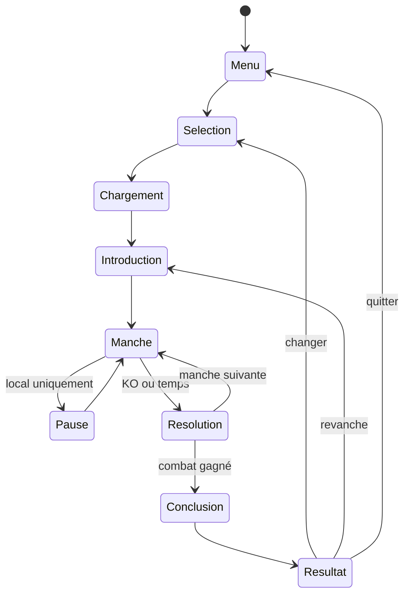

# Half Life Resonance

Bible du mode annexe de combat 2D — version 1.2 — 20 novembre 2026

## Mise à jour Boss Battle

Le dernier chapitre ajoute le mode Boss Battle et son catalogue de 24 rencontres, plus une archive Hydra. Le module jouable livre six profils pilotes et quatre opérations en solo, Boss Rush et entraînement. Les autres chapitres gardent leurs spécifications de duel et leur historique de production : leur mention de moteur non implémenté concerne cette base de conception, pas le nouveau module Boss Battle. Les exports Word et Excel v1 restent des instantanés du premier lot. Les visuels de boss actuels sont des rendus de travail, sans certification 1:1.

# Vision du mode Half Life Resonance

## Identité et objectif

Half Life Resonance est le mode de combat latéral proposé pour Half Life Administrator. Il rassemble des combattants, des équipements et des lieux issus de Half-Life dans des duels lisibles, des parcours individuels, une campagne originale, des défis et des tournois. Sa personnalité vient des outils scientifiques détournés, des armes militaires, de la technologie du Cartel et des organismes Xen. Le pied-de-biche, le Gravity Gun, les décharges vortigaunt et les tirs secondaires doivent modifier la manière de jouer, au-delà de leur apparence.

Cette bible fixe une première cible de 24 combattants, dont 12 dans la première vague, et de 24 arènes, dont 8 prioritaires. Six combattants pilotes servent de référence de production. Le catalogue principal sépare les versions d'un même personnage lorsqu'elles changent son équipement ou son fonctionnement. Des réserves d'extension permettent d'élargir ensuite le bestiaire sans faire passer une idée sommaire pour une fiche de production terminée.

Le joueur doit pouvoir lancer un duel en quelques choix, comprendre pourquoi une attaque a touché, apprendre une réponse en entraînement et retrouver dans chaque personnage une identité reconnaissable. La qualité attendue porte autant sur le retour à la garde, les changements de direction, les réactions aux impacts et les transitions de pose que sur les attaques spectaculaires.

## Périmètre des jeux sources

Le périmètre principal réunit Half-Life, Opposing Force, Blue Shift, Decay, Half-Life 2, Episode One, Episode Two et Half-Life Alyx. Les pages officielles situent le premier jeu autour de l'incident de Black Mesa, Half-Life 2 dans la résistance à l'occupation du Cartel et Alyx entre ces deux périodes [S1 à S3]. Opposing Force et Blue Shift apportent leurs points de vue militaires et de sécurité à Black Mesa [S4 et S5]. Decay conserve ses deux protagonistes et son origine coopérative ; les détails de modèles et de décors demandent une référence directe à l'édition PlayStation 2.

Les contenus Uplink, Lost Coast et les cartes de deathmatch sont réservés à des dossiers supplémentaires identifiés. Half-Life Source ne crée pas automatiquement de nouveaux personnages. Les variantes de modèles basse définition, du pack haute définition et des versions console sont étiquetées au lieu d'être mélangées dans un même costume. Le jeu Black Mesa de Crowbar Collective constitue une interprétation visuelle distincte : ses formes et ses environnements ne servent pas à certifier silencieusement les assets de Half-Life 1998.

Le menu permet de filtrer par jeu source, faction, difficulté de prise en main et style de combat. Un filtre d'époque limite les affrontements à une sélection cohérente lorsqu'on le souhaite. Le versus libre accepte les rencontres transversales comme une règle du mode annexe. Les pages de récit annoncent clairement quand une rencontre est créée pour Resonance.

## Place dans Half Life Administrator

Le point d'entrée proposé est un bouton Half Life Resonance parmi les modes annexes du menu principal. Il ouvre un écran indépendant présentant Duel, Histoire, Arcade, Tournoi, Entraînement et Archives. Une entrée dans un terminal de l'administrateur peut donner accès au même mode après déblocage narratif, sans obliger à démarrer une campagne de gestion pour jouer localement.

Le retour quitte proprement la session de combat et restaure l'écran d'origine. Une partie de combat ne consomme ni journées, ni rations, ni crédits de la simulation de gestion. Les sauvegardes sont séparées et versionnées. Les succès peuvent ouvrir un portrait, un dossier ou une variante visuelle ; ils ne modifient pas les dégâts, les points de vie ou les règles du versus compétitif.

L'habillage raconte un programme d'archives et de simulations tactiques compromis par des phénomènes de résonance. Ce cadre est une invention du mode, pas une explication officielle des événements de la série. Les archives présentent les identités d'origine ; la campagne met en scène ce que produit le programme lorsqu'il reconstruit des confrontations incompatibles. Cette distinction permet des rivaux inattendus tout en gardant visibles les événements des jeux sources.

## Les principes de fidélité

La fidélité 1:1 est un critère d'acceptation à démontrer. Elle porte sur la silhouette, les proportions, les couleurs, les détails d'équipement, la latéralité, les matériaux, la manière de tenir les armes, les signes anatomiques et le contexte du costume. Elle ne peut pas être déduite du seul nom de personnage placé dans une consigne de génération.

Chaque costume reçoit une fiche de référence avec le jeu et sa version, plusieurs captures cohérentes, une liste d'invariants et les angles à vérifier. Pour Gordon, la combinaison Mark IV et la Mark V sont deux dossiers différents. Pour Alyx, la tenue de Half-Life 2 et celle d'Alyx restent distinctes. Pour l'Élite du Cartel, l'œil central rouge, l'armure claire et le fusil doivent tous passer le contrôle. Pour un Vortigaunt, les proportions, le troisième bras, les yeux et l'état libre ou captif doivent être contrôlés séparément.

Les durées d'attaque, les dégâts, le système de garde, la Résonance, les combos, les supers, les fins de parcours et les rencontres entre personnages sont des adaptations de game design. Elles sont documentées comme telles. Une technique inspirée d'une arme connue n'est pas présentée comme une animation extraite du jeu original.

Le processus de validation emploie les états spécifié, référence approuvée, généré, correction requise, validé visuellement, validé en animation et intégré. Une image peut être générée avec transparence et rester incorrecte sur le plan du costume. Une boucle peut être visuellement propre et rester inutilisable si ses pieds glissent ou si ses boîtes de collision ne correspondent pas au geste.

## Direction visuelle

Les combattants sont de grands sprites 2D détaillés, avec une projection latérale stable, des proportions proches des sources et une lecture immédiate du geste. Les volumes sont rendus avec des matériaux crédibles, un éclairage principal cohérent et des contours propres. Le rendu conserve les particularités des jeux sans ajouter une musculature ou des accessoires étrangers au personnage.

Chaque image de production contient un seul personnage et une seule pose. Les armes détachables, accessoires, effets et ombres sont des fichiers séparés quand l'animation le demande. Les planches de comparaison servent à la vérification, pas à remplacer les frames individuelles livrées au moteur. Les pivots sont définis avant l'export des animations ; ils ne sont pas recalculés à partir du rectangle visible à chaque frame.

Le nombre d'images dessinées ne doit pas être confondu avec la fréquence de simulation. Une simulation à 60 Hz peut utiliser une pose durant plusieurs ticks. Le travail d'animation se concentre sur l'anticipation, le contact, la récupération et le retour à l'état suivant. Les attaques rapides demandent une silhouette franche au moment du contact ; les grands mouvements demandent des intermédiaires qui évitent la téléportation des armes et des mains.

Les palettes du monde distinguent la chaleur industrielle de Black Mesa, les bleus froids du Cartel, les ocres de Cité 17 et les matières organiques de Xen. Les effets offensifs restent séparés des détails décoratifs. L'éclat d'un super ne masque pas la direction de fuite ni le résultat de l'impact. Les options d'accessibilité réduisent secousses, flashs, particules et flou indépendamment.

## Personnages et variantes

Le premier ensemble de six pilotes associe Gordon de Half-Life 2, Alyx de Half-Life 2, Barney de Half-Life 2, Adrian Shephard, un Vortigaunt libre et l'Élite du Cartel. Il couvre les armes et la physique, l'agilité, la défense tactique, le soldat polyvalent, l'énergie extraterrestre et le contrôle à distance. Ce groupe permet de tester des réponses différentes à un projectile, une approche aérienne et une pression de garde.

Les variantes de tenue sont regroupées selon trois catégories. Une tenue issue d'un jeu source possède ses références propres. Une palette de lisibilité garde les formes et sert au miroir. Une tenue imaginée pour le mode porte une mention adaptation. Un changement de matériau ou de couleur ne devient pas un nouveau personnage jouable. Un équipement qui modifie réellement les commandes justifie en revanche une variante de kit distincte.

Les costumes cassés ou endommagés sont des états visuels explicites. Ils ne doivent pas effacer les détails d'identification ni créer un avantage par réduction apparente du corps. Les portraits, petites icônes, poses de sélection, expressions d'intro et poses de victoire font partie du même dossier de référence.

G-Man, les grandes entités et les machines hors échelle ne reçoivent pas arbitrairement une taille humaine et un kit ordinaire. Ils interviennent dans les cinématiques, les épreuves ou les combats de boss. Dog, le Hunter et les autres gabarits particuliers demandent une caméra et des tests de collision dédiés, avec une homologation explicite avant tout usage compétitif.

## Narration et mise en scène

Le mode histoire suit douze chapitres avec des transitions courtes, des objectifs de combat distincts et des checkpoints. Il accompagne le joueur vers les règles avancées : placement, garde, projection, gestion des tirs, ressources, accessoires et phases de boss. Un chapitre n'impose pas plusieurs fois un tutoriel déjà validé. Les séquences peuvent être revues depuis les archives.

Le parcours arcade individuel s'ouvre sur une intention claire, présente un rival propre au personnage et se termine par une fin originale. Une intro contextuelle est choisie lorsque la paire de combattants dispose d'une scène dédiée ; sinon, une entrée générale est utilisée. Gordon et Adrian s'expriment par gestes, regard, sons d'équipement et montage. On n'invente pas de répliques pour remplir leurs silences.

Une séquence d'avant combat comporte quatre événements techniques : apparition, placement, interaction éventuelle, retour à la pose neutre. Elle possède un état de saut propre qui place les deux combattants correctement sans rester bloqué dans une animation. Les séquences de victoire et de fin disposent de la même garantie. En ligne, le saut d'une scène est synchronisé et ne modifie pas l'instant de départ de la manche.

Les fatalités sont des conclusions optionnelles après le résultat acquis. Chaque combattant doit disposer d'une conclusion de signature, d'une alternative sans exécution et d'une sortie courte. Le jeu choisit des conclusions compatibles avec la relation entre les adversaires et le type de victime. Un duo allié en contexte d'entraînement utilise un désarmement, un sauvetage, une expulsion ou une capture. Les réglages de contenu peuvent remplacer une scène violente sans changer la récompense ni le résultat.

## Audio et sensation de jeu

Le paysage sonore distingue le contact d'une arme, le blocage, l'armure, la matière organique, l'énergie et le décor. La préparation d'un tir lourd produit un signal reconnaissable avant son départ. La balance du mix garde les commandes vocales et les signaux utiles audibles pendant la musique. Les sous-titres d'intro restent lisibles et leur taille est indépendante du HUD.

Le moteur utilise des événements sonores déterministes pour décider quoi jouer, puis laisse le mélange audio au rendu. Une restauration d'état lors d'un rollback ne doit pas rejouer plusieurs fois le même impact. Les voix nouvelles ne sont pas déclarées comme des enregistrements officiels. Les fichiers distribués doivent avoir une provenance connue et compatible avec le projet.

La musique peut progresser entre neutralité, tension, dernière manche et victoire. Une option autorise une piste fixe par arène pour le tournoi. Le menu propose des réglages séparés pour musique, effets, dialogues et annonceur. Les sons compétitifs ne sont pas remplacés par des effets silencieux lorsqu'on change de costume.

## Livrables et progression de production

La première étape jouable à réaliser réunit deux combattants, une arène sans danger, le cycle complet de manche, un entraînement avec enregistrement et les commandes essentielles. Elle doit confirmer le temps de réponse et les règles avant d'étendre le roster. Le deuxième lot ajoute les six pilotes et leurs interactions. Le troisième ajoute les douze combattants de première vague, les huit arènes prioritaires, les parcours arcade et le tournoi local. Les systèmes en ligne, les grandes campagnes et les extensions sont validés sur cette base.

Cette progression n'efface aucun contenu prévu : elle fixe les dépendances qui empêchent de multiplier des images ou des kits incompatibles. Les conditions de sortie sont observables : intégrité des sauvegardes, rejouabilité des entrées, absence de boucles infinies, stabilité des transitions, lisibilité à faible résolution et cohérence des variantes. Le registre de production garde la distinction entre la cible complète et les fichiers réellement disponibles.

# Systèmes de combat et modes de jeu

## Statut et périmètre

Ce chapitre définit le fonctionnement proposé de HALF LIFE RESONANCE, mode de combat annexe de Half Life Administrator. Les règles, les affrontements entre personnages, les tournois et les événements de scénario sont une adaptation originale. Ils ne deviennent pas des événements canoniques de Half Life. La fidélité demandée concerne les identités, les équipements, les silhouettes, les environnements et les comportements reconnaissables. Les dimensions d’arène, les dégâts et les fenêtres d’action répondent aux besoins du jeu de combat.

Les chiffres ci-dessous constituent une base de prototype cohérente et modifiable. Ils ne représentent ni des mesures des jeux d’origine ni un équilibrage déjà validé. Le dépôt identifié est `darknigthmare/combine-administrator-simulator`, branche `master`, version déclarée `0.47.0`. L’intégration proposée s’appuie sur son environnement React, TypeScript, Vite, Zustand et Tauri. Aucun moteur de combat fonctionnel, service multijoueur, sprite animé complet ou résultat de test de performance ne doit être déduit de cette spécification.

## Contrat du combat

Le combat principal oppose deux personnages sur un plan latéral. La simulation avance à 60 ticks par seconde, indépendamment de la fréquence d’affichage. Un combat se gagne en remportant deux manches. Chaque manche commence avec la vie complète et dure 99 secondes de combat actif. Le chronomètre s’arrête pendant l’introduction, les pauses de contact, les séquences de super et les transitions. Les déplacements ne changent jamais la profondeur de collision.

La caméra cadre les deux combattants sans modifier leurs coordonnées physiques. Elle peut reculer légèrement pour un grand personnage ou une séparation importante, dans des limites communes à toutes les arènes homologuées. Les décors, la parallaxe et les particules n’ont aucune autorité sur les collisions. Le sol compétitif reste horizontal et continu. Les arènes à ascenseurs, effondrements ou changements de lieu appartiennent aux variantes spectacle et histoire.

| Paramètre | Valeur initiale | Rôle dans le prototype |
| --- | --- | --- |
| Simulation | 60 Hz | Résolution commune du mouvement, des impacts et des commandes |
| Vie de référence | 10 000 PV | Unité de comparaison des dégâts |
| Fourchette initiale des combattants | 9 000 à 11 500 PV | Différenciation des gabarits à équilibrer |
| Victoire | 2 manches gagnantes | Format standard local et en ligne |
| Durée d’une manche | 5 940 ticks actifs | 99 secondes hors suspensions prévues |
| Résonance | 0 à 300 points | Ressource commune de techniques avancées |
| Tampon d’action | 6 ticks | Tolérance au déclenchement à la fin d’une récupération |
| Fenêtre d’un quart de cercle | 20 ticks | Reconnaissance de commande, sans allonger la récupération |
| Fenêtre d’un double quart de cercle | 30 ticks | Commande des supers et ultimes |
| Déchoppe standard | 7 ticks | Fenêtre à partir du premier tick de saisie |
| Limite de projectiles persistants | 2 par combattant | Limite par défaut, exceptions explicitement documentées |
| Rebonds pendant un combo | 1 mural et 1 au sol | Protection contre les boucles de jonglage |
| Durée maximale de combo | 600 ticks actifs | Garde-fou de sortie forcée, à vérifier sur tous les kits |

Le compteur de manche compare les fractions de vie restantes à l’expiration du temps. Pour éviter les erreurs d’arrondi, il compare `vieA × maximumB` et `vieB × maximumA`. Un double KO simultané ou une égalité exacte produit une manche nulle. Celle-ci est rejouée à partir de son état initial, y compris les ressources, afin de ne pas permettre leur accumulation par répétition. Après trois manches nulles consécutives, le combat est déclaré nul et recommencé ; il ne rapporte aucun point de rencontre. En tournoi, l’organisateur conserve cette trace et peut suspendre le poste pour vérifier une défaillance. Aucun tirage aléatoire ne départage les joueurs.

## Commandes et apprentissage

Les commandes utilisent quatre boutons : L pour attaque légère, M pour attaque moyenne, H pour attaque lourde, S pour capacité propre au personnage. La notation numérique décrit les directions comme sur un pavé numérique lorsque le personnage regarde vers la droite : 6 avance, 4 recule, 2 s’accroupit, 8 saute. Les diagonales sont 1, 3, 7 et 9. Les directions relatives s’inversent lorsque le personnage change de côté ; les directions physiques enregistrées dans le replay restent inchangées.

| Entrée | Action universelle | Conditions |
| --- | --- | --- |
| 5L, 5M, 5H | Attaques debout | Variante proche uniquement si annoncée dans la fiche |
| 2L, 2M, 2H | Attaques accroupies | La propriété basse dépend du coup, jamais du seul dessin |
| j.L, j.M, j.H | Attaques aériennes | Fenêtres de réception définies par animation |
| 6H | Attaque de direction | Fonction exacte propre au kit et visible dans la liste |
| 5S | Trait du personnage | Ressource et restrictions indiquées dans son panneau |
| 6S | Interaction avec un accessoire | Seulement si un accessoire autorisé est à portée |
| 66 ou 44 | Ruée ou recul rapide | Vulnérabilités conservées et visibles en entraînement |
| L plus M | Projection avant | Au sol et à portée ; 4 plus L plus M projette derrière |
| Quart de cercle plus L, M ou H | Technique spéciale | Version et propriétés définies pour chaque kit |
| Commande de spéciale plus L et M | Version EX | 50 points et variante EX réellement disponible |
| 236236H | Super | 100 points de Résonance |
| 236236S | Ultime | 300 points de Résonance |
| 6 plus M plus H | Contre de garde | Pendant la garde, 100 points |
| M plus H plus S | Rupture défensive | Pendant une séquence autorisée, 200 points |

La reconnaissance donne priorité à une commande spéciale EX complète sur la projection L plus M. Si la ressource manque, l’action EX échoue sans déclencher une projection inattendue. Les commandes non reconnues n’exécutent pas automatiquement une autre technique coûteuse. Le journal d’entraînement affiche le motif de refus : ressource, portée, état, commande incomplète ou variante inexistante.

Dans un état qui les autorise, les commandes défensives complètes sont traitées d'abord, puis l'ultime, la super, l'EX, la spéciale, la projection, le trait, l'interaction et la normale. Ainsi 236236S ne déclenche pas accidentellement 5S ou 6S, et un contre de garde valide ne devient pas 6H. Une commande coûteuse reconnue sans ressource échoue sans repli vers une action simple. Deux directions physiques opposées simultanées donnent une direction neutre sur leur axe avant toute conversion en directions relatives. Le replay conserve les entrées physiques et la version de cette règle.

Le saut standard n’offre ni double saut ni ruée aérienne universelle. Ces possibilités demandent une justification de personnage et un coût réel dans son kit. Une option de commandes simplifiées permet d’associer les spéciales à des combinaisons directionnelles accessibles. Elle conserve les mêmes fenêtres, dégâts et coûts. La sélection du mode d’entrée est visible dans le lobby ; aucune macro ne produit un combo complet automatiquement en compétition.

## Garde et circulation de la pression

Maintenir l’arrière garde les attaques médianes et hautes. Maintenir arrière et bas garde les attaques médianes et basses. Une attaque en surplomb doit être gardée debout. La liste des coups et l’entraînement montrent ces propriétés séparément de l’animation. Une attaque aérienne n’est pas automatiquement imparable au sol. Les projections brisent la garde mais restent limitées par la portée, la préparation et la possibilité de déchoppe.

La garde aérienne bloque les projectiles et les attaques aériennes compatibles. Les anti-aériens au sol peuvent porter une propriété explicite qui interdit cette garde ; leur fiche doit l’indiquer. Après une garde aérienne, l’atterrissage impose douze ticks de récupération défensive. Cette règle empêche de contourner toute pression en sautant continuellement. Elle doit rester assez courte pour ne pas rendre la garde aérienne systématiquement perdante.

Une attaque normale ne provoque aucun dégât à travers la garde. Une spéciale inflige au maximum 5 % de ses dégâts de base, une EX 10 %, une super ou un ultime 10 %. Ces dégâts sont toujours non létaux : un personnage qui garde correctement conserve au moins 1 PV. Il faut donc ouvrir la défense, projeter ou provoquer une erreur pour terminer la manche. Aucun gain de Résonance ne provient de ces dégâts de garde.

Le contre de garde coûte 100 points au déclenchement. Il repousse et peut rendre de l’espace, mais ne démarre pas un long combo. Sa version commune inflige zéro dégât ; les effets visuels suivent l’équipement du personnage. Une feinte peut le provoquer et permettre de punir sa récupération. La rupture défensive coûte 200 points et ne peut réussir qu’une fois par combat. Elle ne fonctionne pas pendant une projection, une prise de boss ou une cinématique de super déjà confirmée. Si elle est autorisée, le coût et la consommation de l’usage sont appliqués même lorsqu’elle manque sa cible.

Les armes à feu conservent leur identité sans transformer chaque match en échange continu à longue distance. Les projectiles ont une préparation, une récupération, une vitesse et une durabilité documentées. Les tirs normaux ne sont pas des impacts instantanés sur toute la scène. Un personnage qui tire expose une zone de vulnérabilité ; ses fenêtres de rechargement ou de refroidissement figurent dans le kit. Les projectiles compatibles peuvent se neutraliser selon une règle de durabilité. Les exceptions lourdes sont limitées à une instance et signalées avant leur départ. La ruée ne rend pas universellement invincible : avancer au bon moment, utiliser la garde, sauter avec discernement et exploiter une récupération restent les réponses communes.

## Résonance et ressources propres

La Résonance commence à zéro au premier round et se conserve entre les manches d’un même combat. Elle revient à zéro au combat suivant. Elle ne représente pas une énergie scientifique canonique partagée par tous les personnages : c’est une ressource de jeu, présentée par des effets adaptés à chaque identité. Les combattants peuvent disposer en plus d’une ressource propre, comme des charges ou une réserve d’objets, mais son panneau doit rester distinct.

| Dépense | Coût | Usage et limite |
| --- | --- | --- |
| Spéciale EX | 50 | Renforcement défini de la technique ; aucune propriété implicite |
| Super | 100 | Confirmation offensive ou réponse spécialisée |
| Contre de garde | 100 | Dégagement défensif pendant la garde |
| Rupture défensive | 200 | Une tentative par combat, hors prises et cinématiques |
| Ultime | 300 | Engagement de toute la réserve ; séquence courte et identifiable |
| Fatalité de fin de combat | 0 | Exécution facultative après résultat déjà acquis |

Un impact ordinaire rapporte à l’attaquant 1 point pour 100 PV effectivement retirés, après réduction des combos. Le défenseur reçoit 0,5 point pour les mêmes 100 PV. Les EX, supers, ultimes, contres de garde, ruptures et dangers du décor ne produisent aucun gain pour aucun des deux camps. Rater, garder ou provoquer des dégâts de garde ne produit aucun gain. Cette règle évite le remplissage de jauge à distance sans prise de risque.

Le calcul interne utilise des millipoints entiers : 1 PV retiré rapporte 10 millipoints à l’attaquant et 5 au défenseur. La jauge possède donc 300 000 unités internes. Il n’y a ni erreur cumulative de virgule flottante ni dépendance à la fréquence d’affichage. Le coût est débité à l’entrée effective dans l’action, après validation de l’état ; une animation interrompue ensuite ne rembourse pas la ressource. Les actions refusées avant leur entrée n’en consomment aucune.

Les charges propres reviennent au début d’une manche selon leur fiche. Elles ne persistent jamais implicitement depuis le mode de gestion. Les récompenses de campagne, les cosmétiques et la progression ne modifient pas la vie, les dégâts, la réserve initiale ou les fenêtres des matchs compétitifs.

## Combos et états d’impact

La chaîne commune va de L vers M puis H, avec une utilisation de chaque niveau dans cette chaîne. Les annulations vers une spéciale et d’une spéciale vers une super dépendent de fenêtres écrites dans les données. Une icône dans la liste des coups indique si l’annulation fonctionne sur impact, sur garde ou dans les deux cas. Les attaques ratées ne s’annulent pas universellement. Les ouvertures, les projections, les renversements et les anti-aériens produisent ainsi des routes différentes.

La réduction des dégâts commence à 100 % au premier coup, puis passe à 90, 80, 70, 60, 50, 45, 40 et enfin 30 % pour les coups ordinaires suivants. Les supers suivent la réduction du combo avec un plancher propre de 15 % ; les ultimes ont un plancher de 20 %. La réduction s’applique par impact dommageable, y compris les multihits. Les données peuvent imposer un prorata de départ plus faible à une ouverture particulièrement sûre. Les valeurs finales sont arrondies vers le bas, avec un minimum de 1 PV pour un impact réellement dommageable.

L’objectif d’équilibrage initial est de maintenir la plupart des routes sans ressource sous 45 % de la vie de référence et les routes coûteuses sous 65 %. Ce sont des seuils de revue, pas une coupure automatique des dégâts. Le moteur limite en revanche les rebonds et le temps de contrôle retiré au défenseur. Un seul rebond mural et un seul rebond au sol sont disponibles par combo. Le budget initial de jonglage est de douze unités ; chaque relance consomme le nombre indiqué dans sa fiche.

À l’épuisement du budget, l’adversaire devient invulnérable aux relances et retombe vers une récupération sûre. Après 600 ticks actifs sans reprise de contrôle, une sortie forcée se déclenche à la prochaine borne sûre de l’action. Une cinématique en cours se termine d’abord ; elle ne peut pas enchaîner vers une nouvelle capture. Le compteur n’est pas remis à zéro par un changement d’animation, un projectile différé ou un changement de côté. Une vraie remise à zéro nécessite un retour à un état où le défenseur pouvait agir.

La séparation des états doit rester explicite : impact léger, impact lourd, lancement, chute, rebond, renversement et relevée ne sont pas des noms interchangeables. La relevée propose une récupération immédiate ou retardée lorsque le type de chute l’autorise. Une séquence de fatalité ne partage aucun état avec les combos : elle intervient après la décision du match.

## Physique et versions des arènes

Chaque arène possède deux profils. Le profil tournoi conserve le fond animé, l’ambiance et les effets non interactifs, avec un sol et une collision normalisés. Le profil spectacle active les accessoires, les dangers annoncés, les transitions et les finishers de décor. L’écran de sélection affiche clairement lequel est choisi. Une même image de fond ne suffit pas à considérer une arène comme intégrée : collision, limites de caméra, couches indépendantes, son et conditions de victoire doivent aussi exister.

L’interaction 6S ne cible qu’un accessoire autorisé présent dans la zone d’action du combattant. Une petite indication apparaît à portée ; sans cible valide, l’entrée reste sans effet. Chaque joueur dispose d’un quota de deux interactions par manche dans le profil spectacle de base. Un accessoire saisi, projeté ou détruit suit un état déterministe et ne réapparaît pas avant la manche suivante. Les objets visuels de fond ne deviennent jamais des projectiles par simple proximité.

Un accessoire ne traverse pas automatiquement tous les tirs. Il possède une masse de jeu, une durabilité et un groupe de collision. Sa trajectoire est calculée par la simulation du combat ; les animations de débris restent décoratives. Les dangers ne s’activent pas aléatoirement pendant un combo sans avertissement. Tout danger influant sur les PV dispose d’une annonce lisible, d’une fenêtre d’évitement et d’un statut explicite dans les règles du lobby.

La parallaxe utilise des couches séparées : ciel ou vide lointain, masses architecturales, activité de fond, plan de combat, avant-plan et effets atmosphériques. Les vitesses relatives sont exprimées par rapport au déplacement de caméra, jamais par rapport à la vitesse d’affichage. Les éléments d’avant-plan ne masquent pas les pieds ni les attaques basses. Une option de visibilité réduit fumée, poussière, flashes et particules sans supprimer les informations nécessaires au jeu.

## Offre de modes

| Mode | Boucle principale | Résultat conservé |
| --- | --- | --- |
| Histoire | Chapitres scénarisés, combats, scènes et choix de parcours | Progression, scènes vues et fins obtenues |
| Arcade | Parcours propre au personnage avec rival et boss | Score, difficulté et ending débloqué |
| Versus local | Combat sur un même poste | Historique facultatif, revanche immédiate |
| Versus en ligne | Rencontres selon les règles du salon | Résultat, replay et qualité de connexion |
| Classé | Matchmaking sous règles homologuées | Classement séparé de la campagne |
| Tournoi | Tableau, postes, rencontres et arbitrage | Bracket vérifiable et champion |
| Équipe | Relais de trois combattants, sans tag instantané initial | Résultat de l’équipe et ordre choisi |
| Survie | Combats successifs avec récupération limitée | Meilleure série par personnage |
| Boss | Rencontres à phases et objectifs spécifiques | Médailles et variantes débloquées |
| Défis | Exercice ciblé, route de combo ou situation tactique | Validation et meilleure exécution |
| Entraînement | Laboratoire libre avec données et mannequins | Réglages et enregistrements locaux |
| Galerie | Relecture des intros, fins, costumes et dossiers | Collection de contenus vus |

Le mode histoire utilise un graphe de chapitres. Chaque nœud possède des prérequis, une scène d’introduction, les adversaires, un profil de règles, les scènes de victoire et de défaite, puis la sortie suivante. Les combats entre alliés doivent avoir une raison écrite, telle qu’une simulation ou une épreuve ; ils ne sont pas présentés comme des affrontements historiques. Les choix peuvent ouvrir des variantes narratives, sans imposer de différences de puissance en versus.

L’arcade comprend six combats ordinaires, un rival et un boss, soit huit étapes par parcours. L’intro de personnage établit son objectif. La rencontre de rival utilise une scène spécifique et une réponse de victoire cohérente. L’ending ferme ce parcours et porte son statut d’interprétation originale. Les défaites proposent recommencer, changer de difficulté ou revenir au menu ; un changement de difficulté est enregistré pour le score. Les intros passent individuellement en jeu local et d’un commun accord en ligne, avec une limite d’attente.

La survie restaure 15 % de la vie maximale après une victoire, sans dépasser le maximum, et conserve la Résonance dans cette seule variante. Le relais par équipes réinitialise les ressources du nouvel entrant ; le survivant récupère 10 % de sa vie maximale entre adversaires. Ces deux exceptions sont visibles avant le départ et n’affectent jamais les règles du duel standard.

## Tournois et rencontres

Le tournoi local gère des tableaux à élimination simple ou double de 4, 8, 16 et 32 places. Un tournoi accepte 4 à 32 participants; le nombre de places est la plus petite de ces tailles permettant de les accueillir. Les places vides produisent des exemptions selon le placement publié du tableau, sans victoire de combat inventée. Douze participants occupent ainsi un tableau de seize places avec quatre exemptions. Une rencontre se joue au premier joueur remportant deux combats. Les finales des tableaux gagnants, perdants et la grande finale se jouent au premier remportant trois combats, sauf règle publiée avant le lancement.

En double élimination, un participant quitte le tournoi après deux défaites de rencontre. Le vainqueur du tableau gagnant arrive en grande finale sans défaite. Si le vainqueur du tableau perdant gagne leur première rencontre, les deux participants ont une défaite et une seconde rencontre complète décide du tournoi. Ce reset doit apparaître dans le tableau, la sauvegarde et le commentaire de résultat. Un changement de personnage ou d’arène entre les deux rencontres suit les mêmes règles qu’entre les combats ordinaires.

Le gagnant d’un combat conserve son personnage. Le perdant peut changer de personnage ou demander une autre arène homologuée selon le règlement choisi. L’ordre de décision est enregistré pour éviter de choisir après avoir vu la sélection cachée adverse. Les costumes purement visuels restent autorisés sous réserve de lisibilité et d’absence de confusion d’équipe. Une configuration verrouillée conserve le checksum des règles et des catalogues utilisés.

Le module prévoit inscriptions, noms de joueurs, classement initial facultatif, attribution des postes, appel de rencontre, saisie du résultat, validation et correction avant propagation. Une correction tardive affiche les rencontres qu’elle invalide ; elle ne réécrit pas silencieusement une finale déjà jouée. Une déconnexion ne produit pas un résultat arbitraire : l’état suspendu attend la politique annoncée de reprise, abandon ou décision d’arbitrage. Le tournoi peut être sauvegardé et repris sans recalculer les appariements déjà validés.

## Fatalités et séquences de conclusion

Les fatalités sont des conclusions facultatives après la victoire du combat, jamais une méthode pour annuler un résultat déjà établi. Une fenêtre de cinq secondes permet de choisir une fatalité propre au personnage, une conclusion de décor disponible ou une victoire courte. Aucun choix ne coûte de Résonance et aucun équipement de campagne ne conditionne son accès en versus. L’absence d’entrée lance la pose de victoire normale.

La mise en scène reprend les moyens, sons, armes et phénomènes associés à l’univers : téléportation, gravité, énergie, capture, désintégration ou danger industriel. La bible de personnage précise la différence entre une action observée dans les jeux et sa transposition de finisher. Le moteur vérifie la compatibilité du squelette de victime, du gabarit et du décor. Si une séquence ne convient pas à une créature particulière, il utilise une variante écrite ou la victoire courte, sans déformer le modèle pour forcer une animation humaine.

Une option de violence réduite remplace le plan final par une disparition, une mise hors combat ou une coupe de caméra adaptée. Elle ne change ni le timing du résultat ni le score. Les captures de replay mémorisent le résultat et l’identifiant de séquence, mais le spectateur peut conserver son propre réglage de visibilité. Les adversaires humains alliés peuvent disposer de conclusions de neutralisation pour préserver la cohérence du parcours.

## Entraînement et accessibilité

Le laboratoire affiche inputs, avantages de frames, dégâts, réduction de combo, coûts, positions et raisons de refus. Les zones de collision distinguent collision corporelle, zone vulnérable, zone d’attaque et saisie par des couleurs doublées de motifs. L’avance image par image fonctionne sur les ticks simulés. La pause conserve l’état exact, y compris les projectiles, accessoires, ressources et compteurs de combo.

Le mannequin peut garder toujours, après le premier coup, aléatoirement selon une graine visible, ou selon un enregistrement. Il peut contre-attaquer sur relevée, après garde ou après récupération. Cinq enregistrements par personnage peuvent être lus séparément ou mélangés avec des poids explicites. L’outil permet de repositionner les deux combattants au centre ou dans un coin, puis d’enregistrer cette situation pour la retrouver après une action.

Les exercices enseignent successivement déplacement, garde, projection, anti-aérien, punition, confirmation, Résonance et gestion d’un projectile. Une réussite n’exige pas seulement une entrée : elle exige le résultat appris. Punir consiste ainsi à toucher avant que le mannequin ait retrouvé la garde. Les routes de combo affichent les fenêtres nécessaires et distinguent une version simple d’une route optimale.

Les commandes sont remappables au clavier et à la manette, avec plusieurs boutons accessibles pouvant produire une combinaison simultanée autorisée. Les avertissements visuels disposent d’un équivalent sonore et les informations sonores importantes d’un équivalent visuel. Sous-titres, taille de texte, intensité des secousses, flashes, contraste des silhouettes et vitesse des menus sont réglables. La réduction de vitesse est réservée à l’entraînement et à certaines aides de campagne ; elle n’affecte pas un adversaire en ligne. L’assistance narrative peut réduire une difficulté sans cacher ce choix dans les résultats.

## Interface et progression

Le menu du mode ouvre Histoire, Arcade, Versus, Tournoi, Entraînement, Défis, Galerie et Options. La sélection affiche identité, épisode de référence, rôle, difficulté de prise en main, costumes compatibles et résumé du trait. Les versions d’un personnage qui modifient réellement ses outils sont des variantes de kit clairement nommées. Un costume ne peut pas devenir une modification cachée de statistiques.

Le HUD réserve la partie supérieure aux vies, aux manches et au chronomètre. La Résonance et les ressources propres occupent la partie basse, avec chiffres optionnels. Les indications de contre, punition et rupture restent brèves et ne couvrent pas les combattants. Le côté de l’écran et la couleur d’équipe servent simultanément de repères. Un écran de résultat présente les décisions utiles : revanche, changement de personnage, détails du combat, sauvegarde du replay et retour.

La progression déverrouille galeries, palettes, variantes de présentation, fiches et défis. Les kits compétitifs ne gagnent pas de puissance. La progression du mode annexe est isolée de celle de la gestion ; une récompense croisée, si elle est retenue, ne transporte qu’un identifiant cosmétique ou un succès. Effacer une sauvegarde de combat ne doit jamais supprimer une campagne de gestion.

## Architecture proposée pour le projet

L’implantation proposée réside dans `src/features/resonance`. Elle doit être adaptée après lecture des conventions du dépôt, sans présumer l’existence d’une route ou d’un composant portant ce nom. React gère les menus, la sélection et les panneaux. La simulation doit vivre dans un noyau TypeScript indépendant du rendu. Zustand peut exposer les états de navigation, options et progression ; il ne doit pas imposer un rendu React complet à chaque tick de combat. Tauri fournit les services natifs nécessaires à la sauvegarde ou aux périphériques, derrière des interfaces remplaçables.

Les catalogues contiennent identifiants stables, références visuelles, commandes, données de frames, ressources, scènes narratives et critères de disponibilité. Une action ne devient sélectionnable que lorsque son animation, sa collision, ses coûts et ses transitions sont validés. Un fichier de prompt ou une image fixe reste un élément de production, sans se déclarer animation intégrée.

La résolution du KO clôt la production de dégâts avant le début de la conclusion. Une pause locale suspend la simulation ; en ligne, ouvrir les options ne la suspend pas. Un chargement incomplet empêche l’introduction, puis affiche le contenu manquant et une sortie propre. Chaque transition dispose d’un point de sauvegarde autorisé ; aucune sauvegarde de progression ne s’écrit au milieu d’une transaction de récompense.

Le multijoueur à rollback est un objectif technique, non une fonctionnalité annoncée comme disponible. Il nécessite une simulation déterministe, un état sérialisable, un historique d’inputs, des instantanés et la reproduction des mêmes résultats après resimulation. Les nombres physiques doivent employer des unités entières ou un format fixe. Le générateur aléatoire possède une graine explicite. Les sons et particules se déclenchent à partir d’événements identifiés pour éviter les doublons lors d’un retour en arrière. Le service de classement, l’authentification et le matchmaking constituent des composants distincts à construire.

Un replay stocke version de schéma, version des règles, identifiants de personnages et d’arène, options influentes, graine et inputs. Un replay d’une version incompatible n’est pas relu comme s’il était fiable : le lecteur signale la différence ou utilise le moteur compatible conservé. Les échanges réseau ne font jamais confiance aux dégâts déclarés par le client ; ils doivent être reconstruits depuis les entrées validées et les règles du match.

## Production et critères de validation

La première tranche jouable doit réunir deux combattants contrastés, une arène homologuée, une scène d’introduction, un parcours court, un écran de résultat et un entraînement utilisable. Elle doit permettre de vérifier la sensation des déplacements, la lisibilité des impacts et la cohérence des données avant de multiplier les personnages. Cette étape n’impose pas de renoncer au roster complet : elle protège la production de centaines d’animations fondées sur une échelle ou des timings incorrects.

Chaque combattant doit ensuite satisfaire une même définition de terminé : silhouettes validées pour la référence choisie ; animations d’entrée, idle, marche, ruée, recul, saut, garde, impacts, chute et relevée ; normales, spéciales, EX, projections, super et ultime ; poses de victoire et défaite ; scènes narratives ; sons ; costumes ; collisions ; données lisibles ; compatibilité avec tous les gabarits de victimes. Les portraits et poses fixes doivent rester comptés séparément de ces séquences.

La validation des règles couvre au minimum les changements de côté pendant une commande, les EX sans jauge, les impacts simultanés, les KO pendant un projectile persistant, les rebonds déjà consommés, les différences de vie maximale au temps, les trois manches nulles, les ressources conservées entre manches et leur remise à zéro au combat suivant. Les tests de tournoi couvrent les exemptions, la descente dans le tableau perdant, le reset de grande finale, les corrections de score et la reprise de sauvegarde.

La validation de présentation examine toutes les arènes aux positions extrêmes de caméra, tous les personnages en miroir, les corps de tailles différentes et les effets les plus lumineux. Les tests de réseau, lorsqu’il existera, doivent comparer les checksums d’état sur des replays identiques et simuler latence, pertes de paquets et resimulations. Une cible de 60 images par seconde doit être mesurée sur une machine explicitement décrite ; elle ne peut pas être déduite du seul choix de moteur.

Le registre de production distingue proposé, documenté, image générée, image contrôlée, animation produite, intégré et vérifié en jeu. Le passage d’un statut à l’autre exige une preuve correspondante. La bible et les contrats de données établissent ainsi une base exploitable sans confondre conception, génération visuelle et fonctionnalités déjà jouables.

# Combattants et narration

## Statut et fidélité des fiches

Le catalogue fixe vingt quatre combattants cibles, dont douze pour une première vague et six pilotes prioritaires. Ce sont des spécifications de production. Aucun de ces movesets n’est déclaré jouable ou équilibré. Les identités viennent des jeux indiqués; les mécaniques, paroles originales, rivalités, fins et scènes de conclusion sont des adaptations non canoniques conçues pour ce mode annexe.

La fidélité un pour un est une exigence à vérifier, jamais une certification acquise par génération. Pour chaque personnage, il faut capturer le modèle dans l’édition source choisie, verrouiller face, silhouette, anatomie, matériaux, armes, animations de référence et proportions, puis comparer chaque image produite. Le modèle classique et un pack HD ne doivent pas être mélangés. Les interprétations de remakes communautaires n’établissent pas la référence des jeux originaux.

Gordon HL1 et Gordon HL2 sont deux slots distincts. Barney Blue Shift et Barney HL2 restent distincts. Alyx HLA et Alyx HL2 restent distinctes. Une version jouable ne reçoit jamais une arme d’une autre époque pour remplir artificiellement son kit. Une tenue cosmétique conserve hitboxes, lisibilité et capacités. Les variantes ne sont pas des promesses de deux fois plus de personnages réellement produits.

La fiction de liaison porte sur un relais de résonance qui rejoue des traces d’événements. Il s’agit d’un dispositif original de Half Life Resonance, sans prétendre expliquer officiellement le G-Man, la chronologie ou la résurrection de personnages. Les combats entre alliés sont essais, malentendus réversibles ou confrontations d’échos; leur conclusion normale est non létale.

## Commandes et lecture des fiches

Le pavé numérique suppose le personnage tourné vers la droite. L, M, H désignent les attaques légère, moyenne et lourde; S déclenche le trait. 5S utilise le trait propre, 6S l’interaction de décor lorsqu’elle est autorisée. Les six pilotes ont chacun trois variantes EX explicitement définies, avec leur mouvement puis L+M, coût 50 Résonance. Une motion ne sélectionne qu’un seul EX : les variantes L, M et H d’une même motion ne sont jamais des candidats concurrents. Les EX des dix huit autres fiches restent à concevoir et sont désactivés dans le catalogue de production. La projection standard est L+M, ou 4+L+M pour une inversion. Le Super utilise 236236H et coûte 100; l’Ultime utilise 236236S et coûte 300. Les deux sont des attaques à confirmer, pas des fatalités gratuites pendant le combat.

Les descriptions n’accordent ni dégâts, invulnérabilité ou durée implicites. La table frame data du prototype fait autorité pour les valeurs. Les projectiles d’armes à feu sont représentés par des trajectoires visibles et réglées pour un duel 2D. Les armes restent visuellement reconnaissables, tandis que cette transposition du temps de trajet est explicitement une adaptation de gameplay.

Les seuls combattants qui manipulent des objets disposent d’une réserve visuelle propre au kit, distincte des props du stage. Un personnage à objets reste utilisable sur un terrain de tournoi vide. Alyx ne peut pas invoquer Dog : Dog occupe son propre slot, ce qui évite qu’il apparaisse simultanément comme personnage et assistance. Les créatures emploient leurs membres réels pour saisir; aucune main humaine n’est inventée pour simplifier les animations.

## Catalogue des vingt quatre combattants

### 01 Gordon Freeman

**Référence et production** : Half-Life 2. Vague 1. Pilote prioritaire. Identifiant `gordon_hl2`.

**Rôle** : Polyvalent à contrôle physique.

HEV Mark V orange, visage lunettes et barbiche, proportions et arme gravitationnelle HL2. Aucun mélange avec le Mark IV. Gordon reste muet.

**Trait 5S Objet en réserve** : Saisit un débris propre au kit; un seul objet actif; le type fixe est connu des deux joueurs. Ne capture ni personnage ni projectile énergétique.

| Commande | Technique | Fonction et contre jeu |
| --- | --- | --- |
| 236L | Impulsion gravitationnelle | Repousse le débris en trajectoire lisible; sans débris produit une courte poussée sans projectile. |
| 214M | Récupération | Rappelle le débris du kit; récupération vulnérable; aucune aspiration d’un adversaire. |
| 623H | Arc du pied de biche | Anti-air à portée courte; punissable au sol si anticipé. |
| 236H | Décharge de fusil | Salve courte représentée par un projectile visible, avec récupération; ne tire pas à travers la garde. |
| 214L | Recul au pied de biche | Frappe de recul qui espace sans esquive invulnérable. |

**Projection** : Dégagement HEV. Saisie d’épaule, renversement à gauche ou à droite; aucune télékinésie sur corps.

**Compression** — 236236H, 100 Résonance. Touche avec l’objet puis deux frappes de pied de biche; dépense confirmable seulement sur attaque autorisée.

**Résonance de la Citadelle** — 236236S, 300 Résonance. Surcharge ponctuelle de l’arme dans une cinématique; cette apparence de fin HL2 ne devient pas une aptitude permanente.

**Tenues** : Base source HL2 Mark V; Usure de campagne adaptée et identifiée comme cosmétique non canonique; même silhouette.

**Intro** : Une caisse glisse hors du champ; Gordon la bloque du pied et prend le pied de biche sans parler.

**Rival** : `shephard_op4`. Deux survivants de Black Mesa reçoivent des indications incompatibles; la confrontation teste leurs décisions, pas une haine affirmée par le canon. Adrian vise une porte derrière Gordon. Gordon baisse son arme, voit le verrou se refermer, puis reprend sa garde.

**Fin** : Gordon coupe l’alimentation du relais. L’image de la Citadelle s’efface; il garde une seule photo de Black Mesa avant de repartir vers la sortie. Aucune réplique.

**Conclusion du duel** : Finition létale optionnelle : projection du vaincu dans une porte de confinement qui se ferme hors champ. Variante allié : désarmement et mise en sûreté derrière la porte ouverte.

### 02 Alyx Vance

**Référence et production** : Half-Life 2 et épisodes. Vague 1. Pilote prioritaire. Identifiant `alyx_hl2`.

**Rôle** : Pression mobile et feintes.

Veste, bandeau, pantalon et Alyx Gun de HL2 à verrouiller sur modèle. Pas de gants gravitationnels HLA. Dog est un combattant autonome, jamais invoqué dans ce kit.

**Trait 5S Détournement** : Prépare une balise technologique fictive visible. La balise ne pirate jamais la manette, le HUD ou les pouvoirs organiques; un seul marqueur.

| Commande | Technique | Fonction et contre jeu |
| --- | --- | --- |
| 236L | Double tir | Deux projectiles rapides visibles; la seconde décharge allonge la récupération. |
| 214L | Pas de côté | Déplacement court dans le plan, sans traversée automatique; suivi L attaque basse, H attaque haute lente. |
| 623H | Interception | Coup montant avec appui de l’arme; anti-air ciblé, aucune invulnérabilité universelle. |
| 214M | Court circuit | Active la balise et couvre une petite zone; destruction possible avant activation. |
| 236M | Percée | Avance derrière un coup d’épaule; interrompable avant contact. |

**Projection** : Prise de poignet. Désarme puis fait pivoter l’adversaire; l’arme revient à son propriétaire à la reprise.

**Point faible** — 236236H, 100 Résonance. Feinte de tir puis enchaînement rapproché de trois coups; confirme la mobilité sans aide de Dog.

**Sortie de secours** — 236236S, 300 Résonance. Une porte Combine ouverte par Alyx devient le cadre d’une séquence de poursuite; retour obligatoire aux positions homologuées.

**Tenues** : Base source HL2; Variante Episode Two uniquement après validation des différences réelles; pas de recoloration vendue comme tenue canonique.

**Intro** : Alyx referme un panneau électrique et vérifie la voie de fuite avant de lever son arme.

**Rival** : `combine_elite_hl2`. Elle cherche le code de contrôle du relais; l’unité en protège l’accès. Alyx désigne le terminal : « Tu as la clé. Je prends la porte. » Dialogue original.

**Fin** : Alyx transmet les coordonnées sûres à la Résistance, puis détruit les copies des identités prisonnières. Elle choisit de sauver une personne au lieu de préserver le relais.

**Conclusion du duel** : Finition optionnelle : verrouillage d’un sas et explosion vue depuis l’extérieur, sans mutilation. Variante allié : brouillage de l’armure et immobilisation temporaire.

### 03 Barney Calhoun

**Référence et production** : Half-Life 2. Vague 1. Pilote prioritaire. Identifiant `barney_hl2`.

**Rôle** : Défense rusée et contre-attaque.

Visage et équipement Barney HL2; masque éventuel uniquement dans l’intro de déguisement et retiré avant duel. Les pouvoirs du Combine ne lui sont pas attribués.

**Trait 5S Faux ordre** : Feinte radio au signal reconnaissable; retarde visuellement son animation, jamais une commande adverse. La feinte n’interrompt pas l’IA gratuitement.

| Commande | Technique | Fonction et contre jeu |
| --- | --- | --- |
| 236L | Tir de couverture | Projectile de pistolet basique, portée complète, récupération exposée. |
| 214M | Coin de porte | Posture de contre physique brève; perd contre projection et attente. |
| 623H | Crosse montante | Anti-air de proximité; faible portée horizontale. |
| 236H | Rafale prudente | Courte rafale de fusil approprié au modèle; trois trajectoires lisibles. |
| 214L | Repli de garde | Pas arrière suivi optionnel de L; la distance ne traverse pas le mur. |

**Projection** : Clé de sécurité. Clé du bras et renversement; version arrière change de côté.

**Service de sécurité** — 236236H, 100 Résonance. Contre scénarisé déclenché par une touche validée; saisie, désarmement et projection.

**Evacuation prioritaire** — 236236S, 300 Résonance. Barney enferme son adversaire dans un couloir de contrôle pendant que des civils passent à l’arrière-plan; dégâts condensés sans allié mécanique.

**Tenues** : Barney HL2 tenue de résistance ou déguisement validé sur modèle; Barney Blue Shift est un slot distinct avec squelette et armes propres.

**Intro** : Il retire son masque, laisse passer un civil et se place devant la porte.

**Rival** : `combine_elite_hl2`. L’unité reconnaît un badge compromis. Barney range le badge : « Bon. On va faire sans la procédure. » Dialogue original.

**Fin** : Il maintient la dernière porte ouverte jusqu’au passage du dernier réfugié. Lorsque le relais s’éteint, son badge est définitivement inutilisable; il sourit et le jette.

**Conclusion du duel** : Finition optionnelle : l’adversaire est entraîné dans un sas hostile hors champ. Variante allié : menottage temporaire puis remise debout; aucune exécution d’un ami.

### 04 Adrian Shephard

**Référence et production** : Half-Life Opposing Force. Vague 1. Pilote prioritaire. Identifiant `shephard_op4`.

**Rôle** : Soldat à changements d’outils.

Casque, masque et paquetage du modèle Opposing Force choisi; orthographe Shephard. Arsenal de cet épisode, jamais AR2 de HL2. Muet pendant les séquences jouées.

**Trait 5S Sélection tactique** : 5S alterne outil conventionnel et arme organique avec animation lisible; chaque mode garde les mêmes vitesses de marche.

| Commande | Technique | Fonction et contre jeu |
| --- | --- | --- |
| 236L | Rafale HECU | Rafale visible brève; contrainte de récupération au lieu d’un verrou de tirs infinis. |
| 214M | Grapple barnacle | Langue de l’arme sur un point du kit prédéfini; sert à déplacer Adrian, ne lui donne pas prise sur le décor arbitraire. |
| 623H | Clef montante | Anti-air avec clé serre-tube; ne bloque pas les projectiles. |
| 236H | Spore de rupture | Projectile organique à rebond unique; rebond déterministe, un actif maximum. |
| 214L | Charge de désengagement | Courte avance de couteau; touche unique et arrêt à la garde. |

**Projection** : Extraction manuelle. Prise de gilet puis projection au sol; arme sécurisée pendant l’animation.

**Fenêtre de tir** — 236236H, 100 Résonance. Enchaînement clé serre-tube puis tir de couverture pendant le recul.

**Déplacement contrôlé** — 236236S, 300 Résonance. Usage cinématique du Displacer pour une brève excursion à Xen puis retour; pas de téléportation libre en neutral.

**Tenues** : Base Opposing Force version standard à verrouiller; Version HD seulement en ensemble séparé documenté; pas de mélange des armes standard et HD.

**Intro** : Une radio crépite; Adrian vérifie son chargeur puis coupe l’émetteur sans répondre.

**Rival** : `gordon_hl2`. Un ordre ancien reparaît dans la simulation et Adrian doit choisir de s’en écarter. Il voit le nom Freeman sur son afficheur; il regarde l’homme réel puis la porte verrouillée.

**Fin** : Adrian laisse le dossier « cible » dans une pièce vide et reprend sa marche. La porte de sortie devient une porte de transport; son refus reste visible, sa destination inconnue.

**Conclusion du duel** : Finition optionnelle : exil via Displacer vers un lieu dangereux, disparition sans détail graphique. Variante allié : déplacement vers un sas sûr et geste indiquant la sortie.

### 05 Vortigaunt

**Référence et production** : Half-Life 2. Vague 1. Pilote prioritaire. Identifiant `vortigaunt_hl2`.

**Rôle** : Charge électrique et contrôle de portée.

Anatomie et bras ventral propres au modèle HL2, posture et yeux à vérifier. Ne pas utiliser le collier d’esclave HL1 comme détail par défaut.

**Trait 5S Concentration** : Maintien 5S accumule une charge personnelle bornée; la charge est perdue au coup reçu et ne remplace pas la jauge Résonance.

| Commande | Technique | Fonction et contre jeu |
| --- | --- | --- |
| 236L | Trait vortique | Projectile électrique annoncé par les mains; la charge modifie sa portée, pas sa priorité absolue. |
| 214M | Onde terrestre | Impulsion courte au sol; saut adverse la contourne. |
| 623H | Arc ascendant | Anti-air électrique oblique; angle fixe. |
| 236H | Décharge concentrée | Projectile plus lent et plus ample; consomme la charge personnelle. |
| 214L | Pas commun | Retrait bref et animation de rassemblement; déplacement physique, pas téléportation intangible. |

**Projection** : Renversement vortique. Saisie anatomiquement correcte avec main principale et appui; troisième bras non allongé magiquement.

**Convergence** — 236236H, 100 Résonance. Deux arcs se rejoignent sur une cible touchée; ne traque pas un adversaire après esquive.

**Le lien** — 236236S, 300 Résonance. Cercle vortique cinématique puis libération de la cible; les silhouettes de Vortigaunts sont effets de récit sans summons compétitifs.

**Tenues** : Base Vortigaunt libre HL2; Version serviteur HL1 réservée à une adaptation distincte; jamais appelée costume identique.

**Intro** : Il examine un reflet qui bouge en retard, puis se tourne vers l’adversaire.

**Rival** : `alien_grunt_hl1`. Un écho d’ancienne servitude attaque tout ce qu’il ne reconnaît pas. « Nous voyons la chaîne. Nous ne voyons pas son maître. » Dialogue original.

**Fin** : Le Vortigaunt défait les liens du relais un à un. Les voix cessent d’être des armes et redeviennent des souvenirs; il n’annonce aucune vérité canonique sur le G-Man.

**Conclusion du duel** : Finition optionnelle : décharge qui dissout une silhouette d’écho sans gore détaillé. Variante allié : mise en sommeil puis réveil hors de la zone dangereuse.

### 06 Combine Elite

**Référence et production** : Half-Life 2. Vague 1. Pilote prioritaire. Identifiant `combine_elite_hl2`.

**Rôle** : Pression de portée et orbes.

Armure blanche, optique rouge unique et silhouette Elite HL2; AR2 et équipement cohérents. Ne pas confondre avec les unités de HLA.

**Trait 5S Calibration** : 5S marque sa prochaine trajectoire sur le sol; améliore un angle prévu mais annonce l’intention à l’ennemi. Aucun verrouillage permanent.

| Commande | Technique | Fonction et contre jeu |
| --- | --- | --- |
| 236L | Impulsions AR2 | Courte rafale de projectiles visibles; récupération commune, pas hitscan gratuit. |
| 236H | Orbe secondaire | Une orbe énergétique active; rebond limité et signal sonore distinct. |
| 214M | Verrou de secteur | Pose une balise du kit fictive; ralentit seulement son propre déploiement d’orbe, ne modifie pas les contrôles adverses. |
| 623H | Crosse de neutralisation | Anti-air frontal court. |
| 214L | Repositionnement | Pas armé arrière; n’ignore pas les attaques basses. |

**Projection** : Contrôle physique. Saisie au col et choc de crosse; la direction choisie avant contact fixe le côté final.

**Priorité cible** — 236236H, 100 Résonance. Une salve concentrée suit un premier impact confirmé; pas de visée après esquive.

**Protocole de suppression** — 236236S, 300 Résonance. Confinement cinématique dans une chambre Combine; le résultat réapparaît sur le même terrain.

**Tenues** : Base Elite HL2 blanche; Version usée adaptation cosmétique, sans bonus ni baisse de lisibilité.

**Intro** : L’unité balaie la scène de son optique; le dernier secteur affiché demeure vide.

**Rival** : `alyx_hl2`. Une intrusion compromet le relais dont l’unité a la garde. Message radio original : « Accès compromis. Interception locale. »

**Fin** : Le relais est déclaré conforme, mais la liste des cibles disparaît avec son maître. L’unité attend un ordre qui ne vient plus; le scénario n’invente pas une personnalité canonique.

**Conclusion du duel** : Finition optionnelle : désintégration stylisée par orbe; variante sobre : capture dans un champ de confinement.

### 07 Père Grigori

**Référence et production** : Half-Life 2. Vague 1. Identifiant `grigori_hl2`.

**Rôle** : Pièges et maîtrise de distance.

Ravenholm, vêtement et fusil de Grigori d’après modèle HL2. Les pièges de gameplay sont une adaptation de son environnement.

**Trait 5S Appât sonore** : 5S prépare un bruit placé au sol qui sert de repère à son prochain piège, sans forcer une marche adverse.

| Commande | Technique | Fonction et contre jeu |
| --- | --- | --- |
| 236L | Tir de chasse | Gerbe visible à courte portée; dispersion fixe. |
| 214M | Piège rotatif | Objet du kit au sol, télégraphié et destructible. |
| 623H | Crosse de veille | Anti-air physique court. |
| 236H | Tir patient | Tir chargé à portée accrue; peut être annulé seulement avant la préparation finale. |

**Projection** : Ecarter du passage. Poussée à deux mains suivie d’un recul.

**Dernier avertissement** — 236236H, 100 Résonance. Tir suivi d’une projection vers un piège du kit.

**Les cloches de Ravenholm** — 236236S, 300 Résonance. Fermeture d’une ruelle et série d’obstacles cinématiques; retour au duel sans danger persistant.

**Tenues** : Base Ravenholm; Usure supplémentaire adaptation.

**Intro** : Il éteint une flamme et écoute le toit.

**Rival** : `zombie_hl2`. Protéger les derniers passages de Ravenholm. Il abaisse brièvement les yeux puis charge son arme.

**Fin** : Les cloches sonnent pour une ville momentanément silencieuse. Grigori ouvre une porte de sortie et reste derrière pour garder le passage.

**Conclusion du duel** : Finition : piège mécanique en silhouette; variante sobre : cible enfermée derrière une grille.

### 08 Dog

**Référence et production** : Half-Life 2. Vague 1. Identifiant `dog_hl2`.

**Rôle** : Lutteur lourd à objets.

Robot de grand gabarit conservé; aucun rétrécissement pour entrer dans une hurtbox humaine. Mains, ferraille et regard à vérifier sur modèle.

**Trait 5S Ramassage** : 5S fournit un unique objet propre au kit, sans voler les props de l’arène en tournoi.

| Commande | Technique | Fonction et contre jeu |
| --- | --- | --- |
| 236L | Jet de ferraille | Arc visible; récupération longue. |
| 214M | Embrassade mécanique | Command grab de portée courte, saut pour l’éviter. |
| 623H | Bras levé | Anti-air lourd, vulnérable à vide. |
| 236H | Charge du robot | Avance à engagement long, arrêt en garde et punition. |

**Projection** : Soulever déposer. Soulève puis lance; version allié sans écrasement.

**Retour à l’expéditeur** — 236236H, 100 Résonance. Rattrape son objet puis projette dans une séquence confirmée.

**Force de récupération** — 236236S, 300 Résonance. Suite de saisies mécaniques; caméra éloignée préserve sa taille.

**Tenues** : Base Dog HL2; Patine adaptée uniquement.

**Intro** : Dog pose une balle hors du couloir puis attend.

**Rival** : `combine_elite_hl2`. Ouvrir une voie pour Alyx sans lui attribuer de dialogue. Dog montre une porte, puis le barrage.

**Fin** : Il revient chercher sa balle, entend un signal familier et s’élance vers une lumière hors champ.

**Conclusion du duel** : Finition : démantèlement d’un adversaire robotique; pour humain : projection hors champ. Variante allié : transport à l’abri.

### 09 Soldat HECU

**Référence et production** : Half-Life. Vague 1. Identifiant `hecu_hl1`.

**Rôle** : Polyvalent militaire à portée moyenne.

Un modèle HECU HL1 déterminé; visage et équipement ne mélangent pas tous les soldats en une silhouette composite.

**Trait 5S Discipline de tir** : 5S prépare une rafale plus compacte mais immobilise brièvement.

| Commande | Technique | Fonction et contre jeu |
| --- | --- | --- |
| 236L | Rafale militaire | Projectile visible de fusil. |
| 214M | Grenade | Arc déterministe, retard fixe et icône claire. |
| 623H | Crosse montante | Anti-air faible portée. |
| 236H | Tir appuyé | Rafale lente à engagement marqué. |

**Projection** : Prise de combat. Saisie de bras puis balayage.

**Secteur sécurisé** — 236236H, 100 Résonance. Grenade puis rafale dans une cinématique déclenchée par hit confirmé.

**Extraction hostile** — 236236S, 300 Résonance. Un corridor militaire fictif encadre l’enchaînement; aucun renfort invincible en combat libre.

**Tenues** : HECU HL1 modèle source choisi; Autres têtes uniformes uniquement après capture, hitboxes identiques.

**Intro** : Le soldat vérifie un ordre effacé sur sa radio.

**Rival** : `shephard_op4`. Opposition d’ordres à Black Mesa, entièrement créée pour ce mode. L’un exige le passage, l’autre montre les survivants derrière lui.

**Fin** : Le soldat quitte le centre avec des témoins au lieu d’un rapport de mission. Le grade et l’identité restent non nommés.

**Conclusion du duel** : Finition : explosion masquée par un sas. Variante non létale : mise en détention.

### 10 Assassin Black Ops

**Référence et production** : Half-Life. Vague 1. Identifiant `black_ops_hl1`.

**Rôle** : Rushdown fragile et mobilité.

Assassin féminin du Half-Life original, silhouette noire et lunettes spécifiques; ne pas utiliser les assassins masculins Opposing Force par défaut.

**Trait 5S Silence** : 5S prépare une feinte d’atterrissage, toujours signalée par contour; aucune invisibilité totale compétitive.

| Commande | Technique | Fonction et contre jeu |
| --- | --- | --- |
| 236L | Tir rapide | Un projectile court puis récupération. |
| 214L | Bond de recul | Saut arrière scripté avec trajectoire vulnérable. |
| 623H | Interception aérienne | Coup montant étroit. |
| 214M | Charge discrète | Petit explosif visible, un seul actif. |

**Projection** : Clé acrobatique. Rotation et projection sans allonger les membres.

**Angle mort** — 236236H, 100 Résonance. Détour latéral scénarisé après touche, sans croisement pendant le freeze.

**Effacement** — 236236S, 300 Résonance. Séquence de bonds et tirs; l’objectif documentaire disparaît, pas la caméra compétitive.

**Tenues** : Base Black Ops HL1; Dégâts textiles adaptés.

**Intro** : Une visée s’éteint; la combattante apparaît depuis l’ombre.

**Rival** : `shephard_op4`. Le témoin refuse d’être effacé. Aucun dialogue explicatif; l’ordre de nettoyage apparaît seulement sur le terminal.

**Fin** : Elle remet un dossier vide à son contact et disparaît. Son allégeance finale reste volontairement indéterminée.

**Conclusion du duel** : Finition : disparition dans un conduit avec bruit hors champ; variante sobre : neutralisation et extraction.

### 11 Alien Grunt

**Référence et production** : Half-Life. Vague 1. Identifiant `alien_grunt_hl1`.

**Rôle** : Colosse de pression à projectiles biologiques.

Anatomie, armure et arme organique du modèle HL1, sans reskin d’un Vortigaunt. Taille conforme source après référence.

**Trait 5S Carapace** : 5S prépare un unique coup absorbé sur une attaque annoncée; pas de super-armure permanente.

| Commande | Technique | Fonction et contre jeu |
| --- | --- | --- |
| 236L | Essaim | Petit groupe de projectiles biologiques à suivi limité explicite. |
| 214M | Percussion | Charge d’épaule courte. |
| 623H | Poing aérien | Anti-air vertical lourd. |
| 236H | Ruche concentrée | Projectile plus gros, un actif et longue préparation. |

**Projection** : Etau. Saisie puis jet au sol.

**Pression de ruche** — 236236H, 100 Résonance. Série de coups puis volée biologique.

**Avant poste de Xen** — 236236S, 300 Résonance. La cible est frappée devant une structure Xen cinématique, sans créer un personnage supplémentaire.

**Tenues** : Base Alien Grunt HL1; Variation de matière adaptée, sans changement anatomique.

**Intro** : Il descend d’une plateforme et inspecte les bords de l’arène.

**Rival** : `vortigaunt_hl2`. Un ordre d’asservissement survit dans l’écho. Le Vortigaunt ouvre les mains; le Grunt frappe son armure.

**Fin** : La ruche cesse de recevoir des instructions. Le Grunt choisit une direction et disparaît dans une ouverture de Xen.

**Conclusion du duel** : Finition : essaim couvrant l’écran puis coupe; variante sobre : cible emportée hors zone.

### 12 Zombie standard

**Référence et production** : Half-Life 2. Vague 1. Identifiant `zombie_hl2`.

**Rôle** : Pression lente et allonge irrégulière.

Zombie classique HL2 avec headcrab correspondant; aucune fusion avec Fast ou Poison Zombie.

**Trait 5S Accrochage** : 5S prend une posture de bras tendus, utile en whiff punish mais facile à projeter.

| Commande | Technique | Fonction et contre jeu |
| --- | --- | --- |
| 236L | Griffure longue | Avance légère et coup horizontal. |
| 214M | Jet de débris | Un objet fixe du kit poussé maladroitement. |
| 623H | Revers haut | Anti-air lent et large. |
| 236H | Roue des bras | Double frappe avec récupération très lisible. |

**Projection** : Agrippement. Tire puis repousse, sans insta-kill.

**Etreinte** — 236236H, 100 Résonance. Saisie après touche puis rejet de la cible.

**Couloir contaminé** — 236236S, 300 Résonance. Une silhouette parasite recouvre brièvement l’image; pas de contrôle mental sur le joueur.

**Tenues** : Zombie HL2 tenue modèle fixe; Autres modèles civils validés comme variantes visuelles seulement.

**Intro** : Un bruit attire le headcrab; le corps se relève.

**Rival** : `grigori_hl2`. Obstacle de survie plutôt que rivalité consciente. Grigori arme son fusil pendant que la créature traverse une flaque.

**Fin** : L’image suit le headcrab qui quitte un couloir désert. Cette fin de créature reste un court tableau, sans lui inventer un monologue humain.

**Conclusion du duel** : Finition : attaque montrée en ombre et coupe; option sobre : fuite de la cible hors du cadre.

### 13 Gina Cross

**Référence et production** : Half-Life Decay PlayStation 2. Vague 2. Identifiant `gina_decay`.

**Rôle** : Contrôle méthodique et préparation.

Identité Dr Gina Cross et combinaison source Decay; teinte, coupe et accessoires à verrouiller depuis le jeu PS2, pas depuis un fan remake.

**Trait 5S Procédure** : 5S prépare un cycle de sécurité fictif qui renforce une prochaine frappe de distance; préparation interrompable.

| Commande | Technique | Fonction et contre jeu |
| --- | --- | --- |
| 236L | Tir de sécurité | Projectile visible de pistolet. |
| 214M | Balise de mesure | Marqueur scientifique fictif destructible, un actif. |
| 623H | Levier défensif | Frappe montante au pied de biche. |
| 236H | Poussée de laboratoire | Débris fixe poussé depuis une balise, pas de gravity gun. |

**Projection** : Sécurité des personnes. Prise et renversement contrôlé.

**Protocole expérimental** — 236236H, 100 Résonance. Suite de frappes et déclenchement de la balise.

**Inversion de résonance** — 236236S, 300 Résonance. Cinématique inspirée du contexte scientifique de Decay; pouvoir individuel inventé et borné au mode.

**Tenues** : Base Gina Decay à capturer; Version holographique uniquement effet visuel d’entraînement, pas costume de tournoi.

**Intro** : Elle examine la chambre puis ferme le registre de test.

**Rival** : `colette_decay`. Duel d’essai amical pour synchroniser les instruments. Les deux scientifiques comparent leurs relevés avant un exercice non létal.

**Fin** : Gina ferme la dernière boucle de mesure et confirme par geste que Colette est sortie. Leur destin après cet écho n’est pas présenté comme celui du canon.

**Conclusion du duel** : Finition : confinement d’une créature; contre allié, extinction du matériel et assistance.

### 14 Colette Green

**Référence et production** : Half-Life Decay PlayStation 2. Vague 2. Identifiant `colette_decay`.

**Rôle** : Pièges d’ingénierie et adaptation.

Dr Colette Green; combinaison et visage Decay PS2 indépendants de ceux de Gina. Ne pas leur attribuer les biographies contradictoires de fichiers inutilisés.

**Trait 5S Diagnostic** : 5S change la direction annoncée de sa prochaine impulsion de kit.

| Commande | Technique | Fonction et contre jeu |
| --- | --- | --- |
| 236L | Tir mesuré | Projectile de pistolet lisible. |
| 214M | Contact de relais | Petit circuit au sol, un actif, adaptation de combat. |
| 623H | Arc de protection | Frappe montante physique avec outil source choisi. |
| 236H | Décharge de banc | Impulsion du relais fixe, ne jaillit pas de pouvoirs personnels. |

**Projection** : Dégagement technique. Balayage et recul protégé.

**Circuit fermé** — 236236H, 100 Résonance. Enchaîne un impact puis le relais.

**Réamorçage** — 236236S, 300 Résonance. Une installation de laboratoire cinématique se rallume et chasse la cible du champ.

**Tenues** : Base Colette Decay à capturer; Patine expérimentale adaptation.

**Intro** : Une alarme s’arrête quand elle retire un câble défectueux.

**Rival** : `gina_decay`. Vérification croisée d’un protocole, jamais duel mortel entre partenaires. « Même mesure, autre angle. » Dialogue original.

**Fin** : Colette détruit la copie dangereuse du dispositif et conserve seulement les relevés nécessaires au retour.

**Conclusion du duel** : Finition : éjection hors de la chambre; contre allié, arrêt d’urgence et sortie assistée.

### 15 Gordon Freeman Mark IV

**Référence et production** : Half-Life. Vague 2. Identifiant `gordon_hl1`.

**Rôle** : Polyvalent à arsenal expérimental.

HEV Mark IV HL1; modèle standard ou HD choisi et documenté. Pas de gravity gun.

**Trait 5S Sélecteur de laboratoire** : 5S bascule un profil de charge pour l’arme expérimentale; aucune nouvelle arme hors HL1.

| Commande | Technique | Fonction et contre jeu |
| --- | --- | --- |
| 236L | Tir de pistolet | Projectile visible. |
| 214M | Charge Tau | Prépare une décharge, annulation précoce seulement. |
| 623H | Pied de biche montant | Anti-air court. |
| 236H | Impulsion Gauss | Décharge chargée traversant le couloir sans suivi. |

**Projection** : Renversement HEV. Saisie et projection.

**Expérience dirigée** — 236236H, 100 Résonance. Impact de pied de biche suivi de décharge.

**Chambre Lambda** — 236236S, 300 Résonance. Utilisation cinématique de l’arsenal HL1; téléporteur décoratif, pas pouvoir de Gordon.

**Tenues** : Mark IV HL1; HL Source et HD ne sont pas fusionnés dans un même modèle.

**Intro** : Il ajuste son gant devant un moniteur de laboratoire.

**Rival** : `alien_grunt_hl1`. Franchir un verrou de Xen. Le Grunt barre la porte; Gordon avance son pied de biche.

**Fin** : Le couloir s’ouvre sur une station inconnue. Il hésite, puis continue sans une parole.

**Conclusion du duel** : Finition : rayon expérimental stylisé; variante non létale : désarmement par débris.

### 16 Barney Calhoun Blue Shift

**Référence et production** : Half-Life Blue Shift. Vague 2. Identifiant `barney_blueshift`.

**Rôle** : Défenseur précis et économie de gestes.

Uniforme et casque de sécurité Blue Shift; choix standard ou HD explicite. Séparé du Barney HL2.

**Trait 5S Vigilance** : 5S prend une posture de lecture sans auto-parade; modifie la prochaine feinte de recul.

| Commande | Technique | Fonction et contre jeu |
| --- | --- | --- |
| 236L | Pistolet de service | Projectile visible. |
| 214M | Barrage | Coup de blocage physique qui ne bat pas projection. |
| 623H | Crosse de garde | Anti-air court. |
| 236H | Tir d’arrêt | Tir lent à recul marqué. |

**Projection** : Immobilisation. Clé de sécurité et poussée.

**Ronde interrompue** — 236236H, 100 Résonance. Contre puis deux frappes physiques.

**Passage sûr** — 236236S, 300 Résonance. Cinématique d’évacuation par ascenseur, bornée au résultat du hit.

**Tenues** : Uniforme Blue Shift standard; Pack HD séparé à vérifier.

**Intro** : Il essaye un badge; la porte refuse et il sort son arme.

**Rival** : `hecu_hl1`. Faire passer des scientifiques. Barney montre le couloir civil; le soldat barre l’accès.

**Fin** : Le train quitte la zone. Barney s’assied quelques secondes avant de retourner vérifier les autres wagons.

**Conclusion du duel** : Finition : sas de sécurité; variante allié : maîtrise puis remise debout.

### 17 Alyx Vance période Alyx

**Référence et production** : Half-Life Alyx. Vague 2. Identifiant `alyx_hla`.

**Rôle** : Manipulation d’objets et mobilité courte.

Visage, gants gravitationnels et tenue de Half-Life Alyx; arme VR et mult outil de cette époque. Slot distinct HL2.

**Trait 5S Russells** : 5S attire un unique objet léger du kit; ne possède pas la force du gravity gun sur les corps.

| Commande | Technique | Fonction et contre jeu |
| --- | --- | --- |
| 236L | Tir chargé | Projectile de pistolet visible. |
| 214M | Rappel de pièce | Retour d’un débris fixe vers sa main. |
| 623H | Interception de proximité | Coup d’arme montant. |
| 236H | Jet en ricochet | Lance l’objet léger avec un rebond déterministe. |

**Projection** : Déviation. Prise du poignet, rotation et fuite courte.

**Deux mains libres** — 236236H, 100 Résonance. Manipulation de débris puis tir confirmé.

**Détour par la quarantaine** — 236236S, 300 Résonance. Cinématique de contournement d’un barrage, sans reproduire une révélation finale du jeu.

**Tenues** : Tenue HLA modèle source; Gants et upgrades uniquement s’ils restent cohérents avec la version choisie.

**Intro** : Elle rattrape un petit objet en l’air puis regarde le passage.

**Rival** : `combine_ordinal_hla`. Libérer un accès de la zone occupée. Alyx observe les signaux de commandement avant de rompre le couvert.

**Fin** : Elle transmet un message bref puis ferme le relais pour protéger une cache. Aucun dévoilement imposé de la fin de HLA.

**Conclusion du duel** : Finition : piège de quarantaine hors champ; variante allié : immobilisation par objet léger et sortie.

### 18 Combine Grunt

**Référence et production** : Half-Life Alyx. Vague 2. Identifiant `combine_grunt_hla`.

**Rôle** : Pression de base et déplacement.

Modèle Grunt HLA uniquement; silhouette, sac et arme capturés depuis source.

**Trait 5S Appui** : 5S prépare un pas de tir court.

| Commande | Technique | Fonction et contre jeu |
| --- | --- | --- |
| 236L | Rafale de patrouille | Projectiles visibles. |
| 214M | Grenade de secteur | Arc borné. |
| 623H | Crosse verticale | Anti-air court. |
| 236H | Avancée armée | Déplacement engagé plus tir retardé. |

**Projection** : Arrestation. Saisie et projection.

**Contrôle de rue** — 236236H, 100 Résonance. Salve confirmée puis recul.

**Bouclage** — 236236S, 300 Résonance. Portes et barrières enferment la scène cinématique.

**Tenues** : Base Grunt HLA; Usure cosmétique adaptée.

**Intro** : Un signal lui fait quitter son poste.

**Rival** : `alyx_hla`. Une interception dans la quarantaine. Il bloque un escalier et lève son arme.

**Fin** : L’unité reprend sa route; l’écran d’ordres se vide au prochain carrefour.

**Conclusion du duel** : Finition : confinement; variante sobre : mise en détention.

### 19 Combine Ordinal

**Référence et production** : Half-Life Alyx. Vague 2. Identifiant `combine_ordinal_hla`.

**Rôle** : Commandement traduit en marquage.

Modèle Ordinal HLA; aucun pouvoir de commandement télépathique inventé comme canon.

**Trait 5S Ordre local** : 5S marque un secteur qui modifie seulement son prochain tir; pas de soldats invoqués.

| Commande | Technique | Fonction et contre jeu |
| --- | --- | --- |
| 236L | Salve de contrôle | Projectiles visibles. |
| 214M | Balise de priorité | Marqueur destructible. |
| 623H | Interception de crosse | Anti-air. |
| 236H | Tir convergent | Tir à angle fixé par balise, annoncé avant émission. |

**Projection** : Mise à terre. Projection standard.

**Priorité confirmée** — 236236H, 100 Résonance. Combinaison de marquage et tir.

**Zone isolée** — 236236S, 300 Résonance. Séquence de verrouillage du relais; renforts purement visuels.

**Tenues** : Base Ordinal HLA; Usure adaptée.

**Intro** : Il compare deux signaux contradictoires.

**Rival** : `alyx_hla`. Elle efface ses routes de commandement. L’Ordinal détruit lui-même la balise compromise.

**Fin** : La dernière transmission n’a plus de destinataire. Il continue pourtant le balayage.

**Conclusion du duel** : Finition : barrage de confinement; variante sobre : capture.

### 20 Combine Charger

**Référence et production** : Half-Life Alyx. Vague 2. Identifiant `combine_charger_hla`.

**Rôle** : Briseur de garde à très courte portée.

Charger HLA et équipement source exact; distinction visuelle stricte avec Suppressor.

**Trait 5S Préparation de charge** : 5S prépare un engagement frontal télégraphié, jamais armure permanente.

| Commande | Technique | Fonction et contre jeu |
| --- | --- | --- |
| 236L | Décharge courte | Projectile court et large. |
| 214M | Accrochage lourd | Command grab évitable par saut. |
| 623H | Revers blindé | Anti-air très court. |
| 236H | Percée | Charge physique longue et punissable. |

**Projection** : Prise blindée. Soulève et rejette.

**Brèche** — 236236H, 100 Résonance. Charge confirmée puis impact.

**Porte enfoncée** — 236236S, 300 Résonance. Séquence où la cible traverse une porte de service; retour au terrain canonique du match.

**Tenues** : Base Charger HLA; Dommages adaptés.

**Intro** : La porte plie avant son arrivée.

**Rival** : `dog_hl2`. Collision de deux forces dans une simulation de franchissement. Le robot barre la porte; le Charger abaisse son centre de gravité.

**Fin** : Il franchit tous les obstacles jusqu’à un couloir sans issue. La mission est terminée, le passage ne mène nulle part.

**Conclusion du duel** : Finition : impact en silhouette; variante sobre : immobilisation au sol.

### 21 Combine Suppressor

**Référence et production** : Half-Life Alyx. Vague 2. Identifiant `combine_suppressor_hla`.

**Rôle** : Zoning lourd à engagements lisibles.

Suppressor HLA et arme volumineuse; aucun mélange avec Elite HL2.

**Trait 5S Mise en batterie** : 5S prépare un tir prolongé; déplacement réduit seulement pendant la posture.

| Commande | Technique | Fonction et contre jeu |
| --- | --- | --- |
| 236L | Salve courte | Projectiles visibles. |
| 214M | Pivot de batterie | Change l’angle prévu sans tracking automatique. |
| 623H | Crosse lourde | Anti-air lent. |
| 236H | Suppression | Rafale prolongée avec trous déterministes et grande récupération. |

**Projection** : Dégagement blindé. Poussée et coup de crosse.

**Couloir saturé** — 236236H, 100 Résonance. Rafale confirmée, scaling appliqué à tous les impacts.

**Mur d’impulsions** — 236236S, 300 Résonance. Grand faisceau cinématique après hit; n’existe pas en neutral.

**Tenues** : Base Suppressor HLA; Patine adaptée.

**Intro** : L’arme se déploie avant que l’unité lève la tête.

**Rival** : `gordon_hl2`. Test de franchissement d’un barrage. Un débris roulé par Gordon interrompt l’alignement de tir.

**Fin** : Il maintient son secteur alors que le bâtiment de l’écho s’efface autour de lui.

**Conclusion du duel** : Finition : lumière et coupe hors champ; variante sobre : capture derrière un champ.

### 22 Hunter

**Référence et production** : Half-Life 2 Episode Two. Vague 2. Identifiant `hunter_ep2`.

**Rôle** : Mobile à trois appuis et pointes.

Hunter de petite classe synth face au Strider géant; trois pattes et proportions à conserver. Validation spécifique hurtboxes nécessaire avant classé.

**Trait 5S Visée de flechettes** : 5S affiche un angle fixe avant son prochain tir.

| Commande | Technique | Fonction et contre jeu |
| --- | --- | --- |
| 236L | Flechette | Projectile visible avec délai de réaction. |
| 214M | Bond latéral | Arc bas vulnérable. |
| 623H | Coup de patte | Anti-air oblique. |
| 236H | Ruée | Charge courte; pas de traversée gratuite. |

**Projection** : Percussion. Renversement avec appuis mécaniques, sans mains inventées.

**Salve croisée** — 236236H, 100 Résonance. Tirs convergents après impact initial.

**Poursuite dans les bois** — 236236S, 300 Résonance. Cinématique de chasse à travers un décor forestier.

**Tenues** : Modèle Hunter Episode Two; Dégâts adaptés.

**Intro** : Il contourne un tronc avant de pivoter vers le duel.

**Rival** : `alyx_hl2`. Poursuite hostile dans un écho de forêt. Alyx repère son reflet avant son arrivée.

**Fin** : Le Hunter retourne à une balise muette et attend la reprise d’un réseau disparu.

**Conclusion du duel** : Finition : charge hors champ; variante sobre : expulsion de l’arène.

### 23 Fourmilion ouvrier

**Référence et production** : Half-Life 2 Episode Two. Vague 2. Identifiant `antlion_worker_ep2`.

**Rôle** : Acide en arcs et déplacements bas.

Version ouvrière Episode Two, distincte du fourmilion standard; taille réelle jamais artificiellement humaine.

**Trait 5S Réserve acide** : 5S prépare une poche personnelle bornée; ressource propre, pas soin.

| Commande | Technique | Fonction et contre jeu |
| --- | --- | --- |
| 236L | Crachat acide | Arc visible faible portée. |
| 214M | Bond de galerie | Saut bas à trajectoire fixe. |
| 623H | Patte haute | Anti-air très court. |
| 236H | Poche éclatée | Projectile lourd consommant la réserve, une flaque bornée et lisible. |

**Projection** : Poussée de carapace. Percussion et retournement.

**Défense de galerie** — 236236H, 100 Résonance. Deux crachats après contact.

**Chambre de ruche** — 236236S, 300 Résonance. Séquence dans une cavité, sans invoquer une reine inventée.

**Tenues** : Base ouvrier Episode Two; Variations source à vérifier, aucune reine inventée.

**Intro** : Il suit une vibration dans le sol.

**Rival** : `vortigaunt_hl2`. Défense du territoire, non haine personnelle. Le Vortigaunt recule d’un pas puis prépare un arc.

**Fin** : L’ouvrier rejoint une galerie éclairée de larves. Le récit reste animal, sans narration humaine de victoire.

**Conclusion du duel** : Finition : nuage acide stylisé; variante sobre : retraite forcée par jets au sol.

### 24 Pit Drone

**Référence et production** : Half-Life Opposing Force. Vague 2. Identifiant `pit_drone_op4`.

**Rôle** : Rushdown à pointes limitées.

Pit Drone Race X, modèle Opposing Force; pas d’assimilation à une espèce de Xen sans qualification.

**Trait 5S Réserve de pointes** : 5S prépare la récupération de pointes du kit, sans régénération invisible.

| Commande | Technique | Fonction et contre jeu |
| --- | --- | --- |
| 236L | Pointe | Projectile visible consommant une réserve personnelle. |
| 214M | Pas chasseur | Déplacement court qui perd face aux attaques basses. |
| 623H | Griffe ascendante | Anti-air étroit. |
| 236H | Assaut croisé | Double frappe au sol, punissable en garde. |

**Projection** : Crochet. Agrippe par griffes puis rejette.

**Charge prédatrice** — 236236H, 100 Résonance. Course puis série de griffures.

**Brèche Race X** — 236236S, 300 Résonance. Séquence à travers une ouverture de combat fictive, sans déclaration sur les origines de Race X.

**Tenues** : Base Opposing Force; Usure adaptée.

**Intro** : Il renifle un sol étranger et déploie ses pointes.

**Rival** : `shephard_op4`. Opposition de survie issue de la rencontre de leurs factions. Adrian repère une pointe plantée dans sa route.

**Fin** : Le Drone suit une ouverture qui se referme derrière lui; aucune origine cosmique n’est révélée.

**Conclusion du duel** : Finition : assaut en ombre; variante sobre : poursuite hors du champ.

## Dispatch des variantes EX

Les dix huit EX ci dessous constituent le périmètre spécifié de ce lot. Les dix huit autres combattants n’ont pas encore de variante EX définie. Leurs versions ordinaires, Super et Ultime sont décrites, mais cette absence reste inscrite dans le JSON et le suivi de production. Une motion EX reconnue prend la priorité sur la projection; aucun EX ne gagne de Résonance. Les mots accéléré et accru sont des objectifs de variation, pas des valeurs de frames déjà mesurées.

| Pilote | Entrée unique | Version EX | Variation prévue |
| --- | --- | --- | --- |
| Gordon Freeman | 236L+M | Impulsion gravitationnelle EX | Angle plus stable et projection du débris plus éloignée; reste un seul objet actif. |
| Gordon Freeman | 214L+M | Récupération EX | Préparation raccourcie après retour du débris; le trajet demeure vulnérable. |
| Gordon Freeman | 623L+M | Arc du pied de biche EX | Couverture verticale accrue, sans protection universelle contre les frappes au sol. |
| Alyx Vance | 236L+M | Double tir EX | Le second projectile part plus tôt; récupération de fin conservée et aucun suivi automatique. |
| Alyx Vance | 214L+M | Court circuit EX | Zone de balise légèrement élargie; une seule balise et destruction toujours possible. |
| Alyx Vance | 623L+M | Interception EX | Déplacement vertical accru, sans invulnérabilité aux projectiles ni traversée de garde. |
| Barney Calhoun | 236L+M | Rafale prudente EX | Rafale plus compacte; un engagement de fin demeure punissable. |
| Barney Calhoun | 214L+M | Coin de porte EX | Fenêtre de contre élargie, compensée par récupération accrue sur raté. |
| Barney Calhoun | 623L+M | Crosse montante EX | Portée verticale accrue avec récupération au sol conservée. |
| Adrian Shephard | 236L+M | Spore de rupture EX | Angle plus tendu; rebond unique et même maximum de projectile actif. |
| Adrian Shephard | 214L+M | Grapple barnacle EX | Remontée raccourcie après attache; trajet toujours vulnérable. |
| Adrian Shephard | 623L+M | Clef montante EX | Le coup soulève légèrement après impact confirmé; toute conversion doit être vérifiée. |
| Vortigaunt | 236L+M | Trait vortique EX | Deux impulsions rapprochées du même projectile; un seul objet logique et scaling commun. |
| Vortigaunt | 214L+M | Onde terrestre EX | Distance de l’onde accrue; saut reste une réponse. |
| Vortigaunt | 623L+M | Arc ascendant EX | Couverture verticale accrue, sans victoire automatique contre une attaque terrestre. |
| Combine Elite | 236L+M | Orbe secondaire EX | Angle fixe plus tendu; limite d’une orbe et durée maximale inchangées. |
| Combine Elite | 214L+M | Verrou de secteur EX | Déploiement du marqueur accéléré; le marqueur reste visible et destructible. |
| Combine Elite | 623L+M | Crosse de neutralisation EX | Crosse plus haute et récupération longue sur raté. |

## Approfondissement des six pilotes

Ces plans de jeu servent à décider les animations et les essais du prototype. Les routes ci dessous sont des intentions de combo à vérifier au moteur; elles ne sont pas déclarées garanties par les tableaux de normales. Une flèche simple décrit une succession, xx une annulation souhaitée seulement là où le contrat l’autorise. Les dégâts de référence restent ceux du fichier de frame data.

### Gordon et le contrôle de matière

Sa boucle consiste à faire respecter le pied de biche, préparer un débris à distance, puis choisir entre l’envoyer et le conserver comme menace. Son débris ne doit jamais masquer tout son corps ou se confondre avec un prop libre. 5M sert de repère de portée; 2M vise les pas adverses; 2H et 623H répondent aux sauts dans des fenêtres distinctes. Un premier essai de route est 2L vers 5M xx 236L avec débris en réserve. Sans débris, la route doit rester courte et moins rentable. Une conversion plus coûteuse teste 5H xx 236 EX vers Super, sous réserve des fenêtres d’annulation.

L’EX Impulsion pousse plus loin et stabilise l’angle, sans doubler le nombre d’objets. L’EX Récupération raccourcit la préparation après retour, sans rendre Gordon invulnérable pendant tout le trajet. Son point faible est la reprise du débris : l’adversaire doit pouvoir y prendre du terrain. La surcharge de l’Ultime est une exception cinématique de fin de partie, pas une excuse pour permettre l’aspiration des ennemis en neutral. La priorité d’animation va aux mains sur les deux poignées, au câble et aux griffes du gravity gun, puis au retour correct à la garde du pied de biche.

### Alyx et le rythme interrompu

Alyx gagne en faisant hésiter entre un pas avant, une interruption courte et une feinte de recul. Elle ne cumule pas la meilleure projection, la meilleure portée et un tir sans récupération. L’essai débutant est 2L vers 5M xx 236L; le confirm plus avancé teste 5M xx Percée puis Super quand la portée le permet. Le marqueur doit être posé avant une attaque de zone et peut être détruit. Un ennemi qui bloque calmement garde une réponse; les feintes ne doivent pas produire une série de hauts et bas impossible à lire.

Pas de côté ne possède pas de version EX dans ce lot. L’EX Court circuit élargit légèrement le marqueur et reste unique; 214L+M désigne exclusivement cette technique. Ni une animation de Dog ni une assistance de résistance ne vient garantir sa sécurité. Son arme, son bandeau et ses vêtements restent ceux de HL2. Une inversion de sprite ne doit pas déplacer un accessoire asymétrique sans validation artistique; l’export gauche et droite peut être requis.

### Barney et la punition fiable

Barney doit sembler expérimenté, économe et imparfait. Sa portée à la crosse permet d’arrêter une approche; le contre Coin de porte offre un pari lisible qui perd face à une projection ou à l’attente. Il ne reçoit pas une parade automatique parce qu’il porte un uniforme. Une route de travail est 5L vers 5M xx Tir de couverture; une punition lourde teste 5H xx Rafale prudente puis Super. La variante EX de Coin de porte élargit la fenêtre de déclenchement et augmente la récupération en cas de raté, pour conserver une décision réelle.

Faux ordre est une feinte de posture, pas un pouvoir qui désactive un adversaire. Les lignes radio évitent les phonèmes qui pourraient être confondus avec un signal système d’accessibilité. Une tenue masquée reste identifiable par nom et portrait; le masque ne rend pas Barney impossible à distinguer du slot Elite. Les scènes amicales se terminent par un geste d’aide qui réutilise proprement le dernier point d’appui.

### Adrian et la polyvalence engagée

Adrian dispose d’outils très différents mais paie leur sélection par des animations vulnérables et des réserves séparées lisibles. Il ne peut pas tirer une spore, se déplacer au grapple et lancer un autre projectile autonome dans le même instant. Le grappin s’attache à un point de kit conçu pour tous les terrains homologués, jamais à un élément décoratif arbitraire. La route simple teste 2L vers 5M xx Rafale HECU. Une route de pression à rebond teste 5H xx Spore, puis laisse un intervalle mesurable où l’autre joueur peut agir.

L’EX Spore gagne un angle plus tendu, pas un second rebond imprévisible. L’EX Grapple réduit le temps de remontée après la saisie du point mais ne rend pas le trajet intangible. Le Displacer reste réservé à l’Ultime; il ne sert pas à esquiver une attaque sans coût. Le masque peut exprimer l’intention par l’orientation de la tête et la respiration, sans ajouter de bouche animée ni de répliques à Adrian.

### Vortigaunt et la préparation exposée

Le Vortigaunt doit faire sentir l’énergie avant de la libérer. La charge personnelle est visuelle autour des mains et dans un indicateur compact, tandis que Résonance reste la ressource commune. Il perd sa préparation sur un coup subi; le défenseur peut donc attaquer sa mise en place. La route de base teste 2L vers 5M xx Trait vortique; un bon anti-air peut permettre une conversion courte sans lancer une boucle de maintien en l’air. Le système n’accorde aucun soin libre qui invaliderait le temps restant.

L’EX Onde terrestre modifie la distance et reste évitable par saut. L’EX Arc ascendant améliore la couverture verticale sans garantir une sortie contre toutes les attaques au sol. Les invocations de l’Ultime sont des silhouettes de récit, pas des corps qui ajoutent collision ou dégâts indépendants. Chaque pose conserve le petit bras ventral et une articulation correcte; cette anatomie doit être vérifiée aussi dans la marche arrière, le recul et les prises.

### Elite et le barrage à franchir

L’Elite impose une distance avec l’AR2 et l’orbe, puis se fragilise si l’ennemi atteint sa récupération. Deux projectiles autonomes ne peuvent pas boucler la garde indéfiniment. Le nombre d’orbes actives, leur durée et leur rebond sont explicitement bornés dans le contrat. Une route de travail est 5L vers 5M xx Impulsions AR2. Une punition lourde teste 5H xx Orbe puis Super seulement si un impact ouvre une fenêtre validée.

L’EX Orbe gagne une vitesse ou un angle fixe distinct, jamais une trajectoire qui réagit secrètement aux entrées ennemies. Calibration montre un signal au sol et ne suit pas un adversaire traversant la scène. Le point faible doit rester sa mobilité et la défense de très près, sans supprimer sa crosse anti-air. L’optique rouge unique conserve sa place dans chaque animation; une génération produisant deux yeux est rejetée même si son rendu paraît réussi.

## Campagne en douze chapitres

La campagne comporte des duels courts, des scènes et quelques objectifs spécifiques qui ne s’appliquent jamais au tournoi. Chaque chapitre possède un point de reprise avant combat, une version de scène écourtée et des sous titres pour tous les messages. Lorsqu’une extension n’est pas encore produite, son chapitre reste verrouillé avec son statut réel; il n’est pas remplacé silencieusement par un autre personnage. Une version initiale peut donc livrer le parcours des six pilotes sans annoncer la campagne de douze chapitres achevée.

### Chapitre 1 Le registre

**Point de vue et lieu** : Gordon HL2, Laboratoire de Black Mesa. **Rencontres** : Tutoriel déplacement, garde et projection contre automate d’entraînement.

Un terminal ajoute des événements qui n’ont pas encore eu lieu. Gordon reconnaît sa signature mais ne répond pas à la voix administrative.

**Objectif** : Arrêter le premier relais sans dégâts létaux; choix visuel sauver les relevés ou sauver un témoin.

**Sortie** : La porte suivante donne sur une gare, sans voyage temporel canonique affirmé.

### Chapitre 2 Ligne coupée

**Point de vue et lieu** : Barney HL2, Gare de Cité 17. **Rencontres** : Deux duels contre patrouille puis Elite.

Barney fait évacuer une file de civils pendant que les panneaux changent de destination.

**Objectif** : Gagner avec une route libre; une défaite reprend le duel sans effacer les civils déjà sauvés.

**Sortie** : Un badge ancien ouvre une porte de Black Mesa.

### Chapitre 3 Ordres persistants

**Point de vue et lieu** : Adrian Shephard, Couloirs militaires. **Rencontres** : HECU puis Black Ops; apprentissage de portée et engagement.

Un ordre d’élimination se répète alors que les unités autour d’Adrian changent d’époque. Il coupe sa radio.

**Objectif** : Franchir le barrage; les décisions sont gestes et trajectoires, pas dialogues inventés pour Adrian.

**Sortie** : Le nom Freeman apparaît dans un dossier scellé.

### Chapitre 4 La chambre commune

**Point de vue et lieu** : Gina et Colette, Chambre de test Decay. **Rencontres** : Deux duels alternés, personnages choisis séquentiellement; pas de tag implicite.

Gina et Colette trouvent des mesures incompatibles et synchronisent leurs relevés.

**Objectif** : Chaque scientifique désactive une boucle; l’épreuve entre elles est toujours non létale.

**Sortie** : Une fréquence correspond au signal de la gare.

### Chapitre 5 Le bruit des toits

**Point de vue et lieu** : Grigori, Ravenholm. **Rencontres** : Zombie puis vague de survie en mode histoire distinct.

Les cloches sonnent sans mouvement. Grigori suit les vibrations vers une route envahie.

**Objectif** : Protéger une issue, apprendre à lire les créatures et neutraliser les pièges de stage activés pour ce chapitre.

**Sortie** : Une balise Combine bat au rythme de la cloche.

### Chapitre 6 Retour sans détour

**Point de vue et lieu** : Alyx HL2, Black Mesa Est. **Rencontres** : Duel technique contre Barney puis combat hostile Elite.

Alyx teste un passage avec Barney. Leur bref duel sert à vérifier que les copies conservent leurs réactions.

**Objectif** : Détruire la balise en sauvant les archives de personnes captives; aucun combat amical ne permet fatalité.

**Sortie** : Dog reconnaît un signal venant de dessous le bâtiment.

### Chapitre 7 Le poids du passage

**Point de vue et lieu** : Dog, Cour industrielle. **Rencontres** : Charger ou adversaire lourd de remplacement selon contenu livré.

Dog pousse une porte dont l’intérieur semble plus grand que le bâtiment.

**Objectif** : Briser trois verrous entre les manches; ce sont objectifs scénarisés et non variations de classé.

**Sortie** : La dernière porte donne sur une forêt.

### Chapitre 8 Les chaînes

**Point de vue et lieu** : Vortigaunt, Avant poste de Xen. **Rencontres** : Alien Grunt et créature de défense.

Une voix ancienne tente de rétablir une hiérarchie que le Vortigaunt refuse.

**Objectif** : Défaire les relais; les lignes sont originales et évitent toute révélation sur la nature des entités supérieures.

**Sortie** : Le Vortigaunt montre la différence entre un souvenir et un ordre.

### Chapitre 9 Témoin de quarantaine

**Point de vue et lieu** : Alyx HLA, Zone de quarantaine. **Rencontres** : Grunt puis Ordinal.

Une Alyx d’une autre période traverse une copie du secteur occupé; aucun personnage n’en tire une vérité sur l’histoire officielle.

**Objectif** : Récupérer un témoin puis désactiver les portes. La campagne indique clairement que ce chapitre utilise une variante de personnage.

**Sortie** : Un fichier joint porte le nom du laboratoire Lambda.

### Chapitre 10 Deux hommes sans ordre

**Point de vue et lieu** : Gordon HL2 ou Adrian, Salle Lambda reconstruite. **Rencontres** : Rival principal Gordon contre Adrian.

Les deux entrent par des portes opposées. Le même écran désigne chacun comme cible de l’autre.

**Objectif** : Duel non létal obligatoire. Après KO, le gagnant détruit le terminal au lieu d’exécuter l’adversaire.

**Sortie** : Ils regardent la porte commune; aucune réplique n’est écrite pour l’un ou l’autre.

### Chapitre 11 Accès administrateur

**Point de vue et lieu** : Equipe choisie, Citadelle. **Rencontres** : Elite puis boss de grande échelle, avec contrat de boss dédié.

Le relais tente d’effacer ses témoins et de restaurer tous ses scénarios.

**Objectif** : Trois phases lisibles : briser alimentation, détourner faisceau, ouvrir issue. Le boss n’utilise pas les règles de tournoi.

**Sortie** : Une porte isolée reste debout au milieu du vide.

### Chapitre 12 Ce qui reste

**Point de vue et lieu** : Combattant sélectionné, Chambre de résonance. **Rencontres** : Dernière épreuve de règles supervisée par une présence jamais blessable comme un humain.

La présence propose la conservation du relais contre la remise des souvenirs. Son identité peut évoquer le G-Man sans expliquer ses employeurs.

**Objectif** : Choix final : détruire le relais, évacuer les témoins ou préserver une archive inerte. Ces choix changent l’épilogue fan du mode.

**Sortie** : La fin propre au personnage se joue, puis une galerie montre les conséquences choisies; le canon externe demeure inchangé.

## Parcours arcade et scènes de rivalité

Chaque personnage possède une route arcade de huit étapes : trois adversaires de découverte, un combat de contraste, deux rencontres de maîtrise, le rival et un boss adapté. Le rival de sa fiche est garanti à l’étape sept, sauf miroir explicitement choisi par le joueur. Le système retire les personnages non livrés avant de tirer la route; il n’affiche jamais un portrait sélectionnable qui débouche sur un remplacement non annoncé. Le boss de fin varie selon le profil de taille et les capacités disponibles, mais n’est pas présenté comme une variante compétitive équivalente.

L’introduction dure idéalement huit à douze secondes, la scène de rivalité quinze à vingt cinq secondes et la fin trente à quarante cinq secondes. Les durées sont cibles de réalisation. Le premier joueur demandant de passer une scène en ligne déclenche une demande lisible; une règle commune décidée au salon contrôle le passage. Le mode tournoi peut imposer la version courte dès le départ. Gordon et Adrian utilisent regards, gestes et objets, sans voix prononcée inventée. Les phrases fournies ici pour d’autres personnages sont entièrement originales et ne sont pas des citations des jeux.

Une rivalité n’est pas forcément une haine. Elle peut représenter un obstacle, une erreur d’identification, une épreuve technique ou la confrontation de deux objectifs. Les créatures n’obtiennent pas un langage humain pour remplir une case. Les variantes d’une même personne ne discutent pas de leur avenir comme si le mode établissait une révélation officielle. Les duels de miroir utilisent un reflet d’écho clairement présenté à l’écran.

Pour chaque route, le dossier de production comprend : intro normale, intro contre rival, intro miroir, entrée courte, victoire de manche, victoire de match, défaite, rival avant duel, rival après duel et ending. Une scène nécessite un storyboard, les poses individuelles, les transitions, les effets séparés, la piste sonore et les sous titres; un simple portrait ou une image de scène ne compte pas comme cinématique terminée.

## Fatalités et conclusions alternatives

Une fatalité est une conclusion après le résultat final du match, pas une attaque qui change le gagnant. Elle n’utilise ni Résonance ni dégâts supplémentaires. L’activation exige la victoire et une fenêtre de commande, puis le résultat est figé. En tournoi, les fatalités sont désactivées par défaut pour accélérer la rotation; une animation de victoire courte suffit. Les paramètres de violence distinguent complet stylisé, atténué et sobre. Le mode sobre remplace la mise à mort par capture, expulsion, désarmement ou fuite selon le personnage.

Chaque conclusion possède trois contrats de cible : humanoïde, créature et machine. Une cible incompatible emploie la conclusion universelle du gagnant; le moteur n’étire pas des bras ou ne produit pas une anatomie artificielle. Les boss géants ont leur propre défaite de phase. Les alliés dans la campagne appellent systématiquement la version non létale et peuvent se relever dans la scène suivante; une option globale ne renverse pas cette règle narrative. Les matches de versus explicitement non canoniques peuvent employer les variantes autorisées par les options de la session.

La violence doit garder le vocabulaire du monde : confinement, créatures, dangers industriels, armes expérimentales et désintégrations stylisées. Aucun personnage n’obtient des membres supplémentaires, de la magie étrangère ou des exécutions qui effacent son identité. Les caméras, bruitages, secousses et flashes se règlent indépendamment. La version sans flashes et la version non létale produisent exactement le même résultat compétitif et les mêmes récompenses.

## Personnages hors compétition et bosses

Le G-Man reste une présence de liaison et éventuellement le superviseur d’une épreuve de règles. Il n’est pas un combattant ordinaire doté de téléportation illimitée, de contrôle du temps ou d’un bouton de victoire. Nihilanth, Gargantua, Strider et Advisors sont des candidats à des rencontres de boss dédiées : leurs dimensions, phases, points faibles et caméras ne se traduisent pas par la réduction arbitraire de leur taille pour les placer dans le roster. Les civils et scientifiques non combattants servent le récit, les boutiques, les commentaires ou les objectifs; ils ne reçoivent pas artificiellement une panoplie militaire pour remplir des slots.

## Réserve de combattants supplémentaires

Cette réserve est hors du total des vingt quatre fiches. Ce sont des pistes identifiées, sans promesse de moveset fini ni d’assets déjà produits. Les créatures de très petite taille demandent une évaluation de compatibilité des attaques, des prises et des hurtboxes avant toute admission au classé.

| Réserve | Rôle visé | Deux pistes de techniques |
| --- | --- | --- |
| Civil Protection | Contrôle court | Matraque à engagement court; Sifflet comme feinte lisible |
| Overwatch Soldier | Polyvalent | Rafale visible; Grenade à rebond borné |
| Fast Zombie | Rushdown aérien | Bond de toit à trajectoire fixe; Griffure plongeante punissable |
| Poison Zombie | Marche lente et espace | Lancer limité de headcrab; Nuage de menace sans poison létal instantané |
| Zombine | Risque de proximité | Course courte télégraphiée; Grenade récupérable par règle déterministe |
| Bullsquid | Zoning bas | Crachat en arc; Balayage de queue |
| Houndeye | Zone sonore | Onde circulaire avec délai; Bond défensif court |
| Shock Trooper | Pression organique | Projectile électrique; Attaque à plusieurs bras fidèle à l’anatomie |
| Alien Controller | Vol borné | Orbes lentes; Station aérienne limitée par réserve |
| Headcrab | Très petit gabarit | Saut annoncé; Accrochage court sans contrôle du joueur |
| Gonome | Lutteur organique | Projection courte; Projectile organique à faible fréquence |
| Fourmilion standard | Mobilité au sol | Bond oblique; Percussion de carapace |

## Références des identités et limites de vérification

Les pages officielles d’Alyx, Opposing Force et Blue Shift ont été consultées [S3 à S5, chapitre Audit et sources]. Elles situent leurs protagonistes et leur contexte, sans certifier chaque détail de costume ou d’arme de ces fiches.

Pour Decay, seul l’extrait indexé du manuel PlayStation 2 a été consulté; l’ouverture du PDF n’a pas abouti [S6]. Les modèles de Gina et Colette, leurs teintes et leurs silhouettes restent à comparer au jeu source. Les biographies contradictoires issues de contenus inutilisés sont exclues.

Chaque fiche indique son jeu et son édition de référence. Avant validation 1:1, son dossier doit réunir les captures d’identité, les armes de face et de profil, les dimensions relatives et les animations originales. Les scènes, techniques nommées, dialogues et fins sont des créations de conception de ce mode.

# Données de frames des six combattants pilotes

Ce jeu de données propose 66 mouvements pour le prototype de Half Life Resonance : neuf normales, un normal directionnel 6H et une projection avant par combattant. Les valeurs sont des créations de gameplay à équilibrer. Elles ne proviennent pas de mesures des jeux Half-Life et n’ont pas été exécutées dans un moteur de combat. Les spéciaux, EX, supers, ultimes et la projection arrière restent dans leurs contrats dédiés.

## Convention de comptage

La simulation cible 60 ticks par seconde. La commande validée entre dans l’action au tick 1. La colonne D donne le premier tick actif et inclut donc ce premier tick dans la durée de démarrage. A indique le nombre total de ticks actifs; R est la récupération après le dernier tick actif. Une attaque de D = 6, A = 3 et R = 10 est active aux ticks 6, 7 et 8, récupère aux ticks 9 à 18, puis permet une nouvelle action au tick 19. Sa durée totale vaut D + A + R − 1.

Le hitfreeze commun suspend les deux personnages et ne modifie pas l’avantage. Au premier tick actif, il reste (A − 1) + R ticks d’engagement à l’attaquant après cette pause. Les formules sont :

`avantage garde = blockstun − ((A − 1) + R)`

`avantage impact = hitstun − ((A − 1) + R)`

Un résultat positif signifie que l’attaquant retrouve le contrôle avant le défenseur. Un résultat nul signifie un retour simultané. Pour un contact plus tardif dans les frames actives, ajouter le décalage de contact à l’avantage nominal, tant qu’aucune autre durée ne change. Les annulations ne sont pas incluses.

Exemple : le 5L de Gordon possède A = 3, R = 10, un blockstun de 12 et un hitstun de 16. Il reste 12 ticks à l’attaquant après contact : son avantage vaut donc 0 en garde et +4 à l’impact. Il ne s’agit pas d’une preuve de combo; portée, pushback, hitboxes et conditions d’annulation doivent encore être vérifiés.

## Propriétés de garde

Les 5L, 5M et 5H sont médians et gardables debout ou accroupi. Les 2L et 2M sont bas. Les 2H sont des anti-aériens médians : ils restent gardables debout ou accroupi au sol et interdisent la garde aérienne. Tous les j.L, j.M et j.H sont overhead; ils demandent une garde debout au sol et acceptent une garde aérienne compatible. Le 6H est un overhead terrestre lent. Aucune normale de cette table n’utilise une propriété high distincte; cette propriété nécessiterait une règle explicite de collision avec un adversaire accroupi.

Les valeurs d’avantage des attaques aériennes sont nominales, sur un défenseur au sol, sans changement de récupération par atterrissage. Elles ne certifient pas l’avantage d’un saut entrant réel. Le moteur devra calculer l’engagement restant depuis le tick de contact et la politique d’atterrissage. La récupération de douze ticks après garde aérienne appartient à une autre situation et ne se remplace pas par ces colonnes.

Les 60 frappes infligent un seul impact de corps à corps, sans projectile et sans hitscan. Elles ne coûtent pas de Résonance et n’infligent aucun dégât de garde. L’armure, l’invulnérabilité, la portée et le pushback ne sont pas présumés à partir du nom du mouvement.

## Lecture des tableaux

La colonne D A R indique, en ticks, le démarrage, l’activité et la récupération. La dernière colonne donne les avantages à l’impact puis en garde, au premier tick actif. Les hitstuns et blockstuns exacts figurent dans frame_data_pilote.json. Les dégâts sont avant réduction de combo, sur une vie de référence de 10 000 PV. Les tirets des projections indiquent une propriété non applicable, pas une valeur nulle.

## Gordon Freeman HEV Mark V

| Entrée | Geste | D A R | Dégâts | Niveau | Impact garde |
|---|---|---|---:|---|---|
| 5L | Coude de la combinaison | 6 / 3 / 10 | 350 | Médiane | +4 / 0 |
| 5M | Revers du pied de biche | 10 / 3 / 15 | 650 | Médiane | +6 / 0 |
| 5H | Grand crochet de fer | 15 / 4 / 22 | 1000 | Médiane | +2 / -7 |
| 2L | Pointe de botte HEV | 7 / 2 / 11 | 300 | Basse | +3 / -1 |
| 2M | Fauchage de laboratoire | 11 / 3 / 18 | 600 | Basse | +3 / -5 |
| 2H | Remontée du levier | 12 / 4 / 25 | 900 | Médiane | 0 / -11 |
| j.L | Genou de la combinaison | 6 / 4 / 10 | 320 | Overhead | +6 / +2 |
| j.M | Botte en travers | 10 / 5 / 15 | 650 | Overhead | +5 / 0 |
| j.H | Fer descendant | 14 / 5 / 20 | 1000 | Overhead | +4 / -2 |
| 6H | Levier par dessus la garde | 23 / 3 / 24 | 850 | Overhead | +2 / -10 |
| L+M | Dégagement HEV | 7 / 2 / 25 | 1200 | Saisie | — / — |

Geste défini par le roster : Saisie d’épaule, renversement à gauche ou à droite; aucune télékinésie sur corps. La variante avant utilise L+M; la variante arrière 4+L+M appartient à la même famille mais reste hors de cette table. La projection avant propose 25 ticks de récupération sur raté. Sur saisie réussie, le verrou partagé dure 30 ticks, dont les sept premiers autorisent la déchoppe. Après libération, l’attaquant récupère pendant 14 ticks et le défenseur reste au sol pendant 24 ticks, soit +10 à la sortie. Ce +10 ne garantit aucune attaque supplémentaire; portée de sortie et protection de relevée restent à définir.

## Alyx Vance Half-Life 2

| Entrée | Geste | D A R | Dégâts | Niveau | Impact garde |
|---|---|---|---:|---|---|
| 5L | Jab de la main libre | 5 / 2 / 9 | 280 | Médiane | +4 / +1 |
| 5M | Crosse courte de résistance | 8 / 3 / 14 | 540 | Médiane | +6 / 0 |
| 5H | Coude en pivot | 13 / 3 / 21 | 820 | Médiane | +3 / -6 |
| 2L | Pointe de chaussure | 5 / 2 / 10 | 260 | Basse | +3 / 0 |
| 2M | Crochet de cheville | 9 / 3 / 16 | 500 | Basse | +4 / -3 |
| 2H | Crosse montante | 10 / 4 / 23 | 760 | Médiane | +2 / -10 |
| j.L | Genou suspendu | 5 / 4 / 9 | 260 | Overhead | +5 / +2 |
| j.M | Coup de pied croisé | 8 / 4 / 14 | 520 | Overhead | +5 / 0 |
| j.H | Talon plongeant | 12 / 5 / 19 | 850 | Overhead | +4 / -2 |
| 6H | Revers plongeant | 21 / 3 / 23 | 720 | Overhead | +3 / -9 |
| L+M | Prise de poignet | 6 / 2 / 24 | 1000 | Saisie | — / — |

Geste défini par le roster : Désarme puis fait pivoter l’adversaire; l’arme revient à son propriétaire à la reprise. La variante avant utilise L+M; la variante arrière 4+L+M appartient à la même famille mais reste hors de cette table. La projection avant propose 24 ticks de récupération sur raté. Sur saisie réussie, le verrou partagé dure 28 ticks, dont les sept premiers autorisent la déchoppe. Après libération, l’attaquant récupère pendant 13 ticks et le défenseur reste au sol pendant 23 ticks, soit +10 à la sortie. Ce +10 ne garantit aucune attaque supplémentaire; portée de sortie et protection de relevée restent à définir.

## Barney Calhoun Half-Life 2

| Entrée | Geste | D A R | Dégâts | Niveau | Impact garde |
|---|---|---|---:|---|---|
| 5L | Poing du garde | 7 / 3 / 11 | 330 | Médiane | +4 / 0 |
| 5M | Revers de crosse du garde | 11 / 3 / 16 | 620 | Médiane | +5 / -1 |
| 5H | Botte de maintien | 16 / 4 / 23 | 980 | Médiane | +2 / -8 |
| 2L | Chaussure basse du garde | 7 / 2 / 12 | 290 | Basse | +3 / -1 |
| 2M | Balayage de contrôle | 12 / 3 / 18 | 570 | Basse | +3 / -5 |
| 2H | Coude ascendant du garde | 13 / 4 / 25 | 880 | Médiane | +1 / -11 |
| j.L | Genou de patrouille | 7 / 4 / 11 | 300 | Overhead | +5 / +1 |
| j.M | Crosse en travers | 11 / 4 / 16 | 600 | Overhead | +4 / -1 |
| j.H | Botte d’interception | 15 / 5 / 21 | 950 | Overhead | +3 / -3 |
| 6H | Crosse verticale du garde | 24 / 3 / 24 | 830 | Overhead | +2 / -10 |
| L+M | Clé de sécurité | 7 / 2 / 26 | 1200 | Saisie | — / — |

Geste défini par le roster : Clé du bras et renversement; version arrière change de côté. La variante avant utilise L+M; la variante arrière 4+L+M appartient à la même famille mais reste hors de cette table. La projection avant propose 26 ticks de récupération sur raté. Sur saisie réussie, le verrou partagé dure 32 ticks, dont les sept premiers autorisent la déchoppe. Après libération, l’attaquant récupère pendant 15 ticks et le défenseur reste au sol pendant 25 ticks, soit +10 à la sortie. Ce +10 ne garantit aucune attaque supplémentaire; portée de sortie et protection de relevée restent à définir.

## Adrian Shephard Opposing Force

| Entrée | Geste | D A R | Dégâts | Niveau | Impact garde |
|---|---|---|---:|---|---|
| 5L | Poing tactique | 6 / 3 / 10 | 360 | Médiane | +4 / 0 |
| 5M | Coude HECU | 10 / 3 / 16 | 680 | Médiane | +5 / -1 |
| 5H | Revers de clé serre tube | 17 / 4 / 24 | 1080 | Médiane | +2 / -9 |
| 2L | Botte de ranger basse | 7 / 2 / 11 | 310 | Basse | +3 / -1 |
| 2M | Fauchage de ranger | 11 / 3 / 18 | 620 | Basse | +4 / -5 |
| 2H | Clé ascendante | 13 / 4 / 26 | 980 | Médiane | +1 / -12 |
| j.L | Genou militaire | 6 / 4 / 10 | 330 | Overhead | +5 / +1 |
| j.M | Botte d’assaut | 10 / 4 / 16 | 650 | Overhead | +5 / -1 |
| j.H | Clé en marteau | 15 / 5 / 22 | 1040 | Overhead | +3 / -3 |
| 6H | Assaut vertical à la clé | 25 / 3 / 25 | 930 | Overhead | +2 / -11 |
| L+M | Extraction manuelle | 7 / 2 / 26 | 1300 | Saisie | — / — |

Geste défini par le roster : Prise de gilet puis projection au sol; arme sécurisée pendant l’animation. La variante avant utilise L+M; la variante arrière 4+L+M appartient à la même famille mais reste hors de cette table. La projection avant propose 26 ticks de récupération sur raté. Sur saisie réussie, le verrou partagé dure 32 ticks, dont les sept premiers autorisent la déchoppe. Après libération, l’attaquant récupère pendant 16 ticks et le défenseur reste au sol pendant 26 ticks, soit +10 à la sortie. Ce +10 ne garantit aucune attaque supplémentaire; portée de sortie et protection de relevée restent à définir.

## Vortigaunt Half-Life 2

| Entrée | Geste | D A R | Dégâts | Niveau | Impact garde |
|---|---|---|---:|---|---|
| 5L | Paume courte | 8 / 3 / 12 | 380 | Médiane | +5 / 0 |
| 5M | Revers du bras principal | 12 / 4 / 17 | 700 | Médiane | +5 / -2 |
| 5H | Double paume lourde | 18 / 5 / 25 | 1150 | Médiane | +2 / -10 |
| 2L | Pied de Xen bas | 8 / 2 / 12 | 320 | Basse | +3 / -2 |
| 2M | Balayage allongé | 13 / 3 / 19 | 650 | Basse | +4 / -6 |
| 2H | Paume ascendante de Xen | 15 / 5 / 28 | 1100 | Médiane | +1 / -13 |
| j.L | Genou de Xen | 8 / 4 / 12 | 350 | Overhead | +5 / +1 |
| j.M | Paume en travers du saut | 12 / 5 / 17 | 680 | Overhead | +4 / -1 |
| j.H | Deux paumes descendantes | 17 / 6 / 23 | 1100 | Overhead | +3 / -4 |
| 6H | Arc des bras au dessus de la garde | 27 / 4 / 27 | 1000 | Overhead | +2 / -12 |
| L+M | Renversement vortique | 9 / 3 / 28 | 1350 | Saisie | — / — |

Geste défini par le roster : Saisie anatomiquement correcte avec main principale et appui; troisième bras non allongé magiquement. La variante avant utilise L+M; la variante arrière 4+L+M appartient à la même famille mais reste hors de cette table. La projection avant propose 28 ticks de récupération sur raté. Sur saisie réussie, le verrou partagé dure 36 ticks, dont les sept premiers autorisent la déchoppe. Après libération, l’attaquant récupère pendant 18 ticks et le défenseur reste au sol pendant 28 ticks, soit +10 à la sortie. Ce +10 ne garantit aucune attaque supplémentaire; portée de sortie et protection de relevée restent à définir.

## Combine Elite Half-Life 2

| Entrée | Geste | D A R | Dégâts | Niveau | Impact garde |
|---|---|---|---:|---|---|
| 5L | Gantelet de l’Élite | 8 / 3 / 12 | 400 | Médiane | +4 / -1 |
| 5M | Crosse de suppression | 12 / 3 / 18 | 720 | Médiane | +5 / -2 |
| 5H | Percussion blindée | 19 / 4 / 26 | 1200 | Médiane | +2 / -10 |
| 2L | Botte de suppression basse | 8 / 2 / 13 | 330 | Basse | +3 / -2 |
| 2M | Fauchage blindé | 13 / 3 / 20 | 680 | Basse | +3 / -6 |
| 2H | Crosse anti aérienne | 15 / 4 / 28 | 1050 | Médiane | +1 / -13 |
| j.L | Genou blindé | 8 / 4 / 12 | 360 | Overhead | +5 / 0 |
| j.M | Botte de descente | 12 / 4 / 18 | 700 | Overhead | +4 / -2 |
| j.H | Crosse aérienne lourde | 18 / 5 / 24 | 1150 | Overhead | +3 / -4 |
| 6H | Marteau de crosse de l’Élite | 26 / 3 / 28 | 1050 | Overhead | +2 / -12 |
| L+M | Contrôle physique | 8 / 3 / 29 | 1400 | Saisie | — / — |

Geste défini par le roster : Saisie au col et choc de crosse; la direction choisie avant contact fixe le côté final. La variante avant utilise L+M; la variante arrière 4+L+M appartient à la même famille mais reste hors de cette table. La projection avant propose 29 ticks de récupération sur raté. Sur saisie réussie, le verrou partagé dure 34 ticks, dont les sept premiers autorisent la déchoppe. Après libération, l’attaquant récupère pendant 18 ticks et le défenseur reste au sol pendant 28 ticks, soit +10 à la sortie. Ce +10 ne garantit aucune attaque supplémentaire; portée de sortie et protection de relevée restent à définir.

## Projection et déchoppe

La fenêtre de déchoppe couvre les sept premiers ticks de capture, numérotés de 0 à 6 inclus dans le compteur de saisie. Le dommage ne peut être validé qu’après l’expiration de cette fenêtre et si la capture reste valide. Une déchoppe réussie libère les deux personnages, sans dommage ni gain de Résonance. Une projection ne se garde pas : BS et avantage en garde restent absents dans le JSON. Elle ne cible ici que les adversaires au sol pouvant être saisis.

Pour une saisie réussie, le verrou commun et les récupérations de sortie remplacent les ticks actifs restants et la récupération de raté. La formule ordinaire utilisant hitstun ou blockstun ne s’applique pas. Le calcul après libération compare la durée de relevée du défenseur à la récupération de l’attaquant. La projection arrière 4+L+M est prévue par les règles globales et par le budget d’animation, mais ne fait pas partie de ces 66 lignes.

## Annulations et limites de validation

La chaîne de normales suit les niveaux L puis M puis H, avec une seule utilisation de chaque niveau. Les champs du JSON décrivent les niveaux suivants autorisés sur impact ou garde. Ils ne définissent aucun nouveau spécial et n’accordent aucune annulation sur raté. Les fenêtres précises d’annulation, les annulations vers spéciaux et supers et les états de jonglage doivent être harmonisés avec les contrats des personnages.

Les contrôles réalisés portent sur les 60 formules de frappe, les six exceptions de projection, la fenêtre de déchoppe de sept ticks, la positivité des durées et l’unicité des 66 identifiants. Ils vérifient une cohérence arithmétique de données. Ils ne constituent pas des tests de moteur, d’équilibrage, de collision, de rollback ou de sensation de jeu.

# Arènes et production visuelle

Ce chapitre définit 24 arènes et la production des images nécessaires à Half Life Resonance. Les lieux renvoient aux jeux identifiés dans chaque fiche. Le plateau de combat, les raccords entre arènes et les conclusions de match sont des adaptations originales pour ce mode annexe. Une image générée peut proposer une direction visuelle; elle ne prouve ni une reproduction exacte du lieu ni une intégration dans le moteur.

## Périmètre des références

La fidélité demandée porte sur la silhouette, les matières, les équipements, les proportions, l'époque et les signes distinctifs de chaque source. La conversion vers un combat de profil impose une composition nouvelle et un sol lisible. On conserve le lieu reconnu, puis on documente précisément cette adaptation. Les décors de Half-Life original ne sont pas remplacés silencieusement par ceux du jeu Black Mesa de Crowbar Collective, présenté par son éditeur comme une réinterprétation du jeu de Valve [A1, A5]. Les époques de Half-Life 2 et de Half-Life Alyx restent séparées; Valve place Alyx entre Half-Life et Half-Life 2 [A2, A6].

Chaque dossier de référence doit contenir au moins une vue générale, deux angles de détail, un relevé de palette et les éléments discriminants. Les références issues d'une autre version reçoivent leur propre identifiant. Les captures de jeu, lorsqu'elles seront disponibles, devront préciser jeu, version, chapitre, emplacement et date de capture. Les pages officielles consultées confirment le cadre des jeux; elles ne suffisent pas à certifier la géométrie exacte des 24 salles. La validation visuelle reste donc ouverte.

## Contrat commun des arènes

Toutes les arènes compétitives partagent une bande de sol horizontale et une géométrie de collision commune. La cible de mise en page utilise un écran logique de 1920 × 1080, un sol à y = 880 et une largeur d'arène de 2560 pixels logiques. Ces valeurs expriment une cible de présentation, à relier aux unités du moteur existant lors de l'intégration. Elles ne sont ni les dimensions des lieux canoniques ni des valeurs déjà implémentées.

Les six couches sont de véritables fichiers distincts. Un panorama maître sert à approuver la composition, puis chaque couche est produite et contrôlée séparément. Découper un panorama en six bandes horizontales ne produit pas une parallaxe correcte : les éléments masqués doivent exister derrière les autres plans, les trous doivent être transparents et les marges doivent couvrir le déplacement de caméra.

| Couche | Coefficient horizontal | Contenu et contrainte |
|---|---:|---|
| L00 Ambiance | 0,00 | Ciel, vide ou enveloppe lointaine; couvre tout le cadrage |
| L01 Lointain | 0,12 | Horizon, mégastructure ou relief très distant |
| L02 Intermédiaire | 0,30 | Architecture et volumes secondaires |
| L03 Proche | 0,55 | Façades, machines et silhouettes derrière les combattants |
| L04 Sol | 1,00 | Plateau visible aligné sur la collision; aucune pente cachée |
| L05 Avant plan | 1,10 | Détails bas et latéraux; jamais devant mains, visages ou projectiles |

Pour un point de référence, le déplacement affiché vaut le déplacement de caméra multiplié par le coefficient de couche. La géométrie jouable reste indépendante de cette animation. Les objets de décor ne deviennent des objets lançables que s'ils possèdent une définition de gameplay, une taille bornée et une règle symétrique. En classé et en tournoi standard, aucun danger, objet aléatoire ou changement de plateau ne s'active pendant un round.

Les variantes spectacle peuvent ajouter une séquence de fond, une transition ou un danger annoncé. Le menu indique ces règles avant le match. Le joueur peut conserver l'ambiance animée tout en désactivant les éléments dangereux. Une transition se joue après la validation du résultat de la manche; elle ne déplace pas un combattant pendant une interaction active. Les cinématiques de fin de stage ne changent jamais le score déjà acquis.

## Catalogue des vingt quatre arènes

Les noms sont des titres de travail propres au mode. Les huit arènes P0 forment le premier lot visuel; les seize P1 élargissent les époques et les ambiances. Chaque entrée possède dans stages.json six couches nommées, quatre props séparés, son ambiance, sa variante spectacle et sa conclusion sans gore.

| Identifiant | Jeu source | Arène | Priorité |
|---|---|---|---|
| STG 01 | Half-Life | Terminus du tram de Black Mesa | P1 |
| STG 02 | Half-Life | Chambre du spectromètre | P0 |
| STG 03 | Half-Life | Passerelle de Blast Pit | P1 |
| STG 04 | Half-Life | Anneau Lambda | P1 |
| STG 05 | Half-Life | Îlot frontière de Xen | P0 |
| STG 06 | Opposing Force | Dépôt sous occupation | P1 |
| STG 07 | Opposing Force | Chambre du portail Race X | P1 |
| STG 08 | Blue Shift | Cour de fret de Calhoun | P1 |
| STG 09 | Blue Shift | Laboratoire de Rosenberg | P1 |
| STG 10 | Decay | Installation de transfert Gamma | P1 |
| STG 11 | Half-Life 2 | Parvis de la gare de Cité 17 | P0 |
| STG 12 | Half-Life 2 | Écluse des canaux | P1 |
| STG 13 | Half-Life 2 | Cour de Black Mesa East | P1 |
| STG 14 | Half-Life 2 | Rue de Ravenholm | P0 |
| STG 15 | Half-Life 2 | Cour de Nova Prospekt | P0 |
| STG 16 | Half-Life 2 | Plateforme de la Citadelle | P0 |
| STG 17 | Episode One | Accès au cœur instable | P1 |
| STG 18 | Episode One | Quai d'évacuation | P1 |
| STG 19 | Episode Two | Galerie des fourmis lions | P1 |
| STG 20 | Episode Two | Hangar de White Forest | P0 |
| STG 21 | Half-Life Alyx | Toits de Cité 17 | P1 |
| STG 22 | Half-Life Alyx | Rue de la zone de quarantaine | P0 |
| STG 23 | Half-Life Alyx | Distillerie en quarantaine | P1 |
| STG 24 | Half-Life Alyx | Intérieur du Vault | P1 |

Les versions Opposing Force et Blue Shift ne sont pas de simples recolorations. Elles réemploient éventuellement un matériau industriel après contrôle de source, mais disposent de leur propre composition, signalétique et bibliothèque de props. La fiche Decay reste suspendue à l'examen des références PlayStation 2; le nom de travail ne constitue pas une certification de salle exacte. Gene Worm est un boss hors échelle représenté dans la profondeur d'une variante spécifique, pas un combattant humanoïde redimensionné.

## Chambre du spectromètre

Le plateau montre une tranche latérale de la salle de test : coque sombre fixe, charpente à 0,12, appareil central à 0,30, instrumentation à 0,55, passerelle à 1 et câbles périphériques à 1,10. Le volume principal demeure visible entre les combattants sans créer une cible concurrente. La passerelle est une adaptation de gameplay explicitement distincte d'un relevé exact de la salle.

Le chariot, le cristal, la console et les voyants sont exportés séparément. Le cristal ne doit pas être agrandi pour devenir une décoration générique dominante. Une animation de charge lente signale l'approche de la dernière manche; elle reste visuelle. Les décharges se produisent derrière l'appareil et leur luminance respecte le réglage d'effets réduits. La conclusion de stage ouvre un portail de confinement, transporte le perdant et le montre vivant derrière une vitre. Le maître de composition, le sol séparé et les cinq autres couches représentent sept livrables distincts.

## Îlot frontière de Xen

La direction vise le Xen de Half-Life original. Il faut verrouiller la forme des roches, le ciel, la végétation et la gamme lumineuse à partir de cette source avant d'ajouter de la définition. Les paysages du remake Black Mesa peuvent faire l'objet d'une variante nommée ultérieure; ils ne remplacent pas ce jeu source [A5].

Le plateau rocheux est continu. Le vide visible derrière et sous le bord n'est pas une fosse jouable. Trois étages d'îles fournissent la profondeur; la végétation reste derrière la zone d'attaque. Un cristal, une plante, une roche organique et une membrane de sol forment les props. L'atmosphère peut respirer lentement, mais les hitboxes, le saut et la gravité demeurent identiques aux autres arènes. La conclusion téléporte le perdant sur une île éloignée, visible et sûre. Les autres îlots ne sont pas présentés comme des versions miniatures exactes de niveaux entiers.

## Parvis de la gare de Cité 17

La composition utilise le parvis extérieur : ciel gris à 0, Citadelle à 0,12, toits lointains à 0,30, façade néoclassique et postes Combine latéraux à 0,55, pavés à 1 et bordure à 1,10. Les passants éventuels restent dans la profondeur et ne sont jamais des cibles de finition. Les symboles et panneaux doivent être reproduits d’après la référence; on réserve une zone vide dans le rendu généré plutôt que d’accepter des lettres inventées. La typographie exacte sera ajoutée comme couche maîtrisée.

Le banc, la valise, la borne et la barrière sont détachés. Le scanner n'entre pas dans la silhouette d'un personnage et son éclairage ne blanchit pas les indications de garde. Les annonces de station sont des indications sonores originales pour le mode, pas des dialogues officiels fabriqués. La finition ferme une petite zone de contrôle autour du perdant. Le parvis conserve la texture de ses pavés sans multiplier les lignes obliques qui rendraient le placement des pieds ambigu. Le candidat de skyline généré associe encore ciel et Citadelle dans une seule image : il reste à scinder ou à régénérer pour obtenir deux couches indépendantes. Il ne valide donc pas simultanément L00 et L01.

## Rue de Ravenholm

L'arène utilise une rue de travail aux façades usées, bois, tôle et éclairages localisés. Le ciel et les cheminées restent calmes; la lumière chaude de l'atelier détache les personnages sans les transformer en silhouettes noires. La lame, le moteur, la bonbonne et le lampadaire sont quatre assets, avec versions intactes et activées lorsqu'une variante narrative le nécessite.

Le plateau classé ne possède aucune scie active, fosse ou attaque de zombie aléatoire. Le mode spectacle peut annoncer un piège avant le début du round; il conserve un état déterministe. Une silhouette en arrière-plan peut souligner le danger sans entrer dans la collision. La finition sans gore rabat une grille d'atelier qui immobilise le perdant dans un abri. Le traitement visuel évite d'introduire du sang décoratif qui contredirait un réglage de violence réduit.

## Cour de Nova Prospekt

La scène oppose la masse de la prison à la structure Combine qui la traverse. Les miradors appartiennent au plan lointain; les équipements proches sont rangés hors de la bande centrale. La lecture repose sur une palette minérale froide et quelques indicateurs lumineux, avec une valeur moyenne derrière les silhouettes sombres de l'Élite et des soldats.

Les props comprennent projecteur, barrière, caisson et porte de cellule. Le projecteur ne cherche pas réellement le joueur en compétitif : sa trajectoire reste une animation de fond. Les fourmis lions n'apparaissent que derrière une séparation et sans effet sur les dégâts. Une transition facultative mène au bloc de cellules entre manches. La finition enferme le perdant dans une cellule sous champ de sûreté. La clôture du premier plan doit rester suffisamment basse pour ne pas masquer les pieds ou la lecture d'un balayage.

## Plateforme de la Citadelle

L'impression de hauteur vient des piliers et des capsules, pas d'un cadrage qui réduit les sprites. Les machines verticales se déplacent dans la profondeur. La piste reste plane et fermée aux extrémités du volume jouable. Les silhouettes de métal ne produisent aucun coin supplémentaire où la collision deviendrait difficile à lire.

Les capsules de transport, consoles, rails lumineux et montants sont séparés. Une variante peut animer l'ascension entière du décor entre manches tout en conservant le même plateau logique. En combat, les paramètres de caméra sont stables. La finition enferme le perdant dans une capsule puis l'éloigne. La version Episode One reçoit des fichiers distincts pour le cœur instable : sa destruction et ses lumières ne contaminent pas cette version de Half-Life 2.

## Hangar de White Forest

L'arène montre le contraste entre l'atelier de la résistance et la forêt. Les installations de lancement restent au fond. Les portes et la charpente donnent un cadre stable, le sol d'atelier reste suffisamment mat pour rendre les pieds lisibles. Le chariot, les caisses, les panneaux et les bidons composent les props, sans attribuer automatiquement une explosion au moindre objet.

Les événements de fond passent d'une préparation calme à une activité soutenue pendant les dernières manches. Aucun compte à rebours du décor ne concurrence le chronomètre. La variante extérieure change après le résultat du round. La finition transporte le perdant sur un chariot jusqu'à une zone médicale indiquée visuellement. Les personnages d'accompagnement peuvent rester hors champ; leur présence n'est pas requise pour valider le décor de base.

## Rue de la zone de quarantaine

Cette arène emploie l'époque de Half-Life Alyx, ses façades et son infestation. La Citadelle, lorsqu'elle apparaît, doit correspondre à cette période. Les spores et les surfaces organiques créent une profondeur contenue, sans filtres pleins écrans ni particules couvrant l'interface. Le sol de combat reçoit une bande dégagée crédible dans la rue.

Les barrières, caisses, pousses et panneaux sont quatre props distincts. Les organismes ne deviennent pas des hitboxes de manière implicite. La variante narrative peut isoler un passage derrière une porte; elle ne crée pas un second jeu de règles caché. La conclusion sans gore enferme le perdant dans une zone de confinement, puis confirme visuellement qu'il est vivant. La distillerie et le Vault constituent deux autres arènes avec leur propre logique; leur présence n'autorise pas une reconstruction complète des pouvoirs ou événements du jeu.

## Contrat des sprites individuels

Chaque image de personnage contient un seul combattant et une seule pose. Les planches réunissant plusieurs vues servent uniquement à la référence lorsqu'elles sont demandées. Le livrable moteur est un PNG RGBA individuel, avec alpha réel et marges transparentes. Une ombre peinte dans le fichier du combattant n'est pas retenue : l'ombre de contact possède un asset et une logique séparés.

Le cadrage utilise un canevas constant par gabarit, un pivot au sol et un registre de points d'attache. La hauteur logique d'un adulte standard vaut une unité de référence; on ajuste la taille des autres personnages à partir de leurs proportions documentées. Les doigts, lunettes, masques, plaques et armes sont contrôlés à la taille d'affichage réelle. Une résolution d'image élevée ne compense pas un équipement erroné.

Les deux orientations ne sont pas présumées identiques. Le logo HEV, les éléments du masque, la ceinture, les poches, l'arme et les détails asymétriques doivent conserver leur côté anatomique. Le miroir automatique est permis uniquement après audit. Sinon, on produit une contrepartie gauche ou une correction par pièces. Les textes et symboles ne sont jamais inversés pour économiser une variante.

Pour l'animation, on verrouille d'abord les poses clés, puis les entre-deux, puis les durées. Douze dessins d'attente ne constituent pas douze frames de simulation : certains dessins peuvent être maintenus plusieurs ticks. La simulation cible 60 Hz; l'animation reçoit une table de durées en ticks et ne décide pas de la fenêtre d'impact. Les pieds doivent rester ancrés lorsqu'ils portent le poids. Les déplacements de personnage viennent des données du mouvement, avec une tolérance visuelle contrôlée pour les gestes.

## Budget de dessins et séquences

Le budget de base propose 53 séquences et 547 dessins par combattant, pour un costume et une orientation dessinée. Les six pilotes représentent 3282 dessins avant contreparties asymétriques, armes détachées, effets, portraits et variantes de costume. C'est une cible de charge de production, pas un nombre d'images déjà fabriquées. Une pose d'attente générée ne clôt pas une séquence d'attente animée.

| Famille | Séquences | Dessins cibles par combattant |
|---|---:|---:|
| Attente et déplacements terrestres | 5 | 52 |
| Accroupissement | 3 | 7 |
| Saut et retournement | 6 | 22 |
| Garde au sol aérienne et réception de blocage | 5 | 28 |
| Réactions aux coups | 4 | 16 |
| Chute et relevée | 3 | 18 |
| Projections et déprojection | 4 | 48 |
| Normaux debout accroupis et aériens | 9 | 72 |
| Normal directionnel 6H | 1 | 10 |
| Spéciaux | 5 | 80 |
| Super et ultime | 2 | 56 |
| Intro provocation victoire défaite | 4 | 74 |
| Fatalité et conclusion non létale | 2 | 64 |
| Total | 53 | 547 |

Le normal directionnel commun est 6H. La garde aérienne dispose de sa propre séquence de dix dessins; aucune commande 6M ou 3H supplémentaire n’est présumée jouable. Les six pilotes possèdent chacun cinq spéciaux définis dans le roster, donc cinq séquences de seize dessins. Aucun sixième emplacement vide n’est conservé dans le budget. Une variation EX qui exige une pose réellement différente augmente le budget; une variation de durée ne le fait pas. Le budget comporte un super de 28 dessins et un ultime de 28 dessins, conformément aux commandes et coûts globaux; un second super distinct demanderait une ligne supplémentaire. Les armes disjointes possèdent leurs points d'attache et leur axe de rotation. L'origine des effets reste stable pour chaque main, canon ou point d'impact.

## Identifiants et suivi de production

La nomenclature associe personnage, jeu source, costume, orientation, action et numéro. Exemple : fighters/gordon_hl2/default/right/normal_5M/frame_0001.png. Un objet de décor utilise stages/hl2_station/props/prp_hl2_station_01_v001.png. Les versions de travail n'écrasent pas les fichiers validés; le manifeste décide du fichier courant.

Le suivi distingue la connaissance du besoin de l'état réel de l'image. Un asset peut être absent de l'audit local tout en existant ailleurs. La comparaison exhaustive au dépôt et aux branches reste nécessaire avant d'appeler cet asset manquant à l'échelle du projet.

| État | Condition de passage |
|---|---|
| À inventorier | Existence non déterminée dans le périmètre audité |
| Manquant | Recherche dans le périmètre défini sans fichier correspondant |
| Spécifié | Dimensions, sujet, références attendues et critères écrits |
| Demandé | Génération réellement lancée et identifiant de lot conservé |
| Échec de génération | Outil terminé sans livrable; raison conservée sans déclarer de succès |
| Généré | Fichier réellement retourné; qualité et fidélité encore ouvertes |
| Validé | Contrôles visuels, techniques et source approuvés |
| Intégré | Manifeste moteur relié et rendu observé dans le jeu |

Le backlog joint contient 558 tâches groupées : 144 couches de décor, 96 props et 318 séquences pour les six pilotes. Il s'agit d'une structure de production; les fichiers individuels seront créés lorsque les séquences seront validées. Les panoramas maîtres et les premières poses générées sont suivis séparément dans le journal de génération pour empêcher qu'ils ne fassent artificiellement baisser le nombre d'animations à produire.

## Douze briefs du premier lot

Chaque brief doit recevoir la référence exacte avant validation de fidélité. Les images de personnages ont un fond transparent réel; les maîtres de décor sont opaques. Les textures de sol et les props sont séparés lorsqu'ils sont prévus pour l'assemblage.

1. Gordon Freeman de Half-Life 2 en HEV Mark V, un seul personnage entier en profil droit, pose d'attente lisible, pied de biche conforme à la référence, pas d'arme supplémentaire et aucune scène de fond.
2. Alyx Vance de Half-Life 2, un seul personnage entier en profil droit, équipement de cette version, proportions adultes, pas de gants gravitationnels ajoutés depuis Half-Life Alyx.
3. Combine Elite de Half-Life 2, un seul personnage entier en profil gauche, armure blanche et masque de cette version, silhouette complète et arme à contrôler sur la référence.
4. Vortigaunt de Half-Life 2, un seul sujet entier en profil droit, anatomie conforme à la source, mains et membre ventral lisibles, aucun effet masquant le corps.
5. Chambre du spectromètre de Half-Life original, panorama maître de combat latéral, plateau vide et continu, machine identifiable en arrière-plan, aucune interface, aucun combattant.
6. Parvis extérieur de la gare de Cité 17 de Half-Life 2, panorama maître latéral, pavés dégagés, façade néoclassique, postes Combine latéraux et Citadelle au loin, aucun personnage, aucun faux texte dans les panneaux.
7. Sol de la chambre du spectromètre dérivé du maître approuvé, seulement passerelle et bord avant, transparence autour, perspective et lumière inchangées.
8. Horizon distant du parvis de la gare dérivé du maître approuvé, uniquement silhouettes lointaines; séparer le ciel de la Citadelle pour les coefficients 0 et 0,12, sans pavés ni mobilier, alpha réel autour des volumes isolés.
9. Chargeur HEV mural de la version de Half-Life choisie, un seul prop isolé, vue adaptée à la scène, sans mur inventé ni ajout d'accessoires, signes et proportions à comparer à la référence.
10. Pied de biche de Gordon de Half-Life 2, une seule arme isolée, orientation de profil et pivot au manche, aucune main et aucune étincelle.
11. Lame de scie de Ravenholm, un seul prop de profil cohérent avec le plan de combat, matière et dents lisibles, pas de sang ajouté.
12. Caisse industrielle de la gare de Cité 17, un seul prop au même angle et à la même échelle que le maître, version intacte, fond transparent réel.

Ces briefs sont des spécifications; le journal réel fait foi pour les appels effectivement réussis ou échoués. Les prompts exacts, leurs références et les dates sont conservés avec le lot pour permettre une reprise ciblée.

## Contrôle avant intégration

Le contrôle du personnage compare d'abord identité et version, puis silhouette, proportions et accessoires. Il vérifie ensuite alpha, cadrage, pivot, continuité de pose, orientation et possibilité d'attacher les effets. Un rendu acceptable comme illustration peut être refusé comme frame si les pieds changent d'échelle, si le masque se déforme ou si le personnage change de costume entre deux images.

Le contrôle d'arène charge les six couches avec les coefficients réels et simule l'ensemble du déplacement de caméra. Aucun bord vide ne doit apparaître. Les points de fuite et l'éclairage ne changent pas lorsqu'une couche se déplace. Les deux combattants sont testés à chaque bord et au centre, dans leurs costumes les plus clairs et les plus sombres. Le mode effets réduits conserve toutes les informations utiles au combat. La conclusion de stage doit produire le même gagnant que sa version ignorée.

La première étape jouable peut se limiter à deux personnages, une arène et les actions fondamentales, mais chaque élément de cette étape doit être réel. Une animation absente reste indiquée comme absente, même si une pose fixe permet temporairement de vérifier le combat. Les couches et les séquences deviennent intégrées seulement après observation dans le moteur du projet.

## Sources des références visuelles

[A1] Valve, Half-Life, https://www.half-life.com/en/halflife. Consulté le 19 novembre 2026. Cadre de Black Mesa et expérience à l'origine de l'incident.

[A2] Valve, Half-Life 2, https://www.half-life.com/en/halflife2. Consulté le 19 novembre 2026. Cité 17, occupation Combine et résistance.

[A3] Gearbox Software et Valve, Half-Life Opposing Force sur Steam, https://store.steampowered.com/app/50/HalfLife_Opposing_Force/. Consulté le 19 novembre 2026. Jeu source distinct, perspective militaire à Black Mesa.

[A4] Gearbox Software et Valve, Half-Life Blue Shift sur Steam, https://store.steampowered.com/app/130/HalfLife_Blue_Shift/. Consulté le 19 novembre 2026. Jeu source distinct et rôle de Barney Calhoun.

[A5] Crowbar Collective, Black Mesa sur Steam, https://store.steampowered.com/app/362890/Black_Mesa. Consulté le 19 novembre 2026. Identification du remake comme réinterprétation, à distinguer de la source Half-Life.

[A6] Valve, Half-Life Alyx, https://www.half-life.com/en/alyx. Consulté le 19 novembre 2026. Époque intermédiaire, Cité 17 et résistance d'Alyx et Eli. Les topologies de niveaux et les équipements exacts doivent encore être validés dans les jeux sources.

# Audit du projet et état de production

## Base examinée

L'examen du 19 novembre 2026 porte sur le dépôt darknigthmare/combine-administrator-simulator, branche master, commit 63652852f030f6d76d5893845e326a60100d3c58. Le package annonce la version 0.47.0. Le dépôt a été lu et cloné ; ses consignes AGENTS ont été examinées. La recherche des demandes de fusion ouvertes n'a retourné aucun résultat au moment de l'examen.

Le projet existant est un jeu de gestion avec React, TypeScript, Vite, Zustand et un shell Tauri. Il dispose déjà d'une création de campagne, d'un prologue, d'écrans spécialisés et de visuels d'illustration. L'inventaire du répertoire public compte 74 fichiers, dont 67 images matricielles. Ces 67 images sont statiques. La recherche dans les sources et les documents n'a trouvé aucun module de combat 2D, moveset de versus ou dossier Resonance. Les occurrences de résonance existantes désignent notamment des événements vortigaunt de la gestion.

Les portraits, illustrations d'unités et panoramas existants peuvent servir au repérage ou à des écrans d'archives après contrôle. Ils ne sont pas comptés comme sprites de combat ou clips animés. La liste complète des chemins, dimensions et formats figure dans existing_visual_inventory.json.

## Premier lot graphique

Neuf demandes de génération ont été exécutées. Six ont produit une image. Trois ont été refusées automatiquement par le service de génération : Gordon, Alyx et le Vortigaunt. Aucune image n'a été reçue pour ces trois cibles, et elles restent non produites dans le journal.

| Asset livré | Format reçu | Usage prévu | Contrôle restant |
| --- | --- | --- | --- |
| Élite du Cartel en garde vers la gauche | PNG RGBA 1245 × 1263 | Pose clé individuelle | Comparer armure, arme, visage et proportions aux références |
| Chambre de test de Black Mesa | PNG RGB 2172 × 724 | Panorama maître | Vérifier architecture source et adapter le cadrage final |
| Gare de Cité 17 | PNG RGB 1774 × 887 | Panorama maître | Vérifier façade et composition sur référence |
| Sol de la chambre de test | PNG RGBA 2172 × 724 | Couche isolée issue du maître | Contrôler franges, raccords et pivot du sol |
| Ciel et Citadelle lointaine | PNG RGBA 1774 × 887 | Couche d'atmosphère candidate | Corriger la transition de brume et contrôler l'opacité |
| Chargeur HEV | PNG RGBA 1024 × 1536 | Accessoire candidat | Reprendre silhouette et marquages sur référence, nettoyer le fond résiduel |

Les quatre fichiers RGBA contiennent réellement des pixels transparents. Ce contrôle technique ne certifie pas la qualité de leur détourage ni leur fidélité. Le chargeur et la couche de brume nécessitent une révision visible. Les autres images restent des candidats à comparer aux références et à tester à l'échelle de jeu.

Le lot contient une pose individuelle, deux panoramas maîtres, deux couches candidates et un accessoire. Il ne contient aucun clip animé complet, aucun décor dont les six couches ont toutes été produites et aucun asset certifié 1:1. Les fichiers de tailles différentes n'ont pas été étirés silencieusement au format cible. L'ajustement devra préserver leurs proportions et leur cadrage.

## Contrôle de production

Le registre generated_art_register.json conserve les neuf demandes, les consignes exactes, le résultat, les dimensions, la transparence et les remarques visuelles. Le backlog d'assets représente des groupes de travail et non un nombre de fichiers déjà créés. Les comptes de dessins d'animation se rapportent à un costume et à une orientation. Les costumes supplémentaires, orientations asymétriques, cinématiques, effets et accessoires peuvent augmenter la charge.

Les documents et catalogues décrivent un mode à construire. Les contrats TypeScript définissent des structures et des vérifications de données ; ils ne constituent pas un moteur de combat ni un service réseau. Les objectifs de rollback, les formats de tournoi et les tests de performance restent des exigences de la bible jusqu'à leur réalisation et leur mesure.

## Références documentaires

Les sources ci-dessous fondent le périmètre des jeux et les identités générales. Elles ne remplacent pas les captures de modèles et de scènes nécessaires au contrôle 1:1. Les techniques, chiffres d'équilibrage, dialogues nouveaux, rivalités, fatalités et fins de parcours sont des créations de cette bible.

| Référence | Source et adresse | Usage et limite |
| --- | --- | --- |
| S1 | Valve Half-Life https://www.half-life.com/en/halflife/ | Incident de Black Mesa, Gordon et périmètre du premier jeu ; page consultée |
| S2 | Valve Half-Life 2 https://www.half-life.com/en/halflife2 | Cité 17, Gordon, Alyx et résistance au Cartel ; page consultée |
| S3 | Valve Half-Life Alyx https://www.half-life.com/en/alyx/ | Position avant Half-Life 2 et identité de la période Alyx ; page consultée |
| S4 | Steam Opposing Force https://store.steampowered.com/app/50/HalfLife_Opposing_Force/ | Extension Gearbox et perspective militaire à Black Mesa ; page consultée |
| S5 | Steam Blue Shift https://store.steampowered.com/app/130/HalfLife_Blue_Shift/ | Barney Calhoun et extension Gearbox ; page consultée |
| S6 | Manuel officiel PlayStation 2 archivé https://valvearchive.com/Games/Half-Life%20%28PlayStation%202%29/Documents/Manual.pdf | Référence repérée pour Decay ; accès direct bloqué, lecture complète non confirmée |
| S7 | Valve Half-Life 2 anniversaire https://www.half-life.com/en/halflife2/20th | Séparation jeu et épisodes, références de rendu ; contenu indexé consulté |
| P1 | Dépôt du projet https://github.com/darknigthmare/combine-administrator-simulator | README, package et sources examinés au commit indiqué |

Les changements de versions des jeux sources, de modèles ou de textures doivent entraîner une nouvelle vérification du dossier concerné, sans modifier rétroactivement la provenance d'un asset validé pour une autre édition.

---

# Boss Battle contre les véhicules et grandes créatures

Chapitre de bible, version 1.0 — 19 novembre 2026.

## 1. Objectif et état du mode

Boss Battle permet au personnage choisi d’affronter une menace hors du format du duel : synth tripode, aéronef, blindé, grande créature ou installation. Le mode reprend l’approche **Boss & Machines de CQC** : opérations dédiées, objectifs explicites, ressources, attaques annoncées, contre-mesures et bilan de mission. Le gabarit et le comportement de l’adversaire déterminent la rencontre. Un transporteur ne reçoit pas les règles d’un humanoïde agrandi.

Le premier module fonctionne avec **six pilotes, quatre rencontres et trois formats** : Opération libre, Boss Rush et Entraînement boss. Les quatre opérations sont Strider de Half-Life 2, Dropship et nacelle, Gunship et Gargantua de Half-Life 1998. Le catalogue complet documente **24 rencontres**, auxquelles s’ajoute **une archive Hydra désactivée**. Les vingt autres rencontres principales sont spécifiées, sans moteur de rencontre livré. Les versions Portal décrites plus bas ne sont donc pas jouables dans ce lot.

Le rendu schématique actuel utilise des décors candidats pour vérifier déplacements, immunités, objectifs et transitions. **Aucun sprite, décor ou cycle animé de boss n’est certifié fidèle 1:1.** Les dégâts, les trois phases d’une opération, les positions des équipements et les parcours transversaux sont des créations pour Resonance.

Les fichiers associés sont `data/boss_battle_catalog.json` pour les références, `data/boss_battle_rules.json` pour les règles et `data/boss_battle_production.json` pour les travaux visuels.

## 2. Accès, sélection et séparation des modes

L’entrée **Half Life Resonance · Boss Battle** ouvre le module depuis le menu principal. Le chemin direct est `?module=resonance-boss-battle`. La sélection présente le pilote, le format, la difficulté et, pour une opération simple, le boss. Son briefing annonce la vraie condition de victoire, l’équipement utile et la différence entre une cible vulnérable et une partie protégée.

Le combat utilise sa propre simulation et ses propres records, sans consommer les ressources de gestion ni modifier le duel compétitif. Les déblocages futurs seront des archives ou des cosmétiques ; ils n’augmenteront pas les dégâts du versus.

La cible de production est l’accès aux **24 combattants documentés**, puis aux extensions validées. Chaque arrivée exige un profil, ses animations, ses interactions d’équipement et un contrôle de toutes les conditions de victoire. Le nom d’un personnage dans le catalogue ne suffit pas à le rendre jouable. Les six pilotes actuels utilisent des profils mécaniques délimités ; leurs movesets complets de duel restent un autre chantier.

## 3. Pilotes et solutions accessibles

| Pilote actuel | Particularité mécanique présente | Spécial du prototype |
| --- | --- | --- |
| Gordon Freeman, HL2 | Profil polyvalent ; pied-de-biche et tir de SMG | Projection d’un débris contre les renforts |
| Alyx Vance, HL2 | Déplacement le plus rapide, vie plus faible | Percée, tir et récupération immédiate de l’esquive |
| Barney Calhoun, HL2 | Vie élevée et rythme plus prudent | Garde temporaire qui réduit les rafales blocables |
| Adrian Shephard, Opposing Force | Tir militaire et réponse explosive | Grenade, utile contre les renforts et Gargantua |
| Vortigaunt, HL2 | Décharge plus lente et plus forte | Arc concentré qui frappe et interrompt les renforts |
| Élite du Cartel, HL2 | Pression à distance | Orbe AR2, distincte de ses tirs ordinaires |

Le matériel indispensable appartient à l’arène lorsque le pilote ne le possède pas dans son identité. Le poste RPG commun permet ainsi au Vortigaunt d’actionner une installation sans lui attribuer un lance-roquettes inné. Les armes personnelles restent utiles contre les renforts et les cibles compatibles. Les orbes AR2 constituent une réponse valide au Strider et au Gunship ; une décharge vortale n’est pas automatiquement une orbe AR2.[^strider][^gunship]

Cette règle devra aussi couvrir les personnages uniquement de mêlée. Ils pourront activer un piège, manipuler une commande ou atteindre une arme montée. Pour White Forest, le dispositif Magnusson sera fourni par une station ; pour Aperture, un dispositif de terrain pourra assurer les redirections du mode libre. Ces équipements partagés sont des adaptations annoncées, pas des capacités ajoutées au canon.

La vérification examine les armes exclusives, les consommables perdus, les interactions inaccessibles et les passages masqués. Chaque rencontre conserve une solution répétable ou une reprise annoncée.

## 4. Actions et règles du prototype

| Action | Clavier initial | Fonction actuelle |
| --- | --- | --- |
| Déplacement | Flèches gauche/droite ; A/Q et D | Déplacement sur le plan latéral |
| Saut | Haut, W/Z ou Espace | Franchissement des ondes et repositionnement |
| Attaque légère | J | Coup de proximité, surtout utile contre les renforts |
| Tir | K | Projectile personnel ; cible les renforts proches lorsqu’ils sont présents |
| Spécial | L | Action propre au pilote, avec dépense de charge |
| Interaction | E | Ravitaillement, poste RPG, générateur ou décharge |
| Esquive | Majuscule | Déplacement bref avec protection limitée et récupération |
| Cible | R | Cycle entre les parties réellement disponibles |
| Pause | Échap ou P | Arrêt de la simulation active |
| Passer l’introduction | Entrée | Accès immédiat à la phase jouable |

Des commandes tactiles reproduisent ces actions. Déplacement et tir peuvent être maintenus ; les interactions, changements de cible et commandes de pause sont déclenchés par une pression. Le prototype ne présente pas une garde universelle capable d’arrêter tous les coups. Les couverts protègent des rafales compatibles ; la garde de Barney réduit ces attaques. Les canons, flammes et écrasements demandent une autre réponse.

La simulation avance à 60 ticks par seconde, indépendamment de l’affichage. L’introduction dure 150 ticks et ne fait pas avancer le temps de combat. La pause suspend positions, attaques, projectiles et horloge. La perte de focus entraîne une pause. Les dangers actifs sont décrits par une zone, une anticipation, une durée et une conséquence ; un même danger ne cumule pas des dégâts à chaque image.

Le poste RPG dispose de trois roquettes transportables et d’un temps de récupération entre tirs. La caisse réapprovisionne cette réserve. Les générateurs de Gargantua demandent deux armements, puis une décharge centrale ; celle-ci consomme les deux charges. L’interface doit désigner ces lieux par leurs noms et leurs repères visuels, jamais par des coordonnées techniques.

## 5. Déroulement, lecture et caméra

Une opération suit une introduction, un briefing court, une phase active, des évolutions de pression et un résultat. L’introduction place les acteurs sans attaque anticipée. Son saut doit produire exactement la même situation de départ que sa lecture complète. Aucun ennemi ne commence son attaque pendant que le joueur regarde encore le briefing.

Le prototype annonce les attaques par un texte et une zone au sol. Les productions finales ajouteront l’anticipation corporelle, le son et des formes distinctes. Une alerte de canon implique un déplacement ; une rafale suggère un couvert ; une onde au sol appelle un saut. La couleur complète ces signes, sans constituer l’unique information. Une montée de difficulté raccourcit des fenêtres dans une limite lisible et augmente les conséquences ; elle ne supprime pas les contre-mesures enseignées.

Le cadrage actuel garde l’arène entière lisible. La caméra de production devra suivre le personnage sans perdre la cible, son signal d’attaque ni le prochain refuge. Le Strider conserve sa hauteur ; Gonarch conserve son volume ; un aéronef garde sa trajectoire en hauteur. Les collisions restent dans le plan de jeu, tandis que l’échelle et la parallaxe donnent la profondeur. Une transition de zone ne déplace pas arbitrairement le joueur au contact d’un danger.

Une phase correspond à un changement de décision : rejoindre l’équipement, ouvrir une fenêtre, traiter un renfort ou finir un objectif. Elle n’exige pas systématiquement une nouvelle armure destructible. Pour le Dropship, la phase finale est le retrait et la sécurisation. Pour Jeff, ce sera l’enfermement et la sortie. Pour les Tentacules, ce sera l’allumage du dispositif.

## 6. Catalogue des 24 rencontres

Les phases ci-dessous sont des **adaptations 2D originales**. Les identités et comportements de référence sont sourcés ; leur découpage en trois étapes ne prétend pas reproduire des seuils officiels. « Prototype » signifie jouable avec rendu de travail ; « Prévu » signifie documenté, sans rencontre intégrée.

| Rencontre | Source précise | Résolution attendue | État |
| --- | --- | --- | --- |
| Strider urbain | Half-Life 2 | Destruction par armement adapté | Prototype |
| Dropship et nacelle | Half-Life 2 | Nacelle, renforts puis retrait | Prototype |
| Gunship | Half-Life 2 / Episode One | Destruction de l’aéronef | Prototype HL2 |
| Gargantua de Power Up | Half-Life 1998 | Piège électrique | Prototype |
| Striders de White Forest | Episode Two | Défense et dispositifs Magnusson | Prévu |
| Strider du parking | Half-Life: Alyx | Rejoindre puis utiliser le canon monté | Prévu |
| Hunter-Chopper des canaux | Half-Life 2 | Riposte au canon d’airboat | Prévu |
| Hunter-Chopper de Station 21 | Episode Two | Renvoi de bombes | Prévu |
| APC Combine | Half-Life 2 | Neutralisation du véhicule | Prévu |
| Gonarch | Half-Life 1998 | Sac abdominal et poursuite entre zones | Prévu |
| Nihilanth | Half-Life 1998 | Cristaux, protection, crâne ouvert | Prévu |
| Tentacules de Blast Pit | Half-Life 1998 | Trois systèmes puis allumage | Prévu |
| Pit Worm | Opposing Force | Commandes du traitement toxique | Prévu |
| Gene Worm | Opposing Force | Yeux puis cavité abdominale | Prévu |
| Antlion Guard | Half-Life 2 | Combat et destruction | Prévu |
| Guardian des tunnels | Episode Two | Fuite avec objectif | Prévu |
| Jeff | Half-Life: Alyx | Distraction, piège et sortie | Prévu |
| Apache HECU | Half-Life 1998 | Destruction de l’hélicoptère | Prévu |
| Guardian en surface | Episode Two | Combat distinct des tunnels | Prévu |
| Advisor et extraction | Episode Two, rencontre originale | Sauvetage ou extraction | Prévu |
| GLaDOS | Portal | Cœurs et incinérateur | Prévu |
| Wheatley, corps central | Portal 2 | Cœurs, transfert et portail lunaire | Prévu |
| Abrams HECU | Half-Life 1998 | Neutralisation d’un emplacement immobile | Prévu |
| Bradley HECU | Half-Life 1998 | Destruction de la tourelle | Prévu |

### 6.1 Strider urbain — contact, contre-attaque, pression finale

La rencontre conserve le tripode, ses rafales, son canon et ses frappes de pattes. Les jambes ne deviennent ni des segments arrachables ni des points faibles rouges. La première phase conduit au poste RPG ; la deuxième organise tirs et ravitaillement sous couverture ; la dernière rapproche les attaques. Les orbes AR2 sont une autre réponse valide. La victoire exige la destruction du corps ; rester en vie ne suffit pas.[^strider]

### 6.2 Dropship — approche, interception, sécurisation

Le transport et sa nacelle sont séparés. Son corps aérien reste invulnérable aux armes du joueur ; la mitrailleuse appartient à la nacelle. Pendant l’approche, le joueur lit les rafales. Pendant l’interception, il sélectionne la nacelle et traite les soldats débarqués. Après destruction de la cargaison, il termine les renforts et attend le retrait. Le résultat s’intitule « Débarquement intercepté », jamais « Dropship abattu ».[^dropship_code][^dropship]

### 6.3 Gunship — repérage, interception, dernière passe

Le synth aérien conserve sa silhouette et son fonctionnement distinct du Hunter-Chopper. Le joueur observe la passe, attaque entre les rafales et recommence sous une pression accrue. Le prototype peut faire intercepter une roquette par une rafale ; il simplifie son guidage. RPG et orbes AR2 peuvent l’endommager. Il n’y a ni largage de bombes ni cœur ventral inventé. Le duel s’achève uniquement après sa destruction.[^gunship]

### 6.4 Gargantua — alimentation, placement, décharge

Le modèle ciblé est celui de 1998. Les balles ricochent ; les explosifs constituent une réponse valide et Power Up fournit la référence du piège électrique. Le joueur arme deux générateurs, prépare une fenêtre et déclenche la commande quand le monstre traverse la cage. Trois décharges suffisent dans le réglage actuel ; ce chiffre appartient au prototype. Les flammes imposent le recul, l’onde impose le saut. L’œil n’est pas un point faible.[^garg_code][^garg]

### 6.5 White Forest — escorte, fixation, défense

Les Hunters menacent le dispositif Magnusson ; le Strider menace l’objectif à défendre. La première phase ouvre une route, la deuxième fixe puis déclenche un dispositif, la troisième force à prioriser le groupe suivant. La vie du silo devient une condition d’échec distincte de celle du combattant. Un projecteur physique de terrain permettra les sélections libres ; la reconstitution avec Gordon conservera son Gravity Gun. Le Magnusson reste un équipement fourni par station.[^ep2_commentary]

### 6.6 Strider de Half-Life: Alyx — traque, percée, riposte

Cette version garde ses propres proportions et sa séquence d’accès à l’arme montée. Traverser le parking et atteindre les couverts constituent les deux premières phases ; l’usage du canon lourd conclut la rencontre. L’arsenal porté d’Alyx ne remplace pas cette solution. Le mode ne réutilise donc pas automatiquement le poste RPG urbain. La caméra doit préserver la lecture des passages avant de cadrer la riposte.[^alyx_commentary]

### 6.7 Hunter-Chopper des canaux — poursuite, riposte, bombardement

La référence Water Hazard associe rafales, bombes et canon d’airboat. L’adaptation commence par l’accès au poste de riposte, poursuit par un suivi de trajectoire et termine par une passe de bombardement laissant des intervalles franchissables. Un poste fixe peut adapter le canon au combat latéral. Son usage est annoncé au briefing. La silhouette mécanique, les rotors et les attaques restent ceux du Hunter-Chopper.[^chopper]

### 6.8 Hunter-Chopper de Station 21 — pression, renvoi, répétition

Episode Two fournit une autre réponse : retourner ses bombes avec le Gravity Gun. Le joueur repère une bombe exploitable, prépare son renvoi, puis répète le cycle au milieu des autres dangers. La temporisation d’explosion reste visible ; aucune bombe n’est conservée indéfiniment. Un appareil de terrain pourra remplir ce rôle pour les autres combattants. Cette variante garde sa propre fiche et ne fusionne pas avec la solution airboat.[^chopper]

### 6.9 APC Combine — barrage, ouverture, neutralisation

Le véhicule utilise son canon et ses missiles ; explosifs, RPG ou canon d’airboat constituent des réponses adaptées. Le joueur traverse le barrage, place ses dégâts durant une récupération puis sécurise la neutralisation. La présence d’un blindage ne justifie pas un réacteur arrière rouge fictif. Les pièces destructibles ne seront ajoutées que si leur comportement est établi pour la version retenue. L’approvisionnement reste accessible à tous les pilotes.[^apc]

### 6.10 Gonarch — exposition, repli, dernière fosse

Le sac abdominal est la cible vulnérable, avec acide, frappes de pattes et petits Headcrabs comme pressions complémentaires. Le joueur cherche d’abord l’angle de tir, suit le repli vers la zone suivante, puis termine dans la dernière fosse. Chaque transfert conserve une issue lisible et un point de reprise. La référence demeure Half-Life 1998 : le modèle et la chorégraphie du remake Black Mesa demanderaient une variante séparée.[^gonarch]

### 6.11 Nihilanth — recharge, protection, crâne ouvert

La première phase traite les cristaux, la deuxième épuise la protection restante en gérant les téléportations et les ennemis, la troisième donne accès à l’intérieur du crâne. Des dispositifs de montée rendent l’angle final accessible au roster. La barre de progression doit expliquer pourquoi une cible reste protégée. Aucun coup ne traverse arbitrairement le crâne fermé. Les éléments ajoutés par d’autres adaptations ne sont pas fusionnés avec le combat de 1998.[^nihilanth][^nihilanth_code]

### 6.12 Tentacules — repérage sonore, circuits, allumage

Les tentacules réagissent au bruit et aux vibrations. Un leurre ouvre une traversée ; des trajets latéraux rétablissent oxygène, carburant et électricité ; le retour à la commande permet l’allumage. L’interface suit trois systèmes, pas trois barres de vie. Une interruption par dégâts crée une fenêtre sans résoudre la rencontre. La difficulté peut modifier les chemins et la pression, mais aucun circuit essentiel ne doit disparaître après consommation d’un objet.[^tentacle]

### 6.13 Pit Worm — observation, réseau, traitement

Le grand œil annonce le rayon. Tirer dessus provoque une interruption utile ; cela ne tue pas le boss. La rencontre consiste à lire cette menace, activer les commandes industrielles, puis déclencher le déversement toxique. Chaque traversée s’appuie sur une rétraction ou une protection solide. Le compteur principal représente l’avancement du dispositif. Le Pit Worm conserve sa solution environnementale au lieu de devenir une cible répétitive à points de vie.[^pitworm]

### 6.14 Gene Worm — yeux, cavité, renforts

Les deux lasers fixes neutralisent les yeux avant l’ouverture abdominale. Pendant cette fenêtre, le joueur vise le fond de la cavité ; l’orbe du portail n’est pas la surface de dégâts. Les renforts compliquent ensuite l’accès aux lasers et relancent le cycle. Le HUD doit distinguer yeux, ouverture et cible valide. Les angles de visée en 2D seront vérifiés avec chaque gabarit avant d’ouvrir la rencontre au roster complet.[^geneworm]

### 6.15 Antlion Guard — charge, réponse, pression

Le Guard peut être tué. Ses charges, coups et projections d’objets structurent le combat : provoquer l’engagement, éviter la trajectoire, frapper pendant la récupération. Les renforts de la dernière phase sont une proposition de mission, à identifier comme telle. Le Bugbait ne donne pas un contrôle gratuit du Guard. Les objets physiques et explosifs du terrain permettent des réponses différentes sans modifier son identité.[^guard]

### 6.16 Guardian des tunnels — réveil, poursuite, extraction

La version souterraine d’Episode Two est invulnérable pendant la poursuite. Les refuges et passages étroits constituent la réponse au gabarit du monstre. Le joueur identifie d’abord un abri, traverse entre les charges, puis atteint la sortie avec l’objectif. Les indicateurs présentent distance, sécurité et progression ; aucune barre de vie trompeuse ne suggère une victoire par dégâts. Cette fiche possède des règles séparées de la version de surface.[^guardian]

### 6.17 Jeff — distraction, manœuvre, piège

Jeff est aveugle, suit les sons et ne meurt pas par tirs ordinaires. Les bouteilles éloignent sa recherche ; les interactions et les spores mettent le déplacement sous pression. La dernière phase l’enferme et ouvre la sortie. Le compactage est une conclusion facultative, avec la même récompense que l’enfermement suivi d’une fuite. Les réactions au bruit doivent être expliquées sans transformer sa détection en poursuite omnisciente.[^jeff][^alyx_commentary]

### 6.18 Apache HECU — survol, tir lourd, destruction

L’Apache de Surface Tension conserve son matériel militaire et ses rotors. Le RPG et le Tau Cannon chargé sont des réponses pertinentes ; les résistances exactes doivent être contrôlées sur la version source avant d’imposer des immunités. Le joueur rejoint un couvert, suit l’appareil pendant l’ouverture et change d’abri pendant la riposte. Un poste d’armement compense les kits incompatibles. L’hélicoptère ne reçoit aucune anatomie de synth.[^apache]

### 6.19 Guardian en surface — sortie, affrontement, passage sûr

La rencontre de Freeman Pontifex permet de vaincre le Guardian et inclut un Antlion Guard. La première phase expose les trajectoires, la deuxième combine les deux menaces et les objets physiques, la dernière sécurise le passage. Le combat ne reprend pas l’invulnérabilité des tunnels. La visibilité de surface et les distances d’engagement justifient une arène propre, avec suffisamment d’espace pour distinguer les charges simultanées.[^guardian][^ep2_commentary]

### 6.20 Advisor — présence, interruption, extraction

L’identité de l’Advisor comprend télékinésie et capture ; les séquences publiées ne fournissent pas un duel standard avec un cœur vulnérable démontré. La rencontre proposée est donc explicitement **un scénario original** : identifier la zone de capture, provoquer une interruption conçue pour la mission, puis extraire une personne ou atteindre la sortie. Aucun moyen de tuer l’Advisor n’est déclaré canonique. Les interactions précises doivent encore être prototypées.[^advisor]

### 6.21 GLaDOS de Portal — découverte, redirection, dernier cœur

Le premier cœur détaché doit être incinéré ; les roquettes redirigées par portails détachent les suivants. La progression traite les quatre cœurs sous contrainte de neurotoxine et de temps. La première phase apprend l’incinérateur, la deuxième organise les redirections, la dernière conclut le cycle. Le corps reste celui de Portal. Les adaptations d’équipement pour les autres personnages sont prévues, sans leur attribuer silencieusement un Portal Gun.[^glados][^portal_chamber]

### 6.22 Wheatley — bombes, cœurs, transfert

La finale de Portal 2 combine conduite de gel de conversion, bombes redirigées, trois cœurs corrompus, transfert, bouton piégé et portail lunaire. Les trois phases du mode regroupent ces étapes sans les remplacer par des dégâts de mêlée. La conclusion éjecte Wheatley dans l’espace ; elle ne le déclare pas tué. Les cœurs, la chambre et le corps endommagé restent distincts de ceux de Portal.[^wheatley][^portal2_commentary]

### 6.23 Abrams HECU — barrage, position de riposte, neutralisation

L’Abrams de Half-Life 1998 est un emplacement immobile construit dans la géométrie du niveau. Sa tourelle, son canon et les éventuelles armes associées organisent les lignes de tir. Le joueur lit leur rotation, atteint une position de riposte et neutralise la variante retenue. Le profil de dégâts dépend de la carte source : il reste à vérifier. Aucune poursuite roulante ni immunité universelle aux balles n’est ajoutée par principe.[^abrams]

### 6.24 Bradley HECU — interdiction, manœuvre, tourelle détruite

Une configuration choisit le canon de 25 mm ou le lanceur de missiles ; les deux variantes ne sont pas cumulées arbitrairement. La tourelle est destructible et une approche au corps à corps, notamment au pied-de-biche, est possible. La variante missile permet un contre lié au guidage RPG. La rencontre passe du couvert à l’angle d’attaque, puis à la destruction de tourelle. Les explosifs ne sont donc pas l’unique réponse imposée.[^bradley]

## 7. Archive Hydra et périmètre des extensions

L’Hydra appartient au contenu abandonné de Half-Life 2. Code, prototypes et démonstrations permettent de documenter des formes et des mouvements, sans fournir un combat finalisé livré dans le jeu. Sa fiche reste désactivée : recherche des références, prototype isolé puis validation. Toute phase inventée sera étiquetée reconstruction originale. Elle n’entre pas dans le Rush des versions publiées.[^hydra][^hl2_anniversary]

Les futurs dossiers devront distinguer contenu officiel publié, contenu coupé attesté et création alternative. Cette bible ne présente pas Half-Life 3 comme un jeu disponible ni comme une source visuelle acquise. Une annonce, un document de développement ou un concept isolé ne clôture jamais la validation d’un personnage, d’une arène ou d’un boss.

## 8. Formats, difficulté et résultats

**Opération libre** lance la rencontre choisie. **Entraînement boss** conserve au minimum un point de vie et exclut ses résultats des records. **Boss Rush** enchaîne réellement Strider, Dropship, Gunship et Gargantua, avec un bilan intermédiaire et une action explicite pour poursuivre. Il restaure 30 % de la vie maximale, ajoute 30 points de charge et remplit la réserve RPG entre deux rencontres, dans les limites des jauges.

Le bouton de rejeu du Rush lance un nouveau parcours depuis le premier boss. Le moteur possède aussi une reprise d’étape qui incrémente le nombre de continuations et exclut le parcours des records ; ce mécanisme ne doit pas être confondu avec un départ neuf. Une défaite interrompt la tentative. Une victoire confirmée fige son résultat et empêche de gagner encore des points en laissant tourner l’écran final.

Les difficultés Découverte, Normal et Vétéran modifient dégâts reçus et anticipations, sans changer l’objectif. Les records locaux sont séparés par personnage, opération ou parcours, format et difficulté. Le score récompense victoire, vie restante, temps actif et renforts neutralisés. Le Rush cumule scores et temps ; son rang global est le plus faible des quatre rangs de rencontre. Aucun classement réseau n’est livré.

**Chroniques par jeu**, **relais de trois personnages**, **coopération à deux** et **opérations personnalisées** sont uniquement spécifiés. La coopération devra donner des tâches complémentaires et une caméra commune lisible ; le relais devra placer ses changements à une défaite ou un checkpoint autorisé. Aucun tag instantané, service en ligne ou rollback n’est revendiqué. Les parcours narratifs seront des simulations originales clairement identifiées.

## 9. Introductions et fins des six pilotes

Les propositions suivantes sont des **séquences narratives à produire**, distinctes du briefing jouable actuel. Elles ne constituent pas des scènes officielles. Chaque intro prépare un objectif ; chaque fin répond à l’action accomplie. Les versions non verbales de Gordon et Shephard sont conservées.

| Pilote | Introduction originale prévue | Fin originale prévue |
| --- | --- | --- |
| Gordon | Une roquette roule jusqu’à ses bottes. Il vérifie le poste, regarde le passage menacé et pose le pied-de-biche contre la caisse. | Il coupe le relais qui reconstruisait les menaces, récupère son arme et ouvre la porte aux silhouettes restées à couvert. |
| Alyx | Elle remet une commande en service, repère deux abris et teste le trajet jusqu’à la sortie. | Elle efface le verrouillage du secteur, transmet la route sûre et quitte l’arène avant que le système ne relance un cycle. |
| Barney | Il fait passer un civil, ferme la grille derrière lui et constate que le poste de tir demeure accessible. | Il maintient le passage jusqu’au dernier évacué, vérifie la liste et éteint son indicatif radio. |
| Shephard | Il inspecte une caisse de munitions, vérifie l’itinéraire et marque au sol le point de repli. Aucun dialogue ajouté. | Il laisse le matériel utile près des survivants, récupère sa clé à griffe et disparaît dans le couloir de service. |
| Vortigaunt | Il approche d’une installation endommagée, en suit les impulsions et libère sa commande bloquée. | Il rompt la boucle du relais, guide les prisonniers vers le passage et laisse l’installation devenir silencieuse. |
| Élite | Un ordre de neutralisation vise une anomalie de simulation. L’unité calibre son AR2 et inspecte le poste lourd. | Le relais demande un nouveau cycle ; l’unité coupe son alimentation. La scène laisse cette décision ouverte, sans la déclarer évolution canonique du Cartel. |

Des variations couvrent destruction, interception, désactivation et extraction. Ces fins restent des récits de Resonance, sans attribuer au personnage une participation aux événements officiels.

## 10. Conclusions, fatalités et présentation non violente

Une finition de boss intervient après acquisition du résultat. Elle ne peut pas voler une victoire, consommer une ressource nécessaire ou modifier le score. La compatibilité dépend de la rencontre : chute d’un Strider, perte de contrôle d’un aéronef, effondrement d’une nacelle, extinction d’un mécanisme ou fermeture d’un piège. Une animation de projection humaine ne s’applique pas à une machine hors échelle.

Le Dropship repart ; Wheatley est éjecté ; un Guardian souterrain est dépassé ; Jeff peut rester enfermé. Ces résolutions ne sont pas remplacées par une exécution générique. La variante non violente utilise une évacuation, une silhouette distante, une extinction de lumière ou un retour sur le personnage après l’événement. Elle conserve durée utile, résultat et récompense. Les cinématiques de finition restent à produire ; le prototype dispose d’un écran de résultat.

## 11. Fidélité visuelle, animation et production

Chaque boss possède une fiche verrouillant jeu, édition, silhouette, échelle, anatomie, matériaux, armement, orientation et comportement. Les versions HL2, Episode Two et Alyx d’un Strider ne partagent pas automatiquement un modèle. Les modèles basse définition, haute définition, console et remake ne sont pas mélangés dans une même référence. Une source textuelle établit une règle, mais ne remplace pas les captures nécessaires à une validation visuelle.

La production respecte **un sujet et une pose par image**. Les frames restent individuelles ; les armes détachables, nacelles, effets et ombres peuvent être des fichiers séparés. Un élément démontable ne devient pas pour autant destructible en jeu. Les pivots, points d’attache et boîtes de collision doivent conserver leur position entre les frames, même lorsque la silhouette dépasse le cadrage ordinaire d’un combattant.

Chaque attaque comprend anticipation, activité, récupération et retour à l’attente. Arrivée, locomotion, réaction valide, réaction sur blindage, changement de phase et départ ou défaite demandent des séquences distinctes. Le déplacement des pattes d’un Strider doit conserver ses appuis ; un aéronef doit garder une trajectoire lisible ; une nacelle doit rester attachée jusqu’à sa rupture prévue. La fréquence de simulation ne remplace pas les dessins intermédiaires.

Les arènes utilisent six couches : **L00 ambiance, L01 lointain, L02 intermédiaire, L03 proche, L04 sol et L05 premier plan**. Les couches décoratives ne portent pas les collisions. Les postes, refuges et surfaces interactives disposent de repères stables ; les effets de brouillard ne masquent pas une zone de danger. Le premier plan s’efface si nécessaire pour laisser lire une interaction.

Le lot initial recense **72 groupes de travail : 12 groupes de références ou d’animation et 6 couches d’arène pour chacun des quatre boss**. Leur état est « spécifié, non produit » : **zéro groupe graphique terminé** dans ce registre. Le rendu schématique ne clôture aucun groupe. La certification 1:1 exige comparaison source, correction des détails, vérification de mouvement, intégration puis observation en jeu.

## 12. Vérification et critères d’extension

Le moteur livré possède des tests de déterminisme, d’absence de mutation, d’arrêt pendant les pauses et introductions, d’immunités, d’interception des roquettes, de circuits électriques et de résultats stables. Un pilote commandé par entrées réalise les 24 associations des six personnages et des quatre boss en difficulté Découverte. Cette vérification ne valide pas l’équilibrage en Normal ou Vétéran. Le Rush complet, l’entraînement et les continuations hors records sont également vérifiés. Ces contrôles ne certifient ni qualité d’animation ni équilibrage final.

Une nouvelle rencontre ne devient sélectionnable qu’après validation de sa vraie condition de victoire, d’une issue pour tous les personnages autorisés, de sa reprise après échec et de la lisibilité de chaque danger. Les objectifs environnementaux doivent être testés avec ressources manquantes, ordre d’interaction différent et changement de phase. Une extension ne transforme pas une fiche d’archive ou une idée alternative en contenu officiel.

## Références

Les identifiants ci-dessous correspondent au registre de sources du catalogue, consulté le 19 novembre 2026. Les commentaires Valve sont conservés sous forme de transcriptions ; les pages communautaires servent de références secondaires. Les captures directes de la version choisie restent nécessaires à l’acceptation visuelle.

[^strider]: [Strider et variantes](https://www.combineoverwiki.net/wiki/Strider).

[^ep2_commentary]: [Commentaires Valve Episode Two](https://combineoverwiki.net/wiki/Developer_commentary/Half-Life_2:_Episode_Two).

[^alyx_commentary]: [Commentaires Valve Half-Life Alyx](https://combineoverwiki.net/wiki/Developer_commentary/Half-Life:_Alyx).

[^dropship_code]: [Valve Source SDK Dropship](https://github.com/ValveSoftware/source-sdk-2013/blob/master/src/game/server/hl2/npc_combinedropship.cpp).

[^dropship]: [Dropship et nacelle](https://www.combineoverwiki.net/wiki/Combine_Dropship).

[^gunship]: [Gunship](https://www.combineoverwiki.net/wiki/Combine_Gunship).

[^chopper]: [Hunter Chopper](https://www.combineoverwiki.net/wiki/Hunter-Chopper).

[^apc]: [APC du Cartel](https://www.combineoverwiki.net/wiki/Armored_Personnel_Carrier).

[^garg_code]: [Valve Half Life Gargantua](https://github.com/ValveSoftware/halflife/blob/master/dlls/gargantua.cpp).

[^garg]: [Gargantua et rencontres](https://www.combineoverwiki.net/wiki/Gargantua).

[^gonarch]: [Gonarch](https://www.combineoverwiki.net/wiki/Gonarch).

[^nihilanth]: [Nihilanth](https://www.combineoverwiki.net/wiki/Nihilanth).

[^nihilanth_code]: [Valve Half Life Nihilanth](https://github.com/ValveSoftware/halflife/blob/master/dlls/nihilanth.cpp).

[^tentacle]: [Tentacles et Blast Pit](https://www.combineoverwiki.net/wiki/Tentacle).

[^pitworm]: [Pit Worm](https://combineoverwiki.net/wiki/Pit_Worm).

[^geneworm]: [Gene Worm](https://combineoverwiki.net/wiki/Gene_Worm).

[^guard]: [Antlion Guard](https://www.combineoverwiki.net/wiki/Antlion_Guard).

[^guardian]: [Antlion Guardian](https://combineoverwiki.net/wiki/Antlion_Guardian).

[^jeff]: [Jeff](https://combineoverwiki.net/wiki/Jeff).

[^apache]: [AH 64 Apache](https://www.combineoverwiki.net/wiki/AH-64_Apache).

[^advisor]: [Advisor](https://combineoverwiki.net/wiki/Advisor).

[^glados]: [GLaDOS](https://theportalwiki.com/wiki/GLaDOS).

[^wheatley]: [Wheatley](https://theportalwiki.com/wiki/Wheatley).

[^abrams]: [M1A1 Abrams](https://combineoverwiki.net/wiki/M1A1_Abrams).

[^bradley]: [M2A3 Bradley](https://combineoverwiki.net/wiki/M2A3_Bradley).

[^hydra]: [Hydra cut content](https://combineoverwiki.net/wiki/Hydra).

[^portal_chamber]: [Finale de Portal escape_02](https://theportalwiki.com/wiki/Portal_GLaDOS%27_Chamber).

[^portal2_commentary]: [Commentaires Valve Portal 2](https://theportalwiki.com/wiki/Portal_2_developer_commentary).

[^hl2_anniversary]: [Valve Half Life 2 vingtième anniversaire](https://www.half-life.com/fr/halflife2/20th/).
<!-- CONTINUATION_20261120_B -->

# Extension du catalogue — 20 novembre 2026

**102 nouvelles cibles de production**, ajoutées aux catalogues déjà présents dans la PR. Elles ne représentent pas 102 combattants jouables. Le JSON associé conserve les rôles, propriétaires, sources et états de production.

| Catégorie | Nouvelles cibles |
|---|---:|
| Personnages, créatures et petites machines | 50 |
| Costumes et variantes | 16 |
| Arènes | 22 |
| Rencontres de boss et machines | 4 |
| Archives et contenu coupé | 10 |

## Règles de version et de fidélité

- Un personnage, une machine ou un accessoire isolé par image. Corps et extrémités complets. Les stages sont des images distinctes et vides.
- Chaque tenue reste liée à sa version précise. Une variante de costume ne crée pas un nouveau personnage et ne réutilise pas automatiquement le dessin de son propriétaire.
- Les PNJ, assistances et petites machines gardent leur rôle proposé; un nom dans le catalogue ne devient pas automatiquement un combattant.
- Les démonstrations officielles, variantes multijoueur publiées, continuités alternatives et archives de développement portent des classes distinctes. Les dix archives restent désactivées par défaut.
- La rubrique Episode Three porte sur des archives identifiées. Aucun jeu, roster ou visuel final Half-Life 3 n’est présumé.
- Une pose ne clôt pas une animation; un panorama ne clôt pas six plans de parallaxe. La fidélité 1:1 exige une comparaison au modèle ou à une capture de la version retenue.
- Les 68 PNG et 229 cibles évoqués dans une reprise antérieure n’ont pas été récupérés. Ils ne sont pas comptés comme fichiers ou entrées disponibles.

## État réel de cette extension

G-Man dispose maintenant d’un candidat. Les demandes Kleiner, Eli, tourelle sentinelle et tourelle défectueuse ont été refusées par le service et restent sans fichier. Colette, les véhicules HECU et White Forest relèvent des catalogues de base; leur production est détaillée dans le registre général. Aucun nouveau moveset jouable n’est déclaré terminé.

## Personnages, créatures et petites machines

| ID | Sujet et version | Rôle proposé | Verrou de référence | État | Sources |
|---|---|---|---|---|---|
| `kleiner_hl2` | **Isaac Kleiner** — Half-Life 2 | `npc_and_assist_candidate` | Modèle retail HL2; lunettes et blouse. Exclure le modèle Source 2 coupé de Half-Life: Alyx. | Refus automatique, aucun fichier | [kleiner](https://www.combineoverwiki.net/wiki/Isaac_Kleiner) · [kleiner_model](https://combineoverwiki.net/wiki/File:Kleiner_model.jpg) |
| `eli_hl2` | **Eli Vance** — Half-Life 2 | `npc_and_assist_candidate` | Apparence HL2; prothèse sous le genou GAUCHE. Ne pas inverser le sprite pour simuler une seconde orientation validée. | Refus automatique, aucun fichier | [eli](https://www.combineoverwiki.net/wiki/Eli_Vance) |
| `mossman_hl2` | **Judith Mossman** — Half-Life 2 | `npc_and_assist_candidate` | Modèle retail de Black Mesa East, distinct du modèle préliminaire Elena et de la tenue des transmissions arctiques. | À produire | [mossman](https://www.combineoverwiki.net/wiki/Judith_Mossman) |
| `breen_hl2` | **Wallace Breen** — Half-Life 2 | `story_npc` | Modèle retail de Breen; aucune fusion avec le Consul abandonné. Gestes de discours, aucun arsenal militaire personnel inventé. | À produire | [breen](https://www.combineoverwiki.net/wiki/Wallace_Breen) |
| `gman_hl2` | **G-Man** — Half-Life 2 | `story_npc` | Costume, mallette et visage du modèle HL2. Yeux avec reflet discret; pas de lueur verte ajoutée. | Candidat produit, non validé 1:1 | [gman](https://www.combineoverwiki.net/wiki/The_G-Man) · [hl220](https://www.half-life.com/en/halflife2/20th) |
| `odessa_hl2` | **Odessa Cubbage** — Half-Life 2 | `npc_and_assist_candidate` | Moustache et tenue de New Little Odessa; ne pas reprendre la combinaison orange d’Odell. | À produire | [odessa](https://www.combineoverwiki.net/wiki/Odessa_Cubbage) |
| `lamarr_hl2` | **Lamarr** — Half-Life 2 | `noncombat_companion` | Crabe de tête apprivoisé de Kleiner, débecqué. Les animations de morsure parasitaire ne sont pas son comportement de base. | À produire | [lamarr](https://www.combineoverwiki.net/wiki/Hedy_Lamarr) |
| `magnusson_ep2` | **Arne Magnusson** — Half-Life 2: Episode Two | `npc_and_assist_candidate` | Scientifique de White Forest; silhouette et tenue propres. Appareil Magnusson en accessoire séparé. | À produire | [magnusson](https://www.combineoverwiki.net/wiki/Arne_Magnusson) |
| `uriah_ep2` | **Uriah** — Half-Life 2: Episode Two | `npc_and_assist_candidate` | Vortigaunt avec blouse, badge et stylo; préserver le troisième bras et la morphologie, sans remplacer par Kleiner. | À produire | [uriah](https://www.combineoverwiki.net/wiki/Uriah) |
| `griggs_ep2` | **Griggs** — Half-Life 2: Episode Two | `assist_candidate` | Référence male_06 de type medic de Victory Mine; image individuelle et identité distincte de Sheckley. | À produire | [griggs_sheckley](https://www.combineoverwiki.net/wiki/Griggs_and_Sheckley) |
| `sheckley_ep2` | **Sheckley** — Half-Life 2: Episode Two | `assist_candidate` | Référence male_08 rebelle de Victory Mine; image individuelle et identité distincte de Griggs. | À produire | [griggs_sheckley](https://www.combineoverwiki.net/wiki/Griggs_and_Sheckley) |
| `fisherman_lostcoast` | **Le Pêcheur** — Half-Life 2: Lost Coast | `story_npc` | Apparence propre à la démo officielle Lost Coast; ne pas inventer une identité de campagne HL2. | À produire | [fisherman](https://www.combineoverwiki.net/wiki/The_Fisherman) · [hl220](https://www.half-life.com/en/halflife2/20th) |
| `russell_hla` | **Russell** — Half-Life: Alyx | `npc_and_assist_candidate` | Tenue et modèle final HLA; le drone de Russell est un autre sujet, pas une partie de sa silhouette. | À produire | [russell](https://www.combineoverwiki.net/wiki/Russell) · [alyx](https://www.half-life.com/en/alyx) |
| `larry_hla` | **Larry** — Half-Life: Alyx | `story_npc` | Survivant de la distillerie dans HLA; gestes d’aide et de discrétion. Pas de transformation en Jeff. | À produire | [larry](https://www.combineoverwiki.net/wiki/Larry) · [alyx_story](https://combineoverwiki.net/wiki/Half-Life:_Alyx_storyline) |
| `gary_hla` | **Gary** — Half-Life: Alyx | `story_npc` | Vortigaunt rencontré dans la zone de quarantaine; référence HLA distincte du Vortigaunt générique HL2 et de Grady. | À produire | [alyx_story](https://combineoverwiki.net/wiki/Half-Life:_Alyx_storyline) |
| `rosenberg_blueshift` | **Rosenberg** — Half-Life: Blue Shift | `npc_and_assist_candidate` | Modèle propre Blue Shift; ne pas substituer Kleiner. Variante Decay à cataloguer ensuite avec sa propre capture. | À produire | [rosenberg](https://combineoverwiki.net/wiki/Rosenberg) · [bs_story](https://www.combineoverwiki.net/wiki/Half-Life:_Blue_Shift_storyline) |
| `simmons_blueshift` | **Simmons** — Half-Life: Blue Shift | `story_npc` | Scientifique de l’équipe du téléporteur; modèle de Blue Shift vérifié individuellement, pas portrait générique arbitraire. | À produire | [simmons](https://combineoverwiki.net/wiki/Simmons) · [bs_story](https://www.combineoverwiki.net/wiki/Half-Life:_Blue_Shift_storyline) |
| `walter_bennet_blueshift` | **Walter Bennet** — Half-Life: Blue Shift | `story_npc` | Scientifique nommé de Blue Shift. Ne pas identifier automatiquement tous les scientifiques à lunettes comme Walter. | À produire | [walter](https://combineoverwiki.net/wiki/Walter_Bennet) · [bs_story](https://www.combineoverwiki.net/wiki/Half-Life:_Blue_Shift_storyline) |
| `richard_keller_decay` | **Richard Keller** — Half-Life: Decay | `npc_and_assist_candidate` | Modèle PS2 de Keller avec son fauteuil; dimensions du fauteuil conservées dans un futur sprite entier. | À produire | [decay](https://combineoverwiki.net/wiki/Half-Life:_Decay) |
| `otis_op4` | **Otis Laurey** — Half-Life: Opposing Force | `assist_candidate` | Garde Otis du jeu source; silhouette distincte de Barney, sans emprunter le modèle d’un mod. | À produire | [op4](https://combineoverwiki.net/wiki/Half-Life:_Opposing_Force) |
| `hecu_medic_op4` | **Infirmier HECU** — Half-Life: Opposing Force | `assist_candidate` | Spécialité Medic du jeu original; équipement de soin et tête du modèle retenu à capturer. | À produire | [hecu_models](https://www.combineoverwiki.net/wiki/List_of_Hazardous_Environment_Combat_Unit_models) |
| `hecu_engineer_op4` | **Ingénieur HECU** — Half-Life: Opposing Force | `assist_candidate` | Équipement d’ingénieur du jeu; chalumeau lié à l’ouverture des passages, pas lance-flammes ajouté. | À produire | [hecu_models](https://www.combineoverwiki.net/wiki/List_of_Hazardous_Environment_Combat_Unit_models) |
| `black_ops_male_op4` | **Black Ops masculin** — Half-Life: Opposing Force | `fighter_candidate` | Uniforme masculin Opposing Force distinct de l’assassin féminin HL1 déjà catalogué. | À produire | [op4](https://combineoverwiki.net/wiki/Half-Life:_Opposing_Force) |
| `shock_roach_op4` | **Shock Roach** — Half-Life: Opposing Force | `creature_or_weapon_prop` | Arme vivante Race X; représentation isolée, jamais confondue avec le Shock Trooper qui la porte. | À produire | [shock_roach](https://www.combineoverwiki.net/wiki/Shock_Roach) |
| `voltigore_op4` | **Voltigore** — Half-Life: Opposing Force | `large_enemy_candidate` | Anatomie adulte de Race X à relever; conserver l’échelle relative, sans étirer un Pit Drone. | À produire | [voltigore](https://www.combineoverwiki.net/wiki/Voltigore) |
| `baby_voltigore_op4` | **Baby Voltigore** — Half-Life: Opposing Force | `small_enemy_candidate` | Modèle juvénile source à capturer; ne pas considérer une simple réduction du PNG adulte comme un modèle validé. | À produire | [voltigore](https://www.combineoverwiki.net/wiki/Voltigore) |
| `barnacle_hl1` | **Barnacle** — Half-Life | `environment_enemy` | Version HL1 attachée au plafond; langue et corps séparables à l’animation, aucun déplacement humanoïde. | À produire | [barnacle](https://www.combineoverwiki.net/wiki/Barnacle) |
| `ichthyosaur_hl1` | **Ichthyosaur** — Half-Life | `aquatic_enemy_candidate` | Version HL1; production de profil aquatique et gabarit complet, pas un combattant terrestre standard. | À produire | [ichthyosaur](https://www.combineoverwiki.net/wiki/Ichthyosaur) |
| `snark_hl1` | **Snark** — Half-Life | `small_creature` | Modèle HL1 séparé de l’animal HLA; conserver l’échelle petite, ne pas le compter comme boss géant. | À produire | [snark](https://www.combineoverwiki.net/wiki/Snark) |
| `scientist_slick_hl1` | **Scientifique HL1 — Slick** — Half-Life | `story_npc` | Corps scientifique original et tête HEAD_SLICK. Nom technique de variante, pas biographie individuelle. | À produire | [scientist_sdk](https://github.com/ValveSoftware/halflife/blob/master/dlls/scientist.cpp) |
| `stalker_hl2` | **Stalker** — Half-Life 2 | `enemy_candidate` | Modèle retail HL2; ne pas reprendre Stalker E3 2002 ou une reconstruction de mod. | À produire | [combine](https://www.combineoverwiki.net/wiki/Combine) |
| `manhack_hl2` | **Manhack** — Half-Life 2 | `small_machine_enemy` | Drone à lames du jeu final; silhouette mécanique complète et lames lisibles. | À produire | [combine](https://www.combineoverwiki.net/wiki/Combine) |
| `city_scanner_hl2` | **City Scanner** — Half-Life 2 | `small_machine_enemy` | Scanner urbain de reconnaissance; caméra et corps du modèle retail, distinct du Shield Scanner. | À produire | [combine](https://www.combineoverwiki.net/wiki/Combine) |
| `shield_scanner_hl2` | **Shield Scanner** — Half-Life 2 | `small_machine_enemy` | Seconde famille de Scanner; prise de référence séparée et aucun simple recoloriage du City Scanner. | À produire | [combine](https://www.combineoverwiki.net/wiki/Combine) |
| `rollermine_hl2` | **Rollermine** — Half-Life 2 | `small_machine_enemy` | États fermé/déployé et taille réelle du modèle; un état par image. | À produire | [combine](https://www.combineoverwiki.net/wiki/Combine) |
| `chell_portal1` | **Chell** — Portal | `fighter_candidate` | Tenue et appareil de Portal 1; ne pas mélanger supports de jambe et bottes de Portal 2. | À produire | [portal_story](https://www.combineoverwiki.net/wiki/Portal_storyline) · [portal_chars](https://theportalwiki.com/wiki/Characters) |
| `atlas_portal2` | **ATLAS** — Portal 2 — coopération | `fighter_candidate` | Robot compact à œil bleu; proportions et appareil propres au coop. Un seul robot par fichier. | À produire | [coop](https://combineoverwiki.net/wiki/ATLAS_and_P-body) |
| `pbody_portal2` | **P-body** — Portal 2 — coopération | `fighter_candidate` | Robot élancé à œil orange; silhouette distincte d’ATLAS. Un seul robot par fichier. | À produire | [coop](https://combineoverwiki.net/wiki/ATLAS_and_P-body) |
| `wheatley_core_portal2` | **Wheatley — noyau mobile** — Portal 2 | `story_npc_and_assist` | Noyau autonome, distinct de Wheatley installé dans le corps central déjà catalogué comme boss. | À produire | [cores](https://theportalwiki.com/wiki/Cores) · [portal2_story](https://combineoverwiki.net/wiki/Portal_2_storyline) |
| `doug_rattmann_labrat` | **Doug Rattmann** — Portal 2: Lab Rat | `story_npc` | Référence dessinée du comic officiel; toute traduction en sprite de profil est une adaptation à valider. | À produire | [labrat](https://www.thinkwithportals.com/comic/) |
| `grady_deskjob` | **Grady** — Aperture Desk Job | `story_npc` | Noyau avec bras et support de Desk Job; continuité alternative distincte. Ne pas fusionner avec Gary de HLA. | À produire | [grady](https://www.combineoverwiki.net/wiki/Grady) · [deskjob](https://store.steampowered.com/app/1902490/) |
| `frankenturret_portal2` | **Frankenturret** — Portal 2 | `machine_enemy_candidate` | Créature mécanique fabriquée par Wheatley; cubes et tourelles du modèle source, sans articulation humanoïde inventée. | À produire | [portal_chars](https://theportalwiki.com/wiki/Characters) · [portal2_story](https://combineoverwiki.net/wiki/Portal_2_storyline) |
| `reviver_hla` | **Reviver / Lightning Dog** — Half-Life: Alyx | `enemy_candidate` | Créature électrique source HLA; état autonome distinct du cadavre réanimé. | À produire | [reviver](https://www.combineoverwiki.net/wiki/Reviver) |
| `armored_headcrab_hla` | **Crabe de tête cuirassé** — Half-Life: Alyx | `enemy_candidate` | Carapace source HLA; différencier carapace entière et état retourné au stade animation. | À produire | [armored_headcrab](https://combineoverwiki.net/wiki/Armored_Headcrab) |
| `space_core_portal2` | **Space Core** — Portal 2 | `story_npc_and_objective` | Noyau corrompu de Portal 2; iris et capot de sa référence, image isolée sans autres noyaux. | À produire | [cores](https://theportalwiki.com/wiki/Cores) |
| `adventure_core_portal2` | **Adventure Core / Rick** — Portal 2 | `story_npc_and_objective` | Noyau corrompu de Portal 2; identité visuelle propre, ne pas recolorier simplement Wheatley. | À produire | [cores](https://theportalwiki.com/wiki/Cores) |
| `fact_core_portal2` | **Fact Core** — Portal 2 | `story_npc_and_objective` | Noyau corrompu de Portal 2; œil et motifs exacts à relever avant génération. | À produire | [cores](https://theportalwiki.com/wiki/Cores) |
| `bendy_peti` | **Bendy — sujet de tests PeTI** — Portal 2: Perpetual Testing Initiative | `test_subject_candidate` | Figure de test du multivers PeTI; respecter son aspect schématique officiel. Pas de corps humain réaliste ajouté. | À produire | [peti](https://store.steampowered.com/news/posts/?appids=620&enddate=1335559264) · [peti_story](https://combineoverwiki.net/wiki/Perpetual_Testing_Initiative) |
| `sentry_turret_portal2` | **Tourelle sentinelle Aperture — Portal 2** — Portal 2 | `stationary_machine_enemy_candidate` | Capturer la tourelle sentinelle standard dans Portal 2, avec une seule pose cohérente et la coque du modèle retail. Ne pas mélanger version Portal 1, Rocket Turret, Frankenturret, Animal King ou Prima Donna. Un sujet par fichier, mécanisme ouvert ou fermé explicitement fixé par la capture. | Refus automatique, aucun fichier | [portal2_turrets_official](https://www.thinkwithportals.com/blog.php?id=5222) · [portal2_turrets_video](https://www.youtube.com/watch?v=6i-nMWgBUp0) · [portal2_turrets](https://theportalwiki.com/wiki/Turrets) |
| `defective_turret_portal2` | **Tourelle défectueuse — campagne Portal 2** — Portal 2 | `noncombatant_machine_and_assist_candidate` | Fixer un modèle défectueux précis de la campagne, par exemple celui manipulé dans sp_a2_bts4. Reproduire ses pièces manquantes telles qu’elles apparaissent dans la capture ; ne pas fusionner plusieurs assemblages. Cette cible vise la tourelle de campagne sans munitions, distincte des modèles à aspect dénudé fonctionnels de la coopération et de l’Oracle Turret. | Refus automatique, aucun fichier | [portal2_defective](https://theportalwiki.com/wiki/Defective_Turret) · [portal2_turrets](https://theportalwiki.com/wiki/Turrets) · [portal2_turret_control](https://www.theportalwiki.com/wiki/Portal_2_Chapter_5_Turret_Control_Center) |

## Costumes et variantes

| ID | Sujet et version | Rôle proposé | Verrou de référence | État | Sources |
|---|---|---|---|---|---|
| `costume_chell_portal2` | **Chell — tenue Portal 2** — Portal 2 | `appearance_variant` | Modèle Portal 2, combinaison à la taille et Long Fall Boots; aucune fusion avec la tenue Portal 1. | À produire | [portal2_story](https://combineoverwiki.net/wiki/Portal_2_storyline) · [portal_chars](https://theportalwiki.com/wiki/Characters) |
| `costume_gman_hl1` | **G-Man — modèle Half-Life** — Half-Life | `appearance_variant` | Version GoldSrc originale; visage, texture de costume et mallette du même jeu. | À produire | [gman](https://www.combineoverwiki.net/wiki/The_G-Man) |
| `costume_gman_hla` | **G-Man — modèle Alyx** — Half-Life: Alyx | `appearance_variant` | Version Source 2 HLA; ne pas présenter un repaint du visage HL2 comme modèle HLA. | À produire | [gman](https://www.combineoverwiki.net/wiki/The_G-Man) · [alyx_story](https://combineoverwiki.net/wiki/Half-Life:_Alyx_storyline) |
| `costume_eli_hla` | **Eli Vance — période Alyx** — Half-Life: Alyx | `appearance_variant` | Apparence HLA de la période antérieure, distincte de l’épilogue et du modèle HL2. | À produire | [eli](https://www.combineoverwiki.net/wiki/Eli_Vance) · [alyx](https://www.half-life.com/en/alyx) |
| `costume_mossman_arctic` | **Judith Mossman — transmission arctique** — Half-Life 2: Episode One / Episode Two | `appearance_variant` | Modèle de la transmission des épisodes; ne pas transformer une tenue issue de concept art Episode Three en costume publié. | À produire | [mossman](https://www.combineoverwiki.net/wiki/Judith_Mossman) |
| `costume_barney_cp_helmet` | **Barney — déguisement avec casque** — Half-Life 2 | `appearance_variant` | Capture de l’apparition à la gare, casque et tenue cohérents; raffine la mention du déguisement déjà dans roster. | À produire | [characters](https://combineoverwiki.net/wiki/Template:Characters) |
| `costume_hecu_beret_hl1` | **HECU — tête au béret** — Half-Life | `appearance_variant` | Sélection explicite du modèle HECU original; ne pas emprunter tête HD ou accessoires Opposing Force. | À produire | [hecu_models](https://www.combineoverwiki.net/wiki/List_of_Hazardous_Environment_Combat_Unit_models) |
| `costume_hecu_gasmask_hl1` | **HECU — masque à gaz** — Half-Life | `appearance_variant` | Tête masquée du modèle retenu; arme et équipement doivent appartenir à la même version. | À produire | [hecu_models](https://www.combineoverwiki.net/wiki/List_of_Hazardous_Environment_Combat_Unit_models) |
| `costume_nova_guard_hl2` | **Soldat — garde de Nova Prospekt** — Half-Life 2 | `appearance_variant` | Insignes Nova Prospekt et lunettes de la variante source; différencier le garde standard et le garde fusil à pompe. | À produire | [soldier](https://www.combineoverwiki.net/wiki/Combine_Soldier) · [combine_markings](https://www.combineoverwiki.net/wiki/Combine_Imagery) |
| `costume_shotgun_soldier_ep2` | **Soldat — Shotgun Soldier** — Half-Life 2: Episode Two | `appearance_variant` | Variante de modèle et texture identifiée dans Episode Two; référence du fusil à pompe distincte de l’AR2. | À produire | [soldier](https://www.combineoverwiki.net/wiki/Combine_Soldier) |
| `costume_scientist_glasses_hl1` | **Scientifique HL1 — Glasses** — Half-Life | `appearance_variant` | Tête HEAD_GLASSES du scientifique générique; ne pas donner automatiquement le nom de Kleiner ou Walter. | À produire | [scientist_sdk](https://github.com/ValveSoftware/halflife/blob/master/dlls/scientist.cpp) |
| `costume_scientist_einstein_hl1` | **Scientifique HL1 — Einstein** — Half-Life | `appearance_variant` | Tête HEAD_EINSTEIN et corps original, variante visuelle sans nouvelle biographie. | À produire | [scientist_sdk](https://github.com/ValveSoftware/halflife/blob/master/dlls/scientist.cpp) |
| `costume_scientist_luther_hl1` | **Scientifique HL1 — Luther** — Half-Life | `appearance_variant` | Tête HEAD_LUTHER avec les mains correspondant au modèle. Ne pas transformer toutes ses instances en Eli. | À produire | [scientist_sdk](https://github.com/ValveSoftware/halflife/blob/master/dlls/scientist.cpp) |
| `costume_colette_headtohead_ps2` | **Colette — Head-to-Head PS2** — Half-Life — PlayStation 2 | `appearance_variant` | Référence de version Head-to-Head distincte du modèle campagne Decay; palette exacte à capturer. | À produire | [colette_model](https://combineoverwiki.net/wiki/File:Ps2_colette_decay.png) |
| `ivan_hl25_multiplayer` | **Ivan the Space Biker — skin publié** — Half-Life — 25th Anniversary | `official_multiplayer_skin` | Modèle multijoueur publié avec la mise à jour anniversaire; origine prototype documentée mais cette distribution est officielle. | À produire | [hl25](https://www.half-life.com/en/halflife/25th) |
| `proto_barney_hl25_multiplayer` | **Proto-Barney — skin publié** — Half-Life — 25th Anniversary | `official_multiplayer_skin` | Modèle multijoueur publié avec la mise à jour anniversaire; ne pas le classer seulement comme archive inaccessible. | À produire | [hl25](https://www.half-life.com/en/halflife/25th) |

## Arènes

| ID | Sujet et version | Rôle proposé | Verrou de référence | État | Sources |
|---|---|---|---|---|---|
| `STG_EXT_HL1_SURFACE_DAM` | **Barrage de Surface Tension** — Half-Life | `arena_candidate` | Choisir le barrage du jeu original; voie 2D ajoutée comme adaptation, volumes du remake Black Mesa exclus. | À produire | [locations](https://combineoverwiki.net/wiki/Locations_in_the_Half-Life_and_Portal_universe) |
| `STG_EXT_HL1_QUESTIONABLE_ETHICS` | **Laboratoires de Questionable Ethics** — Half-Life | `arena_candidate` | Choisir une salle et une carte précises; ne pas mélanger avec le spectromètre déjà catalogué. | À produire | [locations](https://combineoverwiki.net/wiki/Locations_in_the_Half-Life_and_Portal_universe) |
| `STG_EXT_UPLINK_COMMUNICATIONS` | **Centre de communications Uplink** — Half-Life: Uplink | `arena_candidate` | Capture de la mini-campagne officielle Uplink; un lieu identifié plutôt qu’un laboratoire générique. | À produire | [hl25](https://www.half-life.com/en/halflife/25th) |
| `STG_EXT_HLDM_CONTAMINATION` | **Contamination** — Half-Life Deathmatch — 25th Anniversary | `arena_candidate` | Relever la carte Valve contamination; la géométrie de combat 2D reste originale. | À produire | [hl25](https://www.half-life.com/en/halflife/25th) |
| `STG_EXT_HLDM_POOL_PARTY` | **Pool Party** — Half-Life Deathmatch — 25th Anniversary | `arena_candidate` | Relever la carte officielle pool_party; préserver les piscines de soin et la référence Xen choisie. | À produire | [hl25](https://www.half-life.com/en/halflife/25th) |
| `STG_EXT_HLDM_ROCKET_FRENZY` | **Rocket Frenzy** — Half-Life Deathmatch — 25th Anniversary | `arena_candidate` | Capture de la carte officielle rocket_frenzy; ne pas la confondre avec le stage Blast Pit existant. | À produire | [hl25](https://www.half-life.com/en/halflife/25th) |
| `STG_EXT_BS_XEN_RELAY` | **Relais de Xen — Blue Shift** — Half-Life: Blue Shift | `arena_candidate` | Utiliser le lieu visité pendant Focal Point; géométrie propre à Blue Shift, distincte du Xen HL1 générique. | À produire | [locations](https://combineoverwiki.net/wiki/Locations_in_the_Half-Life_and_Portal_universe) · [bs_story](https://www.combineoverwiki.net/wiki/Half-Life:_Blue_Shift_storyline) |
| `STG_EXT_DECAY_DORMITORIES` | **Dortoirs niveau 3 — Domestic Violence** — Half-Life: Decay | `arena_candidate` | Référence PS2 ht05dorms; ne pas utiliser le port amateur PC comme preuve de l’apparence d’origine. | À produire | [decay_story](https://www.combineoverwiki.net/wiki/Domestic_Violence) · [locations](https://combineoverwiki.net/wiki/Locations_in_the_Half-Life_and_Portal_universe) |
| `STG_EXT_LOSTCOAST_MONASTERY` | **Monastère de Lost Coast** — Half-Life 2: Lost Coast | `arena_candidate` | Lieu de la démo officielle; préserver le relevé des matériaux et l’éclairage choisi. | À produire | [hl220](https://www.half-life.com/en/halflife2/20th) · [locations](https://combineoverwiki.net/wiki/Locations_in_the_Half-Life_and_Portal_universe) |
| `STG_EXT_HLA_NORTHERN_STAR` | **Hôtel Northern Star** — Half-Life: Alyx | `arena_candidate` | Capture de l’hôtel; choisir un espace identifiable et inscrire tout élargissement de sol comme adaptation 2D. | À produire | [alyx_story](https://combineoverwiki.net/wiki/Half-Life:_Alyx_storyline) |
| `STG_EXT_HLA_ZOO` | **Zoo de Cité 17** — Half-Life: Alyx | `arena_candidate` | Référence du chapitre Captivity; ne pas remplacer par le quartier de quarantaine général déjà au catalogue. | À produire | [alyx_story](https://combineoverwiki.net/wiki/Half-Life:_Alyx_storyline) |
| `STG_EXT_PORTAL1_RELAXATION` | **Relaxation Vault — Portal** — Portal | `arena_candidate` | Apparence initiale Portal 1, environnement clinique intact. La version délabrée Portal 2 est une autre référence. | À produire | [portal_story](https://www.combineoverwiki.net/wiki/Portal_storyline) |
| `STG_EXT_PORTAL1_TEST17` | **Salle 17 et incinérateur** — Portal | `arena_candidate` | Sélectionner une vue de la salle source avec dispositifs séparés. Aucun numéro de salle inventé. | À produire | [portal_story](https://www.combineoverwiki.net/wiki/Portal_storyline) |
| `STG_EXT_PORTAL1_MAINTENANCE` | **Maintenance — The Escape** — Portal | `arena_candidate` | Couloirs techniques de Portal 1; échelle et trame des murs à capturer avant maître et plans. | À produire | [portal_story](https://www.combineoverwiki.net/wiki/Portal_storyline) |
| `STG_EXT_PORTAL2_RELAXATION` | **Chambre de relaxation délabrée** — Portal 2 | `arena_candidate` | Chambre du début de Portal 2; vieillissement source, pas de combinaison arbitraire avec Portal 1. | À produire | [portal2_story](https://combineoverwiki.net/wiki/Portal_2_storyline) |
| `STG_EXT_PORTAL2_OLD_APERTURE` | **Ancien Aperture — sphère de tests** — Portal 2 | `arena_candidate` | Choisir une sphère et une période du secteur ancien; ambiance différente du laboratoire moderne. | À produire | [portal2_story](https://combineoverwiki.net/wiki/Portal_2_storyline) |
| `STG_EXT_PORTAL2_TURRET_FACTORY` | **Chaîne de fabrication des tourelles** — Portal 2 | `arena_candidate` | Décor de The Escape; tourelles et tapis roulants distincts de la voie de collision future. | À produire | [portal2_story](https://combineoverwiki.net/wiki/Portal_2_storyline) |
| `STG_EXT_PORTAL2_COOP_HUB` | **Hub de la coopération** — Portal 2 — coopération | `arena_candidate` | Référence du hub coop officiel; pas de chambre communautaire présentée comme carte Valve. | À produire | [coop](https://combineoverwiki.net/wiki/ATLAS_and_P-body) · [portal2_story](https://combineoverwiki.net/wiki/Portal_2_storyline) |
| `STG_EXT_PORTAL2_COOP_VAULT` | **Voûte des sujets humains** — Portal 2 — coopération | `arena_candidate` | Lieu de conclusion de la campagne coop; stage vide et sujets de stase en arrière-plan optionnel séparé. | À produire | [portal2_story](https://combineoverwiki.net/wiki/Portal_2_storyline) |
| `STG_EXT_PORTAL2_PEER_REVIEW` | **Art Therapy — Peer Review** — Portal 2: Peer Review | `arena_candidate` | Une carte officielle de Peer Review à sélectionner; capture exacte requise, pas de salle générique certifiée. | À produire | [portal2_story](https://combineoverwiki.net/wiki/Portal_2_storyline) |
| `STG_EXT_DESKJOB_FACTORY` | **Poste de contrôle des produits** — Aperture Desk Job | `arena_candidate` | Atelier et établi de Desk Job; conserver sa continuité à part et produire un panorama sans personnage. | À produire | [deskjob](https://store.steampowered.com/app/1902490/) · [deskjob_story](https://www.combineoverwiki.net/wiki/Aperture_Desk_Job_storyline) |
| `STG_EXT_DESKJOB_OFFICE` | **Bureau de Cave Johnson** — Aperture Desk Job | `arena_candidate` | Bureau final; tête de Cave livrée séparément comme acteur, pas peinte dans la couche de collision. | À produire | [deskjob_story](https://www.combineoverwiki.net/wiki/Aperture_Desk_Job_storyline) |

## Rencontres de boss et machines

| ID | Sujet et version | Rôle proposé | Verrou de référence | État | Sources |
|---|---|---|---|---|---|
| `osprey_hl1` | **Osprey HECU** — Half-Life | `large_machine_encounter` | Modèle HL1 avec deux nacelles de moteur. Déploiement et destruction à vérifier sur l’implémentation source avant équilibrage. | À produire | [osprey](https://www.combineoverwiki.net/wiki/Osprey_Heliplane) |
| `rocket_turret_portal1` | **Rocket Turret** — Portal | `machine_puzzle_encounter` | Tourelle fixe de Portal; rencontre de redirection par portails, pas une machine mobile géante. | À produire | [rocket_turret](https://www.combineoverwiki.net/wiki/Rocket_Turret) · [portal_story](https://www.combineoverwiki.net/wiki/Portal_storyline) |
| `cave_head_deskjob` | **Cave Johnson — tête informatique** — Aperture Desk Job | `scripted_machine_objective` | Tête géante et structure interne du jeu; résultat narratif à respecter, aucune mort canonique garantie par dégâts simples. | À produire | [deskjob_story](https://www.combineoverwiki.net/wiki/Aperture_Desk_Job_storyline) · [deskjob](https://store.steampowered.com/app/1902490/) |
| `appliance_turret_deskjob` | **Tourelle électroménagère** — Aperture Desk Job | `machine_wave_encounter` | Choisir un modèle d’appareil réellement rencontré dans l’ascension; un appareil par image et fichier. | À produire | [deskjob_story](https://www.combineoverwiki.net/wiki/Aperture_Desk_Job_storyline) |

## Archives et contenu coupé

| ID | Sujet et version | Rôle proposé | Verrou de référence | État | Sources |
|---|---|---|---|---|---|
| `archive_kingpin_hl1` | **Kingpin** — Half-Life — développement | `archival_creature` | Choisir une révision précise de concept ou de modèle; ne pas utiliser la version d’un mod comme preuve du modèle Valve. | À produire | [kingpin](https://combineoverwiki.net/wiki/Kingpin) |
| `archive_mr_friendly_hl1` | **Mr. Friendly** — Half-Life — développement | `archival_creature` | Documenter uniquement silhouette et modèle d’archive. Les mécanismes non produits restent hors périmètre du kit. | À produire | [friendly](https://combineoverwiki.net/wiki/Mr._Friendly) |
| `archive_cremator_hl2_2002` | **Cremator — révision HL2 2002** — Half-Life 2 — développement | `archival_enemy` | Fixer une capture datée de la démonstration 2002; ne pas mélanger avec les concepts HLA ou un mod moderne. | À produire | [cremator](https://www.combineoverwiki.net/wiki/Cremator) · [hl220](https://www.half-life.com/en/halflife2/20th) · [hl2doc](https://www.youtube.com/watch?v=YCjNT9qGjh4) |
| `archive_alien_assassin_hl2_2002` | **Alien Assassin — révision HL2 2002** — Half-Life 2 — développement | `archival_enemy` | Même révision de masque, crêtes, mains et silhouette; ce n’est pas le Shock Trooper de Race X. | À produire | [alien_assassin](https://combineoverwiki.net/wiki/Alien_Assassin) · [hl2doc](https://www.youtube.com/watch?v=YCjNT9qGjh4) |
| `archive_odell_hl2` | **Odell** — Half-Life 2 — développement | `archival_story_npc` | Combinaison et modèle d’Odell à figer sur référence; personnage distinct d’Odessa malgré réemploi du visage. | À produire | [odell](https://combineoverwiki.net/wiki/Odell) · [hl220](https://www.half-life.com/en/halflife2/20th) |
| `archive_air_exchange_hl2` | **Air Exchange** — Half-Life 2 — développement | `archival_stage` | Choisir une carte ou un concept daté du dossier de développement; ne pas fusionner plusieurs versions incompatibles. | À produire | [hl2_dev](https://combineoverwiki.net/wiki/Development_of_Half-Life_2) |
| `archive_borealis_hl2_cut` | **Borealis — chapitre abandonné HL2** — Half-Life 2 — développement | `archival_stage` | Le navire de développement HL2/Odell constitue sa propre version; ne pas l’étiqueter décor jouable Episode Three. | À produire | [odell](https://combineoverwiki.net/wiki/Odell) · [hl2_dev](https://combineoverwiki.net/wiki/Development_of_Half-Life_2) |
| `archive_blob_ep3` | **Blob** — Half-Life 2: Episode Three — prototype | `archival_enemy` | Référence du prototype montré dans le documentaire Valve; ni espèce livrée ni sprite officiel certifié. | À produire | [blob](https://www.combineoverwiki.net/wiki/Blob) · [hl2doc](https://www.youtube.com/watch?v=YCjNT9qGjh4) |
| `archive_icegun_ep3` | **Ice Gun — effet prototype** — Half-Life 2: Episode Three — prototype | `archival_prop_and_effect` | Le prototype ne donne pas un modèle d’arme final unique; ne pas inventer un fusil et le nommer 1:1. | À produire | [icegun](https://www.combineoverwiki.net/wiki/Ice_Gun) · [hl2doc](https://www.youtube.com/watch?v=YCjNT9qGjh4) |
| `archive_arctic_ep3` | **Environnement arctique du prototype** — Half-Life 2: Episode Three — prototype | `archival_stage` | Utiliser seulement une scène révélée dans le documentaire avec timecode; aucun environnement commercial HL3 présumé. | À produire | [hl2doc](https://www.youtube.com/watch?v=YCjNT9qGjh4) · [hl220](https://www.half-life.com/en/halflife2/20th) |

## Sources et portée des vérifications

Les sources documentaires confirment une identité ou une version, selon la portée indiquée. Elles ne prouvent pas que les images candidates reproduisent exactement cette référence. Plusieurs images de modèles du wiki ont renvoyé 404: elles sont notées comme références à capturer, pas comme références visuelles déjà comparées.

| ID | Source | Type | Portée vérifiée |
|---|---|---|---|
| `hl25` | [Valve — Half-Life 25th Anniversary](https://www.half-life.com/en/halflife/25th) | `primary_official` | Uplink, quatre nouvelles cartes, modèles multijoueur Ivan et Proto-Barney officiellement distribués. Ne certifie pas les dessins du projet. |
| `hl220` | [Valve — Half-Life 2 20th Anniversary](https://www.half-life.com/en/halflife2/20th) | `primary_official` | Lost Coast; archives vidéo E3 2002/2003; expériences Episode Three; correction du reflet des yeux du G-Man. |
| `hl2doc` | [Valve — Half-Life 2: 20th Anniversary Documentary](https://www.youtube.com/watch?v=YCjNT9qGjh4) | `primary_official` | Documentaire de développement. Pour les archives, choisir une image et un timecode avant génération. |
| `alyx` | [Valve — Half-Life: Alyx](https://www.half-life.com/en/alyx) | `primary_official` | Période située entre Half-Life et Half-Life 2; identité Alyx/Eli. Ne suffit pas à certifier un costume. |
| `deskjob` | [Valve — Aperture Desk Job](https://store.steampowered.com/app/1902490/) | `primary_official` | Jeu court officiel situé dans l’univers Portal; produit distinct de Portal 3. La continuité est conservée séparément. |
| `labrat` | [Valve — Lab Rat](https://www.thinkwithportals.com/comic/) | `primary_official` | Bande dessinée officielle à utiliser comme référence dessinée; pas de modèle 3D retail de Rattmann affirmé. |
| `peti` | [Valve — The Perpetual Testing Initiative](https://store.steampowered.com/news/posts/?appids=620&enddate=1335559264) | `primary_official` | Annonce de Puzzle Maker/Steam Workshop. Les cartes communautaires ne deviennent pas officielles par leur hébergement. |
| `peti_story` | [Perpetual Testing Initiative — multivers et Bendy](https://combineoverwiki.net/wiki/Perpetual_Testing_Initiative) | `secondary_reference` | Identité et présence documentées; capture du modèle ou du lieu encore nécessaire. |
| `scientist_sdk` | [Valve Half-Life SDK — scientist.cpp](https://github.com/ValveSoftware/halflife/blob/master/dlls/scientist.cpp) | `primary_source_code` | Identifiants HEAD_GLASSES, HEAD_EINSTEIN, HEAD_LUTHER et HEAD_SLICK; variations de tête, pas quatre biographies canoniques. |
| `kleiner` | [Isaac Kleiner](https://www.combineoverwiki.net/wiki/Isaac_Kleiner) | `secondary_reference` | Identité et présence documentées; capture du modèle ou du lieu encore nécessaire. |
| `kleiner_model` | [Modèle retail Isaac Kleiner](https://combineoverwiki.net/wiki/File:Kleiner_model.jpg) | `game_asset_metadata` | Fiche du modèle Half-Life 2, 721×1742. Original image indisponible au contrôle HTTP; référence visuelle non inspectée. |
| `eli` | [Eli Vance](https://www.combineoverwiki.net/wiki/Eli_Vance) | `secondary_reference` | Identité et présence documentées; capture du modèle ou du lieu encore nécessaire. |
| `mossman` | [Judith Mossman](https://www.combineoverwiki.net/wiki/Judith_Mossman) | `secondary_reference` | Identité et présence documentées; capture du modèle ou du lieu encore nécessaire. |
| `breen` | [Wallace Breen](https://www.combineoverwiki.net/wiki/Wallace_Breen) | `secondary_reference` | Identité et présence documentées; capture du modèle ou du lieu encore nécessaire. |
| `gman` | [The G-Man](https://www.combineoverwiki.net/wiki/The_G-Man) | `secondary_reference` | Identité et présence documentées; capture du modèle ou du lieu encore nécessaire. |
| `odessa` | [Odessa Cubbage](https://www.combineoverwiki.net/wiki/Odessa_Cubbage) | `secondary_reference` | Identité et présence documentées; capture du modèle ou du lieu encore nécessaire. |
| `lamarr` | [Hedy Lamarr](https://www.combineoverwiki.net/wiki/Hedy_Lamarr) | `secondary_reference` | Identité et présence documentées; capture du modèle ou du lieu encore nécessaire. |
| `magnusson` | [Arne Magnusson](https://www.combineoverwiki.net/wiki/Arne_Magnusson) | `secondary_reference` | Identité et présence documentées; capture du modèle ou du lieu encore nécessaire. |
| `uriah` | [Uriah](https://www.combineoverwiki.net/wiki/Uriah) | `secondary_reference` | Identité et présence documentées; capture du modèle ou du lieu encore nécessaire. |
| `griggs_sheckley` | [Griggs and Sheckley](https://www.combineoverwiki.net/wiki/Griggs_and_Sheckley) | `secondary_reference` | Identité et présence documentées; capture du modèle ou du lieu encore nécessaire. |
| `characters` | [Half-Life — personnages](https://combineoverwiki.net/wiki/Template:Characters) | `secondary_index` | Index de noms, utilisé seulement pour l’identité; détails de modèle à capturer. |
| `fisherman` | [Le Pêcheur — Lost Coast](https://www.combineoverwiki.net/wiki/The_Fisherman) | `secondary_reference` | Identité et présence documentées; capture du modèle ou du lieu encore nécessaire. |
| `russell` | [Russell](https://www.combineoverwiki.net/wiki/Russell) | `secondary_reference` | Identité et présence documentées; capture du modèle ou du lieu encore nécessaire. |
| `larry` | [Larry](https://www.combineoverwiki.net/wiki/Larry) | `secondary_reference` | Identité et présence documentées; capture du modèle ou du lieu encore nécessaire. |
| `alyx_story` | [Half-Life: Alyx — lieux et personnages](https://combineoverwiki.net/wiki/Half-Life:_Alyx_storyline) | `secondary_reference` | Identité et présence documentées; capture du modèle ou du lieu encore nécessaire. |
| `reviver` | [Reviver](https://www.combineoverwiki.net/wiki/Reviver) | `secondary_reference` | Identité et présence documentées; capture du modèle ou du lieu encore nécessaire. |
| `armored_headcrab` | [Armored Headcrab](https://combineoverwiki.net/wiki/Armored_Headcrab) | `secondary_reference` | Identité et présence documentées; capture du modèle ou du lieu encore nécessaire. |
| `bs_story` | [Blue Shift — storyline](https://www.combineoverwiki.net/wiki/Half-Life:_Blue_Shift_storyline) | `secondary_reference` | Identité et présence documentées; capture du modèle ou du lieu encore nécessaire. |
| `rosenberg` | [Rosenberg](https://combineoverwiki.net/wiki/Rosenberg) | `secondary_reference` | Identité et présence documentées; capture du modèle ou du lieu encore nécessaire. |
| `walter` | [Walter Bennet](https://combineoverwiki.net/wiki/Walter_Bennet) | `secondary_reference` | Identité et présence documentées; capture du modèle ou du lieu encore nécessaire. |
| `simmons` | [Simmons](https://combineoverwiki.net/wiki/Simmons) | `secondary_reference` | Identité et présence documentées; capture du modèle ou du lieu encore nécessaire. |
| `decay` | [Half-Life: Decay](https://combineoverwiki.net/wiki/Half-Life:_Decay) | `secondary_reference` | Identité et présence documentées; capture du modèle ou du lieu encore nécessaire. |
| `decay_story` | [Decay — Domestic Violence](https://www.combineoverwiki.net/wiki/Domestic_Violence) | `secondary_reference` | Identité et présence documentées; capture du modèle ou du lieu encore nécessaire. |
| `decay_vorts` | [X-8973 and R-4913](https://combineoverwiki.net/wiki/X-8973_and_R-4913) | `secondary_reference` | Identité et présence documentées; capture du modèle ou du lieu encore nécessaire. |
| `colette_model` | [Colette Green — modèle Decay](https://combineoverwiki.net/wiki/File:Ps2_colette_decay.png) | `game_asset_metadata` | Fiche du modèle player/ginacol/ginacol.dol, 1100×1100; distingue version Head-to-Head. Image originale indisponible au contrôle HTTP. |
| `op4` | [Half-Life: Opposing Force](https://combineoverwiki.net/wiki/Half-Life:_Opposing_Force) | `secondary_reference` | Identité et présence documentées; capture du modèle ou du lieu encore nécessaire. |
| `hecu_models` | [HECU — modèles et spécialités](https://www.combineoverwiki.net/wiki/List_of_Hazardous_Environment_Combat_Unit_models) | `secondary_reference` | Identité et présence documentées; capture du modèle ou du lieu encore nécessaire. |
| `voltigore` | [Voltigore](https://www.combineoverwiki.net/wiki/Voltigore) | `secondary_reference` | Identité et présence documentées; capture du modèle ou du lieu encore nécessaire. |
| `shock_roach` | [Shock Roach](https://www.combineoverwiki.net/wiki/Shock_Roach) | `secondary_reference` | Identité et présence documentées; capture du modèle ou du lieu encore nécessaire. |
| `barnacle` | [Barnacle](https://www.combineoverwiki.net/wiki/Barnacle) | `secondary_reference` | Identité et présence documentées; capture du modèle ou du lieu encore nécessaire. |
| `ichthyosaur` | [Ichthyosaur](https://www.combineoverwiki.net/wiki/Ichthyosaur) | `secondary_reference` | Identité et présence documentées; capture du modèle ou du lieu encore nécessaire. |
| `snark` | [Snark](https://www.combineoverwiki.net/wiki/Snark) | `secondary_reference` | Identité et présence documentées; capture du modèle ou du lieu encore nécessaire. |
| `combine` | [Combine — unités](https://www.combineoverwiki.net/wiki/Combine) | `secondary_index` | Index des unités; modèle et version exacts restent à capturer. |
| `soldier` | [Combine Soldier — variantes](https://www.combineoverwiki.net/wiki/Combine_Soldier) | `secondary_reference` | Identité et présence documentées; capture du modèle ou du lieu encore nécessaire. |
| `combine_markings` | [Combine imagery](https://www.combineoverwiki.net/wiki/Combine_Imagery) | `secondary_reference` | Identité et présence documentées; capture du modèle ou du lieu encore nécessaire. |
| `locations` | [Lieux Half-Life et Portal](https://combineoverwiki.net/wiki/Locations_in_the_Half-Life_and_Portal_universe) | `secondary_index` | Noms de lieux et cartes; aucune topologie 2D finale n’est attestée. |
| `portal_story` | [Portal — storyline](https://www.combineoverwiki.net/wiki/Portal_storyline) | `secondary_reference` | Identité et présence documentées; capture du modèle ou du lieu encore nécessaire. |
| `portal2_story` | [Portal 2 — storyline](https://combineoverwiki.net/wiki/Portal_2_storyline) | `secondary_reference` | Identité et présence documentées; capture du modèle ou du lieu encore nécessaire. |
| `portal_chars` | [Portal — characters](https://theportalwiki.com/wiki/Characters) | `secondary_index` | Index de personnages; référence de modèle requise avant génération. |
| `coop` | [ATLAS and P-body](https://combineoverwiki.net/wiki/ATLAS_and_P-body) | `secondary_reference` | Identité et présence documentées; capture du modèle ou du lieu encore nécessaire. |
| `cores` | [Portal — Cores](https://theportalwiki.com/wiki/Cores) | `secondary_reference` | Identité et présence documentées; capture du modèle ou du lieu encore nécessaire. |
| `grady` | [Grady](https://www.combineoverwiki.net/wiki/Grady) | `secondary_reference` | Identité et présence documentées; capture du modèle ou du lieu encore nécessaire. |
| `deskjob_story` | [Aperture Desk Job — storyline](https://www.combineoverwiki.net/wiki/Aperture_Desk_Job_storyline) | `secondary_reference` | Identité et présence documentées; capture du modèle ou du lieu encore nécessaire. |
| `osprey` | [Osprey Heliplane](https://www.combineoverwiki.net/wiki/Osprey_Heliplane) | `secondary_reference` | Identité et présence documentées; capture du modèle ou du lieu encore nécessaire. |
| `rocket_turret` | [Rocket Turret](https://www.combineoverwiki.net/wiki/Rocket_Turret) | `secondary_reference` | Identité et présence documentées; capture du modèle ou du lieu encore nécessaire. |
| `kingpin` | [Kingpin — contenu retiré HL1](https://combineoverwiki.net/wiki/Kingpin) | `secondary_reference` | Identité et présence documentées; capture du modèle ou du lieu encore nécessaire. |
| `friendly` | [Mr. Friendly — contenu retiré HL1](https://combineoverwiki.net/wiki/Mr._Friendly) | `secondary_reference` | Identité et présence documentées; capture du modèle ou du lieu encore nécessaire. |
| `hl2_dev` | [Développement de Half-Life 2](https://combineoverwiki.net/wiki/Development_of_Half-Life_2) | `secondary_reference` | Identité et présence documentées; capture du modèle ou du lieu encore nécessaire. |
| `cremator` | [Cremator](https://www.combineoverwiki.net/wiki/Cremator) | `secondary_reference` | Identité et présence documentées; capture du modèle ou du lieu encore nécessaire. |
| `alien_assassin` | [Alien Assassin](https://combineoverwiki.net/wiki/Alien_Assassin) | `secondary_reference` | Identité et présence documentées; capture du modèle ou du lieu encore nécessaire. |
| `odell` | [Odell](https://combineoverwiki.net/wiki/Odell) | `secondary_reference` | Identité et présence documentées; capture du modèle ou du lieu encore nécessaire. |
| `blob` | [Blob — prototype Episode Three](https://www.combineoverwiki.net/wiki/Blob) | `secondary_reference` | Identité et présence documentées; capture du modèle ou du lieu encore nécessaire. |
| `icegun` | [Ice Gun — prototype Episode Three](https://www.combineoverwiki.net/wiki/Ice_Gun) | `secondary_reference` | Identité et présence documentées; capture du modèle ou du lieu encore nécessaire. |
| `portal2_turrets_official` | [Valve — Aperture Investment Opportunity #3: Turrets](https://www.thinkwithportals.com/blog.php?id=5222) | `primary_official` | Présentation officielle de la ligne de tourelles ; vidéo Valve liée. Ne prouve pas à elle seule le comportement des tourelles défectueuses en jeu. |
| `portal2_turrets_video` | [Valve — bande-annonce Turrets](https://www.youtube.com/watch?v=6i-nMWgBUp0) | `primary_official` | Vidéo publiée par la chaîne Valve ; référence visuelle potentielle, images non capturées dans cette recherche. |
| `portal2_turrets` | [Portal Wiki — Turrets](https://theportalwiki.com/wiki/Turrets) | `secondary_reference` | Variantes Sentry, Defective et autres tourelles ; différencie campagne et coopération. |
| `portal2_defective` | [Portal Wiki — Defective Turret](https://theportalwiki.com/wiki/Defective_Turret) | `secondary_reference` | Version défectueuse de campagne sans munitions ; les tourelles à aspect dénudé rencontrées en coopération peuvent fonctionner normalement. |
| `portal2_turret_control` | [Portal Wiki — Portal 2 Chapter 5 Turret Control Center](https://www.theportalwiki.com/wiki/Portal_2_Chapter_5_Turret_Control_Center) | `secondary_reference` | Scène de remplacement du modèle de validation de la chaîne de tourelles ; carte sp_a2_bts4. |

## Prochaine production

La file consolidée `data/production_queue.json` rapproche ces cibles des catalogues de base et des fichiers présents. `production/MISSING_TARGETS.md` précise les étapes restantes sans convertir un dessin statique en animation terminée. Le registre `data/generated_art_register.json` demeure la source de vérité des demandes et fichiers réellement produits.
