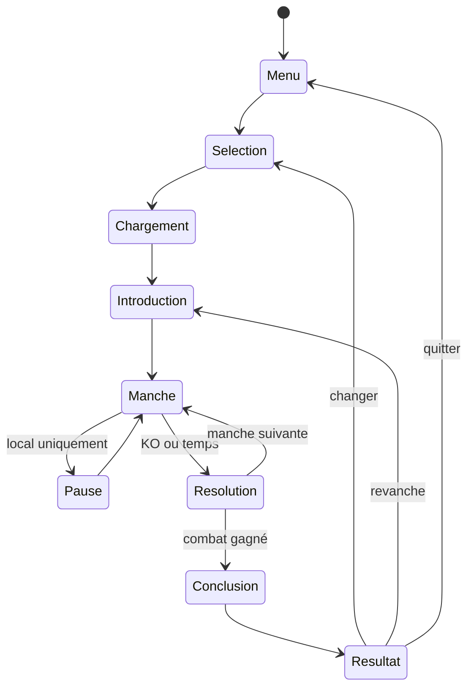

# Half Life Resonance

Bible du mode annexe de combat 2D — version 1.13 — 27 novembre 2026

<!-- CURRENT_CUT_CONTENT_20261127_P -->
## Reprise du 27 novembre — bible 1.13, focus contenu coupé

**81 nouvelles fiches d’archives, 80 notices sources, 694 tâches de production et neuf PNG pour huit cibles.** Les onze archives antérieures sont reliées sans doublon : le catalogue comprend désormais **92 archives**, toutes désactivées dans le jeu.

Le lot P ajoute Panther Eye rouge et bleu, Archer, Combine Assassin, Combine Guard Synth, Bullsquid HL2, Houndeye HL2 frontal et l’étude non texturée du Combine Guard Gun. La première version bleue est conservée avec sa correction ; Stukabat et le Sniper Rifle ont un refus tracé sans fichier. Les références de versions et les limites de détail sont explicites.

L’inventaire consolidé atteint **327 PNG, 381 demandes et 340 cibles : 250 avec une image, 90 sans PNG**. Les 318 images du checkpoint O et les trois sources du guide/extensions restent intactes. L’augmentation des manquants traduit 81 omissions recensées, dont 73 encore sans image. Une pose ne termine ni une animation ni un kit de combat ; aucune fidélité 1:1 n’est certifiée.

[Rapport et contrôles du lot P](production/continuation_20261127_p/README.md) · [Galerie](production/continuation_20261127_p/GALLERY.md) · [Chapitre contenu coupé](chapters/cut_content_20261127.md) · [81 fiches et tâches](data/cut_content_catalog_20261127.json) · [File des archives](production/continuation_20261127_p/CUT_CONTENT_QUEUE.md)
<!-- END_CURRENT_CUT_CONTENT_20261127_P -->

<!-- CURRENT_CONTINUATION_20261127_O -->
## Historique du 27 novembre — bible 1.12 et lot O

**25 nouveaux PNG : sept candidats de personnages retenus, six plans candidats de Contamination et sept candidats FX, avec cinq premières versions conservées.** Les six poses de sélection, désélection et taunt de Gina/Colette sont reliées aux fiches du guide. La base Colette a été corrigée d’après le modèle campagne Decay PS2 ; l’ancien candidat reste disponible et n’est plus sélectionné.

L’inventaire atteint **318 PNG distincts et 370 entrées**. **242 des 259 cibles ont au moins une image ; 17 restent sans PNG.** Le rayon Vortigaunt d’Episode Two fournit la seule première image de cible de ce lot. La charge, l’impact et la variante HL2 de base ne sont pas déclarés couverts. Les 293 anciens PNG sont inchangés.

[Rapport du lot O](production/continuation_20261127_o/README.md) · [Galerie](production/continuation_20261127_o/GALLERY.md) · [Revue des manquants](production/continuation_20261127_o/TARGET_REVIEW.md) · [Inventaire courant](production/MISSING_TARGETS.md)

Les fichiers FX couvrent six nouveaux couples famille/état : **128 états restent sans candidat**. Le contrat Contamination ajoute six plans identifiés ; **131 plans des contrats connus restent sans image et 24 stages sans contrat**. Les rectangles de lecture du sol sont proposés et contrôlés sur un composite, sans intégration au jeu ni validation de caméra. Les silhouettes, proportions fines, transitions, pivots et raccords restent à vérifier. **Aucune fidélité 1:1, animation complète ni arène complète n’est certifiée.** Les douze images déjà déclarées intégrées au runtime restent les seules intégrations.

Les trois fichiers originaux du guide et de ses deux extensions sont conservés sans modification ; leur édition d’intégration reste 1.11. La version 1.12 identifie ce nouveau point de production. Les 36 refus, quatre erreurs outil et douze sorties perdues historiques sont conservés ; le lot M non récupéré n’est pas ajouté aux comptes.
<!-- END_CURRENT_CONTINUATION_20261127_O -->

<!-- CURRENT_GUIDE_INTEGRATION_20261127 -->
## Historique du 27 novembre — bible 1.11, guide commun et deux extensions

Les **trois fichiers originaux du guide de combat** sont désormais [intégrés sans modification](guides/README.md), avec provenance et SHA-256. La [matrice des 68 sections](guides/COVERAGE_68.md) donne une décision, un état réel et un fichier d’application pour chaque rubrique.

Le [chapitre d’intégration](chapters/guide_integration_20261127.md), l’[extension 01](chapters/guide_extension_01_20261127.md) et l’[extension 02](chapters/guide_extension_02_20261127.md) ajoutent **63 fiches de production** : six taunts, six cycles de sélection, trois duos, six assistances, neuf techniques/conclusions d’équipe, trois clashes, quatre entités, cinq bonus, un espace d’archives, treize slots/modes, six règles de déblocage et une politique de soutien. Les [données JSON](data/combat_extensions_20261127.json) restent des contrats de conception, reliés aux identifiants du catalogue.

**Aucun PNG ni clip animé n’est créé par cette intégration.** Le checkpoint graphique repris est le lot L (286 PNG) ; le [lot N produit en parallèle](production/continuation_20261127_n/README.md) porte l’inventaire à **293 PNG, dont sept nouveaux fichiers et six poses retenues pour la prochaine revue**, toujours 18 cibles sans PNG. Le lot M / la version 1.10 annoncés dans l’historique n’ont pas été récupérés ; 1.11 identifie ce nouveau travail sans les déclarer livrés. Les six profils et quatre boss déjà jouables ne deviennent pas des kits complets de duel.

Le lot adjacent intègre le modèle d’accès à quatre dimensions et quatre dossiers de terrain du Boss Battle. La [CI du commit `4ae2ee9`](https://github.com/darknigthmare/combine-administrator-simulator/actions/runs/45948747638) a ensuite validé 60 tests unitaires, 10 tests de parcours navigateur, la matrice de 252 configurations et la compilation. Cette validation technique ne certifie pas la fidélité visuelle des candidats. Les taunts animés, le tag, les assistances, les supers, QTE, bonus et espace exploratoire restent conçus ; les services de soutien restent différés. Les sources, adaptations et limites de fidélité sont explicites. ATLAS/P-body restent en conception avec leurs refus historiques conservés. Les exports Word/Excel v1 restent historiques.

Vérification documentaire : `node scripts/validate-resonance-guides.mjs`.
<!-- END_CURRENT_GUIDE_INTEGRATION_20261127 -->

<!-- CURRENT_CONTINUATION_20261125_L -->
## Reprise du 25 novembre — bible 1.9 et lot L

**15 nouveaux PNG : 10 cibles jusque-là sans fichier reçoivent un premier candidat, et cinq couches sont ajoutées à l’usine à tourelles de Portal 2.** Les 28 cibles initialement manquantes ont toutes une issue documentée.

L’inventaire atteint **286 PNG distincts**, **338 entrées**, **36 refus**, **4 erreurs outil** et **12 sorties historiques perdues**. **241 des 259 cibles ont un PNG; 18 restent sans PNG.**

[Rapport du lot L](production/continuation_20261125_l/README.md) · [Galerie](production/continuation_20261125_l/GALLERY.md) · [Revue des 28 cibles](production/continuation_20261125_l/TARGET_REVIEW.md) · [Inventaire complet](production/MISSING_TARGETS.md)

Les quatre archives ont une première étude, avec leurs limites de version et de matière. Les six identifiants de couches Factory disposent de candidats, mais raccords et séparation L5/L6 restent ouverts. Les refus historiques et reports sont distincts des nouvelles générations. Les neuf images déjà utilisées dans Boss Battle restent les seules intégrations; aucune fidélité 1:1, animation complète ou arène à six couches n’est certifiée. Les exports Word/Excel v1 restent historiques.

<!-- END_CURRENT_CONTINUATION_20261125_L -->

<!-- HISTORICAL_CONTINUATION_20261125_K -->
## Lot K — état historique avant le lot L

**80 nouveaux PNG couvrant 76 cibles jusque-là sans fichier.** Les 104 cibles manquantes au début du lot ont une issue explicite : 76 reçoivent un candidat, 11 ont un refus de génération confirmé et 17 sont reportées sans appel avec le blocage documenté.

L’inventaire atteint **271 PNG distincts**, **323 entrées**, **36 refus**, **4 erreurs outil** et **12 sorties historiques perdues**. **231 des 259 cibles ont un PNG; 28 restent sans PNG.**

[Rapport du lot K](production/continuation_20261125_k/README.md) · [Galerie](production/continuation_20261125_k/GALLERY.md) · [Revue des 104 cibles](production/continuation_20261125_k/TARGET_REVIEW.md) · [Inventaire complet](production/MISSING_TARGETS.md)

Les références, refus explicites et reports sont conservés séparément. Les nouveaux fichiers restent des poses, effets statiques ou panoramas candidats. Les neuf images déjà utilisées dans Boss Battle restent les seules intégrations déclarées; aucune animation complète, arène à six couches ou fidélité 1:1 n’est certifiée. Les exports Word/Excel v1 restent historiques.

<!-- END_HISTORICAL_CONTINUATION_20261125_K -->

<!-- HISTORICAL_CONTINUATION_20261124_J -->
## Lot J — état historique du 24 novembre

**44 PNG supplémentaires : 43 nouvelles images conservées et un décor historique récupéré.** Le [rapport du lot J](production/continuation_20261124_j/README.md) et sa [galerie](production/continuation_20261124_j/GALLERY.md) portent l’inventaire à **191 PNG distincts, 229 entrées, 25 refus antérieurs, 1 erreur outil et 12 sorties perdues tracées**. **155 des 259 cibles** ont un fichier associé; **104 restent sans PNG**.

Le prototype Boss Battle utilise désormais **six sprites fixes de combattants et celui du Gunship**, en plus des deux panoramas déjà intégrés. Le rendu de secours et les signaux de combat restent actifs. Les dix effets recréés après l’interruption sont de nouvelles sorties, explicitement reliées aux versions perdues. Aucune animation complète, arène à six couches ou fidélité 1:1 n’est certifiée.

[Inventaire complet](production/MISSING_TARGETS.md) · [Audit](production/asset_audit.md) · [Intégration et vérifications](production/continuation_20261124_j/runtime_integration.md). Les exports Word/Excel v1 restent historiques.

<!-- END_CURRENT_CONTINUATION_20261124_J -->

<!-- HISTORICAL_CONTINUATION_20261124_I -->
## Mise à jour du 24 novembre — récupération F/H et lot I

À l’issue du lot I, l’état de production était de **147 PNG, 172 demandes et 25 refus sans fichier**, pour **259 cibles, dont 114 illustrées et 145 sans fichier**. Cette reprise conserve les 39 PNG historiques, récupère 94 PNG des lots F/H et ajoute 14 nouveaux fichiers du lot I. Le [rapport complet](production/continuation_20261124_i/README.md), [l’inventaire par cible](production/MISSING_TARGETS.md) et [la galerie](production/continuation_20261124_i/GALLERY.md) documentent ce checkpoint antérieur.

La fusion des catalogues porte les projectiles/effets à 66 familles et conserve 81 références. Les six cibles HL25 supplémentaires, les états visuels et les révisions ne sont pas assimilés à de nouveaux combattants jouables. Les quatorze images du lot I sont des poses, deux portions de boss, trois masters de stages et deux effets de base, sans clips animés ni nouvelle intégration moteur. Les détails, orientations, collisions et parallaxes demandent encore une validation ; aucune image n’est certifiée 1:1.

Le récit, les kits et les modes décrits ci-dessous gardent leur périmètre d’implémentation documenté. Les exports Word/Excel v1 demeurent historiques. Les bilans datés du 20 novembre ci-dessous sont conservés comme checkpoints antérieurs.
<!-- END_CURRENT_CONTINUATION_20261124_I -->

<!-- CURRENT_CONTINUATION_20261120_E -->
## Mise à jour du 20 novembre — lot E et archives

Le [lot E](production/continuation_20261120_e/README.md) livre douze PNG candidats pour sept cibles existantes : Dog, Hunter, Fourmilion ouvrier, costume HECU au béret, Gargantua, Canaux et Ravenholm. À ce point historique, le registre consolidé comptait **39 PNG, 51 demandes et 12 refus**, sans nouveau refus dans ce lot. Le catalogue conserve **187 cibles : 25 avec fichier, 162 sans fichier**.

Les Canaux disposent de cinq plans candidats sur six et Ravenholm de deux. La v2 du mur central des Canaux remplace la v1 pour la prochaine revue ; les raccords et les parties cachées en parallaxe restent à terminer. Les cinq nouveaux sujets sont des poses uniques, sans clips animés ni intégration moteur. Aucun candidat n’est certifié 1:1 et aucun stage complet à six couches n’est déclaré terminé.

Le [dossier d’archives](chapters/archive_reference_contracts_20261120.md), repris à la fin de cette bible, développe **huit contrats détaillés et trois dossiers de recherche**, avec 21 sources, 16 repères visuels inspectés et 48 éléments de capture demandés. Ses 41 sorties proposées, dont douze couches de lieux, sont un plan de travail : aucune image d’archive n’a été produite. Les onze archives restent désactivées. Concepts, prototypes, code publié et versions commercialisées sont distingués.

La [relecture alpha](production/continuation_20261120_e/alpha_review_previous_assets.json) révise le diagnostic de franges rouges nettes de trois sprites D après composition sur fonds opaques. Les fichiers originaux et le refus historique Strider restent conservés. Les exports Word/Excel v1 demeurent historiques ; cette bible Markdown et les données JSON sont les sources courantes.
<!-- END_CURRENT_CONTINUATION_20261120_E -->

## Mise à jour Boss Battle

Le chapitre Boss Battle ajoute ce mode et son catalogue de 24 rencontres, plus une archive Hydra. Le module jouable livre six profils pilotes et quatre opérations en solo, Boss Rush et entraînement. Les autres chapitres gardent leurs spécifications de duel et leur historique de production : leur mention de moteur non implémenté concerne cette base de conception, pas le nouveau module Boss Battle. Les exports Word et Excel v1 restent des instantanés du premier lot. Les visuels de boss actuels sont des rendus de travail, sans certification 1:1.

# Vision du mode Half Life Resonance

## Identité et objectif

Half Life Resonance est le mode de combat latéral proposé pour Half Life Administrator. Il rassemble des combattants, des équipements et des lieux issus de Half-Life dans des duels lisibles, des parcours individuels, une campagne originale, des défis et des tournois. Sa personnalité vient des outils scientifiques détournés, des armes militaires, de la technologie du Cartel et des organismes Xen. Le pied-de-biche, le Gravity Gun, les décharges vortigaunt et les tirs secondaires doivent modifier la manière de jouer, au-delà de leur apparence.

Cette bible fixe une première cible de 24 combattants, dont 12 dans la première vague, et de 24 arènes, dont 8 prioritaires. Six combattants pilotes servent de référence de production. Le catalogue principal sépare les versions d'un même personnage lorsqu'elles changent son équipement ou son fonctionnement. Des réserves d'extension permettent d'élargir ensuite le bestiaire sans faire passer une idée sommaire pour une fiche de production terminée.

Le joueur doit pouvoir lancer un duel en quelques choix, comprendre pourquoi une attaque a touché, apprendre une réponse en entraînement et retrouver dans chaque personnage une identité reconnaissable. La qualité attendue porte autant sur le retour à la garde, les changements de direction, les réactions aux impacts et les transitions de pose que sur les attaques spectaculaires.

## Périmètre des jeux sources

Le périmètre principal réunit Half-Life, Opposing Force, Blue Shift, Decay, Half-Life 2, Episode One, Episode Two et Half-Life Alyx. Les pages officielles situent le premier jeu autour de l'incident de Black Mesa, Half-Life 2 dans la résistance à l'occupation du Cartel et Alyx entre ces deux périodes [S1 à S3]. Opposing Force et Blue Shift apportent leurs points de vue militaires et de sécurité à Black Mesa [S4 et S5]. Decay conserve ses deux protagonistes et son origine coopérative ; les détails de modèles et de décors demandent une référence directe à l'édition PlayStation 2.

Les contenus Uplink, Lost Coast et les cartes de deathmatch sont réservés à des dossiers supplémentaires identifiés. Half-Life Source ne crée pas automatiquement de nouveaux personnages. Les variantes de modèles basse définition, du pack haute définition et des versions console sont étiquetées au lieu d'être mélangées dans un même costume. Le jeu Black Mesa de Crowbar Collective constitue une interprétation visuelle distincte : ses formes et ses environnements ne servent pas à certifier silencieusement les assets de Half-Life 1998.

Le menu permet de filtrer par jeu source, faction, difficulté de prise en main et style de combat. Un filtre d'époque limite les affrontements à une sélection cohérente lorsqu'on le souhaite. Le versus libre accepte les rencontres transversales comme une règle du mode annexe. Les pages de récit annoncent clairement quand une rencontre est créée pour Resonance.

## Place dans Half Life Administrator

Le point d'entrée proposé est un bouton Half Life Resonance parmi les modes annexes du menu principal. Il ouvre un écran indépendant présentant Duel, Histoire, Arcade, Tournoi, Entraînement et Archives. Une entrée dans un terminal de l'administrateur peut donner accès au même mode après déblocage narratif, sans obliger à démarrer une campagne de gestion pour jouer localement.

Le retour quitte proprement la session de combat et restaure l'écran d'origine. Une partie de combat ne consomme ni journées, ni rations, ni crédits de la simulation de gestion. Les sauvegardes sont séparées et versionnées. Les succès peuvent ouvrir un portrait, un dossier ou une variante visuelle ; ils ne modifient pas les dégâts, les points de vie ou les règles du versus compétitif.

L'habillage raconte un programme d'archives et de simulations tactiques compromis par des phénomènes de résonance. Ce cadre est une invention du mode, pas une explication officielle des événements de la série. Les archives présentent les identités d'origine ; la campagne met en scène ce que produit le programme lorsqu'il reconstruit des confrontations incompatibles. Cette distinction permet des rivaux inattendus tout en gardant visibles les événements des jeux sources.

## Les principes de fidélité

La fidélité 1:1 est un critère d'acceptation à démontrer. Elle porte sur la silhouette, les proportions, les couleurs, les détails d'équipement, la latéralité, les matériaux, la manière de tenir les armes, les signes anatomiques et le contexte du costume. Elle ne peut pas être déduite du seul nom de personnage placé dans une consigne de génération.

Chaque costume reçoit une fiche de référence avec le jeu et sa version, plusieurs captures cohérentes, une liste d'invariants et les angles à vérifier. Pour Gordon, la combinaison Mark IV et la Mark V sont deux dossiers différents. Pour Alyx, la tenue de Half-Life 2 et celle d'Alyx restent distinctes. Pour l'Élite du Cartel, l'œil central rouge, l'armure claire et le fusil doivent tous passer le contrôle. Pour un Vortigaunt, les proportions, le troisième bras, les yeux et l'état libre ou captif doivent être contrôlés séparément.

Les durées d'attaque, les dégâts, le système de garde, la Résonance, les combos, les supers, les fins de parcours et les rencontres entre personnages sont des adaptations de game design. Elles sont documentées comme telles. Une technique inspirée d'une arme connue n'est pas présentée comme une animation extraite du jeu original.

Le processus de validation emploie les états spécifié, référence approuvée, généré, correction requise, validé visuellement, validé en animation et intégré. Une image peut être générée avec transparence et rester incorrecte sur le plan du costume. Une boucle peut être visuellement propre et rester inutilisable si ses pieds glissent ou si ses boîtes de collision ne correspondent pas au geste.

## Direction visuelle

Les combattants sont de grands sprites 2D détaillés, avec une projection latérale stable, des proportions proches des sources et une lecture immédiate du geste. Les volumes sont rendus avec des matériaux crédibles, un éclairage principal cohérent et des contours propres. Le rendu conserve les particularités des jeux sans ajouter une musculature ou des accessoires étrangers au personnage.

Chaque image de production contient un seul personnage et une seule pose. Les armes détachables, accessoires, effets et ombres sont des fichiers séparés quand l'animation le demande. Les planches de comparaison servent à la vérification, pas à remplacer les frames individuelles livrées au moteur. Les pivots sont définis avant l'export des animations ; ils ne sont pas recalculés à partir du rectangle visible à chaque frame.

Le nombre d'images dessinées ne doit pas être confondu avec la fréquence de simulation. Une simulation à 60 Hz peut utiliser une pose durant plusieurs ticks. Le travail d'animation se concentre sur l'anticipation, le contact, la récupération et le retour à l'état suivant. Les attaques rapides demandent une silhouette franche au moment du contact ; les grands mouvements demandent des intermédiaires qui évitent la téléportation des armes et des mains.

Les palettes du monde distinguent la chaleur industrielle de Black Mesa, les bleus froids du Cartel, les ocres de Cité 17 et les matières organiques de Xen. Les effets offensifs restent séparés des détails décoratifs. L'éclat d'un super ne masque pas la direction de fuite ni le résultat de l'impact. Les options d'accessibilité réduisent secousses, flashs, particules et flou indépendamment.

## Personnages et variantes

Le premier ensemble de six pilotes associe Gordon de Half-Life 2, Alyx de Half-Life 2, Barney de Half-Life 2, Adrian Shephard, un Vortigaunt libre et l'Élite du Cartel. Il couvre les armes et la physique, l'agilité, la défense tactique, le soldat polyvalent, l'énergie extraterrestre et le contrôle à distance. Ce groupe permet de tester des réponses différentes à un projectile, une approche aérienne et une pression de garde.

Les variantes de tenue sont regroupées selon trois catégories. Une tenue issue d'un jeu source possède ses références propres. Une palette de lisibilité garde les formes et sert au miroir. Une tenue imaginée pour le mode porte une mention adaptation. Un changement de matériau ou de couleur ne devient pas un nouveau personnage jouable. Un équipement qui modifie réellement les commandes justifie en revanche une variante de kit distincte.

Les costumes cassés ou endommagés sont des états visuels explicites. Ils ne doivent pas effacer les détails d'identification ni créer un avantage par réduction apparente du corps. Les portraits, petites icônes, poses de sélection, expressions d'intro et poses de victoire font partie du même dossier de référence.

G-Man, les grandes entités et les machines hors échelle ne reçoivent pas arbitrairement une taille humaine et un kit ordinaire. Ils interviennent dans les cinématiques, les épreuves ou les combats de boss. Dog, le Hunter et les autres gabarits particuliers demandent une caméra et des tests de collision dédiés, avec une homologation explicite avant tout usage compétitif.

## Narration et mise en scène

Le mode histoire suit douze chapitres avec des transitions courtes, des objectifs de combat distincts et des checkpoints. Il accompagne le joueur vers les règles avancées : placement, garde, projection, gestion des tirs, ressources, accessoires et phases de boss. Un chapitre n'impose pas plusieurs fois un tutoriel déjà validé. Les séquences peuvent être revues depuis les archives.

Le parcours arcade individuel s'ouvre sur une intention claire, présente un rival propre au personnage et se termine par une fin originale. Une intro contextuelle est choisie lorsque la paire de combattants dispose d'une scène dédiée ; sinon, une entrée générale est utilisée. Gordon et Adrian s'expriment par gestes, regard, sons d'équipement et montage. On n'invente pas de répliques pour remplir leurs silences.

Une séquence d'avant combat comporte quatre événements techniques : apparition, placement, interaction éventuelle, retour à la pose neutre. Elle possède un état de saut propre qui place les deux combattants correctement sans rester bloqué dans une animation. Les séquences de victoire et de fin disposent de la même garantie. En ligne, le saut d'une scène est synchronisé et ne modifie pas l'instant de départ de la manche.

Les fatalités sont des conclusions optionnelles après le résultat acquis. Chaque combattant doit disposer d'une conclusion de signature, d'une alternative sans exécution et d'une sortie courte. Le jeu choisit des conclusions compatibles avec la relation entre les adversaires et le type de victime. Un duo allié en contexte d'entraînement utilise un désarmement, un sauvetage, une expulsion ou une capture. Les réglages de contenu peuvent remplacer une scène violente sans changer la récompense ni le résultat.

## Audio et sensation de jeu

Le paysage sonore distingue le contact d'une arme, le blocage, l'armure, la matière organique, l'énergie et le décor. La préparation d'un tir lourd produit un signal reconnaissable avant son départ. La balance du mix garde les commandes vocales et les signaux utiles audibles pendant la musique. Les sous-titres d'intro restent lisibles et leur taille est indépendante du HUD.

Le moteur utilise des événements sonores déterministes pour décider quoi jouer, puis laisse le mélange audio au rendu. Une restauration d'état lors d'un rollback ne doit pas rejouer plusieurs fois le même impact. Les voix nouvelles ne sont pas déclarées comme des enregistrements officiels. Les fichiers distribués doivent avoir une provenance connue et compatible avec le projet.

La musique peut progresser entre neutralité, tension, dernière manche et victoire. Une option autorise une piste fixe par arène pour le tournoi. Le menu propose des réglages séparés pour musique, effets, dialogues et annonceur. Les sons compétitifs ne sont pas remplacés par des effets silencieux lorsqu'on change de costume.

## Livrables et progression de production

La première étape jouable à réaliser réunit deux combattants, une arène sans danger, le cycle complet de manche, un entraînement avec enregistrement et les commandes essentielles. Elle doit confirmer le temps de réponse et les règles avant d'étendre le roster. Le deuxième lot ajoute les six pilotes et leurs interactions. Le troisième ajoute les douze combattants de première vague, les huit arènes prioritaires, les parcours arcade et le tournoi local. Les systèmes en ligne, les grandes campagnes et les extensions sont validés sur cette base.

Cette progression n'efface aucun contenu prévu : elle fixe les dépendances qui empêchent de multiplier des images ou des kits incompatibles. Les conditions de sortie sont observables : intégrité des sauvegardes, rejouabilité des entrées, absence de boucles infinies, stabilité des transitions, lisibilité à faible résolution et cohérence des variantes. Le registre de production garde la distinction entre la cible complète et les fichiers réellement disponibles.

# Systèmes de combat et modes de jeu

## Statut et périmètre

Ce chapitre définit le fonctionnement proposé de HALF LIFE RESONANCE, mode de combat annexe de Half Life Administrator. Les règles, les affrontements entre personnages, les tournois et les événements de scénario sont une adaptation originale. Ils ne deviennent pas des événements canoniques de Half Life. La fidélité demandée concerne les identités, les équipements, les silhouettes, les environnements et les comportements reconnaissables. Les dimensions d’arène, les dégâts et les fenêtres d’action répondent aux besoins du jeu de combat.

Les chiffres ci-dessous constituent une base de prototype cohérente et modifiable. Ils ne représentent ni des mesures des jeux d’origine ni un équilibrage déjà validé. Le dépôt identifié est `darknigthmare/combine-administrator-simulator`, branche `master`, version déclarée `0.47.0`. L’intégration proposée s’appuie sur son environnement React, TypeScript, Vite, Zustand et Tauri. Aucun moteur de combat fonctionnel, service multijoueur, sprite animé complet ou résultat de test de performance ne doit être déduit de cette spécification.

## Contrat du combat

Le combat principal oppose deux personnages sur un plan latéral. La simulation avance à 60 ticks par seconde, indépendamment de la fréquence d’affichage. Un combat se gagne en remportant deux manches. Chaque manche commence avec la vie complète et dure 99 secondes de combat actif. Le chronomètre s’arrête pendant l’introduction, les pauses de contact, les séquences de super et les transitions. Les déplacements ne changent jamais la profondeur de collision.

La caméra cadre les deux combattants sans modifier leurs coordonnées physiques. Elle peut reculer légèrement pour un grand personnage ou une séparation importante, dans des limites communes à toutes les arènes homologuées. Les décors, la parallaxe et les particules n’ont aucune autorité sur les collisions. Le sol compétitif reste horizontal et continu. Les arènes à ascenseurs, effondrements ou changements de lieu appartiennent aux variantes spectacle et histoire.

| Paramètre | Valeur initiale | Rôle dans le prototype |
| --- | --- | --- |
| Simulation | 60 Hz | Résolution commune du mouvement, des impacts et des commandes |
| Vie de référence | 10 000 PV | Unité de comparaison des dégâts |
| Fourchette initiale des combattants | 9 000 à 11 500 PV | Différenciation des gabarits à équilibrer |
| Victoire | 2 manches gagnantes | Format standard local et en ligne |
| Durée d’une manche | 5 940 ticks actifs | 99 secondes hors suspensions prévues |
| Résonance | 0 à 300 points | Ressource commune de techniques avancées |
| Tampon d’action | 6 ticks | Tolérance au déclenchement à la fin d’une récupération |
| Fenêtre d’un quart de cercle | 20 ticks | Reconnaissance de commande, sans allonger la récupération |
| Fenêtre d’un double quart de cercle | 30 ticks | Commande des supers et ultimes |
| Déchoppe standard | 7 ticks | Fenêtre à partir du premier tick de saisie |
| Limite de projectiles persistants | 2 par combattant | Limite par défaut, exceptions explicitement documentées |
| Rebonds pendant un combo | 1 mural et 1 au sol | Protection contre les boucles de jonglage |
| Durée maximale de combo | 600 ticks actifs | Garde-fou de sortie forcée, à vérifier sur tous les kits |

Le compteur de manche compare les fractions de vie restantes à l’expiration du temps. Pour éviter les erreurs d’arrondi, il compare `vieA × maximumB` et `vieB × maximumA`. Un double KO simultané ou une égalité exacte produit une manche nulle. Celle-ci est rejouée à partir de son état initial, y compris les ressources, afin de ne pas permettre leur accumulation par répétition. Après trois manches nulles consécutives, le combat est déclaré nul et recommencé ; il ne rapporte aucun point de rencontre. En tournoi, l’organisateur conserve cette trace et peut suspendre le poste pour vérifier une défaillance. Aucun tirage aléatoire ne départage les joueurs.

## Commandes et apprentissage

Les commandes utilisent quatre boutons : L pour attaque légère, M pour attaque moyenne, H pour attaque lourde, S pour capacité propre au personnage. La notation numérique décrit les directions comme sur un pavé numérique lorsque le personnage regarde vers la droite : 6 avance, 4 recule, 2 s’accroupit, 8 saute. Les diagonales sont 1, 3, 7 et 9. Les directions relatives s’inversent lorsque le personnage change de côté ; les directions physiques enregistrées dans le replay restent inchangées.

| Entrée | Action universelle | Conditions |
| --- | --- | --- |
| 5L, 5M, 5H | Attaques debout | Variante proche uniquement si annoncée dans la fiche |
| 2L, 2M, 2H | Attaques accroupies | La propriété basse dépend du coup, jamais du seul dessin |
| j.L, j.M, j.H | Attaques aériennes | Fenêtres de réception définies par animation |
| 6H | Attaque de direction | Fonction exacte propre au kit et visible dans la liste |
| 5S | Trait du personnage | Ressource et restrictions indiquées dans son panneau |
| 6S | Interaction avec un accessoire | Seulement si un accessoire autorisé est à portée |
| 66 ou 44 | Ruée ou recul rapide | Vulnérabilités conservées et visibles en entraînement |
| L plus M | Projection avant | Au sol et à portée ; 4 plus L plus M projette derrière |
| Quart de cercle plus L, M ou H | Technique spéciale | Version et propriétés définies pour chaque kit |
| Commande de spéciale plus L et M | Version EX | 50 points et variante EX réellement disponible |
| 236236H | Super | 100 points de Résonance |
| 236236S | Ultime | 300 points de Résonance |
| 6 plus M plus H | Contre de garde | Pendant la garde, 100 points |
| M plus H plus S | Rupture défensive | Pendant une séquence autorisée, 200 points |

La reconnaissance donne priorité à une commande spéciale EX complète sur la projection L plus M. Si la ressource manque, l’action EX échoue sans déclencher une projection inattendue. Les commandes non reconnues n’exécutent pas automatiquement une autre technique coûteuse. Le journal d’entraînement affiche le motif de refus : ressource, portée, état, commande incomplète ou variante inexistante.

Dans un état qui les autorise, les commandes défensives complètes sont traitées d'abord, puis l'ultime, la super, l'EX, la spéciale, la projection, le trait, l'interaction et la normale. Ainsi 236236S ne déclenche pas accidentellement 5S ou 6S, et un contre de garde valide ne devient pas 6H. Une commande coûteuse reconnue sans ressource échoue sans repli vers une action simple. Deux directions physiques opposées simultanées donnent une direction neutre sur leur axe avant toute conversion en directions relatives. Le replay conserve les entrées physiques et la version de cette règle.

Le saut standard n’offre ni double saut ni ruée aérienne universelle. Ces possibilités demandent une justification de personnage et un coût réel dans son kit. Une option de commandes simplifiées permet d’associer les spéciales à des combinaisons directionnelles accessibles. Elle conserve les mêmes fenêtres, dégâts et coûts. La sélection du mode d’entrée est visible dans le lobby ; aucune macro ne produit un combo complet automatiquement en compétition.

## Garde et circulation de la pression

Maintenir l’arrière garde les attaques médianes et hautes. Maintenir arrière et bas garde les attaques médianes et basses. Une attaque en surplomb doit être gardée debout. La liste des coups et l’entraînement montrent ces propriétés séparément de l’animation. Une attaque aérienne n’est pas automatiquement imparable au sol. Les projections brisent la garde mais restent limitées par la portée, la préparation et la possibilité de déchoppe.

La garde aérienne bloque les projectiles et les attaques aériennes compatibles. Les anti-aériens au sol peuvent porter une propriété explicite qui interdit cette garde ; leur fiche doit l’indiquer. Après une garde aérienne, l’atterrissage impose douze ticks de récupération défensive. Cette règle empêche de contourner toute pression en sautant continuellement. Elle doit rester assez courte pour ne pas rendre la garde aérienne systématiquement perdante.

Une attaque normale ne provoque aucun dégât à travers la garde. Une spéciale inflige au maximum 5 % de ses dégâts de base, une EX 10 %, une super ou un ultime 10 %. Ces dégâts sont toujours non létaux : un personnage qui garde correctement conserve au moins 1 PV. Il faut donc ouvrir la défense, projeter ou provoquer une erreur pour terminer la manche. Aucun gain de Résonance ne provient de ces dégâts de garde.

Le contre de garde coûte 100 points au déclenchement. Il repousse et peut rendre de l’espace, mais ne démarre pas un long combo. Sa version commune inflige zéro dégât ; les effets visuels suivent l’équipement du personnage. Une feinte peut le provoquer et permettre de punir sa récupération. La rupture défensive coûte 200 points et ne peut réussir qu’une fois par combat. Elle ne fonctionne pas pendant une projection, une prise de boss ou une cinématique de super déjà confirmée. Si elle est autorisée, le coût et la consommation de l’usage sont appliqués même lorsqu’elle manque sa cible.

Les armes à feu conservent leur identité sans transformer chaque match en échange continu à longue distance. Les projectiles ont une préparation, une récupération, une vitesse et une durabilité documentées. Les tirs normaux ne sont pas des impacts instantanés sur toute la scène. Un personnage qui tire expose une zone de vulnérabilité ; ses fenêtres de rechargement ou de refroidissement figurent dans le kit. Les projectiles compatibles peuvent se neutraliser selon une règle de durabilité. Les exceptions lourdes sont limitées à une instance et signalées avant leur départ. La ruée ne rend pas universellement invincible : avancer au bon moment, utiliser la garde, sauter avec discernement et exploiter une récupération restent les réponses communes.

## Résonance et ressources propres

La Résonance commence à zéro au premier round et se conserve entre les manches d’un même combat. Elle revient à zéro au combat suivant. Elle ne représente pas une énergie scientifique canonique partagée par tous les personnages : c’est une ressource de jeu, présentée par des effets adaptés à chaque identité. Les combattants peuvent disposer en plus d’une ressource propre, comme des charges ou une réserve d’objets, mais son panneau doit rester distinct.

| Dépense | Coût | Usage et limite |
| --- | --- | --- |
| Spéciale EX | 50 | Renforcement défini de la technique ; aucune propriété implicite |
| Super | 100 | Confirmation offensive ou réponse spécialisée |
| Contre de garde | 100 | Dégagement défensif pendant la garde |
| Rupture défensive | 200 | Une tentative par combat, hors prises et cinématiques |
| Ultime | 300 | Engagement de toute la réserve ; séquence courte et identifiable |
| Fatalité de fin de combat | 0 | Exécution facultative après résultat déjà acquis |

Un impact ordinaire rapporte à l’attaquant 1 point pour 100 PV effectivement retirés, après réduction des combos. Le défenseur reçoit 0,5 point pour les mêmes 100 PV. Les EX, supers, ultimes, contres de garde, ruptures et dangers du décor ne produisent aucun gain pour aucun des deux camps. Rater, garder ou provoquer des dégâts de garde ne produit aucun gain. Cette règle évite le remplissage de jauge à distance sans prise de risque.

Le calcul interne utilise des millipoints entiers : 1 PV retiré rapporte 10 millipoints à l’attaquant et 5 au défenseur. La jauge possède donc 300 000 unités internes. Il n’y a ni erreur cumulative de virgule flottante ni dépendance à la fréquence d’affichage. Le coût est débité à l’entrée effective dans l’action, après validation de l’état ; une animation interrompue ensuite ne rembourse pas la ressource. Les actions refusées avant leur entrée n’en consomment aucune.

Les charges propres reviennent au début d’une manche selon leur fiche. Elles ne persistent jamais implicitement depuis le mode de gestion. Les récompenses de campagne, les cosmétiques et la progression ne modifient pas la vie, les dégâts, la réserve initiale ou les fenêtres des matchs compétitifs.

## Combos et états d’impact

La chaîne commune va de L vers M puis H, avec une utilisation de chaque niveau dans cette chaîne. Les annulations vers une spéciale et d’une spéciale vers une super dépendent de fenêtres écrites dans les données. Une icône dans la liste des coups indique si l’annulation fonctionne sur impact, sur garde ou dans les deux cas. Les attaques ratées ne s’annulent pas universellement. Les ouvertures, les projections, les renversements et les anti-aériens produisent ainsi des routes différentes.

La réduction des dégâts commence à 100 % au premier coup, puis passe à 90, 80, 70, 60, 50, 45, 40 et enfin 30 % pour les coups ordinaires suivants. Les supers suivent la réduction du combo avec un plancher propre de 15 % ; les ultimes ont un plancher de 20 %. La réduction s’applique par impact dommageable, y compris les multihits. Les données peuvent imposer un prorata de départ plus faible à une ouverture particulièrement sûre. Les valeurs finales sont arrondies vers le bas, avec un minimum de 1 PV pour un impact réellement dommageable.

L’objectif d’équilibrage initial est de maintenir la plupart des routes sans ressource sous 45 % de la vie de référence et les routes coûteuses sous 65 %. Ce sont des seuils de revue, pas une coupure automatique des dégâts. Le moteur limite en revanche les rebonds et le temps de contrôle retiré au défenseur. Un seul rebond mural et un seul rebond au sol sont disponibles par combo. Le budget initial de jonglage est de douze unités ; chaque relance consomme le nombre indiqué dans sa fiche.

À l’épuisement du budget, l’adversaire devient invulnérable aux relances et retombe vers une récupération sûre. Après 600 ticks actifs sans reprise de contrôle, une sortie forcée se déclenche à la prochaine borne sûre de l’action. Une cinématique en cours se termine d’abord ; elle ne peut pas enchaîner vers une nouvelle capture. Le compteur n’est pas remis à zéro par un changement d’animation, un projectile différé ou un changement de côté. Une vraie remise à zéro nécessite un retour à un état où le défenseur pouvait agir.

La séparation des états doit rester explicite : impact léger, impact lourd, lancement, chute, rebond, renversement et relevée ne sont pas des noms interchangeables. La relevée propose une récupération immédiate ou retardée lorsque le type de chute l’autorise. Une séquence de fatalité ne partage aucun état avec les combos : elle intervient après la décision du match.

## Physique et versions des arènes

Chaque arène possède deux profils. Le profil tournoi conserve le fond animé, l’ambiance et les effets non interactifs, avec un sol et une collision normalisés. Le profil spectacle active les accessoires, les dangers annoncés, les transitions et les finishers de décor. L’écran de sélection affiche clairement lequel est choisi. Une même image de fond ne suffit pas à considérer une arène comme intégrée : collision, limites de caméra, couches indépendantes, son et conditions de victoire doivent aussi exister.

L’interaction 6S ne cible qu’un accessoire autorisé présent dans la zone d’action du combattant. Une petite indication apparaît à portée ; sans cible valide, l’entrée reste sans effet. Chaque joueur dispose d’un quota de deux interactions par manche dans le profil spectacle de base. Un accessoire saisi, projeté ou détruit suit un état déterministe et ne réapparaît pas avant la manche suivante. Les objets visuels de fond ne deviennent jamais des projectiles par simple proximité.

Un accessoire ne traverse pas automatiquement tous les tirs. Il possède une masse de jeu, une durabilité et un groupe de collision. Sa trajectoire est calculée par la simulation du combat ; les animations de débris restent décoratives. Les dangers ne s’activent pas aléatoirement pendant un combo sans avertissement. Tout danger influant sur les PV dispose d’une annonce lisible, d’une fenêtre d’évitement et d’un statut explicite dans les règles du lobby.

La parallaxe utilise des couches séparées : ciel ou vide lointain, masses architecturales, activité de fond, plan de combat, avant-plan et effets atmosphériques. Les vitesses relatives sont exprimées par rapport au déplacement de caméra, jamais par rapport à la vitesse d’affichage. Les éléments d’avant-plan ne masquent pas les pieds ni les attaques basses. Une option de visibilité réduit fumée, poussière, flashes et particules sans supprimer les informations nécessaires au jeu.

## Offre de modes

| Mode | Boucle principale | Résultat conservé |
| --- | --- | --- |
| Histoire | Chapitres scénarisés, combats, scènes et choix de parcours | Progression, scènes vues et fins obtenues |
| Arcade | Parcours propre au personnage avec rival et boss | Score, difficulté et ending débloqué |
| Versus local | Combat sur un même poste | Historique facultatif, revanche immédiate |
| Versus en ligne | Rencontres selon les règles du salon | Résultat, replay et qualité de connexion |
| Classé | Matchmaking sous règles homologuées | Classement séparé de la campagne |
| Tournoi | Tableau, postes, rencontres et arbitrage | Bracket vérifiable et champion |
| Équipe | Relais de trois combattants, sans tag instantané initial | Résultat de l’équipe et ordre choisi |
| Survie | Combats successifs avec récupération limitée | Meilleure série par personnage |
| Boss | Rencontres à phases et objectifs spécifiques | Médailles et variantes débloquées |
| Défis | Exercice ciblé, route de combo ou situation tactique | Validation et meilleure exécution |
| Entraînement | Laboratoire libre avec données et mannequins | Réglages et enregistrements locaux |
| Galerie | Relecture des intros, fins, costumes et dossiers | Collection de contenus vus |

Le mode histoire utilise un graphe de chapitres. Chaque nœud possède des prérequis, une scène d’introduction, les adversaires, un profil de règles, les scènes de victoire et de défaite, puis la sortie suivante. Les combats entre alliés doivent avoir une raison écrite, telle qu’une simulation ou une épreuve ; ils ne sont pas présentés comme des affrontements historiques. Les choix peuvent ouvrir des variantes narratives, sans imposer de différences de puissance en versus.

L’arcade comprend six combats ordinaires, un rival et un boss, soit huit étapes par parcours. L’intro de personnage établit son objectif. La rencontre de rival utilise une scène spécifique et une réponse de victoire cohérente. L’ending ferme ce parcours et porte son statut d’interprétation originale. Les défaites proposent recommencer, changer de difficulté ou revenir au menu ; un changement de difficulté est enregistré pour le score. Les intros passent individuellement en jeu local et d’un commun accord en ligne, avec une limite d’attente.

La survie restaure 15 % de la vie maximale après une victoire, sans dépasser le maximum, et conserve la Résonance dans cette seule variante. Le relais par équipes réinitialise les ressources du nouvel entrant ; le survivant récupère 10 % de sa vie maximale entre adversaires. Ces deux exceptions sont visibles avant le départ et n’affectent jamais les règles du duel standard.

## Tournois et rencontres

Le tournoi local gère des tableaux à élimination simple ou double de 4, 8, 16 et 32 places. Un tournoi accepte 4 à 32 participants; le nombre de places est la plus petite de ces tailles permettant de les accueillir. Les places vides produisent des exemptions selon le placement publié du tableau, sans victoire de combat inventée. Douze participants occupent ainsi un tableau de seize places avec quatre exemptions. Une rencontre se joue au premier joueur remportant deux combats. Les finales des tableaux gagnants, perdants et la grande finale se jouent au premier remportant trois combats, sauf règle publiée avant le lancement.

En double élimination, un participant quitte le tournoi après deux défaites de rencontre. Le vainqueur du tableau gagnant arrive en grande finale sans défaite. Si le vainqueur du tableau perdant gagne leur première rencontre, les deux participants ont une défaite et une seconde rencontre complète décide du tournoi. Ce reset doit apparaître dans le tableau, la sauvegarde et le commentaire de résultat. Un changement de personnage ou d’arène entre les deux rencontres suit les mêmes règles qu’entre les combats ordinaires.

Le gagnant d’un combat conserve son personnage. Le perdant peut changer de personnage ou demander une autre arène homologuée selon le règlement choisi. L’ordre de décision est enregistré pour éviter de choisir après avoir vu la sélection cachée adverse. Les costumes purement visuels restent autorisés sous réserve de lisibilité et d’absence de confusion d’équipe. Une configuration verrouillée conserve le checksum des règles et des catalogues utilisés.

Le module prévoit inscriptions, noms de joueurs, classement initial facultatif, attribution des postes, appel de rencontre, saisie du résultat, validation et correction avant propagation. Une correction tardive affiche les rencontres qu’elle invalide ; elle ne réécrit pas silencieusement une finale déjà jouée. Une déconnexion ne produit pas un résultat arbitraire : l’état suspendu attend la politique annoncée de reprise, abandon ou décision d’arbitrage. Le tournoi peut être sauvegardé et repris sans recalculer les appariements déjà validés.

## Fatalités et séquences de conclusion

Les fatalités sont des conclusions facultatives après la victoire du combat, jamais une méthode pour annuler un résultat déjà établi. Une fenêtre de cinq secondes permet de choisir une fatalité propre au personnage, une conclusion de décor disponible ou une victoire courte. Aucun choix ne coûte de Résonance et aucun équipement de campagne ne conditionne son accès en versus. L’absence d’entrée lance la pose de victoire normale.

La mise en scène reprend les moyens, sons, armes et phénomènes associés à l’univers : téléportation, gravité, énergie, capture, désintégration ou danger industriel. La bible de personnage précise la différence entre une action observée dans les jeux et sa transposition de finisher. Le moteur vérifie la compatibilité du squelette de victime, du gabarit et du décor. Si une séquence ne convient pas à une créature particulière, il utilise une variante écrite ou la victoire courte, sans déformer le modèle pour forcer une animation humaine.

Une option de violence réduite remplace le plan final par une disparition, une mise hors combat ou une coupe de caméra adaptée. Elle ne change ni le timing du résultat ni le score. Les captures de replay mémorisent le résultat et l’identifiant de séquence, mais le spectateur peut conserver son propre réglage de visibilité. Les adversaires humains alliés peuvent disposer de conclusions de neutralisation pour préserver la cohérence du parcours.

## Entraînement et accessibilité

Le laboratoire affiche inputs, avantages de frames, dégâts, réduction de combo, coûts, positions et raisons de refus. Les zones de collision distinguent collision corporelle, zone vulnérable, zone d’attaque et saisie par des couleurs doublées de motifs. L’avance image par image fonctionne sur les ticks simulés. La pause conserve l’état exact, y compris les projectiles, accessoires, ressources et compteurs de combo.

Le mannequin peut garder toujours, après le premier coup, aléatoirement selon une graine visible, ou selon un enregistrement. Il peut contre-attaquer sur relevée, après garde ou après récupération. Cinq enregistrements par personnage peuvent être lus séparément ou mélangés avec des poids explicites. L’outil permet de repositionner les deux combattants au centre ou dans un coin, puis d’enregistrer cette situation pour la retrouver après une action.

Les exercices enseignent successivement déplacement, garde, projection, anti-aérien, punition, confirmation, Résonance et gestion d’un projectile. Une réussite n’exige pas seulement une entrée : elle exige le résultat appris. Punir consiste ainsi à toucher avant que le mannequin ait retrouvé la garde. Les routes de combo affichent les fenêtres nécessaires et distinguent une version simple d’une route optimale.

Les commandes sont remappables au clavier et à la manette, avec plusieurs boutons accessibles pouvant produire une combinaison simultanée autorisée. Les avertissements visuels disposent d’un équivalent sonore et les informations sonores importantes d’un équivalent visuel. Sous-titres, taille de texte, intensité des secousses, flashes, contraste des silhouettes et vitesse des menus sont réglables. La réduction de vitesse est réservée à l’entraînement et à certaines aides de campagne ; elle n’affecte pas un adversaire en ligne. L’assistance narrative peut réduire une difficulté sans cacher ce choix dans les résultats.

## Interface et progression

Le menu du mode ouvre Histoire, Arcade, Versus, Tournoi, Entraînement, Défis, Galerie et Options. La sélection affiche identité, épisode de référence, rôle, difficulté de prise en main, costumes compatibles et résumé du trait. Les versions d’un personnage qui modifient réellement ses outils sont des variantes de kit clairement nommées. Un costume ne peut pas devenir une modification cachée de statistiques.

Le HUD réserve la partie supérieure aux vies, aux manches et au chronomètre. La Résonance et les ressources propres occupent la partie basse, avec chiffres optionnels. Les indications de contre, punition et rupture restent brèves et ne couvrent pas les combattants. Le côté de l’écran et la couleur d’équipe servent simultanément de repères. Un écran de résultat présente les décisions utiles : revanche, changement de personnage, détails du combat, sauvegarde du replay et retour.

La progression déverrouille galeries, palettes, variantes de présentation, fiches et défis. Les kits compétitifs ne gagnent pas de puissance. La progression du mode annexe est isolée de celle de la gestion ; une récompense croisée, si elle est retenue, ne transporte qu’un identifiant cosmétique ou un succès. Effacer une sauvegarde de combat ne doit jamais supprimer une campagne de gestion.

## Architecture proposée pour le projet

L’implantation proposée réside dans `src/features/resonance`. Elle doit être adaptée après lecture des conventions du dépôt, sans présumer l’existence d’une route ou d’un composant portant ce nom. React gère les menus, la sélection et les panneaux. La simulation doit vivre dans un noyau TypeScript indépendant du rendu. Zustand peut exposer les états de navigation, options et progression ; il ne doit pas imposer un rendu React complet à chaque tick de combat. Tauri fournit les services natifs nécessaires à la sauvegarde ou aux périphériques, derrière des interfaces remplaçables.

Les catalogues contiennent identifiants stables, références visuelles, commandes, données de frames, ressources, scènes narratives et critères de disponibilité. Une action ne devient sélectionnable que lorsque son animation, sa collision, ses coûts et ses transitions sont validés. Un fichier de prompt ou une image fixe reste un élément de production, sans se déclarer animation intégrée.

La résolution du KO clôt la production de dégâts avant le début de la conclusion. Une pause locale suspend la simulation ; en ligne, ouvrir les options ne la suspend pas. Un chargement incomplet empêche l’introduction, puis affiche le contenu manquant et une sortie propre. Chaque transition dispose d’un point de sauvegarde autorisé ; aucune sauvegarde de progression ne s’écrit au milieu d’une transaction de récompense.

Le multijoueur à rollback est un objectif technique, non une fonctionnalité annoncée comme disponible. Il nécessite une simulation déterministe, un état sérialisable, un historique d’inputs, des instantanés et la reproduction des mêmes résultats après resimulation. Les nombres physiques doivent employer des unités entières ou un format fixe. Le générateur aléatoire possède une graine explicite. Les sons et particules se déclenchent à partir d’événements identifiés pour éviter les doublons lors d’un retour en arrière. Le service de classement, l’authentification et le matchmaking constituent des composants distincts à construire.

Un replay stocke version de schéma, version des règles, identifiants de personnages et d’arène, options influentes, graine et inputs. Un replay d’une version incompatible n’est pas relu comme s’il était fiable : le lecteur signale la différence ou utilise le moteur compatible conservé. Les échanges réseau ne font jamais confiance aux dégâts déclarés par le client ; ils doivent être reconstruits depuis les entrées validées et les règles du match.

## Production et critères de validation

La première tranche jouable doit réunir deux combattants contrastés, une arène homologuée, une scène d’introduction, un parcours court, un écran de résultat et un entraînement utilisable. Elle doit permettre de vérifier la sensation des déplacements, la lisibilité des impacts et la cohérence des données avant de multiplier les personnages. Cette étape n’impose pas de renoncer au roster complet : elle protège la production de centaines d’animations fondées sur une échelle ou des timings incorrects.

Chaque combattant doit ensuite satisfaire une même définition de terminé : silhouettes validées pour la référence choisie ; animations d’entrée, idle, marche, ruée, recul, saut, garde, impacts, chute et relevée ; normales, spéciales, EX, projections, super et ultime ; poses de victoire et défaite ; scènes narratives ; sons ; costumes ; collisions ; données lisibles ; compatibilité avec tous les gabarits de victimes. Les portraits et poses fixes doivent rester comptés séparément de ces séquences.

La validation des règles couvre au minimum les changements de côté pendant une commande, les EX sans jauge, les impacts simultanés, les KO pendant un projectile persistant, les rebonds déjà consommés, les différences de vie maximale au temps, les trois manches nulles, les ressources conservées entre manches et leur remise à zéro au combat suivant. Les tests de tournoi couvrent les exemptions, la descente dans le tableau perdant, le reset de grande finale, les corrections de score et la reprise de sauvegarde.

La validation de présentation examine toutes les arènes aux positions extrêmes de caméra, tous les personnages en miroir, les corps de tailles différentes et les effets les plus lumineux. Les tests de réseau, lorsqu’il existera, doivent comparer les checksums d’état sur des replays identiques et simuler latence, pertes de paquets et resimulations. Une cible de 60 images par seconde doit être mesurée sur une machine explicitement décrite ; elle ne peut pas être déduite du seul choix de moteur.

Le registre de production distingue proposé, documenté, image générée, image contrôlée, animation produite, intégré et vérifié en jeu. Le passage d’un statut à l’autre exige une preuve correspondante. La bible et les contrats de données établissent ainsi une base exploitable sans confondre conception, génération visuelle et fonctionnalités déjà jouables.

# Combattants et narration

## Statut et fidélité des fiches

Le catalogue fixe vingt quatre combattants cibles, dont douze pour une première vague et six pilotes prioritaires. Ce sont des spécifications de production. Aucun de ces movesets n’est déclaré jouable ou équilibré. Les identités viennent des jeux indiqués; les mécaniques, paroles originales, rivalités, fins et scènes de conclusion sont des adaptations non canoniques conçues pour ce mode annexe.

La fidélité un pour un est une exigence à vérifier, jamais une certification acquise par génération. Pour chaque personnage, il faut capturer le modèle dans l’édition source choisie, verrouiller face, silhouette, anatomie, matériaux, armes, animations de référence et proportions, puis comparer chaque image produite. Le modèle classique et un pack HD ne doivent pas être mélangés. Les interprétations de remakes communautaires n’établissent pas la référence des jeux originaux.

Gordon HL1 et Gordon HL2 sont deux slots distincts. Barney Blue Shift et Barney HL2 restent distincts. Alyx HLA et Alyx HL2 restent distinctes. Une version jouable ne reçoit jamais une arme d’une autre époque pour remplir artificiellement son kit. Une tenue cosmétique conserve hitboxes, lisibilité et capacités. Les variantes ne sont pas des promesses de deux fois plus de personnages réellement produits.

La fiction de liaison porte sur un relais de résonance qui rejoue des traces d’événements. Il s’agit d’un dispositif original de Half Life Resonance, sans prétendre expliquer officiellement le G-Man, la chronologie ou la résurrection de personnages. Les combats entre alliés sont essais, malentendus réversibles ou confrontations d’échos; leur conclusion normale est non létale.

## Commandes et lecture des fiches

Le pavé numérique suppose le personnage tourné vers la droite. L, M, H désignent les attaques légère, moyenne et lourde; S déclenche le trait. 5S utilise le trait propre, 6S l’interaction de décor lorsqu’elle est autorisée. Les six pilotes ont chacun trois variantes EX explicitement définies, avec leur mouvement puis L+M, coût 50 Résonance. Une motion ne sélectionne qu’un seul EX : les variantes L, M et H d’une même motion ne sont jamais des candidats concurrents. Les EX des dix huit autres fiches restent à concevoir et sont désactivés dans le catalogue de production. La projection standard est L+M, ou 4+L+M pour une inversion. Le Super utilise 236236H et coûte 100; l’Ultime utilise 236236S et coûte 300. Les deux sont des attaques à confirmer, pas des fatalités gratuites pendant le combat.

Les descriptions n’accordent ni dégâts, invulnérabilité ou durée implicites. La table frame data du prototype fait autorité pour les valeurs. Les projectiles d’armes à feu sont représentés par des trajectoires visibles et réglées pour un duel 2D. Les armes restent visuellement reconnaissables, tandis que cette transposition du temps de trajet est explicitement une adaptation de gameplay.

Les seuls combattants qui manipulent des objets disposent d’une réserve visuelle propre au kit, distincte des props du stage. Un personnage à objets reste utilisable sur un terrain de tournoi vide. Alyx ne peut pas invoquer Dog : Dog occupe son propre slot, ce qui évite qu’il apparaisse simultanément comme personnage et assistance. Les créatures emploient leurs membres réels pour saisir; aucune main humaine n’est inventée pour simplifier les animations.

## Catalogue des vingt quatre combattants

### 01 Gordon Freeman

**Référence et production** : Half-Life 2. Vague 1. Pilote prioritaire. Identifiant `gordon_hl2`.

**Rôle** : Polyvalent à contrôle physique.

HEV Mark V orange, visage lunettes et barbiche, proportions et arme gravitationnelle HL2. Aucun mélange avec le Mark IV. Gordon reste muet.

**Trait 5S Objet en réserve** : Saisit un débris propre au kit; un seul objet actif; le type fixe est connu des deux joueurs. Ne capture ni personnage ni projectile énergétique.

| Commande | Technique | Fonction et contre jeu |
| --- | --- | --- |
| 236L | Impulsion gravitationnelle | Repousse le débris en trajectoire lisible; sans débris produit une courte poussée sans projectile. |
| 214M | Récupération | Rappelle le débris du kit; récupération vulnérable; aucune aspiration d’un adversaire. |
| 623H | Arc du pied de biche | Anti-air à portée courte; punissable au sol si anticipé. |
| 236H | Décharge de fusil | Salve courte représentée par un projectile visible, avec récupération; ne tire pas à travers la garde. |
| 214L | Recul au pied de biche | Frappe de recul qui espace sans esquive invulnérable. |

**Projection** : Dégagement HEV. Saisie d’épaule, renversement à gauche ou à droite; aucune télékinésie sur corps.

**Compression** — 236236H, 100 Résonance. Touche avec l’objet puis deux frappes de pied de biche; dépense confirmable seulement sur attaque autorisée.

**Résonance de la Citadelle** — 236236S, 300 Résonance. Surcharge ponctuelle de l’arme dans une cinématique; cette apparence de fin HL2 ne devient pas une aptitude permanente.

**Tenues** : Base source HL2 Mark V; Usure de campagne adaptée et identifiée comme cosmétique non canonique; même silhouette.

**Intro** : Une caisse glisse hors du champ; Gordon la bloque du pied et prend le pied de biche sans parler.

**Rival** : `shephard_op4`. Deux survivants de Black Mesa reçoivent des indications incompatibles; la confrontation teste leurs décisions, pas une haine affirmée par le canon. Adrian vise une porte derrière Gordon. Gordon baisse son arme, voit le verrou se refermer, puis reprend sa garde.

**Fin** : Gordon coupe l’alimentation du relais. L’image de la Citadelle s’efface; il garde une seule photo de Black Mesa avant de repartir vers la sortie. Aucune réplique.

**Conclusion du duel** : Finition létale optionnelle : projection du vaincu dans une porte de confinement qui se ferme hors champ. Variante allié : désarmement et mise en sûreté derrière la porte ouverte.

### 02 Alyx Vance

**Référence et production** : Half-Life 2 et épisodes. Vague 1. Pilote prioritaire. Identifiant `alyx_hl2`.

**Rôle** : Pression mobile et feintes.

Veste, bandeau, pantalon et Alyx Gun de HL2 à verrouiller sur modèle. Pas de gants gravitationnels HLA. Dog est un combattant autonome, jamais invoqué dans ce kit.

**Trait 5S Détournement** : Prépare une balise technologique fictive visible. La balise ne pirate jamais la manette, le HUD ou les pouvoirs organiques; un seul marqueur.

| Commande | Technique | Fonction et contre jeu |
| --- | --- | --- |
| 236L | Double tir | Deux projectiles rapides visibles; la seconde décharge allonge la récupération. |
| 214L | Pas de côté | Déplacement court dans le plan, sans traversée automatique; suivi L attaque basse, H attaque haute lente. |
| 623H | Interception | Coup montant avec appui de l’arme; anti-air ciblé, aucune invulnérabilité universelle. |
| 214M | Court circuit | Active la balise et couvre une petite zone; destruction possible avant activation. |
| 236M | Percée | Avance derrière un coup d’épaule; interrompable avant contact. |

**Projection** : Prise de poignet. Désarme puis fait pivoter l’adversaire; l’arme revient à son propriétaire à la reprise.

**Point faible** — 236236H, 100 Résonance. Feinte de tir puis enchaînement rapproché de trois coups; confirme la mobilité sans aide de Dog.

**Sortie de secours** — 236236S, 300 Résonance. Une porte Combine ouverte par Alyx devient le cadre d’une séquence de poursuite; retour obligatoire aux positions homologuées.

**Tenues** : Base source HL2; Variante Episode Two uniquement après validation des différences réelles; pas de recoloration vendue comme tenue canonique.

**Intro** : Alyx referme un panneau électrique et vérifie la voie de fuite avant de lever son arme.

**Rival** : `combine_elite_hl2`. Elle cherche le code de contrôle du relais; l’unité en protège l’accès. Alyx désigne le terminal : « Tu as la clé. Je prends la porte. » Dialogue original.

**Fin** : Alyx transmet les coordonnées sûres à la Résistance, puis détruit les copies des identités prisonnières. Elle choisit de sauver une personne au lieu de préserver le relais.

**Conclusion du duel** : Finition optionnelle : verrouillage d’un sas et explosion vue depuis l’extérieur, sans mutilation. Variante allié : brouillage de l’armure et immobilisation temporaire.

### 03 Barney Calhoun

**Référence et production** : Half-Life 2. Vague 1. Pilote prioritaire. Identifiant `barney_hl2`.

**Rôle** : Défense rusée et contre-attaque.

Visage et équipement Barney HL2; masque éventuel uniquement dans l’intro de déguisement et retiré avant duel. Les pouvoirs du Combine ne lui sont pas attribués.

**Trait 5S Faux ordre** : Feinte radio au signal reconnaissable; retarde visuellement son animation, jamais une commande adverse. La feinte n’interrompt pas l’IA gratuitement.

| Commande | Technique | Fonction et contre jeu |
| --- | --- | --- |
| 236L | Tir de couverture | Projectile de pistolet basique, portée complète, récupération exposée. |
| 214M | Coin de porte | Posture de contre physique brève; perd contre projection et attente. |
| 623H | Crosse montante | Anti-air de proximité; faible portée horizontale. |
| 236H | Rafale prudente | Courte rafale de fusil approprié au modèle; trois trajectoires lisibles. |
| 214L | Repli de garde | Pas arrière suivi optionnel de L; la distance ne traverse pas le mur. |

**Projection** : Clé de sécurité. Clé du bras et renversement; version arrière change de côté.

**Service de sécurité** — 236236H, 100 Résonance. Contre scénarisé déclenché par une touche validée; saisie, désarmement et projection.

**Evacuation prioritaire** — 236236S, 300 Résonance. Barney enferme son adversaire dans un couloir de contrôle pendant que des civils passent à l’arrière-plan; dégâts condensés sans allié mécanique.

**Tenues** : Barney HL2 tenue de résistance ou déguisement validé sur modèle; Barney Blue Shift est un slot distinct avec squelette et armes propres.

**Intro** : Il retire son masque, laisse passer un civil et se place devant la porte.

**Rival** : `combine_elite_hl2`. L’unité reconnaît un badge compromis. Barney range le badge : « Bon. On va faire sans la procédure. » Dialogue original.

**Fin** : Il maintient la dernière porte ouverte jusqu’au passage du dernier réfugié. Lorsque le relais s’éteint, son badge est définitivement inutilisable; il sourit et le jette.

**Conclusion du duel** : Finition optionnelle : l’adversaire est entraîné dans un sas hostile hors champ. Variante allié : menottage temporaire puis remise debout; aucune exécution d’un ami.

### 04 Adrian Shephard

**Référence et production** : Half-Life Opposing Force. Vague 1. Pilote prioritaire. Identifiant `shephard_op4`.

**Rôle** : Soldat à changements d’outils.

Casque, masque et paquetage du modèle Opposing Force choisi; orthographe Shephard. Arsenal de cet épisode, jamais AR2 de HL2. Muet pendant les séquences jouées.

**Trait 5S Sélection tactique** : 5S alterne outil conventionnel et arme organique avec animation lisible; chaque mode garde les mêmes vitesses de marche.

| Commande | Technique | Fonction et contre jeu |
| --- | --- | --- |
| 236L | Rafale HECU | Rafale visible brève; contrainte de récupération au lieu d’un verrou de tirs infinis. |
| 214M | Grapple barnacle | Langue de l’arme sur un point du kit prédéfini; sert à déplacer Adrian, ne lui donne pas prise sur le décor arbitraire. |
| 623H | Clef montante | Anti-air avec clé serre-tube; ne bloque pas les projectiles. |
| 236H | Spore de rupture | Projectile organique à rebond unique; rebond déterministe, un actif maximum. |
| 214L | Charge de désengagement | Courte avance de couteau; touche unique et arrêt à la garde. |

**Projection** : Extraction manuelle. Prise de gilet puis projection au sol; arme sécurisée pendant l’animation.

**Fenêtre de tir** — 236236H, 100 Résonance. Enchaînement clé serre-tube puis tir de couverture pendant le recul.

**Déplacement contrôlé** — 236236S, 300 Résonance. Usage cinématique du Displacer pour une brève excursion à Xen puis retour; pas de téléportation libre en neutral.

**Tenues** : Base Opposing Force version standard à verrouiller; Version HD seulement en ensemble séparé documenté; pas de mélange des armes standard et HD.

**Intro** : Une radio crépite; Adrian vérifie son chargeur puis coupe l’émetteur sans répondre.

**Rival** : `gordon_hl2`. Un ordre ancien reparaît dans la simulation et Adrian doit choisir de s’en écarter. Il voit le nom Freeman sur son afficheur; il regarde l’homme réel puis la porte verrouillée.

**Fin** : Adrian laisse le dossier « cible » dans une pièce vide et reprend sa marche. La porte de sortie devient une porte de transport; son refus reste visible, sa destination inconnue.

**Conclusion du duel** : Finition optionnelle : exil via Displacer vers un lieu dangereux, disparition sans détail graphique. Variante allié : déplacement vers un sas sûr et geste indiquant la sortie.

### 05 Vortigaunt

**Référence et production** : Half-Life 2. Vague 1. Pilote prioritaire. Identifiant `vortigaunt_hl2`.

**Rôle** : Charge électrique et contrôle de portée.

Anatomie et bras ventral propres au modèle HL2, posture et yeux à vérifier. Ne pas utiliser le collier d’esclave HL1 comme détail par défaut.

**Trait 5S Concentration** : Maintien 5S accumule une charge personnelle bornée; la charge est perdue au coup reçu et ne remplace pas la jauge Résonance.

| Commande | Technique | Fonction et contre jeu |
| --- | --- | --- |
| 236L | Trait vortique | Projectile électrique annoncé par les mains; la charge modifie sa portée, pas sa priorité absolue. |
| 214M | Onde terrestre | Impulsion courte au sol; saut adverse la contourne. |
| 623H | Arc ascendant | Anti-air électrique oblique; angle fixe. |
| 236H | Décharge concentrée | Projectile plus lent et plus ample; consomme la charge personnelle. |
| 214L | Pas commun | Retrait bref et animation de rassemblement; déplacement physique, pas téléportation intangible. |

**Projection** : Renversement vortique. Saisie anatomiquement correcte avec main principale et appui; troisième bras non allongé magiquement.

**Convergence** — 236236H, 100 Résonance. Deux arcs se rejoignent sur une cible touchée; ne traque pas un adversaire après esquive.

**Le lien** — 236236S, 300 Résonance. Cercle vortique cinématique puis libération de la cible; les silhouettes de Vortigaunts sont effets de récit sans summons compétitifs.

**Tenues** : Base Vortigaunt libre HL2; Version serviteur HL1 réservée à une adaptation distincte; jamais appelée costume identique.

**Intro** : Il examine un reflet qui bouge en retard, puis se tourne vers l’adversaire.

**Rival** : `alien_grunt_hl1`. Un écho d’ancienne servitude attaque tout ce qu’il ne reconnaît pas. « Nous voyons la chaîne. Nous ne voyons pas son maître. » Dialogue original.

**Fin** : Le Vortigaunt défait les liens du relais un à un. Les voix cessent d’être des armes et redeviennent des souvenirs; il n’annonce aucune vérité canonique sur le G-Man.

**Conclusion du duel** : Finition optionnelle : décharge qui dissout une silhouette d’écho sans gore détaillé. Variante allié : mise en sommeil puis réveil hors de la zone dangereuse.

### 06 Combine Elite

**Référence et production** : Half-Life 2. Vague 1. Pilote prioritaire. Identifiant `combine_elite_hl2`.

**Rôle** : Pression de portée et orbes.

Armure blanche, optique rouge unique et silhouette Elite HL2; AR2 et équipement cohérents. Ne pas confondre avec les unités de HLA.

**Trait 5S Calibration** : 5S marque sa prochaine trajectoire sur le sol; améliore un angle prévu mais annonce l’intention à l’ennemi. Aucun verrouillage permanent.

| Commande | Technique | Fonction et contre jeu |
| --- | --- | --- |
| 236L | Impulsions AR2 | Courte rafale de projectiles visibles; récupération commune, pas hitscan gratuit. |
| 236H | Orbe secondaire | Une orbe énergétique active; rebond limité et signal sonore distinct. |
| 214M | Verrou de secteur | Pose une balise du kit fictive; ralentit seulement son propre déploiement d’orbe, ne modifie pas les contrôles adverses. |
| 623H | Crosse de neutralisation | Anti-air frontal court. |
| 214L | Repositionnement | Pas armé arrière; n’ignore pas les attaques basses. |

**Projection** : Contrôle physique. Saisie au col et choc de crosse; la direction choisie avant contact fixe le côté final.

**Priorité cible** — 236236H, 100 Résonance. Une salve concentrée suit un premier impact confirmé; pas de visée après esquive.

**Protocole de suppression** — 236236S, 300 Résonance. Confinement cinématique dans une chambre Combine; le résultat réapparaît sur le même terrain.

**Tenues** : Base Elite HL2 blanche; Version usée adaptation cosmétique, sans bonus ni baisse de lisibilité.

**Intro** : L’unité balaie la scène de son optique; le dernier secteur affiché demeure vide.

**Rival** : `alyx_hl2`. Une intrusion compromet le relais dont l’unité a la garde. Message radio original : « Accès compromis. Interception locale. »

**Fin** : Le relais est déclaré conforme, mais la liste des cibles disparaît avec son maître. L’unité attend un ordre qui ne vient plus; le scénario n’invente pas une personnalité canonique.

**Conclusion du duel** : Finition optionnelle : désintégration stylisée par orbe; variante sobre : capture dans un champ de confinement.

### 07 Père Grigori

**Référence et production** : Half-Life 2. Vague 1. Identifiant `grigori_hl2`.

**Rôle** : Pièges et maîtrise de distance.

Ravenholm, vêtement et fusil de Grigori d’après modèle HL2. Les pièges de gameplay sont une adaptation de son environnement.

**Trait 5S Appât sonore** : 5S prépare un bruit placé au sol qui sert de repère à son prochain piège, sans forcer une marche adverse.

| Commande | Technique | Fonction et contre jeu |
| --- | --- | --- |
| 236L | Tir de chasse | Gerbe visible à courte portée; dispersion fixe. |
| 214M | Piège rotatif | Objet du kit au sol, télégraphié et destructible. |
| 623H | Crosse de veille | Anti-air physique court. |
| 236H | Tir patient | Tir chargé à portée accrue; peut être annulé seulement avant la préparation finale. |

**Projection** : Ecarter du passage. Poussée à deux mains suivie d’un recul.

**Dernier avertissement** — 236236H, 100 Résonance. Tir suivi d’une projection vers un piège du kit.

**Les cloches de Ravenholm** — 236236S, 300 Résonance. Fermeture d’une ruelle et série d’obstacles cinématiques; retour au duel sans danger persistant.

**Tenues** : Base Ravenholm; Usure supplémentaire adaptation.

**Intro** : Il éteint une flamme et écoute le toit.

**Rival** : `zombie_hl2`. Protéger les derniers passages de Ravenholm. Il abaisse brièvement les yeux puis charge son arme.

**Fin** : Les cloches sonnent pour une ville momentanément silencieuse. Grigori ouvre une porte de sortie et reste derrière pour garder le passage.

**Conclusion du duel** : Finition : piège mécanique en silhouette; variante sobre : cible enfermée derrière une grille.

### 08 Dog

**Référence et production** : Half-Life 2. Vague 1. Identifiant `dog_hl2`.

**Rôle** : Lutteur lourd à objets.

Robot de grand gabarit conservé; aucun rétrécissement pour entrer dans une hurtbox humaine. Mains, ferraille et regard à vérifier sur modèle.

**Trait 5S Ramassage** : 5S fournit un unique objet propre au kit, sans voler les props de l’arène en tournoi.

| Commande | Technique | Fonction et contre jeu |
| --- | --- | --- |
| 236L | Jet de ferraille | Arc visible; récupération longue. |
| 214M | Embrassade mécanique | Command grab de portée courte, saut pour l’éviter. |
| 623H | Bras levé | Anti-air lourd, vulnérable à vide. |
| 236H | Charge du robot | Avance à engagement long, arrêt en garde et punition. |

**Projection** : Soulever déposer. Soulève puis lance; version allié sans écrasement.

**Retour à l’expéditeur** — 236236H, 100 Résonance. Rattrape son objet puis projette dans une séquence confirmée.

**Force de récupération** — 236236S, 300 Résonance. Suite de saisies mécaniques; caméra éloignée préserve sa taille.

**Tenues** : Base Dog HL2; Patine adaptée uniquement.

**Intro** : Dog pose une balle hors du couloir puis attend.

**Rival** : `combine_elite_hl2`. Ouvrir une voie pour Alyx sans lui attribuer de dialogue. Dog montre une porte, puis le barrage.

**Fin** : Il revient chercher sa balle, entend un signal familier et s’élance vers une lumière hors champ.

**Conclusion du duel** : Finition : démantèlement d’un adversaire robotique; pour humain : projection hors champ. Variante allié : transport à l’abri.

### 09 Soldat HECU

**Référence et production** : Half-Life. Vague 1. Identifiant `hecu_hl1`.

**Rôle** : Polyvalent militaire à portée moyenne.

Un modèle HECU HL1 déterminé; visage et équipement ne mélangent pas tous les soldats en une silhouette composite.

**Trait 5S Discipline de tir** : 5S prépare une rafale plus compacte mais immobilise brièvement.

| Commande | Technique | Fonction et contre jeu |
| --- | --- | --- |
| 236L | Rafale militaire | Projectile visible de fusil. |
| 214M | Grenade | Arc déterministe, retard fixe et icône claire. |
| 623H | Crosse montante | Anti-air faible portée. |
| 236H | Tir appuyé | Rafale lente à engagement marqué. |

**Projection** : Prise de combat. Saisie de bras puis balayage.

**Secteur sécurisé** — 236236H, 100 Résonance. Grenade puis rafale dans une cinématique déclenchée par hit confirmé.

**Extraction hostile** — 236236S, 300 Résonance. Un corridor militaire fictif encadre l’enchaînement; aucun renfort invincible en combat libre.

**Tenues** : HECU HL1 modèle source choisi; Autres têtes uniformes uniquement après capture, hitboxes identiques.

**Intro** : Le soldat vérifie un ordre effacé sur sa radio.

**Rival** : `shephard_op4`. Opposition d’ordres à Black Mesa, entièrement créée pour ce mode. L’un exige le passage, l’autre montre les survivants derrière lui.

**Fin** : Le soldat quitte le centre avec des témoins au lieu d’un rapport de mission. Le grade et l’identité restent non nommés.

**Conclusion du duel** : Finition : explosion masquée par un sas. Variante non létale : mise en détention.

### 10 Assassin Black Ops

**Référence et production** : Half-Life. Vague 1. Identifiant `black_ops_hl1`.

**Rôle** : Rushdown fragile et mobilité.

Assassin féminin du Half-Life original, silhouette noire et lunettes spécifiques; ne pas utiliser les assassins masculins Opposing Force par défaut.

**Trait 5S Silence** : 5S prépare une feinte d’atterrissage, toujours signalée par contour; aucune invisibilité totale compétitive.

| Commande | Technique | Fonction et contre jeu |
| --- | --- | --- |
| 236L | Tir rapide | Un projectile court puis récupération. |
| 214L | Bond de recul | Saut arrière scripté avec trajectoire vulnérable. |
| 623H | Interception aérienne | Coup montant étroit. |
| 214M | Charge discrète | Petit explosif visible, un seul actif. |

**Projection** : Clé acrobatique. Rotation et projection sans allonger les membres.

**Angle mort** — 236236H, 100 Résonance. Détour latéral scénarisé après touche, sans croisement pendant le freeze.

**Effacement** — 236236S, 300 Résonance. Séquence de bonds et tirs; l’objectif documentaire disparaît, pas la caméra compétitive.

**Tenues** : Base Black Ops HL1; Dégâts textiles adaptés.

**Intro** : Une visée s’éteint; la combattante apparaît depuis l’ombre.

**Rival** : `shephard_op4`. Le témoin refuse d’être effacé. Aucun dialogue explicatif; l’ordre de nettoyage apparaît seulement sur le terminal.

**Fin** : Elle remet un dossier vide à son contact et disparaît. Son allégeance finale reste volontairement indéterminée.

**Conclusion du duel** : Finition : disparition dans un conduit avec bruit hors champ; variante sobre : neutralisation et extraction.

### 11 Alien Grunt

**Référence et production** : Half-Life. Vague 1. Identifiant `alien_grunt_hl1`.

**Rôle** : Colosse de pression à projectiles biologiques.

Anatomie, armure et arme organique du modèle HL1, sans reskin d’un Vortigaunt. Taille conforme source après référence.

**Trait 5S Carapace** : 5S prépare un unique coup absorbé sur une attaque annoncée; pas de super-armure permanente.

| Commande | Technique | Fonction et contre jeu |
| --- | --- | --- |
| 236L | Essaim | Petit groupe de projectiles biologiques à suivi limité explicite. |
| 214M | Percussion | Charge d’épaule courte. |
| 623H | Poing aérien | Anti-air vertical lourd. |
| 236H | Ruche concentrée | Projectile plus gros, un actif et longue préparation. |

**Projection** : Etau. Saisie puis jet au sol.

**Pression de ruche** — 236236H, 100 Résonance. Série de coups puis volée biologique.

**Avant poste de Xen** — 236236S, 300 Résonance. La cible est frappée devant une structure Xen cinématique, sans créer un personnage supplémentaire.

**Tenues** : Base Alien Grunt HL1; Variation de matière adaptée, sans changement anatomique.

**Intro** : Il descend d’une plateforme et inspecte les bords de l’arène.

**Rival** : `vortigaunt_hl2`. Un ordre d’asservissement survit dans l’écho. Le Vortigaunt ouvre les mains; le Grunt frappe son armure.

**Fin** : La ruche cesse de recevoir des instructions. Le Grunt choisit une direction et disparaît dans une ouverture de Xen.

**Conclusion du duel** : Finition : essaim couvrant l’écran puis coupe; variante sobre : cible emportée hors zone.

### 12 Zombie standard

**Référence et production** : Half-Life 2. Vague 1. Identifiant `zombie_hl2`.

**Rôle** : Pression lente et allonge irrégulière.

Zombie classique HL2 avec headcrab correspondant; aucune fusion avec Fast ou Poison Zombie.

**Trait 5S Accrochage** : 5S prend une posture de bras tendus, utile en whiff punish mais facile à projeter.

| Commande | Technique | Fonction et contre jeu |
| --- | --- | --- |
| 236L | Griffure longue | Avance légère et coup horizontal. |
| 214M | Jet de débris | Un objet fixe du kit poussé maladroitement. |
| 623H | Revers haut | Anti-air lent et large. |
| 236H | Roue des bras | Double frappe avec récupération très lisible. |

**Projection** : Agrippement. Tire puis repousse, sans insta-kill.

**Etreinte** — 236236H, 100 Résonance. Saisie après touche puis rejet de la cible.

**Couloir contaminé** — 236236S, 300 Résonance. Une silhouette parasite recouvre brièvement l’image; pas de contrôle mental sur le joueur.

**Tenues** : Zombie HL2 tenue modèle fixe; Autres modèles civils validés comme variantes visuelles seulement.

**Intro** : Un bruit attire le headcrab; le corps se relève.

**Rival** : `grigori_hl2`. Obstacle de survie plutôt que rivalité consciente. Grigori arme son fusil pendant que la créature traverse une flaque.

**Fin** : L’image suit le headcrab qui quitte un couloir désert. Cette fin de créature reste un court tableau, sans lui inventer un monologue humain.

**Conclusion du duel** : Finition : attaque montrée en ombre et coupe; option sobre : fuite de la cible hors du cadre.

### 13 Gina Cross

**Référence et production** : Half-Life Decay PlayStation 2. Vague 2. Identifiant `gina_decay`.

**Rôle** : Contrôle méthodique et préparation.

Identité Dr Gina Cross et combinaison source Decay; teinte, coupe et accessoires à verrouiller depuis le jeu PS2, pas depuis un fan remake.

**Trait 5S Procédure** : 5S prépare un cycle de sécurité fictif qui renforce une prochaine frappe de distance; préparation interrompable.

| Commande | Technique | Fonction et contre jeu |
| --- | --- | --- |
| 236L | Tir de sécurité | Projectile visible de pistolet. |
| 214M | Balise de mesure | Marqueur scientifique fictif destructible, un actif. |
| 623H | Levier défensif | Frappe montante au pied de biche. |
| 236H | Poussée de laboratoire | Débris fixe poussé depuis une balise, pas de gravity gun. |

**Projection** : Sécurité des personnes. Prise et renversement contrôlé.

**Protocole expérimental** — 236236H, 100 Résonance. Suite de frappes et déclenchement de la balise.

**Inversion de résonance** — 236236S, 300 Résonance. Cinématique inspirée du contexte scientifique de Decay; pouvoir individuel inventé et borné au mode.

**Tenues** : Base Gina Decay à capturer; Version holographique uniquement effet visuel d’entraînement, pas costume de tournoi.

**Intro** : Elle examine la chambre puis ferme le registre de test.

**Rival** : `colette_decay`. Duel d’essai amical pour synchroniser les instruments. Les deux scientifiques comparent leurs relevés avant un exercice non létal.

**Fin** : Gina ferme la dernière boucle de mesure et confirme par geste que Colette est sortie. Leur destin après cet écho n’est pas présenté comme celui du canon.

**Conclusion du duel** : Finition : confinement d’une créature; contre allié, extinction du matériel et assistance.

### 14 Colette Green

**Référence et production** : Half-Life Decay PlayStation 2. Vague 2. Identifiant `colette_decay`.

**Rôle** : Pièges d’ingénierie et adaptation.

Dr Colette Green; combinaison et visage Decay PS2 indépendants de ceux de Gina. Ne pas leur attribuer les biographies contradictoires de fichiers inutilisés.

**Trait 5S Diagnostic** : 5S change la direction annoncée de sa prochaine impulsion de kit.

| Commande | Technique | Fonction et contre jeu |
| --- | --- | --- |
| 236L | Tir mesuré | Projectile de pistolet lisible. |
| 214M | Contact de relais | Petit circuit au sol, un actif, adaptation de combat. |
| 623H | Arc de protection | Frappe montante physique avec outil source choisi. |
| 236H | Décharge de banc | Impulsion du relais fixe, ne jaillit pas de pouvoirs personnels. |

**Projection** : Dégagement technique. Balayage et recul protégé.

**Circuit fermé** — 236236H, 100 Résonance. Enchaîne un impact puis le relais.

**Réamorçage** — 236236S, 300 Résonance. Une installation de laboratoire cinématique se rallume et chasse la cible du champ.

**Tenues** : Base Colette Decay à capturer; Patine expérimentale adaptation.

**Intro** : Une alarme s’arrête quand elle retire un câble défectueux.

**Rival** : `gina_decay`. Vérification croisée d’un protocole, jamais duel mortel entre partenaires. « Même mesure, autre angle. » Dialogue original.

**Fin** : Colette détruit la copie dangereuse du dispositif et conserve seulement les relevés nécessaires au retour.

**Conclusion du duel** : Finition : éjection hors de la chambre; contre allié, arrêt d’urgence et sortie assistée.

### 15 Gordon Freeman Mark IV

**Référence et production** : Half-Life. Vague 2. Identifiant `gordon_hl1`.

**Rôle** : Polyvalent à arsenal expérimental.

HEV Mark IV HL1; modèle standard ou HD choisi et documenté. Pas de gravity gun.

**Trait 5S Sélecteur de laboratoire** : 5S bascule un profil de charge pour l’arme expérimentale; aucune nouvelle arme hors HL1.

| Commande | Technique | Fonction et contre jeu |
| --- | --- | --- |
| 236L | Tir de pistolet | Projectile visible. |
| 214M | Charge Tau | Prépare une décharge, annulation précoce seulement. |
| 623H | Pied de biche montant | Anti-air court. |
| 236H | Impulsion Gauss | Décharge chargée traversant le couloir sans suivi. |

**Projection** : Renversement HEV. Saisie et projection.

**Expérience dirigée** — 236236H, 100 Résonance. Impact de pied de biche suivi de décharge.

**Chambre Lambda** — 236236S, 300 Résonance. Utilisation cinématique de l’arsenal HL1; téléporteur décoratif, pas pouvoir de Gordon.

**Tenues** : Mark IV HL1; HL Source et HD ne sont pas fusionnés dans un même modèle.

**Intro** : Il ajuste son gant devant un moniteur de laboratoire.

**Rival** : `alien_grunt_hl1`. Franchir un verrou de Xen. Le Grunt barre la porte; Gordon avance son pied de biche.

**Fin** : Le couloir s’ouvre sur une station inconnue. Il hésite, puis continue sans une parole.

**Conclusion du duel** : Finition : rayon expérimental stylisé; variante non létale : désarmement par débris.

### 16 Barney Calhoun Blue Shift

**Référence et production** : Half-Life Blue Shift. Vague 2. Identifiant `barney_blueshift`.

**Rôle** : Défenseur précis et économie de gestes.

Uniforme et casque de sécurité Blue Shift; choix standard ou HD explicite. Séparé du Barney HL2.

**Trait 5S Vigilance** : 5S prend une posture de lecture sans auto-parade; modifie la prochaine feinte de recul.

| Commande | Technique | Fonction et contre jeu |
| --- | --- | --- |
| 236L | Pistolet de service | Projectile visible. |
| 214M | Barrage | Coup de blocage physique qui ne bat pas projection. |
| 623H | Crosse de garde | Anti-air court. |
| 236H | Tir d’arrêt | Tir lent à recul marqué. |

**Projection** : Immobilisation. Clé de sécurité et poussée.

**Ronde interrompue** — 236236H, 100 Résonance. Contre puis deux frappes physiques.

**Passage sûr** — 236236S, 300 Résonance. Cinématique d’évacuation par ascenseur, bornée au résultat du hit.

**Tenues** : Uniforme Blue Shift standard; Pack HD séparé à vérifier.

**Intro** : Il essaye un badge; la porte refuse et il sort son arme.

**Rival** : `hecu_hl1`. Faire passer des scientifiques. Barney montre le couloir civil; le soldat barre l’accès.

**Fin** : Le train quitte la zone. Barney s’assied quelques secondes avant de retourner vérifier les autres wagons.

**Conclusion du duel** : Finition : sas de sécurité; variante allié : maîtrise puis remise debout.

### 17 Alyx Vance période Alyx

**Référence et production** : Half-Life Alyx. Vague 2. Identifiant `alyx_hla`.

**Rôle** : Manipulation d’objets et mobilité courte.

Visage, gants gravitationnels et tenue de Half-Life Alyx; arme VR et mult outil de cette époque. Slot distinct HL2.

**Trait 5S Russells** : 5S attire un unique objet léger du kit; ne possède pas la force du gravity gun sur les corps.

| Commande | Technique | Fonction et contre jeu |
| --- | --- | --- |
| 236L | Tir chargé | Projectile de pistolet visible. |
| 214M | Rappel de pièce | Retour d’un débris fixe vers sa main. |
| 623H | Interception de proximité | Coup d’arme montant. |
| 236H | Jet en ricochet | Lance l’objet léger avec un rebond déterministe. |

**Projection** : Déviation. Prise du poignet, rotation et fuite courte.

**Deux mains libres** — 236236H, 100 Résonance. Manipulation de débris puis tir confirmé.

**Détour par la quarantaine** — 236236S, 300 Résonance. Cinématique de contournement d’un barrage, sans reproduire une révélation finale du jeu.

**Tenues** : Tenue HLA modèle source; Gants et upgrades uniquement s’ils restent cohérents avec la version choisie.

**Intro** : Elle rattrape un petit objet en l’air puis regarde le passage.

**Rival** : `combine_ordinal_hla`. Libérer un accès de la zone occupée. Alyx observe les signaux de commandement avant de rompre le couvert.

**Fin** : Elle transmet un message bref puis ferme le relais pour protéger une cache. Aucun dévoilement imposé de la fin de HLA.

**Conclusion du duel** : Finition : piège de quarantaine hors champ; variante allié : immobilisation par objet léger et sortie.

### 18 Combine Grunt

**Référence et production** : Half-Life Alyx. Vague 2. Identifiant `combine_grunt_hla`.

**Rôle** : Pression de base et déplacement.

Modèle Grunt HLA uniquement; silhouette, sac et arme capturés depuis source.

**Trait 5S Appui** : 5S prépare un pas de tir court.

| Commande | Technique | Fonction et contre jeu |
| --- | --- | --- |
| 236L | Rafale de patrouille | Projectiles visibles. |
| 214M | Grenade de secteur | Arc borné. |
| 623H | Crosse verticale | Anti-air court. |
| 236H | Avancée armée | Déplacement engagé plus tir retardé. |

**Projection** : Arrestation. Saisie et projection.

**Contrôle de rue** — 236236H, 100 Résonance. Salve confirmée puis recul.

**Bouclage** — 236236S, 300 Résonance. Portes et barrières enferment la scène cinématique.

**Tenues** : Base Grunt HLA; Usure cosmétique adaptée.

**Intro** : Un signal lui fait quitter son poste.

**Rival** : `alyx_hla`. Une interception dans la quarantaine. Il bloque un escalier et lève son arme.

**Fin** : L’unité reprend sa route; l’écran d’ordres se vide au prochain carrefour.

**Conclusion du duel** : Finition : confinement; variante sobre : mise en détention.

### 19 Combine Ordinal

**Référence et production** : Half-Life Alyx. Vague 2. Identifiant `combine_ordinal_hla`.

**Rôle** : Commandement traduit en marquage.

Modèle Ordinal HLA; aucun pouvoir de commandement télépathique inventé comme canon.

**Trait 5S Ordre local** : 5S marque un secteur qui modifie seulement son prochain tir; pas de soldats invoqués.

| Commande | Technique | Fonction et contre jeu |
| --- | --- | --- |
| 236L | Salve de contrôle | Projectiles visibles. |
| 214M | Balise de priorité | Marqueur destructible. |
| 623H | Interception de crosse | Anti-air. |
| 236H | Tir convergent | Tir à angle fixé par balise, annoncé avant émission. |

**Projection** : Mise à terre. Projection standard.

**Priorité confirmée** — 236236H, 100 Résonance. Combinaison de marquage et tir.

**Zone isolée** — 236236S, 300 Résonance. Séquence de verrouillage du relais; renforts purement visuels.

**Tenues** : Base Ordinal HLA; Usure adaptée.

**Intro** : Il compare deux signaux contradictoires.

**Rival** : `alyx_hla`. Elle efface ses routes de commandement. L’Ordinal détruit lui-même la balise compromise.

**Fin** : La dernière transmission n’a plus de destinataire. Il continue pourtant le balayage.

**Conclusion du duel** : Finition : barrage de confinement; variante sobre : capture.

### 20 Combine Charger

**Référence et production** : Half-Life Alyx. Vague 2. Identifiant `combine_charger_hla`.

**Rôle** : Briseur de garde à très courte portée.

Charger HLA et équipement source exact; distinction visuelle stricte avec Suppressor.

**Trait 5S Préparation de charge** : 5S prépare un engagement frontal télégraphié, jamais armure permanente.

| Commande | Technique | Fonction et contre jeu |
| --- | --- | --- |
| 236L | Décharge courte | Projectile court et large. |
| 214M | Accrochage lourd | Command grab évitable par saut. |
| 623H | Revers blindé | Anti-air très court. |
| 236H | Percée | Charge physique longue et punissable. |

**Projection** : Prise blindée. Soulève et rejette.

**Brèche** — 236236H, 100 Résonance. Charge confirmée puis impact.

**Porte enfoncée** — 236236S, 300 Résonance. Séquence où la cible traverse une porte de service; retour au terrain canonique du match.

**Tenues** : Base Charger HLA; Dommages adaptés.

**Intro** : La porte plie avant son arrivée.

**Rival** : `dog_hl2`. Collision de deux forces dans une simulation de franchissement. Le robot barre la porte; le Charger abaisse son centre de gravité.

**Fin** : Il franchit tous les obstacles jusqu’à un couloir sans issue. La mission est terminée, le passage ne mène nulle part.

**Conclusion du duel** : Finition : impact en silhouette; variante sobre : immobilisation au sol.

### 21 Combine Suppressor

**Référence et production** : Half-Life Alyx. Vague 2. Identifiant `combine_suppressor_hla`.

**Rôle** : Zoning lourd à engagements lisibles.

Suppressor HLA et arme volumineuse; aucun mélange avec Elite HL2.

**Trait 5S Mise en batterie** : 5S prépare un tir prolongé; déplacement réduit seulement pendant la posture.

| Commande | Technique | Fonction et contre jeu |
| --- | --- | --- |
| 236L | Salve courte | Projectiles visibles. |
| 214M | Pivot de batterie | Change l’angle prévu sans tracking automatique. |
| 623H | Crosse lourde | Anti-air lent. |
| 236H | Suppression | Rafale prolongée avec trous déterministes et grande récupération. |

**Projection** : Dégagement blindé. Poussée et coup de crosse.

**Couloir saturé** — 236236H, 100 Résonance. Rafale confirmée, scaling appliqué à tous les impacts.

**Mur d’impulsions** — 236236S, 300 Résonance. Grand faisceau cinématique après hit; n’existe pas en neutral.

**Tenues** : Base Suppressor HLA; Patine adaptée.

**Intro** : L’arme se déploie avant que l’unité lève la tête.

**Rival** : `gordon_hl2`. Test de franchissement d’un barrage. Un débris roulé par Gordon interrompt l’alignement de tir.

**Fin** : Il maintient son secteur alors que le bâtiment de l’écho s’efface autour de lui.

**Conclusion du duel** : Finition : lumière et coupe hors champ; variante sobre : capture derrière un champ.

### 22 Hunter

**Référence et production** : Half-Life 2 Episode Two. Vague 2. Identifiant `hunter_ep2`.

**Rôle** : Mobile à trois appuis et pointes.

Hunter de petite classe synth face au Strider géant; trois pattes et proportions à conserver. Validation spécifique hurtboxes nécessaire avant classé.

**Trait 5S Visée de flechettes** : 5S affiche un angle fixe avant son prochain tir.

| Commande | Technique | Fonction et contre jeu |
| --- | --- | --- |
| 236L | Flechette | Projectile visible avec délai de réaction. |
| 214M | Bond latéral | Arc bas vulnérable. |
| 623H | Coup de patte | Anti-air oblique. |
| 236H | Ruée | Charge courte; pas de traversée gratuite. |

**Projection** : Percussion. Renversement avec appuis mécaniques, sans mains inventées.

**Salve croisée** — 236236H, 100 Résonance. Tirs convergents après impact initial.

**Poursuite dans les bois** — 236236S, 300 Résonance. Cinématique de chasse à travers un décor forestier.

**Tenues** : Modèle Hunter Episode Two; Dégâts adaptés.

**Intro** : Il contourne un tronc avant de pivoter vers le duel.

**Rival** : `alyx_hl2`. Poursuite hostile dans un écho de forêt. Alyx repère son reflet avant son arrivée.

**Fin** : Le Hunter retourne à une balise muette et attend la reprise d’un réseau disparu.

**Conclusion du duel** : Finition : charge hors champ; variante sobre : expulsion de l’arène.

### 23 Fourmilion ouvrier

**Référence et production** : Half-Life 2 Episode Two. Vague 2. Identifiant `antlion_worker_ep2`.

**Rôle** : Acide en arcs et déplacements bas.

Version ouvrière Episode Two, distincte du fourmilion standard; taille réelle jamais artificiellement humaine.

**Trait 5S Réserve acide** : 5S prépare une poche personnelle bornée; ressource propre, pas soin.

| Commande | Technique | Fonction et contre jeu |
| --- | --- | --- |
| 236L | Crachat acide | Arc visible faible portée. |
| 214M | Bond de galerie | Saut bas à trajectoire fixe. |
| 623H | Patte haute | Anti-air très court. |
| 236H | Poche éclatée | Projectile lourd consommant la réserve, une flaque bornée et lisible. |

**Projection** : Poussée de carapace. Percussion et retournement.

**Défense de galerie** — 236236H, 100 Résonance. Deux crachats après contact.

**Chambre de ruche** — 236236S, 300 Résonance. Séquence dans une cavité, sans invoquer une reine inventée.

**Tenues** : Base ouvrier Episode Two; Variations source à vérifier, aucune reine inventée.

**Intro** : Il suit une vibration dans le sol.

**Rival** : `vortigaunt_hl2`. Défense du territoire, non haine personnelle. Le Vortigaunt recule d’un pas puis prépare un arc.

**Fin** : L’ouvrier rejoint une galerie éclairée de larves. Le récit reste animal, sans narration humaine de victoire.

**Conclusion du duel** : Finition : nuage acide stylisé; variante sobre : retraite forcée par jets au sol.

### 24 Pit Drone

**Référence et production** : Half-Life Opposing Force. Vague 2. Identifiant `pit_drone_op4`.

**Rôle** : Rushdown à pointes limitées.

Pit Drone Race X, modèle Opposing Force; pas d’assimilation à une espèce de Xen sans qualification.

**Trait 5S Réserve de pointes** : 5S prépare la récupération de pointes du kit, sans régénération invisible.

| Commande | Technique | Fonction et contre jeu |
| --- | --- | --- |
| 236L | Pointe | Projectile visible consommant une réserve personnelle. |
| 214M | Pas chasseur | Déplacement court qui perd face aux attaques basses. |
| 623H | Griffe ascendante | Anti-air étroit. |
| 236H | Assaut croisé | Double frappe au sol, punissable en garde. |

**Projection** : Crochet. Agrippe par griffes puis rejette.

**Charge prédatrice** — 236236H, 100 Résonance. Course puis série de griffures.

**Brèche Race X** — 236236S, 300 Résonance. Séquence à travers une ouverture de combat fictive, sans déclaration sur les origines de Race X.

**Tenues** : Base Opposing Force; Usure adaptée.

**Intro** : Il renifle un sol étranger et déploie ses pointes.

**Rival** : `shephard_op4`. Opposition de survie issue de la rencontre de leurs factions. Adrian repère une pointe plantée dans sa route.

**Fin** : Le Drone suit une ouverture qui se referme derrière lui; aucune origine cosmique n’est révélée.

**Conclusion du duel** : Finition : assaut en ombre; variante sobre : poursuite hors du champ.

## Dispatch des variantes EX

Les dix huit EX ci dessous constituent le périmètre spécifié de ce lot. Les dix huit autres combattants n’ont pas encore de variante EX définie. Leurs versions ordinaires, Super et Ultime sont décrites, mais cette absence reste inscrite dans le JSON et le suivi de production. Une motion EX reconnue prend la priorité sur la projection; aucun EX ne gagne de Résonance. Les mots accéléré et accru sont des objectifs de variation, pas des valeurs de frames déjà mesurées.

| Pilote | Entrée unique | Version EX | Variation prévue |
| --- | --- | --- | --- |
| Gordon Freeman | 236L+M | Impulsion gravitationnelle EX | Angle plus stable et projection du débris plus éloignée; reste un seul objet actif. |
| Gordon Freeman | 214L+M | Récupération EX | Préparation raccourcie après retour du débris; le trajet demeure vulnérable. |
| Gordon Freeman | 623L+M | Arc du pied de biche EX | Couverture verticale accrue, sans protection universelle contre les frappes au sol. |
| Alyx Vance | 236L+M | Double tir EX | Le second projectile part plus tôt; récupération de fin conservée et aucun suivi automatique. |
| Alyx Vance | 214L+M | Court circuit EX | Zone de balise légèrement élargie; une seule balise et destruction toujours possible. |
| Alyx Vance | 623L+M | Interception EX | Déplacement vertical accru, sans invulnérabilité aux projectiles ni traversée de garde. |
| Barney Calhoun | 236L+M | Rafale prudente EX | Rafale plus compacte; un engagement de fin demeure punissable. |
| Barney Calhoun | 214L+M | Coin de porte EX | Fenêtre de contre élargie, compensée par récupération accrue sur raté. |
| Barney Calhoun | 623L+M | Crosse montante EX | Portée verticale accrue avec récupération au sol conservée. |
| Adrian Shephard | 236L+M | Spore de rupture EX | Angle plus tendu; rebond unique et même maximum de projectile actif. |
| Adrian Shephard | 214L+M | Grapple barnacle EX | Remontée raccourcie après attache; trajet toujours vulnérable. |
| Adrian Shephard | 623L+M | Clef montante EX | Le coup soulève légèrement après impact confirmé; toute conversion doit être vérifiée. |
| Vortigaunt | 236L+M | Trait vortique EX | Deux impulsions rapprochées du même projectile; un seul objet logique et scaling commun. |
| Vortigaunt | 214L+M | Onde terrestre EX | Distance de l’onde accrue; saut reste une réponse. |
| Vortigaunt | 623L+M | Arc ascendant EX | Couverture verticale accrue, sans victoire automatique contre une attaque terrestre. |
| Combine Elite | 236L+M | Orbe secondaire EX | Angle fixe plus tendu; limite d’une orbe et durée maximale inchangées. |
| Combine Elite | 214L+M | Verrou de secteur EX | Déploiement du marqueur accéléré; le marqueur reste visible et destructible. |
| Combine Elite | 623L+M | Crosse de neutralisation EX | Crosse plus haute et récupération longue sur raté. |

## Approfondissement des six pilotes

Ces plans de jeu servent à décider les animations et les essais du prototype. Les routes ci dessous sont des intentions de combo à vérifier au moteur; elles ne sont pas déclarées garanties par les tableaux de normales. Une flèche simple décrit une succession, xx une annulation souhaitée seulement là où le contrat l’autorise. Les dégâts de référence restent ceux du fichier de frame data.

### Gordon et le contrôle de matière

Sa boucle consiste à faire respecter le pied de biche, préparer un débris à distance, puis choisir entre l’envoyer et le conserver comme menace. Son débris ne doit jamais masquer tout son corps ou se confondre avec un prop libre. 5M sert de repère de portée; 2M vise les pas adverses; 2H et 623H répondent aux sauts dans des fenêtres distinctes. Un premier essai de route est 2L vers 5M xx 236L avec débris en réserve. Sans débris, la route doit rester courte et moins rentable. Une conversion plus coûteuse teste 5H xx 236 EX vers Super, sous réserve des fenêtres d’annulation.

L’EX Impulsion pousse plus loin et stabilise l’angle, sans doubler le nombre d’objets. L’EX Récupération raccourcit la préparation après retour, sans rendre Gordon invulnérable pendant tout le trajet. Son point faible est la reprise du débris : l’adversaire doit pouvoir y prendre du terrain. La surcharge de l’Ultime est une exception cinématique de fin de partie, pas une excuse pour permettre l’aspiration des ennemis en neutral. La priorité d’animation va aux mains sur les deux poignées, au câble et aux griffes du gravity gun, puis au retour correct à la garde du pied de biche.

### Alyx et le rythme interrompu

Alyx gagne en faisant hésiter entre un pas avant, une interruption courte et une feinte de recul. Elle ne cumule pas la meilleure projection, la meilleure portée et un tir sans récupération. L’essai débutant est 2L vers 5M xx 236L; le confirm plus avancé teste 5M xx Percée puis Super quand la portée le permet. Le marqueur doit être posé avant une attaque de zone et peut être détruit. Un ennemi qui bloque calmement garde une réponse; les feintes ne doivent pas produire une série de hauts et bas impossible à lire.

Pas de côté ne possède pas de version EX dans ce lot. L’EX Court circuit élargit légèrement le marqueur et reste unique; 214L+M désigne exclusivement cette technique. Ni une animation de Dog ni une assistance de résistance ne vient garantir sa sécurité. Son arme, son bandeau et ses vêtements restent ceux de HL2. Une inversion de sprite ne doit pas déplacer un accessoire asymétrique sans validation artistique; l’export gauche et droite peut être requis.

### Barney et la punition fiable

Barney doit sembler expérimenté, économe et imparfait. Sa portée à la crosse permet d’arrêter une approche; le contre Coin de porte offre un pari lisible qui perd face à une projection ou à l’attente. Il ne reçoit pas une parade automatique parce qu’il porte un uniforme. Une route de travail est 5L vers 5M xx Tir de couverture; une punition lourde teste 5H xx Rafale prudente puis Super. La variante EX de Coin de porte élargit la fenêtre de déclenchement et augmente la récupération en cas de raté, pour conserver une décision réelle.

Faux ordre est une feinte de posture, pas un pouvoir qui désactive un adversaire. Les lignes radio évitent les phonèmes qui pourraient être confondus avec un signal système d’accessibilité. Une tenue masquée reste identifiable par nom et portrait; le masque ne rend pas Barney impossible à distinguer du slot Elite. Les scènes amicales se terminent par un geste d’aide qui réutilise proprement le dernier point d’appui.

### Adrian et la polyvalence engagée

Adrian dispose d’outils très différents mais paie leur sélection par des animations vulnérables et des réserves séparées lisibles. Il ne peut pas tirer une spore, se déplacer au grapple et lancer un autre projectile autonome dans le même instant. Le grappin s’attache à un point de kit conçu pour tous les terrains homologués, jamais à un élément décoratif arbitraire. La route simple teste 2L vers 5M xx Rafale HECU. Une route de pression à rebond teste 5H xx Spore, puis laisse un intervalle mesurable où l’autre joueur peut agir.

L’EX Spore gagne un angle plus tendu, pas un second rebond imprévisible. L’EX Grapple réduit le temps de remontée après la saisie du point mais ne rend pas le trajet intangible. Le Displacer reste réservé à l’Ultime; il ne sert pas à esquiver une attaque sans coût. Le masque peut exprimer l’intention par l’orientation de la tête et la respiration, sans ajouter de bouche animée ni de répliques à Adrian.

### Vortigaunt et la préparation exposée

Le Vortigaunt doit faire sentir l’énergie avant de la libérer. La charge personnelle est visuelle autour des mains et dans un indicateur compact, tandis que Résonance reste la ressource commune. Il perd sa préparation sur un coup subi; le défenseur peut donc attaquer sa mise en place. La route de base teste 2L vers 5M xx Trait vortique; un bon anti-air peut permettre une conversion courte sans lancer une boucle de maintien en l’air. Le système n’accorde aucun soin libre qui invaliderait le temps restant.

L’EX Onde terrestre modifie la distance et reste évitable par saut. L’EX Arc ascendant améliore la couverture verticale sans garantir une sortie contre toutes les attaques au sol. Les invocations de l’Ultime sont des silhouettes de récit, pas des corps qui ajoutent collision ou dégâts indépendants. Chaque pose conserve le petit bras ventral et une articulation correcte; cette anatomie doit être vérifiée aussi dans la marche arrière, le recul et les prises.

### Elite et le barrage à franchir

L’Elite impose une distance avec l’AR2 et l’orbe, puis se fragilise si l’ennemi atteint sa récupération. Deux projectiles autonomes ne peuvent pas boucler la garde indéfiniment. Le nombre d’orbes actives, leur durée et leur rebond sont explicitement bornés dans le contrat. Une route de travail est 5L vers 5M xx Impulsions AR2. Une punition lourde teste 5H xx Orbe puis Super seulement si un impact ouvre une fenêtre validée.

L’EX Orbe gagne une vitesse ou un angle fixe distinct, jamais une trajectoire qui réagit secrètement aux entrées ennemies. Calibration montre un signal au sol et ne suit pas un adversaire traversant la scène. Le point faible doit rester sa mobilité et la défense de très près, sans supprimer sa crosse anti-air. L’optique rouge unique conserve sa place dans chaque animation; une génération produisant deux yeux est rejetée même si son rendu paraît réussi.

## Campagne en douze chapitres

La campagne comporte des duels courts, des scènes et quelques objectifs spécifiques qui ne s’appliquent jamais au tournoi. Chaque chapitre possède un point de reprise avant combat, une version de scène écourtée et des sous titres pour tous les messages. Lorsqu’une extension n’est pas encore produite, son chapitre reste verrouillé avec son statut réel; il n’est pas remplacé silencieusement par un autre personnage. Une version initiale peut donc livrer le parcours des six pilotes sans annoncer la campagne de douze chapitres achevée.

### Chapitre 1 Le registre

**Point de vue et lieu** : Gordon HL2, Laboratoire de Black Mesa. **Rencontres** : Tutoriel déplacement, garde et projection contre automate d’entraînement.

Un terminal ajoute des événements qui n’ont pas encore eu lieu. Gordon reconnaît sa signature mais ne répond pas à la voix administrative.

**Objectif** : Arrêter le premier relais sans dégâts létaux; choix visuel sauver les relevés ou sauver un témoin.

**Sortie** : La porte suivante donne sur une gare, sans voyage temporel canonique affirmé.

### Chapitre 2 Ligne coupée

**Point de vue et lieu** : Barney HL2, Gare de Cité 17. **Rencontres** : Deux duels contre patrouille puis Elite.

Barney fait évacuer une file de civils pendant que les panneaux changent de destination.

**Objectif** : Gagner avec une route libre; une défaite reprend le duel sans effacer les civils déjà sauvés.

**Sortie** : Un badge ancien ouvre une porte de Black Mesa.

### Chapitre 3 Ordres persistants

**Point de vue et lieu** : Adrian Shephard, Couloirs militaires. **Rencontres** : HECU puis Black Ops; apprentissage de portée et engagement.

Un ordre d’élimination se répète alors que les unités autour d’Adrian changent d’époque. Il coupe sa radio.

**Objectif** : Franchir le barrage; les décisions sont gestes et trajectoires, pas dialogues inventés pour Adrian.

**Sortie** : Le nom Freeman apparaît dans un dossier scellé.

### Chapitre 4 La chambre commune

**Point de vue et lieu** : Gina et Colette, Chambre de test Decay. **Rencontres** : Deux duels alternés, personnages choisis séquentiellement; pas de tag implicite.

Gina et Colette trouvent des mesures incompatibles et synchronisent leurs relevés.

**Objectif** : Chaque scientifique désactive une boucle; l’épreuve entre elles est toujours non létale.

**Sortie** : Une fréquence correspond au signal de la gare.

### Chapitre 5 Le bruit des toits

**Point de vue et lieu** : Grigori, Ravenholm. **Rencontres** : Zombie puis vague de survie en mode histoire distinct.

Les cloches sonnent sans mouvement. Grigori suit les vibrations vers une route envahie.

**Objectif** : Protéger une issue, apprendre à lire les créatures et neutraliser les pièges de stage activés pour ce chapitre.

**Sortie** : Une balise Combine bat au rythme de la cloche.

### Chapitre 6 Retour sans détour

**Point de vue et lieu** : Alyx HL2, Black Mesa Est. **Rencontres** : Duel technique contre Barney puis combat hostile Elite.

Alyx teste un passage avec Barney. Leur bref duel sert à vérifier que les copies conservent leurs réactions.

**Objectif** : Détruire la balise en sauvant les archives de personnes captives; aucun combat amical ne permet fatalité.

**Sortie** : Dog reconnaît un signal venant de dessous le bâtiment.

### Chapitre 7 Le poids du passage

**Point de vue et lieu** : Dog, Cour industrielle. **Rencontres** : Charger ou adversaire lourd de remplacement selon contenu livré.

Dog pousse une porte dont l’intérieur semble plus grand que le bâtiment.

**Objectif** : Briser trois verrous entre les manches; ce sont objectifs scénarisés et non variations de classé.

**Sortie** : La dernière porte donne sur une forêt.

### Chapitre 8 Les chaînes

**Point de vue et lieu** : Vortigaunt, Avant poste de Xen. **Rencontres** : Alien Grunt et créature de défense.

Une voix ancienne tente de rétablir une hiérarchie que le Vortigaunt refuse.

**Objectif** : Défaire les relais; les lignes sont originales et évitent toute révélation sur la nature des entités supérieures.

**Sortie** : Le Vortigaunt montre la différence entre un souvenir et un ordre.

### Chapitre 9 Témoin de quarantaine

**Point de vue et lieu** : Alyx HLA, Zone de quarantaine. **Rencontres** : Grunt puis Ordinal.

Une Alyx d’une autre période traverse une copie du secteur occupé; aucun personnage n’en tire une vérité sur l’histoire officielle.

**Objectif** : Récupérer un témoin puis désactiver les portes. La campagne indique clairement que ce chapitre utilise une variante de personnage.

**Sortie** : Un fichier joint porte le nom du laboratoire Lambda.

### Chapitre 10 Deux hommes sans ordre

**Point de vue et lieu** : Gordon HL2 ou Adrian, Salle Lambda reconstruite. **Rencontres** : Rival principal Gordon contre Adrian.

Les deux entrent par des portes opposées. Le même écran désigne chacun comme cible de l’autre.

**Objectif** : Duel non létal obligatoire. Après KO, le gagnant détruit le terminal au lieu d’exécuter l’adversaire.

**Sortie** : Ils regardent la porte commune; aucune réplique n’est écrite pour l’un ou l’autre.

### Chapitre 11 Accès administrateur

**Point de vue et lieu** : Equipe choisie, Citadelle. **Rencontres** : Elite puis boss de grande échelle, avec contrat de boss dédié.

Le relais tente d’effacer ses témoins et de restaurer tous ses scénarios.

**Objectif** : Trois phases lisibles : briser alimentation, détourner faisceau, ouvrir issue. Le boss n’utilise pas les règles de tournoi.

**Sortie** : Une porte isolée reste debout au milieu du vide.

### Chapitre 12 Ce qui reste

**Point de vue et lieu** : Combattant sélectionné, Chambre de résonance. **Rencontres** : Dernière épreuve de règles supervisée par une présence jamais blessable comme un humain.

La présence propose la conservation du relais contre la remise des souvenirs. Son identité peut évoquer le G-Man sans expliquer ses employeurs.

**Objectif** : Choix final : détruire le relais, évacuer les témoins ou préserver une archive inerte. Ces choix changent l’épilogue fan du mode.

**Sortie** : La fin propre au personnage se joue, puis une galerie montre les conséquences choisies; le canon externe demeure inchangé.

## Parcours arcade et scènes de rivalité

Chaque personnage possède une route arcade de huit étapes : trois adversaires de découverte, un combat de contraste, deux rencontres de maîtrise, le rival et un boss adapté. Le rival de sa fiche est garanti à l’étape sept, sauf miroir explicitement choisi par le joueur. Le système retire les personnages non livrés avant de tirer la route; il n’affiche jamais un portrait sélectionnable qui débouche sur un remplacement non annoncé. Le boss de fin varie selon le profil de taille et les capacités disponibles, mais n’est pas présenté comme une variante compétitive équivalente.

L’introduction dure idéalement huit à douze secondes, la scène de rivalité quinze à vingt cinq secondes et la fin trente à quarante cinq secondes. Les durées sont cibles de réalisation. Le premier joueur demandant de passer une scène en ligne déclenche une demande lisible; une règle commune décidée au salon contrôle le passage. Le mode tournoi peut imposer la version courte dès le départ. Gordon et Adrian utilisent regards, gestes et objets, sans voix prononcée inventée. Les phrases fournies ici pour d’autres personnages sont entièrement originales et ne sont pas des citations des jeux.

Une rivalité n’est pas forcément une haine. Elle peut représenter un obstacle, une erreur d’identification, une épreuve technique ou la confrontation de deux objectifs. Les créatures n’obtiennent pas un langage humain pour remplir une case. Les variantes d’une même personne ne discutent pas de leur avenir comme si le mode établissait une révélation officielle. Les duels de miroir utilisent un reflet d’écho clairement présenté à l’écran.

Pour chaque route, le dossier de production comprend : intro normale, intro contre rival, intro miroir, entrée courte, victoire de manche, victoire de match, défaite, rival avant duel, rival après duel et ending. Une scène nécessite un storyboard, les poses individuelles, les transitions, les effets séparés, la piste sonore et les sous titres; un simple portrait ou une image de scène ne compte pas comme cinématique terminée.

## Fatalités et conclusions alternatives

Une fatalité est une conclusion après le résultat final du match, pas une attaque qui change le gagnant. Elle n’utilise ni Résonance ni dégâts supplémentaires. L’activation exige la victoire et une fenêtre de commande, puis le résultat est figé. En tournoi, les fatalités sont désactivées par défaut pour accélérer la rotation; une animation de victoire courte suffit. Les paramètres de violence distinguent complet stylisé, atténué et sobre. Le mode sobre remplace la mise à mort par capture, expulsion, désarmement ou fuite selon le personnage.

Chaque conclusion possède trois contrats de cible : humanoïde, créature et machine. Une cible incompatible emploie la conclusion universelle du gagnant; le moteur n’étire pas des bras ou ne produit pas une anatomie artificielle. Les boss géants ont leur propre défaite de phase. Les alliés dans la campagne appellent systématiquement la version non létale et peuvent se relever dans la scène suivante; une option globale ne renverse pas cette règle narrative. Les matches de versus explicitement non canoniques peuvent employer les variantes autorisées par les options de la session.

La violence doit garder le vocabulaire du monde : confinement, créatures, dangers industriels, armes expérimentales et désintégrations stylisées. Aucun personnage n’obtient des membres supplémentaires, de la magie étrangère ou des exécutions qui effacent son identité. Les caméras, bruitages, secousses et flashes se règlent indépendamment. La version sans flashes et la version non létale produisent exactement le même résultat compétitif et les mêmes récompenses.

## Personnages hors compétition et bosses

Le G-Man reste une présence de liaison et éventuellement le superviseur d’une épreuve de règles. Il n’est pas un combattant ordinaire doté de téléportation illimitée, de contrôle du temps ou d’un bouton de victoire. Nihilanth, Gargantua, Strider et Advisors sont des candidats à des rencontres de boss dédiées : leurs dimensions, phases, points faibles et caméras ne se traduisent pas par la réduction arbitraire de leur taille pour les placer dans le roster. Les civils et scientifiques non combattants servent le récit, les boutiques, les commentaires ou les objectifs; ils ne reçoivent pas artificiellement une panoplie militaire pour remplir des slots.

## Réserve de combattants supplémentaires

Cette réserve est hors du total des vingt quatre fiches. Ce sont des pistes identifiées, sans promesse de moveset fini ni d’assets déjà produits. Les créatures de très petite taille demandent une évaluation de compatibilité des attaques, des prises et des hurtboxes avant toute admission au classé.

| Réserve | Rôle visé | Deux pistes de techniques |
| --- | --- | --- |
| Civil Protection | Contrôle court | Matraque à engagement court; Sifflet comme feinte lisible |
| Overwatch Soldier | Polyvalent | Rafale visible; Grenade à rebond borné |
| Fast Zombie | Rushdown aérien | Bond de toit à trajectoire fixe; Griffure plongeante punissable |
| Poison Zombie | Marche lente et espace | Lancer limité de headcrab; Nuage de menace sans poison létal instantané |
| Zombine | Risque de proximité | Course courte télégraphiée; Grenade récupérable par règle déterministe |
| Bullsquid | Zoning bas | Crachat en arc; Balayage de queue |
| Houndeye | Zone sonore | Onde circulaire avec délai; Bond défensif court |
| Shock Trooper | Pression organique | Projectile électrique; Attaque à plusieurs bras fidèle à l’anatomie |
| Alien Controller | Vol borné | Orbes lentes; Station aérienne limitée par réserve |
| Headcrab | Très petit gabarit | Saut annoncé; Accrochage court sans contrôle du joueur |
| Gonome | Lutteur organique | Projection courte; Projectile organique à faible fréquence |
| Fourmilion standard | Mobilité au sol | Bond oblique; Percussion de carapace |

## Références des identités et limites de vérification

Les pages officielles d’Alyx, Opposing Force et Blue Shift ont été consultées [S3 à S5, chapitre Audit et sources]. Elles situent leurs protagonistes et leur contexte, sans certifier chaque détail de costume ou d’arme de ces fiches.

Pour Decay, seul l’extrait indexé du manuel PlayStation 2 a été consulté; l’ouverture du PDF n’a pas abouti [S6]. Les modèles de Gina et Colette, leurs teintes et leurs silhouettes restent à comparer au jeu source. Les biographies contradictoires issues de contenus inutilisés sont exclues.

Chaque fiche indique son jeu et son édition de référence. Avant validation 1:1, son dossier doit réunir les captures d’identité, les armes de face et de profil, les dimensions relatives et les animations originales. Les scènes, techniques nommées, dialogues et fins sont des créations de conception de ce mode.

# Données de frames des six combattants pilotes

Ce jeu de données propose 66 mouvements pour le prototype de Half Life Resonance : neuf normales, un normal directionnel 6H et une projection avant par combattant. Les valeurs sont des créations de gameplay à équilibrer. Elles ne proviennent pas de mesures des jeux Half-Life et n’ont pas été exécutées dans un moteur de combat. Les spéciaux, EX, supers, ultimes et la projection arrière restent dans leurs contrats dédiés.

## Convention de comptage

La simulation cible 60 ticks par seconde. La commande validée entre dans l’action au tick 1. La colonne D donne le premier tick actif et inclut donc ce premier tick dans la durée de démarrage. A indique le nombre total de ticks actifs; R est la récupération après le dernier tick actif. Une attaque de D = 6, A = 3 et R = 10 est active aux ticks 6, 7 et 8, récupère aux ticks 9 à 18, puis permet une nouvelle action au tick 19. Sa durée totale vaut D + A + R − 1.

Le hitfreeze commun suspend les deux personnages et ne modifie pas l’avantage. Au premier tick actif, il reste (A − 1) + R ticks d’engagement à l’attaquant après cette pause. Les formules sont :

`avantage garde = blockstun − ((A − 1) + R)`

`avantage impact = hitstun − ((A − 1) + R)`

Un résultat positif signifie que l’attaquant retrouve le contrôle avant le défenseur. Un résultat nul signifie un retour simultané. Pour un contact plus tardif dans les frames actives, ajouter le décalage de contact à l’avantage nominal, tant qu’aucune autre durée ne change. Les annulations ne sont pas incluses.

Exemple : le 5L de Gordon possède A = 3, R = 10, un blockstun de 12 et un hitstun de 16. Il reste 12 ticks à l’attaquant après contact : son avantage vaut donc 0 en garde et +4 à l’impact. Il ne s’agit pas d’une preuve de combo; portée, pushback, hitboxes et conditions d’annulation doivent encore être vérifiés.

## Propriétés de garde

Les 5L, 5M et 5H sont médians et gardables debout ou accroupi. Les 2L et 2M sont bas. Les 2H sont des anti-aériens médians : ils restent gardables debout ou accroupi au sol et interdisent la garde aérienne. Tous les j.L, j.M et j.H sont overhead; ils demandent une garde debout au sol et acceptent une garde aérienne compatible. Le 6H est un overhead terrestre lent. Aucune normale de cette table n’utilise une propriété high distincte; cette propriété nécessiterait une règle explicite de collision avec un adversaire accroupi.

Les valeurs d’avantage des attaques aériennes sont nominales, sur un défenseur au sol, sans changement de récupération par atterrissage. Elles ne certifient pas l’avantage d’un saut entrant réel. Le moteur devra calculer l’engagement restant depuis le tick de contact et la politique d’atterrissage. La récupération de douze ticks après garde aérienne appartient à une autre situation et ne se remplace pas par ces colonnes.

Les 60 frappes infligent un seul impact de corps à corps, sans projectile et sans hitscan. Elles ne coûtent pas de Résonance et n’infligent aucun dégât de garde. L’armure, l’invulnérabilité, la portée et le pushback ne sont pas présumés à partir du nom du mouvement.

## Lecture des tableaux

La colonne D A R indique, en ticks, le démarrage, l’activité et la récupération. La dernière colonne donne les avantages à l’impact puis en garde, au premier tick actif. Les hitstuns et blockstuns exacts figurent dans frame_data_pilote.json. Les dégâts sont avant réduction de combo, sur une vie de référence de 10 000 PV. Les tirets des projections indiquent une propriété non applicable, pas une valeur nulle.

## Gordon Freeman HEV Mark V

| Entrée | Geste | D A R | Dégâts | Niveau | Impact garde |
|---|---|---|---:|---|---|
| 5L | Coude de la combinaison | 6 / 3 / 10 | 350 | Médiane | +4 / 0 |
| 5M | Revers du pied de biche | 10 / 3 / 15 | 650 | Médiane | +6 / 0 |
| 5H | Grand crochet de fer | 15 / 4 / 22 | 1000 | Médiane | +2 / -7 |
| 2L | Pointe de botte HEV | 7 / 2 / 11 | 300 | Basse | +3 / -1 |
| 2M | Fauchage de laboratoire | 11 / 3 / 18 | 600 | Basse | +3 / -5 |
| 2H | Remontée du levier | 12 / 4 / 25 | 900 | Médiane | 0 / -11 |
| j.L | Genou de la combinaison | 6 / 4 / 10 | 320 | Overhead | +6 / +2 |
| j.M | Botte en travers | 10 / 5 / 15 | 650 | Overhead | +5 / 0 |
| j.H | Fer descendant | 14 / 5 / 20 | 1000 | Overhead | +4 / -2 |
| 6H | Levier par dessus la garde | 23 / 3 / 24 | 850 | Overhead | +2 / -10 |
| L+M | Dégagement HEV | 7 / 2 / 25 | 1200 | Saisie | — / — |

Geste défini par le roster : Saisie d’épaule, renversement à gauche ou à droite; aucune télékinésie sur corps. La variante avant utilise L+M; la variante arrière 4+L+M appartient à la même famille mais reste hors de cette table. La projection avant propose 25 ticks de récupération sur raté. Sur saisie réussie, le verrou partagé dure 30 ticks, dont les sept premiers autorisent la déchoppe. Après libération, l’attaquant récupère pendant 14 ticks et le défenseur reste au sol pendant 24 ticks, soit +10 à la sortie. Ce +10 ne garantit aucune attaque supplémentaire; portée de sortie et protection de relevée restent à définir.

## Alyx Vance Half-Life 2

| Entrée | Geste | D A R | Dégâts | Niveau | Impact garde |
|---|---|---|---:|---|---|
| 5L | Jab de la main libre | 5 / 2 / 9 | 280 | Médiane | +4 / +1 |
| 5M | Crosse courte de résistance | 8 / 3 / 14 | 540 | Médiane | +6 / 0 |
| 5H | Coude en pivot | 13 / 3 / 21 | 820 | Médiane | +3 / -6 |
| 2L | Pointe de chaussure | 5 / 2 / 10 | 260 | Basse | +3 / 0 |
| 2M | Crochet de cheville | 9 / 3 / 16 | 500 | Basse | +4 / -3 |
| 2H | Crosse montante | 10 / 4 / 23 | 760 | Médiane | +2 / -10 |
| j.L | Genou suspendu | 5 / 4 / 9 | 260 | Overhead | +5 / +2 |
| j.M | Coup de pied croisé | 8 / 4 / 14 | 520 | Overhead | +5 / 0 |
| j.H | Talon plongeant | 12 / 5 / 19 | 850 | Overhead | +4 / -2 |
| 6H | Revers plongeant | 21 / 3 / 23 | 720 | Overhead | +3 / -9 |
| L+M | Prise de poignet | 6 / 2 / 24 | 1000 | Saisie | — / — |

Geste défini par le roster : Désarme puis fait pivoter l’adversaire; l’arme revient à son propriétaire à la reprise. La variante avant utilise L+M; la variante arrière 4+L+M appartient à la même famille mais reste hors de cette table. La projection avant propose 24 ticks de récupération sur raté. Sur saisie réussie, le verrou partagé dure 28 ticks, dont les sept premiers autorisent la déchoppe. Après libération, l’attaquant récupère pendant 13 ticks et le défenseur reste au sol pendant 23 ticks, soit +10 à la sortie. Ce +10 ne garantit aucune attaque supplémentaire; portée de sortie et protection de relevée restent à définir.

## Barney Calhoun Half-Life 2

| Entrée | Geste | D A R | Dégâts | Niveau | Impact garde |
|---|---|---|---:|---|---|
| 5L | Poing du garde | 7 / 3 / 11 | 330 | Médiane | +4 / 0 |
| 5M | Revers de crosse du garde | 11 / 3 / 16 | 620 | Médiane | +5 / -1 |
| 5H | Botte de maintien | 16 / 4 / 23 | 980 | Médiane | +2 / -8 |
| 2L | Chaussure basse du garde | 7 / 2 / 12 | 290 | Basse | +3 / -1 |
| 2M | Balayage de contrôle | 12 / 3 / 18 | 570 | Basse | +3 / -5 |
| 2H | Coude ascendant du garde | 13 / 4 / 25 | 880 | Médiane | +1 / -11 |
| j.L | Genou de patrouille | 7 / 4 / 11 | 300 | Overhead | +5 / +1 |
| j.M | Crosse en travers | 11 / 4 / 16 | 600 | Overhead | +4 / -1 |
| j.H | Botte d’interception | 15 / 5 / 21 | 950 | Overhead | +3 / -3 |
| 6H | Crosse verticale du garde | 24 / 3 / 24 | 830 | Overhead | +2 / -10 |
| L+M | Clé de sécurité | 7 / 2 / 26 | 1200 | Saisie | — / — |

Geste défini par le roster : Clé du bras et renversement; version arrière change de côté. La variante avant utilise L+M; la variante arrière 4+L+M appartient à la même famille mais reste hors de cette table. La projection avant propose 26 ticks de récupération sur raté. Sur saisie réussie, le verrou partagé dure 32 ticks, dont les sept premiers autorisent la déchoppe. Après libération, l’attaquant récupère pendant 15 ticks et le défenseur reste au sol pendant 25 ticks, soit +10 à la sortie. Ce +10 ne garantit aucune attaque supplémentaire; portée de sortie et protection de relevée restent à définir.

## Adrian Shephard Opposing Force

| Entrée | Geste | D A R | Dégâts | Niveau | Impact garde |
|---|---|---|---:|---|---|
| 5L | Poing tactique | 6 / 3 / 10 | 360 | Médiane | +4 / 0 |
| 5M | Coude HECU | 10 / 3 / 16 | 680 | Médiane | +5 / -1 |
| 5H | Revers de clé serre tube | 17 / 4 / 24 | 1080 | Médiane | +2 / -9 |
| 2L | Botte de ranger basse | 7 / 2 / 11 | 310 | Basse | +3 / -1 |
| 2M | Fauchage de ranger | 11 / 3 / 18 | 620 | Basse | +4 / -5 |
| 2H | Clé ascendante | 13 / 4 / 26 | 980 | Médiane | +1 / -12 |
| j.L | Genou militaire | 6 / 4 / 10 | 330 | Overhead | +5 / +1 |
| j.M | Botte d’assaut | 10 / 4 / 16 | 650 | Overhead | +5 / -1 |
| j.H | Clé en marteau | 15 / 5 / 22 | 1040 | Overhead | +3 / -3 |
| 6H | Assaut vertical à la clé | 25 / 3 / 25 | 930 | Overhead | +2 / -11 |
| L+M | Extraction manuelle | 7 / 2 / 26 | 1300 | Saisie | — / — |

Geste défini par le roster : Prise de gilet puis projection au sol; arme sécurisée pendant l’animation. La variante avant utilise L+M; la variante arrière 4+L+M appartient à la même famille mais reste hors de cette table. La projection avant propose 26 ticks de récupération sur raté. Sur saisie réussie, le verrou partagé dure 32 ticks, dont les sept premiers autorisent la déchoppe. Après libération, l’attaquant récupère pendant 16 ticks et le défenseur reste au sol pendant 26 ticks, soit +10 à la sortie. Ce +10 ne garantit aucune attaque supplémentaire; portée de sortie et protection de relevée restent à définir.

## Vortigaunt Half-Life 2

| Entrée | Geste | D A R | Dégâts | Niveau | Impact garde |
|---|---|---|---:|---|---|
| 5L | Paume courte | 8 / 3 / 12 | 380 | Médiane | +5 / 0 |
| 5M | Revers du bras principal | 12 / 4 / 17 | 700 | Médiane | +5 / -2 |
| 5H | Double paume lourde | 18 / 5 / 25 | 1150 | Médiane | +2 / -10 |
| 2L | Pied de Xen bas | 8 / 2 / 12 | 320 | Basse | +3 / -2 |
| 2M | Balayage allongé | 13 / 3 / 19 | 650 | Basse | +4 / -6 |
| 2H | Paume ascendante de Xen | 15 / 5 / 28 | 1100 | Médiane | +1 / -13 |
| j.L | Genou de Xen | 8 / 4 / 12 | 350 | Overhead | +5 / +1 |
| j.M | Paume en travers du saut | 12 / 5 / 17 | 680 | Overhead | +4 / -1 |
| j.H | Deux paumes descendantes | 17 / 6 / 23 | 1100 | Overhead | +3 / -4 |
| 6H | Arc des bras au dessus de la garde | 27 / 4 / 27 | 1000 | Overhead | +2 / -12 |
| L+M | Renversement vortique | 9 / 3 / 28 | 1350 | Saisie | — / — |

Geste défini par le roster : Saisie anatomiquement correcte avec main principale et appui; troisième bras non allongé magiquement. La variante avant utilise L+M; la variante arrière 4+L+M appartient à la même famille mais reste hors de cette table. La projection avant propose 28 ticks de récupération sur raté. Sur saisie réussie, le verrou partagé dure 36 ticks, dont les sept premiers autorisent la déchoppe. Après libération, l’attaquant récupère pendant 18 ticks et le défenseur reste au sol pendant 28 ticks, soit +10 à la sortie. Ce +10 ne garantit aucune attaque supplémentaire; portée de sortie et protection de relevée restent à définir.

## Combine Elite Half-Life 2

| Entrée | Geste | D A R | Dégâts | Niveau | Impact garde |
|---|---|---|---:|---|---|
| 5L | Gantelet de l’Élite | 8 / 3 / 12 | 400 | Médiane | +4 / -1 |
| 5M | Crosse de suppression | 12 / 3 / 18 | 720 | Médiane | +5 / -2 |
| 5H | Percussion blindée | 19 / 4 / 26 | 1200 | Médiane | +2 / -10 |
| 2L | Botte de suppression basse | 8 / 2 / 13 | 330 | Basse | +3 / -2 |
| 2M | Fauchage blindé | 13 / 3 / 20 | 680 | Basse | +3 / -6 |
| 2H | Crosse anti aérienne | 15 / 4 / 28 | 1050 | Médiane | +1 / -13 |
| j.L | Genou blindé | 8 / 4 / 12 | 360 | Overhead | +5 / 0 |
| j.M | Botte de descente | 12 / 4 / 18 | 700 | Overhead | +4 / -2 |
| j.H | Crosse aérienne lourde | 18 / 5 / 24 | 1150 | Overhead | +3 / -4 |
| 6H | Marteau de crosse de l’Élite | 26 / 3 / 28 | 1050 | Overhead | +2 / -12 |
| L+M | Contrôle physique | 8 / 3 / 29 | 1400 | Saisie | — / — |

Geste défini par le roster : Saisie au col et choc de crosse; la direction choisie avant contact fixe le côté final. La variante avant utilise L+M; la variante arrière 4+L+M appartient à la même famille mais reste hors de cette table. La projection avant propose 29 ticks de récupération sur raté. Sur saisie réussie, le verrou partagé dure 34 ticks, dont les sept premiers autorisent la déchoppe. Après libération, l’attaquant récupère pendant 18 ticks et le défenseur reste au sol pendant 28 ticks, soit +10 à la sortie. Ce +10 ne garantit aucune attaque supplémentaire; portée de sortie et protection de relevée restent à définir.

## Projection et déchoppe

La fenêtre de déchoppe couvre les sept premiers ticks de capture, numérotés de 0 à 6 inclus dans le compteur de saisie. Le dommage ne peut être validé qu’après l’expiration de cette fenêtre et si la capture reste valide. Une déchoppe réussie libère les deux personnages, sans dommage ni gain de Résonance. Une projection ne se garde pas : BS et avantage en garde restent absents dans le JSON. Elle ne cible ici que les adversaires au sol pouvant être saisis.

Pour une saisie réussie, le verrou commun et les récupérations de sortie remplacent les ticks actifs restants et la récupération de raté. La formule ordinaire utilisant hitstun ou blockstun ne s’applique pas. Le calcul après libération compare la durée de relevée du défenseur à la récupération de l’attaquant. La projection arrière 4+L+M est prévue par les règles globales et par le budget d’animation, mais ne fait pas partie de ces 66 lignes.

## Annulations et limites de validation

La chaîne de normales suit les niveaux L puis M puis H, avec une seule utilisation de chaque niveau. Les champs du JSON décrivent les niveaux suivants autorisés sur impact ou garde. Ils ne définissent aucun nouveau spécial et n’accordent aucune annulation sur raté. Les fenêtres précises d’annulation, les annulations vers spéciaux et supers et les états de jonglage doivent être harmonisés avec les contrats des personnages.

Les contrôles réalisés portent sur les 60 formules de frappe, les six exceptions de projection, la fenêtre de déchoppe de sept ticks, la positivité des durées et l’unicité des 66 identifiants. Ils vérifient une cohérence arithmétique de données. Ils ne constituent pas des tests de moteur, d’équilibrage, de collision, de rollback ou de sensation de jeu.

# Arènes et production visuelle

Ce chapitre définit 24 arènes et la production des images nécessaires à Half Life Resonance. Les lieux renvoient aux jeux identifiés dans chaque fiche. Le plateau de combat, les raccords entre arènes et les conclusions de match sont des adaptations originales pour ce mode annexe. Une image générée peut proposer une direction visuelle; elle ne prouve ni une reproduction exacte du lieu ni une intégration dans le moteur.

## Périmètre des références

La fidélité demandée porte sur la silhouette, les matières, les équipements, les proportions, l'époque et les signes distinctifs de chaque source. La conversion vers un combat de profil impose une composition nouvelle et un sol lisible. On conserve le lieu reconnu, puis on documente précisément cette adaptation. Les décors de Half-Life original ne sont pas remplacés silencieusement par ceux du jeu Black Mesa de Crowbar Collective, présenté par son éditeur comme une réinterprétation du jeu de Valve [A1, A5]. Les époques de Half-Life 2 et de Half-Life Alyx restent séparées; Valve place Alyx entre Half-Life et Half-Life 2 [A2, A6].

Chaque dossier de référence doit contenir au moins une vue générale, deux angles de détail, un relevé de palette et les éléments discriminants. Les références issues d'une autre version reçoivent leur propre identifiant. Les captures de jeu, lorsqu'elles seront disponibles, devront préciser jeu, version, chapitre, emplacement et date de capture. Les pages officielles consultées confirment le cadre des jeux; elles ne suffisent pas à certifier la géométrie exacte des 24 salles. La validation visuelle reste donc ouverte.

## Contrat commun des arènes

Toutes les arènes compétitives partagent une bande de sol horizontale et une géométrie de collision commune. La cible de mise en page utilise un écran logique de 1920 × 1080, un sol à y = 880 et une largeur d'arène de 2560 pixels logiques. Ces valeurs expriment une cible de présentation, à relier aux unités du moteur existant lors de l'intégration. Elles ne sont ni les dimensions des lieux canoniques ni des valeurs déjà implémentées.

Les six couches sont de véritables fichiers distincts. Un panorama maître sert à approuver la composition, puis chaque couche est produite et contrôlée séparément. Découper un panorama en six bandes horizontales ne produit pas une parallaxe correcte : les éléments masqués doivent exister derrière les autres plans, les trous doivent être transparents et les marges doivent couvrir le déplacement de caméra.

| Couche | Coefficient horizontal | Contenu et contrainte |
|---|---:|---|
| L00 Ambiance | 0,00 | Ciel, vide ou enveloppe lointaine; couvre tout le cadrage |
| L01 Lointain | 0,12 | Horizon, mégastructure ou relief très distant |
| L02 Intermédiaire | 0,30 | Architecture et volumes secondaires |
| L03 Proche | 0,55 | Façades, machines et silhouettes derrière les combattants |
| L04 Sol | 1,00 | Plateau visible aligné sur la collision; aucune pente cachée |
| L05 Avant plan | 1,10 | Détails bas et latéraux; jamais devant mains, visages ou projectiles |

Pour un point de référence, le déplacement affiché vaut le déplacement de caméra multiplié par le coefficient de couche. La géométrie jouable reste indépendante de cette animation. Les objets de décor ne deviennent des objets lançables que s'ils possèdent une définition de gameplay, une taille bornée et une règle symétrique. En classé et en tournoi standard, aucun danger, objet aléatoire ou changement de plateau ne s'active pendant un round.

Les variantes spectacle peuvent ajouter une séquence de fond, une transition ou un danger annoncé. Le menu indique ces règles avant le match. Le joueur peut conserver l'ambiance animée tout en désactivant les éléments dangereux. Une transition se joue après la validation du résultat de la manche; elle ne déplace pas un combattant pendant une interaction active. Les cinématiques de fin de stage ne changent jamais le score déjà acquis.

## Catalogue des vingt quatre arènes

Les noms sont des titres de travail propres au mode. Les huit arènes P0 forment le premier lot visuel; les seize P1 élargissent les époques et les ambiances. Chaque entrée possède dans stages.json six couches nommées, quatre props séparés, son ambiance, sa variante spectacle et sa conclusion sans gore.

| Identifiant | Jeu source | Arène | Priorité |
|---|---|---|---|
| STG 01 | Half-Life | Terminus du tram de Black Mesa | P1 |
| STG 02 | Half-Life | Chambre du spectromètre | P0 |
| STG 03 | Half-Life | Passerelle de Blast Pit | P1 |
| STG 04 | Half-Life | Anneau Lambda | P1 |
| STG 05 | Half-Life | Îlot frontière de Xen | P0 |
| STG 06 | Opposing Force | Dépôt sous occupation | P1 |
| STG 07 | Opposing Force | Chambre du portail Race X | P1 |
| STG 08 | Blue Shift | Cour de fret de Calhoun | P1 |
| STG 09 | Blue Shift | Laboratoire de Rosenberg | P1 |
| STG 10 | Decay | Installation de transfert Gamma | P1 |
| STG 11 | Half-Life 2 | Parvis de la gare de Cité 17 | P0 |
| STG 12 | Half-Life 2 | Écluse des canaux | P1 |
| STG 13 | Half-Life 2 | Cour de Black Mesa East | P1 |
| STG 14 | Half-Life 2 | Rue de Ravenholm | P0 |
| STG 15 | Half-Life 2 | Cour de Nova Prospekt | P0 |
| STG 16 | Half-Life 2 | Plateforme de la Citadelle | P0 |
| STG 17 | Episode One | Accès au cœur instable | P1 |
| STG 18 | Episode One | Quai d'évacuation | P1 |
| STG 19 | Episode Two | Galerie des fourmis lions | P1 |
| STG 20 | Episode Two | Hangar de White Forest | P0 |
| STG 21 | Half-Life Alyx | Toits de Cité 17 | P1 |
| STG 22 | Half-Life Alyx | Rue de la zone de quarantaine | P0 |
| STG 23 | Half-Life Alyx | Distillerie en quarantaine | P1 |
| STG 24 | Half-Life Alyx | Intérieur du Vault | P1 |

Les versions Opposing Force et Blue Shift ne sont pas de simples recolorations. Elles réemploient éventuellement un matériau industriel après contrôle de source, mais disposent de leur propre composition, signalétique et bibliothèque de props. La fiche Decay reste suspendue à l'examen des références PlayStation 2; le nom de travail ne constitue pas une certification de salle exacte. Gene Worm est un boss hors échelle représenté dans la profondeur d'une variante spécifique, pas un combattant humanoïde redimensionné.

## Chambre du spectromètre

Le plateau montre une tranche latérale de la salle de test : coque sombre fixe, charpente à 0,12, appareil central à 0,30, instrumentation à 0,55, passerelle à 1 et câbles périphériques à 1,10. Le volume principal demeure visible entre les combattants sans créer une cible concurrente. La passerelle est une adaptation de gameplay explicitement distincte d'un relevé exact de la salle.

Le chariot, le cristal, la console et les voyants sont exportés séparément. Le cristal ne doit pas être agrandi pour devenir une décoration générique dominante. Une animation de charge lente signale l'approche de la dernière manche; elle reste visuelle. Les décharges se produisent derrière l'appareil et leur luminance respecte le réglage d'effets réduits. La conclusion de stage ouvre un portail de confinement, transporte le perdant et le montre vivant derrière une vitre. Le maître de composition, le sol séparé et les cinq autres couches représentent sept livrables distincts.

## Îlot frontière de Xen

La direction vise le Xen de Half-Life original. Il faut verrouiller la forme des roches, le ciel, la végétation et la gamme lumineuse à partir de cette source avant d'ajouter de la définition. Les paysages du remake Black Mesa peuvent faire l'objet d'une variante nommée ultérieure; ils ne remplacent pas ce jeu source [A5].

Le plateau rocheux est continu. Le vide visible derrière et sous le bord n'est pas une fosse jouable. Trois étages d'îles fournissent la profondeur; la végétation reste derrière la zone d'attaque. Un cristal, une plante, une roche organique et une membrane de sol forment les props. L'atmosphère peut respirer lentement, mais les hitboxes, le saut et la gravité demeurent identiques aux autres arènes. La conclusion téléporte le perdant sur une île éloignée, visible et sûre. Les autres îlots ne sont pas présentés comme des versions miniatures exactes de niveaux entiers.

## Parvis de la gare de Cité 17

La composition utilise le parvis extérieur : ciel gris à 0, Citadelle à 0,12, toits lointains à 0,30, façade néoclassique et postes Combine latéraux à 0,55, pavés à 1 et bordure à 1,10. Les passants éventuels restent dans la profondeur et ne sont jamais des cibles de finition. Les symboles et panneaux doivent être reproduits d’après la référence; on réserve une zone vide dans le rendu généré plutôt que d’accepter des lettres inventées. La typographie exacte sera ajoutée comme couche maîtrisée.

Le banc, la valise, la borne et la barrière sont détachés. Le scanner n'entre pas dans la silhouette d'un personnage et son éclairage ne blanchit pas les indications de garde. Les annonces de station sont des indications sonores originales pour le mode, pas des dialogues officiels fabriqués. La finition ferme une petite zone de contrôle autour du perdant. Le parvis conserve la texture de ses pavés sans multiplier les lignes obliques qui rendraient le placement des pieds ambigu. Le candidat de skyline généré associe encore ciel et Citadelle dans une seule image : il reste à scinder ou à régénérer pour obtenir deux couches indépendantes. Il ne valide donc pas simultanément L00 et L01.

## Rue de Ravenholm

L'arène utilise une rue de travail aux façades usées, bois, tôle et éclairages localisés. Le ciel et les cheminées restent calmes; la lumière chaude de l'atelier détache les personnages sans les transformer en silhouettes noires. La lame, le moteur, la bonbonne et le lampadaire sont quatre assets, avec versions intactes et activées lorsqu'une variante narrative le nécessite.

Le plateau classé ne possède aucune scie active, fosse ou attaque de zombie aléatoire. Le mode spectacle peut annoncer un piège avant le début du round; il conserve un état déterministe. Une silhouette en arrière-plan peut souligner le danger sans entrer dans la collision. La finition sans gore rabat une grille d'atelier qui immobilise le perdant dans un abri. Le traitement visuel évite d'introduire du sang décoratif qui contredirait un réglage de violence réduit.

## Cour de Nova Prospekt

La scène oppose la masse de la prison à la structure Combine qui la traverse. Les miradors appartiennent au plan lointain; les équipements proches sont rangés hors de la bande centrale. La lecture repose sur une palette minérale froide et quelques indicateurs lumineux, avec une valeur moyenne derrière les silhouettes sombres de l'Élite et des soldats.

Les props comprennent projecteur, barrière, caisson et porte de cellule. Le projecteur ne cherche pas réellement le joueur en compétitif : sa trajectoire reste une animation de fond. Les fourmis lions n'apparaissent que derrière une séparation et sans effet sur les dégâts. Une transition facultative mène au bloc de cellules entre manches. La finition enferme le perdant dans une cellule sous champ de sûreté. La clôture du premier plan doit rester suffisamment basse pour ne pas masquer les pieds ou la lecture d'un balayage.

## Plateforme de la Citadelle

L'impression de hauteur vient des piliers et des capsules, pas d'un cadrage qui réduit les sprites. Les machines verticales se déplacent dans la profondeur. La piste reste plane et fermée aux extrémités du volume jouable. Les silhouettes de métal ne produisent aucun coin supplémentaire où la collision deviendrait difficile à lire.

Les capsules de transport, consoles, rails lumineux et montants sont séparés. Une variante peut animer l'ascension entière du décor entre manches tout en conservant le même plateau logique. En combat, les paramètres de caméra sont stables. La finition enferme le perdant dans une capsule puis l'éloigne. La version Episode One reçoit des fichiers distincts pour le cœur instable : sa destruction et ses lumières ne contaminent pas cette version de Half-Life 2.

## Hangar de White Forest

L'arène montre le contraste entre l'atelier de la résistance et la forêt. Les installations de lancement restent au fond. Les portes et la charpente donnent un cadre stable, le sol d'atelier reste suffisamment mat pour rendre les pieds lisibles. Le chariot, les caisses, les panneaux et les bidons composent les props, sans attribuer automatiquement une explosion au moindre objet.

Les événements de fond passent d'une préparation calme à une activité soutenue pendant les dernières manches. Aucun compte à rebours du décor ne concurrence le chronomètre. La variante extérieure change après le résultat du round. La finition transporte le perdant sur un chariot jusqu'à une zone médicale indiquée visuellement. Les personnages d'accompagnement peuvent rester hors champ; leur présence n'est pas requise pour valider le décor de base.

## Rue de la zone de quarantaine

Cette arène emploie l'époque de Half-Life Alyx, ses façades et son infestation. La Citadelle, lorsqu'elle apparaît, doit correspondre à cette période. Les spores et les surfaces organiques créent une profondeur contenue, sans filtres pleins écrans ni particules couvrant l'interface. Le sol de combat reçoit une bande dégagée crédible dans la rue.

Les barrières, caisses, pousses et panneaux sont quatre props distincts. Les organismes ne deviennent pas des hitboxes de manière implicite. La variante narrative peut isoler un passage derrière une porte; elle ne crée pas un second jeu de règles caché. La conclusion sans gore enferme le perdant dans une zone de confinement, puis confirme visuellement qu'il est vivant. La distillerie et le Vault constituent deux autres arènes avec leur propre logique; leur présence n'autorise pas une reconstruction complète des pouvoirs ou événements du jeu.

## Contrat des sprites individuels

Chaque image de personnage contient un seul combattant et une seule pose. Les planches réunissant plusieurs vues servent uniquement à la référence lorsqu'elles sont demandées. Le livrable moteur est un PNG RGBA individuel, avec alpha réel et marges transparentes. Une ombre peinte dans le fichier du combattant n'est pas retenue : l'ombre de contact possède un asset et une logique séparés.

Le cadrage utilise un canevas constant par gabarit, un pivot au sol et un registre de points d'attache. La hauteur logique d'un adulte standard vaut une unité de référence; on ajuste la taille des autres personnages à partir de leurs proportions documentées. Les doigts, lunettes, masques, plaques et armes sont contrôlés à la taille d'affichage réelle. Une résolution d'image élevée ne compense pas un équipement erroné.

Les deux orientations ne sont pas présumées identiques. Le logo HEV, les éléments du masque, la ceinture, les poches, l'arme et les détails asymétriques doivent conserver leur côté anatomique. Le miroir automatique est permis uniquement après audit. Sinon, on produit une contrepartie gauche ou une correction par pièces. Les textes et symboles ne sont jamais inversés pour économiser une variante.

Pour l'animation, on verrouille d'abord les poses clés, puis les entre-deux, puis les durées. Douze dessins d'attente ne constituent pas douze frames de simulation : certains dessins peuvent être maintenus plusieurs ticks. La simulation cible 60 Hz; l'animation reçoit une table de durées en ticks et ne décide pas de la fenêtre d'impact. Les pieds doivent rester ancrés lorsqu'ils portent le poids. Les déplacements de personnage viennent des données du mouvement, avec une tolérance visuelle contrôlée pour les gestes.

## Budget de dessins et séquences

Le budget de base propose 53 séquences et 547 dessins par combattant, pour un costume et une orientation dessinée. Les six pilotes représentent 3282 dessins avant contreparties asymétriques, armes détachées, effets, portraits et variantes de costume. C'est une cible de charge de production, pas un nombre d'images déjà fabriquées. Une pose d'attente générée ne clôt pas une séquence d'attente animée.

| Famille | Séquences | Dessins cibles par combattant |
|---|---:|---:|
| Attente et déplacements terrestres | 5 | 52 |
| Accroupissement | 3 | 7 |
| Saut et retournement | 6 | 22 |
| Garde au sol aérienne et réception de blocage | 5 | 28 |
| Réactions aux coups | 4 | 16 |
| Chute et relevée | 3 | 18 |
| Projections et déprojection | 4 | 48 |
| Normaux debout accroupis et aériens | 9 | 72 |
| Normal directionnel 6H | 1 | 10 |
| Spéciaux | 5 | 80 |
| Super et ultime | 2 | 56 |
| Intro provocation victoire défaite | 4 | 74 |
| Fatalité et conclusion non létale | 2 | 64 |
| Total | 53 | 547 |

Le normal directionnel commun est 6H. La garde aérienne dispose de sa propre séquence de dix dessins; aucune commande 6M ou 3H supplémentaire n’est présumée jouable. Les six pilotes possèdent chacun cinq spéciaux définis dans le roster, donc cinq séquences de seize dessins. Aucun sixième emplacement vide n’est conservé dans le budget. Une variation EX qui exige une pose réellement différente augmente le budget; une variation de durée ne le fait pas. Le budget comporte un super de 28 dessins et un ultime de 28 dessins, conformément aux commandes et coûts globaux; un second super distinct demanderait une ligne supplémentaire. Les armes disjointes possèdent leurs points d'attache et leur axe de rotation. L'origine des effets reste stable pour chaque main, canon ou point d'impact.

## Identifiants et suivi de production

La nomenclature associe personnage, jeu source, costume, orientation, action et numéro. Exemple : fighters/gordon_hl2/default/right/normal_5M/frame_0001.png. Un objet de décor utilise stages/hl2_station/props/prp_hl2_station_01_v001.png. Les versions de travail n'écrasent pas les fichiers validés; le manifeste décide du fichier courant.

Le suivi distingue la connaissance du besoin de l'état réel de l'image. Un asset peut être absent de l'audit local tout en existant ailleurs. La comparaison exhaustive au dépôt et aux branches reste nécessaire avant d'appeler cet asset manquant à l'échelle du projet.

| État | Condition de passage |
|---|---|
| À inventorier | Existence non déterminée dans le périmètre audité |
| Manquant | Recherche dans le périmètre défini sans fichier correspondant |
| Spécifié | Dimensions, sujet, références attendues et critères écrits |
| Demandé | Génération réellement lancée et identifiant de lot conservé |
| Échec de génération | Outil terminé sans livrable; raison conservée sans déclarer de succès |
| Généré | Fichier réellement retourné; qualité et fidélité encore ouvertes |
| Validé | Contrôles visuels, techniques et source approuvés |
| Intégré | Manifeste moteur relié et rendu observé dans le jeu |

Le backlog joint contient 558 tâches groupées : 144 couches de décor, 96 props et 318 séquences pour les six pilotes. Il s'agit d'une structure de production; les fichiers individuels seront créés lorsque les séquences seront validées. Les panoramas maîtres et les premières poses générées sont suivis séparément dans le journal de génération pour empêcher qu'ils ne fassent artificiellement baisser le nombre d'animations à produire.

## Douze briefs du premier lot

Chaque brief doit recevoir la référence exacte avant validation de fidélité. Les images de personnages ont un fond transparent réel; les maîtres de décor sont opaques. Les textures de sol et les props sont séparés lorsqu'ils sont prévus pour l'assemblage.

1. Gordon Freeman de Half-Life 2 en HEV Mark V, un seul personnage entier en profil droit, pose d'attente lisible, pied de biche conforme à la référence, pas d'arme supplémentaire et aucune scène de fond.
2. Alyx Vance de Half-Life 2, un seul personnage entier en profil droit, équipement de cette version, proportions adultes, pas de gants gravitationnels ajoutés depuis Half-Life Alyx.
3. Combine Elite de Half-Life 2, un seul personnage entier en profil gauche, armure blanche et masque de cette version, silhouette complète et arme à contrôler sur la référence.
4. Vortigaunt de Half-Life 2, un seul sujet entier en profil droit, anatomie conforme à la source, mains et membre ventral lisibles, aucun effet masquant le corps.
5. Chambre du spectromètre de Half-Life original, panorama maître de combat latéral, plateau vide et continu, machine identifiable en arrière-plan, aucune interface, aucun combattant.
6. Parvis extérieur de la gare de Cité 17 de Half-Life 2, panorama maître latéral, pavés dégagés, façade néoclassique, postes Combine latéraux et Citadelle au loin, aucun personnage, aucun faux texte dans les panneaux.
7. Sol de la chambre du spectromètre dérivé du maître approuvé, seulement passerelle et bord avant, transparence autour, perspective et lumière inchangées.
8. Horizon distant du parvis de la gare dérivé du maître approuvé, uniquement silhouettes lointaines; séparer le ciel de la Citadelle pour les coefficients 0 et 0,12, sans pavés ni mobilier, alpha réel autour des volumes isolés.
9. Chargeur HEV mural de la version de Half-Life choisie, un seul prop isolé, vue adaptée à la scène, sans mur inventé ni ajout d'accessoires, signes et proportions à comparer à la référence.
10. Pied de biche de Gordon de Half-Life 2, une seule arme isolée, orientation de profil et pivot au manche, aucune main et aucune étincelle.
11. Lame de scie de Ravenholm, un seul prop de profil cohérent avec le plan de combat, matière et dents lisibles, pas de sang ajouté.
12. Caisse industrielle de la gare de Cité 17, un seul prop au même angle et à la même échelle que le maître, version intacte, fond transparent réel.

Ces briefs sont des spécifications; le journal réel fait foi pour les appels effectivement réussis ou échoués. Les prompts exacts, leurs références et les dates sont conservés avec le lot pour permettre une reprise ciblée.

## Contrôle avant intégration

Le contrôle du personnage compare d'abord identité et version, puis silhouette, proportions et accessoires. Il vérifie ensuite alpha, cadrage, pivot, continuité de pose, orientation et possibilité d'attacher les effets. Un rendu acceptable comme illustration peut être refusé comme frame si les pieds changent d'échelle, si le masque se déforme ou si le personnage change de costume entre deux images.

Le contrôle d'arène charge les six couches avec les coefficients réels et simule l'ensemble du déplacement de caméra. Aucun bord vide ne doit apparaître. Les points de fuite et l'éclairage ne changent pas lorsqu'une couche se déplace. Les deux combattants sont testés à chaque bord et au centre, dans leurs costumes les plus clairs et les plus sombres. Le mode effets réduits conserve toutes les informations utiles au combat. La conclusion de stage doit produire le même gagnant que sa version ignorée.

La première étape jouable peut se limiter à deux personnages, une arène et les actions fondamentales, mais chaque élément de cette étape doit être réel. Une animation absente reste indiquée comme absente, même si une pose fixe permet temporairement de vérifier le combat. Les couches et les séquences deviennent intégrées seulement après observation dans le moteur du projet.

## Sources des références visuelles

[A1] Valve, Half-Life, https://www.half-life.com/en/halflife. Consulté le 19 novembre 2026. Cadre de Black Mesa et expérience à l'origine de l'incident.

[A2] Valve, Half-Life 2, https://www.half-life.com/en/halflife2. Consulté le 19 novembre 2026. Cité 17, occupation Combine et résistance.

[A3] Gearbox Software et Valve, Half-Life Opposing Force sur Steam, https://store.steampowered.com/app/50/HalfLife_Opposing_Force/. Consulté le 19 novembre 2026. Jeu source distinct, perspective militaire à Black Mesa.

[A4] Gearbox Software et Valve, Half-Life Blue Shift sur Steam, https://store.steampowered.com/app/130/HalfLife_Blue_Shift/. Consulté le 19 novembre 2026. Jeu source distinct et rôle de Barney Calhoun.

[A5] Crowbar Collective, Black Mesa sur Steam, https://store.steampowered.com/app/362890/Black_Mesa. Consulté le 19 novembre 2026. Identification du remake comme réinterprétation, à distinguer de la source Half-Life.

[A6] Valve, Half-Life Alyx, https://www.half-life.com/en/alyx. Consulté le 19 novembre 2026. Époque intermédiaire, Cité 17 et résistance d'Alyx et Eli. Les topologies de niveaux et les équipements exacts doivent encore être validés dans les jeux sources.

# Audit du projet et état de production

## Base examinée

L'examen du 19 novembre 2026 porte sur le dépôt darknigthmare/combine-administrator-simulator, branche master, commit 63652852f030f6d76d5893845e326a60100d3c58. Le package annonce la version 0.47.0. Le dépôt a été lu et cloné ; ses consignes AGENTS ont été examinées. La recherche des demandes de fusion ouvertes n'a retourné aucun résultat au moment de l'examen.

Le projet existant est un jeu de gestion avec React, TypeScript, Vite, Zustand et un shell Tauri. Il dispose déjà d'une création de campagne, d'un prologue, d'écrans spécialisés et de visuels d'illustration. L'inventaire du répertoire public compte 74 fichiers, dont 67 images matricielles. Ces 67 images sont statiques. La recherche dans les sources et les documents n'a trouvé aucun module de combat 2D, moveset de versus ou dossier Resonance. Les occurrences de résonance existantes désignent notamment des événements vortigaunt de la gestion.

Les portraits, illustrations d'unités et panoramas existants peuvent servir au repérage ou à des écrans d'archives après contrôle. Ils ne sont pas comptés comme sprites de combat ou clips animés. La liste complète des chemins, dimensions et formats figure dans existing_visual_inventory.json.

## Premier lot graphique

Neuf demandes de génération ont été exécutées. Six ont produit une image. Trois ont été refusées automatiquement par le service de génération : Gordon, Alyx et le Vortigaunt. Aucune image n'a été reçue pour ces trois cibles, et elles restent non produites dans le journal.

| Asset livré | Format reçu | Usage prévu | Contrôle restant |
| --- | --- | --- | --- |
| Élite du Cartel en garde vers la gauche | PNG RGBA 1245 × 1263 | Pose clé individuelle | Comparer armure, arme, visage et proportions aux références |
| Chambre de test de Black Mesa | PNG RGB 2172 × 724 | Panorama maître | Vérifier architecture source et adapter le cadrage final |
| Gare de Cité 17 | PNG RGB 1774 × 887 | Panorama maître | Vérifier façade et composition sur référence |
| Sol de la chambre de test | PNG RGBA 2172 × 724 | Couche isolée issue du maître | Contrôler franges, raccords et pivot du sol |
| Ciel et Citadelle lointaine | PNG RGBA 1774 × 887 | Couche d'atmosphère candidate | Corriger la transition de brume et contrôler l'opacité |
| Chargeur HEV | PNG RGBA 1024 × 1536 | Accessoire candidat | Reprendre silhouette et marquages sur référence, nettoyer le fond résiduel |

Les quatre fichiers RGBA contiennent réellement des pixels transparents. Ce contrôle technique ne certifie pas la qualité de leur détourage ni leur fidélité. Le chargeur et la couche de brume nécessitent une révision visible. Les autres images restent des candidats à comparer aux références et à tester à l'échelle de jeu.

Le lot contient une pose individuelle, deux panoramas maîtres, deux couches candidates et un accessoire. Il ne contient aucun clip animé complet, aucun décor dont les six couches ont toutes été produites et aucun asset certifié 1:1. Les fichiers de tailles différentes n'ont pas été étirés silencieusement au format cible. L'ajustement devra préserver leurs proportions et leur cadrage.

## Contrôle de production

Le registre generated_art_register.json conserve les neuf demandes, les consignes exactes, le résultat, les dimensions, la transparence et les remarques visuelles. Le backlog d'assets représente des groupes de travail et non un nombre de fichiers déjà créés. Les comptes de dessins d'animation se rapportent à un costume et à une orientation. Les costumes supplémentaires, orientations asymétriques, cinématiques, effets et accessoires peuvent augmenter la charge.

Les documents et catalogues décrivent un mode à construire. Les contrats TypeScript définissent des structures et des vérifications de données ; ils ne constituent pas un moteur de combat ni un service réseau. Les objectifs de rollback, les formats de tournoi et les tests de performance restent des exigences de la bible jusqu'à leur réalisation et leur mesure.

## Références documentaires

Les sources ci-dessous fondent le périmètre des jeux et les identités générales. Elles ne remplacent pas les captures de modèles et de scènes nécessaires au contrôle 1:1. Les techniques, chiffres d'équilibrage, dialogues nouveaux, rivalités, fatalités et fins de parcours sont des créations de cette bible.

| Référence | Source et adresse | Usage et limite |
| --- | --- | --- |
| S1 | Valve Half-Life https://www.half-life.com/en/halflife/ | Incident de Black Mesa, Gordon et périmètre du premier jeu ; page consultée |
| S2 | Valve Half-Life 2 https://www.half-life.com/en/halflife2 | Cité 17, Gordon, Alyx et résistance au Cartel ; page consultée |
| S3 | Valve Half-Life Alyx https://www.half-life.com/en/alyx/ | Position avant Half-Life 2 et identité de la période Alyx ; page consultée |
| S4 | Steam Opposing Force https://store.steampowered.com/app/50/HalfLife_Opposing_Force/ | Extension Gearbox et perspective militaire à Black Mesa ; page consultée |
| S5 | Steam Blue Shift https://store.steampowered.com/app/130/HalfLife_Blue_Shift/ | Barney Calhoun et extension Gearbox ; page consultée |
| S6 | Manuel officiel PlayStation 2 archivé https://valvearchive.com/Games/Half-Life%20%28PlayStation%202%29/Documents/Manual.pdf | Référence repérée pour Decay ; accès direct bloqué, lecture complète non confirmée |
| S7 | Valve Half-Life 2 anniversaire https://www.half-life.com/en/halflife2/20th | Séparation jeu et épisodes, références de rendu ; contenu indexé consulté |
| P1 | Dépôt du projet https://github.com/darknigthmare/combine-administrator-simulator | README, package et sources examinés au commit indiqué |

Les changements de versions des jeux sources, de modèles ou de textures doivent entraîner une nouvelle vérification du dossier concerné, sans modifier rétroactivement la provenance d'un asset validé pour une autre édition.

---

# Boss Battle contre les véhicules et grandes créatures

Chapitre de bible, version 1.0 — 19 novembre 2026.

## 1. Objectif et état du mode

Boss Battle permet au personnage choisi d’affronter une menace hors du format du duel : synth tripode, aéronef, blindé, grande créature ou installation. Le mode reprend l’approche **Boss & Machines de CQC** : opérations dédiées, objectifs explicites, ressources, attaques annoncées, contre-mesures et bilan de mission. Le gabarit et le comportement de l’adversaire déterminent la rencontre. Un transporteur ne reçoit pas les règles d’un humanoïde agrandi.

Le premier module fonctionne avec **six pilotes, quatre rencontres et trois formats** : Opération libre, Boss Rush et Entraînement boss. Les quatre opérations sont Strider de Half-Life 2, Dropship et nacelle, Gunship et Gargantua de Half-Life 1998. Le catalogue complet documente **24 rencontres**, auxquelles s’ajoute **une archive Hydra désactivée**. Les vingt autres rencontres principales sont spécifiées, sans moteur de rencontre livré. Les versions Portal décrites plus bas ne sont donc pas jouables dans ce lot.

Le rendu du lot J utilise sept images fixes candidates — les six pilotes et le Gunship — avec des représentations vectorielles de secours et deux panoramas candidats. Les déplacements, immunités, objectifs et transitions restent ceux du prototype; les poses fixes ne constituent pas des clips animés. **Aucun sprite, décor ou cycle animé de boss n’est certifié fidèle 1:1.** Les dégâts, les trois phases d’une opération, les positions des équipements et les parcours transversaux sont des créations pour Resonance.

Les fichiers associés sont `data/boss_battle_catalog.json` pour les références, `data/boss_battle_rules.json` pour les règles et `data/boss_battle_production.json` pour les travaux visuels.

## 2. Accès, sélection et séparation des modes

L’entrée **Half Life Resonance · Boss Battle** ouvre le module depuis le menu principal. Le chemin direct est `?module=resonance-boss-battle`. La sélection présente le pilote, le format, la difficulté et, pour une opération simple, le boss. Son briefing annonce la vraie condition de victoire, l’équipement utile et la différence entre une cible vulnérable et une partie protégée.

Le combat utilise sa propre simulation et ses propres records, sans consommer les ressources de gestion ni modifier le duel compétitif. Les déblocages futurs seront des archives ou des cosmétiques ; ils n’augmenteront pas les dégâts du versus.

La cible de production est l’accès aux **24 combattants documentés**, puis aux extensions validées. Chaque arrivée exige un profil, ses animations, ses interactions d’équipement et un contrôle de toutes les conditions de victoire. Le nom d’un personnage dans le catalogue ne suffit pas à le rendre jouable. Les six pilotes actuels utilisent des profils mécaniques délimités ; leurs movesets complets de duel restent un autre chantier.

## 3. Pilotes et solutions accessibles

| Pilote actuel | Particularité mécanique présente | Spécial du prototype |
| --- | --- | --- |
| Gordon Freeman, HL2 | Profil polyvalent ; pied-de-biche et tir de SMG | Projection d’un débris contre les renforts |
| Alyx Vance, HL2 | Déplacement le plus rapide, vie plus faible | Percée, tir et récupération immédiate de l’esquive |
| Barney Calhoun, HL2 | Vie élevée et rythme plus prudent | Garde temporaire qui réduit les rafales blocables |
| Adrian Shephard, Opposing Force | Tir militaire et réponse explosive | Grenade, utile contre les renforts et Gargantua |
| Vortigaunt, HL2 | Décharge plus lente et plus forte | Arc concentré qui frappe et interrompt les renforts |
| Élite du Cartel, HL2 | Pression à distance | Orbe AR2, distincte de ses tirs ordinaires |

Le matériel indispensable appartient à l’arène lorsque le pilote ne le possède pas dans son identité. Le poste RPG commun permet ainsi au Vortigaunt d’actionner une installation sans lui attribuer un lance-roquettes inné. Les armes personnelles restent utiles contre les renforts et les cibles compatibles. Les orbes AR2 constituent une réponse valide au Strider et au Gunship ; une décharge vortale n’est pas automatiquement une orbe AR2.[^strider][^gunship]

Cette règle devra aussi couvrir les personnages uniquement de mêlée. Ils pourront activer un piège, manipuler une commande ou atteindre une arme montée. Pour White Forest, le dispositif Magnusson sera fourni par une station ; pour Aperture, un dispositif de terrain pourra assurer les redirections du mode libre. Ces équipements partagés sont des adaptations annoncées, pas des capacités ajoutées au canon.

La vérification examine les armes exclusives, les consommables perdus, les interactions inaccessibles et les passages masqués. Chaque rencontre conserve une solution répétable ou une reprise annoncée.

## 4. Actions et règles du prototype

| Action | Clavier initial | Fonction actuelle |
| --- | --- | --- |
| Déplacement | Flèches gauche/droite ; A/Q et D | Déplacement sur le plan latéral |
| Saut | Haut, W/Z ou Espace | Franchissement des ondes et repositionnement |
| Attaque légère | J | Coup de proximité, surtout utile contre les renforts |
| Tir | K | Projectile personnel ; cible les renforts proches lorsqu’ils sont présents |
| Spécial | L | Action propre au pilote, avec dépense de charge |
| Interaction | E | Ravitaillement, poste RPG, générateur ou décharge |
| Esquive | Majuscule | Déplacement bref avec protection limitée et récupération |
| Cible | R | Cycle entre les parties réellement disponibles |
| Pause | Échap ou P | Arrêt de la simulation active |
| Passer l’introduction | Entrée | Accès immédiat à la phase jouable |

Des commandes tactiles reproduisent ces actions. Déplacement et tir peuvent être maintenus ; les interactions, changements de cible et commandes de pause sont déclenchés par une pression. Le prototype ne présente pas une garde universelle capable d’arrêter tous les coups. Les couverts protègent des rafales compatibles ; la garde de Barney réduit ces attaques. Les canons, flammes et écrasements demandent une autre réponse.

La simulation avance à 60 ticks par seconde, indépendamment de l’affichage. L’introduction dure 150 ticks et ne fait pas avancer le temps de combat. La pause suspend positions, attaques, projectiles et horloge. La perte de focus entraîne une pause. Les dangers actifs sont décrits par une zone, une anticipation, une durée et une conséquence ; un même danger ne cumule pas des dégâts à chaque image.

Le poste RPG dispose de trois roquettes transportables et d’un temps de récupération entre tirs. La caisse réapprovisionne cette réserve. Les générateurs de Gargantua demandent deux armements, puis une décharge centrale ; celle-ci consomme les deux charges. L’interface doit désigner ces lieux par leurs noms et leurs repères visuels, jamais par des coordonnées techniques.

## 5. Déroulement, lecture et caméra

Une opération suit une introduction, un briefing court, une phase active, des évolutions de pression et un résultat. L’introduction place les acteurs sans attaque anticipée. Son saut doit produire exactement la même situation de départ que sa lecture complète. Aucun ennemi ne commence son attaque pendant que le joueur regarde encore le briefing.

Le prototype annonce les attaques par un texte et une zone au sol. Les productions finales ajouteront l’anticipation corporelle, le son et des formes distinctes. Une alerte de canon implique un déplacement ; une rafale suggère un couvert ; une onde au sol appelle un saut. La couleur complète ces signes, sans constituer l’unique information. Une montée de difficulté raccourcit des fenêtres dans une limite lisible et augmente les conséquences ; elle ne supprime pas les contre-mesures enseignées.

Le cadrage actuel garde l’arène entière lisible. La caméra de production devra suivre le personnage sans perdre la cible, son signal d’attaque ni le prochain refuge. Le Strider conserve sa hauteur ; Gonarch conserve son volume ; un aéronef garde sa trajectoire en hauteur. Les collisions restent dans le plan de jeu, tandis que l’échelle et la parallaxe donnent la profondeur. Une transition de zone ne déplace pas arbitrairement le joueur au contact d’un danger.

Une phase correspond à un changement de décision : rejoindre l’équipement, ouvrir une fenêtre, traiter un renfort ou finir un objectif. Elle n’exige pas systématiquement une nouvelle armure destructible. Pour le Dropship, la phase finale est le retrait et la sécurisation. Pour Jeff, ce sera l’enfermement et la sortie. Pour les Tentacules, ce sera l’allumage du dispositif.

## 6. Catalogue des 24 rencontres

Les phases ci-dessous sont des **adaptations 2D originales**. Les identités et comportements de référence sont sourcés ; leur découpage en trois étapes ne prétend pas reproduire des seuils officiels. « Prototype » signifie jouable avec rendu de travail ; « Prévu » signifie documenté, sans rencontre intégrée.

| Rencontre | Source précise | Résolution attendue | État |
| --- | --- | --- | --- |
| Strider urbain | Half-Life 2 | Destruction par armement adapté | Prototype |
| Dropship et nacelle | Half-Life 2 | Nacelle, renforts puis retrait | Prototype |
| Gunship | Half-Life 2 / Episode One | Destruction de l’aéronef | Prototype HL2 |
| Gargantua de Power Up | Half-Life 1998 | Piège électrique | Prototype |
| Striders de White Forest | Episode Two | Défense et dispositifs Magnusson | Prévu |
| Strider du parking | Half-Life: Alyx | Rejoindre puis utiliser le canon monté | Prévu |
| Hunter-Chopper des canaux | Half-Life 2 | Riposte au canon d’airboat | Prévu |
| Hunter-Chopper de Station 21 | Episode Two | Renvoi de bombes | Prévu |
| APC Combine | Half-Life 2 | Neutralisation du véhicule | Prévu |
| Gonarch | Half-Life 1998 | Sac abdominal et poursuite entre zones | Prévu |
| Nihilanth | Half-Life 1998 | Cristaux, protection, crâne ouvert | Prévu |
| Tentacules de Blast Pit | Half-Life 1998 | Trois systèmes puis allumage | Prévu |
| Pit Worm | Opposing Force | Commandes du traitement toxique | Prévu |
| Gene Worm | Opposing Force | Yeux puis cavité abdominale | Prévu |
| Antlion Guard | Half-Life 2 | Combat et destruction | Prévu |
| Guardian des tunnels | Episode Two | Fuite avec objectif | Prévu |
| Jeff | Half-Life: Alyx | Distraction, piège et sortie | Prévu |
| Apache HECU | Half-Life 1998 | Destruction de l’hélicoptère | Prévu |
| Guardian en surface | Episode Two | Combat distinct des tunnels | Prévu |
| Advisor et extraction | Episode Two, rencontre originale | Sauvetage ou extraction | Prévu |
| GLaDOS | Portal | Cœurs et incinérateur | Prévu |
| Wheatley, corps central | Portal 2 | Cœurs, transfert et portail lunaire | Prévu |
| Abrams HECU | Half-Life 1998 | Neutralisation d’un emplacement immobile | Prévu |
| Bradley HECU | Half-Life 1998 | Destruction de la tourelle | Prévu |

### 6.1 Strider urbain — contact, contre-attaque, pression finale

La rencontre conserve le tripode, ses rafales, son canon et ses frappes de pattes. Les jambes ne deviennent ni des segments arrachables ni des points faibles rouges. La première phase conduit au poste RPG ; la deuxième organise tirs et ravitaillement sous couverture ; la dernière rapproche les attaques. Les orbes AR2 sont une autre réponse valide. La victoire exige la destruction du corps ; rester en vie ne suffit pas.[^strider]

### 6.2 Dropship — approche, interception, sécurisation

Le transport et sa nacelle sont séparés. Son corps aérien reste invulnérable aux armes du joueur ; la mitrailleuse appartient à la nacelle. Pendant l’approche, le joueur lit les rafales. Pendant l’interception, il sélectionne la nacelle et traite les soldats débarqués. Après destruction de la cargaison, il termine les renforts et attend le retrait. Le résultat s’intitule « Débarquement intercepté », jamais « Dropship abattu ».[^dropship_code][^dropship]

### 6.3 Gunship — repérage, interception, dernière passe

Le synth aérien conserve sa silhouette et son fonctionnement distinct du Hunter-Chopper. Le joueur observe la passe, attaque entre les rafales et recommence sous une pression accrue. Le prototype peut faire intercepter une roquette par une rafale ; il simplifie son guidage. RPG et orbes AR2 peuvent l’endommager. Il n’y a ni largage de bombes ni cœur ventral inventé. Le duel s’achève uniquement après sa destruction.[^gunship]

### 6.4 Gargantua — alimentation, placement, décharge

Le modèle ciblé est celui de 1998. Les balles ricochent ; les explosifs constituent une réponse valide et Power Up fournit la référence du piège électrique. Le joueur arme deux générateurs, prépare une fenêtre et déclenche la commande quand le monstre traverse la cage. Trois décharges suffisent dans le réglage actuel ; ce chiffre appartient au prototype. Les flammes imposent le recul, l’onde impose le saut. L’œil n’est pas un point faible.[^garg_code][^garg]

### 6.5 White Forest — escorte, fixation, défense

Les Hunters menacent le dispositif Magnusson ; le Strider menace l’objectif à défendre. La première phase ouvre une route, la deuxième fixe puis déclenche un dispositif, la troisième force à prioriser le groupe suivant. La vie du silo devient une condition d’échec distincte de celle du combattant. Un projecteur physique de terrain permettra les sélections libres ; la reconstitution avec Gordon conservera son Gravity Gun. Le Magnusson reste un équipement fourni par station.[^ep2_commentary]

### 6.6 Strider de Half-Life: Alyx — traque, percée, riposte

Cette version garde ses propres proportions et sa séquence d’accès à l’arme montée. Traverser le parking et atteindre les couverts constituent les deux premières phases ; l’usage du canon lourd conclut la rencontre. L’arsenal porté d’Alyx ne remplace pas cette solution. Le mode ne réutilise donc pas automatiquement le poste RPG urbain. La caméra doit préserver la lecture des passages avant de cadrer la riposte.[^alyx_commentary]

### 6.7 Hunter-Chopper des canaux — poursuite, riposte, bombardement

La référence Water Hazard associe rafales, bombes et canon d’airboat. L’adaptation commence par l’accès au poste de riposte, poursuit par un suivi de trajectoire et termine par une passe de bombardement laissant des intervalles franchissables. Un poste fixe peut adapter le canon au combat latéral. Son usage est annoncé au briefing. La silhouette mécanique, les rotors et les attaques restent ceux du Hunter-Chopper.[^chopper]

### 6.8 Hunter-Chopper de Station 21 — pression, renvoi, répétition

Episode Two fournit une autre réponse : retourner ses bombes avec le Gravity Gun. Le joueur repère une bombe exploitable, prépare son renvoi, puis répète le cycle au milieu des autres dangers. La temporisation d’explosion reste visible ; aucune bombe n’est conservée indéfiniment. Un appareil de terrain pourra remplir ce rôle pour les autres combattants. Cette variante garde sa propre fiche et ne fusionne pas avec la solution airboat.[^chopper]

### 6.9 APC Combine — barrage, ouverture, neutralisation

Le véhicule utilise son canon et ses missiles ; explosifs, RPG ou canon d’airboat constituent des réponses adaptées. Le joueur traverse le barrage, place ses dégâts durant une récupération puis sécurise la neutralisation. La présence d’un blindage ne justifie pas un réacteur arrière rouge fictif. Les pièces destructibles ne seront ajoutées que si leur comportement est établi pour la version retenue. L’approvisionnement reste accessible à tous les pilotes.[^apc]

### 6.10 Gonarch — exposition, repli, dernière fosse

Le sac abdominal est la cible vulnérable, avec acide, frappes de pattes et petits Headcrabs comme pressions complémentaires. Le joueur cherche d’abord l’angle de tir, suit le repli vers la zone suivante, puis termine dans la dernière fosse. Chaque transfert conserve une issue lisible et un point de reprise. La référence demeure Half-Life 1998 : le modèle et la chorégraphie du remake Black Mesa demanderaient une variante séparée.[^gonarch]

### 6.11 Nihilanth — recharge, protection, crâne ouvert

La première phase traite les cristaux, la deuxième épuise la protection restante en gérant les téléportations et les ennemis, la troisième donne accès à l’intérieur du crâne. Des dispositifs de montée rendent l’angle final accessible au roster. La barre de progression doit expliquer pourquoi une cible reste protégée. Aucun coup ne traverse arbitrairement le crâne fermé. Les éléments ajoutés par d’autres adaptations ne sont pas fusionnés avec le combat de 1998.[^nihilanth][^nihilanth_code]

### 6.12 Tentacules — repérage sonore, circuits, allumage

Les tentacules réagissent au bruit et aux vibrations. Un leurre ouvre une traversée ; des trajets latéraux rétablissent oxygène, carburant et électricité ; le retour à la commande permet l’allumage. L’interface suit trois systèmes, pas trois barres de vie. Une interruption par dégâts crée une fenêtre sans résoudre la rencontre. La difficulté peut modifier les chemins et la pression, mais aucun circuit essentiel ne doit disparaître après consommation d’un objet.[^tentacle]

### 6.13 Pit Worm — observation, réseau, traitement

Le grand œil annonce le rayon. Tirer dessus provoque une interruption utile ; cela ne tue pas le boss. La rencontre consiste à lire cette menace, activer les commandes industrielles, puis déclencher le déversement toxique. Chaque traversée s’appuie sur une rétraction ou une protection solide. Le compteur principal représente l’avancement du dispositif. Le Pit Worm conserve sa solution environnementale au lieu de devenir une cible répétitive à points de vie.[^pitworm]

### 6.14 Gene Worm — yeux, cavité, renforts

Les deux lasers fixes neutralisent les yeux avant l’ouverture abdominale. Pendant cette fenêtre, le joueur vise le fond de la cavité ; l’orbe du portail n’est pas la surface de dégâts. Les renforts compliquent ensuite l’accès aux lasers et relancent le cycle. Le HUD doit distinguer yeux, ouverture et cible valide. Les angles de visée en 2D seront vérifiés avec chaque gabarit avant d’ouvrir la rencontre au roster complet.[^geneworm]

### 6.15 Antlion Guard — charge, réponse, pression

Le Guard peut être tué. Ses charges, coups et projections d’objets structurent le combat : provoquer l’engagement, éviter la trajectoire, frapper pendant la récupération. Les renforts de la dernière phase sont une proposition de mission, à identifier comme telle. Le Bugbait ne donne pas un contrôle gratuit du Guard. Les objets physiques et explosifs du terrain permettent des réponses différentes sans modifier son identité.[^guard]

### 6.16 Guardian des tunnels — réveil, poursuite, extraction

La version souterraine d’Episode Two est invulnérable pendant la poursuite. Les refuges et passages étroits constituent la réponse au gabarit du monstre. Le joueur identifie d’abord un abri, traverse entre les charges, puis atteint la sortie avec l’objectif. Les indicateurs présentent distance, sécurité et progression ; aucune barre de vie trompeuse ne suggère une victoire par dégâts. Cette fiche possède des règles séparées de la version de surface.[^guardian]

### 6.17 Jeff — distraction, manœuvre, piège

Jeff est aveugle, suit les sons et ne meurt pas par tirs ordinaires. Les bouteilles éloignent sa recherche ; les interactions et les spores mettent le déplacement sous pression. La dernière phase l’enferme et ouvre la sortie. Le compactage est une conclusion facultative, avec la même récompense que l’enfermement suivi d’une fuite. Les réactions au bruit doivent être expliquées sans transformer sa détection en poursuite omnisciente.[^jeff][^alyx_commentary]

### 6.18 Apache HECU — survol, tir lourd, destruction

L’Apache de Surface Tension conserve son matériel militaire et ses rotors. Le RPG et le Tau Cannon chargé sont des réponses pertinentes ; les résistances exactes doivent être contrôlées sur la version source avant d’imposer des immunités. Le joueur rejoint un couvert, suit l’appareil pendant l’ouverture et change d’abri pendant la riposte. Un poste d’armement compense les kits incompatibles. L’hélicoptère ne reçoit aucune anatomie de synth.[^apache]

### 6.19 Guardian en surface — sortie, affrontement, passage sûr

La rencontre de Freeman Pontifex permet de vaincre le Guardian et inclut un Antlion Guard. La première phase expose les trajectoires, la deuxième combine les deux menaces et les objets physiques, la dernière sécurise le passage. Le combat ne reprend pas l’invulnérabilité des tunnels. La visibilité de surface et les distances d’engagement justifient une arène propre, avec suffisamment d’espace pour distinguer les charges simultanées.[^guardian][^ep2_commentary]

### 6.20 Advisor — présence, interruption, extraction

L’identité de l’Advisor comprend télékinésie et capture ; les séquences publiées ne fournissent pas un duel standard avec un cœur vulnérable démontré. La rencontre proposée est donc explicitement **un scénario original** : identifier la zone de capture, provoquer une interruption conçue pour la mission, puis extraire une personne ou atteindre la sortie. Aucun moyen de tuer l’Advisor n’est déclaré canonique. Les interactions précises doivent encore être prototypées.[^advisor]

### 6.21 GLaDOS de Portal — découverte, redirection, dernier cœur

Le premier cœur détaché doit être incinéré ; les roquettes redirigées par portails détachent les suivants. La progression traite les quatre cœurs sous contrainte de neurotoxine et de temps. La première phase apprend l’incinérateur, la deuxième organise les redirections, la dernière conclut le cycle. Le corps reste celui de Portal. Les adaptations d’équipement pour les autres personnages sont prévues, sans leur attribuer silencieusement un Portal Gun.[^glados][^portal_chamber]

### 6.22 Wheatley — bombes, cœurs, transfert

La finale de Portal 2 combine conduite de gel de conversion, bombes redirigées, trois cœurs corrompus, transfert, bouton piégé et portail lunaire. Les trois phases du mode regroupent ces étapes sans les remplacer par des dégâts de mêlée. La conclusion éjecte Wheatley dans l’espace ; elle ne le déclare pas tué. Les cœurs, la chambre et le corps endommagé restent distincts de ceux de Portal.[^wheatley][^portal2_commentary]

### 6.23 Abrams HECU — barrage, position de riposte, neutralisation

L’Abrams de Half-Life 1998 est un emplacement immobile construit dans la géométrie du niveau. Sa tourelle, son canon et les éventuelles armes associées organisent les lignes de tir. Le joueur lit leur rotation, atteint une position de riposte et neutralise la variante retenue. Le profil de dégâts dépend de la carte source : il reste à vérifier. Aucune poursuite roulante ni immunité universelle aux balles n’est ajoutée par principe.[^abrams]

### 6.24 Bradley HECU — interdiction, manœuvre, tourelle détruite

Une configuration choisit le canon de 25 mm ou le lanceur de missiles ; les deux variantes ne sont pas cumulées arbitrairement. La tourelle est destructible et une approche au corps à corps, notamment au pied-de-biche, est possible. La variante missile permet un contre lié au guidage RPG. La rencontre passe du couvert à l’angle d’attaque, puis à la destruction de tourelle. Les explosifs ne sont donc pas l’unique réponse imposée.[^bradley]

## 7. Archive Hydra et périmètre des extensions

L’Hydra appartient au contenu abandonné de Half-Life 2. Code, prototypes et démonstrations permettent de documenter des formes et des mouvements, sans fournir un combat finalisé livré dans le jeu. Sa fiche reste désactivée : recherche des références, prototype isolé puis validation. Toute phase inventée sera étiquetée reconstruction originale. Elle n’entre pas dans le Rush des versions publiées.[^hydra][^hl2_anniversary]

Les futurs dossiers devront distinguer contenu officiel publié, contenu coupé attesté et création alternative. Cette bible ne présente pas Half-Life 3 comme un jeu disponible ni comme une source visuelle acquise. Une annonce, un document de développement ou un concept isolé ne clôture jamais la validation d’un personnage, d’une arène ou d’un boss.

## 8. Formats, difficulté et résultats

**Opération libre** lance la rencontre choisie. **Entraînement boss** conserve au minimum un point de vie et exclut ses résultats des records. **Boss Rush** enchaîne réellement Strider, Dropship, Gunship et Gargantua, avec un bilan intermédiaire et une action explicite pour poursuivre. Il restaure 30 % de la vie maximale, ajoute 30 points de charge et remplit la réserve RPG entre deux rencontres, dans les limites des jauges.

Le bouton de rejeu du Rush lance un nouveau parcours depuis le premier boss. Le moteur possède aussi une reprise d’étape qui incrémente le nombre de continuations et exclut le parcours des records ; ce mécanisme ne doit pas être confondu avec un départ neuf. Une défaite interrompt la tentative. Une victoire confirmée fige son résultat et empêche de gagner encore des points en laissant tourner l’écran final.

Les difficultés Découverte, Normal et Vétéran modifient dégâts reçus et anticipations, sans changer l’objectif. Les records locaux sont séparés par personnage, opération ou parcours, format et difficulté. Le score récompense victoire, vie restante, temps actif et renforts neutralisés. Le Rush cumule scores et temps ; son rang global est le plus faible des quatre rangs de rencontre. Aucun classement réseau n’est livré.

**Chroniques par jeu**, **relais de trois personnages**, **coopération à deux** et **opérations personnalisées** sont uniquement spécifiés. La coopération devra donner des tâches complémentaires et une caméra commune lisible ; le relais devra placer ses changements à une défaite ou un checkpoint autorisé. Aucun tag instantané, service en ligne ou rollback n’est revendiqué. Les parcours narratifs seront des simulations originales clairement identifiées.

## 9. Introductions et fins des six pilotes

Les propositions suivantes sont des **séquences narratives à produire**, distinctes du briefing jouable actuel. Elles ne constituent pas des scènes officielles. Chaque intro prépare un objectif ; chaque fin répond à l’action accomplie. Les versions non verbales de Gordon et Shephard sont conservées.

| Pilote | Introduction originale prévue | Fin originale prévue |
| --- | --- | --- |
| Gordon | Une roquette roule jusqu’à ses bottes. Il vérifie le poste, regarde le passage menacé et pose le pied-de-biche contre la caisse. | Il coupe le relais qui reconstruisait les menaces, récupère son arme et ouvre la porte aux silhouettes restées à couvert. |
| Alyx | Elle remet une commande en service, repère deux abris et teste le trajet jusqu’à la sortie. | Elle efface le verrouillage du secteur, transmet la route sûre et quitte l’arène avant que le système ne relance un cycle. |
| Barney | Il fait passer un civil, ferme la grille derrière lui et constate que le poste de tir demeure accessible. | Il maintient le passage jusqu’au dernier évacué, vérifie la liste et éteint son indicatif radio. |
| Shephard | Il inspecte une caisse de munitions, vérifie l’itinéraire et marque au sol le point de repli. Aucun dialogue ajouté. | Il laisse le matériel utile près des survivants, récupère sa clé à griffe et disparaît dans le couloir de service. |
| Vortigaunt | Il approche d’une installation endommagée, en suit les impulsions et libère sa commande bloquée. | Il rompt la boucle du relais, guide les prisonniers vers le passage et laisse l’installation devenir silencieuse. |
| Élite | Un ordre de neutralisation vise une anomalie de simulation. L’unité calibre son AR2 et inspecte le poste lourd. | Le relais demande un nouveau cycle ; l’unité coupe son alimentation. La scène laisse cette décision ouverte, sans la déclarer évolution canonique du Cartel. |

Des variations couvrent destruction, interception, désactivation et extraction. Ces fins restent des récits de Resonance, sans attribuer au personnage une participation aux événements officiels.

## 10. Conclusions, fatalités et présentation non violente

Une finition de boss intervient après acquisition du résultat. Elle ne peut pas voler une victoire, consommer une ressource nécessaire ou modifier le score. La compatibilité dépend de la rencontre : chute d’un Strider, perte de contrôle d’un aéronef, effondrement d’une nacelle, extinction d’un mécanisme ou fermeture d’un piège. Une animation de projection humaine ne s’applique pas à une machine hors échelle.

Le Dropship repart ; Wheatley est éjecté ; un Guardian souterrain est dépassé ; Jeff peut rester enfermé. Ces résolutions ne sont pas remplacées par une exécution générique. La variante non violente utilise une évacuation, une silhouette distante, une extinction de lumière ou un retour sur le personnage après l’événement. Elle conserve durée utile, résultat et récompense. Les cinématiques de finition restent à produire ; le prototype dispose d’un écran de résultat.

## 11. Fidélité visuelle, animation et production

Chaque boss possède une fiche verrouillant jeu, édition, silhouette, échelle, anatomie, matériaux, armement, orientation et comportement. Les versions HL2, Episode Two et Alyx d’un Strider ne partagent pas automatiquement un modèle. Les modèles basse définition, haute définition, console et remake ne sont pas mélangés dans une même référence. Une source textuelle établit une règle, mais ne remplace pas les captures nécessaires à une validation visuelle.

La production respecte **un sujet et une pose par image**. Les frames restent individuelles ; les armes détachables, nacelles, effets et ombres peuvent être des fichiers séparés. Un élément démontable ne devient pas pour autant destructible en jeu. Les pivots, points d’attache et boîtes de collision doivent conserver leur position entre les frames, même lorsque la silhouette dépasse le cadrage ordinaire d’un combattant.

Chaque attaque comprend anticipation, activité, récupération et retour à l’attente. Arrivée, locomotion, réaction valide, réaction sur blindage, changement de phase et départ ou défaite demandent des séquences distinctes. Le déplacement des pattes d’un Strider doit conserver ses appuis ; un aéronef doit garder une trajectoire lisible ; une nacelle doit rester attachée jusqu’à sa rupture prévue. La fréquence de simulation ne remplace pas les dessins intermédiaires.

Les arènes utilisent six couches : **L00 ambiance, L01 lointain, L02 intermédiaire, L03 proche, L04 sol et L05 premier plan**. Les couches décoratives ne portent pas les collisions. Les postes, refuges et surfaces interactives disposent de repères stables ; les effets de brouillard ne masquent pas une zone de danger. Le premier plan s’efface si nécessaire pour laisser lire une interaction.

Le lot initial recense **72 groupes de travail : 12 groupes de références ou d’animation et 6 couches d’arène pour chacun des quatre boss**. Leur état est « spécifié, non produit » : **zéro groupe graphique terminé** dans ce registre. Le rendu schématique ne clôture aucun groupe. La certification 1:1 exige comparaison source, correction des détails, vérification de mouvement, intégration puis observation en jeu.

## 12. Vérification et critères d’extension

Le moteur livré possède des tests de déterminisme, d’absence de mutation, d’arrêt pendant les pauses et introductions, d’immunités, d’interception des roquettes, de circuits électriques et de résultats stables. Un pilote commandé par entrées réalise les 24 associations des six personnages et des quatre boss en difficulté Découverte. Cette vérification ne valide pas l’équilibrage en Normal ou Vétéran. Le Rush complet, l’entraînement et les continuations hors records sont également vérifiés. Ces contrôles ne certifient ni qualité d’animation ni équilibrage final.

Une nouvelle rencontre ne devient sélectionnable qu’après validation de sa vraie condition de victoire, d’une issue pour tous les personnages autorisés, de sa reprise après échec et de la lisibilité de chaque danger. Les objectifs environnementaux doivent être testés avec ressources manquantes, ordre d’interaction différent et changement de phase. Une extension ne transforme pas une fiche d’archive ou une idée alternative en contenu officiel.

## Références

Les identifiants ci-dessous correspondent au registre de sources du catalogue, consulté le 19 novembre 2026. Les commentaires Valve sont conservés sous forme de transcriptions ; les pages communautaires servent de références secondaires. Les captures directes de la version choisie restent nécessaires à l’acceptation visuelle.

[^strider]: [Strider et variantes](https://www.combineoverwiki.net/wiki/Strider).

[^ep2_commentary]: [Commentaires Valve Episode Two](https://combineoverwiki.net/wiki/Developer_commentary/Half-Life_2:_Episode_Two).

[^alyx_commentary]: [Commentaires Valve Half-Life Alyx](https://combineoverwiki.net/wiki/Developer_commentary/Half-Life:_Alyx).

[^dropship_code]: [Valve Source SDK Dropship](https://github.com/ValveSoftware/source-sdk-2013/blob/master/src/game/server/hl2/npc_combinedropship.cpp).

[^dropship]: [Dropship et nacelle](https://www.combineoverwiki.net/wiki/Combine_Dropship).

[^gunship]: [Gunship](https://www.combineoverwiki.net/wiki/Combine_Gunship).

[^chopper]: [Hunter Chopper](https://www.combineoverwiki.net/wiki/Hunter-Chopper).

[^apc]: [APC du Cartel](https://www.combineoverwiki.net/wiki/Armored_Personnel_Carrier).

[^garg_code]: [Valve Half Life Gargantua](https://github.com/ValveSoftware/halflife/blob/master/dlls/gargantua.cpp).

[^garg]: [Gargantua et rencontres](https://www.combineoverwiki.net/wiki/Gargantua).

[^gonarch]: [Gonarch](https://www.combineoverwiki.net/wiki/Gonarch).

[^nihilanth]: [Nihilanth](https://www.combineoverwiki.net/wiki/Nihilanth).

[^nihilanth_code]: [Valve Half Life Nihilanth](https://github.com/ValveSoftware/halflife/blob/master/dlls/nihilanth.cpp).

[^tentacle]: [Tentacles et Blast Pit](https://www.combineoverwiki.net/wiki/Tentacle).

[^pitworm]: [Pit Worm](https://combineoverwiki.net/wiki/Pit_Worm).

[^geneworm]: [Gene Worm](https://combineoverwiki.net/wiki/Gene_Worm).

[^guard]: [Antlion Guard](https://www.combineoverwiki.net/wiki/Antlion_Guard).

[^guardian]: [Antlion Guardian](https://combineoverwiki.net/wiki/Antlion_Guardian).

[^jeff]: [Jeff](https://combineoverwiki.net/wiki/Jeff).

[^apache]: [AH 64 Apache](https://www.combineoverwiki.net/wiki/AH-64_Apache).

[^advisor]: [Advisor](https://combineoverwiki.net/wiki/Advisor).

[^glados]: [GLaDOS](https://theportalwiki.com/wiki/GLaDOS).

[^wheatley]: [Wheatley](https://theportalwiki.com/wiki/Wheatley).

[^abrams]: [M1A1 Abrams](https://combineoverwiki.net/wiki/M1A1_Abrams).

[^bradley]: [M2A3 Bradley](https://combineoverwiki.net/wiki/M2A3_Bradley).

[^hydra]: [Hydra cut content](https://combineoverwiki.net/wiki/Hydra).

[^portal_chamber]: [Finale de Portal escape_02](https://theportalwiki.com/wiki/Portal_GLaDOS%27_Chamber).

[^portal2_commentary]: [Commentaires Valve Portal 2](https://theportalwiki.com/wiki/Portal_2_developer_commentary).

[^hl2_anniversary]: [Valve Half Life 2 vingtième anniversaire](https://www.half-life.com/fr/halflife2/20th/).

<!-- CONTINUATION_20261120_B -->

# Extension du catalogue — 20 novembre 2026

**102 nouvelles cibles de production**, ajoutées aux catalogues déjà présents dans la PR. Elles ne représentent pas 102 combattants jouables. Le JSON associé conserve les rôles, propriétaires, sources et états de production.

| Catégorie | Nouvelles cibles |
|---|---:|
| Personnages, créatures et petites machines | 50 |
| Costumes et variantes | 16 |
| Arènes | 22 |
| Rencontres de boss et machines | 4 |
| Archives et contenu coupé | 10 |

## Règles de version et de fidélité

- Un personnage, une machine ou un accessoire isolé par image. Corps et extrémités complets. Les stages sont des images distinctes et vides.
- Chaque tenue reste liée à sa version précise. Une variante de costume ne crée pas un nouveau personnage et ne réutilise pas automatiquement le dessin de son propriétaire.
- Les PNJ, assistances et petites machines gardent leur rôle proposé; un nom dans le catalogue ne devient pas automatiquement un combattant.
- Les démonstrations officielles, variantes multijoueur publiées, continuités alternatives et archives de développement portent des classes distinctes. Les dix archives restent désactivées par défaut.
- La rubrique Episode Three porte sur des archives identifiées. Aucun jeu, roster ou visuel final Half-Life 3 n’est présumé.
- Une pose ne clôt pas une animation; un panorama ne clôt pas six plans de parallaxe. La fidélité 1:1 exige une comparaison au modèle ou à une capture de la version retenue.
- Les 68 PNG et 229 cibles évoqués dans une reprise antérieure n’ont pas été récupérés. Ils ne sont pas comptés comme fichiers ou entrées disponibles.

## État réel de cette extension

Après les lots B et C, G-Man, Chell Portal 1, la tenue Chell Portal 2, le noyau de Grady, la Rocket Turret et la chaîne de fabrication disposent de candidats. Les demandes Kleiner, Eli, tourelle sentinelle, tourelle défectueuse, Wheatley, ATLAS et P-body restent sans fichier après refus du service. Colette, les véhicules HECU et White Forest relèvent des catalogues de base; leur production est détaillée dans le registre général. Aucun nouveau moveset jouable n’est déclaré terminé.

## Personnages, créatures et petites machines

| ID | Sujet et version | Rôle proposé | Verrou de référence | État | Sources |
|---|---|---|---|---|---|
| `kleiner_hl2` | **Isaac Kleiner** — Half-Life 2 | `npc_and_assist_candidate` | Modèle retail HL2; lunettes et blouse. Exclure le modèle Source 2 coupé de Half-Life: Alyx. | Refus automatique, aucun fichier | [kleiner](https://www.combineoverwiki.net/wiki/Isaac_Kleiner) · [kleiner_model](https://combineoverwiki.net/wiki/File:Kleiner_model.jpg) |
| `eli_hl2` | **Eli Vance** — Half-Life 2 | `npc_and_assist_candidate` | Apparence HL2; prothèse sous le genou GAUCHE. Ne pas inverser le sprite pour simuler une seconde orientation validée. | Refus automatique, aucun fichier | [eli](https://www.combineoverwiki.net/wiki/Eli_Vance) |
| `mossman_hl2` | **Judith Mossman** — Half-Life 2 | `npc_and_assist_candidate` | Modèle retail de Black Mesa East, distinct du modèle préliminaire Elena et de la tenue des transmissions arctiques. | À produire | [mossman](https://www.combineoverwiki.net/wiki/Judith_Mossman) |
| `breen_hl2` | **Wallace Breen** — Half-Life 2 | `story_npc` | Modèle retail de Breen; aucune fusion avec le Consul abandonné. Gestes de discours, aucun arsenal militaire personnel inventé. | À produire | [breen](https://www.combineoverwiki.net/wiki/Wallace_Breen) |
| `gman_hl2` | **G-Man** — Half-Life 2 | `story_npc` | Costume, mallette et visage du modèle HL2. Yeux avec reflet discret; pas de lueur verte ajoutée. | Candidat présent, validation en cours | [gman](https://www.combineoverwiki.net/wiki/The_G-Man) · [hl220](https://www.half-life.com/en/halflife2/20th) |
| `odessa_hl2` | **Odessa Cubbage** — Half-Life 2 | `npc_and_assist_candidate` | Moustache et tenue de New Little Odessa; ne pas reprendre la combinaison orange d’Odell. | À produire | [odessa](https://www.combineoverwiki.net/wiki/Odessa_Cubbage) |
| `lamarr_hl2` | **Lamarr** — Half-Life 2 | `noncombat_companion` | Crabe de tête apprivoisé de Kleiner, débecqué. Les animations de morsure parasitaire ne sont pas son comportement de base. | À produire | [lamarr](https://www.combineoverwiki.net/wiki/Hedy_Lamarr) |
| `magnusson_ep2` | **Arne Magnusson** — Half-Life 2: Episode Two | `npc_and_assist_candidate` | Scientifique de White Forest; silhouette et tenue propres. Appareil Magnusson en accessoire séparé. | À produire | [magnusson](https://www.combineoverwiki.net/wiki/Arne_Magnusson) |
| `uriah_ep2` | **Uriah** — Half-Life 2: Episode Two | `npc_and_assist_candidate` | Vortigaunt avec blouse, badge et stylo; préserver le troisième bras et la morphologie, sans remplacer par Kleiner. | À produire | [uriah](https://www.combineoverwiki.net/wiki/Uriah) |
| `griggs_ep2` | **Griggs** — Half-Life 2: Episode Two | `assist_candidate` | Référence male_06 de type medic de Victory Mine; image individuelle et identité distincte de Sheckley. | À produire | [griggs_sheckley](https://www.combineoverwiki.net/wiki/Griggs_and_Sheckley) |
| `sheckley_ep2` | **Sheckley** — Half-Life 2: Episode Two | `assist_candidate` | Référence male_08 rebelle de Victory Mine; image individuelle et identité distincte de Griggs. | À produire | [griggs_sheckley](https://www.combineoverwiki.net/wiki/Griggs_and_Sheckley) |
| `fisherman_lostcoast` | **Le Pêcheur** — Half-Life 2: Lost Coast | `story_npc` | Apparence propre à la démo officielle Lost Coast; ne pas inventer une identité de campagne HL2. | À produire | [fisherman](https://www.combineoverwiki.net/wiki/The_Fisherman) · [hl220](https://www.half-life.com/en/halflife2/20th) |
| `russell_hla` | **Russell** — Half-Life: Alyx | `npc_and_assist_candidate` | Tenue et modèle final HLA; le drone de Russell est un autre sujet, pas une partie de sa silhouette. | À produire | [russell](https://www.combineoverwiki.net/wiki/Russell) · [alyx](https://www.half-life.com/en/alyx) |
| `larry_hla` | **Larry** — Half-Life: Alyx | `story_npc` | Survivant de la distillerie dans HLA; gestes d’aide et de discrétion. Pas de transformation en Jeff. | À produire | [larry](https://www.combineoverwiki.net/wiki/Larry) · [alyx_story](https://combineoverwiki.net/wiki/Half-Life:_Alyx_storyline) |
| `gary_hla` | **Gary** — Half-Life: Alyx | `story_npc` | Vortigaunt rencontré dans la zone de quarantaine; référence HLA distincte du Vortigaunt générique HL2 et de Grady. | À produire | [alyx_story](https://combineoverwiki.net/wiki/Half-Life:_Alyx_storyline) |
| `rosenberg_blueshift` | **Rosenberg** — Half-Life: Blue Shift | `npc_and_assist_candidate` | Modèle propre Blue Shift; ne pas substituer Kleiner. Variante Decay à cataloguer ensuite avec sa propre capture. | À produire | [rosenberg](https://combineoverwiki.net/wiki/Rosenberg) · [bs_story](https://www.combineoverwiki.net/wiki/Half-Life:_Blue_Shift_storyline) |
| `simmons_blueshift` | **Simmons** — Half-Life: Blue Shift | `story_npc` | Scientifique de l’équipe du téléporteur; modèle de Blue Shift vérifié individuellement, pas portrait générique arbitraire. | À produire | [simmons](https://combineoverwiki.net/wiki/Simmons) · [bs_story](https://www.combineoverwiki.net/wiki/Half-Life:_Blue_Shift_storyline) |
| `walter_bennet_blueshift` | **Walter Bennet** — Half-Life: Blue Shift | `story_npc` | Scientifique nommé de Blue Shift. Ne pas identifier automatiquement tous les scientifiques à lunettes comme Walter. | À produire | [walter](https://combineoverwiki.net/wiki/Walter_Bennet) · [bs_story](https://www.combineoverwiki.net/wiki/Half-Life:_Blue_Shift_storyline) |
| `richard_keller_decay` | **Richard Keller** — Half-Life: Decay | `npc_and_assist_candidate` | Modèle PS2 de Keller avec son fauteuil; dimensions du fauteuil conservées dans un futur sprite entier. | À produire | [decay](https://combineoverwiki.net/wiki/Half-Life:_Decay) |
| `otis_op4` | **Otis Laurey** — Half-Life: Opposing Force | `assist_candidate` | Garde Otis du jeu source; silhouette distincte de Barney, sans emprunter le modèle d’un mod. | À produire | [op4](https://combineoverwiki.net/wiki/Half-Life:_Opposing_Force) |
| `hecu_medic_op4` | **Infirmier HECU** — Half-Life: Opposing Force | `assist_candidate` | Spécialité Medic du jeu original; équipement de soin et tête du modèle retenu à capturer. | À produire | [hecu_models](https://www.combineoverwiki.net/wiki/List_of_Hazardous_Environment_Combat_Unit_models) |
| `hecu_engineer_op4` | **Ingénieur HECU** — Half-Life: Opposing Force | `assist_candidate` | Équipement d’ingénieur du jeu; chalumeau lié à l’ouverture des passages, pas lance-flammes ajouté. | À produire | [hecu_models](https://www.combineoverwiki.net/wiki/List_of_Hazardous_Environment_Combat_Unit_models) |
| `black_ops_male_op4` | **Black Ops masculin** — Half-Life: Opposing Force | `fighter_candidate` | Uniforme masculin Opposing Force distinct de l’assassin féminin HL1 déjà catalogué. | À produire | [op4](https://combineoverwiki.net/wiki/Half-Life:_Opposing_Force) |
| `shock_roach_op4` | **Shock Roach** — Half-Life: Opposing Force | `creature_or_weapon_prop` | Arme vivante Race X; représentation isolée, jamais confondue avec le Shock Trooper qui la porte. | À produire | [shock_roach](https://www.combineoverwiki.net/wiki/Shock_Roach) |
| `voltigore_op4` | **Voltigore** — Half-Life: Opposing Force | `large_enemy_candidate` | Anatomie adulte de Race X à relever; conserver l’échelle relative, sans étirer un Pit Drone. | À produire | [voltigore](https://www.combineoverwiki.net/wiki/Voltigore) |
| `baby_voltigore_op4` | **Baby Voltigore** — Half-Life: Opposing Force | `small_enemy_candidate` | Modèle juvénile source à capturer; ne pas considérer une simple réduction du PNG adulte comme un modèle validé. | À produire | [voltigore](https://www.combineoverwiki.net/wiki/Voltigore) |
| `barnacle_hl1` | **Barnacle** — Half-Life | `environment_enemy` | Version HL1 attachée au plafond; langue et corps séparables à l’animation, aucun déplacement humanoïde. | À produire | [barnacle](https://www.combineoverwiki.net/wiki/Barnacle) |
| `ichthyosaur_hl1` | **Ichthyosaur** — Half-Life | `aquatic_enemy_candidate` | Version HL1; production de profil aquatique et gabarit complet, pas un combattant terrestre standard. | À produire | [ichthyosaur](https://www.combineoverwiki.net/wiki/Ichthyosaur) |
| `snark_hl1` | **Snark** — Half-Life | `small_creature` | Modèle HL1 séparé de l’animal HLA; conserver l’échelle petite, ne pas le compter comme boss géant. | À produire | [snark](https://www.combineoverwiki.net/wiki/Snark) |
| `scientist_slick_hl1` | **Scientifique HL1 — Slick** — Half-Life | `story_npc` | Corps scientifique original et tête HEAD_SLICK. Nom technique de variante, pas biographie individuelle. | À produire | [scientist_sdk](https://github.com/ValveSoftware/halflife/blob/master/dlls/scientist.cpp) |
| `stalker_hl2` | **Stalker** — Half-Life 2 | `enemy_candidate` | Modèle retail HL2; ne pas reprendre Stalker E3 2002 ou une reconstruction de mod. | À produire | [combine](https://www.combineoverwiki.net/wiki/Combine) |
| `manhack_hl2` | **Manhack** — Half-Life 2 | `small_machine_enemy` | Drone à lames du jeu final; silhouette mécanique complète et lames lisibles. | À produire | [combine](https://www.combineoverwiki.net/wiki/Combine) |
| `city_scanner_hl2` | **City Scanner** — Half-Life 2 | `small_machine_enemy` | Scanner urbain de reconnaissance; caméra et corps du modèle retail, distinct du Shield Scanner. | À produire | [combine](https://www.combineoverwiki.net/wiki/Combine) |
| `shield_scanner_hl2` | **Shield Scanner** — Half-Life 2 | `small_machine_enemy` | Seconde famille de Scanner; prise de référence séparée et aucun simple recoloriage du City Scanner. | À produire | [combine](https://www.combineoverwiki.net/wiki/Combine) |
| `rollermine_hl2` | **Rollermine** — Half-Life 2 | `small_machine_enemy` | États fermé/déployé et taille réelle du modèle; un état par image. | À produire | [combine](https://www.combineoverwiki.net/wiki/Combine) |
| `chell_portal1` | **Chell** — Portal | `fighter_candidate` | Tenue et appareil de Portal 1; ne pas mélanger supports de jambe et bottes de Portal 2. | Candidat présent, validation en cours | [portal_story](https://www.combineoverwiki.net/wiki/Portal_storyline) · [portal_chars](https://theportalwiki.com/wiki/Characters) |
| `atlas_portal2` | **ATLAS** — Portal 2 — coopération | `fighter_candidate` | Robot compact à œil bleu; proportions et appareil propres au coop. Un seul robot par fichier. | Refus automatique, aucun fichier | [coop](https://combineoverwiki.net/wiki/ATLAS_and_P-body) |
| `pbody_portal2` | **P-body** — Portal 2 — coopération | `fighter_candidate` | Robot élancé à œil orange; silhouette distincte d’ATLAS. Un seul robot par fichier. | Refus automatique, aucun fichier | [coop](https://combineoverwiki.net/wiki/ATLAS_and_P-body) |
| `wheatley_core_portal2` | **Wheatley — noyau mobile** — Portal 2 | `story_npc_and_assist` | Noyau autonome, distinct de Wheatley installé dans le corps central déjà catalogué comme boss. | Refus automatique, aucun fichier | [cores](https://theportalwiki.com/wiki/Cores) · [portal2_story](https://combineoverwiki.net/wiki/Portal_2_storyline) |
| `doug_rattmann_labrat` | **Doug Rattmann** — Portal 2: Lab Rat | `story_npc` | Référence dessinée du comic officiel; toute traduction en sprite de profil est une adaptation à valider. | À produire | [labrat](https://www.thinkwithportals.com/comic/) |
| `grady_deskjob` | **Grady** — Aperture Desk Job | `story_npc` | Noyau avec bras et support de Desk Job; continuité alternative distincte. Ne pas fusionner avec Gary de HLA. | Candidat présent, validation en cours | [grady](https://www.combineoverwiki.net/wiki/Grady) · [deskjob](https://store.steampowered.com/app/1902490/) |
| `frankenturret_portal2` | **Frankenturret** — Portal 2 | `machine_enemy_candidate` | Créature mécanique fabriquée par Wheatley; cubes et tourelles du modèle source, sans articulation humanoïde inventée. | À produire | [portal_chars](https://theportalwiki.com/wiki/Characters) · [portal2_story](https://combineoverwiki.net/wiki/Portal_2_storyline) |
| `reviver_hla` | **Reviver / Lightning Dog** — Half-Life: Alyx | `enemy_candidate` | Créature électrique source HLA; état autonome distinct du cadavre réanimé. | À produire | [reviver](https://www.combineoverwiki.net/wiki/Reviver) |
| `armored_headcrab_hla` | **Crabe de tête cuirassé** — Half-Life: Alyx | `enemy_candidate` | Carapace source HLA; différencier carapace entière et état retourné au stade animation. | À produire | [armored_headcrab](https://combineoverwiki.net/wiki/Armored_Headcrab) |
| `space_core_portal2` | **Space Core** — Portal 2 | `story_npc_and_objective` | Noyau corrompu de Portal 2; iris et capot de sa référence, image isolée sans autres noyaux. | À produire | [cores](https://theportalwiki.com/wiki/Cores) |
| `adventure_core_portal2` | **Adventure Core / Rick** — Portal 2 | `story_npc_and_objective` | Noyau corrompu de Portal 2; identité visuelle propre, ne pas recolorier simplement Wheatley. | À produire | [cores](https://theportalwiki.com/wiki/Cores) |
| `fact_core_portal2` | **Fact Core** — Portal 2 | `story_npc_and_objective` | Noyau corrompu de Portal 2; œil et motifs exacts à relever avant génération. | À produire | [cores](https://theportalwiki.com/wiki/Cores) |
| `bendy_peti` | **Bendy — sujet de tests PeTI** — Portal 2: Perpetual Testing Initiative | `test_subject_candidate` | Figure de test du multivers PeTI; respecter son aspect schématique officiel. Pas de corps humain réaliste ajouté. | À produire | [peti](https://store.steampowered.com/news/posts/?appids=620&enddate=1335559264) · [peti_story](https://combineoverwiki.net/wiki/Perpetual_Testing_Initiative) |
| `sentry_turret_portal2` | **Tourelle sentinelle Aperture — Portal 2** — Portal 2 | `stationary_machine_enemy_candidate` | Capturer la tourelle sentinelle standard dans Portal 2, avec une seule pose cohérente et la coque du modèle retail. Ne pas mélanger version Portal 1, Rocket Turret, Frankenturret, Animal King ou Prima Donna. Un sujet par fichier, mécanisme ouvert ou fermé explicitement fixé par la capture. | Refus automatique, aucun fichier | [portal2_turrets_official](https://www.thinkwithportals.com/blog.php?id=5222) · [portal2_turrets_video](https://www.youtube.com/watch?v=6i-nMWgBUp0) · [portal2_turrets](https://theportalwiki.com/wiki/Turrets) |
| `defective_turret_portal2` | **Tourelle défectueuse — campagne Portal 2** — Portal 2 | `noncombatant_machine_and_assist_candidate` | Fixer un modèle défectueux précis de la campagne, par exemple celui manipulé dans sp_a2_bts4. Reproduire ses pièces manquantes telles qu’elles apparaissent dans la capture ; ne pas fusionner plusieurs assemblages. Cette cible vise la tourelle de campagne sans munitions, distincte des modèles à aspect dénudé fonctionnels de la coopération et de l’Oracle Turret. | Refus automatique, aucun fichier | [portal2_defective](https://theportalwiki.com/wiki/Defective_Turret) · [portal2_turrets](https://theportalwiki.com/wiki/Turrets) · [portal2_turret_control](https://www.theportalwiki.com/wiki/Portal_2_Chapter_5_Turret_Control_Center) |

## Costumes et variantes

| ID | Sujet et version | Rôle proposé | Verrou de référence | État | Sources |
|---|---|---|---|---|---|
| `costume_chell_portal2` | **Chell — tenue Portal 2** — Portal 2 | `appearance_variant` | Modèle Portal 2, combinaison à la taille et Long Fall Boots; aucune fusion avec la tenue Portal 1. | Candidat présent, validation en cours | [portal2_story](https://combineoverwiki.net/wiki/Portal_2_storyline) · [portal_chars](https://theportalwiki.com/wiki/Characters) |
| `costume_gman_hl1` | **G-Man — modèle Half-Life** — Half-Life | `appearance_variant` | Version GoldSrc originale; visage, texture de costume et mallette du même jeu. | À produire | [gman](https://www.combineoverwiki.net/wiki/The_G-Man) |
| `costume_gman_hla` | **G-Man — modèle Alyx** — Half-Life: Alyx | `appearance_variant` | Version Source 2 HLA; ne pas présenter un repaint du visage HL2 comme modèle HLA. | À produire | [gman](https://www.combineoverwiki.net/wiki/The_G-Man) · [alyx_story](https://combineoverwiki.net/wiki/Half-Life:_Alyx_storyline) |
| `costume_eli_hla` | **Eli Vance — période Alyx** — Half-Life: Alyx | `appearance_variant` | Apparence HLA de la période antérieure, distincte de l’épilogue et du modèle HL2. | À produire | [eli](https://www.combineoverwiki.net/wiki/Eli_Vance) · [alyx](https://www.half-life.com/en/alyx) |
| `costume_mossman_arctic` | **Judith Mossman — transmission arctique** — Half-Life 2: Episode One / Episode Two | `appearance_variant` | Modèle de la transmission des épisodes; ne pas transformer une tenue issue de concept art Episode Three en costume publié. | À produire | [mossman](https://www.combineoverwiki.net/wiki/Judith_Mossman) |
| `costume_barney_cp_helmet` | **Barney — déguisement avec casque** — Half-Life 2 | `appearance_variant` | Capture de l’apparition à la gare, casque et tenue cohérents; raffine la mention du déguisement déjà dans roster. | À produire | [characters](https://combineoverwiki.net/wiki/Template:Characters) |
| `costume_hecu_beret_hl1` | **HECU — tête au béret** — Half-Life | `appearance_variant` | Sélection explicite du modèle HECU original; ne pas emprunter tête HD ou accessoires Opposing Force. | À produire | [hecu_models](https://www.combineoverwiki.net/wiki/List_of_Hazardous_Environment_Combat_Unit_models) |
| `costume_hecu_gasmask_hl1` | **HECU — masque à gaz** — Half-Life | `appearance_variant` | Tête masquée du modèle retenu; arme et équipement doivent appartenir à la même version. | À produire | [hecu_models](https://www.combineoverwiki.net/wiki/List_of_Hazardous_Environment_Combat_Unit_models) |
| `costume_nova_guard_hl2` | **Soldat — garde de Nova Prospekt** — Half-Life 2 | `appearance_variant` | Insignes Nova Prospekt et lunettes de la variante source; différencier le garde standard et le garde fusil à pompe. | À produire | [soldier](https://www.combineoverwiki.net/wiki/Combine_Soldier) · [combine_markings](https://www.combineoverwiki.net/wiki/Combine_Imagery) |
| `costume_shotgun_soldier_ep2` | **Soldat — Shotgun Soldier** — Half-Life 2: Episode Two | `appearance_variant` | Variante de modèle et texture identifiée dans Episode Two; référence du fusil à pompe distincte de l’AR2. | À produire | [soldier](https://www.combineoverwiki.net/wiki/Combine_Soldier) |
| `costume_scientist_glasses_hl1` | **Scientifique HL1 — Glasses** — Half-Life | `appearance_variant` | Tête HEAD_GLASSES du scientifique générique; ne pas donner automatiquement le nom de Kleiner ou Walter. | À produire | [scientist_sdk](https://github.com/ValveSoftware/halflife/blob/master/dlls/scientist.cpp) |
| `costume_scientist_einstein_hl1` | **Scientifique HL1 — Einstein** — Half-Life | `appearance_variant` | Tête HEAD_EINSTEIN et corps original, variante visuelle sans nouvelle biographie. | À produire | [scientist_sdk](https://github.com/ValveSoftware/halflife/blob/master/dlls/scientist.cpp) |
| `costume_scientist_luther_hl1` | **Scientifique HL1 — Luther** — Half-Life | `appearance_variant` | Tête HEAD_LUTHER avec les mains correspondant au modèle. Ne pas transformer toutes ses instances en Eli. | À produire | [scientist_sdk](https://github.com/ValveSoftware/halflife/blob/master/dlls/scientist.cpp) |
| `costume_colette_headtohead_ps2` | **Colette — Head-to-Head PS2** — Half-Life — PlayStation 2 | `appearance_variant` | Référence de version Head-to-Head distincte du modèle campagne Decay; palette exacte à capturer. | À produire | [colette_model](https://combineoverwiki.net/wiki/File:Ps2_colette_decay.png) |
| `ivan_hl25_multiplayer` | **Ivan the Space Biker — skin publié** — Half-Life — 25th Anniversary | `official_multiplayer_skin` | Modèle multijoueur publié avec la mise à jour anniversaire; origine prototype documentée mais cette distribution est officielle. | À produire | [hl25](https://www.half-life.com/en/halflife/25th) |
| `proto_barney_hl25_multiplayer` | **Proto-Barney — skin publié** — Half-Life — 25th Anniversary | `official_multiplayer_skin` | Modèle multijoueur publié avec la mise à jour anniversaire; ne pas le classer seulement comme archive inaccessible. | À produire | [hl25](https://www.half-life.com/en/halflife/25th) |

## Arènes

| ID | Sujet et version | Rôle proposé | Verrou de référence | État | Sources |
|---|---|---|---|---|---|
| `STG_EXT_HL1_SURFACE_DAM` | **Barrage de Surface Tension** — Half-Life | `arena_candidate` | Choisir le barrage du jeu original; voie 2D ajoutée comme adaptation, volumes du remake Black Mesa exclus. | À produire | [locations](https://combineoverwiki.net/wiki/Locations_in_the_Half-Life_and_Portal_universe) |
| `STG_EXT_HL1_QUESTIONABLE_ETHICS` | **Laboratoires de Questionable Ethics** — Half-Life | `arena_candidate` | Choisir une salle et une carte précises; ne pas mélanger avec le spectromètre déjà catalogué. | À produire | [locations](https://combineoverwiki.net/wiki/Locations_in_the_Half-Life_and_Portal_universe) |
| `STG_EXT_UPLINK_COMMUNICATIONS` | **Centre de communications Uplink** — Half-Life: Uplink | `arena_candidate` | Capture de la mini-campagne officielle Uplink; un lieu identifié plutôt qu’un laboratoire générique. | À produire | [hl25](https://www.half-life.com/en/halflife/25th) |
| `STG_EXT_HLDM_CONTAMINATION` | **Contamination** — Half-Life Deathmatch — 25th Anniversary | `arena_candidate` | Relever la carte Valve contamination; la géométrie de combat 2D reste originale. | À produire | [hl25](https://www.half-life.com/en/halflife/25th) |
| `STG_EXT_HLDM_POOL_PARTY` | **Pool Party** — Half-Life Deathmatch — 25th Anniversary | `arena_candidate` | Relever la carte officielle pool_party; préserver les piscines de soin et la référence Xen choisie. | À produire | [hl25](https://www.half-life.com/en/halflife/25th) |
| `STG_EXT_HLDM_ROCKET_FRENZY` | **Rocket Frenzy** — Half-Life Deathmatch — 25th Anniversary | `arena_candidate` | Capture de la carte officielle rocket_frenzy; ne pas la confondre avec le stage Blast Pit existant. | À produire | [hl25](https://www.half-life.com/en/halflife/25th) |
| `STG_EXT_BS_XEN_RELAY` | **Relais de Xen — Blue Shift** — Half-Life: Blue Shift | `arena_candidate` | Utiliser le lieu visité pendant Focal Point; géométrie propre à Blue Shift, distincte du Xen HL1 générique. | À produire | [locations](https://combineoverwiki.net/wiki/Locations_in_the_Half-Life_and_Portal_universe) · [bs_story](https://www.combineoverwiki.net/wiki/Half-Life:_Blue_Shift_storyline) |
| `STG_EXT_DECAY_DORMITORIES` | **Dortoirs niveau 3 — Domestic Violence** — Half-Life: Decay | `arena_candidate` | Référence PS2 ht05dorms; ne pas utiliser le port amateur PC comme preuve de l’apparence d’origine. | À produire | [decay_story](https://www.combineoverwiki.net/wiki/Domestic_Violence) · [locations](https://combineoverwiki.net/wiki/Locations_in_the_Half-Life_and_Portal_universe) |
| `STG_EXT_LOSTCOAST_MONASTERY` | **Monastère de Lost Coast** — Half-Life 2: Lost Coast | `arena_candidate` | Lieu de la démo officielle; préserver le relevé des matériaux et l’éclairage choisi. | À produire | [hl220](https://www.half-life.com/en/halflife2/20th) · [locations](https://combineoverwiki.net/wiki/Locations_in_the_Half-Life_and_Portal_universe) |
| `STG_EXT_HLA_NORTHERN_STAR` | **Hôtel Northern Star** — Half-Life: Alyx | `arena_candidate` | Capture de l’hôtel; choisir un espace identifiable et inscrire tout élargissement de sol comme adaptation 2D. | À produire | [alyx_story](https://combineoverwiki.net/wiki/Half-Life:_Alyx_storyline) |
| `STG_EXT_HLA_ZOO` | **Zoo de Cité 17** — Half-Life: Alyx | `arena_candidate` | Référence du chapitre Captivity; ne pas remplacer par le quartier de quarantaine général déjà au catalogue. | À produire | [alyx_story](https://combineoverwiki.net/wiki/Half-Life:_Alyx_storyline) |
| `STG_EXT_PORTAL1_RELAXATION` | **Relaxation Vault — Portal** — Portal | `arena_candidate` | Apparence initiale Portal 1, environnement clinique intact. La version délabrée Portal 2 est une autre référence. | À produire | [portal_story](https://www.combineoverwiki.net/wiki/Portal_storyline) |
| `STG_EXT_PORTAL1_TEST17` | **Salle 17 et incinérateur** — Portal | `arena_candidate` | Sélectionner une vue de la salle source avec dispositifs séparés. Aucun numéro de salle inventé. | À produire | [portal_story](https://www.combineoverwiki.net/wiki/Portal_storyline) |
| `STG_EXT_PORTAL1_MAINTENANCE` | **Maintenance — The Escape** — Portal | `arena_candidate` | Couloirs techniques de Portal 1; échelle et trame des murs à capturer avant maître et plans. | À produire | [portal_story](https://www.combineoverwiki.net/wiki/Portal_storyline) |
| `STG_EXT_PORTAL2_RELAXATION` | **Chambre de relaxation délabrée** — Portal 2 | `arena_candidate` | Chambre du début de Portal 2; vieillissement source, pas de combinaison arbitraire avec Portal 1. | À produire | [portal2_story](https://combineoverwiki.net/wiki/Portal_2_storyline) |
| `STG_EXT_PORTAL2_OLD_APERTURE` | **Ancien Aperture — sphère de tests** — Portal 2 | `arena_candidate` | Choisir une sphère et une période du secteur ancien; ambiance différente du laboratoire moderne. | À produire | [portal2_story](https://combineoverwiki.net/wiki/Portal_2_storyline) |
| `STG_EXT_PORTAL2_TURRET_FACTORY` | **Chaîne de fabrication des tourelles** — Portal 2 | `arena_candidate` | Secteur industriel de fabrication Portal 2, captures officielles Steam 08 et 09: bras orange, tapis et puits mécanique. Projection latérale recomposée et explicitement adaptée, sans confusion avec une chambre blanche ni le hub coop. | Candidat présent, validation en cours | [portal2_story](https://combineoverwiki.net/wiki/Portal_2_storyline) |
| `STG_EXT_PORTAL2_COOP_HUB` | **Hub de la coopération** — Portal 2 — coopération | `arena_candidate` | Référence du hub coop officiel; pas de chambre communautaire présentée comme carte Valve. | À produire | [coop](https://combineoverwiki.net/wiki/ATLAS_and_P-body) · [portal2_story](https://combineoverwiki.net/wiki/Portal_2_storyline) |
| `STG_EXT_PORTAL2_COOP_VAULT` | **Voûte des sujets humains** — Portal 2 — coopération | `arena_candidate` | Lieu de conclusion de la campagne coop; stage vide et sujets de stase en arrière-plan optionnel séparé. | À produire | [portal2_story](https://combineoverwiki.net/wiki/Portal_2_storyline) |
| `STG_EXT_PORTAL2_PEER_REVIEW` | **Art Therapy — Peer Review** — Portal 2: Peer Review | `arena_candidate` | Une carte officielle de Peer Review à sélectionner; capture exacte requise, pas de salle générique certifiée. | À produire | [portal2_story](https://combineoverwiki.net/wiki/Portal_2_storyline) |
| `STG_EXT_DESKJOB_FACTORY` | **Poste de contrôle des produits** — Aperture Desk Job | `arena_candidate` | Atelier et établi de Desk Job; conserver sa continuité à part et produire un panorama sans personnage. | À produire | [deskjob](https://store.steampowered.com/app/1902490/) · [deskjob_story](https://www.combineoverwiki.net/wiki/Aperture_Desk_Job_storyline) |
| `STG_EXT_DESKJOB_OFFICE` | **Bureau de Cave Johnson** — Aperture Desk Job | `arena_candidate` | Bureau final; tête de Cave livrée séparément comme acteur, pas peinte dans la couche de collision. | À produire | [deskjob_story](https://www.combineoverwiki.net/wiki/Aperture_Desk_Job_storyline) |

## Rencontres de boss et machines

| ID | Sujet et version | Rôle proposé | Verrou de référence | État | Sources |
|---|---|---|---|---|---|
| `osprey_hl1` | **Osprey HECU** — Half-Life | `large_machine_encounter` | Modèle HL1 avec deux nacelles de moteur. Déploiement et destruction à vérifier sur l’implémentation source avant équilibrage. | À produire | [osprey](https://www.combineoverwiki.net/wiki/Osprey_Heliplane) |
| `rocket_turret_portal1` | **Rocket Turret** — Portal | `machine_puzzle_encounter` | Tourelle fixe de Portal; rencontre de redirection par portails, pas une machine mobile géante. | Candidat présent, validation en cours | [rocket_turret](https://www.combineoverwiki.net/wiki/Rocket_Turret) · [portal_story](https://www.combineoverwiki.net/wiki/Portal_storyline) |
| `cave_head_deskjob` | **Cave Johnson — tête informatique** — Aperture Desk Job | `scripted_machine_objective` | Tête géante et structure interne du jeu; résultat narratif à respecter, aucune mort canonique garantie par dégâts simples. | À produire | [deskjob_story](https://www.combineoverwiki.net/wiki/Aperture_Desk_Job_storyline) · [deskjob](https://store.steampowered.com/app/1902490/) |
| `appliance_turret_deskjob` | **Tourelle électroménagère** — Aperture Desk Job | `machine_wave_encounter` | Choisir un modèle d’appareil réellement rencontré dans l’ascension; un appareil par image et fichier. | À produire | [deskjob_story](https://www.combineoverwiki.net/wiki/Aperture_Desk_Job_storyline) |

## Archives et contenu coupé

| ID | Sujet et version | Rôle proposé | Verrou de référence | État | Sources |
|---|---|---|---|---|---|
| `archive_kingpin_hl1` | **Kingpin** — Half-Life — développement | `archival_creature` | Choisir une révision précise de concept ou de modèle; ne pas utiliser la version d’un mod comme preuve du modèle Valve. | À produire | [kingpin](https://combineoverwiki.net/wiki/Kingpin) |
| `archive_mr_friendly_hl1` | **Mr. Friendly** — Half-Life — développement | `archival_creature` | Documenter uniquement silhouette et modèle d’archive. Les mécanismes non produits restent hors périmètre du kit. | À produire | [friendly](https://combineoverwiki.net/wiki/Mr._Friendly) |
| `archive_cremator_hl2_2002` | **Cremator — révision HL2 2002** — Half-Life 2 — développement | `archival_enemy` | Fixer une capture datée de la démonstration 2002; ne pas mélanger avec les concepts HLA ou un mod moderne. | À produire | [cremator](https://www.combineoverwiki.net/wiki/Cremator) · [hl220](https://www.half-life.com/en/halflife2/20th) · [hl2doc](https://www.youtube.com/watch?v=YCjNT9qGjh4) |
| `archive_alien_assassin_hl2_2002` | **Alien Assassin — révision HL2 2002** — Half-Life 2 — développement | `archival_enemy` | Même révision de masque, crêtes, mains et silhouette; ce n’est pas le Shock Trooper de Race X. | À produire | [alien_assassin](https://combineoverwiki.net/wiki/Alien_Assassin) · [hl2doc](https://www.youtube.com/watch?v=YCjNT9qGjh4) |
| `archive_odell_hl2` | **Odell** — Half-Life 2 — développement | `archival_story_npc` | Combinaison et modèle d’Odell à figer sur référence; personnage distinct d’Odessa malgré réemploi du visage. | À produire | [odell](https://combineoverwiki.net/wiki/Odell) · [hl220](https://www.half-life.com/en/halflife2/20th) |
| `archive_air_exchange_hl2` | **Air Exchange** — Half-Life 2 — développement | `archival_stage` | Choisir une carte ou un concept daté du dossier de développement; ne pas fusionner plusieurs versions incompatibles. | À produire | [hl2_dev](https://combineoverwiki.net/wiki/Development_of_Half-Life_2) |
| `archive_borealis_hl2_cut` | **Borealis — chapitre abandonné HL2** — Half-Life 2 — développement | `archival_stage` | Le navire de développement HL2/Odell constitue sa propre version; ne pas l’étiqueter décor jouable Episode Three. | À produire | [odell](https://combineoverwiki.net/wiki/Odell) · [hl2_dev](https://combineoverwiki.net/wiki/Development_of_Half-Life_2) |
| `archive_blob_ep3` | **Blob** — Half-Life 2: Episode Three — prototype | `archival_enemy` | Référence du prototype montré dans le documentaire Valve; ni espèce livrée ni sprite officiel certifié. | À produire | [blob](https://www.combineoverwiki.net/wiki/Blob) · [hl2doc](https://www.youtube.com/watch?v=YCjNT9qGjh4) |
| `archive_icegun_ep3` | **Ice Gun — effet prototype** — Half-Life 2: Episode Three — prototype | `archival_prop_and_effect` | Le prototype ne donne pas un modèle d’arme final unique; ne pas inventer un fusil et le nommer 1:1. | À produire | [icegun](https://www.combineoverwiki.net/wiki/Ice_Gun) · [hl2doc](https://www.youtube.com/watch?v=YCjNT9qGjh4) |
| `archive_arctic_ep3` | **Environnement arctique du prototype** — Half-Life 2: Episode Three — prototype | `archival_stage` | Utiliser seulement une scène révélée dans le documentaire avec timecode; aucun environnement commercial HL3 présumé. | À produire | [hl2doc](https://www.youtube.com/watch?v=YCjNT9qGjh4) · [hl220](https://www.half-life.com/en/halflife2/20th) |

## Sources et portée des vérifications

Les sources documentaires confirment une identité ou une version, selon la portée indiquée. Elles ne prouvent pas que les images candidates reproduisent exactement cette référence. Le lot B ne disposait pas de plusieurs bitmaps du wiki. Le lot C a effectivement chargé les modèles Chell, ATLAS, P-body et Rocket Turret, ainsi que des captures Steam pour Wheatley, Grady et la chaîne; empreintes et limites sont consignées dans son registre.

| ID | Source | Type | Portée vérifiée |
|---|---|---|---|
| `hl25` | [Valve — Half-Life 25th Anniversary](https://www.half-life.com/en/halflife/25th) | `primary_official` | Uplink, quatre nouvelles cartes, modèles multijoueur Ivan et Proto-Barney officiellement distribués. Ne certifie pas les dessins du projet. |
| `hl220` | [Valve — Half-Life 2 20th Anniversary](https://www.half-life.com/en/halflife2/20th) | `primary_official` | Lost Coast; archives vidéo E3 2002/2003; expériences Episode Three; correction du reflet des yeux du G-Man. |
| `hl2doc` | [Valve — Half-Life 2: 20th Anniversary Documentary](https://www.youtube.com/watch?v=YCjNT9qGjh4) | `primary_official` | Documentaire de développement. Pour les archives, choisir une image et un timecode avant génération. |
| `alyx` | [Valve — Half-Life: Alyx](https://www.half-life.com/en/alyx) | `primary_official` | Période située entre Half-Life et Half-Life 2; identité Alyx/Eli. Ne suffit pas à certifier un costume. |
| `deskjob` | [Valve — Aperture Desk Job](https://store.steampowered.com/app/1902490/) | `primary_official` | Jeu court officiel situé dans l’univers Portal; produit distinct de Portal 3. La continuité est conservée séparément. |
| `labrat` | [Valve — Lab Rat](https://www.thinkwithportals.com/comic/) | `primary_official` | Bande dessinée officielle à utiliser comme référence dessinée; pas de modèle 3D retail de Rattmann affirmé. |
| `peti` | [Valve — The Perpetual Testing Initiative](https://store.steampowered.com/news/posts/?appids=620&enddate=1335559264) | `primary_official` | Annonce de Puzzle Maker/Steam Workshop. Les cartes communautaires ne deviennent pas officielles par leur hébergement. |
| `peti_story` | [Perpetual Testing Initiative — multivers et Bendy](https://combineoverwiki.net/wiki/Perpetual_Testing_Initiative) | `secondary_reference` | Identité et présence documentées; capture du modèle ou du lieu encore nécessaire. |
| `scientist_sdk` | [Valve Half-Life SDK — scientist.cpp](https://github.com/ValveSoftware/halflife/blob/master/dlls/scientist.cpp) | `primary_source_code` | Identifiants HEAD_GLASSES, HEAD_EINSTEIN, HEAD_LUTHER et HEAD_SLICK; variations de tête, pas quatre biographies canoniques. |
| `kleiner` | [Isaac Kleiner](https://www.combineoverwiki.net/wiki/Isaac_Kleiner) | `secondary_reference` | Identité et présence documentées; capture du modèle ou du lieu encore nécessaire. |
| `kleiner_model` | [Modèle retail Isaac Kleiner](https://combineoverwiki.net/wiki/File:Kleiner_model.jpg) | `game_asset_metadata` | Fiche du modèle Half-Life 2, 721×1742. Original image indisponible au contrôle HTTP; référence visuelle non inspectée. |
| `eli` | [Eli Vance](https://www.combineoverwiki.net/wiki/Eli_Vance) | `secondary_reference` | Identité et présence documentées; capture du modèle ou du lieu encore nécessaire. |
| `mossman` | [Judith Mossman](https://www.combineoverwiki.net/wiki/Judith_Mossman) | `secondary_reference` | Identité et présence documentées; capture du modèle ou du lieu encore nécessaire. |
| `breen` | [Wallace Breen](https://www.combineoverwiki.net/wiki/Wallace_Breen) | `secondary_reference` | Identité et présence documentées; capture du modèle ou du lieu encore nécessaire. |
| `gman` | [The G-Man](https://www.combineoverwiki.net/wiki/The_G-Man) | `secondary_reference` | Identité et présence documentées; capture du modèle ou du lieu encore nécessaire. |
| `odessa` | [Odessa Cubbage](https://www.combineoverwiki.net/wiki/Odessa_Cubbage) | `secondary_reference` | Identité et présence documentées; capture du modèle ou du lieu encore nécessaire. |
| `lamarr` | [Hedy Lamarr](https://www.combineoverwiki.net/wiki/Hedy_Lamarr) | `secondary_reference` | Identité et présence documentées; capture du modèle ou du lieu encore nécessaire. |
| `magnusson` | [Arne Magnusson](https://www.combineoverwiki.net/wiki/Arne_Magnusson) | `secondary_reference` | Identité et présence documentées; capture du modèle ou du lieu encore nécessaire. |
| `uriah` | [Uriah](https://www.combineoverwiki.net/wiki/Uriah) | `secondary_reference` | Identité et présence documentées; capture du modèle ou du lieu encore nécessaire. |
| `griggs_sheckley` | [Griggs and Sheckley](https://www.combineoverwiki.net/wiki/Griggs_and_Sheckley) | `secondary_reference` | Identité et présence documentées; capture du modèle ou du lieu encore nécessaire. |
| `characters` | [Half-Life — personnages](https://combineoverwiki.net/wiki/Template:Characters) | `secondary_index` | Index de noms, utilisé seulement pour l’identité; détails de modèle à capturer. |
| `fisherman` | [Le Pêcheur — Lost Coast](https://www.combineoverwiki.net/wiki/The_Fisherman) | `secondary_reference` | Identité et présence documentées; capture du modèle ou du lieu encore nécessaire. |
| `russell` | [Russell](https://www.combineoverwiki.net/wiki/Russell) | `secondary_reference` | Identité et présence documentées; capture du modèle ou du lieu encore nécessaire. |
| `larry` | [Larry](https://www.combineoverwiki.net/wiki/Larry) | `secondary_reference` | Identité et présence documentées; capture du modèle ou du lieu encore nécessaire. |
| `alyx_story` | [Half-Life: Alyx — lieux et personnages](https://combineoverwiki.net/wiki/Half-Life:_Alyx_storyline) | `secondary_reference` | Identité et présence documentées; capture du modèle ou du lieu encore nécessaire. |
| `reviver` | [Reviver](https://www.combineoverwiki.net/wiki/Reviver) | `secondary_reference` | Identité et présence documentées; capture du modèle ou du lieu encore nécessaire. |
| `armored_headcrab` | [Armored Headcrab](https://combineoverwiki.net/wiki/Armored_Headcrab) | `secondary_reference` | Identité et présence documentées; capture du modèle ou du lieu encore nécessaire. |
| `bs_story` | [Blue Shift — storyline](https://www.combineoverwiki.net/wiki/Half-Life:_Blue_Shift_storyline) | `secondary_reference` | Identité et présence documentées; capture du modèle ou du lieu encore nécessaire. |
| `rosenberg` | [Rosenberg](https://combineoverwiki.net/wiki/Rosenberg) | `secondary_reference` | Identité et présence documentées; capture du modèle ou du lieu encore nécessaire. |
| `walter` | [Walter Bennet](https://combineoverwiki.net/wiki/Walter_Bennet) | `secondary_reference` | Identité et présence documentées; capture du modèle ou du lieu encore nécessaire. |
| `simmons` | [Simmons](https://combineoverwiki.net/wiki/Simmons) | `secondary_reference` | Identité et présence documentées; capture du modèle ou du lieu encore nécessaire. |
| `decay` | [Half-Life: Decay](https://combineoverwiki.net/wiki/Half-Life:_Decay) | `secondary_reference` | Identité et présence documentées; capture du modèle ou du lieu encore nécessaire. |
| `decay_story` | [Decay — Domestic Violence](https://www.combineoverwiki.net/wiki/Domestic_Violence) | `secondary_reference` | Identité et présence documentées; capture du modèle ou du lieu encore nécessaire. |
| `decay_vorts` | [X-8973 and R-4913](https://combineoverwiki.net/wiki/X-8973_and_R-4913) | `secondary_reference` | Identité et présence documentées; capture du modèle ou du lieu encore nécessaire. |
| `colette_model` | [Colette Green — modèle Decay](https://combineoverwiki.net/wiki/File:Ps2_colette_decay.png) | `game_asset_metadata` | Fiche du modèle player/ginacol/ginacol.dol, 1100×1100; distingue version Head-to-Head. Image originale indisponible au contrôle HTTP. |
| `op4` | [Half-Life: Opposing Force](https://combineoverwiki.net/wiki/Half-Life:_Opposing_Force) | `secondary_reference` | Identité et présence documentées; capture du modèle ou du lieu encore nécessaire. |
| `hecu_models` | [HECU — modèles et spécialités](https://www.combineoverwiki.net/wiki/List_of_Hazardous_Environment_Combat_Unit_models) | `secondary_reference` | Identité et présence documentées; capture du modèle ou du lieu encore nécessaire. |
| `voltigore` | [Voltigore](https://www.combineoverwiki.net/wiki/Voltigore) | `secondary_reference` | Identité et présence documentées; capture du modèle ou du lieu encore nécessaire. |
| `shock_roach` | [Shock Roach](https://www.combineoverwiki.net/wiki/Shock_Roach) | `secondary_reference` | Identité et présence documentées; capture du modèle ou du lieu encore nécessaire. |
| `barnacle` | [Barnacle](https://www.combineoverwiki.net/wiki/Barnacle) | `secondary_reference` | Identité et présence documentées; capture du modèle ou du lieu encore nécessaire. |
| `ichthyosaur` | [Ichthyosaur](https://www.combineoverwiki.net/wiki/Ichthyosaur) | `secondary_reference` | Identité et présence documentées; capture du modèle ou du lieu encore nécessaire. |
| `snark` | [Snark](https://www.combineoverwiki.net/wiki/Snark) | `secondary_reference` | Identité et présence documentées; capture du modèle ou du lieu encore nécessaire. |
| `combine` | [Combine — unités](https://www.combineoverwiki.net/wiki/Combine) | `secondary_index` | Index des unités; modèle et version exacts restent à capturer. |
| `soldier` | [Combine Soldier — variantes](https://www.combineoverwiki.net/wiki/Combine_Soldier) | `secondary_reference` | Identité et présence documentées; capture du modèle ou du lieu encore nécessaire. |
| `combine_markings` | [Combine imagery](https://www.combineoverwiki.net/wiki/Combine_Imagery) | `secondary_reference` | Identité et présence documentées; capture du modèle ou du lieu encore nécessaire. |
| `locations` | [Lieux Half-Life et Portal](https://combineoverwiki.net/wiki/Locations_in_the_Half-Life_and_Portal_universe) | `secondary_index` | Noms de lieux et cartes; aucune topologie 2D finale n’est attestée. |
| `portal_story` | [Portal — storyline](https://www.combineoverwiki.net/wiki/Portal_storyline) | `secondary_reference` | Identité et présence documentées; capture du modèle ou du lieu encore nécessaire. |
| `portal2_story` | [Portal 2 — storyline](https://combineoverwiki.net/wiki/Portal_2_storyline) | `secondary_reference` | Identité et présence documentées; capture du modèle ou du lieu encore nécessaire. |
| `portal_chars` | [Portal — characters](https://theportalwiki.com/wiki/Characters) | `secondary_index` | Index de personnages; référence de modèle requise avant génération. |
| `coop` | [ATLAS and P-body](https://combineoverwiki.net/wiki/ATLAS_and_P-body) | `secondary_reference` | Identité et présence documentées; capture du modèle ou du lieu encore nécessaire. |
| `cores` | [Portal — Cores](https://theportalwiki.com/wiki/Cores) | `secondary_reference` | Identité et présence documentées; capture du modèle ou du lieu encore nécessaire. |
| `grady` | [Grady](https://www.combineoverwiki.net/wiki/Grady) | `secondary_reference` | Identité et présence documentées; capture du modèle ou du lieu encore nécessaire. |
| `deskjob_story` | [Aperture Desk Job — storyline](https://www.combineoverwiki.net/wiki/Aperture_Desk_Job_storyline) | `secondary_reference` | Identité et présence documentées; capture du modèle ou du lieu encore nécessaire. |
| `osprey` | [Osprey Heliplane](https://www.combineoverwiki.net/wiki/Osprey_Heliplane) | `secondary_reference` | Identité et présence documentées; capture du modèle ou du lieu encore nécessaire. |
| `rocket_turret` | [Rocket Turret](https://www.combineoverwiki.net/wiki/Rocket_Turret) | `secondary_reference` | Identité et présence documentées; capture du modèle ou du lieu encore nécessaire. |
| `kingpin` | [Kingpin — contenu retiré HL1](https://combineoverwiki.net/wiki/Kingpin) | `secondary_reference` | Identité et présence documentées; capture du modèle ou du lieu encore nécessaire. |
| `friendly` | [Mr. Friendly — contenu retiré HL1](https://combineoverwiki.net/wiki/Mr._Friendly) | `secondary_reference` | Identité et présence documentées; capture du modèle ou du lieu encore nécessaire. |
| `hl2_dev` | [Développement de Half-Life 2](https://combineoverwiki.net/wiki/Development_of_Half-Life_2) | `secondary_reference` | Identité et présence documentées; capture du modèle ou du lieu encore nécessaire. |
| `cremator` | [Cremator](https://www.combineoverwiki.net/wiki/Cremator) | `secondary_reference` | Identité et présence documentées; capture du modèle ou du lieu encore nécessaire. |
| `alien_assassin` | [Alien Assassin](https://combineoverwiki.net/wiki/Alien_Assassin) | `secondary_reference` | Identité et présence documentées; capture du modèle ou du lieu encore nécessaire. |
| `odell` | [Odell](https://combineoverwiki.net/wiki/Odell) | `secondary_reference` | Identité et présence documentées; capture du modèle ou du lieu encore nécessaire. |
| `blob` | [Blob — prototype Episode Three](https://www.combineoverwiki.net/wiki/Blob) | `secondary_reference` | Identité et présence documentées; capture du modèle ou du lieu encore nécessaire. |
| `icegun` | [Ice Gun — prototype Episode Three](https://www.combineoverwiki.net/wiki/Ice_Gun) | `secondary_reference` | Identité et présence documentées; capture du modèle ou du lieu encore nécessaire. |
| `portal2_turrets_official` | [Valve — Aperture Investment Opportunity #3: Turrets](https://www.thinkwithportals.com/blog.php?id=5222) | `primary_official` | Présentation officielle de la ligne de tourelles ; vidéo Valve liée. Ne prouve pas à elle seule le comportement des tourelles défectueuses en jeu. |
| `portal2_turrets_video` | [Valve — bande-annonce Turrets](https://www.youtube.com/watch?v=6i-nMWgBUp0) | `primary_official` | Vidéo publiée par la chaîne Valve ; référence visuelle potentielle, images non capturées dans cette recherche. |
| `portal2_turrets` | [Portal Wiki — Turrets](https://theportalwiki.com/wiki/Turrets) | `secondary_reference` | Variantes Sentry, Defective et autres tourelles ; différencie campagne et coopération. |
| `portal2_defective` | [Portal Wiki — Defective Turret](https://theportalwiki.com/wiki/Defective_Turret) | `secondary_reference` | Version défectueuse de campagne sans munitions ; les tourelles à aspect dénudé rencontrées en coopération peuvent fonctionner normalement. |
| `portal2_turret_control` | [Portal Wiki — Portal 2 Chapter 5 Turret Control Center](https://www.theportalwiki.com/wiki/Portal_2_Chapter_5_Turret_Control_Center) | `secondary_reference` | Scène de remplacement du modèle de validation de la chaîne de tourelles ; carte sp_a2_bts4. |

| `portal1_rocket_model_c` | [Portal Wiki — modèle props_bts/rocket_sentry de Portal](https://i1.theportalwiki.net/img/d/d5/Portal_Rocket_Turret.png) | `secondary_hosted_game_model` | Référence bitmap chargée et inspectée dans le lot C; sortie générée encore à valider. |
| `portal2_chell_model_c` | [Portal Wiki — modèle retail Chell Portal 2](https://i1.theportalwiki.net/img/4/40/Chell.png) | `secondary_hosted_game_model` | Référence bitmap chargée et inspectée dans le lot C; sortie générée encore à valider. |
| `portal1_chell_model_c` | [Portal Wiki — modèle retail Chell Portal](https://i1.theportalwiki.net/img/8/81/Portal_Chell.png) | `secondary_hosted_game_model` | Référence bitmap chargée et inspectée dans le lot C; sortie générée encore à valider. |
| `portal2_wheatley_capture_c` | [Valve / Steam — Wheatley, capture 02](https://shared.akamai.steamstatic.com/store_item_assets/steam/apps/620/ss_0cdd90fafc160b52d08b303d205f9fd4e83cf164.1920x1080.jpg?t=1790187113) | `primary_official_screenshot` | Référence bitmap chargée et inspectée dans le lot C; sortie générée encore à valider. |
| `portal2_factory_capture08_c` | [Valve / Steam — chaîne de fabrication, capture 08](https://shared.akamai.steamstatic.com/store_item_assets/steam/apps/620/ss_0e16bceacb6616a5ca4bc4ba4d28c7a0d06b671c.1920x1080.jpg?t=1790187113) | `primary_official_screenshot` | Référence bitmap chargée et inspectée dans le lot C; sortie générée encore à valider. |
| `portal2_factory_capture09_c` | [Valve / Steam — chaîne de fabrication, capture 09](https://shared.akamai.steamstatic.com/store_item_assets/steam/apps/620/ss_d8f172249d6e89999c3692bf2c380921f197fd82.1920x1080.jpg?t=1790187113) | `primary_official_screenshot` | Référence bitmap chargée et inspectée dans le lot C; sortie générée encore à valider. |
| `deskjob_grady_capture01_c` | [Valve / Steam — Grady, capture 01](https://shared.akamai.steamstatic.com/store_item_assets/steam/apps/1902490/ss_4b8b8d6ab04d3c42584abb31b5b4d7d534478d1d.1920x1080.jpg?t=1745368564) | `primary_official_screenshot` | Référence bitmap chargée et inspectée dans le lot C; sortie générée encore à valider. |
| `portal2_atlas_model_c` | [Portal Wiki — modèle retail ATLAS](https://i1.theportalwiki.net/img/0/04/Atlas.png) | `secondary_hosted_game_model` | Référence bitmap chargée et inspectée dans le lot C; sortie générée encore à valider. |
| `portal2_pbody_model_c` | [Portal Wiki — modèle retail P-body](https://i1.theportalwiki.net/img/7/74/P-body.png) | `secondary_hosted_game_model` | Référence bitmap chargée et inspectée dans le lot C; sortie générée encore à valider. |

## Prochaine production

La file consolidée `data/production_queue.json` rapproche ces cibles des catalogues de base et des fichiers présents. `production/MISSING_TARGETS.md` précise les étapes restantes sans convertir un dessin statique en animation terminée. Le registre `data/generated_art_register.json` demeure la source de vérité des demandes et fichiers réellement produits.

<!-- CONTINUATION_20261120_C -->

# Portal / Aperture — kits, épreuve et production

**Continuation du 20 novembre 2026 — conception détaillée, non implémentée et non testée en jeu.** Ce chapitre enrichit huit cibles déjà présentes dans le catalogue. Il ne crée ni personnage de catalogue supplémentaire, ni image, ni animation terminée. Son contrat machine est [aperture_combat_design_20261120.json](data/aperture_combat_design_20261120.json).

## 1. Périmètre et statut des références

La campagne coopérative officielle de Portal 2 possède ses personnages, ses chambres et son récit propres [AP01]. Resonance conserve cette provenance tout en proposant ici un duel original. Les valeurs de vie, les frappes, les projections, les portails limités, les dialogues, les rivaux et les fins de parcours ci-dessous sont des créations de game design pour ce mode annexe. Elles ne sont pas présentées comme des capacités de combat ou des événements attestés dans les jeux Valve.

| Objet | Conception livrée | État réel |
|---|---|---|
| ATLAS, P-body, Chell | 3 kits, 69 actions détaillées | Conception; aucun ajout au sélecteur de combattants |
| Chell, tenue Portal 2 | 1 profil cosmétique distinct | Références et animations propres requises |
| Wheatley autonome | 1 PNJ/assist, 8 états | Conception; pas de combattant humanoïde |
| Rocket Turret de Portal | 1 épreuve, 3 phases | Conception; pas de boss géant destructible |
| Hub coop et ancien Aperture | 2 arènes, 12 couches prévues | Aucun assemblage à six plans validé ici |
| Parcours et vérification | 12 routes proposées, 12 scénarios | Aucune route certifiée combo ni scénario exécuté |

Les huit identifiants sont `atlas_portal2`, `pbody_portal2`, `chell_portal1`, `costume_chell_portal2`, `wheatley_core_portal2`, `rocket_turret_portal1`, `STG_EXT_PORTAL2_COOP_HUB` et `STG_EXT_PORTAL2_OLD_APERTURE`. Le registre graphique courant reste la source des générations réussies, refusées ou à corriger; ce chapitre ne recopie aucun total d’images en cours de production.

Les pages Valve Bot Trust, Boots et Meet Wheatley sont des références officielles identifiées [AP02–AP04]. Les détails de modèle sont à contrôler sur des captures correspondant à la version retenue. Les pages secondaires utilisées pour les couleurs, silhouettes et la Rocket Turret sont étiquetées comme telles [AP06–AP10]. Une page qui nomme le sujet ne valide pas à elle seule une pose ni une architecture.

### Conventions communes

- Simulation proposée à **60 Hz**, vie de référence 10 000; ATLAS 10 500, P-body 9 500, Chell 10 000. Ces écarts restent à équilibrer après collisions.
- `P/A/R` signifie préparation / activité / récupération en ticks. La préparation inclut le premier tick actif. Pour une frappe, durée totale = P + A + R − 1.
- Avantage au premier tick actif = stun − (A − 1 + R), hors hitfreeze partagé. Pour une attaque aérienne, l’atterrissage peut changer le résultat; la table ne garantit pas l’avantage obtenu en jeu.
- Commandes relatives au personnage tourné à droite. `L`, `M`, `H`, `S` suivent le contrat existant; chaîne normale L → M → H, chaque niveau une fois. `6H` est un overhead annoncé.
- Les normales aériennes sont overhead; `2H` reste une frappe mid anti-air non gardable dans les airs. Au sol, un mid se garde debout ou accroupi; un low accroupi; un overhead debout.
- EX = **50**, super = **100**, ultime = **300** Résonance. Coût débité à l’entrée validée, sans remboursement après interruption; pas de gain de Résonance provenant de ces actions.
- Budget aérien initial 12, un rebond de mur et un rebond au sol au maximum par combo. Les routes ci-dessous n’ajoutent aucun rebond gratuit. La limite de 600 ticks actifs sans contrôle du contrat général reste applicable.
- Les portées sont des cibles en unités logiques. Elles ne sont pas des hitboxes déjà écrites et ne déterminent pas la résolution en pixels des sprites.

## 2. Système de portails de duel

L’appareil à portails sert au placement de passages; le rayon de placement ne devient pas une balle ou un rayon de dégâts [AP05, AP07]. La traduction en combat ci-dessous est volontairement bornée : elle garde des signaux lisibles et évite les déplacements sans réponse possible.

| Propriétaire | Paire de couleur source | Identification complémentaire |
|---|---|---|
| Chell | Bleu / orange | A/B et motif du joueur |
| ATLAS | Cyan / indigo | A/B et motif du joueur |
| P-body | Jaune / rouge | A/B et motif du joueur |

Les couleurs ci-dessus viennent de la description des portails [AP07]. L’œil orange de P-body ne signifie donc pas que sa paire de portails doit être une copie bleu/orange de celle de Chell. Les motifs additionnels, noms d’ancrage et contours sont des choix d’accessibilité de Resonance.

### Placement

Chaque combattant dispose d’une paire et d’un cube de kit au maximum. `5S` parcourt quatre emplacements de simulation, dont le choix est visible pour les deux joueurs. `236L` place A et `214L` place B. Un ancrage dure au plus 300 ticks; l’ouverture demande 12 ticks. Replacer une couleur remplace uniquement son ancien ancrage à la validation de l’événement; il n’existe jamais un troisième portail temporaire.

Sur une arène logique de 2 560 unités et une ligne de sol à y = 880, les sockets muraux sont placés à x = 320 et 2 240, centre y = 710; les sockets de sol à x = 760 et 1 800. Ces panneaux sont un équipement du simulateur créé pour le duel, indépendant de l’architecture d’arrière-plan. Ils restent les mêmes en tournoi et ne réactivent pas les accessoires mécaniques du stage.

### Traversée et réponse adverse

`214M` exige une paire ouverte, un acteur libre et une entrée à moins de 120 unités. La sortie est annoncée pendant 18 ticks puis laisse 18 ticks de récupération vulnérable. Il n’existe aucune invulnérabilité universelle. Un seul transit est autorisé par combo, avec 90 ticks de délai de paire après usage. L’EX `214L+M` conserve les 18 ticks d’annonce et raccourcit seulement la récupération à 12 ticks : il ne permet pas une arrivée sans signal.

Une sortie obstruée cherche le segment libre le plus proche dans la direction de l’entrée; si aucun n’est valide, la traversée est refusée. L’opération ne superpose pas les acteurs et ne repousse pas gratuitement le défenseur. Une fermeture de paire pendant un transit déjà engagé résout la sortie prévalidée; elle ne laisse jamais le combattant hors scène. La paire se ferme au KO et au changement de round.

### Objets, dégâts et prévention des boucles

Seuls le cube du kit et la roquette de l’épreuve dédiée sont initialement déclarés compatibles. Chacun ne traverse qu’une fois; la norme de vitesse autorisée est conservée et aucun multiplicateur de dégâts n’est ajouté. Les balles, les rayons et les attaques de boss ne sont pas convertis automatiquement. Un adversaire libre n’est jamais aspiré ni forcé à traverser à distance. Les transferts de victime appartiennent seulement à une projection ou une cinématique déjà confirmée.

Un hit peut interrompre une pose ou une traversée encore en préparation; une garde ne supprime pas arbitrairement la paire. Une commande reconnue mais impossible indique sa cause — ressources, paire, portée, état ou sortie — et ne se transforme pas en projection. Les jeux Portal possèdent leur propre physique; la durée des portails, les sockets et ces restrictions sont des règles proposées pour Resonance, sans prétention d’identité mécanique complète.

## 3. ATLAS — fiche de combattant

**ID : `atlas_portal2` · Vie proposée : 10 500 · Rôle : Contrôle compact  cube et occupation de l’espace · Prise en main : intermédiaire.

### Identité et lecture du kit

- Corps compact arrondi, œil bleu et structure mécanique propre au modèle coop.
- Appareil et pinces cohérents avec la même version; pas de châssis P-body.
- Un robot entier par image; le second robot n’est pas un membre du sprite.

Sources de référence : AP01, AP02, AP07. Les gestes de frappe et valeurs ci-dessous sont des adaptations originales.

| Atouts proposés | Faiblesses à préserver |
|---|---|
| Normales courtes fiables. | Atteint difficilement les longues allonges. |
| Cube du kit facile à suivre. | Transit interrompable avant engagement. |
| Placement défensif lisible. | Le châssis compact ne réduit pas automatiquement les collisions pour passer sous les attaques. |

### Normales

| Commande | Mouvement | P/A/R | Dégâts | Garde | Avantage hit/bloc | Portée |
|---|---|---|---|---|---|---|
| 5L | Contact du manipulateur | 7/3/11 | 320 | mid | +4/-1 | 85 |
| 5M | Poussée du châssis | 11/3/16 | 620 | mid | +5/-1 | 135 |
| 5H | Balancier du bras | 17/4/23 | 980 | mid | +4/-6 | 175 |
| 2L | Coup bas du pied | 7/2/12 | 290 | low | +4/-1 | 90 |
| 2M | Balayage compact | 12/3/18 | 590 | low | +5/-2 | 145 |
| 2H | Vérin ascendant | 15/5/26 | 900 | mid | +2/-10 | 130 |
| j.L | Tapotement aérien | 7/4/13 | 310 | overhead | +2/-2 | 80 |
| j.M | Bras déployé | 10/5/17 | 600 | overhead | +3/-4 | 135 |
| j.H | Châssis en arc | 14/6/23 | 930 | overhead | +2/-7 | 160 |
| 6H | Saut court du châssis | 25/3/26 | 1050 | overhead | +3/-8 | 145 |

`2H` lance la cible; les attaques `j.` ont une récupération d’atterrissage cible de 10 ticks. Les avantages affichés sont des calculs statiques au contact initial, pas des mesures de jeu. Les hurtboxes restent présentes sur les membres déployés. `6H` ne s’annule pas en pression de garde. Les annulations normales vers un spécial sont autorisées sur hit pour 5M, 5H, 2M et 2H; les supers sur hit de 5H ou 2H. Aucun whiff cancel n’est prévu.

### Trait, projections et spéciaux

**5S — Choix du point d’ancrage.** Action utilitaire de 12 ticks, sans dégâts; elle prévisualise le socket suivant. Son annulation vers la pose de portail n’arrive qu’après ces 12 ticks.

**L+M / 4+L+M — Dégagement.** Préparation 6 ticks, activité 2, fenêtre de déchoppe 7; 28 ticks de récupération à vide. La capture confirmée dure 36 ticks puis libère avec 16 ticks de récupération et un renversement de 40 ticks. Portée cible 80; dégâts 1100. La projection n’attrape pas à travers un portail et ne déclenche ni rebond de mur ni rebond de sol.

| Commande | Action | Préparation / récupération | Dégâts | Fonction | Réponse |
|---|---|---|---|---|---|
| 236L | Pose du portail A | 20 / 18 | 0 | Place l’ancrage A au socket prévisualisé; ouverture en 12 ticks; ne blesse pas. | Interrompre la préparation ou occuper la sortie. |
| 214L | Pose du portail B | 22 / 18 | 0 | Place l’ancrage B; la paire ne fonctionne que lorsque les deux bords sont ouverts. | Avancer pendant la récupération et limiter le temps de préparation. |
| 214M | Traversée préparée | 18 / 18 | 0 | Entre dans la paire existante, un transit par combo; sortie signalée et vulnérable. | Couvrir la sortie annoncée; ne pas poursuivre aveuglément à l’entrée. |
| 236H | Lancer du cube de test | 24 / 26 | 850 | Lance l’unique cube du kit; projectile à durée bornée, une seule traversée de portail. Ce cube fourni au duel est une adaptation. | Sauter sa trajectoire, le faire entrer en collision ou punir le lancer à courte distance. |
| 623H | Extension des vérins | 12 / 32 | 1100 | Frappe anti-air du corps; aucune invulnérabilité aux coups au sol. | Rester au sol puis punir la récupération. |

Le cube est un projectile visible de durée maximale 90 ticks, vitesse proposée 12 unités par tick et durabilité de collision 1. Il touche une fois et reste l’unique cube actif. Son avantage dépend de la distance de collision. L’anti-air a 5 ticks actifs, coûte 4 points de budget aérien et ne protège pas des frappes au sol. Le cube fourni au kit est une convention du duel; il ne prétend pas constituer un inventaire permanent du personnage source.

### Variantes EX et cinématiques de combat

| Commande | Coût | Variante | Détail |
|---|---|---|---|
| 236L+M | 50 | Pose A EX | Préparation 14 ticks, récupération 14; l’ouverture reste 12. Ne pose qu’un portail. |
| 214L+M | 50 | Traversée EX | Même préparation et signal de sortie de 18 ticks; récupération réduite à 12. Toujours vulnérable; paire préexistante obligatoire. |
| 623L+M | 50 | Anti-air EX | Même démarrage que l’anti-air, 1300 dégâts, récupération 36; couverture verticale accrue, aucune invulnérabilité universelle. |

Une variante EX par motion 236/214/623. 236L+M signifie Pose A EX, jamais le lancer de cube. 214L+M signifie Traversée EX, jamais Pose B EX. Une commande reconnue mais impossible ne devient pas une projection.

| Commande | Nom | Coût | Démarrage | Dégâts de base | Capture | Récupération sur garde/à vide |
|---|---|---|---|---|---|---|
| 236236H | Transfert contrôlé | 100 | 12 | 2400 | 120 | 38 |
| 236236S | Protocole de sortie | 300 | 18 | 4300 | 240 | 48 |

Une courte frappe corporelle mid doit confirmer le contact avant toute capture cinématique. Le super et l’ultime ont 3 ticks de contact, aucune invulnérabilité universelle et une sortie punissable si le départ manque ou est gardé. Les dégâts de base sont appliqués comme un impact logique unique après la mise en scène; les planchers de scaling restent 15 % et 20 %. Le trajet par portails et l’impact de cube sont une chorégraphie originale, jamais une attaque canonique ajoutée silencieusement.

### Routes à éprouver en entraînement

| Séquence | Coût | But et préconditions | État |
|---|---|---|---|
| 5L → 5M → 5H | 0 | Conversion simple au sol. Contact proche; L→M→H une fois chacun. | Dégâts théoriques 1662 si tous les contacts passent; À vérifier en collision |
| 2L → 2M → 2H → 623H | 0 | Conversion basse vers anti-air. Vérifier portée après lancement; coût aérien 4, une seule reprise de niveau H. | À vérifier en collision |
| 5M → 5H → 236236H | 100 | Confirmation du super. Annulation sur hit seulement; aucun super automatique en garde. | À vérifier en collision |
| 236L → 214L → 214M | 0 | Préparation de position, sans dégâts. Paire ouverte et entrée proche; cette séquence utilitaire ne constitue pas un combo. | À vérifier en collision |

La route de placement ne provoque pas de hitstun et n’est pas un combo. Les trois autres routes dépendent encore de la portée, du pushback, des fenêtres d’annulation, du budget aérien et de l’état réel de la cible; leur écriture ne garantit pas une chaîne sans échappatoire.

### Intro, rival, victoire et ending

**Intro —** ATLAS sort d’un appareil d’assemblage arrêté, vérifie ses deux pinces puis pointe la sortie du doigt. Un bip bref accompagne la sélection; aucun second robot n’est dessiné dans sa frame.

**Rivalité —** Le simulateur attribue le même dernier emplacement à deux partenaires. Le duel teste un protocole de coopération mal transcrit, sans affirmer une hostilité canonique.

**Scène de rival —** Les deux robots désignent tour à tour le même bouton; ATLAS pose un cube entre eux. Ils reculent sur leurs repères lorsque le signal de simulation retentit.

**Victoire sur le rival —** ATLAS avance la main puis attend que P-body se relève; le geste coopératif complet n’est lancé que si les deux acteurs sont disponibles.

**Ending —** ATLAS place le cube sur le bon capteur et maintient la porte ouverte. P-body passe, puis revient tenir le mécanisme. Les deux voyants indiquent enfin le même objectif.

**Finition après résultat —** Après victoire, transfère le perdant vers un sas de récupération vide. Pour une machine compatible, fermeture des bras de maintenance hors champ; pour un humain, désarmement et porte ouverte. Aucun score modifié.

Le rival désigné est `pbody_portal2`. Le parcours conserve le format de la bible : six combats ordinaires, un rival, un boss. La Rocket Turret peut occuper une épreuve intermédiaire de scénario; elle ne remplace pas automatiquement le boss final de tous les parcours. Le finisher n’est proposé qu’après la victoire de la partie, dans la fenêtre générale de 300 ticks; absence d’entrée ou victime incompatible mène à une courte pose de victoire.

## 4. P-body — fiche de combattant

**ID : `pbody_portal2` · Vie proposée : 9 500 · Rôle : Allonge et déplacements préparés · Prise en main : avancée.

### Identité et lecture du kit

- Silhouette verticale élancée et œil orange.
- Membres longs et minces; ne pas élargir le corps pour égaliser ATLAS.
- L’appareil, les articulations et les pieds viennent du modèle coop retenu.

Sources de référence : AP01, AP02, AP07, AP10. Les gestes de frappe et valeurs ci-dessous sont des adaptations originales.

| Atouts proposés | Faiblesses à préserver |
|---|---|
| Bonne allonge au sol et dans les airs. | Récupérations lourdes. |
| Menace de placement à distance. | Faible vie de référence. |
| Conversion de cube après lecture de saut. | Longs membres avec hurtboxes actives, pas de frappe à longue portée désincarnée. |

### Normales

| Commande | Mouvement | P/A/R | Dégâts | Garde | Avantage hit/bloc | Portée |
|---|---|---|---|---|---|---|
| 5L | Pointe du manipulateur | 8/3/12 | 330 | mid | +4/-2 | 105 |
| 5M | Allonge du bras | 12/3/18 | 660 | mid | +5/-3 | 170 |
| 5H | Fauchage du membre | 19/4/27 | 1080 | mid | +3/-9 | 225 |
| 2L | Contact du pied avant | 8/2/13 | 300 | low | +4/-2 | 100 |
| 2M | Balayage de jambe | 14/4/21 | 680 | low | +4/-5 | 200 |
| 2H | Déploiement vertical | 17/5/28 | 980 | mid | +2/-10 | 170 |
| j.L | Manipulateur descendant | 8/4/14 | 330 | overhead | +2/-3 | 100 |
| j.M | Jambe en diagonale | 12/5/20 | 660 | overhead | +3/-6 | 190 |
| j.H | Grand arc descendant | 17/6/26 | 1020 | overhead | +3/-9 | 215 |
| 6H | Pas enjambé | 28/4/29 | 1120 | overhead | +2/-11 | 180 |

`2H` lance la cible; les attaques `j.` ont une récupération d’atterrissage cible de 10 ticks. Les avantages affichés sont des calculs statiques au contact initial, pas des mesures de jeu. Les hurtboxes restent présentes sur les membres déployés. `6H` ne s’annule pas en pression de garde. Les annulations normales vers un spécial sont autorisées sur hit pour 5M, 5H, 2M et 2H; les supers sur hit de 5H ou 2H. Aucun whiff cancel n’est prévu.

### Trait, projections et spéciaux

**5S — Choix du point d’ancrage.** Action utilitaire de 12 ticks, sans dégâts; elle prévisualise le socket suivant. Son annulation vers la pose de portail n’arrive qu’après ces 12 ticks.

**L+M / 4+L+M — Dégagement.** Préparation 6 ticks, activité 2, fenêtre de déchoppe 7; 28 ticks de récupération à vide. La capture confirmée dure 36 ticks puis libère avec 16 ticks de récupération et un renversement de 40 ticks. Portée cible 80; dégâts 1150. La projection n’attrape pas à travers un portail et ne déclenche ni rebond de mur ni rebond de sol.

| Commande | Action | Préparation / récupération | Dégâts | Fonction | Réponse |
|---|---|---|---|---|---|
| 236L | Pose du portail A | 20 / 18 | 0 | Place l’ancrage A au socket prévisualisé; ouverture en 12 ticks; ne blesse pas. | Interrompre la préparation ou occuper la sortie. |
| 214L | Pose du portail B | 22 / 18 | 0 | Place l’ancrage B; la paire ne fonctionne que lorsque les deux bords sont ouverts. | Avancer pendant la récupération et limiter le temps de préparation. |
| 214M | Traversée préparée | 18 / 18 | 0 | Entre dans la paire existante, un transit par combo; sortie signalée et vulnérable. | Couvrir la sortie annoncée; ne pas poursuivre aveuglément à l’entrée. |
| 236H | Lancer du cube de test | 28 / 30 | 900 | Lance l’unique cube du kit; projectile à durée bornée, une seule traversée de portail. Ce cube fourni au duel est une adaptation. | Sauter sa trajectoire, le faire entrer en collision ou punir le lancer à courte distance. |
| 623H | Arc de la jambe | 15 / 35 | 1150 | Frappe anti-air du corps; aucune invulnérabilité aux coups au sol. | Rester au sol puis punir la récupération. |

Le cube est un projectile visible de durée maximale 90 ticks, vitesse proposée 12 unités par tick et durabilité de collision 1. Il touche une fois et reste l’unique cube actif. Son avantage dépend de la distance de collision. L’anti-air a 5 ticks actifs, coûte 4 points de budget aérien et ne protège pas des frappes au sol. Le cube fourni au kit est une convention du duel; il ne prétend pas constituer un inventaire permanent du personnage source.

### Variantes EX et cinématiques de combat

| Commande | Coût | Variante | Détail |
|---|---|---|---|
| 236L+M | 50 | Pose A EX | Préparation 14 ticks, récupération 14; l’ouverture reste 12. Ne pose qu’un portail. |
| 214L+M | 50 | Traversée EX | Même préparation et signal de sortie de 18 ticks; récupération réduite à 12. Toujours vulnérable; paire préexistante obligatoire. |
| 623L+M | 50 | Anti-air EX | Même démarrage que l’anti-air, 1300 dégâts, récupération 36; couverture verticale accrue, aucune invulnérabilité universelle. |

Une variante EX par motion 236/214/623. 236L+M signifie Pose A EX, jamais le lancer de cube. 214L+M signifie Traversée EX, jamais Pose B EX. Une commande reconnue mais impossible ne devient pas une projection.

| Commande | Nom | Coût | Démarrage | Dégâts de base | Capture | Récupération sur garde/à vide |
|---|---|---|---|---|---|---|
| 236236H | Transfert contrôlé | 100 | 12 | 2400 | 120 | 38 |
| 236236S | Protocole de sortie | 300 | 18 | 4300 | 240 | 48 |

Une courte frappe corporelle mid doit confirmer le contact avant toute capture cinématique. Le super et l’ultime ont 3 ticks de contact, aucune invulnérabilité universelle et une sortie punissable si le départ manque ou est gardé. Les dégâts de base sont appliqués comme un impact logique unique après la mise en scène; les planchers de scaling restent 15 % et 20 %. Le trajet par portails et l’impact de cube sont une chorégraphie originale, jamais une attaque canonique ajoutée silencieusement.

### Routes à éprouver en entraînement

| Séquence | Coût | But et préconditions | État |
|---|---|---|---|
| 5L → 5M → 5H | 0 | Conversion simple au sol. Contact proche; L→M→H une fois chacun. | Dégâts théoriques 1788 si tous les contacts passent; À vérifier en collision |
| 2L → 2M → 2H → 623H | 0 | Conversion basse vers anti-air. Vérifier portée après lancement; coût aérien 4, une seule reprise de niveau H. | À vérifier en collision |
| 5M → 5H → 236236H | 100 | Confirmation du super. Annulation sur hit seulement; aucun super automatique en garde. | À vérifier en collision |
| 236L → 214L → 214M | 0 | Préparation de position, sans dégâts. Paire ouverte et entrée proche; cette séquence utilitaire ne constitue pas un combo. | À vérifier en collision |

La route de placement ne provoque pas de hitstun et n’est pas un combo. Les trois autres routes dépendent encore de la portée, du pushback, des fenêtres d’annulation, du budget aérien et de l’état réel de la cible; leur écriture ne garantit pas une chaîne sans échappatoire.

### Intro, rival, victoire et ending

**Intro —** P-body se déplie de toute sa hauteur, observe la caméra puis pose un pied exactement sur le repère au sol. Le bras ajuste l’appareil sans le faire flotter.

**Rivalité —** Même erreur de protocole vue depuis l’autre robot; la rivalité reste une scène du mode annexe.

**Scène de rival —** P-body indique un passage trop haut pour ATLAS. Le panneau descend soudain jusqu’au sol et affiche les deux repères de duel; P-body incline la tête puis se prépare.

**Victoire sur le rival —** P-body propose une tape dans la main à hauteur d’ATLAS. Si le partenaire est absent ou incompatible, le geste devient un salut vers la caméra.

**Ending —** Au lieu de prendre la sortie seul, P-body redirige le cube vers le mécanisme d’ATLAS. Les robots utilisent ensuite un passage différent chacun et se retrouvent de l’autre côté.

**Finition après résultat —** Une pince du décor place le vaincu dans une nacelle ouverte à distance sûre. La variante machine peut montrer des étincelles, jamais une modification du résultat.

Le rival désigné est `atlas_portal2`. Le parcours conserve le format de la bible : six combats ordinaires, un rival, un boss. La Rocket Turret peut occuper une épreuve intermédiaire de scénario; elle ne remplace pas automatiquement le boss final de tous les parcours. Le finisher n’est proposé qu’après la victoire de la partie, dans la fenêtre générale de 300 ticks; absence d’entrée ou victime incompatible mène à une courte pose de victoire.

## 5. Chell — fiche de combattant

**ID : `chell_portal1` · Vie proposée : 10 000 · Rôle : Mobilité méthodique et punition proche · Prise en main : intermédiaire.

### Identité et lecture du kit

- Base: combinaison et protections de jambe de Portal, appareil de cette version.
- Le costume Portal 2 dispose de ses propres références et images.
- Silhouette humaine et gestuelle silencieuse; aucune force surhumaine ajoutée comme fait canon.

Sources de référence : AP03, AP05, AP07, AP08. Les gestes de frappe et valeurs ci-dessous sont des adaptations originales.

| Atouts proposés | Faiblesses à préserver |
|---|---|
| Meilleur démarrage léger de ces trois propositions. | Portée de frappe modeste. |
| Punition de récupération proche. | Installation de portails vulnérable. |
| Changements de position annoncés. | Pas de projectile direct blessant tiré par le Portal Gun. |

### Normales

| Commande | Mouvement | P/A/R | Dégâts | Garde | Avantage hit/bloc | Portée |
|---|---|---|---|---|---|---|
| 5L | Dégagement du coude | 6/3/10 | 300 | mid | +4/+0 | 80 |
| 5M | Paume de dégagement | 10/3/15 | 560 | mid | +5/-1 | 125 |
| 5H | Revers avec appui | 16/4/22 | 900 | mid | +4/-6 | 165 |
| 2L | Coup de pied bas | 6/2/11 | 270 | low | +4/-1 | 85 |
| 2M | Balayage glissé | 11/3/17 | 560 | low | +5/-2 | 145 |
| 2H | Genou ascendant | 14/4/25 | 850 | mid | +2/-9 | 120 |
| j.L | Coude aérien | 6/3/12 | 290 | overhead | +3/-2 | 75 |
| j.M | Coup de pied en travers | 9/4/16 | 550 | overhead | +4/-3 | 130 |
| j.H | Talon descendant | 13/5/22 | 870 | overhead | +3/-6 | 155 |
| 6H | Pas sauté | 24/3/25 | 970 | overhead | +3/-8 | 140 |

`2H` lance la cible; les attaques `j.` ont une récupération d’atterrissage cible de 10 ticks. Les avantages affichés sont des calculs statiques au contact initial, pas des mesures de jeu. Les hurtboxes restent présentes sur les membres déployés. `6H` ne s’annule pas en pression de garde. Les annulations normales vers un spécial sont autorisées sur hit pour 5M, 5H, 2M et 2H; les supers sur hit de 5H ou 2H. Aucun whiff cancel n’est prévu.

### Trait, projections et spéciaux

**5S — Choix du point d’ancrage.** Action utilitaire de 12 ticks, sans dégâts; elle prévisualise le socket suivant. Son annulation vers la pose de portail n’arrive qu’après ces 12 ticks.

**L+M / 4+L+M — Dégagement.** Préparation 6 ticks, activité 2, fenêtre de déchoppe 7; 28 ticks de récupération à vide. La capture confirmée dure 36 ticks puis libère avec 16 ticks de récupération et un renversement de 40 ticks. Portée cible 80; dégâts 1100. La projection n’attrape pas à travers un portail et ne déclenche ni rebond de mur ni rebond de sol.

| Commande | Action | Préparation / récupération | Dégâts | Fonction | Réponse |
|---|---|---|---|---|---|
| 236L | Pose du portail A | 20 / 18 | 0 | Place l’ancrage A au socket prévisualisé; ouverture en 12 ticks; ne blesse pas. | Interrompre la préparation ou occuper la sortie. |
| 214L | Pose du portail B | 22 / 18 | 0 | Place l’ancrage B; la paire ne fonctionne que lorsque les deux bords sont ouverts. | Avancer pendant la récupération et limiter le temps de préparation. |
| 214M | Traversée préparée | 18 / 18 | 0 | Entre dans la paire existante, un transit par combo; sortie signalée et vulnérable. | Couvrir la sortie annoncée; ne pas poursuivre aveuglément à l’entrée. |
| 236H | Lancer du cube de test | 24 / 26 | 800 | Lance l’unique cube du kit; projectile à durée bornée, une seule traversée de portail. Ce cube fourni au duel est une adaptation. | Sauter sa trajectoire, le faire entrer en collision ou punir le lancer à courte distance. |
| 623H | Dégagement vertical | 12 / 32 | 1000 | Frappe anti-air du corps; aucune invulnérabilité aux coups au sol. | Rester au sol puis punir la récupération. |

Le cube est un projectile visible de durée maximale 90 ticks, vitesse proposée 12 unités par tick et durabilité de collision 1. Il touche une fois et reste l’unique cube actif. Son avantage dépend de la distance de collision. L’anti-air a 5 ticks actifs, coûte 4 points de budget aérien et ne protège pas des frappes au sol. Le cube fourni au kit est une convention du duel; il ne prétend pas constituer un inventaire permanent du personnage source.

### Variantes EX et cinématiques de combat

| Commande | Coût | Variante | Détail |
|---|---|---|---|
| 236L+M | 50 | Pose A EX | Préparation 14 ticks, récupération 14; l’ouverture reste 12. Ne pose qu’un portail. |
| 214L+M | 50 | Traversée EX | Même préparation et signal de sortie de 18 ticks; récupération réduite à 12. Toujours vulnérable; paire préexistante obligatoire. |
| 623L+M | 50 | Anti-air EX | Même démarrage que l’anti-air, 1300 dégâts, récupération 36; couverture verticale accrue, aucune invulnérabilité universelle. |

Une variante EX par motion 236/214/623. 236L+M signifie Pose A EX, jamais le lancer de cube. 214L+M signifie Traversée EX, jamais Pose B EX. Une commande reconnue mais impossible ne devient pas une projection.

| Commande | Nom | Coût | Démarrage | Dégâts de base | Capture | Récupération sur garde/à vide |
|---|---|---|---|---|---|---|
| 236236H | Transfert contrôlé | 100 | 12 | 2400 | 120 | 38 |
| 236236S | Protocole de sortie | 300 | 18 | 4300 | 240 | 48 |

Une courte frappe corporelle mid doit confirmer le contact avant toute capture cinématique. Le super et l’ultime ont 3 ticks de contact, aucune invulnérabilité universelle et une sortie punissable si le départ manque ou est gardé. Les dégâts de base sont appliqués comme un impact logique unique après la mise en scène; les planchers de scaling restent 15 % et 20 %. Le trajet par portails et l’impact de cube sont une chorégraphie originale, jamais une attaque canonique ajoutée silencieusement.

### Routes à éprouver en entraînement

| Séquence | Coût | But et préconditions | État |
|---|---|---|---|
| 5L → 5M → 5H | 0 | Conversion simple au sol. Contact proche; L→M→H une fois chacun. | Dégâts théoriques 1524 si tous les contacts passent; À vérifier en collision |
| 2L → 2M → 2H → 623H | 0 | Conversion basse vers anti-air. Vérifier portée après lancement; coût aérien 4, une seule reprise de niveau H. | À vérifier en collision |
| 5M → 5H → 236236H | 100 | Confirmation du super. Annulation sur hit seulement; aucun super automatique en garde. | À vérifier en collision |
| 236L → 214L → 214M | 0 | Préparation de position, sans dégâts. Paire ouverte et entrée proche; cette séquence utilitaire ne constitue pas un combo. | À vérifier en collision |

La route de placement ne provoque pas de hitstun et n’est pas un combo. Les trois autres routes dépendent encore de la portée, du pushback, des fenêtres d’annulation, du budget aérien et de l’état réel de la cible; leur écriture ne garantit pas une chaîne sans échappatoire.

### Intro, rival, victoire et ending

**Intro —** Chell observe les panneaux, vérifie l’appareil puis avance sur le repère sans parler. La tenue sélectionnée conserve son jeu source durant toute la scène.

**Rivalité —** Deux sorties de simulation partagent une alimentation. Le conflit est écrit pour Resonance et ne prétend pas raconter une rencontre officielle.

**Scène de rival —** Gordon présente un débris à un capteur; Chell désigne l’autre face du panneau. Le protocole les sépare avant qu’ils puissent l’essayer ensemble. Aucun dialogue imposé.

**Victoire sur le rival —** Chell abaisse l’appareil et montre à Gordon le chemin encore praticable. Le geste remplace une réplique de victoire.

**Ending —** Chell ferme le circuit du simulateur, récupère l’appareil et franchit une porte de service. La caméra reste sur le panneau éteint; le récit ne fixe ni famille ni date future.

**Finition après résultat —** Redirige le vaincu vers une salle de confinement sûre après confirmation de victoire. La version à violence réduite garde la porte ouverte et se termine par une posture de garde; Chell reste silencieuse.

Le rival désigné est `gordon_hl2`. Le parcours conserve le format de la bible : six combats ordinaires, un rival, un boss. La Rocket Turret peut occuper une épreuve intermédiaire de scénario; elle ne remplace pas automatiquement le boss final de tous les parcours. Le finisher n’est proposé qu’après la victoire de la partie, dans la fenêtre générale de 300 ticks; absence d’entrée ou victime incompatible mène à une courte pose de victoire.

## 6. Chell — costume Portal 2

**Cible : `costume_chell_portal2` ; propriétaire : `chell_portal1`.** Ce profil change l’apparence, pas les règles du kit. La référence Portal 2 combine débardeur, combinaison à la taille et Long Fall Boots [AP03, AP08]. La base Portal conserve ses protections de jambe de cette version; un sprite hybride ne valide aucune des deux apparences.

- Débardeur et combinaison attachée à la taille de la référence retail Portal 2.
- Long Fall Boots et dispositif appartenant à cette version.
- Visage, cheveux, attaches et latéralité relevés sur captures cohérentes; aucun recoloriage de la base Portal 1 déclaré suffisant.

Créer un dossier d’animations propre pour cette tenue. Il doit couvrir les mêmes actions, transitions et orientations que la base, mais les vêtements, les bottes, les cheveux et la prise de l’appareil demandent leurs propres dessins et contrôles. Les collisions, dégâts, coûts et temps restent normalisés. La protection contre les chutes dans le jeu source ne devient pas une invulnérabilité des pieds en duel. Le miroir automatique d’une image ne suffit pas à certifier les détails asymétriques.

## 7. Wheatley — noyau narratif et assistance

**Cible : `wheatley_core_portal2`.** Le noyau autonome reste séparé du Wheatley installé dans le corps central, déjà traité comme une autre cible [AP04, AP09]. Il n’occupe pas une case de combattant et ne reçoit ni squelette humain, ni frappes de poing, ni bouche dessinée.

- Noyau sphérique autonome à œil bleu, coques et poignées propres à Wheatley.
- Vérifier les asymétries de façade sur la référence exacte; ne pas obtenir la seconde orientation par miroir validé d’office.
- Séparer le rail ou le support en prop; aucun corps humanoïde, bras de combattant ou corps central de boss ajouté.

| État | Production attendue |
|---|---|
| rail_idle | Présence sur rail, regard vers le joueur. |
| scan | Mouvement d’iris, sans rotation incohérente de la coque. |
| speak | Paupières mécaniques, iris et petites rotations; aucune bouche dessinée. |
| detach | Transition du rail vers l’objet porté, support rendu séparément. |
| carried | Pivot et poignées suivent la prise du porteur. |
| hint | Regard vers le socket utile sans flèche produite dans le bitmap. |
| startled | Rétraction légère de l’iris; pas de téléportation de la coque. |
| socketed | Noyau fixé dans une console de scène sans devenir le boss central. |

Dans une scène compatible, `6S` près de sa console demande une aide. Portée cible 140 unités, activation 30 ticks, deux usages maximum par rencontre et délai de 900 ticks. L’indice pointe un socket pendant 180 ticks, sans poser le portail, déplacer l’ennemi, infliger de dégâts ni masquer un danger. Un hit avant validation annule l’activation sans consommer l’indice. Cette assistance est désactivée en tournoi.

Exemples de textes **originaux proposés pour Resonance**, sans piste audio générée :

- Ce panneau. Enfin, celui qui tient encore au mur.
- J’avais prévu cette ouverture. À peu près à cette hauteur.
- Tu peux garder l’appareil en main pendant que je réfléchis ?

L’animation de parole utilise iris, paupières mécaniques et petites rotations de la sphère. L’état porté emploie un pivot cohérent avec les mains du porteur; le rail, la fixation et la console sont des assets distincts. Une pose du noyau ne produit pas les huit états ci-dessus.

## 8. Rocket Turret — épreuve d’évasion en trois phases

**Cible : `rocket_turret_portal1` ; référence : Portal.** La documentation consultée décrit une tourelle fixe dont les roquettes peuvent être redirigées vers des cibles du décor; un retour sur la tourelle est neutralisé [AP06]. Le contrat conserve ce comportement. L’épreuve ne comporte aucune barre de PV de tourelle et aucune victoire par sa propre destruction. GLaDOS reste une rencontre distincte.

Le joueur doit résoudre trois verrous environnementaux par trois redirections, puis activer et franchir le sas. Vie de référence proposée 10 000, temps actif 9 000 ticks (150 secondes). La géométrie, les trois phases et leurs compteurs sont une création Resonance à vérifier, pas la reproduction annoncée d’une salle précise du jeu.

### Accès pour tous les profils autorisés

Un combattant équipé d’un appareil à portails emploie sa paire sur les sockets de la rencontre. Les autres utilisent une console environnementale à deux ancrages prédéfinis : `6S` à moins de 150 unités, 24 ticks d’activation. Un hit avant la fin annule la commande. Le personnage conserve son équipement et ne reçoit pas artificiellement un Portal Gun. La rencontre ne peut être activée dans une rotation tant que chacun des profils proposés ne peut pas en résoudre les trois phases.

### Cycle de tir proposé

| État | Durée standard | Réponse attendue |
|---|---|---|
| Acquisition | 90 ticks | Préparer le trajet et attirer la ligne de visée |
| Verrouillage | 24 ticks | La position visée se fige; quitter la trajectoire |
| Départ | 1 événement | Roquette visible, un seul projectile actif |
| Récupération | 90 ticks | Déplacer les ancrages ou activer la console |

Une roquette dure au plus 180 ticks, ne traverse qu’un portail et ne cause qu’une application de dégâts. Dégâts proposés 1 800, garde inopérante; la réponse est le mouvement ou la redirection. Après un impact, 60 ticks empêchent une cascade d’autres dégâts du même cycle. Ligne, forme du réticule et signal sonore annoncent le tir. L’assistance porte l’acquisition à 120 ticks et le verrouillage à 36; l’expert réduit seulement l’acquisition à 72, conserve les 24 ticks de signal et retire les indices. Les solutions et l’indestructibilité de la tourelle restent identiques.

### Comprendre la redirection

**Cible —** Vitrage de service marqué au fond de la voie.

**Boucle —** Placer la sortie face au vitrage, attirer la visée vers l’entrée, quitter la trajectoire après verrouillage.

**Réponse et reprise —** Sortir de la ligne fixée; la roquette conserve une trajectoire lisible. Vitrage intact: nouveau cycle après dissipation; aucun état irréversible.

**Validation —** Vitrage brisé et relais A visible. Ouvrir le passage vers la console latérale; courte pause de tir de 120 ticks.

### Lire le volet

**Cible —** Verrou B derrière un volet au cycle annoncé.

**Boucle —** Une interaction de console ouvre le volet 180 ticks; le joueur doit préparer le trajet avant de déclencher la fenêtre.

**Réponse et reprise —** Ne pas rester près de la console après l’activation. Le volet se referme puis redevient activable après 120 ticks; une roquette échouée ne détruit aucun outil nécessaire.

**Validation —** Verrou B désengagé. Rendre accessible le socket final; pause de tir de 120 ticks.

### Ouvrir puis sortir

**Cible —** Verrou C du sas de sortie, à l’écart de la tourelle.

**Boucle —** Placer la dernière paire, obtenir une redirection, puis activer 6S au sas pendant 24 ticks et traverser la zone de sortie.

**Réponse et reprise —** La tourelle continue ses cycles tant que le sas n’est pas franchi; la sortie reste ouverte une fois le verrou détruit. Aucune fermeture punitive du sas; le joueur peut attendre le cycle suivant avant de traverser.

**Validation —** Acteur dans la zone de sortie avec trois verrous résolus. Figer le résultat, couper les nouvelles collisions de danger et jouer une sortie courte.

Les résultats sont `escaped`, `defeated`, `time_expired` ou `abandoned`. La sortie ouverte ne se referme pas pour punir un délai de déplacement. Une réussite fige d’abord le score et désactive les nouvelles collisions de danger avant la cinématique. Le classement peut utiliser temps actif, dégâts reçus et tirs nécessaires; il n’accorde aucun bonus permanent de dégâts. La production de tourelle prévoit repos, déploiement, acquisition, verrouillage, tir, recul, récupération et retour au repos. Aucune animation de mort de tourelle n’est requise pour cette épreuve.

## 9. Arène — Hub de la coopération

**Cible : `STG_EXT_PORTAL2_COOP_HUB`.** Hub officiel de Portal 2 coop; état précis du hub, passages déverrouillés et cadrage à capturer.

La page officielle confirme le contexte des laboratoires et de la coopération [AP01, AP05]; elle ne certifie pas la géométrie ci-dessous. Avant acceptation visuelle, rattacher des captures au lieu et à son état exacts. La bande de duel horizontale est une adaptation de composition explicitement déclarée.

| Couche | Parallaxe | Contenu prévu | Fichier |
|---|---|---|---|
| L00_ambience | 0 | Volume sombre et atmosphère industrielle de l’arrière-plan. | PNG distinct; opaque |
| L01_far | 0.12 | Structures éloignées et passerelles du hub de référence. | PNG distinct avec alpha |
| L02_mid | 0.3 | Accès aux parcours selon l’état du hub choisi. | PNG distinct avec alpha |
| L03_near | 0.55 | Consoles et cadres des zones d’assemblage derrière les combattants. | PNG distinct avec alpha |
| L04_ground | 1 | Voie horizontale continue adaptée au duel; repère sol stable. | PNG distinct avec alpha |
| L05_foreground | 1.1 | Raccords de câbles et bords de rail au bas du cadre, hors silhouettes. | PNG distinct avec alpha |

La scène logique utilise 2 560 × 1 080, fenêtre 1 920 × 1 080 et sol à y = 880. Le tournoi conserve un sol continu, aucune collision décorative aléatoire et aucun danger de stage. Les portails du kit suivent le même contrat normalisé que sur les autres arènes. Les six couches conservent le même canevas et la même origine; les zones masquées sont à reconstruire proprement avant séparation. Un panorama maître ne compte jamais comme six images de parallaxe.

**Variante spectacle — Signal de calibration.** 6S, 30 ticks d’activation et 120 ticks d’effet : Active un signal sur la console, utile à un objectif d’entraînement; aucune téléportation forcée ni piège de tournoi. Deux utilisations par joueur et par round au maximum. L’interaction reste éteinte en tournoi.

**Ambiance proposée —** Ventilation, appareils d’assemblage et bips courts espacés.

- Captures du lieu exact et état choisi archivés par référence.
- Six fichiers distincts et leur recomposition contrôlés.
- Sol et pieds stables aux deux extrémités de caméra.
- Pas d’élément opaque sur les silhouettes ou les télégraphes.
- Option de paralaxe réduite sans changement de collisions.
- Marquages du lieu contrôlés sur capture; aucun faux texte décoratif certifié.

## 10. Arène — Ancien Aperture — sphère de tests

**Cible : `STG_EXT_PORTAL2_OLD_APERTURE`.** Fixer une sphère et une période du secteur ancien avant validation. Les propositions de matière ci-dessous ne certifient aucune chambre précise.

La page officielle confirme le contexte des laboratoires et de la coopération [AP01, AP05]; elle ne certifie pas la géométrie ci-dessous. Avant acceptation visuelle, rattacher des captures au lieu et à son état exacts. La bande de duel horizontale est une adaptation de composition explicitement déclarée.

| Couche | Parallaxe | Contenu prévu | Fichier |
|---|---|---|---|
| L00_ambience | 0 | Profondeur de la cavité et brume légère loin du plan de combat. | PNG distinct; opaque |
| L01_far | 0.12 | Coque de la sphère et structure porteuse distante. | PNG distinct avec alpha |
| L02_mid | 0.3 | Passerelles, conduites et locaux du secteur source retenu. | PNG distinct avec alpha |
| L03_near | 0.55 | Paroi de maintenance et tuyaux proches en retrait. | PNG distinct avec alpha |
| L04_ground | 1 | Passerelle de duel horizontale; façade et dessus du sol alignés. | PNG distinct avec alpha |
| L05_foreground | 1.1 | Tranches de support et câbles sans masquer pieds ni télégraphes. | PNG distinct avec alpha |

La scène logique utilise 2 560 × 1 080, fenêtre 1 920 × 1 080 et sol à y = 880. Le tournoi conserve un sol continu, aucune collision décorative aléatoire et aucun danger de stage. Les portails du kit suivent le même contrat normalisé que sur les autres arènes. Les six couches conservent le même canevas et la même origine; les zones masquées sont à reconstruire proprement avant séparation. Un panorama maître ne compte jamais comme six images de parallaxe.

**Variante spectacle — Évacuation du conduit.** 6S, 36 ticks d’activation et 150 ticks d’effet : Ouvre une vanne décorative derrière la voie; indique une étape de scénario. Les gels et changements de friction ne sont pas activés dans ce premier contrat. Deux utilisations par joueur et par round au maximum. L’interaction reste éteinte en tournoi.

**Ambiance proposée —** Résonance métallique, tuyauterie, ventilation lointaine.

- Captures du lieu exact et état choisi archivés par référence.
- Six fichiers distincts et leur recomposition contrôlés.
- Sol et pieds stables aux deux extrémités de caméra.
- Pas d’élément opaque sur les silhouettes ou les télégraphes.
- Option de paralaxe réduite sans changement de collisions.
- Marquages du lieu contrôlés sur capture; aucun faux texte décoratif certifié.

## 11. Production des animations, poses et effets

Chaque frame de production contient **un sujet et une pose**, avec transparence pour les acteurs. Les fichiers se rangent par cible, orientation, clip et index stable : `assets/resonance/production/actors/{target_id}/{orientation}/{clip_id}/{frame_index:04d}.png`. Les deux orientations sont contrôlées séparément. La tenue Portal 2 de Chell possède son propre dossier; un partage du profil de gameplay ne vaut pas partage visuel validé.

Le pivot au sol reste entre les appuis, sur la ligne de sol. La bbox visible ne recentre pas chaque frame. Les frames aériennes gardent la même origine logique; la simulation porte la trajectoire. Wheatley pivote autour du centre mécanique de sa sphère. La Rocket Turret conserve son axe de socle entre la visée, le tir et le recul.

| Clip commun | Dessins cibles par orientation |
|---|---|
| idle | 8 |
| walk_forward | 8 |
| walk_back | 8 |
| dash_forward | 6 |
| dash_back | 6 |
| jump_takeoff | 3 |
| jump_rise | 3 |
| jump_apex | 2 |
| jump_fall | 3 |
| jump_land | 3 |
| crouch_enter | 3 |
| crouch_idle | 4 |
| crouch_exit | 3 |
| turn | 4 |
| guard_high | 4 |
| guard_low | 4 |
| air_guard | 4 |
| hit_light | 4 |
| hit_heavy | 6 |
| launch_react | 5 |
| knockdown | 6 |
| stand_up | 7 |
| throw_tech | 4 |
| taunt | 10 |
| victory | 10 |
| defeat | 8 |
| intro | 12 |

Ces **27 types de clips** décrivent locomotion, réactions et scènes. S’y ajoutent les clips d’action liés à chacun des 23 `move_id` d’un kit. Les budgets ci-dessous indiquent des dessins d’anticipation / contact ou événement / récupération; ils ne sont pas les ticks de simulation. Une même frame peut durer plusieurs ticks, sans que cette répétition crée de nouveaux dessins.

| Action | Budget dessins anticipation / contact / retour |
|---|---|
| normal_light | 2 / 1 / 3 |
| normal_medium | 3 / 2 / 4 |
| normal_heavy | 4 / 2 / 5 |
| throw | 3 / 5 / 4 |
| portal_placement | 4 / 2 / 4 |
| portal_transit | 3 / 4 / 4 |
| cube_throw | 4 / 2 / 5 |
| anti_air | 3 / 3 / 5 |
| ex | 4 / 3 / 5 |
| super | 4 / 8 / 5 |
| ultimate | 6 / 14 / 6 |
| trait | 2 / 1 / 3 |

Le retour vers idle, la transition vers garde, l’annulation autorisée et le changement de direction doivent être contrôlés; un clip dont seule l’attaque centrale existe n’est pas terminé. Les gestes de partenaire ne sont joués que si les deux acteurs existent avec la bonne distance, et chaque acteur conserve ses frames individuelles.

### Assets séparés

- Cube unique du kit, tenu et lancé avec pivot cohérent.
- Portail A: ouverture, boucle, fermeture.
- Portail B: ouverture, boucle, fermeture.
- Rayon de placement sans collision de dégâts.
- Effet de transit et aperçu de sortie.
- Ombre au sol et effets de contact séparés.
- Support ou rail Wheatley indépendant du noyau.
- Roquette, visée, fumée et impact de la rencontre Rocket Turret.

Événements à aligner sur les données : `portal_place`, `portal_open`, `portal_enter`, `portal_exit`, `cube_release`, `strike_contact`, `throw_capture`, `throw_release`, `rocket_lock`, `rocket_launch`, `environment_lock_break`, `exit_confirmed`. Un dessin d’effet ne définit pas l’instant de collision. Aucun clip terminé, aucun lot de six couches et aucune certification 1:1 ne sont produits par l’écriture de ce contrat.

## 12. Scénarios de vérification et ordre d’intégration

Les douze scénarios suivants sont des **critères de recette prévus**, sans exécution annoncée. Ils servent à vérifier les risques concrets de ce système une fois implémenté; ils ne remplacent pas l’inspection des images ou le contrôle des sources.

| ID / scénario | Préparation | Résultat attendu |
|---|---|---|
| AP_T01 — Lire la paire | Placer A puis B; attendre l’ouverture des deux. | Deux sockets distincts ouverts, sans dégâts ni déplacement inattendu. |
| AP_T02 — Refuser une sortie occupée | Préparer le transit vers un segment bloqué. | Refus explicite et retour stable; aucun acteur superposé. |
| AP_T03 — Punir l’installation | Enregistrer 236L puis attaquer la préparation. | Pose interrompue avant événement; ancien ancrage conservé jusqu’à remplacement validé. |
| AP_T04 — Réagir à la sortie | Enregistrer un transit puis garder ou attaquer l’arrivée. | Télégraphe visible au moins 18 ticks; aucune invulnérabilité cachée. |
| AP_T05 — Limiter la boucle | Faire traverser un cube puis tenter un second passage. | Deuxième traversée ignorée ou collision résolue; dégâts et vitesse non multipliés. |
| AP_T06 — Comprendre EX | Saisir 214L+M sans paire ou sans 50 Résonance. | Refus pour précondition/ressource; jamais projection ni Pose B de remplacement. |
| AP_T07 — Différencier les costumes | Rejouer un même état avec Chell P1 et tenue P2. | Mêmes coûts, collision et résultat; images et protections de jambe distinctes. |
| AP_T08 — Répondre à l’anti-air | Varier saut et approche au sol contre 623H. | Le saut peut être pris, mais une approche au sol peut punir la récupération. |
| AP_T09 — Résoudre la Rocket Turret | Renvoyer une roquette sur la tourelle puis sur le vitrage. | La première se neutralise sans victoire; seul le vitrage progresse. |
| AP_T10 — Sortir avec un autre profil | Sélectionner un combattant sans Portal Gun. | La console permet de résoudre les mêmes trois objectifs sans changer son identité. |
| AP_T11 — Lire sans couleur | Activer palette adaptée et couper les sons. | Pictogrammes de paire, forme de verrouillage et durée restent lisibles. |
| AP_T12 — Ne pas surcompter la production | Comparer un master, ses couches futures et une pose. | Aucune pose déclarée animation complète; un master n’est ni six plans ni une nouvelle arène par variante. |

L’intégration commence par un kit pilote, sa paire et un cube, puis l’épreuve de tourelle avec console. Les deux autres kits ne sont activés qu’après vérification du socle partagé. Les skins, Wheatley et les variantes de stage viennent ensuite avec leurs données propres. Les quatre boss et six profils déjà jouables dans le prototype Boss Battle ne sont pas modifiés par l’ajout de ces fichiers documentaires.

- Références de version et vues opposées approuvées.
- Frames individuelles, pivots, hitboxes, hurtboxes et événements rédigés.
- Simulation de portails déterministe et bornée implémentée dans un module distinct.
- Préconditions de transit, annulations, coûts et combos vérifiés en jeu.
- Rencontre Rocket Turret gagnable avec chaque profil autorisé.
- Contrastes, collisions et options de réduction visuelle contrôlés.

### Contrôles statiques effectués

Les huit cibles se résolvent dans les catalogues existants; les 69 commandes et identifiants d’action sont uniques par kit. Les coûts sont cohérents avec `combat_rules.json`. Les durées et avantages de 39 lignes de frappe, les six avantages sur garde des cinématiques et les six fenêtres de déchoppe ont été vérifiés arithmétiquement. Les trois compteurs de phase et les douze couches prévues sont cohérents. Ces contrôles ne valident ni les collisions, ni les combos, ni le rendu, ni la fidélité visuelle.

### Sources et portée

**AP01 — [Valve — Portal 2 sur Steam](https://store.steampowered.com/app/620/Portal_2/)** · officielle · consultée le 20 novembre 2026. Campagne coopérative distincte, deux personnages et chambres dédiées; ne valide pas les kits de duel.

**AP02 — [Valve — Bot Trust](https://www.thinkwithportals.com/media_16.php)** · officielle · consultée le 20 novembre 2026. Vidéo officielle de présentation des robots; la page est consultée, les captures de pose finales restent à rattacher au registre.

**AP03 — [Valve — Boots](https://www.thinkwithportals.com/media_14.php)** · officielle · consultée le 20 novembre 2026. Référence officielle Long Fall Boots; aucune invulnérabilité de combat déduite des protections de chute.

**AP04 — [Valve — Meet Wheatley](https://www.thinkwithportals.com/media.php)** · officielle · consultée le 20 novembre 2026. Présentation officielle du noyau Wheatley; état autonome à séparer du corps central.

**AP05 — [Valve — Portal 2, présentation](https://www.thinkwithportals.com/about.php)** · officielle · consultée le 20 novembre 2026. Identité du dispositif à portails et du jeu de réflexion; aucun coup chiffré ci-dessous ne provient de cette source.

**AP06 — [Portal Wiki — Turrets, Rocket Turret](https://theportalwiki.com/wiki/Rocket_Turret)** · secondaire · consultée le 20 novembre 2026. Tourelle fixe à verrouillage et roquettes; renvoi sur la tourelle neutralisé; redirection vers vitrages ou GLaDOS. À recouper avec capture du jeu avant fidélité validée.

**AP07 — [Portal Wiki — Portals](https://theportalwiki.com/wiki/Portals)** · secondaire · consultée le 20 novembre 2026. Paires et couleurs: Chell bleu/orange, ATLAS cyan/indigo, P-body jaune/rouge. Ne source ni les limites temporelles ni les ancrages de combat proposés.

**AP08 — [Portal Wiki — Chell](https://theportalwiki.com/wiki/Chell)** · secondaire · consultée le 20 novembre 2026. Protagoniste silencieuse; distinguer tenue et protections de jambe des deux jeux.

**AP09 — [Portal Wiki — Wheatley](https://theportalwiki.com/wiki/Wheatley)** · secondaire · consultée le 20 novembre 2026. Noyau autonome, rail et rôle narratif; pas de corps humanoïde.

**AP10 — [Portal Wiki — P-body](https://theportalwiki.com/wiki/P-body)** · secondaire · consultée le 20 novembre 2026. Robot élancé à œil orange; les gestes coopératifs doivent conserver leurs partenaires et leurs préconditions.

Les JSON de référence du projet restent `combat_rules.json`, `frame_data_pilote.json` et `catalogue_extension_20261120.json`. Les nouvelles valeurs sont contrôlables arithmétiquement, mais ne sont pas présentées comme équilibrées ni jouables. Les divergences de silhouette, de détail ou d’architecture restent visibles dans le suivi de production jusqu’à comparaison avec la référence exacte.

<!-- CONTINUATION_20261120_D -->

# Bible Resonance — Machines du Cartel et production des rencontres

Lot D du 20 novembre 2026 · référence de lecture du moteur : `25b3392`.

Ce chapitre précise la production de cinq rencontres déjà cataloguées : Strider, Dropship avec nacelle, Gunship, APC et Hunter Chopper. Il fournit leurs contrats de silhouette, de dégâts, de collision et d’animation, ainsi que les plans de six couches de Ravenholm, Nova Prospekt et des Canaux. Le fichier associé, `docs/resonance/data/combine_encounter_design_20261120.json`, contient les identifiants, budgets, paramètres et listes de vérification exploitables par la production.

**Ces profils ne livrent aucun nouveau comportement de jeu.** Le moteur Boss Battle observé possède toujours quatre boss : Strider, Dropship, Gunship et Gargantua. Dans ce chapitre, trois profils développent les prototypes existants ; APC et Hunter Chopper restent des rencontres documentaires. Aucun de ces cinq appareils ne reçoit une case de combattant jouable. Les illustrations produites dans d’autres travaux du lot D ont leur propre registre ; une pose, même retenue, ne valide ni les clips décrits ici, ni les hitboxes, ni les six fichiers d’un décor.

La métadonnée `source_game` des douze réserves a été intégrée séparément dans `roster.json`, avec sa provenance documentaire, puis vérifiée en lecture. Le présent chapitre conserve l’état d’origine dans `baseline_source_game_in_roster: null`, rattaché à `25b3392`. Les recommandations de modèles, de versions et de comportement restent documentaires. Cette attribution de jeu n’accorde aucune jouabilité et ne certifie aucune image.

## 1. Périmètre et conventions

| Livrable de conception | Quantité | Statut |
| --- | --- | --- |
| Profils de machines existantes | 5 | 3 prototypes déjà actifs, 2 documentaires |
| Profils de phases | 15 | Libellés du catalogue conservés |
| Profils d’attaque ou de déploiement | 13 | 6 relevés du prototype, 7 propositions |
| Zones de collision | 17 | Géométrie proposée, à ajuster aux images approuvées |
| Clips d’animation | 77 | Planifiés ; aucun clip produit par ce document |
| Dessins ciblés par orientation | 557 | Budget prévisionnel, distinct d’un nombre de fichiers livrés |
| Demandes de vues de référence des machines | 30 | 6 vues par machine ; mesures à acquérir |
| Stages / couches / props conservés | 3 / 18 / 12 | Plans de production, sans nouveau fond intégré |
| Réserves documentées | 12 | source_game intégré séparément ; autres champs proposés |
| Contrôles de production / scénarios de recette | 43 / 16 | À exécuter lors de la production et de l’intégration |
| Sources | 22 | Code officiel fixé par commit et attribution documentaire |

### Ce qui relève de Valve, du projet ou d’une proposition

Les résumés **source** décrivent uniquement les chemins consultés du code officiel. Ils ne remplacent pas la vérification d’un build commercial, d’un réglage de difficulté ou d’un script de carte. Les invariants visuels sont repris du catalogue existant et doivent être confrontés à des captures versionnées. Les champs `source_behavior_summary` et `source_ids` servent à retrouver ces preuves.

Les valeurs **observées dans Resonance** sont isolées dans `runtime_snapshot` et portent la référence `25b3392`. Les séquences 2D, jauges, récupérations, phases, contre-jeux et volumes proposés constituent du design original. Une entrée `proposed_not_implemented` ne décrit pas une fonction active. Les tableaux ci-dessous emploient les noms du catalogue, tandis que l’interface du prototype peut employer d’autres libellés de phase : les deux nomenclatures sont conservées dans le JSON.

**Temps :** 60 ticks logiques par seconde. Une valeur de 90 ticks correspond à 1,5 seconde de simulation. Les nombres de dessins indiqués pour les clips mesurent un budget artistique, pas une durée : huit dessins peuvent être tenus ou répartis sur une séquence de 90 ticks. Le lecteur d’animation ne crée jamais de dégâts par lui-même.

**Dégâts :** la colonne D indique les dégâts infligés au combattant dans l’échelle du prototype. Ses combattants possèdent entre 10 500 et 13 000 PV à la référence lue. Les boss utilisent une autre échelle, par exemple 1 200 PV pour le Strider ; comparer directement « 1 300 de rafale » et « 1 200 PV de boss » serait trompeur. La garde indiquée concerne uniquement le pattern de Resonance, pas une possibilité de parer ce véhicule dans Half-Life 2.

**Coordonnées :** le prototype Boss Battle possède une largeur logique de 1 280. Le contrat des stages de duel utilise un monde de 2 560, une fenêtre de 1 920 × 1 080 et un sol à y = 880. Tout rapprochement exige un adaptateur explicite. Les boîtes normalisées du JSON sont des guides pour les futures poses, pas des hitboxes extraites des modèles Valve.

### Cadence actuelle et limites de la lecture

Pour les six patterns existants, les valeurs présentées correspondent à la phase 0, difficulté normale. Le moteur applique ensuite `max(42, base + difficulté − phase × 5)` au télégraphe : histoire +20, normale 0, difficile −12. La récupération vaut `max(45, 115 − phase × 18 − ajustement difficile)`, ce dernier ajustement étant 18. Ces formules sont celles du projet ; elles ne sont pas attribuées au SDK.

Une interaction valide déclenche immédiatement le ravitaillement ou le tir et affiche l’état `interact` pendant 18 ticks. Le joueur porte au maximum trois roquettes ; le poste de ravitaillement possède une récupération de 100 ticks et le lanceur de 90 ticks. Une roquette inflige 300 dégâts à une cible admissible. Cette dotation appartient au terrain et permet aux profils autorisés de résoudre la rencontre sans leur ajouter un lanceur permanent. Toute nouvelle animation devra rendre l’accès, la prise et le tir lisibles sans déplacer ces événements de simulation.

## 2. Références, échelle et fichiers à produire

### Versionner la preuve avant la fidélité

Les références techniques principales sont les dépôts officiels `ValveSoftware/source-sdk-2013`, commit `3e957b70b167929f120360115d359d1ecb4c1699`, et `ValveSoftware/halflife`, commit `b1b5cf5892918535619b2937bb927e46cb097ba1`. Chaque fichier de code utilisé possède son empreinte SHA-256 et les symboles consultés dans le JSON. Une modification ultérieure de la branche distante ne change donc pas la référence de ce chapitre.

Le profil visuel `HL2_RETAIL_SOURCE_BASE_D01` vise la campagne de base Half-Life 2. Son identifiant de build reste à renseigner. Les six demandes par machine couvrent côté droit, côté gauche, face ou arrière pour les asymétries, attache d’arme, état endommagé et comparaison avec un humain dans une caméra comparable. Il faut enregistrer carte, position ou timecode, FOV, modèle, skin, bodygroup, rendu et empreinte de capture. La page officielle anniversaire fournit un contexte de référence ; elle n’établit pas à elle seule une dimension ou l’architecture exacte de chaque rencontre. [CB07]

Une référence d’Episode Two ne remplit pas automatiquement le dossier de `strider_hl2`. Elle peut servir à une cible de variante déjà identifiée, avec sa propre provenance. De même, un rendu de Gunship ne remplace pas le Hunter Chopper, même si certains chemins du SDK partagent des mécanismes de vol. Le nom d’une classe logicielle ne suffit pas à certifier une silhouette.

### Mesure par témoin humain

On définit H comme la hauteur du témoin humain dans une projection comparable. Les ratios suivants servent uniquement à préparer le cadrage 2D. **Ils ne constituent pas des dimensions canoniques mesurées.** Le JSON conserve `source_measured_ratios: null` et `measurement_status: not_measured`. La capture doit permettre de séparer profondeur, perspective et adaptation de caméra ; une réduction graphique pour faire tenir le boss à l’écran se consigne comme adaptation.

| Machine | Cibles de cadrage, non mesurées | Échelle source validée |
| --- | --- | --- |
| Strider de Cité 17 | hauteur debout : 4.6 H ; largeur d’appui : 3.4 H ; hauteur accroupie : 3.2 H | Non |
| Dropship et nacelle de débarquement | envergure du porteur : 5.4 H ; hauteur du porteur : 1.9 H ; longueur de nacelle : 2.7 H ; hauteur de nacelle : 1.25 H | Non |
| Gunship du Cartel | longueur du corps : 4.5 H ; hauteur du corps : 1.6 H ; diamètre du ventilateur : 1.05 H | Non |
| APC du Cartel | longueur du véhicule : 3.2 H ; hauteur de coque : 1.25 H ; hauteur avec tourelle : 1.7 H | Non |
| Hunter Chopper des canaux | longueur entière : 5.4 H ; diamètre du rotor principal : 4.0 H ; hauteur du fuselage : 1.65 H | Non |

### Contrat de fichiers individuels

Un fichier représente un sujet et une pose. Les acteurs utilisent un fond transparent ; le décor et la caméra restent hors de ces fichiers. Le chemin prévu est `assets/resonance/production/bosses/{target_id}/{orientation}/{state}/{frame:04d}.png`, avec `left` et `right` documentés séparément. Un miroir automatique ne vaut pas contrôle des asymétries. Chaque clip conserve son pivot, son rectangle de référence et les attaches des effets.

Les tracés de tir, fumées, impacts, ombres et projectiles sont des effets séparés. La nacelle reste un sujet distinct du porteur ; une bombe sortie de l’hélicoptère devient un acteur indépendant. Les débris de fin ne récupèrent pas implicitement une collision offensive. Le budget de 557 dessins par orientation, soit 1 114 pour deux orientations, est une estimation de travail pour 77 clips : aucune de ces unités n’est comptée comme image réalisée.

Pour chaque attaque, la simulation traverse les intervalles `[0,T)`, `[T,T+A)` et `[T+A,T+A+R)`. T est le télégraphe, A la fenêtre active, R la récupération. Les noms d’événements du JSON sont des points de raccordement ; leurs positions exactes dans les clips attendent les images approuvées. Une pause, un saut de frame ou une boucle visuelle ne doit produire ni second projectile, ni second soldat, ni seconde dose de dégâts.

Une application de dégâts est identifiée par le couple attaque/réservoir de santé. Plusieurs volumes partageant le même réservoir ne multiplient pas l’impact. Les patterns multiples proposés pour APC et hélicoptère sont plafonnés à une application par attaque au stade de cette conception ; une autre règle exigerait une décision d’équilibrage explicite.

## 3. Profils de rencontre

Dans les tableaux d’attaque, T/A/R sont les durées en ticks. « Observé » désigne le prototype Resonance à la référence lue ; « proposé » désigne le travail restant à intégrer. Les phases numérotées appartiennent au catalogue de rencontres, sans prétendre reproduire des chapitres ou scripts officiels.

### 3.1. Strider de Cité 17 — `strider_hl2`

Le Strider se lit d’abord par ses trois longues pattes, son corps haut et ses deux armes distinctes. La production doit conserver les trois chaînes d’appui pendant la marche, l’abaissement et la chute. Une patte cachée par la profondeur garde son existence dans la pose et la collision ; elle ne se transforme pas en quatrième membre au changement de vue.

**Source.** Le code officiel possède un traitement explicite des balles Combine, avec un chemin particulier pour l’AR2. Les explosions admissibles sont traitées sur le corps ; la branche de dégâts ordinaires placée sous `#if 0` est inactive. `BigGun` et `MiniGun` sont des attaches distinctes. Les chemins consultés n’établissent pas de santé indépendante pour un genou ou une patte. [CB01] [CB06]

**Adaptation de rencontre.** Le RPG et la réserve sont des équipements de terrain. La rafale enseigne l’usage du couvert ; l’écrasement impose un déplacement ; le canon demande de quitter la zone annoncée. Le joueur doit pouvoir relire le membre choisi avant l’impact. Le flash du canon ne remplace pas la forme de son télégraphe, afin que la réduction des effets lumineux conserve le même contre-jeu.

**Ancrage de catalogue :** `BBA_STRIDER_HL2`, stage de base `STG_11_HL2_STATION`, victoire `destroy_boss`. Le nouveau profil est `production_design_not_implemented` ; son existence ne change pas l’état du prototype.

#### Assemblage, réception et armes

| Élément | Volume proposé | Réservoir | Rôle et contrôle |
| --- | --- | --- | --- |
| Corps | ellipse | boss | Recevoir le RPG sur la masse centrale, jamais sur une tache rouge inventée. |
| Patte 1 | capsule | aucun | Capsule à reconstruire depuis chaque pose; pas de PV de genou. |
| Patte 2 | capsule | aucun | Même règle; pas de détachement à un seuil de dégâts. |
| Patte 3 | capsule | aucun | La troisième patte peut passer en profondeur, elle ne disparaît pas du cycle. |

Les coordonnées normalisées sont conservées dans le JSON et seront ajustées à chaque pose approuvée. Aucun de ces volumes ne possède un multiplicateur de point faible indépendant.

| Arme / événement | Attache logique | Règle de production |
| --- | --- | --- |
| Tir de suppression | `MiniGun` | Effet de bouche indépendant du corps; suivre orientation du canon. |
| Canon à distorsion | `BigGun` | La charge, le tir et l’impact sont des événements séparés. |
| Frappe de patte | `selected_foot_contact` | Le télégraphe indique l’appui choisi; aucune jambe surnuméraire pour l’animation. |

#### Télégraphes et fenêtres

| Pattern | Origine | T / A / R | D | Garde | Télégraphe et réponse |
| --- | --- | --- | --- | --- | --- |
| Rafale | observé | 70 / 34 / 115 | 1300 | oui | Orientation du MiniGun, ligne de secteur et signal bref. Couvert ou esquive; utiliser la récupération pour le RPG. |
| Écrasement | observé | 65 / 20 / 115 | 2100 | non | Patte identifiée levée et zone de contact bornée. S’éloigner de l’appui ou sauter selon la règle actuelle. |
| Canon à distorsion | observé | 90 / 18 / 115 | 2600 | non | Charge au BigGun et marque au sol; destination fixée à la création de l’attaque actuelle. Quitter la zone annoncée; la garde ne remplace pas le déplacement. |

#### Phases et transition de résultat

| Phase du catalogue | Objectif | Consigne de production |
| --- | --- | --- |
| 1 — Contact | Rejoindre le poste de tir | Faire découvrir couvert, réserve et poste RPG avant de demander une rotation de positions. |
| 2 — Contre attaque | Atteindre le corps au RPG | Cadrer les fenêtres après rafale/écrasement; aucune nouvelle faiblesse anatomique. |
| 3 — Pression finale | Détruire le Strider | Augmenter la pression par cadence prévue, jamais supprimer le télégraphe. |

**Lecture du prototype :** 1200 PV de boss ; libellés actuels : Patrouille, Suppression, Dernière avancée. Les deux seuils sont les deux tiers et le tiers de PV restants.

**Fin :** Valider la neutralisation puis jouer la chute; aucun écrasement tardif après résultat.

#### États et fichiers d’animation à produire

| Relation d’états proposée | Contrat |
| --- | --- |
| entry | enter → idle ou walk. Le déplacement conserve trois pistes de contact de patte. |
| attack | burst_aim → burst_fire → recover; cannon_charge → cannon_fire → recover; stomp_prepare → stomp_contact → recover. |
| height | crouch_down → crouch_idle → rise, sans lancer une seconde attaque pendant la transition. |
| interrupt | heavy_flinch suspend les demandes non engagées; les événements déjà partis restent attachés à leur identifiant. |
| terminal | death_fall → wreck_settle; aucune boucle de combat ne redémarre. |

| État / dossier | Dessins par orientation | Boucle | Finalité |
| --- | --- | --- | --- |
| `enter` | 8 | non | apparition entière |
| `idle` | 8 | oui | équilibre des trois pattes |
| `walk` | 12 | oui | contacts alternés sans glissement |
| `crouch_down` | 6 | non | corps abaissé sans raccourcir les membres |
| `crouch_idle` | 6 | oui | pose basse |
| `rise` | 6 | non | retour à la hauteur |
| `burst_aim` | 5 | non | axe MiniGun |
| `burst_fire` | 6 | oui | rafale |
| `cannon_charge` | 8 | non | charge du BigGun |
| `cannon_fire` | 5 | non | départ du canon |
| `stomp_prepare` | 6 | non | levée de patte |
| `stomp_contact` | 4 | non | impact local |
| `recover` | 6 | non | reprise d’appui |
| `heavy_flinch` | 6 | non | réaction du corps sans perte de patte |
| `death_fall` | 14 | non | chute de l’ensemble |
| `wreck_settle` | 5 | non | fin du mouvement |

Budget du profil : **16 clips**, **111 dessins par orientation**. Chaque ligne utilise le chemin de fichiers individuels défini en section 2 ; toutes restent `planned_not_generated` et `runtime_clip_wired: false`.

#### Liste de contrôle de production

- [ ] Compter exactement trois pattes sur toute la boucle.
- [ ] Comparer la hauteur debout et accroupie sans tricher par squash global.
- [ ] Aligner BigGun et MiniGun sur leurs événements.
- [ ] Séparer réception de projectiles sur le corps et frappe de patte.
- [ ] Ne produire ni genou rouge ni membre arraché comme faiblesse canonique.

### 3.2. Dropship et nacelle de débarquement — `dropship_hl2`

Le sujet est un transporteur invulnérable portant une nacelle attaquable, avec des soldats individualisés. Cette séparation gouverne le dessin, les pivots, la sélection de cible, les dégâts et la victoire. Aucun moteur rouge, canon supplémentaire sur le porteur ou état « transport abattu » n’est introduit pour rendre la rencontre plus conventionnelle.

**Source.** Le code crée `prop_dropship_container` séparément et l’attache au transport. Le chemin de dégâts du porteur renvoie zéro et peut transmettre l’impact à la nacelle. Celle-ci filtre notamment explosions et dégâts AIRBOAT ; le même impact peut être dédupliqué lorsqu’il traverse les deux chemins. Les attaches de tir sont lues sur la nacelle. Les flags de carte pouvant aussi protéger celle-ci doivent être distingués du choix d’une nacelle destructible dans cette rencontre. [CB02]

**Adaptation de rencontre.** Le prototype donne 900 PV à l’objectif de cargaison. Sa phase de déploiement commence à 240 ticks actifs ; les renforts apparaissent actuellement un cycle sur deux, dans la limite de trois simultanés. Le déploiement de 72/24/90 ci-dessous est une proposition de synchronisation future, pas une animation déjà branchée. À zéro PV de cargaison, annuler les futures attaques et sorties de trappe, laisser les soldats présents continuer et montrer le retrait intact du transporteur. Le retrait actuel dure 180 ticks ; la victoire attend aussi l’élimination des renforts.

**Ancrage de catalogue :** `BBA_DROPSHIP_HL2`, stage de base `STG_15_HL2_NOVA`, victoire `destroy_cargo_and_clear_reinforcements`. Le nouveau profil est `production_design_not_implemented` ; son existence ne change pas l’état du prototype.

#### Assemblage, réception et armes

| Élément | Volume proposé | Réservoir | Rôle et contrôle |
| --- | --- | --- | --- |
| Porteur | ellipse | aucun | Sélection possible avec retour invulnérable; aucune jauge de moteur. |
| Nacelle | box | cargo | Seule santé de grande cible dans cette rencontre. |
| Canon de nacelle | capsule | cargo | Pas de tourelle détachable ni multiplicateur de point faible ajouté. |
| Sortie des renforts | box | aucun | Ne reçoit pas de dégâts; chaque renfort possède ensuite sa collision propre. |

Les coordonnées normalisées sont conservées dans le JSON et seront ajustées à chaque pose approuvée. Aucun de ces volumes ne possède un multiplicateur de point faible indépendant.

| Arme / événement | Attache logique | Règle de production |
| --- | --- | --- |
| Mitrailleuse de nacelle | `cargo.muzzle` | Le porteur n’a pas une deuxième mitrailleuse dessinée par erreur. |
| Débarquement | `cargo.deploy_landpoint` | Soldats individualisés, entrée et appui visibles. |

#### Télégraphes et fenêtres

| Pattern | Origine | T / A / R | D | Garde | Télégraphe et réponse |
| --- | --- | --- | --- | --- | --- |
| Rafale de nacelle | observé | 75 / 32 / 115 | 1200 | oui | Rotation du canon ventral, secteur de tir et bref signal. Changer de couvert; cibler explicitement la nacelle. |
| Débarquement visible | proposé | 72 / 24 / 90 | 0 | non | Nacelle stabilisée, trappe annoncée et aire d’arrivée visible. Intercepter le soldat après son apparition, sans frapper un marqueur vide. |

#### Phases et transition de résultat

| Phase du catalogue | Objectif | Consigne de production |
| --- | --- | --- |
| 1 — Approche | Lire les passes de la nacelle | Montrer porteur et nacelle comme deux cibles nommées. |
| 2 — Interception | Neutraliser la nacelle | Faire alterner tir sur cargaison et gestion des renforts; pas de double comptage de blast. |
| 3 — Sécurisation | Éliminer les renforts restants | Désactiver les attaques de nacelle, animer le départ intact et attendre les renforts restants. |

**Lecture du prototype :** 900 PV de nacelle ; libellés actuels : Approche, Débarquement, Retrait du transport. Les déclencheurs temporel et de destruction sont décrits ci-dessus.

**Fin :** Libellé d’interception ou débarquement neutralisé; ne jamais écrire Dropship abattu.

#### États et fichiers d’animation à produire

| Relation d’états proposée | Contrat |
| --- | --- |
| entry | carrier_approach → carrier_brake → carrier_hover_loaded; la nacelle suit une attache stable. |
| attack | cargo_aim → cargo_fire, indépendamment du maintien du porteur. |
| deploy | cargo_open → troop_exit → troop_land; un acteur n’est créé qu’une fois à l’événement de sortie. |
| cargo_loss | cargo_destroy puis carrier_release; supprimer feu et déploiements futurs, garder les soldats déjà présents. |
| terminal | carrier_hover_empty → carrier_depart; victoire après retrait et élimination des renforts. |

| État / dossier | Dessins par orientation | Boucle | Finalité |
| --- | --- | --- | --- |
| `carrier_approach` | 10 | oui | vol avec nacelle |
| `carrier_brake` | 6 | non | ralentissement |
| `carrier_hover_loaded` | 10 | oui | porteur avec attache chargée |
| `cargo_aim` | 5 | non | orientation du canon |
| `cargo_fire` | 5 | oui | bouche et recul |
| `cargo_open` | 6 | non | trappe |
| `troop_exit` | 8 | non | sortie un acteur par frame |
| `troop_land` | 4 | non | contact sol |
| `cargo_hit` | 5 | non | impact lourd |
| `cargo_smoke` | 6 | oui | fumée en FX séparé |
| `cargo_destroy` | 12 | non | destruction de nacelle seule |
| `carrier_release` | 6 | non | détachement |
| `carrier_hover_empty` | 8 | oui | porteur sans nacelle |
| `carrier_depart` | 10 | non | retrait intact |
| `cargo_debris_settle` | 6 | non | débris sans nouvelle collision offensive |

Budget du profil : **15 clips**, **107 dessins par orientation**. Chaque ligne utilise le chemin de fichiers individuels défini en section 2 ; toutes restent `planned_not_generated` et `runtime_clip_wired: false`.

#### Liste de contrôle de production

- [ ] Séparer les pivots porteur/nacelle et leur attache.
- [ ] Placer tous les FX de mitrailleuse sur la nacelle.
- [ ] Prévoir chargement et retrait sans nacelle; aucune explosion du porteur.
- [ ] Empêcher une double application d’explosion sur cargaison via plusieurs zones.
- [ ] Ne faire apparaître un renfort actif qu’au passage de sortie prévu.

### 3.3. Gunship du Cartel — `gunship_hl2`

Le Gunship doit conserver sa silhouette synthétique, son canon frontal et son ventilateur arrière. Il n’emprunte ni le rotor central d’un hélicoptère, ni la nacelle et les soldats d’un Dropship. Son mouvement organise la lecture des passes ; l’interception est une action de son canon, pas une arme additionnelle inventée.

**Source.** Les traces de balles ordinaires sont écartées et les explosions passent par un filtre de dégâts. La logique de tir inclut la défense contre les missiles. Le fichier contient aussi des variantes de modèle et d’attaque au sol, qui ne suffisent pas à établir leur présence dans la scène retail choisie. Les indicateurs anti-dissolution imposent de ne pas assimiler automatiquement l’orbe du prototype à toutes les interactions d’une balle Combine du jeu source. [CB03] [CB06]

**Adaptation de rencontre.** Le prototype travaille avec une trajectoire de RPG simplifiée. Pendant la rafale active, une roquette suffisamment proche peut être interceptée ; le seuil lu est de 200 unités logiques. Une fenêtre de repositionnement doit rendre la riposte compréhensible. Le joueur ne doit pas apprendre une règle visuelle fausse, par exemple viser le ventilateur comme un réservoir séparé. La chute finale reste à distance de la voie de déplacement après résolution du combat.

**Ancrage de catalogue :** `BBA_GUNSHIP_HL2`, stage de base `STG_15_HL2_NOVA`, victoire `destroy_boss`. Le nouveau profil est `production_design_not_implemented` ; son existence ne change pas l’état du prototype.

#### Assemblage, réception et armes

| Élément | Volume proposé | Réservoir | Rôle et contrôle |
| --- | --- | --- | --- |
| Corps | ellipse | boss | Réception sur le fuselage; pas de cockpit humain ajouté. |
| Ventilateur arrière | ellipse | boss | Animation mécanique distincte; aucune jauge ou casse indépendante. |
| Canon frontal | capsule | boss | Aligner visée et FX; pas de nacelle de transport. |

Les coordonnées normalisées sont conservées dans le JSON et seront ajustées à chaque pose approuvée. Aucun de ces volumes ne possède un multiplicateur de point faible indépendant.

| Arme / événement | Attache logique | Règle de production |
| --- | --- | --- |
| Canon frontal | `muzzle` | Canon unique servant également à l’interception. |
| Interception de roquette | `muzzle` | Action de défense de trajectoire; ne pas ajouter un second lance-missiles visuel. |

#### Télégraphes et fenêtres

| Pattern | Origine | T / A / R | D | Garde | Télégraphe et réponse |
| --- | --- | --- | --- | --- | --- |
| Rafale et interception | observé | 80 / 75 / 115 | 1500 | oui | Nez orienté et bande de suppression indiquée. Tirer après la salve; les roquettes proches peuvent être interceptées. |
| Passe à impulsions | observé | 70 / 24 / 115 | 2100 | oui | Inclinaison avant passe et bande prévue. Couverture ou esquive puis changement de poste. |

#### Phases et transition de résultat

| Phase du catalogue | Objectif | Consigne de production |
| --- | --- | --- |
| 1 — Repérage | Observer la passe de suppression | Enseigner couverture et perte possible d’une roquette pendant interception. |
| 2 — Interception | Faire parvenir une roquette | Montrer une fenêtre de repositionnement exploitable sans modifier le blindage. |
| 3 — Dernière passe | Confirmer la destruction | Changer de poste en conservant la distinction des passes; chute hors voie. |

**Lecture du prototype :** 1000 PV de boss ; libellés actuels : Passe de reconnaissance, Feu de suppression, Rupture de trajectoire. Les deux seuils sont les deux tiers et le tiers de PV restants.

**Fin :** Neutralisation puis chute à distance; pas de collision tardive sur le héros après résultat.

#### États et fichiers d’animation à produire

| Relation d’états proposée | Contrat |
| --- | --- |
| entry | approach → hover; ventilateur et masse centrale restent cohérents pendant les inclinaisons. |
| attack | aim → burst → recover ou bank_left/bank_right → strafe_pass → recover. |
| defense | intercept_turn → intercept_fire → recover; même canon que la rafale. |
| interrupt | heavy_hit → damaged_flight; les traces de tir déjà engagées gardent leur propriétaire. |
| terminal | death_spiral → distant_impact; la piste du joueur n’acquiert pas un nouveau volume de crash. |

| État / dossier | Dessins par orientation | Boucle | Finalité |
| --- | --- | --- | --- |
| `approach` | 10 | oui | entrée en vol |
| `hover` | 10 | oui | maintien propulsif |
| `bank_left` | 7 | non | inclinaison |
| `bank_right` | 7 | non | inclinaison opposée |
| `aim` | 5 | non | nez et canon |
| `burst` | 6 | oui | rafale |
| `intercept_turn` | 6 | non | visée vers roquette |
| `intercept_fire` | 4 | non | tir défensif |
| `strafe_pass` | 10 | oui | passe latérale |
| `recover` | 7 | non | repositionnement |
| `heavy_hit` | 6 | non | déviation du fuselage |
| `damaged_flight` | 8 | oui | fumée distincte |
| `death_spiral` | 14 | non | chute distante |
| `distant_impact` | 7 | non | impact hors voie |

Budget du profil : **14 clips**, **107 dessins par orientation**. Chaque ligne utilise le chemin de fichiers individuels défini en section 2 ; toutes restent `planned_not_generated` et `runtime_clip_wired: false`.

#### Liste de contrôle de production

- [ ] Ne dessiner ni rotor central, ni nacelle de soldats, ni silhouette de Dropship.
- [ ] Maintenir le ventilateur arrière pendant toutes les inclinaisons.
- [ ] Faire sortir le tir offensif et défensif du même canon.
- [ ] Séparer l’interception réellement visible de la destruction de la roquette.
- [ ] Garder ground attack hors kit tant qu’une version/scène approuvée ne l’exige pas.

### 3.4. APC du Cartel — `apc_hl2`

L’APC reste une rencontre documentée, absente des identifiants jouables du moteur Boss Battle. Le profil prépare un véhicule roulant, sa coque, ses roues, sa tourelle, son tir et ses missiles. Le nombre et l’implantation des roues doivent être relevés dans la référence retenue, sans déduire l’autre flanc d’une silhouette incomplète.

**Source.** `CPropAPC::OnTakeDamage` traite notamment BLAST et AIRBOAT. Le code distingue les tirs du véhicule, les missiles et une séquence de tir lors de sa fin. Cela n’établit ni vulnérabilité d’un pneu, ni réacteur exposé, ni tourelle destructible séparée. Le modèle étant fourni dans le contexte de carte, le chemin de modèle proposé doit encore être confirmé par la capture retenue. [CB04]

**Adaptation de rencontre.** Un poste lourd ou un canon monté permet la riposte. Le véhicule prépare une salve dont les destinations se verrouillent avant le lancement. Les deux impacts annoncés laissent un corridor atteignable ; les dessins et numéros maintiennent cette information sans dépendre seulement de couleurs. La dernière attaque est un état vivant optionnel, entièrement résolu avant la confirmation de victoire. L’épave ne lance ensuite aucun projectile et ne bloque pas arbitrairement la sortie.

**Ancrage de catalogue :** `BBA_APC_HL2`, stage de base `STG_12_HL2_CANALS`, victoire `destroy_boss`. Le nouveau profil est `production_design_not_implemented` ; son existence ne change pas l’état du prototype.

#### Assemblage, réception et armes

| Élément | Volume proposé | Réservoir | Rôle et contrôle |
| --- | --- | --- | --- |
| Coque blindée | box | boss | Pas de noyau lumineux ajouté. |
| Roues visibles | capsule | boss | Nombre et essieux à relever dans la même référence; pas de pneus destructibles inventés. |
| Tourelle | box | boss | Attache de canon et missiles distincts, aucune barre de tourelle. |

Les coordonnées normalisées sont conservées dans le JSON et seront ajustées à chaque pose approuvée. Aucun de ces volumes ne possède un multiplicateur de point faible indépendant.

| Arme / événement | Attache logique | Règle de production |
| --- | --- | --- |
| Canon | `machinegun_muzzle` | Nom logique à aligner avec l’attache retenue dans le modèle. |
| Salve de missiles | `cannon_muzzle` | Projectile séparé du tracé du canon; sélection de côté et trajectoire explicites. |

#### Télégraphes et fenêtres

| Pattern | Origine | T / A / R | D | Garde | Télégraphe et réponse |
| --- | --- | --- | --- | --- | --- |
| Rafale de barrage | proposé | 78 / 36 / 102 | 1100 | oui | Tourelle tourne, bouche orientée, secteur marqué. Couvert; sortie après le dernier impact annoncé. |
| Salve de missiles | proposé | 96 / 42 / 126 | 1900 | non | Deux points d’impact successifs, ordre affiché par formes numérotées. Se déplacer vers le corridor libre; aucun suivi caché après verrouillage. |
| Dernier tir avant neutralisation | proposé | 108 / 24 / 144 | 2100 | non | Préparation plus longue et unique destination verrouillée. Réserver une fenêtre de tir lourd puis quitter le point annoncé. |

#### Phases et transition de résultat

| Phase du catalogue | Objectif | Consigne de production |
| --- | --- | --- |
| 1 — Barrage | Passer la salve de missiles | Accès au couvert et à un poste lourd avant la première salve. |
| 2 — Ouverture | Placer les dégâts lourds | Alternance canon/missiles, fenêtre de riposte après récupération. |
| 3 — Neutralisation | Détruire le véhicule | Dernier tir signalé avant résultat, puis aucune attaque post-victoire. |

**Lecture du prototype :** aucun profil actif, aucune jauge ni aucun seuil de phase intégré pour cette cible. Les durées proposées demandent une future recette de déplacement et de riposte.

**Fin :** Épave immobile, voie dégagée; aucune poursuite de dommages après le résultat.

#### États et fichiers d’animation à produire

| Relation d’états proposée | Contrat |
| --- | --- |
| entry | enter_drive → brake → idle; roues et coque partagent la vitesse de translation. |
| attack | turret_track → gun_prepare → gun_fire → recover ou missile_prepare → missile_launch → recover. |
| reposition | reposition revient à idle avant une nouvelle préparation; aucune visée téléportée. |
| damage | heavy_hit puis damaged_idle; aucune roue n’est retirée pour fabriquer un palier. |
| terminal | final_attack est un état vivant optionnel, ensuite destroy → wreck; aucune salve après victoire. |

| État / dossier | Dessins par orientation | Boucle | Finalité |
| --- | --- | --- | --- |
| `enter_drive` | 10 | oui | véhicule entier |
| `brake` | 5 | non | arrêt de roues et coque |
| `idle` | 6 | oui | tourelle stable |
| `turret_track` | 6 | oui | rotation sans glisser la coque |
| `gun_prepare` | 4 | non | orientation |
| `gun_fire` | 5 | oui | rafale |
| `missile_prepare` | 6 | non | ouverture/attache source à capturer |
| `missile_launch` | 5 | non | départ séparé |
| `recover` | 6 | non | reprise de visée |
| `reposition` | 10 | oui | translation sur roues |
| `heavy_hit` | 5 | non | réaction sans faux blindage arraché |
| `damaged_idle` | 6 | oui | fumée graduelle |
| `final_attack` | 7 | non | dernier tir avant résultat |
| `destroy` | 12 | non | neutralisation |
| `wreck` | 6 | oui | épave immobile |

Budget du profil : **15 clips**, **99 dessins par orientation**. Chaque ligne utilise le chemin de fichiers individuels défini en section 2 ; toutes restent `planned_not_generated` et `runtime_clip_wired: false`.

#### Liste de contrôle de production

- [ ] Fixer le nombre de roues et les essieux d’après la référence; pas de symétrie devinée.
- [ ] Canon, missiles et fumée possèdent leurs sorties propres.
- [ ] RPG et explosifs admissibles atteignent le même réservoir de vie.
- [ ] Aucune destruction séparée de roues ou canon n’est déclarée canonique.
- [ ] La salve finale se termine avant confirmation de victoire, sans projectiles hostiles résiduels.

### 3.5. Hunter Chopper des canaux — `hunter_chopper_hl2`

Le Hunter Chopper garde un rotor principal, un fuselage et un empennage d’hélicoptère, avec des bombes séparées. Le passage aérien ne transforme pas l’appareil en Gunship. Ce profil reste documentaire : ni ce boss, ni une section d’airboat complète ne sont ajoutés au moteur par le chapitre.

**Source.** Le filtre consulté accepte notamment AIRBOAT et les entités classées missiles. La propriété d’une bombe intervient dans ses dégâts au propre hélicoptère ; une bombe simplement tombée ne devient donc pas automatiquement un projectile allié. Des règles de carte peuvent modifier l’invulnérabilité. Ces chemins ne décrivent pas le rotor comme une faiblesse indépendante. [CB05]

**Adaptation de rencontre.** La proposition emploie un canon inspiré de l’airboat sur un poste fixe, ou, si un futur mode l’assume, une section véhicule distincte. La version fixe est une transformation 2D déclarée. Trois trajectoires de bombes se verrouillent avant leurs départs et conservent une sortie sur toute la séquence, y compris pour le profil autorisé le moins rapide. Une éventuelle récupération de bombe exige sa propre prise, son transfert de propriétaire et ses règles de collision ; elle n’est pas activée par ce document. Un rotor dessiné ne crée pas non plus un danger au sol implicite.

**Ancrage de catalogue :** `BBA_HUNTER_CHOPPER_HL2`, stage de base `STG_12_HL2_CANALS`, victoire `destroy_boss`. Le nouveau profil est `production_design_not_implemented` ; son existence ne change pas l’état du prototype.

#### Assemblage, réception et armes

| Élément | Volume proposé | Réservoir | Rôle et contrôle |
| --- | --- | --- | --- |
| Fuselage | ellipse | boss | Pas de cockpit humain transparent ajouté. |
| Rotor principal | capsule | aucun | Garder hors du plan de collision du joueur; aucun disque létal implicite. |
| Trappe de bombes | box | aucun | Le marqueur n’est pas un point faible; bombes avec collision propre. |

Les coordonnées normalisées sont conservées dans le JSON et seront ajustées à chaque pose approuvée. Aucun de ces volumes ne possède un multiplicateur de point faible indépendant.

| Arme / événement | Attache logique | Règle de production |
| --- | --- | --- |
| Canon | `gun_muzzle` | Alignement exact du modèle à relever, canon indépendant du rotor. |
| Bombes | `bomb_release` | Objet distinct avec chute et signaux; jamais missile de Gunship. |

#### Télégraphes et fenêtres

| Pattern | Origine | T / A / R | D | Garde | Télégraphe et réponse |
| --- | --- | --- | --- | --- | --- |
| Rafale de poursuite | proposé | 84 / 36 / 96 | 1400 | oui | Fuselage incliné et axe de poursuite annoncé. Gagner la couverture puis le poste monté. |
| Ligne de bombes | proposé | 108 / 72 / 132 | 1800 | non | Trois trajectoires et impacts numérotés, corridor libre maintenu. Traverser l’intervalle préparé; ne pas suivre la première bombe. |
| Passe de bombardement finale | proposé | 120 / 84 / 156 | 2100 | non | Inclinaison et pattern final annoncés avant le premier largage. Sortir de la bande marquée puis reprendre le tir monté. |

#### Phases et transition de résultat

| Phase du catalogue | Objectif | Consigne de production |
| --- | --- | --- |
| 1 — Poursuite | Gagner le poste de riposte | Atteindre le canon monté sous les passes annoncées. |
| 2 — Riposte | Endommager l’appareil | Suivre le fuselage pendant une fenêtre de tir, sans viser un rotor faible fictif. |
| 3 — Bombardement | Survivre à la passe finale | Combiner sortie de pattern et riposte; chaque difficulté garde un intervalle atteignable. |

**Lecture du prototype :** aucun profil actif, aucune jauge ni aucun seuil de phase intégré pour cette cible. Les durées proposées demandent une future recette de déplacement et de riposte.

**Fin :** Crash hors piste et canal ouvert après résultat; aucun projectile oublié ne peut tuer le joueur pendant la sortie.

#### États et fichiers d’animation à produire

| Relation d’états proposée | Contrat |
| --- | --- |
| entry | approach → hover → bank; rotor et fuselage ne sont pas redimensionnés entre états. |
| attack | gun_track → gun_prepare → gun_fire → climb_recover. |
| bomb | bomb_prepare → bomb_release sur le porteur; chaque bombe suit bomb_fall → bomb_warning → bomb_explode dans un acteur séparé. |
| damage | heavy_hit → damaged_flight; final_pass réutilise un pattern annoncé et borné. |
| terminal | death_fall → distant_impact hors piste; les bombes engagées sont résolues avant confirmation du résultat. |

| État / dossier | Dessins par orientation | Boucle | Finalité |
| --- | --- | --- | --- |
| `approach` | 10 | oui | arrivée entière |
| `hover` | 10 | oui | rotor et stabilité |
| `bank` | 8 | non | inclinaison du fuselage |
| `gun_track` | 6 | oui | visée |
| `gun_prepare` | 5 | non | anticipation |
| `gun_fire` | 6 | oui | rafale |
| `bomb_prepare` | 6 | non | sortie sous fuselage |
| `bomb_release` | 5 | non | détachement de bombe |
| `bomb_fall` | 6 | oui | bombe isolée |
| `bomb_warning` | 5 | oui | alerte de l’objet, hors sprite du porteur |
| `bomb_explode` | 8 | non | FX isolé |
| `climb_recover` | 8 | non | sortie de passe |
| `heavy_hit` | 6 | non | réaction cohérente |
| `damaged_flight` | 10 | oui | vol endommagé |
| `final_pass` | 12 | oui | bombardement annoncé |
| `death_fall` | 14 | non | crash hors piste |
| `distant_impact` | 8 | non | effet après neutralisation |

Budget du profil : **17 clips**, **133 dessins par orientation**. Chaque ligne utilise le chemin de fichiers individuels défini en section 2 ; toutes restent `planned_not_generated` et `runtime_clip_wired: false`.

#### Liste de contrôle de production

- [ ] Conserver rotor principal, fuselage et empennage sans pièces de Gunship.
- [ ] Animer l’attache de bombe avant séparation; compter chaque bombe active.
- [ ] Garantir le corridor de fuite sur tout le pattern, pas seulement sur une frame.
- [ ] Ne pas autoriser le renvoi de bombe sans prise, transfert de propriété et collision dédiés.
- [ ] Le rotor ne devient pas un point faible ou un danger au sol implicite.

## 4. Stages : six plans physiques par lieu

Les trois plans suivants prolongent les entrées de `stages.json`. Ils ne prétendent pas qu’une image master a déjà été découpée. Une composition aplatie fournit un contrôle de perspective ; les six fichiers avec transparence et zones reconstruites derrière les occlusions restent une production distincte. Les références exactes de carte, build, éclairage et caméra restent à renseigner dans le dossier de chaque stage.

Le contrat compétitif conserve une voie plane, aucun danger, aucune variation aléatoire de gameplay et aucune transition pendant la manche. Les accessoires et interactions spectacle ont une activation explicite. Choisir le fond de Nova Prospekt ne fait apparaître ni cargaison vivante ni soldat ; choisir les Canaux ne crée pas un canon utilisable ; choisir Ravenholm ne rend pas sa scie létale.

### Canevas, parallaxe et recomposition

Les six ratios du catalogue sont conservés : 0 ; 0,12 ; 0,30 ; 0,55 ; 1 ; 1,10. Pour la fenêtre de 1 920 dans le monde de 2 560, le déplacement maximal de caméra vaut 640. Le premier plan à 1,10 demande donc 64 pixels logiques de réserve supplémentaire. La proposition de production utilise un canevas commun de **2 688 × 1 080**, avec **64 pixels de marge de chaque côté** et l’origine monde en **(64,0)**. La largeur jouable reste 2 560 ; ces marges ne l’allongent pas.

La position de dessin proposée est `x = −64 − caméra_x × parallaxe`. Le sol reste à y = 880 dans le monde. Les six images partagent dimensions et origine ; seule L00 peut être entièrement opaque. Les portions cachées du fond sont reconstruites pour éviter qu’un mouvement de caméra révèle une découpe vide. Ce choix de canevas est une spécification d’export future, pas une modification d’assets existants.

Les couches futures suivront `assets/resonance/production/stages/{stage_id}/{layer_id}.png`. Chaque fichier devra être contrôlé seul, puis recomposé aux deux limites de caméra, puis avec parallaxe désactivée. Une marge transparente au premier plan est acceptable tant que le fond complet reste couvert et que les repères de lecture ne disparaissent pas sans intention.

### 4.1. Rue de Ravenholm — `STG_14_HL2_RAVENHOLM`

L’intention du catalogue est une rue industrielle nocturne avec une voie continue. Les variations de lumière et les créatures restent derrière l’aire de combat dans le profil compétitif. La présence d’un atelier, d’une scie ou d’un moteur suspendu n’autorise pas à mélanger des architectures de plusieurs lieux sans documentation. Ce décor ne transforme pas une rencontre de Strider, d’APC ou de Gunship en scène officielle de Ravenholm.

Le piège optionnel est une règle originale de spectacle : Interaction près du mécanisme, 90 ticks de préparation, 24 d’activité, 180 de récupération, au maximum deux activations par joueur et par manche. La collision est désactivée par défaut. Le moteur suspendu, le levier et la zone de passage disposent de leurs propres fichiers et événements. Avant activation, il faut démontrer une issue atteignable et empêcher le décor proche de masquer le signal.

| Fichier de couche | Ratio | Contenu du catalogue | Tâche de production |
| --- | --- | --- | --- |
| `L00_ambience.png` | 0 | ciel nocturne | Ciel nocturne continu derrière chaque découpe de toiture; aucun crâne ou motif étranger. |
| `L01_far.png` | 0.12 | silhouettes de toits et cheminée | Relever les silhouettes de toits, cheminées et différences de hauteur du point de vue choisi. |
| `L02_mid.png` | 0.3 | façades lointaines | Reconstruire les façades cachées par la couche proche; conserver un contraste bas. |
| `L03_near.png` | 0.55 | façades proches et atelier | Atelier et façades latérales; fenêtres et portes suivent la même perspective. |
| `L04_ground.png` | 1 | portion de rue plane sans fosse | Rue plane continue; rigoles et pavés restent graphiques, sans trous de collision. |
| `L05_foreground.png` | 1.1 | grillage brisé et débris aux coins | Débris et grillage limités aux coins; ne pas recouvrir pieds, corps ou signaux de piège. |

| Prop conservé | Identifiant | Collision initiale |
| --- | --- | --- |
| lame de scie séparée | `PRP_HL2_RAVENHOLM_01` | aucune par défaut |
| moteur suspendu | `PRP_HL2_RAVENHOLM_02` | aucune par défaut |
| bonbonne | `PRP_HL2_RAVENHOLM_03` | aucune par défaut |
| lampadaire | `PRP_HL2_RAVENHOLM_04` | aucune par défaut |

**Ambiance proposée par le catalogue :** vent entre les tôles, bois qui craque et cloche distante.

**Fin de stage, adaptation Resonance après résultat :** Un mécanisme de fortune rabat une grille et enferme le perdant dans un abri éclairé. Cette séquence est une proposition de mise en scène ; elle ne change pas la collision de la manche terminée.

**Contrôles à réaliser :**

- [ ] Fixer carte, build, point de vue et lumière des captures.
- [ ] Conserver l’échelle du témoin humain et le sol à y=880 logique.
- [ ] Recomposer les six couches et comparer au master retenu.
- [ ] Tester déplacement de caméra aux deux limites et avec parallaxe désactivée.
- [ ] Maintenir un contraste suffisant derrière les silhouettes et télégraphes.
- [ ] Tournoi sans danger ni collision décorative aléatoire; règles spectacle explicitement distinctes.

### 4.2. Cour de Nova Prospekt — `STG_15_HL2_NOVA`

Le contrat vise une cour extérieure : ciel côtier, horizon, miradors, murs de prison et greffes Combine. Une capture de hall intérieur ne remplit pas ce dossier. Les six plans restent à produire à partir d’une référence compatible avec cette cour ; aucun master de Nova Prospekt n’est déclaré livré ou validé par ce chapitre.

Pour les rencontres Dropship et Gunship déjà associées à ce stage, les éléments actifs demeurent dans une surcouche de rencontre : couverture, poste lourd, nacelle, signaux et renforts. Le fond de prison ne porte aucune de leurs jauges. La proposition de débarquement annonce l’aire d’arrivée 72 ticks avant l’événement et conserve un plafond de trois renforts ; elle reste désactivée dans le duel de tournoi. Les fourmilions d’ambiance éventuels restent derrière une séparation lisible.

| Fichier de couche | Ratio | Contenu du catalogue | Tâche de production |
| --- | --- | --- | --- |
| `L00_ambience.png` | 0 | ciel côtier froid | Ciel côtier cohérent, luminosité verrouillée au même état du jeu. |
| `L01_far.png` | 0.12 | tours et horizon | Tours et horizon stables, sans y ajouter la Citadelle par automatisme. |
| `L02_mid.png` | 0.3 | murs de prison et miradors | Maçonnerie, tours et miradors de prison de la référence, distincts des ajouts Combine. |
| `L03_near.png` | 0.55 | barrière et machinerie Combine | Barrières et greffes Combine, réservant les corridors de lecture de nacelle et renforts. |
| `L04_ground.png` | 1 | cour bétonnée continue | Cour bétonnée d’un seul tenant; repères sol compatibles avec pieds et équipements. |
| `L05_foreground.png` | 1.1 | grillage proche hors silhouettes | Grillage très proche hors silhouettes; prévoir variante désactivée pour lisibilité. |

| Prop conservé | Identifiant | Collision initiale |
| --- | --- | --- |
| projecteur de prison | `PRP_HL2_NOVA_01` | aucune par défaut |
| barrière métallique | `PRP_HL2_NOVA_02` | aucune par défaut |
| caisson Combine | `PRP_HL2_NOVA_03` | aucune par défaut |
| porte de cellule | `PRP_HL2_NOVA_04` | aucune par défaut |

**Ambiance proposée par le catalogue :** vent côtier, annonces étouffées et verrouillages métalliques.

**Fin de stage, adaptation Resonance après résultat :** Le perdant est repoussé dans une cellule dont le champ de sûreté se réactive. Cette séquence est une proposition de mise en scène ; elle ne change pas la collision de la manche terminée.

**Contrôles à réaliser :**

- [ ] Fixer carte, build, point de vue et lumière des captures.
- [ ] Conserver l’échelle du témoin humain et le sol à y=880 logique.
- [ ] Recomposer les six couches et comparer au master retenu.
- [ ] Tester déplacement de caméra aux deux limites et avec parallaxe désactivée.
- [ ] Maintenir un contraste suffisant derrière les silhouettes et télégraphes.
- [ ] Tournoi sans danger ni collision décorative aléatoire; règles spectacle explicitement distinctes.

### 4.3. Écluse des canaux — `STG_12_HL2_CANALS`

Le chemin de halage fournit la piste continue ; l’eau, le canal inférieur et l’écluse organisent la profondeur. Les traces d’usure et les surfaces humides ne doivent pas créer une fausse pente de collision. Le pont et l’usine seront relevés dans la même référence de lieu, avec les parties cachées reconstruites lors de la séparation des plans.

La proposition de spectacle associe une vanne et un poste monté, avec 84 ticks de préparation pour l’interaction prévue. La vanne déplace l’eau derrière la piste. Un sol inondable ou une conduite complète d’airboat exigerait un mode distinct, avec ses propres règles. Les rencontres documentaires APC et Hunter Chopper peuvent réutiliser le vocabulaire du décor, mais leur présence n’est pas activée par sa sélection. Les marqueurs de bombe restent lisibles devant les herbes et les tuyaux du premier plan.

| Fichier de couche | Ratio | Contenu du catalogue | Tâche de production |
| --- | --- | --- | --- |
| `L00_ambience.png` | 0 | ciel urbain | Ciel urbain et brume en profondeur; limiter les contrastes sous les trajectoires aériennes. |
| `L01_far.png` | 0.12 | tours et cheminées | Tours et cheminées relevées; aucun bâtiment d’une autre époque ajouté. |
| `L02_mid.png` | 0.3 | pont et usine | Pont et usine cohérents avec l’écluse choisie; arches reconstruites derrière les couches proches. |
| `L03_near.png` | 0.55 | canal inférieur et muret | Eau du canal inférieur et muret; l’eau ne coupe pas la voie de duel. |
| `L04_ground.png` | 1 | chemin de halage plat | Chemin de halage plat; contact du personnage et des postes vérifié sur toute la largeur. |
| `L05_foreground.png` | 1.1 | herbes et tuyaux aux bords | Herbes, tuyaux et pneus aux bords seulement; aucune occultation des marqueurs de bombe. |

| Prop conservé | Identifiant | Collision initiale |
| --- | --- | --- |
| pneu | `PRP_HL2_CANALS_01` | aucune par défaut |
| bidon | `PRP_HL2_CANALS_02` | aucune par défaut |
| vanne d’écluse | `PRP_HL2_CANALS_03` | aucune par défaut |
| panneau usé | `PRP_HL2_CANALS_04` | aucune par défaut |

**Ambiance proposée par le catalogue :** eau, résonance de tunnel et hélicoptère distant.

**Fin de stage, adaptation Resonance après résultat :** Un jet d’eau emporte le perdant vers une plateforme de maintenance visible. Cette séquence est une proposition de mise en scène ; elle ne change pas la collision de la manche terminée.

**Contrôles à réaliser :**

- [ ] Fixer carte, build, point de vue et lumière des captures.
- [ ] Conserver l’échelle du témoin humain et le sol à y=880 logique.
- [ ] Recomposer les six couches et comparer au master retenu.
- [ ] Tester déplacement de caméra aux deux limites et avec parallaxe désactivée.
- [ ] Maintenir un contraste suffisant derrière les silhouettes et télégraphes.
- [ ] Tournoi sans danger ni collision décorative aléatoire; règles spectacle explicitement distinctes.

## 5. Les douze réserves : attribution de jeu et limites

Les douze identifiants ci-dessous existaient déjà à la référence `25b3392`, sans champ `source_game`. Les valeurs proposées sont maintenant intégrées à ce champ avec un lien vers la présente provenance. Aucun identifiant supplémentaire n’est créé. Les autres colonnes décrivent le dossier à compléter : la présence d’un nom de modèle dans un SDK ne constitue pas une image inspectée.

Les sources de code officiel établissent les classes et modèles cités pour Half-Life et Half-Life 2. Le rattachement du Zombine à Episode One combine une attribution de jeu et un dossier technique distincts. Pour Opposing Force, les sources consultées suffisent à l’attribution de la réserve ; elles ne fondent aucun comportement technique nouveau. Les chemins d’entité et de modèle de ces deux cibles restent donc nuls dans la proposition.

| Réserve existante | source_game intégré | Classe / modèle vérifiés ou limite | Provenance |
| --- | --- | --- | --- |
| `civil_protection_hl2` | Half-Life 2 | `npc_metropolice` ; `models/police.mdl` | [RS01] [CB07] |
| `overwatch_soldier_hl2` | Half-Life 2 | `npc_combine_s` ; `models/combine_soldier.mdl` | [RS02] [CB07] |
| `fast_zombie_hl2` | Half-Life 2 | `npc_fastzombie` ; `models/zombie/fast.mdl` | [RS03] [CB07] |
| `poison_zombie_hl2` | Half-Life 2 | `npc_poisonzombie` ; `models/zombie/poison.mdl` | [RS04] [CB07] |
| `zombine_ep1` | Half-Life 2: Episode One | `npc_zombine` ; `models/zombie/zombie_soldier.mdl` | [RS05] [RS11] [CB08] |
| `bullsquid_hl1` | Half-Life | `monster_bullchicken` ; `models/bullsquid.mdl` | [RS07] |
| `houndeye_hl1` | Half-Life | `monster_houndeye` ; `models/houndeye.mdl` | [RS08] |
| `shock_trooper_op4` | Half-Life: Opposing Force | Modèle et classe à relever ; aucun chemin déclaré vérifié | [RS12] [RS14] |
| `alien_controller_hl1` | Half-Life | `monster_alien_controller` ; `models/controller.mdl` | [RS09] |
| `headcrab_hl1` | Half-Life | `monster_headcrab` ; `models/headcrab.mdl` | [RS10] |
| `gonome_op4` | Half-Life: Opposing Force | Modèle et classe à relever ; aucun chemin déclaré vérifié | [RS13] [RS14] |
| `antlion_hl2` | Half-Life 2 | `npc_antlion` ; `models/antlion.mdl` | [RS06] [CB07] |

**Niveau de preuve particulier.** La page de capture du Shock Trooper identifie Opposing Force et une carte source ; ce n’est pas un SDK technique officiel. La page Gonome n’a pas été entièrement récupérée : seule l’attribution de jeu de l’extrait indexé a été retenue, et cette limite est inscrite dans la source RS13. Le code de mods ou de réimplémentations communautaires n’a pas été présenté comme celui de Valve. Les pages Steam officielles établissent l’existence et le contexte des jeux concernés, pas les dimensions des monstres. [RS12] [RS13] [RS14] [CB08]

Pour une production fidèle, chaque réserve conserve sa version de référence et ses exclusions :

| Réserve | Version proposée | Contrôle d’identité |
| --- | --- | --- |
| Civil Protection | Source, modèle retail de Civil Protection | Séparer Civil Protection, garde Overwatch et costume infiltré de Barney. |
| Overwatch Soldier | Source, soldat Overwatch standard | Exclure Élite, shotgun et Nova Prospekt de la pose standard. |
| Fast Zombie | Source, Fast Zombie corps entier | Torse séparé et modèle des épisodes ne remplacent pas la référence entière. |
| Poison Zombie | Source, Poison Zombie | Le headcrab noir porté doit avoir son propre suivi lorsque détaché. |
| Zombine | Source, apparition Episode One retenue | Conserver la grenade comme état/objet dédié; pas de variante fast ou poison inventée. |
| Bullsquid | GoldSrc, modèle original; HD et remake séparés | Ne pas importer le modèle Black Mesa dans la cible HL1. |
| Houndeye | GoldSrc, modèle original; HD et remake séparés | Conserver le gabarit et les appuis du modèle source; ne pas lui donner un squelette canin générique. |
| Shock Trooper | GoldSrc, campagne Opposing Force | Source de capture identifiée; modèle exact et géométrie à relever. Aucun code communautaire présenté comme SDK officiel. |
| Alien Controller | GoldSrc, Alien Controller original | Position aérienne et boules d’énergie relèvent de fichiers distincts; aucune fusion avec Advisor. |
| Headcrab | GoldSrc, Headcrab standard original | Ni baby_headcrab, ni headcrab rapide/poison de HL2. |
| Gonome | GoldSrc, campagne Opposing Force | Attribution du jeu documentée par l’extrait consulté; référence de modèle et source technique restent à acquérir. |
| Fourmilion standard | Source, Fourmilion standard | Séparer worker, guard et variantes des épisodes. |

Les éventuelles images réalisées ailleurs dans le lot D se consultent dans leur registre graphique. Le statut `capture_required` de ces propositions concerne le dossier de références décrit ici ; il n’efface ni ne certifie les fichiers graphiques d’un autre sous-lot. Le contrôle d’intégration a comparé seulement les douze valeurs `source_game` au roster, sans écrire dans celui-ci.

## 6. Points ouverts avant intégration de la conception

### Orbes AR2 : garder la règle actuelle et sa provenance distinctes

Le prototype autorise `energy_orb` sur le Strider, le Gunship et la nacelle du Dropship. Le Strider possède un traitement explicite dans le SDK consulté. Pour Gunship et nacelle, les chemins lus ne démontrent pas cette équivalence ; les filtres de dégâts et de dissolution demandent une vérification de scène et de version. Le chapitre conserve donc ce comportement comme **adaptation actuelle à revoir**, sans le transformer en faiblesse canonique et sans modifier le moteur. Une décision ultérieure devra soit apporter une preuve retail précise, soit changer séparément la règle et ses contrôles. [CB01] [CB02] [CB03] [CB06]

### Autres contrôles ouverts

| Point | Cibles | Décision requise |
| --- | --- | --- |
| CB_REVIEW_02 | gunship_hl2 | Ne pas ajouter ces modes à la cible Gunship retail choisie sans référence de scène/version. |
| CB_REVIEW_03 | dropship_hl2 | Dédupliquer par identifiant de projectile/explosion et réservoir de santé; ne compter qu’une application sur cargo. |
| CB_REVIEW_04 | strider_hl2, dropship_hl2, gunship_hl2, apc_hl2, hunter_chopper_hl2 | Remplir les mesures du profil de référence avant d’annoncer 1:1. |

### Recettes futures, distinctes de la vérification documentaire

Les seize scénarios suivants sont préparés pour l’intégration. Ils ne sont pas déclarés exécutés. Ils visent les risques concrets du changement : faux points faibles, double application de dégâts, interruption, obstacles de caméra, absence de sortie et résultat contradictoire. Aucun test artificiel reproduisant le JSON n’est ajouté au dépôt.

| Scénario | Critère à démontrer |
| --- | --- |
| CB_TEST_COLLISION_HEAVY | Vérifier bullets/melee puis RPG sur chaque zone; aucun contact normal ne crée une faiblesse de genou, moteur, roue ou rotor. |
| CB_TEST_DROPSHIP_BODY | Frappes sur porteur: zéro perte de vie du porteur, aucun état de mort, aucun compteur Dropship abattu. |
| CB_TEST_DROPSHIP_CARGO | Une explosion chevauchant porteur et nacelle ne retire qu’une dose à cargo. |
| CB_TEST_DROPSHIP_VICTORY | Cargaison nulle avec renfort vivant: pas de victoire; retrait achevé et renforts nuls: interception réussie. |
| CB_TEST_GUNSHIP_INTERCEPT | Roquette avant, pendant et après la fenêtre: signal et issue cohérents, aucune interception invisible hors fenêtre prévue. |
| CB_TEST_STRIDER_LEGS | Lire une boucle complète dans les deux orientations: trois pattes, appuis stables, aucune quatrième patte de transition. |
| CB_TEST_STATION_ACCESS | Chaque profil autorisé peut atteindre réserve et arme lourde sans posséder personnellement l’équipement. |
| CB_TEST_APC_PHASE | Les salves ont un ordre figé et une sortie atteignable; dernière attaque terminée avant résultat. |
| CB_TEST_CHOPPER_PATTERN | Pour chaque vitesse de profil et difficulté, vérifier le corridor libre sur toute la suite de bombes. |
| CB_TEST_CHOPPER_OWNERSHIP | Bombe propre non récupérée et bombe reprise ont un propriétaire distinct; aucune réflexion gratuite activée par simple collision. |
| CB_TEST_PAUSE_EVENTS | Pause à la frame précédant fire/contact/spawn: reprise ne duplique ni projectile, ni soldat, ni dégâts. |
| CB_TEST_RESULT_CLEANUP | Après victoire, aucun événement hostile différé ne modifie HP ou résultat. |
| CB_TEST_STAGE_CANVAS | Six couches partagent dimensions/origine; limites caméra sans trous ni décalage du sol. |
| CB_TEST_STAGE_TOURNAMENT | Les trois fonds n’activent ni piège, ni nacelle, ni canon par leur seule sélection en tournoi. |
| CB_TEST_ACCESSIBILITY | Télégraphes reconnus sans couleur et avec réduction de flashs; réduire FX ne change jamais collisions ni durées. |
| CB_TEST_PRODUCTION_ACCOUNTING | Une pose reste une pose; un master reste un master; budget de dessins et fichiers générés ne sont jamais additionnés. |

### Conditions de passage en production validée

- [ ] **CB_GATE_REF :** Référence de modèle/build, vues opposées, armes et mesure d’échelle enregistrées.
- [ ] **CB_GATE_VISUAL :** Frames individuelles inspectées, proportions et détails comparés aux captures.
- [ ] **CB_GATE_MOTION :** Pivots, appuis, transitions, événements et FX synchronisés.
- [ ] **CB_GATE_COLLISION :** Zones liées au réservoir approprié; aucun faux point faible; explosion dédupliquée.
- [ ] **CB_GATE_PLAY :** Recettes de contre-jeu, accès à l’arsenal et nettoyage du résultat exécutées.

Ces conditions restent toutes en attente. La validation statique du présent lot porte sur les données et leur cohérence avec le catalogue ; elle ne prétend pas remplacer une comparaison de pixels, une lecture de boucle d’animation ou une session de jeu.

## 7. Sources consultées et traçabilité

Les codes CB désignent les références des machines et du contexte Half-Life 2 ; les codes RS désignent les preuves d’attribution des réserves. Les liens de code sont fixés par commit. Les empreintes complètes, méthodes de lecture, symboles et limites de chaque source figurent dans le JSON associé. Les contenus d’architecture et les noms de phase sont repris des catalogues internes cités en section 1 ; les nombres de design de ce chapitre sont des valeurs Resonance.

| Source | Document | Nature et limite |
| --- | --- | --- |
| CB01 | [Valve — npc_strider.cpp](https://github.com/ValveSoftware/source-sdk-2013/blob/3e957b70b167929f120360115d359d1ecb4c1699/src/game/server/hl2/npc_strider.cpp) | primary_official_source_code — Dégâts filtrés, traitement explicite des orbes, canon et attaches BigGun/MiniGun. La branche de dégâts ordinaires sous #if 0 est inactive. |
| CB02 | [Valve — npc_combinedropship.cpp](https://github.com/ValveSoftware/source-sdk-2013/blob/3e957b70b167929f120360115d359d1ecb4c1699/src/game/server/hl2/npc_combinedropship.cpp) | primary_official_source_code — Porteur et nacelle distincts; transmission de dégâts sans mort du porteur; filtrage nacelle BLAST/AIRBOAT; déduplication d’une même explosion; attaches de canon sur la nacelle. |
| CB03 | [Valve — npc_combinegunship.cpp](https://github.com/ValveSoftware/source-sdk-2013/blob/3e957b70b167929f120360115d359d1ecb4c1699/src/game/server/hl2/npc_combinegunship.cpp) | primary_official_source_code — Filtrage des balles, seuil explosif, interception de missiles et flags anti-dissolution. Des variantes de modèle/ground attack existent dans le SDK sans prouver leur usage dans la scène retail choisie. |
| CB04 | [Valve — vehicle_apc.cpp](https://github.com/ValveSoftware/source-sdk-2013/blob/3e957b70b167929f120360115d359d1ecb4c1699/src/game/server/hl2/vehicle_apc.cpp) | primary_official_source_code — Dégâts BLAST/AIRBOAT, canon et missiles séparés; le code de salve de mort ne vaut pas autorisation de poursuivre les collisions après résultat dans Resonance. |
| CB05 | [Valve — npc_attackchopper.cpp](https://github.com/ValveSoftware/source-sdk-2013/blob/3e957b70b167929f120360115d359d1ecb4c1699/src/game/server/hl2/npc_attackchopper.cpp) | primary_official_source_code — Canon d’airboat et missiles; filtres de propriété des bombes et état indestructible; modèles du fuselage et des bombes. |
| CB06 | [Valve — prop_combine_ball.cpp](https://github.com/ValveSoftware/source-sdk-2013/blob/3e957b70b167929f120360115d359d1ecb4c1699/src/game/server/hl2/prop_combine_ball.cpp) | primary_official_source_code — Distinction entre contact de balle Combine, dissolution et cas Strider. Un tag energy_orb du prototype ne constitue pas une preuve d’équivalence avec tous les chemins SDK. |
| RS01 | [Valve — npc_metropolice.cpp](https://github.com/ValveSoftware/source-sdk-2013/blob/3e957b70b167929f120360115d359d1ecb4c1699/src/game/server/hl2/npc_metropolice.cpp) | primary_official_source_code — Entité Civil Protection et référence models/police.mdl. |
| RS02 | [Valve — npc_combines.cpp](https://github.com/ValveSoftware/source-sdk-2013/blob/3e957b70b167929f120360115d359d1ecb4c1699/src/game/server/hl2/npc_combines.cpp) | primary_official_source_code — Entité soldat Overwatch et modèles de soldat; séparer variante standard, Élite et Nova Prospekt. |
| RS03 | [Valve — npc_fastzombie.cpp](https://github.com/ValveSoftware/source-sdk-2013/blob/3e957b70b167929f120360115d359d1ecb4c1699/src/game/server/hl2/npc_fastzombie.cpp) | primary_official_source_code — Entité Fast Zombie, modèle de corps entier distinct du torse. |
| RS04 | [Valve — npc_PoisonZombie.cpp](https://github.com/ValveSoftware/source-sdk-2013/blob/3e957b70b167929f120360115d359d1ecb4c1699/src/game/server/hl2/npc_PoisonZombie.cpp) | primary_official_source_code — Entité Poison Zombie et modèle poison.mdl. |
| RS05 | [Valve — npc_zombine.cpp](https://github.com/ValveSoftware/source-sdk-2013/blob/3e957b70b167929f120360115d359d1ecb4c1699/src/game/server/hl2/npc_zombine.cpp) | primary_official_source_code — Entité Zombine et modèle zombie_soldier.mdl; l’attribution Episode One est recoupée par RS11. |
| RS06 | [Valve — npc_antlion.cpp](https://github.com/ValveSoftware/source-sdk-2013/blob/3e957b70b167929f120360115d359d1ecb4c1699/src/game/server/hl2/npc_antlion.cpp) | primary_official_source_code — Fourmilion standard et distinction du modèle worker. |
| RS07 | [Valve — bullsquid.cpp](https://github.com/ValveSoftware/halflife/blob/b1b5cf5892918535619b2937bb927e46cb097ba1/dlls/bullsquid.cpp) | primary_official_source_code — Identité de l’entité et modèle dans le SDK Half-Life GoldSrc; ne constitue pas une référence au remake Black Mesa ou à une version HD. |
| RS08 | [Valve — houndeye.cpp](https://github.com/ValveSoftware/halflife/blob/b1b5cf5892918535619b2937bb927e46cb097ba1/dlls/houndeye.cpp) | primary_official_source_code — Identité de l’entité et modèle dans le SDK Half-Life GoldSrc; ne constitue pas une référence au remake Black Mesa ou à une version HD. |
| RS09 | [Valve — controller.cpp](https://github.com/ValveSoftware/halflife/blob/b1b5cf5892918535619b2937bb927e46cb097ba1/dlls/controller.cpp) | primary_official_source_code — Identité de l’entité et modèle dans le SDK Half-Life GoldSrc; ne constitue pas une référence au remake Black Mesa ou à une version HD. |
| RS10 | [Valve — headcrab.cpp](https://github.com/ValveSoftware/halflife/blob/b1b5cf5892918535619b2937bb927e46cb097ba1/dlls/headcrab.cpp) | primary_official_source_code — Identité de l’entité et modèle dans le SDK Half-Life GoldSrc; ne constitue pas une référence au remake Black Mesa ou à une version HD. |
| RS11 | [Combine OverWiki — Zombine](https://www.combineoverwiki.net/wiki/Zombine) | secondary_reference — Attribution de la première rencontre à Episode One, chapitre Lowlife; aucune extrapolation sur les états mentaux de l’hôte. |
| RS12 | [Combine OverWiki — capture Shock Trooper of1a5b](https://combineoverwiki.net/wiki/File:Of1a5b_trooper.jpg) | secondary_documented_game_capture — Métadonnées de capture: Shock Trooper, carte of1a5b, Half-Life: Opposing Force. La capture complète reste à examiner pour production visuelle. |
| RS13 | [Combine OverWiki — Gonome](https://www.combineoverwiki.net/wiki/Gonome) | secondary_reference_search_excerpt — Extrait indexé consulté identifie le Gonome à Opposing Force. Page complète indisponible pendant cette lecture; aucun comportement technique déduit de cette source. |
| RS14 | [Valve / Gearbox — Half-Life: Opposing Force sur Steam](https://store.steampowered.com/app/50/HalfLife_Opposing_Force/) | primary_official_product — Identité du jeu et attribution Gearbox/Valve; la page produit ne constitue pas un catalogue détaillé des monstres. |
| CB07 | [Valve — Half-Life 2, 20e anniversaire](https://www.half-life.com/en/halflife2/20th) | primary_official_product — Version anniversaire, choix visuels et contenu retail. Chaque capture doit enregistrer le build et les options; une archive E3 ne remplace pas la référence retail. |
| CB08 | [Valve — Half-Life 2: Episode One sur Steam](https://store.steampowered.com/app/380/HalfLife_2_Episode_One/) | primary_official_product — Épisode officiel distinct; ne suffit pas à identifier seul un modèle d’ennemi. |

## 8. Vérification documentaire du livrable

Le contrôle compare les cinq identifiants de machine, leurs trois phases et leurs statuts au catalogue existant ; les trois stages à leurs six couches et ratios d’origine ; les douze réserves au roster et à leurs valeurs `source_game` intégrées séparément. Il vérifie aussi les liens de sources, les empreintes des fichiers consultés, l’unicité des identifiants de clips, les bornes des volumes normalisés, la cohérence des durées et les compteurs de production.

Le transporteur Dropship conserve son immunité et aucun clip de mort du porteur. Les armes et appendices ne reçoivent aucune faiblesse indépendante. Les exports de stage restent des chemins prévus, les 77 clips restent non produits, les mesures restent non renseignées et APC/Hunter Chopper restent hors du moteur. Les scénarios de jeu et les contrôles visuels attendent des assets et une intégration concrète.

Résultat détaillé de la vérification statique : voir `document_validation` dans le JSON. Le périmètre de ce document reste strictement la conception et la provenance ; il n’annonce ni nouvelle image, ni nouveau boss actif, ni validation 1:1.

[CB01]: https://github.com/ValveSoftware/source-sdk-2013/blob/3e957b70b167929f120360115d359d1ecb4c1699/src/game/server/hl2/npc_strider.cpp

[CB02]: https://github.com/ValveSoftware/source-sdk-2013/blob/3e957b70b167929f120360115d359d1ecb4c1699/src/game/server/hl2/npc_combinedropship.cpp

[CB03]: https://github.com/ValveSoftware/source-sdk-2013/blob/3e957b70b167929f120360115d359d1ecb4c1699/src/game/server/hl2/npc_combinegunship.cpp

[CB04]: https://github.com/ValveSoftware/source-sdk-2013/blob/3e957b70b167929f120360115d359d1ecb4c1699/src/game/server/hl2/vehicle_apc.cpp

[CB05]: https://github.com/ValveSoftware/source-sdk-2013/blob/3e957b70b167929f120360115d359d1ecb4c1699/src/game/server/hl2/npc_attackchopper.cpp

[CB06]: https://github.com/ValveSoftware/source-sdk-2013/blob/3e957b70b167929f120360115d359d1ecb4c1699/src/game/server/hl2/prop_combine_ball.cpp

[RS01]: https://github.com/ValveSoftware/source-sdk-2013/blob/3e957b70b167929f120360115d359d1ecb4c1699/src/game/server/hl2/npc_metropolice.cpp

[RS02]: https://github.com/ValveSoftware/source-sdk-2013/blob/3e957b70b167929f120360115d359d1ecb4c1699/src/game/server/hl2/npc_combines.cpp

[RS03]: https://github.com/ValveSoftware/source-sdk-2013/blob/3e957b70b167929f120360115d359d1ecb4c1699/src/game/server/hl2/npc_fastzombie.cpp

[RS04]: https://github.com/ValveSoftware/source-sdk-2013/blob/3e957b70b167929f120360115d359d1ecb4c1699/src/game/server/hl2/npc_PoisonZombie.cpp

[RS05]: https://github.com/ValveSoftware/source-sdk-2013/blob/3e957b70b167929f120360115d359d1ecb4c1699/src/game/server/hl2/npc_zombine.cpp

[RS06]: https://github.com/ValveSoftware/source-sdk-2013/blob/3e957b70b167929f120360115d359d1ecb4c1699/src/game/server/hl2/npc_antlion.cpp

[RS07]: https://github.com/ValveSoftware/halflife/blob/b1b5cf5892918535619b2937bb927e46cb097ba1/dlls/bullsquid.cpp

[RS08]: https://github.com/ValveSoftware/halflife/blob/b1b5cf5892918535619b2937bb927e46cb097ba1/dlls/houndeye.cpp

[RS09]: https://github.com/ValveSoftware/halflife/blob/b1b5cf5892918535619b2937bb927e46cb097ba1/dlls/controller.cpp

[RS10]: https://github.com/ValveSoftware/halflife/blob/b1b5cf5892918535619b2937bb927e46cb097ba1/dlls/headcrab.cpp

[RS11]: https://www.combineoverwiki.net/wiki/Zombine

[RS12]: https://combineoverwiki.net/wiki/File:Of1a5b_trooper.jpg

[RS13]: https://www.combineoverwiki.net/wiki/Gonome

[RS14]: https://store.steampowered.com/app/50/HalfLife_Opposing_Force/

[CB07]: https://www.half-life.com/en/halflife2/20th

[CB08]: https://store.steampowered.com/app/380/HalfLife_2_Episode_One/

<!-- CONTINUATION_20261120_E -->

# Archives — contrats de référence et de production, lot E

**20 novembre 2026 — documentation uniquement.** Ce chapitre approfondit huit des onze archives déjà présentes dans Resonance et inscrit les trois autres dans un suivi de recherche précis. Il ne crée aucune cible, aucun personnage jouable et aucun boss supplémentaire. Les onze cibles conservent `runtime_enabled=false` et `certified_one_to_one=false`.

Le livrable exploitable est le [contrat JSON](data/archive_reference_contracts_20261120.json). Il complète le [catalogue d’extension](data/catalogue_extension_20261120.json), la [file de production](data/production_queue.json) et le [catalogue de rencontres](data/boss_battle_catalog.json). Les noms de captures, dossiers et sorties ci-dessous sont des **demandes de production** ; aucun de ces fichiers n’est déclaré créé.

## 1. Périmètre et niveau de preuve

Une archive exige deux décisions distinctes : identifier le document, puis déterminer ce que ce document permet réellement de dessiner. Une vidéo officielle peut montrer un ancien modèle sans en donner le nom ; un wiki peut aider à identifier ce modèle sans transformer son interprétation en déclaration Valve. De même, un fichier public du SDK atteste le code à une révision précise, sans démontrer que le modèle montré dans une vidéo utilise exactement cette révision.

La recherche a commencé par les publications officielles Valve, les métadonnées des vidéos qu’elles diffusent et le dépôt officiel `ValveSoftware/source-sdk-2013`. Les sources secondaires servent à localiser et nommer les objets. Les données provenant de fuites ne sont pas incorporées comme comportement officiel ; aucun build divulgué n’a été téléchargé ou exécuté.

| Mesure documentaire | Résultat |
| --- | --- |
| Archives existantes lues | 11 |
| Fiches approfondies / dossiers en attente | 8 / 3 |
| Sources primaires / secondaires | 10 / 11 |
| Repères visuels inspectés | 16 |
| Éléments de capture demandés | 48 |
| Sorties individuelles proposées | 41, dont 12 couches pour deux études de lieux |
| Images candidates d’archives présentes au relevé | 0 |
| Captures natives acquises / animations terminées / entrées runtime ajoutées | 0 / 0 / 0 |

Les quatre boss du runtime restent `strider_hl2`, `dropship_hl2`, `gunship_hl2` et `gargantua_hl1`. Les étapes documentaires de l’Hydra ne constituent pas un cinquième combat intégré. Ces comptes concernent les archives de ce chapitre ; ils ne résument pas les images produites ailleurs dans le lot E.

### Ce qui a effectivement été inspecté

Les lecteurs officiels YouTube ont fourni leur titre, la chaîne **Valve**, leur durée et leurs miniatures de repérage. Les images inspectées sont des échantillons espacés de **10 secondes**, en **320 × 180** pour le documentaire et **240 × 180** pour E3 2002. Le JSON enregistre la planche, la case, l’empreinte du fichier consulté et le lien vers le temps correspondant. Le temps est celui d’un échantillon, sans prétendre être le début exact du plan.

Il n’y a eu ni visionnage continu validé, ni transcription audio exploitée, ni capture native haute résolution acquise. Les tentatives de récupération de certains JPEG de galeries secondaires n’ont pas abouti ; leur légende reste une métadonnée secondaire. Les miniatures suffisent à choisir des zones à capturer et à éviter plusieurs confusions de silhouettes. Elles ne suffisent pas pour certifier des doigts, un rig, un nombre de frames, une collision ou une vitesse.

### Versions qu’il faut maintenir distinctes

| Document ou version | Usage retenu | Source |
| --- | --- | --- |
| E3 2002 | Démonstration préparée mais non montrée à l’E3 à l’époque ; publication vidéo officielle ultérieure. Pas de build jouable déclaré livré. | [Valve — Half-Life 2, 20th Anniversary](https://www.half-life.com/en/halflife2/20th) ; [Half Life 2 Anniversary Archive: E3 2002 Demo](https://www.youtube.com/watch?v=8CoMdbnJwvE) |
| E3 2003 | Démo historique et capture officielle distinctes de 2002. Ne pas identifier les vidéos à partir du seul ordre des iframes de la page. | [Valve — Half-Life 2, 20th Anniversary](https://www.half-life.com/en/halflife2/20th) ; [Half Life 2 Anniversary Archive: E3 2003 Demo](https://www.youtube.com/watch?v=CaHtOISsLT4) |
| Hydra / Blob / Assassin du SDK | Conserver commit et modèle déclaré. Un nom d’entité commun ne démontre pas une identité visuelle commune. | [ValveSoftware/source-sdk-2013 — npc_hydra.cpp](https://github.com/ValveSoftware/source-sdk-2013/blob/3e957b70b167929f120360115d359d1ecb4c1699/src/game/server/hl2/npc_hydra.cpp) ; [ValveSoftware/source-sdk-2013 — npc_blob.cpp](https://github.com/ValveSoftware/source-sdk-2013/blob/3e957b70b167929f120360115d359d1ecb4c1699/src/game/server/hl2/npc_blob.cpp) ; [ValveSoftware/source-sdk-2013 — npc_assassin.cpp](https://github.com/ValveSoftware/source-sdk-2013/blob/3e957b70b167929f120360115d359d1ecb4c1699/src/game/server/hl2/npc_assassin.cpp) |
| Concepts et expériences du troisième épisode | Support concept ou test noté plan par plan ; aucune apparence définitive de Half-Life 3 dérivée de ce corpus. | [Half-Life 2: 20th Anniversary Documentary](https://www.youtube.com/watch?v=YCjNT9qGjh4) ; [Valve — Half-Life 2, 20th Anniversary](https://www.half-life.com/en/halflife2/20th) |
| Contenus anniversaire explicitement livrés | Uplink, skins HL1 restaurés et intégration des Episodes/Lost Coast relèvent des annonces de versions publiées. Aucun de ces exemples ne valide les onze archives. | [Valve — Half-Life, 25th Anniversary](https://www.half-life.com/en/halflife/25th) ; [Valve — Half-Life 2, 20th Anniversary](https://www.half-life.com/en/halflife2/20th) |
| Raising the Bar | La page officielle est une piste vers une publication ; aucune page du livre ni disponibilité actuelle n’est revendiquée comme vérifiée ici. | [Valve — Half-Life 2, 20th Anniversary](https://www.half-life.com/en/halflife2/20th) |

Le titre exact des vidéos a été vérifié dans leurs métadonnées : **E3 2002 = `8CoMdbnJwvE`**, **E3 2003 = `CaHtOISsLT4`** et **documentaire = `YCjNT9qGjh4`**. L’ordre des iframes dans une extraction de page n’est pas utilisé pour les attribuer. Une capture directe publiée en 2024 ne signifie pas que le build ancien a été distribué au public.

## 2. Fiches de référence

Dans chaque fiche, « observé » désigne seulement l’image inspectée. « Rapporté » désigne l’apport secondaire à vérifier. Toutes les propositions d’animation, de calques et d’interaction sont des adaptations Resonance à produire ultérieurement. Les dégâts, points de vie et données à 60 Hz restent indéfinis : leur donner des valeurs maintenant fabriquerait une précision sans référence ni prototype.

### 2.1. Hydra des versions abandonnées — `hydra_hl2_cut`

**Version retenue.** Démonstration E3 2002 publiée par Valve ; détail anatomique à verrouiller avec une capture native. Le code SDK constitue un dossier technique distinct, figé au commit indiqué.

**État de preuve.** Identité de code primaire ; apparence primaire repérée à distance ; continuité code/modèle/film non démontrée.

**Base documentaire.** Le SDK publié contient une entité Hydra et un modèle nommé Hydra.mdl. Le client calcule la pose le long d’une spline. La référence filmée choisie est le repère E3 2002 ; le dossier ne le remplace pas par un montage de fans comprenant des plans supplémentaires. Sources : [Half Life 2 Anniversary Archive: E3 2002 Demo](https://www.youtube.com/watch?v=8CoMdbnJwvE) ; [ValveSoftware/source-sdk-2013 — npc_hydra.cpp](https://github.com/ValveSoftware/source-sdk-2013/blob/3e957b70b167929f120360115d359d1ecb4c1699/src/game/server/hl2/npc_hydra.cpp) ; [ValveSoftware/source-sdk-2013 — npc_hydra.h](https://github.com/ValveSoftware/source-sdk-2013/blob/3e957b70b167929f120360115d359d1ecb4c1699/src/game/server/hl2/npc_hydra.h) ; [ValveSoftware/source-sdk-2013 — c_npc_hydra.cpp](https://github.com/ValveSoftware/source-sdk-2013/blob/3e957b70b167929f120360115d359d1ecb4c1699/src/game/client/hl2/c_npc_hydra.cpp) ; [Combine OverWiki — Hydra](https://combineoverwiki.net/wiki/Hydra).

| Repère inspecté | Observation | Limite |
| --- | --- | --- |
| [20:20](https://www.youtube.com/watch?v=8CoMdbnJwvE&t=1220s) | Dans un égout sombre, une forme étroite cyan et translucide est visible à distance. | Attribution Hydra croisée avec le catalogue, le SDK et la référence secondaire ; nombre et forme détaillée des extrémités non résolus par cette miniature. |

**Invariants visuels utilisables.** Forme cyan et translucide dans le plan inspecté ; fond sombre nécessaire pour lire sa présence. Le volume étroit et souple doit rester distinct du Tentacle de Half-Life ; aucun corps humanoïde ajouté.

**Détails rapportés, encore à vérifier.** La source secondaire décrit plusieurs tentacules et extrémités différentes ; leur nombre exact reste à confirmer sur la révision filmée retenue.

**Preuves absentes.** Aucun gros plan natif, dos ou échelle mesurée acquis. Aucun combat complet livré servant de référence, aucune vulnérabilité finale, aucun timing de frappe validé. La correspondance entre le code SDK actuel et le binaire de la démonstration 2002 n’est pas établie.

**Mélanges à éviter.**

- Ne pas fusionner les plans E3 2002 et 2003 sans marquer leur version.
- Ne pas transférer les réactions au son, le bec ou le combat du Tentacle.
- Ne pas transformer les étapes Références / Prototype isolé / Validation du catalogue en trois phases de boss canoniques.

**Dossier de captures requis.** Dossier proposé : `references/resonance/archives/hydra_hl2_cut/`.

| Fichier demandé | Vérification attendue |
| --- | --- |
| `context_e3_2002_1220.png` | Conserver un cadre natif complet autour du repère 20:20, avec les repères du décor. |
| `silhouette_same_revision.png` | Choisir le plan le moins occulté ; relever chaque extrémité réellement visible. |
| `material_same_revision.png` | Comparer bords, cœur translucide et lumière ambiante sans supprimer le fond source. |
| `motion_window_same_revision.mp4` | Relever émergence, courbure et éventuelle attaque dans une séquence continue ; noter ce qui n’apparaît pas. |
| `scale_same_frame.png` | Mesurer uniquement une proportion par rapport à un personnage ou élément visible dans le même plan. |
| `provenance.json` | URL, temps exact, format natif, empreinte, version et limites ; joindre le commit séparé pour les observations de code. |

**Sorties individuelles proposées.** Dossier proposé : `assets/resonance/candidates/archives/hydra_hl2_cut/`. Tous les fichiers ci-dessous restent au plan.

| Sortie proposée | Condition de production |
| --- | --- |
| `identity_candidate.png` | Un sujet complet sur transparence ; nombre d’appendices déterminé seulement après verrou anatomique. |
| `curve_rest_000.png` | Pose de repos originale 2D gardant le volume interne lisible. |
| `curve_anticipation_000.png` | Pose de préparation hypothétique, séparée de la référence vidéo et étiquetée adaptation. |
| `curve_extension_000.png` | Extension sans section détachée inventée ; portée uniquement lors d’un prototype ultérieur. |
| `curve_retract_000.png` | Repli vers l’ancrage ; pas de mort canonique fabriquée. |

**Compatibilité du catalogue Hydra.** `BBA_HYDRA_HL2_CUT` reste son identifiant documentaire, sans `base_stage_id`. Les intitulés **Références → Prototype isolé → Validation** décrivent un travail de recherche et de conception. Ils ne sont ni des phases attestées, ni une victoire débloquée dans le Boss Rush.

**Idée originale Resonance, facultative et non intégrée.** Laboratoire d’esquive : une courbe s’arme vers une zone annoncée, puis traverse cette zone et se retire. La sortie dépendrait d’un passage ouvert, sans supposer que l’Hydra puisse être tuée. Cette idée ne décrit aucune rencontre Valve.

**Décision de production.** Recherche primaire partiellement acquise. Autoriser le relevé et les annotations ; retenir toute génération fidèle tant que les extrémités restent indéterminées.

### 2.2. Cremator — révision HL2 2002 — `archive_cremator_hl2_2002`

**Version retenue.** Silhouette ancienne montrée à environ 12:50 dans le documentaire officiel ; attribution au build 2002 rapportée par la légende secondaire. L’appartenance à la vidéo autonome E3 2002 n’est pas prouvée.

**État de preuve.** Publication visuelle primaire ; identification et année corroborées secondairement ; gros plans et build précis encore requis.

**Base documentaire.** Le plan officiel inspecté montre une silhouette en tenue longue dans une rue. La légende secondaire date ce matériel de 2002. Le verrou du catalogue mentionne une démonstration 2002 ; il reste ouvert tant que la provenance exacte de ce plan n’a pas été établie. Sources : [Half-Life 2: 20th Anniversary Documentary](https://www.youtube.com/watch?v=YCjNT9qGjh4) ; [Combine OverWiki — Cremator](https://combineoverwiki.net/wiki/Cremator) ; [Combine OverWiki — légende 2002 Cremator 01](https://combineoverwiki.net/wiki/File:2002_Cremator_01.jpg).

| Repère inspecté | Observation | Limite |
| --- | --- | --- |
| [12:50](https://www.youtube.com/watch?v=YCjNT9qGjh4&t=770s) | Silhouette haute à vêtement long sombre et petite tête claire, dans une rue verdâtre. | Identification Cremator et date 2002 appuyées par la légende secondaire ; tuyau, doigts et arme non certifiés à cette résolution. |

**Invariants visuels utilisables.** Silhouette haute, manteau sombre allongé, petite tête claire ; conserver ces rapports au lieu d’un soldat standard en armure.

**Détails rapportés, encore à vérifier.** Col haut, bras longs, gros abdomen, tuyau vers l’arme et doigts sont décrits par la référence secondaire ; ils doivent être visibles sur la même révision avant d’être fixés.

**Preuves absentes.** Aucun gros plan natif de la liaison arme/abdomen ni des mains. Dimensions métriques, couleur exacte du tir et règles de résistance non validées. Aucune preuve de ce lot ne relie le plan à un fichier de map ou à une IA officiellement publiée.

**Mélanges à éviter.**

- Pas de combinaison avec un concept de Half-Life: Alyx.
- Pas de mod moderne utilisé pour finir les parties cachées.
- Pas de tête conservée en laboratoire utilisée comme preuve d’un corps animé retail.
- Pas de propriétés déduites de scripts divulgués présentées comme comportement livré.

**Dossier de captures requis.** Dossier proposé : `references/resonance/archives/archive_cremator_hl2_2002/`.

| Fichier demandé | Vérification attendue |
| --- | --- |
| `context_documentary_0770.png` | Cadre natif complet du personnage dans la rue, avec quelques secondes de contexte avant et après. |
| `full_body_same_revision.png` | Pieds, tête et arme dans un même plan ; mesurer la silhouette sans inventer l’arrière. |
| `head_hands_hose_detail.png` | Détails séparés de la tête, des mains et du raccord d’arme, tous de cette révision. |
| `weapon_state_window.mp4` | Vérifier si le film montre déplacement, armement ou tir ; marquer les états non observés. |
| `relative_scale.png` | Comparer un personnage proche si la perspective le permet ; garder la taille canonique inconnue sinon. |
| `provenance.json` | Séparer date de publication 2024, année de build rapportée 2002 et date précise inconnue ; ne pas écrire E3 sans preuve. |

**Sorties individuelles proposées.** Dossier proposé : `assets/resonance/candidates/archives/archive_cremator_hl2_2002/`. Tous les fichiers ci-dessous restent au plan.

| Sortie proposée | Condition de production |
| --- | --- |
| `identity_candidate.png` | Un personnage intégral et son équipement attesté, fond transparent. |
| `idle_000.png` | Pose originale de repos, taille relative à confirmer. |
| `walk_contact_000.png` | Contact au sol ; ne pas réduire le manteau à une jupe générique. |
| `weapon_ready_000.png` | Pose d’arme seulement après validation du raccord et du côté de port. |
| `effect_candidate_000.png` | Effet isolé à produire uniquement après fixation de la couleur et de la forme de référence. |

**Idée originale Resonance, facultative et non intégrée.** Une adaptation pourrait annoncer un couloir de nettoyage au sol, puis laisser une fenêtre de déplacement. Le type d’effet, les dégâts et un éventuel point faible resteraient des décisions originales ultérieures ; aucun réservoir explosif obligatoire n’est présumé.

**Décision de production.** Contrat de silhouette exploitable pour recherche ; génération d’un modèle fidèle suspendue au plan natif et au contrôle du couple arme/abdomen.

### 2.3. Alien Assassin — révision HL2 2002 — `archive_alien_assassin_hl2_2002`

**Version retenue.** Modèle ancien repéré vers 11:40 dans le documentaire ; le nom Alien Assassin et la révision 2002 sont rapprochés du dossier secondaire. Ne pas confondre avec la classe npc_assassin du SDK actuel.

**État de preuve.** Silhouette primaire visible ; identification secondaire et détails anatomiques incomplets ; contrôle de code négatif explicite.

**Base documentaire.** Le modèle filmé inspecté présente une posture accroupie et des membres allongés. Dans le SDK officiel épinglé, npc_assassin charge fassassin.mdl. Ce fichier n’établit donc pas les capacités de l’Alien Assassin de cette archive. Sources : [Half-Life 2: 20th Anniversary Documentary](https://www.youtube.com/watch?v=YCjNT9qGjh4) ; [Combine OverWiki — Alien Assassin](https://combineoverwiki.net/wiki/Alien_Assassin) ; [ValveSoftware/source-sdk-2013 — npc_assassin.cpp](https://github.com/ValveSoftware/source-sdk-2013/blob/3e957b70b167929f120360115d359d1ecb4c1699/src/game/server/hl2/npc_assassin.cpp).

| Repère inspecté | Observation | Limite |
| --- | --- | --- |
| [11:40](https://www.youtube.com/watch?v=YCjNT9qGjh4&t=700s) | Humanoïde accroupi, membres allongés, tête portant des accents rouges, dans une pièce de brique. | Rapprochement avec l’Alien Assassin documenté secondairement ; masque, doigts, orteils et datation précise du build restent à confirmer en capture native. |

**Invariants visuels utilisables.** Membres longs et posture ramassée ; accents rouges sur la tête dans l’image de repérage.

**Détails rapportés, encore à vérifier.** Masque respiratoire, griffes, tuyaux et nombre d’orteils sont des détails rapportés à confirmer sur une capture native. La marche sur cordes, fumigènes, pièges et autres équipements décrits secondairement ne sont pas des capacités livrées établies ici.

**Preuves absentes.** Aucun relevé natif fiable des mains, pieds et côtés du masque. Aucune séquence continue d’attaque validée. Aucune correspondance démontrée entre ce modèle et le code de l’assassin féminin du SDK.

**Mélanges à éviter.**

- Pas de Shock Trooper Race X, malgré un alias historique rapporté.
- Pas d’armure et de pistolets du Combine Assassin importés depuis fassassin.mdl.
- Pas de squelette de Fast Zombie adopté comme preuve du modèle source.
- Pas de miroir automatique des mains tant que les asymétries sont inconnues.

**Dossier de captures requis.** Dossier proposé : `references/resonance/archives/archive_alien_assassin_hl2_2002/`.

| Fichier demandé | Vérification attendue |
| --- | --- |
| `context_documentary_0700.png` | Cadre natif complet de la pièce en brique ; conserver la posture entière. |
| `silhouette_front_three_quarter.png` | Choisir les angles réellement montrés ; annoter le dos inconnu. |
| `mask_hands_feet.png` | Relever masque, crêtes, doigts et orteils séparément, avec la même provenance. |
| `locomotion_window.mp4` | Relever les changements d’appui visibles ; aucune cadence déduite de miniatures espacées. |
| `asymmetry_and_scale.png` | Table gauche/droite et proportions dans le même plan ; aucune taille métrique inventée. |
| `provenance.json` | Nom documentaire, attribution secondaire et contrôle npc_assassin/fassassin à trois entrées distinctes. |

**Sorties individuelles proposées.** Dossier proposé : `assets/resonance/candidates/archives/archive_alien_assassin_hl2_2002/`. Tous les fichiers ci-dessous restent au plan.

| Sortie proposée | Condition de production |
| --- | --- |
| `identity_candidate.png` | Corps entier ; silhouette de la révision retenue et non celle d’un autre assassin. |
| `crouch_000.png` | Pose de référence transposée en 2D, sans équipement ajouté. |
| `step_contact_000.png` | Premier appui proposé ; longueur des membres verrouillée avant animation. |
| `turn_000.png` | Vue opposée à dessiner séparément si les détails sont asymétriques. |
| `leap_anticipation_000.png` | Uniquement une adaptation originale éventuelle ; ne constitue pas la restitution d’une animation Valve. |

**Idée originale Resonance, facultative et non intégrée.** Duel de mobilité envisageable : prise d’appui très lisible, bond sur un point annoncé, récupération. Ces trois états sont une proposition originale ; téléportation, invisibilité et gadgets n’en sont pas déduits.

**Décision de production.** Relevé anatomique prioritaire. Aucun kit de tir ou d’invisibilité n’est approuvé par le simple nom assassin.

### 2.4. Odell — `archive_odell_hl2`

**Version retenue.** Odell du chapitre de développement HL2 ; révision de modèle et capture primaire encore à sélectionner. Ne pas certifier la galerie secondaire comme extraction Valve déjà inspectée.

**État de preuve.** Identité documentée secondairement ; aucune vue primaire nominativement verrouillée dans ce lot.

**Base documentaire.** La source secondaire distingue Odell d’Odessa et rapporte une combinaison orange ainsi qu’un modèle de visage réutilisé. Aucun plan de repérage inspecté n’est retenu ici comme preuve suffisante de l’identité visuelle d’Odell. Sources : [Combine OverWiki — Odell](https://combineoverwiki.net/wiki/Odell) ; [Half-Life 2: 20th Anniversary Documentary](https://www.youtube.com/watch?v=YCjNT9qGjh4) ; [Half Life 2 Anniversary Archive: E3 2002 Demo](https://www.youtube.com/watch?v=8CoMdbnJwvE).

**Aucune observation visuelle primaire attribuée à cette cible n’est validée.** Les captures demandées commencent par l’identification du plan.

**Invariants visuels utilisables.** Aucun invariant primaire n’est certifié dans ce lot ; la liste suivante sert uniquement de contrôle de recherche.

**Détails rapportés, encore à vérifier.** Combinaison de survie orange, bonnet sombre, barbe grise et bandage au genou droit : liste de vérification secondaire, pas silhouette certifiée. Le rôle d’ingénieur et les usages d’un chalumeau sont des pistes de scénario de développement, pas un kit de combat livré.

**Preuves absentes.** Capture native officielle clairement attribuée à Odell. Position exacte des détails, dos et tenue à la révision choisie. Preuve continue du geste d’outil ; voix, lignes de dialogue et trajectoire narrative ne sont pas validées dans ce dossier.

**Mélanges à éviter.**

- Pas de veste, insignes ou RPG d’Odessa Cubbage.
- Pas de modèle de fuite corrigé par un tiers présenté comme modèle Valve publié.
- Pas d’apparence de doublure ou de simple placeholder utilisée comme identité définitive.
- Pas de mort, de destination ou de lien scénaristique repris comme fait canon.

**Dossier de captures requis.** Dossier proposé : `references/resonance/archives/archive_odell_hl2/`.

| Fichier demandé | Vérification attendue |
| --- | --- |
| `primary_context_to_locate.png` | Trouver et identifier un plan officiel ; laisser le temps nul tant que ce travail n’est pas fait. |
| `full_body_selected_revision.png` | Fixer costume, bottes et bonnet sur un seul modèle sourcé. |
| `face_knee_tool_details.png` | Vérifier la barbe, le côté du bandage et l’outil effectivement visible. |
| `gesture_window.mp4` | Capturer le mouvement montré ou déclarer explicitement qu’aucun geste de référence n’est disponible. |
| `odell_odessa_comparison.json` | Documenter les différences sans fondre les deux identités ni ajouter Odessa à cette production. |
| `provenance.json` | Identifier source, révision, temps exact, auteur et statut éventuel de reconstruction ; une piste de galerie ne suffit pas. |

**Sorties individuelles proposées.** Dossier proposé : `assets/resonance/candidates/archives/archive_odell_hl2/`. Tous les fichiers ci-dessous restent au plan.

| Sortie proposée | Condition de production |
| --- | --- |
| `identity_candidate.png` | À produire seulement après acquisition de la première capture primaire. |
| `idle_000.png` | Posture neutre de personnage de récit, sans arme ajoutée. |
| `inspect_door_000.png` | Geste original éventuel ; ne pas déclarer une animation retrouvée. |
| `tool_overlay_000.png` | Accessoire séparé uniquement si la révision le montre. |

**Idée originale Resonance, facultative et non intégrée.** Rôle de soutien possible : signaler une porte puis travailler sur un mécanisme pendant que le joueur garde un espace libre. Pas de slot jouable, de compétence RPG ni de route canonique créée.

**Décision de production.** Dossier détaillé de recherche ; blocage de production visuelle tant que l’identité primaire n’est pas acquise. Il reste une fiche utile, pas une validation du modèle.

### 2.5. Borealis — chapitre abandonné HL2 — `archive_borealis_hl2_cut`

**Version retenue.** Navire de la vidéo officielle E3 2002, repères 10:30 à 13:00. Sélection visuelle proposée : pont extérieur à 11:00 ; intérieurs conservés comme vues distinctes de cette séquence.

**État de preuve.** Architecture primaire inspectée ; nom du navire attribué par recoupement secondaire ; nom de map et métrique inconnus.

**Base documentaire.** La vidéo officielle 2002 montre un navire rouge et clair, son pont et des espaces industriels. L’attribution au chapitre Borealis abandonné est documentaire ; cette séquence ne constitue pas un décor jouable publié d’Episode Three. Sources : [Half Life 2 Anniversary Archive: E3 2002 Demo](https://www.youtube.com/watch?v=8CoMdbnJwvE) ; [Valve — Half-Life 2, 20th Anniversary](https://www.half-life.com/en/halflife2/20th) ; [Combine OverWiki — Borealis — cut ship](https://combineoverwiki.net/wiki/Borealis_(cut_ship)).

| Repère inspecté | Observation | Limite |
| --- | --- | --- |
| [10:30](https://www.youtube.com/watch?v=8CoMdbnJwvE&t=630s) | Navire : coque inférieure rouge, superstructure claire, numéro 02 visible. | Attribution au Borealis abandonné par le contexte documentaire secondaire ; aucun logo Aperture déduit. |
| [11:00](https://www.youtube.com/watch?v=8CoMdbnJwvE&t=660s) | Pont extérieur, parois métalliques claires, hublot, garde-corps et escalier. | Un angle filmé ; pas de géométrie arrière complète ni d’échelle métrique démontrée. |
| [11:50](https://www.youtube.com/watch?v=8CoMdbnJwvE&t=710s) | Intérieur industriel, poteaux et caisses ; feu visible au fond. | Le plan ne fournit ni déclencheur de feu ni collision jouable vérifiée. |
| [13:00](https://www.youtube.com/watch?v=8CoMdbnJwvE&t=780s) | Passerelle intérieure bordée de tuyaux et de rails clairs. | Aucun nom de fichier de carte établi à partir de l’image. |

**Invariants visuels utilisables.** Coque rouge et superstructure claire pour la vue extérieure retenue. Rails, hublots, marches et surfaces métalliques du pont visibles dans le plan de 11:00.

**Détails rapportés, encore à vérifier.** Les différents noms et versions de cartes cités secondairement ne sont pas assignés aux plans sans preuve de correspondance.

**Preuves absentes.** Nom de la carte exécutée, révision binaire et fichier de build. Relevé métrique et faces hors caméra. Preuve de continuité spatiale entre toutes les salles du montage ; aucun parcours complet jouable établi.

**Mélanges à éviter.**

- Pas de logos Aperture ou de matériel d’Episode Two ajouté au pont 2002.
- Pas de glace des concepts EP3 collée au navire pour fabriquer une version finale.
- Pas de pièces de mods ou de maps de fuite comblant les zones invisibles.
- Ne pas ajouter un stage runtime ni un identifiant STG inventé.

**Dossier de captures requis.** Dossier proposé : `references/resonance/archives/archive_borealis_hl2_cut/`.

| Fichier demandé | Vérification attendue |
| --- | --- |
| `context_e3_2002_0630.png` | Vue générale de coque, dans son format natif 4:3. |
| `deck_e3_2002_0660.png` | Ancre de composition : pont, escalier et hublot à 11:00. |
| `deck_detail_same_view.png` | Relever rails, joints et usure ; limiter les détails aux surfaces visibles. |
| `interior_e3_2002_0710.png` | Archiver la vue intérieure comme alternative séparée, sans fusion de perspective. |
| `layout_and_occlusion.json` | Lister surfaces vues, inconnues et extensions 2D originales ; pas de carte prétendue exacte. |
| `provenance.json` | Vidéo E3 2002, temps exact, rapport 4:3, identité attribuée et map inconnue. |

**Sorties individuelles proposées.** Dossier proposé : `assets/resonance/candidates/archives/archive_borealis_hl2_cut/`. Tous les fichiers ci-dessous restent au plan.

| Sortie proposée | Condition de production |
| --- | --- |
| `layer_01_atmosphere.png` | Ciel visible dans la vue du pont ; aucune tempête arctique ajoutée comme fait. |
| `layer_02_far_structure.png` | Silhouettes lointaines présentes ; garder transparent ce qui n’est pas attesté. |
| `layer_03_ship_structure.png` | Paroi, hublot et volume clair choisis dans le même point de vue. |
| `layer_04_deck.png` | Surface de lecture du combat éventuel : extension 2D originale explicitement étiquetée. |
| `layer_05_near_rail.png` | Premier plan limité aux rails attestés, sans masquer les appuis du joueur. |
| `layer_06_effects.png` | Éclairage ou atmosphère optionnels ; aucun feu de l’intérieur transféré automatiquement sur le pont. |

**Idée originale Resonance, facultative et non intégrée.** Une scène latérale pourrait réserver une bande stable du pont et utiliser une porte comme objectif d’évacuation. L’extension de perspective, les limites de déplacement et l’objectif seraient des choix Resonance, sans nouveau chapitre canonique.

**Décision de production.** Ancre de lieu suffisamment repérée pour demander une capture native. Un plan à six couches est proposé ; aucune couche ni arène n’est produite ou complète.

### 2.6. Blob — `archive_blob_ep3`

**Version retenue.** Expérience translucide de l’épilogue du documentaire, repère visuel 1:55:00 ; dossier séparé du npc_blob du SDK.

**État de preuve.** Matière et volume primaires repérés ; nom et comportement détaillé recoupés secondairement, non mesurés.

**Base documentaire.** Le documentaire montre une forme translucide arrondie avec une structure intérieure dans une séquence de démonstration technique. Le fichier SDK npc_blob contient un modèle de test headcrab.mdl et INT_MAX. Ces choix techniques ne sont pas un contrat d’apparence ou de santé de la version filmée. Sources : [Half-Life 2: 20th Anniversary Documentary](https://www.youtube.com/watch?v=YCjNT9qGjh4) ; [ValveSoftware/source-sdk-2013 — npc_blob.cpp](https://github.com/ValveSoftware/source-sdk-2013/blob/3e957b70b167929f120360115d359d1ecb4c1699/src/game/server/hl2/npc_blob.cpp) ; [Combine OverWiki — Blob](https://combineoverwiki.net/wiki/Blob).

| Repère inspecté | Observation | Limite |
| --- | --- | --- |
| [1:54:30](https://www.youtube.com/watch?v=YCjNT9qGjh4&t=6870s) | Séquence industrielle portant le libellé Tech Demo. | Le libellé décrit une démonstration ; il ne certifie pas un contenu livré. |
| [1:54:40](https://www.youtube.com/watch?v=YCjNT9qGjh4&t=6880s) | Masse verdâtre ou cyan sous une structure industrielle. | Pas de causalité de division ou de passage à travers une grille établie par une image isolée. |
| [1:55:00](https://www.youtube.com/watch?v=YCjNT9qGjh4&t=6900s) | Volume arrondi translucide avec structure intérieure sombre et rouge ; canon à gravité au premier plan. | Nom Blob attribué en croisant le contexte et la source secondaire ; matière lisible, détails internes incomplets. |

**Invariants visuels utilisables.** Enveloppe translucide distincte du fond ; structure sombre/rouge intérieure dans le plan retenu. Pas de visage, d’yeux expressifs ou de carapace de Headcrab attestés pour cette version filmée.

**Détails rapportés, encore à vérifier.** Absorption, division et passage par des grilles sont des comportements rapportés ; leur séquence exacte doit être relevée dans le film continu avant toute restitution.

**Preuves absentes.** Masque d’alpha natif, vues opposées, détails internes nets. Chronométrage de déformation, absorption et séparation. Lien de version démontré entre l’expérience filmée et ce commit SDK ; résistance finale et contre canonique inconnus.

**Mélanges à éviter.**

- Pas d’error.mdl, de Headcrab ou de Snarks comme apparence officielle EP3.
- Pas d’INT_MAX converti en points de vie du jeu de combat.
- Pas de gels Portal ajoutés sur la base d’une filiation technique rapportée.
- Pas de segmentation visible inventée pour justifier une attaque.

**Dossier de captures requis.** Dossier proposé : `references/resonance/archives/archive_blob_ep3/`.

| Fichier demandé | Vérification attendue |
| --- | --- |
| `context_documentary_6900.png` | Cadre natif complet avec l’objet et l’environnement de contraste. |
| `envelope_and_interior.png` | Séparer visuellement enveloppe, reflet et structure interne sans fabriquer ce qui est masqué. |
| `contrasting_backgrounds.png` | Acquérir plusieurs fonds de la même version afin d’étudier la transparence réelle. |
| `continuous_deformation_window.mp4` | Documenter les transformations réellement visibles et leur ordre ; aucune extrapolation depuis deux miniatures. |
| `scale_and_contacts.json` | Relever rapports à une caisse, un fût ou un personnage du même plan ; identifier contact et simple recouvrement. |
| `provenance.json` | Vidéo, repères, résolution, nom attribué ; maintenir un volet séparé pour le code SDK. |

**Sorties individuelles proposées.** Dossier proposé : `assets/resonance/candidates/archives/archive_blob_ep3/`. Tous les fichiers ci-dessous restent au plan.

| Sortie proposée | Condition de production |
| --- | --- |
| `envelope_candidate_000.png` | Volume translucide isolé, testé sur fond sombre et clair. |
| `interior_candidate_000.png` | Structure intérieure seulement après validation des détails. |
| `compress_000.png` | Déformation originale éventuelle sans supposer un rig humanoïde. |
| `stretch_000.png` | Étirement original éventuel ; préserver la lecture du volume. |
| `reform_000.png` | Retour proposé à un volume lisible, pas une résurrection canonique. |

**Idée originale Resonance, facultative et non intégrée.** Prototype éventuel de contrôle d’espace : une masse avance vers un appât annoncé puis laisse temporairement un passage. Le jeu pourrait mesurer l’ouverture du passage plutôt qu’un nombre de dégâts ; c’est une proposition originale, sans faiblesse élémentaire canonique.

**Décision de production.** Étude de matière avant animation. Une image fixe ne clôt ni l’effet de transparence ni la mécanique de déformation.

### 2.7. Ice Gun — effet prototype — `archive_icegun_ep3`

**Version retenue.** Effet de glace dans les pièces grises de test de l’épilogue, repères 1:53:40–1:54:10 ; aucune forme d’arme finale choisie.

**État de preuve.** Formations de glace et environnement de test repérés dans la source primaire ; modes et durées à revoir en mouvement.

**Base documentaire.** Les images inspectées montrent des masses de glace dans un blockout à la première personne. Aucun modèle unique final d’Ice Gun n’est validé par ce dossier ; le nom d’entité rapporté depuis des fichiers divulgués n’est pas traité comme du code Valve officiellement publié. Sources : [Half-Life 2: 20th Anniversary Documentary](https://www.youtube.com/watch?v=YCjNT9qGjh4) ; [Combine OverWiki — Ice Gun](https://combineoverwiki.net/wiki/Ice_Gun).

| Repère inspecté | Observation | Limite |
| --- | --- | --- |
| [1:53:40](https://www.youtube.com/watch?v=YCjNT9qGjh4&t=6820s) | Vue à la première personne dans un espace gris de test ; masses claires de glace au premier plan. | Le fonctionnement continu et les modes d’entrée ne sont pas mesurables avec cette image. |
| [1:53:50](https://www.youtube.com/watch?v=YCjNT9qGjh4&t=6830s) | Autre vue du test avec une formation de glace et une arme à l’écran. | Aucun modèle final unique d’Ice Gun n’est établi par ce plan. |
| [1:54:10](https://www.youtube.com/watch?v=YCjNT9qGjh4&t=6850s) | Espace de test gris avec silhouettes de soldats et géométrie simple. | L’effet précis sur les ennemis demande la séquence continue ; aucune valeur de gel ou de dégâts déduite. |

**Invariants visuels utilisables.** Glace claire et irrégulière sur un décor gris ; conserver la séparation entre effet et arme affichée. L’environnement de test n’autorise pas à inventer une carte arctique finie.

**Détails rapportés, encore à vérifier.** Création de murs, rampes et gel d’ennemis sont décrits secondairement ; ils doivent être rattachés à des séquences continues pour être transposés comme gestes observés.

**Preuves absentes.** Géométrie d’une arme complète, vue à la troisième personne et modèle de prise en main. Timings, consommation, fonte, collisions et dégâts officiels. Code publié correspondant précisément à la démonstration filmée.

**Mélanges à éviter.**

- Pas de fusil nouveau appelé modèle officiel ou 1:1.
- Pas de mélange du décor gris et d’une peinture EP3 pour présenter une carte finie.
- Pas de weapon_icegun provenant d’un leak requalifié en SDK public.
- Pas de projectile élémentaire générique ajouté sans le déclarer adaptation.

**Dossier de captures requis.** Dossier proposé : `references/resonance/archives/archive_icegun_ep3/`.

| Fichier demandé | Vérification attendue |
| --- | --- |
| `context_documentary_6820.png` | Vue native complète du test, en conservant l’interface et l’arme visible. |
| `ice_form_documentary_6830.png` | Ancrage principal de forme ; pas de lissage qui transforme le matériau en cristal décoratif. |
| `effect_contact_detail.png` | Point d’apparition, liaison au sol et bord de l’effet sur une seule révision. |
| `creation_and_change_window.mp4` | Relever apparition, croissance et éventuel changement ; séparer mécanisme vu et commentaire entendu. |
| `collision_evidence.json` | Documenter ce qui prouve une collision ou une rampe ; inscrire inconnu si seule l’image est disponible. |
| `provenance.json` | Conserver le nom d’expérience et la limite : modèle final d’arme non établi. |

**Sorties individuelles proposées.** Dossier proposé : `assets/resonance/candidates/archives/archive_icegun_ep3/`. Tous les fichiers ci-dessous restent au plan.

| Sortie proposée | Condition de production |
| --- | --- |
| `effect_start_000.png` | Amorce d’effet proposée, indépendante de tout nouveau fusil. |
| `ice_mass_000.png` | Masse de glace isolée inspirée de la vue fixée. |
| `ice_edge_000.png` | Jonction au sol, sans collision moteur automatique. |
| `effect_end_000.png` | Fin d’effet originale éventuelle, marquée comme telle. |
| `readability_preview.png` | Aperçu de l’effet sur fond gris ; ne pas le comptabiliser comme arme jouable. |

**Idée originale Resonance, facultative et non intégrée.** Une règle originale pourrait créer un obstacle temporaire de hauteur limitée, clairement annoncé, avec une durée fixée lors d’un prototype ultérieur. L’obstacle n’est ni un gel universel des ennemis ni une compétence canonique livrée.

**Décision de production.** Production limitée à l’étude d’effet après capture native. Aucun sprite d’arme complet n’est demandé tant que la source n’en fournit pas.

### 2.8. Environnement arctique du prototype — `archive_arctic_ep3`

**Version retenue.** Une seule illustration publiée dans le documentaire : navire et massif de glace au repère 1:53:20. Le champ source_game du catalogue est conservé, mais le support précis est un concept, pas une capture de prototype jouable.

**État de preuve.** Concept primaire inspecté en miniature ; auteur, date de dessin et fichier natif non confirmés.

**Base documentaire.** Le documentaire présente des illustrations de neige, de glace et de structures ; l’ancre choisie est le navire contre le massif de glace. Le corpus examiné ne fixe aucune apparence officielle définitive d’un produit nommé Half-Life 3. Sources : [Half-Life 2: 20th Anniversary Documentary](https://www.youtube.com/watch?v=YCjNT9qGjh4) ; [Valve — Half-Life 2, 20th Anniversary](https://www.half-life.com/en/halflife2/20th).

| Repère inspecté | Observation | Limite |
| --- | --- | --- |
| [1:53:20](https://www.youtube.com/watch?v=YCjNT9qGjh4&t=6800s) | Illustration d’un navire sombre pris près d’un massif de glace bleu et blanc. | Concept montré officiellement ; pas une capture de carte jouable ni une apparence commerciale définitive de Half-Life 3. |
| [1:53:30](https://www.youtube.com/watch?v=YCjNT9qGjh4&t=6810s) | Autre illustration de figures et de structures dans la neige. | Plan distinct ; ne complète pas automatiquement la géométrie du concept à 6800 s. |
| [1:55:20](https://www.youtube.com/watch?v=YCjNT9qGjh4&t=6920s) | Illustration d’une arche rocheuse et glacée près de la mer. | Illustration alternative ; ne pas l’assembler au navire de 6800 s comme un même lieu attesté. |

**Invariants visuels utilisables.** Grandes masses de glace bleues/blanches et navire sombre pour le concept à 6800 s. Conserver le contraste et la direction de composition de cette illustration seule.

**Détails rapportés, encore à vérifier.** Des attributions d’auteur et dates de concept existent dans des galeries secondaires ; elles ne sont pas reprises comme métadonnées vérifiées de cette image.

**Preuves absentes.** Concept natif haute résolution et légende complète. Auteur et date confirmés par publication primaire. Géométrie cachée, échelle jouable, emplacement exact, nom de map et liens spatiaux aux autres images.

**Mélanges à éviter.**

- Pas d’assemblage des concepts 6800, 6810 et 6920 présenté comme un lieu continu.
- Pas de pont 2002 ni de blockout Ice Gun greffés comme version finale.
- Pas de personnages, ennemis ou logos ajoutés en prétendant qu’ils étaient dans le plan.
- Pas de nom de carte ou de version commerciale HL3 inventé.

**Dossier de captures requis.** Dossier proposé : `references/resonance/archives/archive_arctic_ep3/`.

| Fichier demandé | Vérification attendue |
| --- | --- |
| `concept_documentary_6800.png` | Relever le concept entier, sans crop esthétique supprimant sa composition. |
| `concept_caption_context.png` | Capturer titre, crédit et contexte s’ils sont présents ; garder auteur/date inconnus sinon. |
| `structure_detail.png` | Relever uniquement les formes lisibles du navire et des falaises de cette illustration. |
| `depth_partition.json` | Décrire les plans réellement séparables ; tous les espaces nouvellement révélés sont des reconstructions originales. |
| `unknown_geometry_mask.png` | Annoter la zone de sol et les faces absentes ; empêcher leur certification comme architecture Valve. |
| `provenance.json` | Support concept, vidéo, temps exact ; aucun nom de map ni build joué. |

**Sorties individuelles proposées.** Dossier proposé : `assets/resonance/candidates/archives/archive_arctic_ep3/`. Tous les fichiers ci-dessous restent au plan.

| Sortie proposée | Condition de production |
| --- | --- |
| `layer_01_sky.png` | Ciel transposé depuis le concept sélectionné ; texture originale signalée. |
| `layer_02_far_ice.png` | Massif lointain, sans ajout d’un autre concept. |
| `layer_03_ship.png` | Volume du navire visible ; face cachée non reconstituée comme officielle. |
| `layer_04_play_plane.png` | Sol latéral éventuel : géométrie originale Resonance et collision future distincte. |
| `layer_05_near_ice.png` | Premier plan seulement à partir des masses visibles ; ne pas masquer toute la zone de lecture. |
| `layer_06_atmosphere.png` | Effets facultatifs explicitement originaux ; le concept ne prouve pas une simulation de blizzard. |

**Lecture du champ existant.** `source_game` reste « Half-Life 2: Episode Three — prototype » dans le catalogue ; le contrat affine le support de cette fiche en **illustration conceptuelle montrée officiellement**. Il ne modifie pas silencieusement l’entrée partagée.

**Idée originale Resonance, facultative et non intégrée.** Scène d’étude envisageable autour d’un objectif de traverse sur sol stable. Vent, glace glissante, effondrement et disparition du navire restent exclus tant qu’un design original séparé ne les définit pas ; ils ne sont pas inférés de l’illustration.

**Décision de production.** Contrat de concept sélectionné ; une transposition à six couches serait une interprétation artistique. Aucun stage officiel achevé ni master produit dans ce dossier.

## 3. Trois dossiers conservés en recherche

Ces cibles ont été lues et rapprochées de leurs sources existantes. Elles ne sont pas supprimées et ne sont pas comptées parmi les huit contrats approfondis. Le manque d’une référence primaire fixée est enregistré comme une tâche précise, sans inventer une version pour remplir un quota.

| Cible existante | Pourquoi elle reste en recherche | Prochaine acquisition | Source secondaire |
| --- | --- | --- | --- |
| **Kingpin** — `archive_kingpin_hl1` | Plusieurs révisions anatomiques sont rapportées ; aucune planche primaire précise n’a été inspectée et choisie. | Retrouver une publication Valve ou un concept dûment attribué avec sa page, sa date et sa légende. Choisir une seule révision et relever silhouette, appendices et vues manquantes. Écarter les captures de mods comme preuve du modèle original. | [Combine OverWiki — Kingpin](https://combineoverwiki.net/wiki/Kingpin) |
| **Mr. Friendly** — `archive_mr_friendly_hl1` | Identité secondaire disponible, mais aucune capture native primaire de la révision à produire. | Acquérir un concept ou rendu de publication primaire avec crédit et légende. Fixer la silhouette et ses asymétries ; inscrire inconnu pour les parties cachées. Limiter ce dossier au modèle visuel, conformément au verrou existant. | [Combine OverWiki — Mr. Friendly](https://combineoverwiki.net/wiki/Mr._Friendly) |
| **Air Exchange** — `archive_air_exchange_hl2` | La source secondaire mélange des concepts et des variantes de cartes ; aucun point de vue primaire daté n’est encore choisi. | Choisir une seule illustration ou démonstration officielle et en vérifier l’attribution Air Exchange. Distinguer concept pictural, scène de démonstration et carte de développement décrite par un tiers. Acquérir un cadre entier et les limites spatiales avant de dessiner un master ou des couches. | [Combine OverWiki — Air Exchange](https://combineoverwiki.net/wiki/Air_Exchange) |

**Kingpin : verrou de version.** Ne pas fusionner différentes dispositions de pattes et de queue ; aucune apparition retail déduite d’un bestiaire communautaire.

**Mr. Friendly : verrou de version.** Ne pas transformer les intentions abandonnées ou la reconstruction d’un mod en mécanismes validés.

**Air Exchange : verrou de version.** Ne pas reconstruire une usine unique à partir de plans, cartes divulguées et concepts incompatibles.

La mise à jour anniversaire de Half-Life fournit un exemple utile de différence de statut : Valve décrit expressément des skins multijoueurs restaurés et Uplink. Elle ne donne pas, par simple proximité thématique, une preuve de livraison des deux créatures HL1 de cette liste. Le dossier n’ajoute aucun nouvel identifiant pour ces exemples. Source : [Valve — Half-Life, 25th Anniversary](https://www.half-life.com/en/halflife/25th).

## 4. Checklist de production commune

Les portes suivantes se ferment **pour chaque cible**, indépendamment du fait que d’autres images du lot E aient été produites. Un fichier candidat ne peut pas transformer une hypothèse de référence en fait établi.

- [ ] **ARCHIVE_GATE_01 — Provenance précise.** Une référence primaire identifiée, son support, sa version et son temps ou numéro de page sont enregistrés ; identification secondaire explicitement séparée.
- [ ] **ARCHIVE_GATE_02 — Image native.** Au moins un cadre natif entier est acquis ; résolution, recadrage éventuel et empreinte sont enregistrés. Une miniature du lecteur ne suffit pas à fermer ce point.
- [ ] **ARCHIVE_GATE_03 — Anatomie ou architecture.** Les détails déterminants sont visibles ou déclarés inconnus ; aucune reconstruction de parties cachées présentée comme preuve.
- [ ] **ARCHIVE_GATE_04 — Version unique.** Chaque élément du candidat appartient à la même révision choisie ; variantes, leaks, concepts et mods restent dans des dossiers distincts.
- [ ] **ARCHIVE_GATE_05 — Traduction 2D contrôlée.** Un sujet par fichier, corps entier pour un acteur, alpha vérifié sur deux fonds ; une vue d’archive n’est pas un clip animé ; une image de décor n’est pas six couches.
- [ ] **ARCHIVE_GATE_06 — Statut lisible.** Le candidat porte archive / adaptation selon le cas ; runtime_enabled reste false et aucune entrée jouable ou donnée de combat canonique n’est créée par ce dossier.

### Métadonnées à joindre aux captures

Le sidecar `provenance.json` doit indiquer l’identifiant existant, le document source, son URL, le type de support, le libellé de version, le temps exact ou la page, les dimensions, le rapport d’image original, le recadrage éventuel, l’empreinte et la date de capture. Il doit aussi séparer observations directes, identification secondaire, détails inconnus et surfaces reconstruites. Les temps absents restent `null` ; une approximation ne doit pas être transformée en timecode exact.

Les cadres sources sont conservés entiers. Un détail recadré et une annotation restent des dérivés reliés à ce cadre. Pour un acteur, le candidat montre un seul sujet entier et garde un fond transparent ; l’étude d’une seconde orientation doit respecter les asymétries attestées. Pour un lieu, un master peut aider à choisir la composition, mais les couches séparées restent nécessaires et les zones révélées par la parallaxe sont identifiées comme reconstruction.

### Revue utile avant un premier candidat

- [ ] La révision est identifiable sans se fier seulement à un nom de fichier communautaire.
- [ ] Les détails déterminants sont lisibles à la résolution source ; une miniature agrandie n’est pas traitée comme un détail neuf.
- [ ] Les parties inconnues restent hors certification ; elles ne sont pas complétées par un autre jeu, un mod ou un concept voisin.
- [ ] Les couleurs proviennent du même plan ; éclairage verdâtre et matériau de base ne sont pas confondus.
- [ ] Le masque alpha d’un volume translucide garde une lecture sur fond clair et sombre, sans trou intérieur artificiel.
- [ ] Les phases d’une interaction proposée sont étiquetées adaptation originale ; aucun test de combat n’est annoncé avant implémentation.
- [ ] Le résultat est compté comme un fichier candidat individuel. Ni une planche, ni un rendu maître, ni un seul état d’effet ne ferme une animation ou une arène complète.

## 5. Contrôles documentaires et limites restantes

Les **124 contrôles de cohérence** vérifient la couverture exacte des onze identifiants, la répartition 8 + 3, les valeurs `source_game` reprises sans modification, les liens internes de sources et d’observations, la correspondance temps/planche/case des repères, les empreintes des cinq fichiers SDK, les 48 éléments de capture et le statut exclusivement proposé des sorties. Les quatre boss runtime du catalogue restent inchangés. Aucun test artificiel, compilation du SDK ou test de gameplay n’a été ajouté.

La première décision utile pour poursuivre est l’acquisition de cadres natifs aux repères indiqués. Odell requiert d’abord l’identification d’un plan ; Kingpin, Mr. Friendly et Air Exchange requièrent une sélection primaire de version. Les recherches satisfont ainsi un objectif borné : réduire les erreurs de provenance et fournir des demandes de production exécutables, sans déclarer terminé ce que les sources ou les fichiers ne permettent pas encore de vérifier.

## 6. Répertoire des sources

Le JSON contient les périmètres de vérification, les limites et les empreintes des copies effectivement consultées. Les URLs suivantes sont les points de publication ; les images temporaires de repérage ne sont pas promises comme fichiers livrés par le dépôt.

| Identifiant | Classe | Publication |
| --- | --- | --- |
| `valve_hl2_anniversary` | primary_official_page | [Valve — Half-Life 2, 20th Anniversary](https://www.half-life.com/en/halflife2/20th) |
| `valve_hl1_anniversary` | primary_official_page | [Valve — Half-Life, 25th Anniversary](https://www.half-life.com/en/halflife/25th) |
| `valve_documentary` | primary_official_video | [Half-Life 2: 20th Anniversary Documentary](https://www.youtube.com/watch?v=YCjNT9qGjh4) |
| `valve_e3_2002` | primary_official_video | [Half Life 2 Anniversary Archive: E3 2002 Demo](https://www.youtube.com/watch?v=8CoMdbnJwvE) |
| `valve_e3_2003` | primary_official_video | [Half Life 2 Anniversary Archive: E3 2003 Demo](https://www.youtube.com/watch?v=CaHtOISsLT4) |
| `sdk_hydra_server` | primary_published_source_code | [ValveSoftware/source-sdk-2013 — npc_hydra.cpp](https://github.com/ValveSoftware/source-sdk-2013/blob/3e957b70b167929f120360115d359d1ecb4c1699/src/game/server/hl2/npc_hydra.cpp) |
| `sdk_hydra_header` | primary_published_source_code | [ValveSoftware/source-sdk-2013 — npc_hydra.h](https://github.com/ValveSoftware/source-sdk-2013/blob/3e957b70b167929f120360115d359d1ecb4c1699/src/game/server/hl2/npc_hydra.h) |
| `sdk_hydra_client` | primary_published_source_code | [ValveSoftware/source-sdk-2013 — c_npc_hydra.cpp](https://github.com/ValveSoftware/source-sdk-2013/blob/3e957b70b167929f120360115d359d1ecb4c1699/src/game/client/hl2/c_npc_hydra.cpp) |
| `sdk_blob_server` | primary_published_source_code | [ValveSoftware/source-sdk-2013 — npc_blob.cpp](https://github.com/ValveSoftware/source-sdk-2013/blob/3e957b70b167929f120360115d359d1ecb4c1699/src/game/server/hl2/npc_blob.cpp) |
| `sdk_assassin_control` | primary_published_source_code | [ValveSoftware/source-sdk-2013 — npc_assassin.cpp](https://github.com/ValveSoftware/source-sdk-2013/blob/3e957b70b167929f120360115d359d1ecb4c1699/src/game/server/hl2/npc_assassin.cpp) |
| `secondary_hydra` | secondary_reference | [Combine OverWiki — Hydra](https://combineoverwiki.net/wiki/Hydra) |
| `secondary_cremator` | secondary_reference | [Combine OverWiki — Cremator](https://combineoverwiki.net/wiki/Cremator) |
| `secondary_alien_assassin` | secondary_reference | [Combine OverWiki — Alien Assassin](https://combineoverwiki.net/wiki/Alien_Assassin) |
| `secondary_odell` | secondary_reference | [Combine OverWiki — Odell](https://combineoverwiki.net/wiki/Odell) |
| `secondary_borealis` | secondary_reference | [Combine OverWiki — Borealis — cut ship](https://combineoverwiki.net/wiki/Borealis_(cut_ship)) |
| `secondary_blob` | secondary_reference | [Combine OverWiki — Blob](https://combineoverwiki.net/wiki/Blob) |
| `secondary_icegun` | secondary_reference | [Combine OverWiki — Ice Gun](https://combineoverwiki.net/wiki/Ice_Gun) |
| `secondary_kingpin` | secondary_reference | [Combine OverWiki — Kingpin](https://combineoverwiki.net/wiki/Kingpin) |
| `secondary_friendly` | secondary_reference | [Combine OverWiki — Mr. Friendly](https://combineoverwiki.net/wiki/Mr._Friendly) |
| `secondary_air_exchange` | secondary_reference | [Combine OverWiki — Air Exchange](https://combineoverwiki.net/wiki/Air_Exchange) |
| `secondary_cremator_2002_caption` | secondary_image_metadata | [Combine OverWiki — légende 2002 Cremator 01](https://combineoverwiki.net/wiki/File:2002_Cremator_01.jpg) |

Le code est fixé au commit `3e957b70b167929f120360115d359d1ecb4c1699`. Les noms d’entités et modèles qu’il contient sont des données de cette révision ; toute utilisation future doit conserver cette provenance au lieu de les attribuer indistinctement à une « bêta HL2 ».

<!-- APPENDED_CUT_CONTENT_20261127_P -->

# Contenus coupés — bible de production du lot P

27 novembre 2026 · Half-Life Resonance

## Périmètre et état réel

Ce chapitre ajoute **81 cibles d’archives** à inventorier et produire, avec **80 références** et **694 tâches de production**. Il réexamine aussi les **11 cibles d’archives déjà présentes**, en conservant leurs identifiants. Une cible peut être un personnage, une variante, un équipement, une mécanique ou un lieu : ces nombres ne désignent pas des combattants terminés.

Le [catalogue structuré](data/cut_content_catalog_20261127.json) est la source des verrous de référence et des tâches. Le [registre graphique](data/generated_art_register.json) et l’[audit de production](production/asset_audit.md) restent les sources des fichiers réellement livrés. Ce chapitre ne produit aucune image par lui-même, ne certifie aucune fidélité 1:1 et n’active aucune archive dans le jeu. Les générations du lot P sont suivies séparément avec leur résultat et leur revue.

| Famille | Nouvelles cibles |
|---|---:|
| Half-Life : alpha, concepts et modèles anciens | 14 |
| Half-Life: Decay : missions abandonnées | 3 |
| Half-Life 2 et épisodes : concepts, prototypes et fichiers | 47 |
| Half-Life: Alyx : Combine Recon | 1 |
| Portal, Still Alive, Portal 2 et F-Stop | 16 |
| **Total** | **81** |

| Domaine de production | Cibles |
|---|---:|
| Créatures | 11 |
| Personnages / PNJ | 15 |
| Lieux / pistes de lieux | 20 |
| Boss / concepts de boss | 5 |
| Machines | 4 |
| Armes / équipements | 18 |
| Véhicule | 1 |
| Mécaniques | 5 |
| Props | 2 |

Les cinq dernières pistes du catalogue restent une **liste de recherche ouverte**. Le périmètre public ne permet pas de garantir que tous les essais de développement de Valve et de ses partenaires sont connus.

## Principe de fidélité : une révision précise

Une représentation fidèle doit correspondre à un état précis du développement. Le nom « beta » ne suffit pas : deux fichiers appelés de la même manière peuvent concerner des corps, des textures ou des comportements distincts. Chaque fiche fixe donc sa version, ses preuves et ses inconnues avant la production finale.

Les codes du SDK cités sont verrouillés au commit `3e957b70b167929f120360115d359d1ecb4c1699` du dépôt officiel Valve. Ils permettent de vérifier des symboles et des expériences de comportement. Ils ne constituent pas automatiquement une capture du modèle utilisé dans une démonstration antérieure.

| Nature de la preuve | Ce qu’elle permet d’établir | Limite de production |
|---|---|---|
| Vidéo officielle d’un prototype | Ce qui apparaît dans les plans examinés | Les angles cachés, mouvements non vus et détails trop petits restent ouverts |
| Modèle ou image originale identifié | Silhouette et matière visibles de cette révision | La reconstruction des parties invisibles exige d’autres références |
| Concept d’auteur | Intention visuelle sur une feuille précise | Un concept n’est pas un modèle complet ni un comportement jouable |
| Code publié par Valve | Symboles, variables et logique de cette révision | Modèles, activation et apparence doivent être contrôlés séparément |
| Fichiers inutilisés d’une version publiée | Présence d’une ressource dans cette version | Une ressource présente peut être un placeholder ou ne servir à aucune scène |
| Article communautaire | Identification, pistes et liens vers les documents | Une reconstruction communautaire ne devient pas une preuve de géométrie originale |

La page [Valve des vingt ans de Half-Life 2](https://www.half-life.com/en/halflife2/20th) identifie séparément les démonstrations E3 2002, E3 2003 et SIGGRAPH 2000. Leurs vidéos officielles sont des documents de développement; leur publication ne déclare pas les builds distribués. La [page officielle des vingt-cinq ans de Half-Life](https://www.half-life.com/en/halflife/25th) confirme quant à elle des modèles et contenus restaurés dans une version publiée.

### Collisions de noms et de versions résolues

| Dossiers | Décision |
|---|---|
| Ivan the Space Biker / Proto-Barney / Uplink / Lost Coast | Des versions officielles ont été publiées; seules de vraies différences de révision justifient une nouvelle archive. |
| Panther Eye rouge / Panther Eye bleu alpha | Même famille, deux cibles/révisions; pas de recoloration automatique. |
| Alien Assassin / Combine Assassin | Deux identités distinctes malgré réemploi du nom d’entité. |
| Combine Guard humain / Combine Guard Synth | Équipements et silhouettes séparés. |
| Hopwire HL2 / Hopwire vortex Episode One | Expériences distinctes; fonctions et modèles provisoires non interchangeables. |
| Borealis HL2 coupé / Borealis des épisodes | Ancien navire et fonction ultérieure du récit non mélangés. |
| Mel Valve / Portal Stories: Mel | Design du mod exclu comme preuve du placeholder Valve. |
| Diversity Vent E3 / Tubes de transport retail | Mécanique de puzzle abandonnée distincte de la tuyauterie conservée. |
| Depot / Wasteland / Citadelle | Seules les anciennes révisions spécifiées sont ici des archives. |

Le **Sand Barnacle appartient aux archives de Half-Life 2**, selon sa [fiche documentée](https://combineoverwiki.net/wiki/Sand_Barnacle). Le **Riverbed** est suivi comme [carte de style des épisodes](https://combineoverwiki.net/wiki/Riverbed). Le **Recon d’Alyx** reste un [modèle signalé sans textures](https://combineoverwiki.net/wiki/Combine_Recon); une palette finale ne peut pas être inventée puis certifiée.

## Catalogue détaillé des nouvelles cibles

Chaque ligne renvoie à une référence d’identification. Les captures précises, leur provenance et les parties réellement inspectées se trouvent dans `reference_capture` du JSON. Une source secondaire reste étiquetée comme telle même lorsqu’elle reproduit du matériel d’auteur.

### Half-Life : créatures, personnages et lieux anciens

| Cible | Verrou de production | Référence |
|---|---|---|
| **Panther Eye — révision rouge de Chuck Jones** `archive_panther_eye_hl1` | Révision rouge du rendu auteur Diablopanther1 uniquement. Corps, œil, membres et palette ne sont pas mélangés avec l’alpha bleue, cataloguée séparément. | [Dossier](https://combineoverwiki.net/wiki/Panther_Eye) |
| **Panther Eye — révision alpha bleue** `archive_panther_eye_hl1_alpha_blue` | Verrouiller Blue_Panther_Eye_model.jpg et ne pas importer anatomie/palette de la version rouge. Même famille d’identité, autre révision de modèle. | [Dossier](https://combineoverwiki.net/wiki/Panther_Eye) |
| **Archer — créature aquatique** `archive_archer_hl1` | Utiliser le modèle original d’Archer et son état de nage identifié; aucun Ichthyosaur, monstre de mod ou anatomie ajoutée. | [Dossier](https://combineoverwiki.net/wiki/Archer) |
| **Stukabat — créature volante** `archive_stukabat_hl1` | Séparer modèle d’archive et textures SDK ultérieures; ailes, pattes et tête sont verrouillées sur une référence unique. | [Dossier](https://combineoverwiki.net/wiki/Stukabat) |
| **Human Sergeant / Military Gunner** `archive_human_sergeant_hl1` | Choisir explicitement concept M60/LAW ou dernière variante canon 20 mm/sac. Ne pas cumuler toutes les armes; couteau peint ne devient pas accessoire 3D attesté. | [Dossier](https://combineoverwiki.net/wiki/Human_Sergeant) |
| **Scientifique du X-Lab — personnage coupé** `archive_female_scientist_hl1` | Ne pas remplacer par Gina, Colette ou Judith. Texture publiée, modèle aperçu et placeholder alpha sont trois preuves distinctes; dos manquant à documenter. | [Dossier](https://combineoverwiki.net/wiki/Female_Scientist) |
| **Flocking Floater / Bloater** `archive_flocking_floater_hl1` | Conserver la créature originale; les réinterprétations de Black Mesa: Blue Shift ne constituent pas son apparence Valve. | [Dossier](https://combineoverwiki.net/wiki/Flocking_Floater) |
| **Charger de Xen — modèle SDK** `archive_charger_xen_hl1` | Pas de confusion avec le Combine Charger d’Alyx. Distinguer les variantes de texture d’yeux; tout mouvement nouveau sera adaptation Resonance. | [Dossier](https://combineoverwiki.net/wiki/Charger_%28Xen_creature%29) |
| **The Portal Device — chapitre alpha** `archive_portal_device_hl1_alpha` | Plan d’une carte alpha identifiée, pas Portal Gun Aperture ni Anti-Mass Spectrometer. Les fragments réutilisés ne rendent pas tout le chapitre retail. | [Dossier](https://combineoverwiki.net/wiki/The_Portal_Device) |
| **The Security Complex — chapitre alpha** `archive_security_complex_hl1_alpha` | Fixer carte c1a3 et sous-carte, parcours et étage. Ne pas utiliser le chapitre retail We’ve Got Hostiles comme reconstruction exacte. | [Dossier](https://combineoverwiki.net/wiki/The_Security_Complex) |
| **Alien Research Lab — chapitre alpha** `archive_alien_research_lab_hl1_alpha` | Choisir une carte c2a4 précise et ses volumes réels; ne pas fusionner LAB1/LAB2/LAB3 avec Questionable Ethics. | [Dossier](https://combineoverwiki.net/wiki/Alien_Research_Lab) |
| **Communications Center — chapitre alpha** `archive_communications_center_hl1_alpha` | Verrouiller c3a1 alpha; ne pas mélanger versions Net Tests, retail, Uplink et Decay. Les ascenseurs/portes gardent leurs connexions observées. | [Dossier](https://combineoverwiki.net/wiki/Communications_Center) |
| **Reactor Lab — chapitre alpha** `archive_reactor_lab_hl1_alpha` | Séparer c3a2 et c3a2a; les états prévus dans un texte ne sont pas déclarés exécutables. Ne pas copier Lambda Core retail à sa place. | [Dossier](https://combineoverwiki.net/wiki/Reactor_Lab) |
| **X-Lab — laboratoire acoustique** `archive_xlab_audio_hl1` | Cible limitée au laboratoire son c3a3c et à l’Equivocator; géométrie absente à laisser inconnue, sans recomposer le X-Lab entier. | [Dossier](https://combineoverwiki.net/wiki/X-Lab) |

### Half-Life: Decay : trois missions abandonnées

| Cible | Verrou de production | Référence |
|---|---|---|
| **Decay — Central Transit Hub** `archive_decay_central_transit_hub` | Distinguer captures originales, dialogues reconstitués et carte absente. Relever sat_keypad, sat_point et squish sans inventer tout le transit. | [Dossier](https://combineoverwiki.net/wiki/Cut_missions_from_Half-Life:_Decay) |
| **Decay — Hangar** `archive_decay_hangar` | Verrouiller les captures du hangar coupé. Séparer hangar_idle, interogation1/2 et clutch_stomach des mêmes personnages en campagne finale. | [Dossier](https://combineoverwiki.net/wiki/Cut_missions_from_Half-Life:_Decay) |
| **Decay — Residue** `archive_decay_residue` | Ne pas présenter la séquence comme événement retail. Relever tentacle_smash, cap_gordon et capped_fall; liaisons de cartes non établies restent ouvertes. | [Dossier](https://combineoverwiki.net/wiki/Cut_missions_from_Half-Life:_Decay) |

### Half-Life 2 et épisodes : êtres, machines et boss

| Cible | Verrou de production | Référence |
|---|---|---|
| **Combine Assassin — modèle féminin** `archive_combine_assassin_hl2` | Ne pas mélanger fassassin, Alien Assassin, assassin Black Ops HL1 et variantes de textures plus tardives. Révision d’image à fixer avant production. | [Dossier](https://combineoverwiki.net/wiki/Combine_Assassin) |
| **Combine Guard — Synth** `archive_combine_guard_synth_hl2` | Silhouette du Synth identifiée; aucune fusion avec le garde humain en manteau, Hunter, retail Elite ou toutes les esquisses Synth Elite. | [Dossier](https://combineoverwiki.net/wiki/Combine_Guard_%28Synth%29) |
| **Combine Guard — concept humain** `archive_combine_guard_human_hl2` | Un concept précis de manteau/casque; ne pas compléter les volumes cachés à partir du modèle Synth. Arme non déterminée à laisser non résolue. | [Dossier](https://combineoverwiki.net/wiki/Combine_Guard_%28human%29) |
| **Alien Combine Soldier** `archive_alien_combine_soldier_hl2` | Séparer esquisse vermiforme et version aux lentilles jaunes; le fouet ne s’ajoute qu’à la variante qui le montre. | [Dossier](https://combineoverwiki.net/wiki/Alien_Combine_Soldier) |
| **Combine Synth Elite Soldier** `archive_synth_elite_soldier_hl2` | Une feuille d’auteur par variante; bras, jambes, arme et insignes ne sont pas mutualisés entre les esquisses. | [Dossier](https://combineoverwiki.net/wiki/Combine_Synth_Elite_Soldier) |
| **Combine Super Soldier** `archive_super_soldier_hl2` | Choisir version blanche ou autre illustration documentée. Ne pas déduire une attaque finale de sa seule parenté visuelle avec le Strider. | [Dossier](https://combineoverwiki.net/wiki/Combine_Super_Soldier) |
| **Elite Metro Cop / supercop** `archive_elite_metrocop_hl2` | Verrouiller casque, yeux, plastron et couleurs de la référence. Rôle et arme restent inconnus; pas d’AR2 ajouté automatiquement. | [Dossier](https://combineoverwiki.net/wiki/Elite_Metro_Cop) |
| **Conscript — unité générique** `archive_conscript_hl2` | Un modèle générique documenté; Captain Vance possède une fiche distincte. Les têtes citoyennes hypothétiques ne sont pas des variantes confirmées. | [Dossier](https://combineoverwiki.net/wiki/Conscripts) |
| **Le Consul** `archive_consul_hl2` | Référence d’affiche, portrait ou modèle précisée; ne pas habiller le modèle Breen retail et déclarer le Consul restitué. | [Dossier](https://combineoverwiki.net/wiki/The_Consul) |
| **Eli — ancien personnage / Junkman** `archive_eli_junkman_hl2` | Référence du mécanicien retenue avec sa canne/outillage observés. Ne pas fusionner automatiquement son histoire avec Captain Vance. | [Dossier](https://combineoverwiki.net/wiki/Eli_%28early_character%29) |
| **Captain Vance** `archive_captain_vance_hl2` | Modèle et uniforme de Vance, pas Eli Vance retail ni simple renommage d’un citoyen actuel; parenté limitée au scénario de cette révision. | [Dossier](https://combineoverwiki.net/wiki/Vance) |
| **Elena Mossman** `archive_elena_mossman_hl2` | Textures/concept blond au costume violet distincts du modèle Judith retail. Ne pas prétendre reconstruire un modèle absent à partir du visage final. | [Dossier](https://combineoverwiki.net/wiki/Elena_Mossman) |
| **Samuel** `archive_samuel_hl2` | Distinguer variante ancienne avec masque et apparence plus tardive; la restauration communautaire à masque n’est pas un modèle Valve complet attesté. Ne pas substituer Laszlo retail. | [Dossier](https://combineoverwiki.net/wiki/Samuel) |
| **Antlion King** `archive_antlion_king_hl2` | Ne pas transformer l’Antlion Guardian retail en King. Silhouettes attribuées à des fuites non vérifiées ne valent pas modèle complet. | [Dossier](https://combineoverwiki.net/wiki/Antlion_King) |
| **Bullsquid — incarnation HL2 abandonnée** `archive_bullsquid_hl2_cut` | Référence du modèle HL2 identifiée; jamais sprite HL1 recoloré. Un nom de modèle dans le SDK ne fixe pas sa texture de 2002/2003. | [Dossier](https://combineoverwiki.net/wiki/Bullsquid) |
| **Houndeye — incarnation HL2 abandonnée** `archive_houndeye_hl2_cut` | Utiliser l’aperçu original du modèle HL2; pas Houndeye de Missing Information ni le modèle HL1. Séparer états de groupe des poses individuelles. | [Dossier](https://combineoverwiki.net/wiki/Houndeye) |
| **Wasteland Scanner** `archive_wasteland_scanner_hl2` | Un scanner isolé par sprite; formation composée ensuite. Texture manquante d’un modèle de groupe ne s’invente pas à partir d’un autre. | [Dossier](https://combineoverwiki.net/wiki/Wasteland_Scanner) |
| **Combot — scanner ancien** `archive_combot_hl2` | Verrouiller modèle/texture et longueur de queue anciens; ne pas prendre le City Scanner retail comme référence complète. | [Dossier](https://combineoverwiki.net/wiki/Combot) |
| **Sacktick** `archive_sacktick_hl2` | Un concept précis, sac replié ou déployé explicitement choisi. Capsules de livraison et organisme restent fichiers distincts. | [Dossier](https://combineoverwiki.net/wiki/Sacktick) |
| **Zombie Assassin** `archive_zombie_assassin_hl2` | Conserver statut inachevé: ne pas substituer le Fast Zombie ni certifier les réparations de textures d’une capture communautaire. | [Dossier](https://combineoverwiki.net/wiki/Zombie_Assassin) |
| **Sand Barnacle** `archive_sand_barnacle_hl2` | Modèle original avec texture provisoire séparé des restaurations avec textures inutilisées appliquées. Ni IA ni animation originales affirmées. | [Dossier](https://combineoverwiki.net/wiki/Sand_Barnacle) |

### Half-Life 2 et épisodes : armes et véhicule

| Cible | Verrou de production | Référence |
|---|---|---|
| **AR1** `archive_ar1_hl2` | Aucun modèle retail AR2 substitué; nom de code ne suffit pas à choisir le fusil/skin. | [Source Valve](https://github.com/ValveSoftware/source-sdk-2013/blob/3e957b70b167929f120360115d359d1ecb4c1699/src/game/server/hl2/weapon_ar1.cpp) |
| **SMG2** `archive_smg2_hl2` | Séparer arme déclarée, ancien modèle et sons provisoires; ne pas déduire le rendu d’un nom commercial. | [Source Valve](https://github.com/ValveSoftware/source-sdk-2013/blob/3e957b70b167929f120360115d359d1ecb4c1699/src/game/server/hl2/weapon_smg2.cpp) |
| **Fusil de précision jouable** `archive_sniper_rifle_hl2` | Ne pas confondre arme de joueur et NPC sniper retail; lunette, portée et verrou d’animation à observer. | [Source Valve](https://github.com/ValveSoftware/source-sdk-2013/blob/3e957b70b167929f120360115d359d1ecb4c1699/src/game/server/hl2/weapon_sniperrifle.cpp) |
| **Combine Guard Gun** `archive_cguard_gun_hl2` | Modèle exact de l’arme distinct du Synth porteur; ne pas copier le canon du Strider parce qu’un effet est apparenté. | [Source Valve](https://github.com/ValveSoftware/source-sdk-2013/blob/3e957b70b167929f120360115d359d1ecb4c1699/src/game/server/hl2/weapon_cguard.cpp) |
| **Extincteur** `archive_extinguisher_hl2` | Corps d’objet, buse, départ/flux/arrêt séparés; pas d’arme incendiaire transformée en extinction par recoloration. | [Source Valve](https://github.com/ValveSoftware/source-sdk-2013/blob/3e957b70b167929f120360115d359d1ecb4c1699/src/game/server/hl2/weapon_extinguisher.cpp) |
| **Flare Gun** `archive_flaregun_hl2` | Séparer arme, fusée et halo; aucune fusée rouge générique déclarée originale sans inspection du matériau source. | [Source Valve](https://github.com/ValveSoftware/source-sdk-2013/blob/3e957b70b167929f120360115d359d1ecb4c1699/src/game/server/hl2/weapon_flaregun.cpp) |
| **Immolator — prototype du SDK** `archive_immolator_hl2` | Le prototype publié ne fixe pas automatiquement le design/fluide de l’arme du Cremator 2002. Ne pas fusionner lanceur joueur et équipement du PNJ. | [Source Valve](https://github.com/ValveSoftware/source-sdk-2013/blob/3e957b70b167929f120360115d359d1ecb4c1699/src/game/server/hl2/weapon_immolator.cpp) |
| **IRifle** `archive_irifle_hl2` | Le nom interne n’atteste pas un skin ou une géométrie finale; capter modèle et effets dans la même révision. | [Source Valve](https://github.com/ValveSoftware/source-sdk-2013/blob/3e957b70b167929f120360115d359d1ecb4c1699/src/game/server/hl2/weapon_irifle.cpp) |
| **Manhack — arme/dispositif du joueur** `archive_manhack_weapon_hl2` | Distinguer dispositif manipulé, Manhack autonome et console Manhack Arcade; pas de nouveau drone inventé. | [Source Valve](https://github.com/ValveSoftware/source-sdk-2013/blob/3e957b70b167929f120360115d359d1ecb4c1699/src/game/server/hl2/weapon_manhack.cpp) |
| **Molotov — prototype** `archive_molotov_hl2` | Étiquette/modèle TEMP conservés comme provisoires; ne pas promouvoir cette apparence en modèle définitif. | [Source Valve](https://github.com/ValveSoftware/source-sdk-2013/blob/3e957b70b167929f120360115d359d1ecb4c1699/src/game/server/hl2/weapon_molotov.cpp) |
| **Brickbat — objets lancés** `archive_brickbat_hl2` | Objet de référence à choisir explicitement; la présence du fichier ne prouve pas une arme activable ou livrée. | [Source Valve](https://github.com/ValveSoftware/source-sdk-2013/blob/3e957b70b167929f120360115d359d1ecb4c1699/src/game/server/hl2/weapon_brickbat.cpp) |
| **Thumper — dispositif expérimental** `archive_thumper_weapon_hl2` | Ne pas confondre cette arme/proto avec le grand Thumper environnemental retail. Verrouiller une branche de code et son modèle. | [Source Valve](https://github.com/ValveSoftware/source-sdk-2013/blob/3e957b70b167929f120360115d359d1ecb4c1699/src/game/server/hl2/weapon_thumper.cpp) |
| **Tripwire — dispositif expérimental** `archive_tripwire_hl2` | Corps/fil/ancrage/armement séparés; ne pas copier automatiquement la Tripmine GoldSrc. | [Source Valve](https://github.com/ValveSoftware/source-sdk-2013/blob/3e957b70b167929f120360115d359d1ecb4c1699/src/game/server/hl2/weapon_tripwire.cpp) |
| **Hopwire Grenade — prototype HL2** `archive_hopwire_hl2` | Version HL2 à verrouiller sur source originale; aucune singularité/vortex importé depuis Episode One. | [Dossier](https://combineoverwiki.net/wiki/Hopwire_Grenade) |
| **Hopwire vortex — expérience Episode One** `archive_vortex_hopwire_ep1` | Modèles provisoires de grenade/Rollermine explicités; ne pas renommer le prototype HL2. Aucun canon antistrider nouveau inventé. | [Dossier](https://combineoverwiki.net/wiki/Vortex_Hopwire) |
| **Jetski — véhicule prototype** `archive_jetski_hl2` | Séparer ce véhicule de l’Airboat retail; coque, commande, position pilote et effets aquatiques à capter sur une version précise. | [Source Valve](https://github.com/ValveSoftware/source-sdk-2013/blob/3e957b70b167929f120360115d359d1ecb4c1699/src/game/server/hl2/vehicle_jetski.cpp) |

### Half-Life 2 et épisodes : lieux et anciennes révisions

| Cible | Verrou de production | Référence |
|---|---|---|
| **Depot — ancienne révision** `archive_depot_early_hl2` | Ne pas classer le Depot retail comme entièrement coupé. Choisir une feuille ou carte ancienne et marquer les éléments réellement observés. | [Dossier](https://combineoverwiki.net/wiki/Depot) |
| **Kraken Base** `archive_kraken_base_hl2` | Choisir deep_01_011, proto_deep002 ou proto_deep002b; jamais réunir leurs plans en une carte supposée officielle. | [Dossier](https://combineoverwiki.net/wiki/Kraken_Base) |
| **Weather Control** `archive_weather_control_hl2` | Le texte ne fixe pas un plan jouable complet. Une vue candidate reconstituée reste interprétation tant que géométrie et ouvertures ne sont pas attestées. | [Dossier](https://combineoverwiki.net/wiki/Weather_Control) |
| **Manhack Arcade** `archive_manhack_arcade_hl2` | Choisir la carte/illustration de référence; ne pas fusionner c17_04, c17_05 et arcade_*. Bornes et connexions de manhacks sont documentées séparément. | [Dossier](https://combineoverwiki.net/wiki/Manhack_Arcade) |
| **Combine Factories** `archive_combine_factories_hl2` | Une usine et une révision par décor; aucune scène de récit ou main-d’œuvre ajoutée à partir d’un simple nom de fichier. | [Dossier](https://combineoverwiki.net/wiki/Combine_Factories) |
| **Skyscraper / Vertigo** `archive_skyscraper_hl2` | Vertigo est un alias de ce dossier, pas une cible en double. Étage, façade, crash et parcours doivent provenir de la même révision. | [Dossier](https://combineoverwiki.net/wiki/Skyscraper) |
| **Vance Headquarters** `archive_vance_hq_hl2` | Référence VanceHQ limitée au périmètre attesté; pas d’annexion automatique de toute la Citadelle ou de la Cité 17 retail. | [Dossier](https://combineoverwiki.net/wiki/Vance_Headquarters) |
| **Wasteland — concepts antérieurs** `archive_wasteland_early_hl2` | Choisir un concept abandonné distinct de Highway 17 retail. Pas de planète ou biome entièrement inventé au nom du Wasteland. | [Dossier](https://combineoverwiki.net/wiki/The_Wasteland) |
| **Citadelle — ancienne révision** `archive_citadel_early_hl2` | Une révision datée par vue: 2001, E3 2002 et modèle retail séparés. Aucun œil/arme géante fusionné avec une tour qui ne le porte pas. | [Dossier](https://combineoverwiki.net/wiki/Citadel_design_evolution) |
| **Riverbed — cartes de style** `archive_riverbed_episodes` | Verrouiller styleguide_riverbed ou styleguide_riverbed2; ne pas présenter comme chapitre retail Episode Two complet. | [Dossier](https://combineoverwiki.net/wiki/Riverbed) |

### Half-Life: Alyx

| Cible | Verrou de production | Référence |
|---|---|---|
| **Combine Recon — modèle inutilisé** `archive_combine_recon_hla` | Ne pas inventer palette finale ni copier la tenue Grunt. Étude monochrome possible après inspection; version texturée bloquée. | [Dossier](https://combineoverwiki.net/wiki/Combine_Recon) |

### Portal, Still Alive et F-Stop

| Cible | Verrou de production | Référence |
|---|---|---|
| **Walking Turret** `archive_walking_turret_portal` | Séparer posture ouverte et boule/fling; ne pas la remplacer par une Sentry Turret retail dotée de roues inventées. | [Dossier](https://theportalwiki.com/wiki/Walking_Turret) |
| **Portal Gun — ancienne forme pistolet** `archive_portalgun_pistol` | Utiliser la seule révision pistolet documentée; ne pas fusionner les griffes et le corps du modèle gravité ultérieur. | [Dossier](https://theportalwiki.com/wiki/Unused_content) |
| **Portal Gun — ancienne forme gravité** `archive_portalgun_gravity` | Fiche distincte du pistolet et de l’ASHPD retail; l’analogie visuelle ne donne pas les mêmes fonctions que le Gravity Gun. | [Dossier](https://theportalwiki.com/wiki/Unused_content) |
| **Betty / GLAaDOS** `archive_betty_portal2` | Le prototype assemblé avec une lampe et un core reste un prototype; aucune coque finale inventée ni confusion avec GLaDOS. | [Dossier](https://theportalwiki.com/wiki/Betty) |
| **Mel — placeholder Valve** `archive_mel_portal2` | Tenue/couleur du placeholder Valve; ne pas utiliser le design distinct du mod Portal Stories: Mel. Anciennes incarnations solo/coop non fusionnées. | [Dossier](https://theportalwiki.com/wiki/Mel) |
| **Adhesion Gel** `archive_adhesion_gel_portal2` | Ne pas certifier violet comme couleur finale. Séparer tache, goutte, contact et orientation de gravité; restaurations communautaires ne font pas foi. | [Dossier](https://theportalwiki.com/wiki/Adhesion_Gel) |
| **Reflection Gel** `archive_reflection_gel_portal2` | Révision Authoring Tools/Peer Review à préciser; ne pas donner automatiquement pouvoir de portail à une surface réfléchissante. | [Dossier](https://theportalwiki.com/wiki/Reflection_Gel) |
| **Pneumatic Diversity Vent — puzzle E3** `archive_diversity_vent_portal2` | Cible = aspiration du puzzle de démonstration, pas toute la tuyauterie retail. Entrée/sortie/aspiration et caméra du plan à verrouiller. | [Source Valve](https://www.thinkwithportals.com/media_08.php) |
| **Hover Turret — prototype suspendu** `archive_hover_turret_portal2` | Son nom ne permet pas de dessiner un drone libre: documenter câble/support et core exact. Ne pas valider un modèle ERROR ou une restauration de fan. | [Dossier](https://theportalwiki.com/wiki/Hover_Turret) |
| **Aperture Camera / F-Stop** `archive_fstop_camera` | Une version documentée par source publique autorisée; ne pas importer un build divulgué ni inventer appareil ou interface finale. | [Dossier](https://theportalwiki.com/wiki/Unused_content) |
| **F-Stop — mannequin de test** `archive_fstop_mannequin` | Une forme de mannequin observée; pas de fusion automatique avec Bendy PeTI ou le mannequin décoratif retail. Comportements racontés restent non observés. | [Dossier](https://theportalwiki.com/wiki/Unused_content) |
| **Futbol — dispositif et essai compétitif** `archive_futbol_portal2` | Corps du dispositif, distributeur et essais de règles séparés; aucune arène originale complète déduite de la seule boule. | [Dossier](https://theportalwiki.com/wiki/Unused_content) |
| **Paint Gun — prototype Valve** `archive_paintgun_portal2` | Exclure le modèle d’Aperture Tag et Tag: The Power of Paint comme preuves de l’arme Valve. Couleurs/types de peinture verrouillés par essai. | [Dossier](https://theportalwiki.com/wiki/Unused_content) |
| **Poulet géant — concept de développement** `archive_giant_chicken_fstop` | Attribution et feuille originale à vérifier avant sprite. Aucun combat final, nom de boss ou histoire définitive inventé. | [Dossier](https://theportalwiki.com/wiki/Unused_content) |
| **Skull Cube — skin inutilisé** `archive_skull_cube_still_alive` | Texture inutilisée du cube distincte du bouton à tête de mort publié; ne pas en faire un compagnon doté de pouvoirs sans source. | [Dossier](https://theportalwiki.com/wiki/Unused_content) |
| **Still Alive — piste de chambre 15** `archive_chamber15_still_alive` | L’icône n’est pas un plan de niveau: génération d’une arène complète bloquée. La carte du mod Flash Version n’est pas une preuve du niveau final. | [Dossier](https://theportalwiki.com/wiki/Unused_content) |

## Archives existantes conservées

Les onze identifiants ci-dessous existent déjà dans les catalogues antérieurs. Le lot P ajoute du suivi à leur production sans les compter à nouveau parmi les 81 cibles.

| Identifiant existant | Suite de production |
|---|---|
| `archive_kingpin_hl1` | Compléter angles/animations/effets depuis la même variante, sans transposer un boss de mod. |
| `archive_mr_friendly_hl1` | L’étude existante ne termine pas anatomie/animation; les descriptions conceptuelles restent distinctes des images observées. |
| `archive_cremator_hl2_2002` | Conserver révision 2002; équipement et jet à comparer avant de les rapprocher du prototype weapon_immolator. |
| `archive_alien_assassin_hl2_2002` | Distinct de la Combine Assassin féminine; npc_assassin réutilisé ne démontre pas identité de modèle. |
| `archive_odell_hl2` | Distinct d’Odessa Cubbage; gestes et portrait sur même modèle d’archive. |
| `archive_air_exchange_hl2` | Master existant = étude de concept; plans, accès et parcours non validés. |
| `archive_borealis_hl2_cut` | Chapitre ancien distinct des références des épisodes; navire et intérieur de même révision. |
| `archive_blob_ep3` | Prototype officiel et code npc_blob sont des révisions indépendantes; état morphologique exact à documenter. |
| `archive_icegun_ep3` | Effet existant ne termine pas l’arme; appareil, glace, gel et déplacement à séparer. |
| `archive_arctic_ep3` | Chaque concept garde sa composition; aucune carte complète ni environnement final HL3 déduit. |
| `hydra_hl2_cut` | Verrou E3 2003; formes cachées, attaque et retrait nécessitent plans successifs. |

Le [dossier de référence antérieur](chapters/archive_reference_contracts_20261120.md) reste la source des repères déjà inspectés pour ces archives. Ses distinctions entre Hydra, Blob, Ice Gun, Air Exchange et le Borealis sont conservées.

## Tâches concrètes à produire

Les **694 tâches** sont des contrats de travail, pas des fichiers présents. Leur comptage se fait sur les identifiants uniques `target_id.template_id`. Le JSON fournit chaque instance, son statut et sa dépendance au verrou de référence. L’étape graphique réussie sera renseignée à partir d’un vrai fichier; la certification ne suivra qu’après comparaison.

| Tâche | Livrables et critère |
|---|---|
| **Verrou de référence** · `reference_lock` | Source originale/reproduction identifiée; Révision, image/plan précis, provenance et empreinte; Angles nécessaires ou inconnues déclarées. Aucune supposition ne remplit un angle ou une séquence manquants. |
| **Revue d’identité** · `identity_review` | Comparaison silhouette, proportions, textures, équipements; Variantes proches à exclure. La référence appartient au même état de développement que la cible. |
| **Image de base** · `single_sprite` | Un sujet, une pose, PNG alpha si sujet isolé; Dimensions, pivot, échelle et marges. Pas de planche multi-sujets; fichier livré et qualité visuelle suivis séparément. |
| **Cycle de mouvement** · `movement` | Entrée, déplacement, arrêt, retour; Images séparées, ordre et durée. Une image clé ne termine pas une animation. |
| **Actions et réactions** · `combat_actions` | Attaques attestées: anticipation/action/récupération; Recul et neutralisation; Adaptation Resonance explicite pour les mouvements nouveaux. Frame data originale uniquement si mesurée dans la version source. |
| **Projectiles et effets** · `effects` | Charge/départ, corps/flux si pertinent, impact, extinction; Effets séparés des acteurs. Pas de projectile de voyage pour un tir instantané; matière/couleur de même source. |
| **Présentation et menu** · `presentation` | Portrait; Sélection, désélection, taunt selon rôle; Silhouette de verrouillage. Gestes de combat = adaptation sauf animation source identifiée. |
| **Intro, rival, conclusion** · `narrative` | Contexte de révision; Dialogue/chronologie du scénario abandonné; Accès par archives. Rencontres entre versions incompatibles jamais présentées comme officielles. |
| **Son** · `sound` | Événements sonores; Provenance du son source ou mention de création. Son généré jamais enregistré comme original Valve. |
| **Rencontre de boss** · `boss_phases` | États et vulnérabilités attestés; Phases/caméra/réponses du joueur comme adaptation si nécessaire. Un concept de boss ne prouve pas une rencontre originale jouable. |
| **États objet/machine** · `device_states` | Inactif, activation, actif, arrêt, dégradé si attestés; Pièces mobiles et fixations. États absents de la source à concevoir explicitement. |
| **Vue maîtresse** · `master_stage` | Plan/capture précis; Vue latérale à l’échelle des acteurs; Sol et limites. Icône ou récit seuls ne justifient pas une arène complète. |
| **Plans décor** · `parallax_layers` | Fond lointain; Structure distante; Architecture intermédiaire; Sol jouable; Premier plan; Atmosphère si pertinente. Adapter les couches à la géométrie; cette liste ne signifie pas images produites. |
| **Topologie et accès** · `topology` | Portes, escaliers, ascenseurs, sorties; Niveau/sens de passage; Zones inconnues. Pas de porte sans support ou connexion. |
| **Props et interactions** · `stage_props` | Objets caractéristiques; Mécanismes et dangers; Occlusions/raccords. Seulement équipements visibles ou attestés dans cette révision. |
| **Règle de mécanique** · `mechanic_contract` | Condition de départ et de sortie; Effet observé vs adaptation; Cas limites/transitions. Présence de fichier ou entrée d’éditeur ≠ mécanique finalisée. |
| **Contrôle de livraison** · `export_qa` | Registre, SHA-256, comparaison; Alpha sur plusieurs fonds; Runtime et fidélité suivis séparément. Candidat possible sans certification ni intégration. |

### Personnages, créatures et boss

La production commence par une vue de combat unique, entièrement cadrée, dont la silhouette reste lisible à l’échelle prévue. Pour un personnage jouable envisagé, les portraits, états de sélection/désélection et taunts suivent le guide commun. Les PNJ et créatures ne reçoivent pas automatiquement une garde de combattant humanoïde.

Les attaques documentées doivent être séparées en anticipation, action et récupération. Les déplacements demandent des images cohérentes entre les poses et des pivots stables. Les réactions, neutralisations et sorties de caméra sont contrôlées indépendamment. Une pose statique candidate ne clôt aucune de ces séquences.

Le [prototype d’assassin conservé dans le SDK](https://github.com/ValveSoftware/source-sdk-2013/blob/3e957b70b167929f120360115d359d1ecb4c1699/src/game/server/hl2/npc_assassin.cpp) sert de piste pour ses actions; sa géométrie féminine doit toujours provenir de la bonne référence. Le [code Houndeye](https://github.com/ValveSoftware/source-sdk-2013/blob/3e957b70b167929f120360115d359d1ecb4c1699/src/game/server/hl2/npc_houndeye.cpp) permet d’étudier une logique de groupe, sans faire passer un effet HL1 existant pour un effet HL2 validé.

Les propositions de Boss Battle des nouvelles archives demandent un contrat de phases distinct. Taille, caméra, points vulnérables et réactions du joueur sont conçus pour Resonance lorsque la source n’établit aucun combat complet. Les concepts d’Antlion King, Synth Elite et Super Soldier gardent ce statut de concept.

### Armes, projectiles et effets

Chaque équipement reçoit une vue propre avant les états tenus, activés ou tirés. L’arme, le projectile et l’impact restent des fichiers séparés. Les flux continus, tirs instantanés et dispositifs posés n’utilisent pas le même contrat.

Les expériences **Brickbat**, **Molotov** et **Thumper** sont particulièrement sensibles aux placeholders et aux branches de code. La fiche précise ce qui est vérifié et ce qui n’est pas activé ou finalisé. L’Immolator du SDK n’est pas assimilé d’office à l’équipement exact du Cremator de 2002.

Les deux Hopwire ont des fiches séparées. Les références secondaires décrivent une [version HL2 à fils](https://combineoverwiki.net/wiki/Hopwire_Grenade) et une [expérience vortex d’Episode One](https://combineoverwiki.net/wiki/Vortex_Hopwire); le second nom est communautaire. Leur modèle de vue tenue peut aussi être provisoire. Une adaptation de jeu doit conserver ces limites dans ses métadonnées.

### Stages, parallaxe et raccords

Les vingt cibles de lieux ne représentent pas vingt arènes prêtes. Une carte de style, une icône ou un concept ne donnent pas nécessairement le plan complet. Le travail demandé comprend une vue maîtresse, le sol jouable, les plans visuels pertinents, les props et une carte des accès.

Les six emplacements de plans proposés — fond, structure distante, architecture, sol, premier plan, atmosphère — sont un cadre de production. Ils s’adaptent au lieu observé. Les ouvrir dans le catalogue ne les compte pas comme couches terminées.

Les portes doivent avoir un mur ou un support cohérent, une hauteur et une destination connues. Les escaliers et ascenseurs doivent relier des niveaux compatibles. Les éléments cachés par le cadrage sont des inconnues à résoudre. Les cartes `deep_01_011`, `proto_deep002` et `proto_deep002b` de Kraken restent des révisions différentes.

Dans Decay, les trois dossiers portent respectivement sur **Central Transit Hub**, **Hangar** et **Residue**. Ils conservent les restes d’animations identifiés comme pistes de production; les dialogues remontés et les reconstructions ne deviennent pas des captures du jeu original. Le sauvetage de Gordon de la mission abandonnée reste attaché à ce scénario abandonné.

### Portal et mécaniques de laboratoire

Le dossier **Pneumatic Diversity Vent** s’appuie sur la [page média officielle Valve](https://www.thinkwithportals.com/media_08.php). Il vise le puzzle montré dans la démonstration, tandis que le système de tubes de transport reste une autre utilisation. Activation, aspiration, sortie et objets traversant le conduit doivent être observés dans une séquence cohérente.

L’Adhesion Gel garde sa couleur provisoire, et le Reflection Gel reste distinct du gel de conversion. La Hover Turret demande une référence du support/câble; son nom seul ne justifie pas un drone libre.

**F-Stop**, les mannequins, le Paint Gun et le concept de poulet géant sont suivis à leur niveau de preuve actuel. La chambre 15 de Still Alive n’est qu’une piste d’interface: aucune arène complète n’est générée à partir de cette seule icône. Le modèle du mod Portal Stories: Mel reste exclu du verrou visuel de Mel Valve.

## Récit et intégration dans Resonance

Les archives peuvent recevoir une carte de contexte indiquant projet, période, révision et nature de preuve. Un épisode d’archives peut réunir plusieurs sujets dont les sources sont compatibles. Cette proposition d’interface et de récit est une conception de Resonance.

L’introduction précise l’état de développement. Une scène de rivalité ou une conclusion qui n’existe dans aucune source porte une mention d’adaptation dans ses données. Les filiations de design, comme Eli/Junkman et Captain Vance, ne donnent pas une généalogie commune au récit publié.

Les nouveaux dossiers peuvent réutiliser les exigences de portraits, sélection/désélection, taunts et déblocages décrites dans les deux extensions du guide. Leur présence dans ce chapitre ne déclare aucun slot fonctionnel, tag, super ou finisher implémenté. Le registre de production, la logique d’accès et les tests d’intégration restent des étapes distinctes.

## Conditions de validation

Une nouvelle sortie est enregistrée avec sa cible, sa révision, sa référence et son état de revue. Le contrôle vérifie sujet unique, cadrage, proportions, couleurs, détails d’équipement, alpha, échelle et pivot. Une version rejetée reste traçable et ne remplace pas silencieusement une référence ou un candidat antérieur.

La certification visuelle, l’animation complète, la rencontre fonctionnelle et la présence au runtime sont quatre décisions différentes. Tant qu’une condition manque, le fichier peut être livré comme candidat et le manque reste visible. Les archives sont déclarées `runtime_enabled: false` et `certified_one_to_one: false` dans ce catalogue.

## Pistes de recherche restant ouvertes

- **Autres créatures Quiver/HL1 (Fast Walker, Snapbug, Sphere, Jelly Bobber)** — Pistes à recouper sur images d’auteur; aucune anatomie finale affirmée. [Piste documentaire](https://combineoverwiki.net/wiki/Category:Cut_enemies).
- **Particle Storm** — Descriptions/sons insuffisants pour une silhouette complète; pas de boss/VFX final inventé. [Piste documentaire](https://combineoverwiki.net/wiki/Particle_Storm).
- **Anciennes variantes Alyx/Barney/citoyens, Stalker, Dog/Skitch et autres Synths** — Fiche par révision dès qu’une référence précise distingue réellement la cible. [Piste documentaire](https://combineoverwiki.net/wiki/Development_of_Half-Life_2).
- **Portal: Paint Fizzler, Self-Esteem Field, Android/Zombie audio-only, essais de compétition** — Qualifier fichiers/usage invisible/noms seuls avant de concevoir des visuels. [Piste documentaire](https://theportalwiki.com/wiki/Unused_content).
- **Hostile Takeover et épisodes de partenaires annulés** — Dossiers autonomes après contrôle de sources d’auteur, sans intégrer d’emblée les restitutions de fans. [Piste documentaire](https://combineoverwiki.net/wiki/Houndeye).

## Sources et traçabilité

Les **80 notices de sources** du JSON donnent URL, nature et périmètre examiné. Les références de code sont figées par commit. Les articles secondaires restent identifiables et ne sont jamais remplacés dans le catalogue par une fausse mention de capture directe.

Aucun livre non consulté, modèle non ouvert, animation non observée ou fichier non présent n’est déclaré vérifié. Les anciens guides et leurs fichiers originaux ne sont modifiés par ce chapitre.

<!-- END_APPENDED_CUT_CONTENT_20261127_P -->
