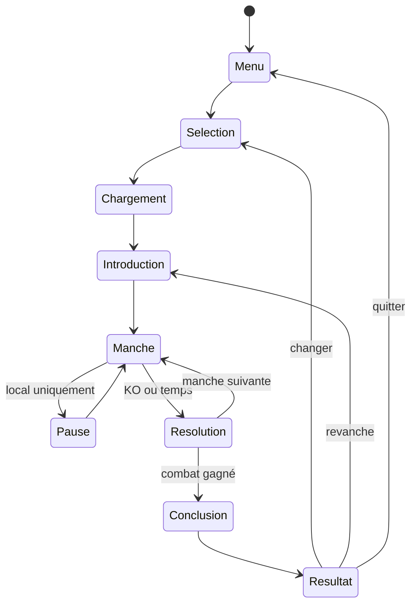

# Systèmes de combat et modes de jeu

## Statut et périmètre

Ce chapitre définit le fonctionnement proposé de HALF LIFE RESONANCE, mode de combat annexe de Half Life Administrator. Les règles, les affrontements entre personnages, les tournois et les événements de scénario sont une adaptation originale. Ils ne deviennent pas des événements canoniques de Half Life. La fidélité demandée concerne les identités, les équipements, les silhouettes, les environnements et les comportements reconnaissables. Les dimensions d’arène, les dégâts et les fenêtres d’action répondent aux besoins du jeu de combat.

Les chiffres ci-dessous constituent une base de prototype cohérente et modifiable. Ils ne représentent ni des mesures des jeux d’origine ni un équilibrage déjà validé. Le dépôt identifié est `darknigthmare/combine-administrator-simulator`, branche `master`, version déclarée `0.47.0`. L’intégration proposée s’appuie sur son environnement React, TypeScript, Vite, Zustand et Tauri. Aucun moteur de combat fonctionnel, service multijoueur, sprite animé complet ou résultat de test de performance ne doit être déduit de cette spécification.

## Contrat du combat

Le combat principal oppose deux personnages sur un plan latéral. La simulation avance à 60 ticks par seconde, indépendamment de la fréquence d’affichage. Un combat se gagne en remportant deux manches. Chaque manche commence avec la vie complète et dure 99 secondes de combat actif. Le chronomètre s’arrête pendant l’introduction, les pauses de contact, les séquences de super et les transitions. Les déplacements ne changent jamais la profondeur de collision.

La caméra cadre les deux combattants sans modifier leurs coordonnées physiques. Elle peut reculer légèrement pour un grand personnage ou une séparation importante, dans des limites communes à toutes les arènes homologuées. Les décors, la parallaxe et les particules n’ont aucune autorité sur les collisions. Le sol compétitif reste horizontal et continu. Les arènes à ascenseurs, effondrements ou changements de lieu appartiennent aux variantes spectacle et histoire.

| Paramètre | Valeur initiale | Rôle dans le prototype |
| --- | --- | --- |
| Simulation | 60 Hz | Résolution commune du mouvement, des impacts et des commandes |
| Vie de référence | 10 000 PV | Unité de comparaison des dégâts |
| Fourchette initiale des combattants | 9 000 à 11 500 PV | Différenciation des gabarits à équilibrer |
| Victoire | 2 manches gagnantes | Format standard local et en ligne |
| Durée d’une manche | 5 940 ticks actifs | 99 secondes hors suspensions prévues |
| Résonance | 0 à 300 points | Ressource commune de techniques avancées |
| Tampon d’action | 6 ticks | Tolérance au déclenchement à la fin d’une récupération |
| Fenêtre d’un quart de cercle | 20 ticks | Reconnaissance de commande, sans allonger la récupération |
| Fenêtre d’un double quart de cercle | 30 ticks | Commande des supers et ultimes |
| Déchoppe standard | 7 ticks | Fenêtre à partir du premier tick de saisie |
| Limite de projectiles persistants | 2 par combattant | Limite par défaut, exceptions explicitement documentées |
| Rebonds pendant un combo | 1 mural et 1 au sol | Protection contre les boucles de jonglage |
| Durée maximale de combo | 600 ticks actifs | Garde-fou de sortie forcée, à vérifier sur tous les kits |

Le compteur de manche compare les fractions de vie restantes à l’expiration du temps. Pour éviter les erreurs d’arrondi, il compare `vieA × maximumB` et `vieB × maximumA`. Un double KO simultané ou une égalité exacte produit une manche nulle. Celle-ci est rejouée à partir de son état initial, y compris les ressources, afin de ne pas permettre leur accumulation par répétition. Après trois manches nulles consécutives, le combat est déclaré nul et recommencé ; il ne rapporte aucun point de rencontre. En tournoi, l’organisateur conserve cette trace et peut suspendre le poste pour vérifier une défaillance. Aucun tirage aléatoire ne départage les joueurs.

## Commandes et apprentissage

Les commandes utilisent quatre boutons : L pour attaque légère, M pour attaque moyenne, H pour attaque lourde, S pour capacité propre au personnage. La notation numérique décrit les directions comme sur un pavé numérique lorsque le personnage regarde vers la droite : 6 avance, 4 recule, 2 s’accroupit, 8 saute. Les diagonales sont 1, 3, 7 et 9. Les directions relatives s’inversent lorsque le personnage change de côté ; les directions physiques enregistrées dans le replay restent inchangées.

| Entrée | Action universelle | Conditions |
| --- | --- | --- |
| 5L, 5M, 5H | Attaques debout | Variante proche uniquement si annoncée dans la fiche |
| 2L, 2M, 2H | Attaques accroupies | La propriété basse dépend du coup, jamais du seul dessin |
| j.L, j.M, j.H | Attaques aériennes | Fenêtres de réception définies par animation |
| 6H | Attaque de direction | Fonction exacte propre au kit et visible dans la liste |
| 5S | Trait du personnage | Ressource et restrictions indiquées dans son panneau |
| 6S | Interaction avec un accessoire | Seulement si un accessoire autorisé est à portée |
| 66 ou 44 | Ruée ou recul rapide | Vulnérabilités conservées et visibles en entraînement |
| L plus M | Projection avant | Au sol et à portée ; 4 plus L plus M projette derrière |
| Quart de cercle plus L, M ou H | Technique spéciale | Version et propriétés définies pour chaque kit |
| Commande de spéciale plus L et M | Version EX | 50 points et variante EX réellement disponible |
| 236236H | Super | 100 points de Résonance |
| 236236S | Ultime | 300 points de Résonance |
| 6 plus M plus H | Contre de garde | Pendant la garde, 100 points |
| M plus H plus S | Rupture défensive | Pendant une séquence autorisée, 200 points |

La reconnaissance donne priorité à une commande spéciale EX complète sur la projection L plus M. Si la ressource manque, l’action EX échoue sans déclencher une projection inattendue. Les commandes non reconnues n’exécutent pas automatiquement une autre technique coûteuse. Le journal d’entraînement affiche le motif de refus : ressource, portée, état, commande incomplète ou variante inexistante.

Dans un état qui les autorise, les commandes défensives complètes sont traitées d'abord, puis l'ultime, la super, l'EX, la spéciale, la projection, le trait, l'interaction et la normale. Ainsi 236236S ne déclenche pas accidentellement 5S ou 6S, et un contre de garde valide ne devient pas 6H. Une commande coûteuse reconnue sans ressource échoue sans repli vers une action simple. Deux directions physiques opposées simultanées donnent une direction neutre sur leur axe avant toute conversion en directions relatives. Le replay conserve les entrées physiques et la version de cette règle.

Le saut standard n’offre ni double saut ni ruée aérienne universelle. Ces possibilités demandent une justification de personnage et un coût réel dans son kit. Une option de commandes simplifiées permet d’associer les spéciales à des combinaisons directionnelles accessibles. Elle conserve les mêmes fenêtres, dégâts et coûts. La sélection du mode d’entrée est visible dans le lobby ; aucune macro ne produit un combo complet automatiquement en compétition.

## Garde et circulation de la pression

Maintenir l’arrière garde les attaques médianes et hautes. Maintenir arrière et bas garde les attaques médianes et basses. Une attaque en surplomb doit être gardée debout. La liste des coups et l’entraînement montrent ces propriétés séparément de l’animation. Une attaque aérienne n’est pas automatiquement imparable au sol. Les projections brisent la garde mais restent limitées par la portée, la préparation et la possibilité de déchoppe.

La garde aérienne bloque les projectiles et les attaques aériennes compatibles. Les anti-aériens au sol peuvent porter une propriété explicite qui interdit cette garde ; leur fiche doit l’indiquer. Après une garde aérienne, l’atterrissage impose douze ticks de récupération défensive. Cette règle empêche de contourner toute pression en sautant continuellement. Elle doit rester assez courte pour ne pas rendre la garde aérienne systématiquement perdante.

Une attaque normale ne provoque aucun dégât à travers la garde. Une spéciale inflige au maximum 5 % de ses dégâts de base, une EX 10 %, une super ou un ultime 10 %. Ces dégâts sont toujours non létaux : un personnage qui garde correctement conserve au moins 1 PV. Il faut donc ouvrir la défense, projeter ou provoquer une erreur pour terminer la manche. Aucun gain de Résonance ne provient de ces dégâts de garde.

Le contre de garde coûte 100 points au déclenchement. Il repousse et peut rendre de l’espace, mais ne démarre pas un long combo. Sa version commune inflige zéro dégât ; les effets visuels suivent l’équipement du personnage. Une feinte peut le provoquer et permettre de punir sa récupération. La rupture défensive coûte 200 points et ne peut réussir qu’une fois par combat. Elle ne fonctionne pas pendant une projection, une prise de boss ou une cinématique de super déjà confirmée. Si elle est autorisée, le coût et la consommation de l’usage sont appliqués même lorsqu’elle manque sa cible.

Les armes à feu conservent leur identité sans transformer chaque match en échange continu à longue distance. Les projectiles ont une préparation, une récupération, une vitesse et une durabilité documentées. Les tirs normaux ne sont pas des impacts instantanés sur toute la scène. Un personnage qui tire expose une zone de vulnérabilité ; ses fenêtres de rechargement ou de refroidissement figurent dans le kit. Les projectiles compatibles peuvent se neutraliser selon une règle de durabilité. Les exceptions lourdes sont limitées à une instance et signalées avant leur départ. La ruée ne rend pas universellement invincible : avancer au bon moment, utiliser la garde, sauter avec discernement et exploiter une récupération restent les réponses communes.

## Résonance et ressources propres

La Résonance commence à zéro au premier round et se conserve entre les manches d’un même combat. Elle revient à zéro au combat suivant. Elle ne représente pas une énergie scientifique canonique partagée par tous les personnages : c’est une ressource de jeu, présentée par des effets adaptés à chaque identité. Les combattants peuvent disposer en plus d’une ressource propre, comme des charges ou une réserve d’objets, mais son panneau doit rester distinct.

| Dépense | Coût | Usage et limite |
| --- | --- | --- |
| Spéciale EX | 50 | Renforcement défini de la technique ; aucune propriété implicite |
| Super | 100 | Confirmation offensive ou réponse spécialisée |
| Contre de garde | 100 | Dégagement défensif pendant la garde |
| Rupture défensive | 200 | Une tentative par combat, hors prises et cinématiques |
| Ultime | 300 | Engagement de toute la réserve ; séquence courte et identifiable |
| Fatalité de fin de combat | 0 | Exécution facultative après résultat déjà acquis |

Un impact ordinaire rapporte à l’attaquant 1 point pour 100 PV effectivement retirés, après réduction des combos. Le défenseur reçoit 0,5 point pour les mêmes 100 PV. Les EX, supers, ultimes, contres de garde, ruptures et dangers du décor ne produisent aucun gain pour aucun des deux camps. Rater, garder ou provoquer des dégâts de garde ne produit aucun gain. Cette règle évite le remplissage de jauge à distance sans prise de risque.

Le calcul interne utilise des millipoints entiers : 1 PV retiré rapporte 10 millipoints à l’attaquant et 5 au défenseur. La jauge possède donc 300 000 unités internes. Il n’y a ni erreur cumulative de virgule flottante ni dépendance à la fréquence d’affichage. Le coût est débité à l’entrée effective dans l’action, après validation de l’état ; une animation interrompue ensuite ne rembourse pas la ressource. Les actions refusées avant leur entrée n’en consomment aucune.

Les charges propres reviennent au début d’une manche selon leur fiche. Elles ne persistent jamais implicitement depuis le mode de gestion. Les récompenses de campagne, les cosmétiques et la progression ne modifient pas la vie, les dégâts, la réserve initiale ou les fenêtres des matchs compétitifs.

## Combos et états d’impact

La chaîne commune va de L vers M puis H, avec une utilisation de chaque niveau dans cette chaîne. Les annulations vers une spéciale et d’une spéciale vers une super dépendent de fenêtres écrites dans les données. Une icône dans la liste des coups indique si l’annulation fonctionne sur impact, sur garde ou dans les deux cas. Les attaques ratées ne s’annulent pas universellement. Les ouvertures, les projections, les renversements et les anti-aériens produisent ainsi des routes différentes.

La réduction des dégâts commence à 100 % au premier coup, puis passe à 90, 80, 70, 60, 50, 45, 40 et enfin 30 % pour les coups ordinaires suivants. Les supers suivent la réduction du combo avec un plancher propre de 15 % ; les ultimes ont un plancher de 20 %. La réduction s’applique par impact dommageable, y compris les multihits. Les données peuvent imposer un prorata de départ plus faible à une ouverture particulièrement sûre. Les valeurs finales sont arrondies vers le bas, avec un minimum de 1 PV pour un impact réellement dommageable.

L’objectif d’équilibrage initial est de maintenir la plupart des routes sans ressource sous 45 % de la vie de référence et les routes coûteuses sous 65 %. Ce sont des seuils de revue, pas une coupure automatique des dégâts. Le moteur limite en revanche les rebonds et le temps de contrôle retiré au défenseur. Un seul rebond mural et un seul rebond au sol sont disponibles par combo. Le budget initial de jonglage est de douze unités ; chaque relance consomme le nombre indiqué dans sa fiche.

À l’épuisement du budget, l’adversaire devient invulnérable aux relances et retombe vers une récupération sûre. Après 600 ticks actifs sans reprise de contrôle, une sortie forcée se déclenche à la prochaine borne sûre de l’action. Une cinématique en cours se termine d’abord ; elle ne peut pas enchaîner vers une nouvelle capture. Le compteur n’est pas remis à zéro par un changement d’animation, un projectile différé ou un changement de côté. Une vraie remise à zéro nécessite un retour à un état où le défenseur pouvait agir.

La séparation des états doit rester explicite : impact léger, impact lourd, lancement, chute, rebond, renversement et relevée ne sont pas des noms interchangeables. La relevée propose une récupération immédiate ou retardée lorsque le type de chute l’autorise. Une séquence de fatalité ne partage aucun état avec les combos : elle intervient après la décision du match.

## Physique et versions des arènes

Chaque arène possède deux profils. Le profil tournoi conserve le fond animé, l’ambiance et les effets non interactifs, avec un sol et une collision normalisés. Le profil spectacle active les accessoires, les dangers annoncés, les transitions et les finishers de décor. L’écran de sélection affiche clairement lequel est choisi. Une même image de fond ne suffit pas à considérer une arène comme intégrée : collision, limites de caméra, couches indépendantes, son et conditions de victoire doivent aussi exister.

L’interaction 6S ne cible qu’un accessoire autorisé présent dans la zone d’action du combattant. Une petite indication apparaît à portée ; sans cible valide, l’entrée reste sans effet. Chaque joueur dispose d’un quota de deux interactions par manche dans le profil spectacle de base. Un accessoire saisi, projeté ou détruit suit un état déterministe et ne réapparaît pas avant la manche suivante. Les objets visuels de fond ne deviennent jamais des projectiles par simple proximité.

Un accessoire ne traverse pas automatiquement tous les tirs. Il possède une masse de jeu, une durabilité et un groupe de collision. Sa trajectoire est calculée par la simulation du combat ; les animations de débris restent décoratives. Les dangers ne s’activent pas aléatoirement pendant un combo sans avertissement. Tout danger influant sur les PV dispose d’une annonce lisible, d’une fenêtre d’évitement et d’un statut explicite dans les règles du lobby.

La parallaxe utilise des couches séparées : ciel ou vide lointain, masses architecturales, activité de fond, plan de combat, avant-plan et effets atmosphériques. Les vitesses relatives sont exprimées par rapport au déplacement de caméra, jamais par rapport à la vitesse d’affichage. Les éléments d’avant-plan ne masquent pas les pieds ni les attaques basses. Une option de visibilité réduit fumée, poussière, flashes et particules sans supprimer les informations nécessaires au jeu.

## Offre de modes

| Mode | Boucle principale | Résultat conservé |
| --- | --- | --- |
| Histoire | Chapitres scénarisés, combats, scènes et choix de parcours | Progression, scènes vues et fins obtenues |
| Arcade | Parcours propre au personnage avec rival et boss | Score, difficulté et ending débloqué |
| Versus local | Combat sur un même poste | Historique facultatif, revanche immédiate |
| Versus en ligne | Rencontres selon les règles du salon | Résultat, replay et qualité de connexion |
| Classé | Matchmaking sous règles homologuées | Classement séparé de la campagne |
| Tournoi | Tableau, postes, rencontres et arbitrage | Bracket vérifiable et champion |
| Équipe | Relais de trois combattants, sans tag instantané initial | Résultat de l’équipe et ordre choisi |
| Survie | Combats successifs avec récupération limitée | Meilleure série par personnage |
| Boss | Rencontres à phases et objectifs spécifiques | Médailles et variantes débloquées |
| Défis | Exercice ciblé, route de combo ou situation tactique | Validation et meilleure exécution |
| Entraînement | Laboratoire libre avec données et mannequins | Réglages et enregistrements locaux |
| Galerie | Relecture des intros, fins, costumes et dossiers | Collection de contenus vus |

Le mode histoire utilise un graphe de chapitres. Chaque nœud possède des prérequis, une scène d’introduction, les adversaires, un profil de règles, les scènes de victoire et de défaite, puis la sortie suivante. Les combats entre alliés doivent avoir une raison écrite, telle qu’une simulation ou une épreuve ; ils ne sont pas présentés comme des affrontements historiques. Les choix peuvent ouvrir des variantes narratives, sans imposer de différences de puissance en versus.

L’arcade comprend six combats ordinaires, un rival et un boss, soit huit étapes par parcours. L’intro de personnage établit son objectif. La rencontre de rival utilise une scène spécifique et une réponse de victoire cohérente. L’ending ferme ce parcours et porte son statut d’interprétation originale. Les défaites proposent recommencer, changer de difficulté ou revenir au menu ; un changement de difficulté est enregistré pour le score. Les intros passent individuellement en jeu local et d’un commun accord en ligne, avec une limite d’attente.

La survie restaure 15 % de la vie maximale après une victoire, sans dépasser le maximum, et conserve la Résonance dans cette seule variante. Le relais par équipes réinitialise les ressources du nouvel entrant ; le survivant récupère 10 % de sa vie maximale entre adversaires. Ces deux exceptions sont visibles avant le départ et n’affectent jamais les règles du duel standard.

## Tournois et rencontres

Le tournoi local gère des tableaux à élimination simple ou double de 4, 8, 16 et 32 places. Un tournoi accepte 4 à 32 participants; le nombre de places est la plus petite de ces tailles permettant de les accueillir. Les places vides produisent des exemptions selon le placement publié du tableau, sans victoire de combat inventée. Douze participants occupent ainsi un tableau de seize places avec quatre exemptions. Une rencontre se joue au premier joueur remportant deux combats. Les finales des tableaux gagnants, perdants et la grande finale se jouent au premier remportant trois combats, sauf règle publiée avant le lancement.

En double élimination, un participant quitte le tournoi après deux défaites de rencontre. Le vainqueur du tableau gagnant arrive en grande finale sans défaite. Si le vainqueur du tableau perdant gagne leur première rencontre, les deux participants ont une défaite et une seconde rencontre complète décide du tournoi. Ce reset doit apparaître dans le tableau, la sauvegarde et le commentaire de résultat. Un changement de personnage ou d’arène entre les deux rencontres suit les mêmes règles qu’entre les combats ordinaires.

Le gagnant d’un combat conserve son personnage. Le perdant peut changer de personnage ou demander une autre arène homologuée selon le règlement choisi. L’ordre de décision est enregistré pour éviter de choisir après avoir vu la sélection cachée adverse. Les costumes purement visuels restent autorisés sous réserve de lisibilité et d’absence de confusion d’équipe. Une configuration verrouillée conserve le checksum des règles et des catalogues utilisés.

Le module prévoit inscriptions, noms de joueurs, classement initial facultatif, attribution des postes, appel de rencontre, saisie du résultat, validation et correction avant propagation. Une correction tardive affiche les rencontres qu’elle invalide ; elle ne réécrit pas silencieusement une finale déjà jouée. Une déconnexion ne produit pas un résultat arbitraire : l’état suspendu attend la politique annoncée de reprise, abandon ou décision d’arbitrage. Le tournoi peut être sauvegardé et repris sans recalculer les appariements déjà validés.

## Fatalités et séquences de conclusion

Les fatalités sont des conclusions facultatives après la victoire du combat, jamais une méthode pour annuler un résultat déjà établi. Une fenêtre de cinq secondes permet de choisir une fatalité propre au personnage, une conclusion de décor disponible ou une victoire courte. Aucun choix ne coûte de Résonance et aucun équipement de campagne ne conditionne son accès en versus. L’absence d’entrée lance la pose de victoire normale.

La mise en scène reprend les moyens, sons, armes et phénomènes associés à l’univers : téléportation, gravité, énergie, capture, désintégration ou danger industriel. La bible de personnage précise la différence entre une action observée dans les jeux et sa transposition de finisher. Le moteur vérifie la compatibilité du squelette de victime, du gabarit et du décor. Si une séquence ne convient pas à une créature particulière, il utilise une variante écrite ou la victoire courte, sans déformer le modèle pour forcer une animation humaine.

Une option de violence réduite remplace le plan final par une disparition, une mise hors combat ou une coupe de caméra adaptée. Elle ne change ni le timing du résultat ni le score. Les captures de replay mémorisent le résultat et l’identifiant de séquence, mais le spectateur peut conserver son propre réglage de visibilité. Les adversaires humains alliés peuvent disposer de conclusions de neutralisation pour préserver la cohérence du parcours.

## Entraînement et accessibilité

Le laboratoire affiche inputs, avantages de frames, dégâts, réduction de combo, coûts, positions et raisons de refus. Les zones de collision distinguent collision corporelle, zone vulnérable, zone d’attaque et saisie par des couleurs doublées de motifs. L’avance image par image fonctionne sur les ticks simulés. La pause conserve l’état exact, y compris les projectiles, accessoires, ressources et compteurs de combo.

Le mannequin peut garder toujours, après le premier coup, aléatoirement selon une graine visible, ou selon un enregistrement. Il peut contre-attaquer sur relevée, après garde ou après récupération. Cinq enregistrements par personnage peuvent être lus séparément ou mélangés avec des poids explicites. L’outil permet de repositionner les deux combattants au centre ou dans un coin, puis d’enregistrer cette situation pour la retrouver après une action.

Les exercices enseignent successivement déplacement, garde, projection, anti-aérien, punition, confirmation, Résonance et gestion d’un projectile. Une réussite n’exige pas seulement une entrée : elle exige le résultat appris. Punir consiste ainsi à toucher avant que le mannequin ait retrouvé la garde. Les routes de combo affichent les fenêtres nécessaires et distinguent une version simple d’une route optimale.

Les commandes sont remappables au clavier et à la manette, avec plusieurs boutons accessibles pouvant produire une combinaison simultanée autorisée. Les avertissements visuels disposent d’un équivalent sonore et les informations sonores importantes d’un équivalent visuel. Sous-titres, taille de texte, intensité des secousses, flashes, contraste des silhouettes et vitesse des menus sont réglables. La réduction de vitesse est réservée à l’entraînement et à certaines aides de campagne ; elle n’affecte pas un adversaire en ligne. L’assistance narrative peut réduire une difficulté sans cacher ce choix dans les résultats.

## Interface et progression

Le menu du mode ouvre Histoire, Arcade, Versus, Tournoi, Entraînement, Défis, Galerie et Options. La sélection affiche identité, épisode de référence, rôle, difficulté de prise en main, costumes compatibles et résumé du trait. Les versions d’un personnage qui modifient réellement ses outils sont des variantes de kit clairement nommées. Un costume ne peut pas devenir une modification cachée de statistiques.

Le HUD réserve la partie supérieure aux vies, aux manches et au chronomètre. La Résonance et les ressources propres occupent la partie basse, avec chiffres optionnels. Les indications de contre, punition et rupture restent brèves et ne couvrent pas les combattants. Le côté de l’écran et la couleur d’équipe servent simultanément de repères. Un écran de résultat présente les décisions utiles : revanche, changement de personnage, détails du combat, sauvegarde du replay et retour.

La progression déverrouille galeries, palettes, variantes de présentation, fiches et défis. Les kits compétitifs ne gagnent pas de puissance. La progression du mode annexe est isolée de celle de la gestion ; une récompense croisée, si elle est retenue, ne transporte qu’un identifiant cosmétique ou un succès. Effacer une sauvegarde de combat ne doit jamais supprimer une campagne de gestion.

## Architecture proposée pour le projet

L’implantation proposée réside dans `src/features/resonance`. Elle doit être adaptée après lecture des conventions du dépôt, sans présumer l’existence d’une route ou d’un composant portant ce nom. React gère les menus, la sélection et les panneaux. La simulation doit vivre dans un noyau TypeScript indépendant du rendu. Zustand peut exposer les états de navigation, options et progression ; il ne doit pas imposer un rendu React complet à chaque tick de combat. Tauri fournit les services natifs nécessaires à la sauvegarde ou aux périphériques, derrière des interfaces remplaçables.

Les catalogues contiennent identifiants stables, références visuelles, commandes, données de frames, ressources, scènes narratives et critères de disponibilité. Une action ne devient sélectionnable que lorsque son animation, sa collision, ses coûts et ses transitions sont validés. Un fichier de prompt ou une image fixe reste un élément de production, sans se déclarer animation intégrée.

La résolution du KO clôt la production de dégâts avant le début de la conclusion. Une pause locale suspend la simulation ; en ligne, ouvrir les options ne la suspend pas. Un chargement incomplet empêche l’introduction, puis affiche le contenu manquant et une sortie propre. Chaque transition dispose d’un point de sauvegarde autorisé ; aucune sauvegarde de progression ne s’écrit au milieu d’une transaction de récompense.

Le multijoueur à rollback est un objectif technique, non une fonctionnalité annoncée comme disponible. Il nécessite une simulation déterministe, un état sérialisable, un historique d’inputs, des instantanés et la reproduction des mêmes résultats après resimulation. Les nombres physiques doivent employer des unités entières ou un format fixe. Le générateur aléatoire possède une graine explicite. Les sons et particules se déclenchent à partir d’événements identifiés pour éviter les doublons lors d’un retour en arrière. Le service de classement, l’authentification et le matchmaking constituent des composants distincts à construire.

Un replay stocke version de schéma, version des règles, identifiants de personnages et d’arène, options influentes, graine et inputs. Un replay d’une version incompatible n’est pas relu comme s’il était fiable : le lecteur signale la différence ou utilise le moteur compatible conservé. Les échanges réseau ne font jamais confiance aux dégâts déclarés par le client ; ils doivent être reconstruits depuis les entrées validées et les règles du match.

## Production et critères de validation

La première tranche jouable doit réunir deux combattants contrastés, une arène homologuée, une scène d’introduction, un parcours court, un écran de résultat et un entraînement utilisable. Elle doit permettre de vérifier la sensation des déplacements, la lisibilité des impacts et la cohérence des données avant de multiplier les personnages. Cette étape n’impose pas de renoncer au roster complet : elle protège la production de centaines d’animations fondées sur une échelle ou des timings incorrects.

Chaque combattant doit ensuite satisfaire une même définition de terminé : silhouettes validées pour la référence choisie ; animations d’entrée, idle, marche, ruée, recul, saut, garde, impacts, chute et relevée ; normales, spéciales, EX, projections, super et ultime ; poses de victoire et défaite ; scènes narratives ; sons ; costumes ; collisions ; données lisibles ; compatibilité avec tous les gabarits de victimes. Les portraits et poses fixes doivent rester comptés séparément de ces séquences.

La validation des règles couvre au minimum les changements de côté pendant une commande, les EX sans jauge, les impacts simultanés, les KO pendant un projectile persistant, les rebonds déjà consommés, les différences de vie maximale au temps, les trois manches nulles, les ressources conservées entre manches et leur remise à zéro au combat suivant. Les tests de tournoi couvrent les exemptions, la descente dans le tableau perdant, le reset de grande finale, les corrections de score et la reprise de sauvegarde.

La validation de présentation examine toutes les arènes aux positions extrêmes de caméra, tous les personnages en miroir, les corps de tailles différentes et les effets les plus lumineux. Les tests de réseau, lorsqu’il existera, doivent comparer les checksums d’état sur des replays identiques et simuler latence, pertes de paquets et resimulations. Une cible de 60 images par seconde doit être mesurée sur une machine explicitement décrite ; elle ne peut pas être déduite du seul choix de moteur.

Le registre de production distingue proposé, documenté, image générée, image contrôlée, animation produite, intégré et vérifié en jeu. Le passage d’un statut à l’autre exige une preuve correspondante. La bible et les contrats de données établissent ainsi une base exploitable sans confondre conception, génération visuelle et fonctionnalités déjà jouables.
