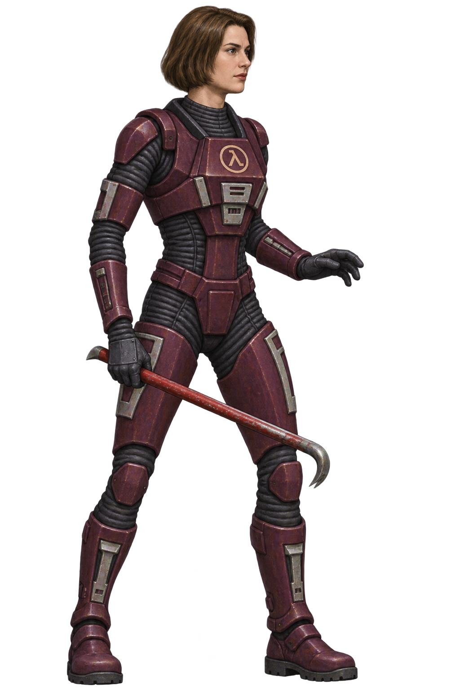
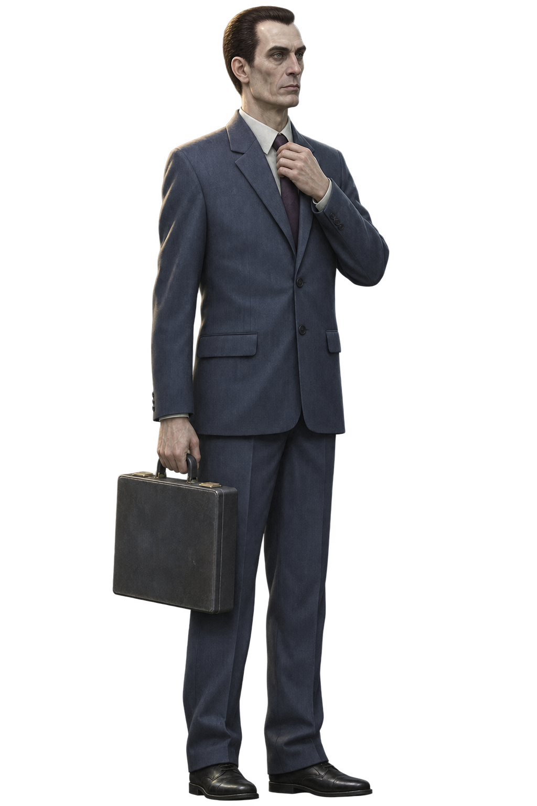
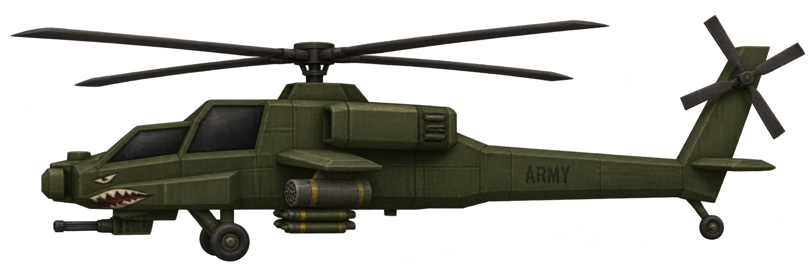
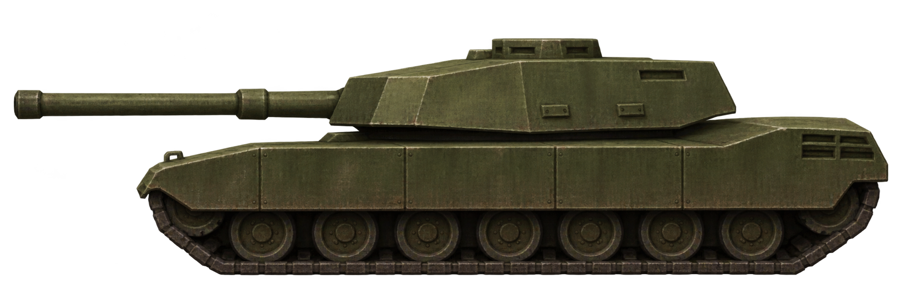
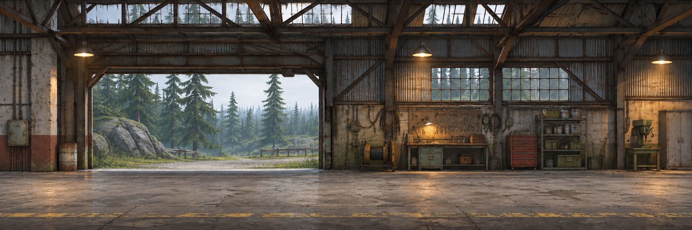

# Reprise du 20 novembre 2026 — lot B

Cette reprise part du commit distant `aa2eb7224911be62214fc019b4a823269eb6252c` et de la PR #1. Le lot précédent évoqué dans les conversations n’étant pas récupérable, cette livraison s’appuie uniquement sur des fichiers effectivement présents et sur de nouvelles demandes journalisées.

## Livré dans ce lot

- 102 cibles ajoutées au catalogue: 50 personnages/créatures/petites machines, 16 costumes, 22 stages, 4 rencontres de machines et 10 archives.
- Six PNG supplémentaires couvrant cinq sujets: Colette, G-Man, Apache HECU, Abrams HECU, White Forest avec sa correction v2. La v1 est conservée pour la revue et ne compte pas comme une arène supplémentaire.
- Douze PNG au total dans le dépôt, tous décodés localement et recensés par SHA256. Vingt demandes de livrables/versions conservées, dont huit refus (cinq dans ce lot). Un essai de détourage non retenu est décrit séparément.
- Bible Markdown 1.2, file des cibles manquantes, audit reproductible et galerie. Les exports Word/Excel v1 restent historiques; cette extension n’est pas incluse dans ces deux anciens exports.

## Résultats graphiques

| Sujet | Fichier | Dimensions | État |
|---|---|---|---|
| Colette Green — Decay | [colette_decay_idle_right.png](../../../../assets/resonance/candidates/continuation_20261120_b/colette_decay_idle_right.png) | 1024 × 1536 | candidat à vérifier |
| G-Man — Half-Life 2 | [gman_hl2_idle_right.png](../../../../assets/resonance/candidates/continuation_20261120_b/gman_hl2_idle_right.png) | 1024 × 1536 | candidat à vérifier |
| Apache HECU — Half-Life | [apache_hecu_hl1_hover_left.png](../../../../assets/resonance/candidates/continuation_20261120_b/apache_hecu_hl1_hover_left.png) | 2172 × 724 | candidat à vérifier |
| White Forest — première version | [stage_whiteforest_ep2_hangar_master.png](../../../../assets/resonance/candidates/continuation_20261120_b/stage_whiteforest_ep2_hangar_master.png) | 2172 × 724 | révision requise |
| Abrams HECU — Half-Life | [abrams_hl1_idle_left.png](../../../../assets/resonance/candidates/continuation_20261120_b/abrams_hl1_idle_left.png) | 2172 × 724 | candidat à vérifier |
| White Forest — correction forêt | [stage_whiteforest_ep2_hangar_master_v2.png](../../../../assets/resonance/candidates/continuation_20261120_b/stage_whiteforest_ep2_hangar_master_v2.png) | 2172 × 724 | candidat à vérifier |

## Fidélité et contrôle visuel

Les images sont des candidats de production. Aucun asset n’est certifié 1:1. Les visages, panneaux d’armure, silhouettes de véhicules et plans des lieux doivent encore être confrontés à des captures originales accessibles.
Colette et G-Man sont cadrés en pied. L’alpha est réel; les contrôles détectent des franges à faible alpha et une opacité du corps légèrement inférieure à 255. Un essai de nettoyage Colette n’a pas apporté assez d’amélioration et a été écarté, sans modifier le fichier conservé.
White Forest v1 ajoutait des silos extérieurs non confirmés. La v2 les retire et prolonge la forêt. Cette correction ne valide pas le plan exact du hangar. Les deux images restent des maîtres composites, sans six couches séparées.
Les deux véhicules conservent un seul sujet complet par image. Leur géométrie doit être revue face aux modèles/brushes HL1; aucune animation de rotor, chenille, attaque ou destruction n’est livrée.

## Demandes refusées dans ce lot

Kleiner, Eli Vance, Gonarch, tourelle sentinelle Portal 2 et tourelle défectueuse Portal 2. Le service image_gen a refusé automatiquement ces sorties. Aucun fichier n’est associé à ces demandes et aucune reformulation de contournement n’a été utilisée.

## Vérifications

- `node scripts/audit-resonance-production.mjs --write-report`: douze PNG vérifiés, aucun non recensé, aucune erreur, aucun avertissement.
- `node scripts/validate-resonance-design.mjs`: réussi, notamment provenance des images et cohérence des données historiques.
- `node scripts/validate-resonance-boss-design.mjs`: réussi; quatre boss jouables et les 72 groupes visuels prévus restent distincts des PNG candidats.
- `npm run quality`: réussi, avec 28 tests, matrice de 252 configurations, lint et compilation TypeScript/Vite.
- Revue des PNG et contrôles alpha effectués. Aucun nouveau comportement de jeu ni animation n’est ajouté dans ce lot; la vérification visuelle interactive du prototype reste celle à compléter dans son rapport propre.

## Reprendre ensuite

Consulter `../MISSING_TARGETS.md`, `../../data/production_queue.json` et `../../data/generated_art_register.json`. Commencer par récupérer les références exactes pour contrôler les cinq sujets produits; poursuivre ensuite les priorités P0 déjà documentées, puis les couches de stages. Ne pas déduire de complétude à partir des anciens nombres annoncés.

Les prompts exacts sont dans `character_generation.json`, `boss_generation.json`, `stage_revision.json` et le registre général. Toutes les demandes de ce lot utilisent Imagegen intégré.

## Galerie de la sélection courante

### Colette Green — Decay

### G-Man — Half-Life 2

### Apache HECU — Half-Life

### Abrams HECU — Half-Life

### White Forest — correction forêt

