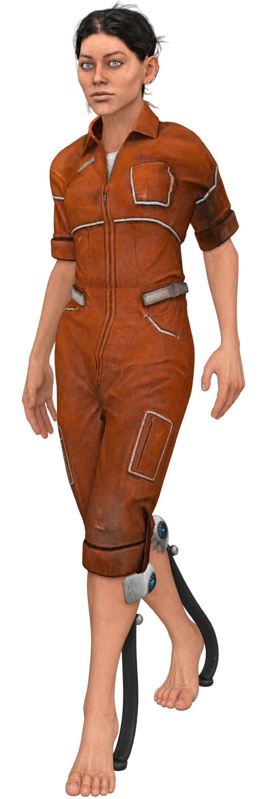
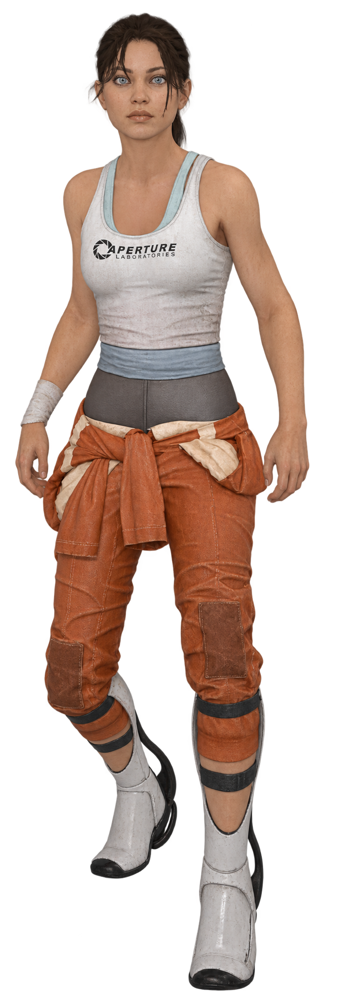
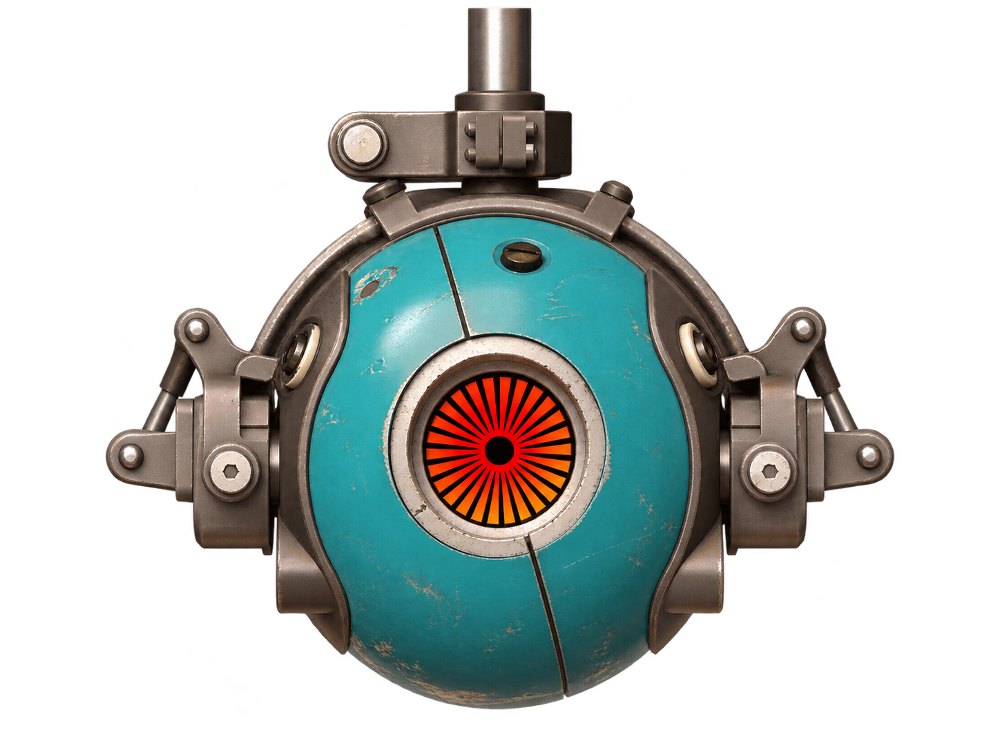
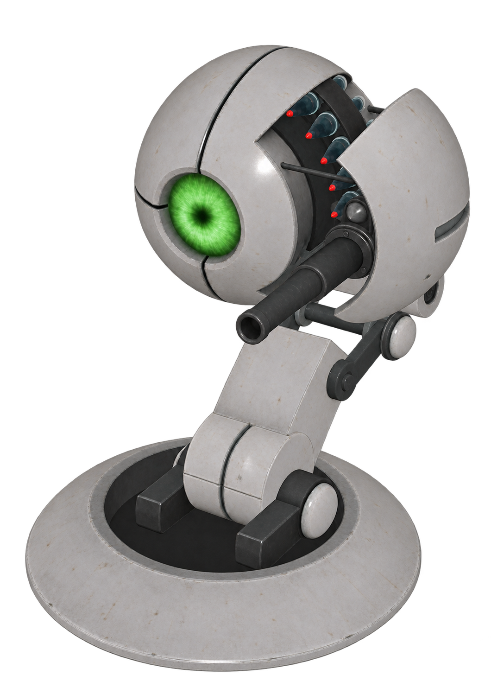
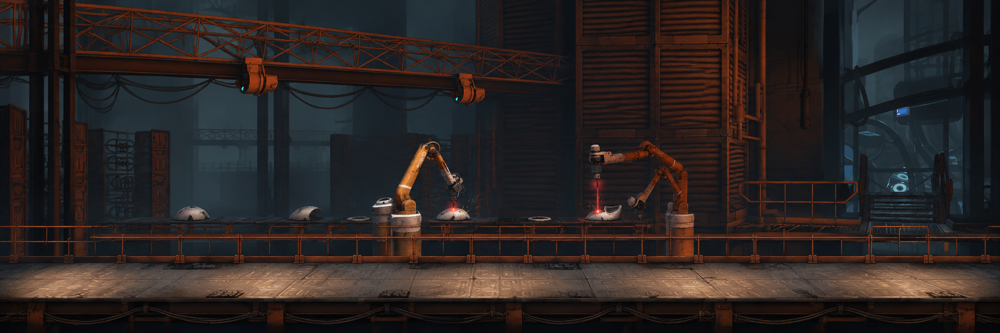
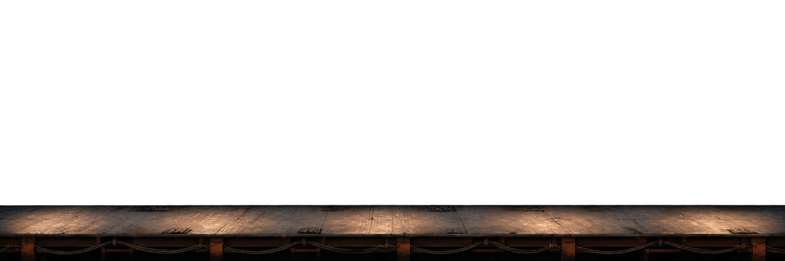

# Reprise du 20 novembre 2026 — lot C, Portal et Aperture

Ce lot poursuit la [PR #2](https://github.com/darknigthmare/combine-administrator-simulator/pull/2), après publication du lot B au commit `445dd6cab16bf180d8d3582c548166a875002fcd`. Il réutilise les cibles déjà répertoriées : aucune nouvelle entité n’est ajoutée pour augmenter artificiellement le catalogue.

## Résultat réel

**Sept PNG conservés pour cinq cibles de production** : Chell Portal 1, la tenue Chell Portal 2, Grady, Rocket Turret et la chaîne de fabrication. Les deux versions de Rocket Turret représentent un seul sujet. Le maître de la chaîne et son sol représentent un seul stage en cours de production.

| Sujet | Fichier | Dimensions | État |
|---|---|---|---|
| Chell — apparence Portal 1 | [chell_portal1_idle_c.png](../../../../assets/resonance/candidates/continuation_20261120_c/chell_portal1_idle_c.png) | 725 × 2170 | Pose de référence, contours et marges à reprendre |
| Chell — tenue Portal 2 | [costume_chell_portal2_idle_c.png](../../../../assets/resonance/candidates/continuation_20261120_c/costume_chell_portal2_idle_c.png) | 736 × 2135 | Costume candidat, franges à corriger |
| Grady — noyau Desk Job | [grady_deskjob_core_idle_c.png](../../../../assets/resonance/candidates/continuation_20261120_c/grady_deskjob_core_idle_c.png) | 1448 × 1086 | Noyau et attaches uniquement, bras complet non produit |
| Rocket Turret — v1 | [rocket_turret_portal1_idle_left_c.png](../../../../assets/resonance/candidates/continuation_20261120_c/rocket_turret_portal1_idle_left_c.png) | 1060 × 1484 | Historique, cadrage trop serré |
| Rocket Turret — v2 | [rocket_turret_portal1_idle_left_v2_c.png](../../../../assets/resonance/candidates/continuation_20261120_c/rocket_turret_portal1_idle_left_v2_c.png) | 1060 × 1484 | Cadrage amélioré, candidate préférée pour revue |
| Chaîne de fabrication — maître | [stage_portal2_turret_factory_master_c.png](../../../../assets/resonance/candidates/continuation_20261120_c/stage_portal2_turret_factory_master_c.png) | 2172 × 724 | Composition latérale candidate |
| Chaîne de fabrication — sol L5 | [layer_portal2_turret_factory_floor_c.png](../../../../assets/resonance/candidates/continuation_20261120_c/layer_portal2_turret_factory_floor_c.png) | 2172 × 724 | Couche avec alpha, à contrôler en composition |

Les dix demandes du lot ont produit sept fichiers. **Wheatley, ATLAS et P-body ont été refusés automatiquement à la sortie** (`moderation_blocked`, catégorie `other`). Aucun fichier n’est associé à ces trois demandes ; aucune relance n’a été effectuée. Les prompts complets, erreurs et références figurent dans [generation_register.json](generation_register.json), avec le détail des deux robots dans [coop_character_generation.json](coop_character_generation.json).

## Références et contrôle visuel

Les deux apparences de Chell proviennent de références de modèles distinctes relayées par Portal Wiki. La combinaison fermée et les supports de genoux de Portal 1 ne sont pas remplacés par le débardeur et les Long Fall Boots de Portal 2. Les ressorts de talon de cette seconde tenue sont présents dans le PNG. La revue trouve néanmoins des franges colorées, une orientation presque frontale et des pieds sur deux niveaux. Ces fichiers servent de références de personnage et de costume ; ils ne sont pas des gardes latérales prêtes pour le moteur.

Rocket Turret utilise la référence du modèle `props_bts/rocket_sentry`. La v2 dégage la tête et le socle des limites du cadre ; la marge demandée n’est pas atteinte uniformément et des résidus faibles subsistent. Les deux images conservent l’iris vert, la coque ouverte, le lanceur et le support articulé. Elles ne créent pas deux boss et ne livrent aucune animation de tir.

Grady est issu d’une capture Steam officielle d’Aperture Desk Job. Le fichier représente son noyau turquoise, son iris radial et des attaches ; la grue, la main, le câble, les expressions et leurs animations restent à réaliser. Le bras complet n’est pas annoncé comme livré. La continuité Desk Job demeure séparée dans le catalogue.

La chaîne reprend les matériaux et machines de deux captures Steam officielles de Portal 2 : bras orange, tapis, panneaux industriels, passerelles et profondeur bleutée. Son organisation est recomposée pour une voie de combat horizontale. Cette adaptation est documentée ; elle ne reproduit pas le niveau original pixel par pixel. La couche L5 conserve les dimensions du maître et occupe le bas du cadre, avec le haut transparent. Une extraction générative ne garantit pas une identité des textures au pixel près.

Chaque référence utilisée possède un identifiant, une URL, des dimensions et une empreinte dans le registre. Les références tierces sont distinguées des captures officielles. Elles ne sont pas comptées comme des créations du lot.

## Plans de parallaxe de la chaîne

| Plan | Contenu prévu | Parallaxe | Production |
|---|---|---:|---|
| L1 | Atmosphère du puits industriel | 0 | À produire |
| L2 | Charpentes et passerelles lointaines | 0,12 | À produire |
| L3 | Parois et structures industrielles | 0,30 | À produire |
| L4 | Convoyeur et bras d’assemblage en arrière-plan | 0,55 | À produire |
| L5 | Sol de combat plat | 1 | Candidat présent, composition à vérifier |
| L6 | Bordure de premier plan | 1,10 | À produire |

Le maître sert de référence d’assemblage. Il ne remplace aucun des plans manquants. Les lumières de soudure devront être contrôlées avec les combattants avant un éventuel réglage de contraste.

## Bible 1.3

Le nouveau [chapitre Aperture](../../chapters/aperture_combat_design_20261120.md) et son [contrat JSON](../../data/aperture_combat_design_20261120.json) enrichissent huit cibles existantes :

- Trois kits ATLAS, P-body et Chell, totalisant **69 actions proposées** : 30 normales, six projections, trois traits, quinze spéciaux, neuf variantes EX et six supers/ultimes.
- Douze routes proposées et les parcours d’intro, rival, victoire, ending et finisher. Les textes sont des créations de Resonance.
- Une fiche de costume Portal 2 et une assistance Wheatley.
- Une rencontre Rocket Turret à trois phases : trois objectifs du décor puis sortie. La tourelle n’a pas de barre de PV et ne meurt pas d’une roquette retournée sur elle.
- Deux plans d’arènes, hub coop et ancien Aperture, avec douze couches prévues, vingt-sept types de clips communs et douze scénarios de vérification après implémentation.

Ces valeurs, commandes, phases et scènes sont des propositions de conception. Elles ne sont pas intégrées au moteur par ce lot et ne transforment pas les trois refus d’images en résultats graphiques.

## État consolidé et vérifications

Après ce lot, le registre contient **19 PNG distincts**, **30 demandes**, **11 refus**, et un essai antérieur non retenu décrit séparément. Les **187 cibles** restent inchangées : **13** possèdent au moins un fichier associé et **174** restent sans fichier. Aucune cible n’est automatiquement déclarée terminée.

Les validateurs de conception et Boss Battle passent. L’audit des fichiers vérifie présence, en-tête, dimensions, tailles et empreintes des dix-neuf PNG sans erreur ni avertissement. Les sept nouveaux fichiers ont aussi été décodés et inspectés. La synchronisation du catalogue conserve un avertissement historique : douze réserves n’ont pas encore de champ `source_game` explicite. Leur valeur reste inconnue dans la file plutôt qu’inférée depuis leur identifiant.

La revue indépendante de la bible ne trouve pas d’incohérence matérielle dans les comptes, coûts, timings ou la séparation entre source et adaptation. **Aucune certification visuelle 1:1, animation complète, arène à six couches ou nouvelle intégration moteur n’est déclarée.** Les corrections visuelles sont détaillées dans [validation_summary.json](validation_summary.json).

## Galerie de revue

### Chell — Portal 1

### Chell — tenue Portal 2

### Grady — noyau

### Rocket Turret — v2

### Chaîne de fabrication — maître et sol

