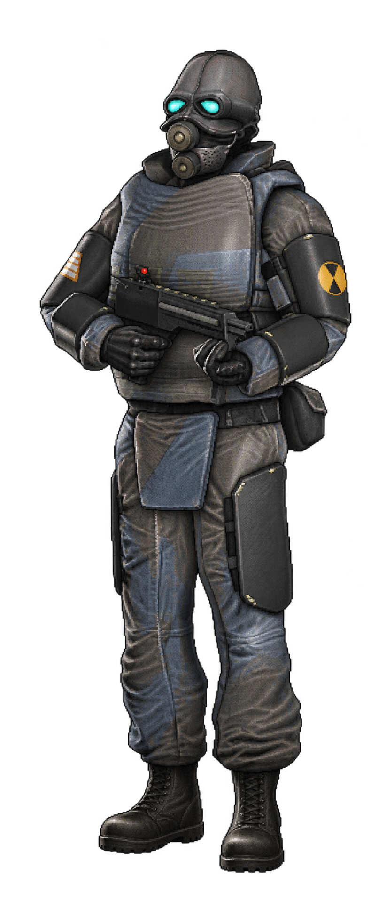
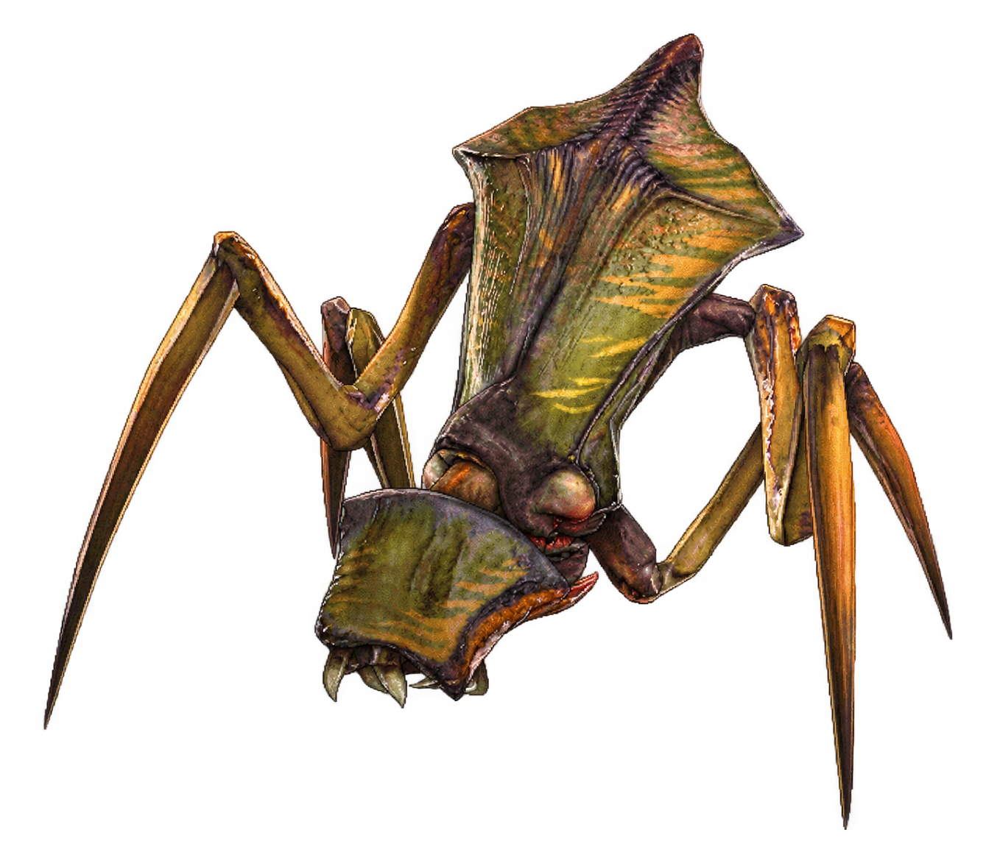
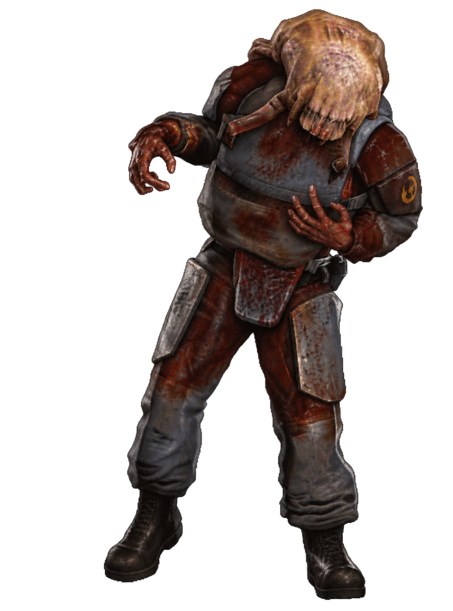
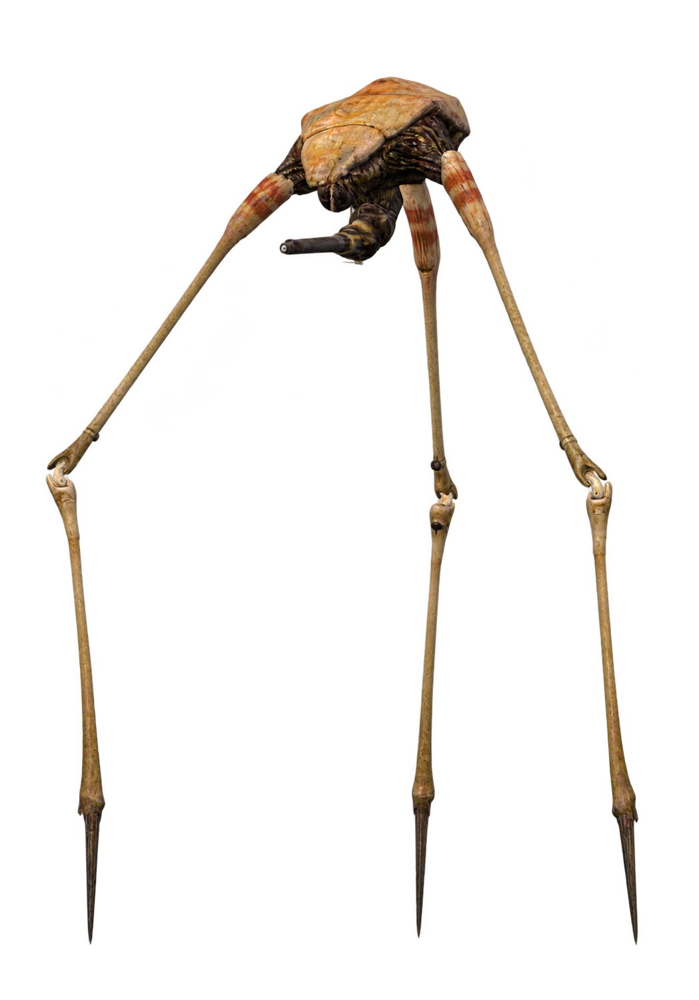
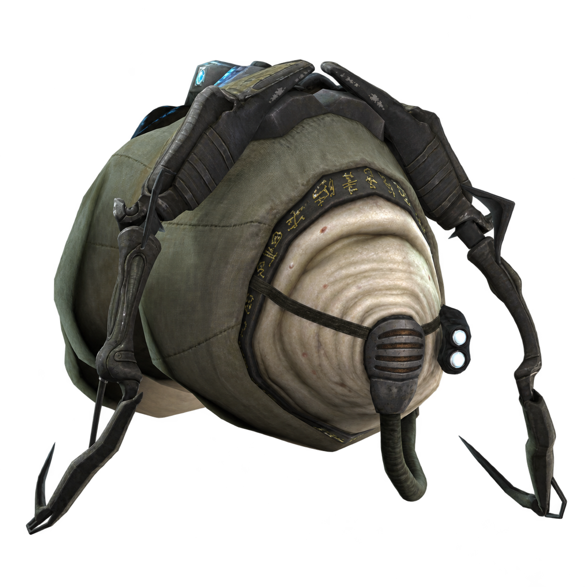
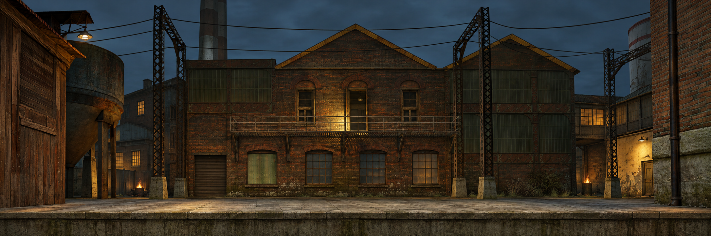
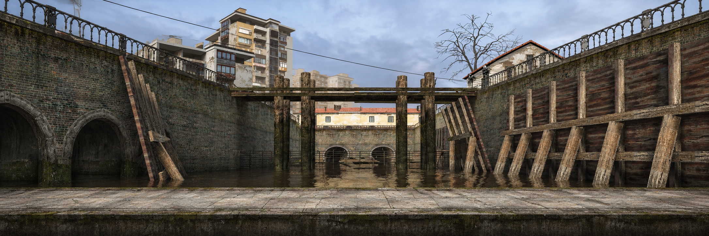
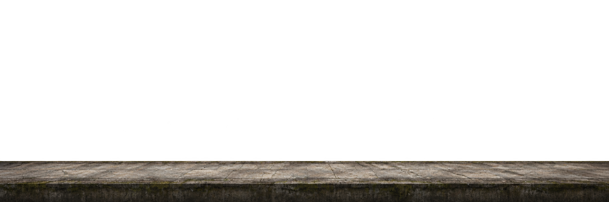

# Reprise du 20 novembre 2026 — lot D, Half-Life et Combine

## Erratum de transparence — revue du lot E

Ce rapport conserve l’état historique du lot D. La [relecture alpha du lot E](../continuation_20261120_e/alpha_review_previous_assets.json) révise les mentions de « franges rouges nettes » du Strider, du Fourmilion standard et de l’Advisor ci-dessous : sur les fonds opaques clair et foncé testés, ces franges nettes ne sont pas confirmées. Les pixels rouge saturé mesurés ont tous un alpha de 1 à 15. Les PNG originaux sont inchangés, les autres limites restent ouvertes et le refus historique de la correction Strider est conservé. Le registre global contient la conclusion courante.

Ce lot poursuit la [PR #2](https://github.com/darknigthmare/combine-administrator-simulator/pull/2) après le lot C, depuis le commit `25b3392`. Il conserve les cibles existantes du catalogue et ajoute **huit PNG candidats pour sept cibles** : trois poses de personnages de réserve, deux poses de boss, deux maîtres de décor et un sol des Canaux. **Aucun costume n’a été produit dans ce lot.**

Les fichiers sont des candidats de production. Aucune nouvelle animation complète, intégration moteur, certification visuelle 1:1 ou arène à six couches n’est déclarée.

## Résultat réel

| Cible | Livrable | Dimensions | État de revue |
|---|---|---:|---|
| `overwatch_soldier_hl2` | [Soldat Overwatch — pose](../../../../assets/resonance/candidates/continuation_20261120_d/overwatch_soldier_hl2_idle_left_d.png) | 822 × 1914 | Réserve, détails et contours à contrôler |
| `antlion_hl2` | [Fourmilion standard — pose](../../../../assets/resonance/candidates/continuation_20261120_d/antlion_hl2_idle_d.png) | 1358 × 1158 | Réserve, franges colorées à corriger |
| `zombine_ep1` | [Zombine — pose](../../../../assets/resonance/candidates/continuation_20261120_d/zombine_ep1_idle_d.png) | 1081 × 1455 | Réserve, insigne, palette et marges à reprendre |
| `strider_whiteforest_ep2` | [Strider de White Forest — v1](../../../../assets/resonance/candidates/continuation_20261120_d/strider_whiteforest_ep2_idle_left_d.png) | 1049 × 1499 | Boss candidat, franges visibles ; v1 conservée |
| `advisor_extraction_ep2` | [Advisor — pose](../../../../assets/resonance/candidates/continuation_20261120_d/advisor_extraction_ep2_idle_right_d.png) | 1254 × 1254 | Boss candidat, contours et orientation à contrôler |
| `STG_14_HL2_RAVENHOLM` | [Ravenholm — maître](../../../../assets/resonance/candidates/continuation_20261120_d/stage_ravenholm_master_d.png) | 2172 × 724 | Composition latérale, couches encore à produire |
| `STG_12_HL2_CANALS` | [Canaux — maître](../../../../assets/resonance/candidates/continuation_20261120_d/stage_canals_master_d.png) | 2172 × 724 | Composition latérale, topologie adaptée |
| `STG_12_HL2_CANALS` / `L04_ground` | [Canaux — sol](../../../../assets/resonance/candidates/continuation_20261120_d/layer_canals_floor_d.png) | 2172 × 724 | Une couche candidate avec alpha, raccord à vérifier |

Les **neuf demandes** du lot ont produit **huit fichiers**. La demande de nettoyage `strider_whiteforest_ep2_idle_left_v2_d` a été **refusée automatiquement à la sortie** par le service (`moderation_blocked`, catégorie `other`). Aucun PNG v2 n’existe et aucune relance du refus n’a été effectuée. La v1 déjà produite reste conservée avec ses limites ; le refus n’annule pas son existence.

Les trois personnages restent dans la réserve du roster : ces poses ne les ajoutent pas aux vingt-quatre combattants du catalogue principal et ne les rendent pas jouables. Le maître des Canaux et son sol comptent pour une seule cible de stage.

Les demandes exactes, résultats, empreintes et références figurent dans le [registre du lot](generation_register.json), le [journal des personnages](character_generation.json) et le [journal des boss et décors](machine_stage_generation.json).

## Références officielles utilisées

Les références ont été chargées et inspectées avant génération. Les vidéos de modèles proviennent de la [page officielle Valve du vingtième anniversaire de Half-Life 2](https://www.half-life.com/en/halflife2/20th). Les captures proviennent de la [fiche Steam officielle](https://store.steampowered.com/app/220/HalfLife_2/), qui inclut aussi les épisodes : le contenu visible de chaque capture détermine la variante retenue.

| Sujet | Référence | Sélection |
|---|---|---|
| Soldat Overwatch standard | [Vidéo Valve combine.webm](https://cdn.fastly.steamstatic.com/half-life.com/images/halflife220/combine.webm) | Cadre à 00:04.000, uniforme gris-bleu et lunettes cyan |
| Fourmilion standard | [Vidéo Valve antlion.webm](https://cdn.fastly.steamstatic.com/half-life.com/images/halflife220/antlion.webm) | Cadre à 00:04.000, variante verte et ocre |
| Zombine d’Episode One | [Vidéo Valve zombine.webm](https://cdn.fastly.steamstatic.com/half-life.com/images/halflife220/zombine.webm) | Cadre à 00:00.500, headcrab et uniforme endommagé |
| Advisor | [Vidéo Valve advisor.webm](https://cdn.fastly.steamstatic.com/half-life.com/images/halflife220/advisor.webm) | Première sortie de l’extraction à une image par seconde ; timecode exact non déclaré |
| Strider de White Forest, Episode Two | [Capture Steam 09](https://shared.akamai.steamstatic.com/store_item_assets/steam/apps/220/ss_ed5532325f508728f8481f0109d662352a519e0a.1920x1080.jpg?t=1745368545) et [capture 18](https://shared.akamai.steamstatic.com/store_item_assets/steam/apps/220/ss_fe894d70bdfa75236a4b451efbeea7d4ce3e0174.1920x1080.jpg?t=1745368545) | Modèle de Strider dans les scènes avec Hunters ; seul le Strider a été demandé |
| Ravenholm | [Capture Steam 04](https://shared.akamai.steamstatic.com/store_item_assets/steam/apps/220/ss_c400361f185800786ea984e795f2a0dd4afee990.1920x1080.jpg?t=1745368545) | Façades industrielles de brique, galerie, pylônes et lumière nocturne |
| Canaux de Cité 17 | [Capture Steam 06](https://shared.akamai.steamstatic.com/store_item_assets/steam/apps/220/ss_394f4ad714937db2cc90545972b318ddb6db7231.1920x1080.jpg?t=1745368545) | Briques humides, soutènements de bois, eau brune et immeubles |

Le sol `L04_ground` des Canaux dérive du maître généré de ce lot. C’est une extraction générative : ses textures et son raccord ne sont pas garantis identiques au maître pixel par pixel. Il n’est pas présenté comme une capture officielle indépendante.

Les journaux conservent les URL, dimensions, hashes des références et méthode d’extraction. Les huit PNG livrés ont été copiés depuis la sortie du générateur sans modification de leurs pixels.

## Contrôle visuel et limites

### Personnages de réserve

Le soldat conserve deux lunettes cyan, son masque, son arme tenue à deux mains, ses plaques d’armure et ses bottes. La pose suit la vue trois-quarts de la référence. Les inscriptions, coutures et détails du masque restent réinterprétés ; cette image ne livre pas une garde latérale animée.

Le fourmilion conserve sa carapace verte et ocre, ses quatre longues pattes et leurs pointes entières. Des franges rouge et jaune sont visibles autour de plusieurs membres. Les proportions fines de la tête et les textures doivent encore être confrontées au modèle source.

Le Zombine conserve le headcrab, la silhouette voûtée et l’uniforme Combine. Son emblème jaune est approximatif et ses taches rouges sont plus saturées que dans le cadre Valve. La composition est décalée à droite ; les marges haute et basse ne mesurent que 21 et 26 pixels au seuil alpha supérieur ou égal à 16.

Ces trois PNG possèdent un vrai canal alpha et des zones totalement transparentes. Quelques pixels de bord ont un alpha de 1/255, sans découper la silhouette opaque. L’alpha intérieur dominant vaut 252/255 : il est presque opaque, avec des contours encore à nettoyer. Les poses ne valident ni pivot de sol, ni échelle en jeu, ni clips complets.

### Boss

Le Strider conserve trois longues pattes, trois pointes complètes, sa carapace ocre et son canon ventral. Ses appuis ne sont pas exactement alignés et sa vue reste en trois-quarts. Les franges rouge et jaune sont nettes le long de la carapace et des pattes. Sa correction v2 étant refusée, seule la v1 est disponible. Les Hunters, le dispositif Magnusson et les animations ne sont pas produits par cette pose.

L’Advisor présente son corps larvaire, son harnais, son masque, deux lentilles et deux appendices complets. L’orientation reste presque frontale, les marges sont inégales et des franges subsistent sous le masque et aux contours. Aucun effet de télékinésie, langue déployée ou comportement de boss n’est livré par cette image.

### Décors et couche de sol

Ravenholm reprend les matériaux et les motifs de la capture officielle, avec une piste continue au premier plan et des feux placés en retrait. Les Canaux conservent l’eau derrière un chemin de halage sec. Les deux compositions adaptent la projection et la disposition des lieux au combat latéral ; elles ne certifient pas une reproduction 1:1 des cartes originales.

Les maîtres sont des images RGB complètes. Le sol des Canaux est une image RGBA de même canevas, avec le haut transparent et une bande basse continue. Une frange claire ou colorée reste visible à sa limite haute. Son alignement, ses raccords et sa lisibilité avec les combattants doivent être contrôlés en composition.

## Bible et chapitre Combine

Le nouveau [chapitre Combine](../../chapters/combine_encounter_design_20261120.md) et son [contrat JSON](../../data/combine_encounter_design_20261120.json) enrichissent la [bible](../../BIBLE.md) avec cinq profils existants : Strider, Dropship, Gunship, APC et Hunter-Chopper. Le contrat décrit quinze profils de phases, treize attaques, dix-sept parties de collision proposées et soixante-dix-sept clips planifiés.

Il ajoute aussi trois plans de production de stages — Ravenholm, Nova Prospekt et Canaux — totalisant dix-huit couches prévues, ainsi que douze propositions de métadonnées pour les réserves et seize scénarios de vérification. Le jeu d’origine et sa provenance documentaire sont maintenant renseignés pour les douze réserves ; les autres recommandations restent à examiner. Ces nombres décrivent le travail conçu et à réaliser. Ils ne comptent pas comme des PNG supplémentaires, des animations terminées ou de nouveaux boss exécutés par le moteur.

Le profil documentaire `strider_hl2` et le candidat graphique `strider_whiteforest_ep2` gardent leurs identifiants distincts. Le lot ne fusionne pas ces variantes.

## Cibles différées

| Cible | Motif | État réel |
|---|---|---|
| `barney_hl2` | Page de modèle identifiée, bitmap exact indisponible en HTTP 404 ; pas de référence complète équivalente récupérée | Aucune demande, aucun fichier, aucun refus ajouté |
| `grigori_hl2` | Bitmap du modèle publié indisponible en HTTP 404 ; les variantes bêta ou remakes ne sont pas utilisées | Aucune demande, aucun fichier, aucun refus ajouté |
| `costume_nova_guard_hl2` | Référence de la variante standard indisponible ; le garde au fusil à pompe n’est pas substitué | Aucun costume produit |
| `STG_15_HL2_NOVA` | La capture récupérée montre un hall intérieur ; le contrat vise une cour extérieure avec ciel et miradors | Aucun maître de cour produit depuis ce hall |

Ces reports restent visibles dans le registre. Ils ne sont pas assimilés au refus de nettoyage du Strider.

## État consolidé et vérifications

Après ce lot, le [registre global](../../data/generated_art_register.json) comptabilise **27 PNG distincts, 39 demandes et 12 refus**. Une ancienne itération générée puis écartée reste suivie séparément. Le catalogue demeure à **187 cibles**, dont **20 avec au moins un fichier associé et 167 sans fichier**, conformément à la [liste des manquants](../MISSING_TARGETS.md) et à la [file de production](../../data/production_queue.json).

Il existe désormais **4 fichiers de couches, dont 3 associés à un plan identifié dans leur stage ; Cité 17 reste sans ID**. L’identification se fait par couple stage/plan, avec déduplication des révisions d’un même plan. Aucun stage n’a ses six couches terminées.

Les vérifications consolidées de conception, Boss Battle, audit des fichiers et synchronisation passent. L’avertissement conservé concerne la couche historique de skyline de Cité 17 sans `layer_id` ; aucun identifiant ne lui a été attribué arbitrairement. L’[audit des fichiers](../asset_audit.md), le [rapport de validation du lot](validation_summary.json) et les journaux permettent de contrôler la présence et les métadonnées des PNG.

**Le lot D ajoute zéro costume, zéro animation complète, zéro nouvelle intégration moteur et zéro certification 1:1.** Les sept cibles concernées restent à poursuivre après revue des candidats.

## Galerie de revue

### Soldat Overwatch — réserve

### Fourmilion standard — réserve

### Zombine — réserve d’Episode One

### Strider de White Forest — v1 conservée

### Advisor — pose candidate

### Ravenholm — maître

### Canaux de Cité 17 — maître

### Canaux de Cité 17 — sol L04_ground

