# Suite du 20 novembre 2026 — lot E

**Douze demandes ont produit douze PNG, sans nouveau refus.** Le lot avance sept cibles déjà au catalogue : trois combattants, un costume, un boss et deux stages. Il ajoute cinq cibles jusque-là sans fichier ; les Canaux et Ravenholm possédaient déjà leurs maîtres dans le lot D. Aucun nouvel ID de personnage ou de stage n’est créé.

La bible passe en **version 1.5** avec le [dossier des archives et contrats de référence](../../chapters/archive_reference_contracts_20261120.md). Le registre graphique demeure distinct de cette documentation : un contrat de capture ne constitue pas une image produite.

## Fichiers livrés

| Cible | Production du lot E | Limite principale |
| --- | --- | --- |
| Dog — Half-Life 2 | Une pose entière sur alpha | Marges haute/basse courtes, matériaux et proportions fines à comparer |
| Hunter — Episode Two | Une pose entière sur alpha | Trois appuis à convertir en pivot cohérent ; vue presque frontale |
| Fourmilion ouvrier — Episode Two | Une pose entière sur alpha | Pattes arrière partiellement masquées, pas de projection d’acide |
| HECU — costume au béret, modèle original | Une garde accroupie sur alpha | Arme et détails de costume à comparer ; ne couvre pas la cible HECU de base |
| Gargantua — Half-Life original | Une vue arrière trois-quarts sur alpha | Volume arrière seulement ; face, œil et bras lointain non validés |
| Canaux de Cité 17 | Ciel, ville lointaine, structures v1/v2, eau et bois | Cinq fichiers E pour quatre nouveaux plans ; le sol vient du lot D |
| Ravenholm | Ciel et sol | Deux plans sur six, raccord arrière du sol encore à recaler |

Les cinq sprites sont des images individuelles : un sujet et une pose par fichier. Les sept fichiers de décor restent sur le canevas **2172 × 724**, sans redimensionnement après génération. Les deux ciels sont volontairement opaques ; les autres fichiers portent un canal alpha.

## Références et variantes

Dog, le Hunter et le Fourmilion ouvrier suivent des captures officielles Steam, identifiées par leur contenu. La fiche Steam de Half-Life 2 inclut aussi des images des épisodes : le numéro d’application seul ne détermine donc pas la version. Le wallpaper anniversaire de Valve complète les extrémités de Dog ; la capture du jeu reste sa référence principale.

Le costume HECU reprend la variante au béret des images officielles de Half-Life/Uplink. Il utilise un `target_ids` explicite : aucune association implicite à la tête avec masque à gaz ni à une tenue HD. Le Gargantua se fonde sur deux instants du montage officiel du 25e anniversaire, dans le parking de Surface Tension. Cette vue ne prétend pas valider la géométrie de l’arène Power Up ou la face avant.

Les couches de décor ont pour références immédiates les **maîtres générés du lot D**. Ces maîtres sont des adaptations latérales de captures officielles ; les couches E ne sont pas des extractions des fichiers du jeu. Leurs références, prompts exacts, dimensions et empreintes figurent dans les [trois journaux spécialisés](generation_register.json).

## Revue des couches

| Stage | Plans disposant d’au moins un candidat | Manquants | État |
| --- | --- | --- | --- |
| Canaux | L00, L01, L02, L03, L04 | L05 | 5/6 candidats ; raccords et parallaxe non validés |
| Ravenholm | L00, L04 | L01, L02, L03, L05 | 2/6 candidats ; architecture à séparer |

L’assemblage des Canaux a révélé que la première version de L02 omettait le mur arrière sous la maison centrale. Une seule révision a rétabli ce mur et les deux arches d’égout. La **v2 est retenue pour la prochaine revue** ; la v1 reste conservée et non sélectionnée. Deux fichiers de L02 représentent un seul plan de stage.

Le composite v2 ferme la grande ouverture accidentelle. De petits jours subsistent à la ligne d’eau ; les bâtiments lointains ne sont pas entièrement prolongés derrière les occultations. Il faut terminer ces raccords avant les déplacements de parallaxe. Les reflets de l’eau sont encore peints dans une image fixe. Ravenholm nécessite le recalage du bord arrière du sol et quatre couches supplémentaires.

Le canevas des candidats n’est pas encore converti en coordonnées logiques du moteur. Aucun défilement, pivot de sol, test de lisibilité en jeu ou scène à six couches n’est validé. Le [rapport de composition](stage_layer_review.json) décrit l’ordre d’assemblage et les travaux restants.

## Transparence : correction du diagnostic

Les cinq nouveaux sprites ont été composés sur des fonds opaques clairs et gris/foncés **à résolution native avant réduction**. Les grands halos verts ou franges rouges aperçus dans certaines vues RGB brutes ne se confirment pas dans ces composites alpha. Les PNG originaux n’ont subi aucune retouche.

Une [relecture de trois images du lot D](alpha_review_previous_assets.json) corrige également le diagnostic de franges rouges nettes pour le Strider, le Fourmilion standard et l’Advisor. Les pixels rouge saturé mesurés dans ces trois images ont tous un alpha compris entre 1 et 15 ; ils ne sont pas tous entièrement transparents, mais ne produisent pas les franges nettes décrites initialement sur les fonds testés. Cette conclusion ne certifie ni les couleurs du modèle, ni les proportions, ni les marges, ni les animations.

Le refus historique de la correction Strider reste inscrit dans le journal D. Aucun refus n’a été relancé dans ce lot. Les aperçus techniques de composition servent à la QA et ne sont pas comptés parmi les PNG livrés.

## Bilan vérifié

Après le lot E, le [registre global](../../data/generated_art_register.json) et l’[audit physique](../asset_audit.md) comptent **39 PNG distincts, 51 demandes et 12 refus sans fichier**. Une ancienne itération générée puis écartée reste suivie séparément, soit 52 appels en l’incluant.

Le catalogue conserve **187 cibles : 25 avec au moins un fichier associé et 162 sans fichier**. Les onze fichiers de couches couvrent neuf couples stage/plan identifiés. Le fichier historique de Cité 17 reste sans ID de plan car il mélange ciel et Citadelle ; les deux versions de L02 Canaux comptent pour un seul plan. Il reste 141 IDs de couches sans candidat dans les contrats connus et 21 stages sans contrat de couches détaillé.

Deux costumes ont maintenant un fichier associé précisément à leur cible. Les 24 combattants, les quatre boss schématiques du prototype et les deux panoramas déjà utilisés par celui-ci ne changent pas. **Zéro nouvelle intégration moteur, zéro clip animé complet, zéro stage complet à six couches et zéro certification 1:1** sont déclarés par ce lot.

Les [manquants](../MISSING_TARGETS.md) et le [rapport de validation](validation_summary.json) donnent l’état de travail. Les exports Word/Excel v1 restent des instantanés historiques ; les sources Markdown et JSON actuelles font foi.

## Galerie — sujets individuels

### Dog — Half-Life 2

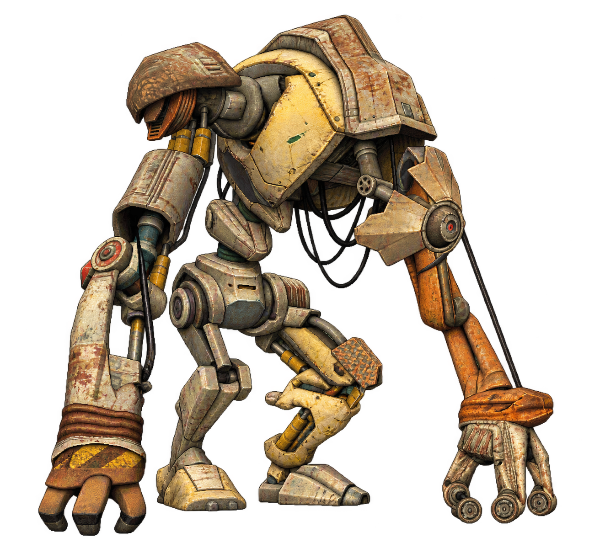

Dog entier, silhouette lourde et voûtée, longs bras asymétriques, deux mains différentes, deux pieds, pistons et câbles conservés. La vue primaire reste celle du modèle Half-Life 2; le wallpaper Valve complète les extrémités. Le capteur reste partiellement caché sous la coque dans cet angle; aucune nouvelle vue de son visage n’est prétendue. Une pose trois-quarts unique ne définit pas les deux orientations de combat. La patine jaune/crème/orange suit la capture éclairée chaudement; elle ne constitue pas une validation de la couleur des matériaux sous éclairage neutre. Les pièces fines et proportions restent à comparer au modèle. Marges au seuil alpha>=16: gauche 83, haut 32, droite 93, bas 26 px. Les mains sont entières, mais les marges haute et basse sont trop courtes pour la cible 10 %. Les fortes franges rouge/jaune de l’aperçu RGB brut ne se confirment pas sur les composites alpha gris et blanc. Les contours sont lisibles sans halo coloré majeur; source PNG conservée sans retouche. Alpha dominant 252/255, résidu alpha 1 au bord gauche. Aucune certification 1:1, animation ou intégration moteur.

**Références :** [Valve / Steam — capture 220/07](https://shared.akamai.steamstatic.com/store_item_assets/steam/apps/220/ss_412b0e9f8285d3695d0b39840da41c184dff591a.1920x1080.jpg?t=1745368545) · [Valve — wallpaper 01 du vingtième anniversaire](https://cdn.fastly.steamstatic.com/half-life.com/images/halflife220/hl2wallpaper01_16x9.jpg).

### Hunter — Episode Two

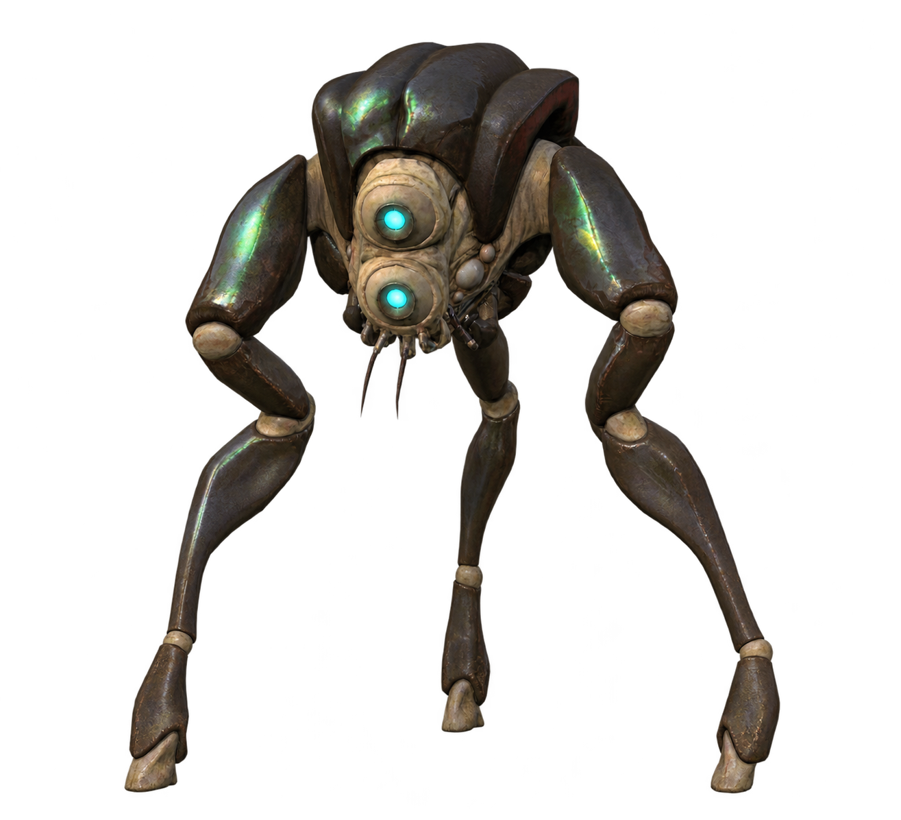

Une seule créature, trois pattes et trois extrémités entières, deux capteurs cyan verticaux, carapace sombre irisée et face claire cohérentes avec les captures officielles. Pose presque frontale, non profil latéral de combat. Le pied arrière termine plus haut dans le cadre que les deux pieds avant: la baseline runtime reste à définir. Les détails de matière, les articulations et les volumes fins ont été réinterprétés; la capture entière est relativement petite dans son cadre. Aucun contrôle modèle 1:1 certifié. Marges au seuil alpha>=16: gauche 181, haut 61, droite 176, bas 38 px; la demande de 10 % sur tous les bords n’est pas atteinte. Composites réels inspectés sur gris 128 et blanc: aucun fond opaque ni frange rouge/jaune majeure confirmé. Les couleurs visibles dans un aperçu RGB brut ne suffisent pas à diagnostiquer une frange visible. Alpha dominant 253/255 et quelques résidus alpha 1 au bord gauche. Aucun sujet opaque coupé, aucun clip, pivot ou activation moteur livré.

**Références :** [Valve / Steam — capture 220/09](https://shared.akamai.steamstatic.com/store_item_assets/steam/apps/220/ss_ed5532325f508728f8481f0109d662352a519e0a.1920x1080.jpg?t=1745368545) · [Valve / Steam — capture 220/18](https://shared.akamai.steamstatic.com/store_item_assets/steam/apps/220/ss_fe894d70bdfa75236a4b451efbeea7d4ce3e0174.1920x1080.jpg?t=1745368545).

### Fourmilion ouvrier — Episode Two

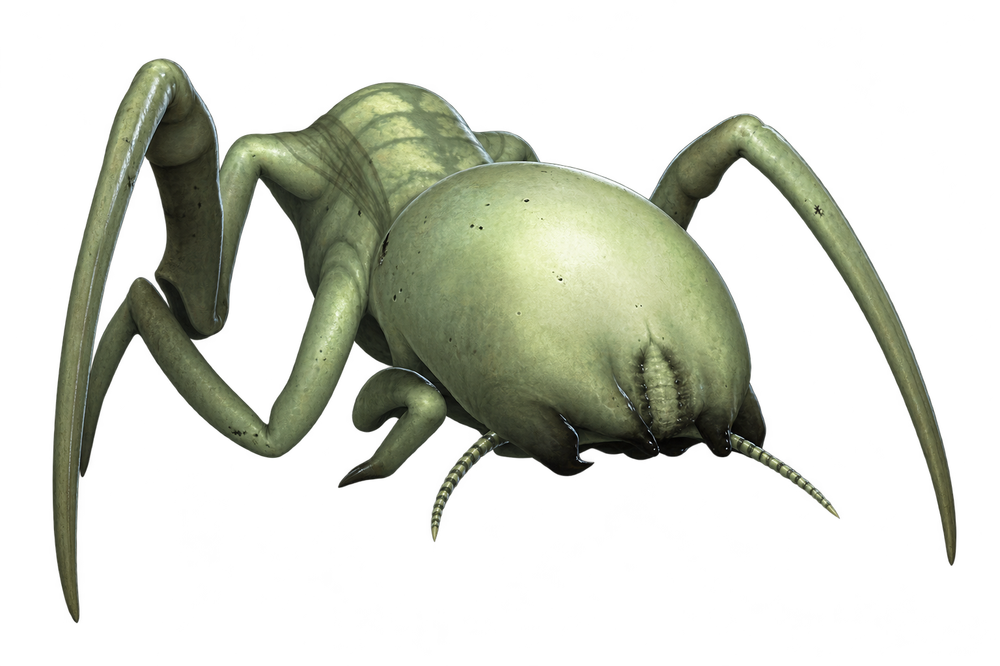

Un seul fourmilion ouvrier, large tête pâle vert-jaune, coque arrière striée, longues pattes et deux appendices buccaux cohérents avec la capture Episode Two. Les quatre membres ne sont pas tous séparément lisibles: les pattes arrière sont repliées et partiellement masquées par le corps. La vue est proche de la référence, avec variations génératives de proportions et de détail. Aucune classe standard verte/ocre ni Antlion Guard substituée. Marges au seuil alpha>=16: gauche 80, haut 90, droite 66, bas 65 px; silhouette entière dans le canevas mais cible 10 % non atteinte sur tous les côtés. Le halo vert vu dans l’aperçu brut se trouve dans les RGB de pixels alpha 0. Les composites sur gris 128 et blanc montrent un fond uniforme sans ce halo. Aucune correction de fond n’a été demandée, car l’alpha réel était déjà présent. Alpha dominant 253/255, maximum 254/255; intérieurs presque opaques sans pixels alpha 255. Résidus alpha 1 sur trois bords, sans découpe de matière opaque. Pose unique, pas de silhouette latérale opposée, pas de projection d’acide, pas de clip complet ni d’intégration moteur.

**Références :** [Valve / Steam — capture 220/15](https://shared.akamai.steamstatic.com/store_item_assets/steam/apps/220/ss_b3de6987b384b2db61b5dcad2dd6460fd2969612.1920x1080.jpg?t=1745368545).

### HECU original — costume au béret

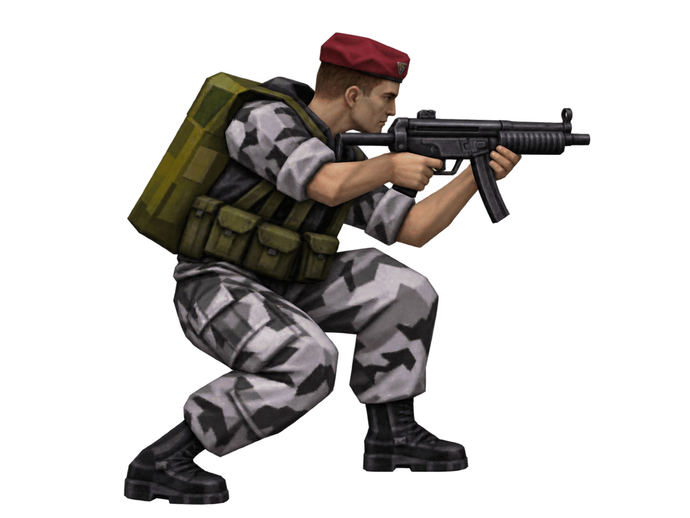

Béret bordeaux, camouflage urbain gris/blanc/noir, gilet et sac olive, bras nus et deux bottes présents. Une seule figure entière et une seule pose. Vérification par alpha_composite sur blanc et gris foncé avant réduction: aucune frange colorée nette ni halo saturé visible. L’impression initiale de franges dans l’affichage RGBA brut n’est donc pas retenue comme défaut avéré. L’arme a été redessinée: silhouette du chargeur et ensemble sous-canon à comparer au modèle GoldSrc. Les poches et le visage sont davantage détaillés que la référence; aucune fidélité 1:1 certifiée. Pose accroupie: ne vaut pas garde debout ni animation complète. Le target_ids explicite rattache uniquement ce PNG au costume au béret; il ne couvre pas le masque à gaz.

**Références :** [Valve — Half-Life 25th anniversary, capture Uplink, soldat au béret à gauche](https://cdn.fastly.steamstatic.com/half-life.com/images/halflife25/uplink_1.jpg) · [Valve / Steam — Half-Life, capture officielle 0000002343](https://shared.akamai.steamstatic.com/store_item_assets/steam/apps/70/0000002343.1920x1080.jpg?t=1745368462).

### Gargantua original — vue arrière trois-quarts

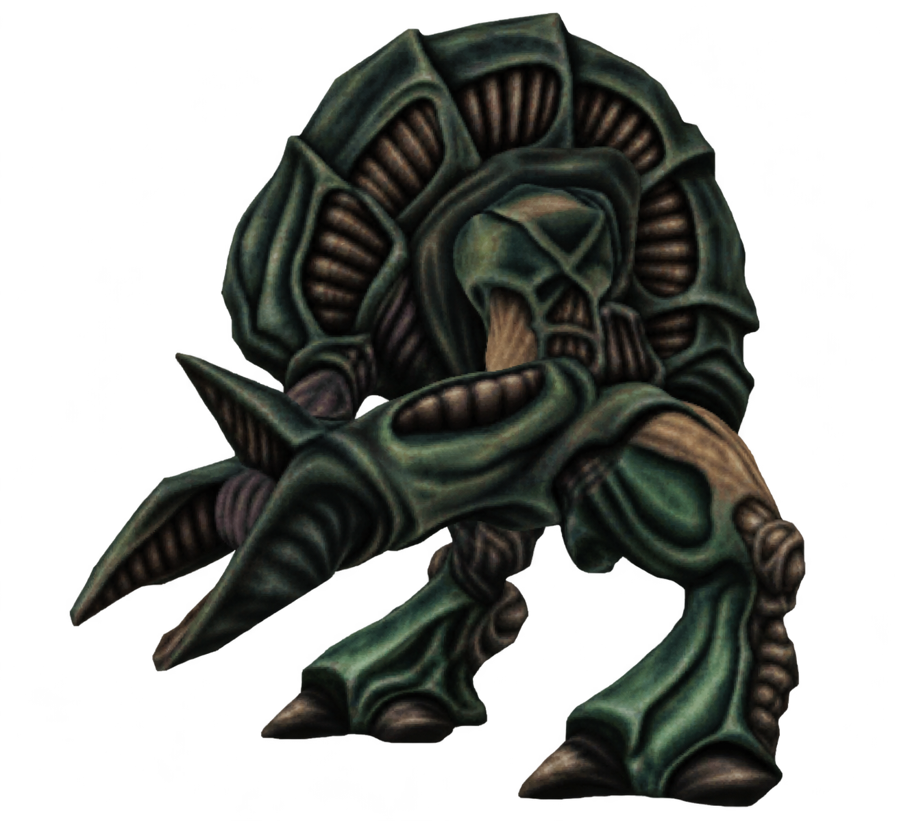

Carapace en éventail bleu-vert, nervures brunes, volumes des avant-bras et deux pieds visibles; un seul boss entier. Vue arrière conservée selon les références: ni œil ni face ne sont certifiés. Marges serrées au sommet. Vérification par alpha_composite sur blanc et gris foncé avant réduction: aucune frange colorée nette ni halo saturé visible. Les pixels de très faible alpha mesurés dans le fichier ne sont pas, à eux seuls, un défaut visible de contour. Articulation du bras lointain et contours des pinces à revalider sur un modèle complet. Ce candidat documente le volume arrière et ne remplace pas une garde latérale de gameplay. Le prototype de mécanique Gargantua existait avant ce lot; ce fichier n’y est pas intégré.

**Références :** [Valve — Half-Life 25th anniversary, Gargantua à 26,0 secondes](https://cdn.fastly.steamstatic.com/half-life.com/images/halflife25/hl1_anniversary_mashup_looping_H.264.mp4) · [Valve — Half-Life 25th anniversary, Gargantua à 25,5 secondes](https://cdn.fastly.steamstatic.com/half-life.com/images/halflife25/hl1_anniversary_mashup_looping_H.264.mp4).

## Galerie — couches séparées

Les fonds transparents peuvent s’afficher différemment selon le lecteur. Le diagnostic de détourage repose sur les composites décrits ci-dessus.

### Canaux — ciel L00

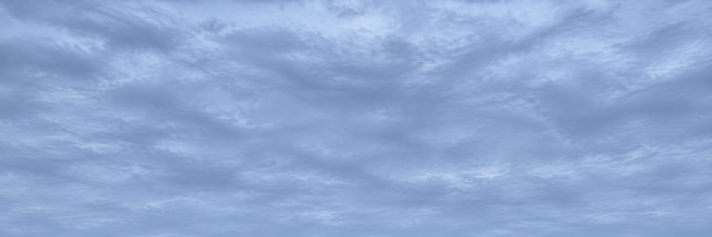

Plaque de ciel opaque sur tout le canevas, sans architecture. Palette bleu-gris proche du maître; nuages et zones cachées reconstitués générativement, sans identité pixel à pixel.

### Canaux — ville lointaine L01

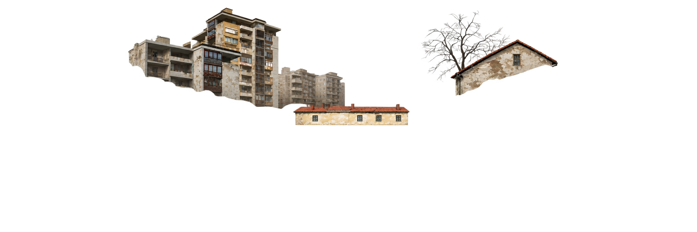

Immeubles, maison centrale et pignon/arbre droit isolés aux positions approximatives du maître. Les parties cachées par les murs restent incomplètes: une translation en parallaxe peut révéler des coupes. Ne pas considérer la seule séparation alpha comme une couche terminée.

### Canaux — murs et pont L02, révision du mur arrière

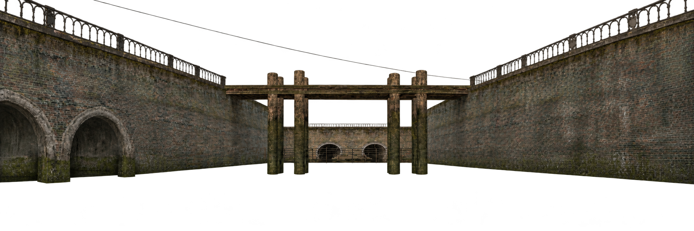

Le mur arrière central, les deux arches d’égout et la rambarde basse sont rétablis; les fils supérieurs sont conservés. Le composite v2 ferme la grande lacune sous la maison. Quelques jours étroits persistent près de la ligne d’eau et les raccords ne sont pas certifiés. Révision retenue pour la prochaine revue, pas validation finale de L02.

### Canaux — eau et soutènements L03

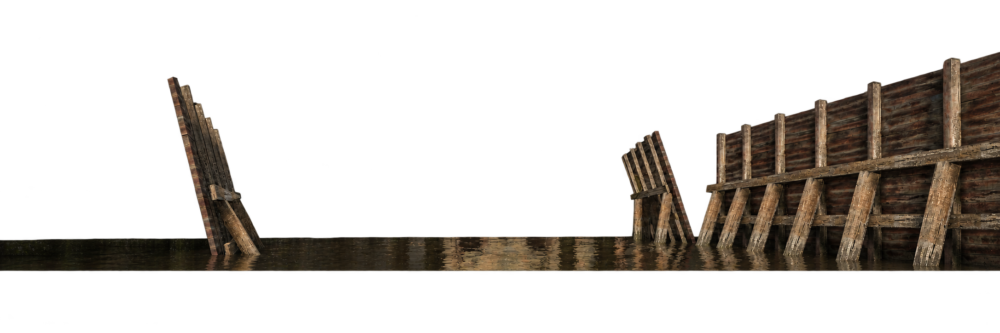

Eau brune, soutènement de bois droit et poutre inclinée gauche séparés. Les reflets restent peints dans l’eau; aucune animation livrée. De petits jours de ciel subsistent à la jonction eau/structures dans le composite v2. Raccords, occultations et extension en parallaxe restent à corriger.

### Ravenholm — ciel L00

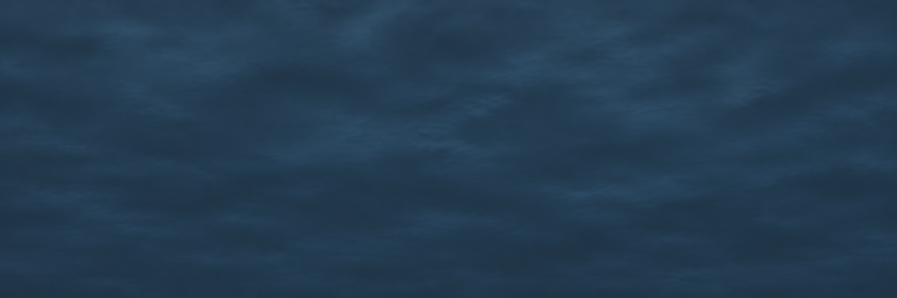

Plaque opaque de ciel nocturne ardoise, sans bâtiment ni cheminée. Fond prolongé générativement derrière les objets retirés; seule la continuité visuelle candidate est visée.

### Ravenholm — sol L04

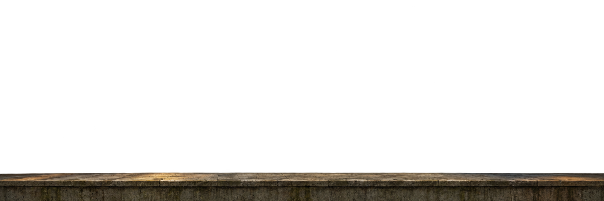

Bande de sol et face verticale basse isolées sur le canevas complet. La limite arrière est légèrement aplatie/déplacée par rapport au maître; raccord exact, alignement du sol et projection logique restent à valider. Aucun décor complet ne peut être déduit de ce sol.

### Canaux — murs et pont L02, première version

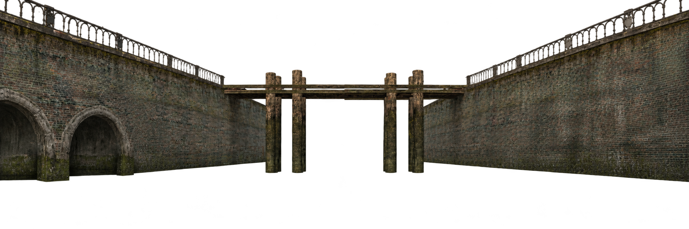

Première séparation des murs latéraux, arches et pont. Le mur arrière central et ses deux sorties d’égout ont été omis; le composite v1 révélait le ciel sous la maison. Conservée pour traçabilité, non retenue pour la prochaine revue; remplacée à cette étape par layer_canals_mid_structure_v2_e.

## Journaux de production

- [Registre complet du lot E](generation_register.json).
- [Trois personnages](character_generation.json).
- [Costume HECU et Gargantua](costume_boss_generation.json).
- [Sept fichiers de couches et révision L02](stage_generation.json).
- [Revue de composition des stages](stage_layer_review.json).
- [Erratum alpha sur trois candidats D](alpha_review_previous_assets.json).
- [Rapport de validation](validation_summary.json).
