# Galerie — nouveaux candidats du 24 novembre 2026

Une image par fichier. Les versions non retenues restent visibles pour la traçabilité; aucune certification 1:1 n’est déduite de leur sélection.

## Alien Controller — `alien_controller_hl1_hover_h`

**1183 × 1330**, RGBA. Retenu pour revue.

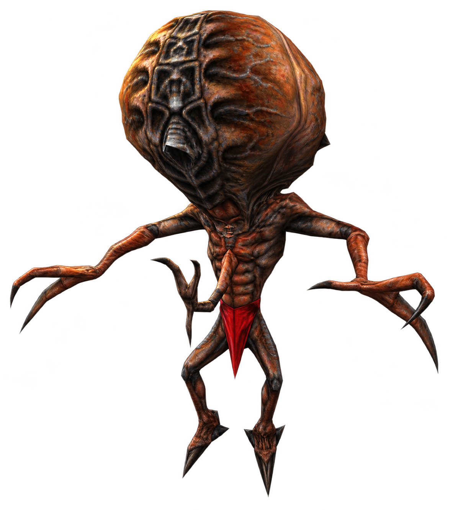

Pose isolée; les proportions du modèle source sont traduites en illustration 2D détaillée. Orientation de référence conservée; pas une animation ou certification visuelle exhaustive.

## Houndeye — `houndeye_hl1_idle_v2_h`

**1536 × 1024**, RGBA. Retenu pour revue.

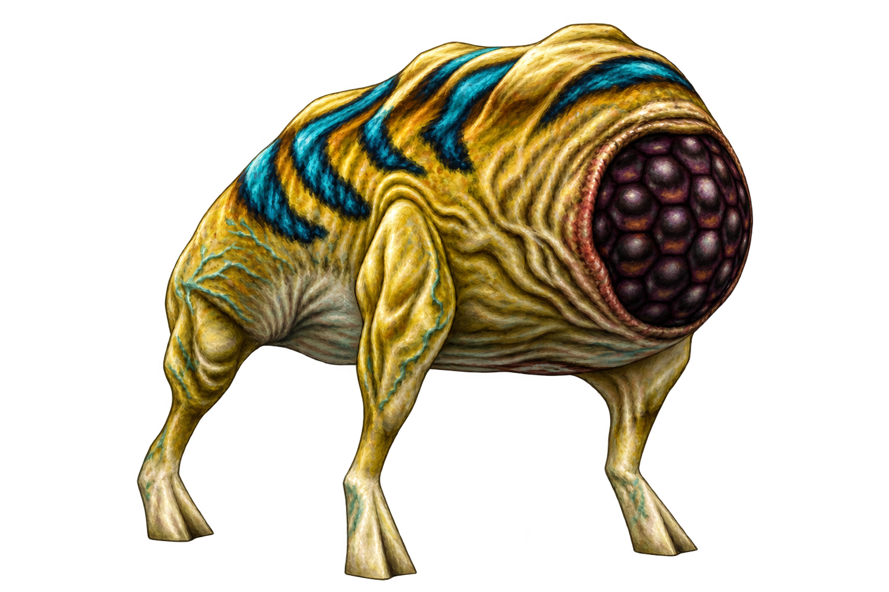

Pose isolée; les proportions du modèle source sont traduites en illustration 2D détaillée. Orientation de référence conservée; pas une animation ou certification visuelle exhaustive. Correction anatomique: trois pattes. La première version à quatre pattes est écartée.

## Headcrab — `headcrab_hl1_idle_v2_h`

**1536 × 1024**, RGBA. Retenu pour revue.

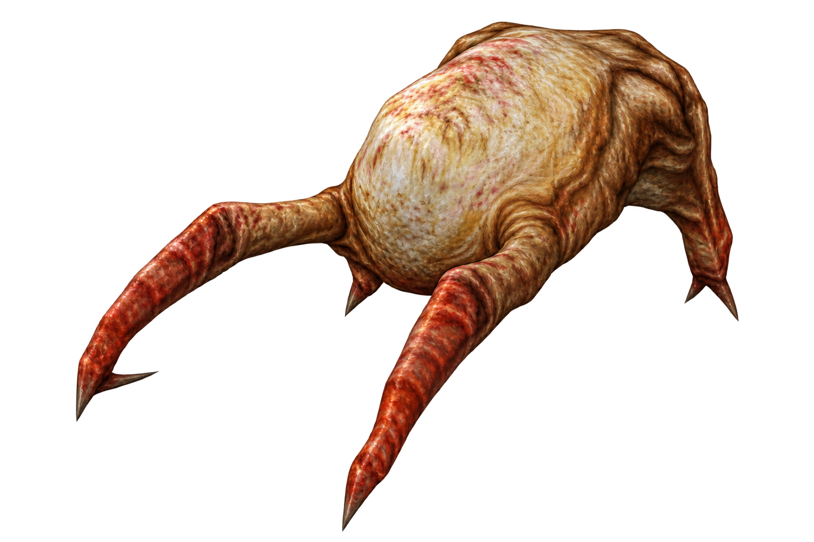

Pose isolée; les proportions du modèle source sont traduites en illustration 2D détaillée. Orientation de référence conservée; pas une animation ou certification visuelle exhaustive.

## Manhack — `manhack_hl2_hover_v2_h`

**1360 × 1157**, RGBA. Retenu pour revue.

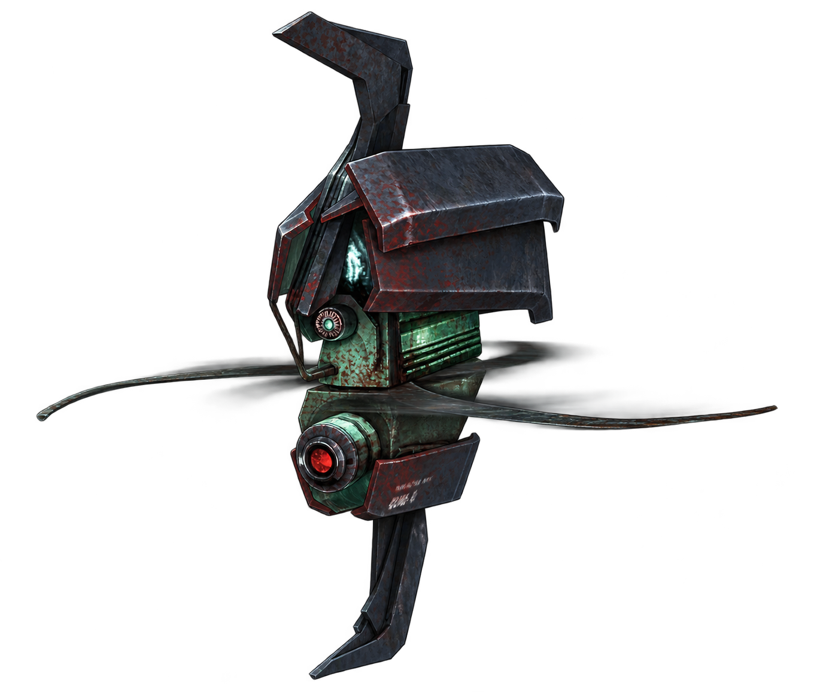

Pose isolée; les proportions du modèle source sont traduites en illustration 2D détaillée. Orientation de référence conservée; pas une animation ou certification visuelle exhaustive. Nouvelle référence visuelle utilisée après rejet QA de la première interprétation en drone à scies.

## Scientifique HL1 — Glasses — `costume_scientist_glasses_hl1_idle_h`

**1024 × 1536**, RGBA. Retenu pour revue.

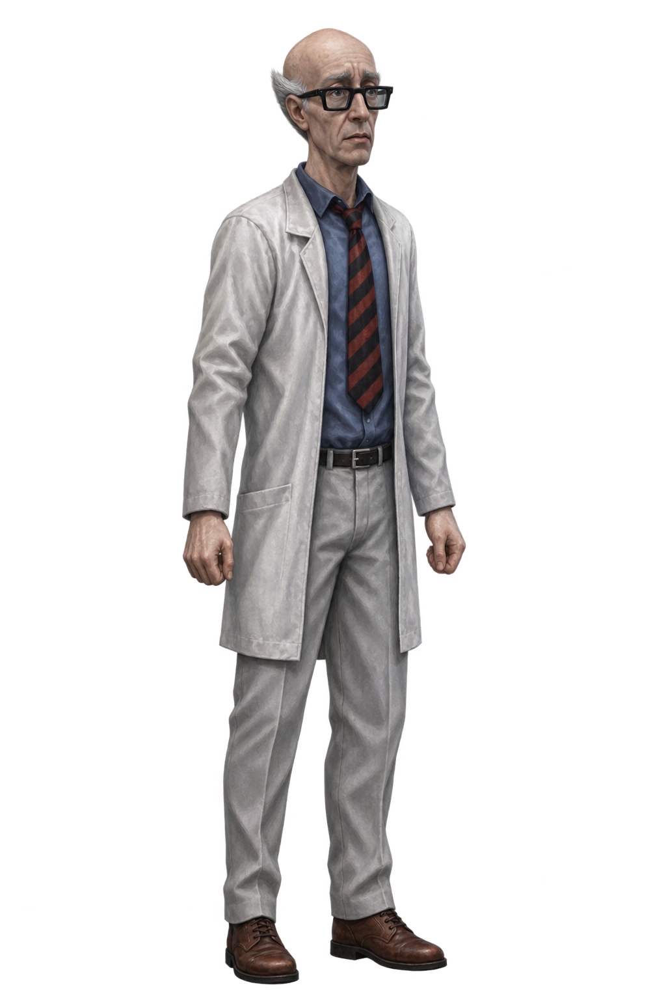

Pose isolée; les proportions du modèle source sont traduites en illustration 2D détaillée. Orientation de référence conservée; pas une animation ou certification visuelle exhaustive.

## Scientifique HL1 — Einstein — `costume_scientist_einstein_hl1_idle_h`

**1024 × 1536**, RGBA. Retenu pour revue.

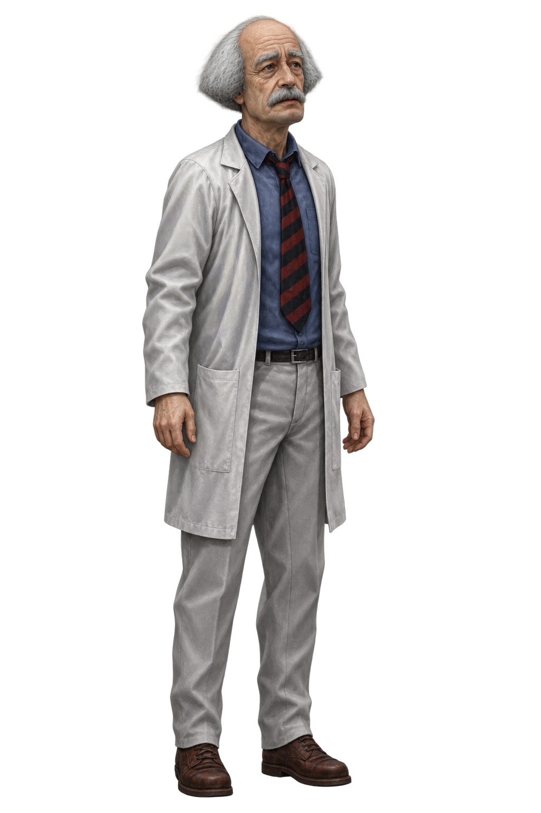

Pose isolée; les proportions du modèle source sont traduites en illustration 2D détaillée. Orientation de référence conservée; pas une animation ou certification visuelle exhaustive.

## Scientifique générique HL1 — HEAD_LUTHER — `costume_scientist_luther_hl1_idle_h`

**1024 × 1536**, RGBA. Retenu pour revue.

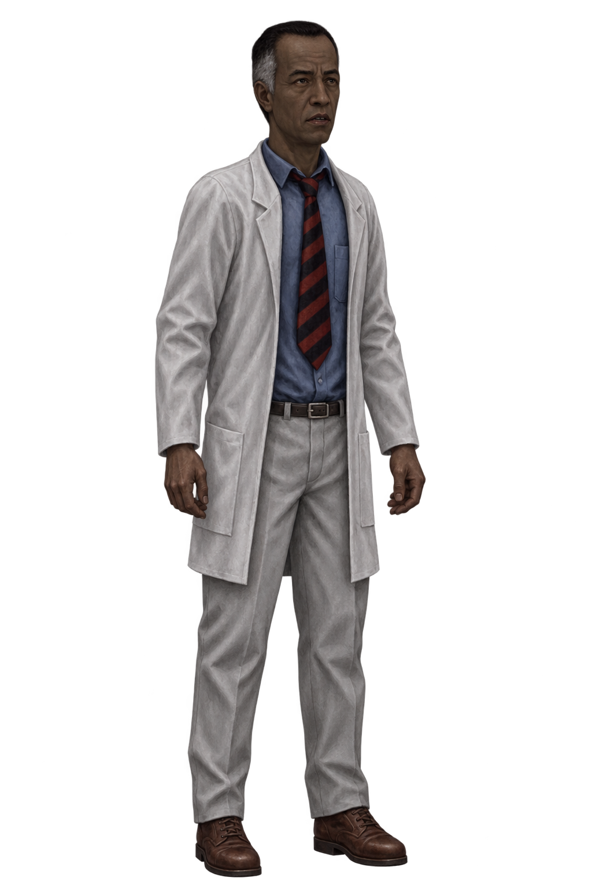

Pose isolée; les proportions du modèle source sont traduites en illustration 2D détaillée. Orientation de référence conservée; pas une animation ou certification visuelle exhaustive.

## Ivan the Space Biker — skin publié — `ivan_hl25_multiplayer_idle_h`

**1024 × 1536**, RGBA. Retenu pour revue.

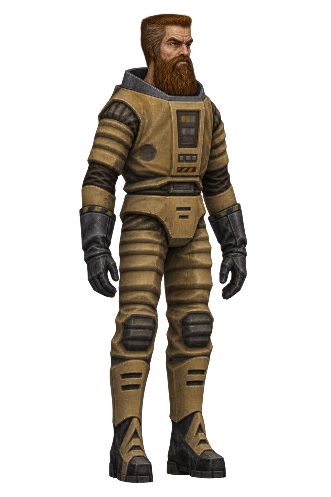

Pose isolée; les proportions du modèle source sont traduites en illustration 2D détaillée. Orientation de référence conservée; pas une animation ou certification visuelle exhaustive.

## Scientifique HL1 — Slick — `scientist_slick_hl1_idle_h`

**1024 × 1536**, RGBA. Retenu pour revue.

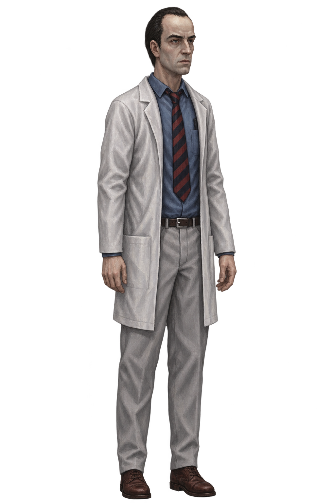

Reconstruction candidate fondée sur le modèle du jeu; pose isolée, proportions et vue à vérifier avant animation et intégration.

## Proto-Barney — skin publié — `proto_barney_hl25_multiplayer_idle_h`

**1024 × 1536**, RGBA. Retenu pour revue.

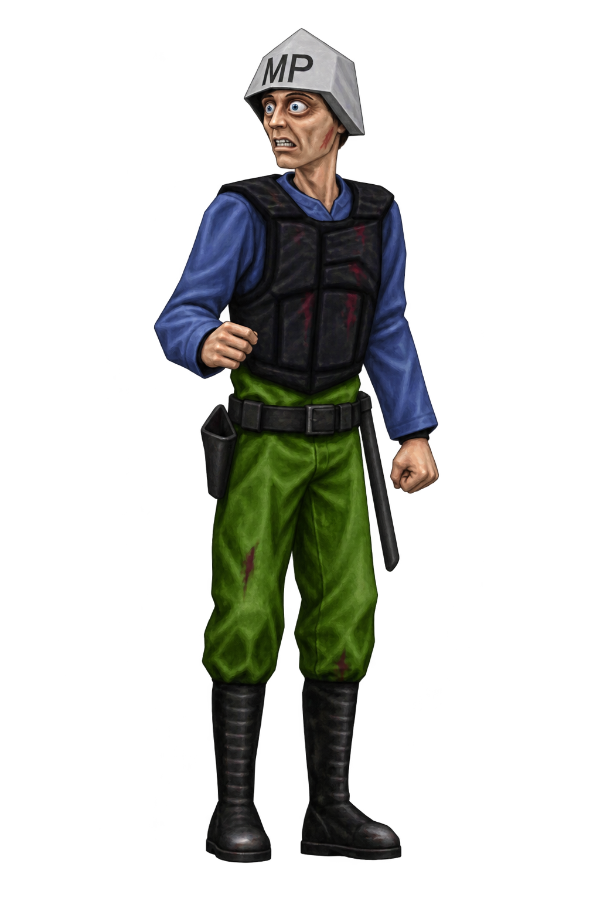

Reconstruction candidate fondée sur le modèle du jeu; pose isolée, proportions et vue à vérifier avant animation et intégration.

## Osprey HECU — `osprey_hl1_hover_h`

**1891 × 832**, RGBA. Retenu pour revue.

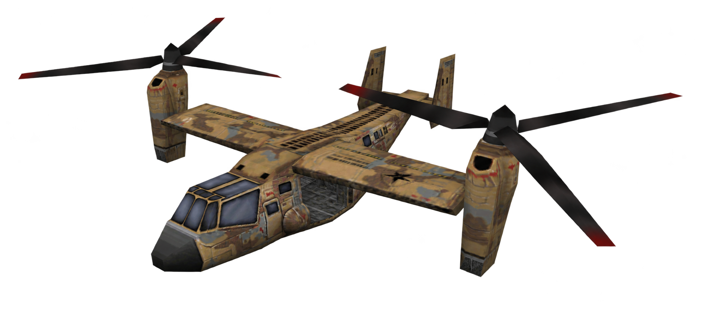

Reconstruction candidate fondée sur le modèle du jeu; pose isolée, proportions et vue à vérifier avant animation et intégration.

## M2A3 Bradley HECU — `bradley_hl1_idle_h`

**1774 × 887**, RGBA. Retenu pour revue.

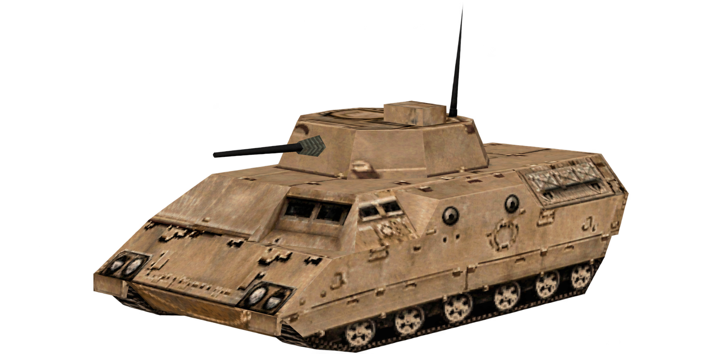

Reconstruction candidate fondée sur le modèle du jeu; pose isolée, proportions et vue à vérifier avant animation et intégration.

## Alien Grunt — `alien_grunt_hl1_idle_h`

**1229 × 1280**, RGBA. Retenu pour revue.

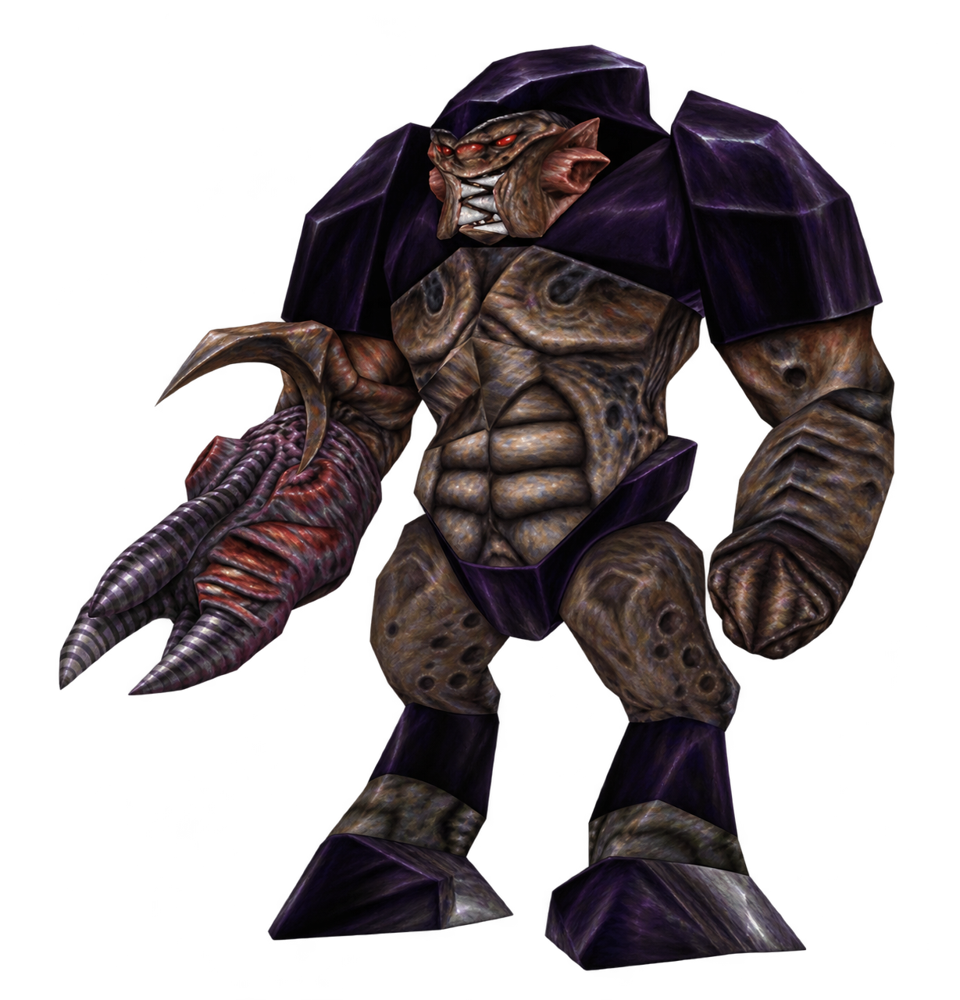

Reconstruction candidate fondée sur le modèle du jeu; pose isolée, proportions et vue à vérifier avant animation et intégration.

## Bullsquid — `bullsquid_hl1_idle_h`

**1774 × 887**, RGBA. Retenu pour revue.

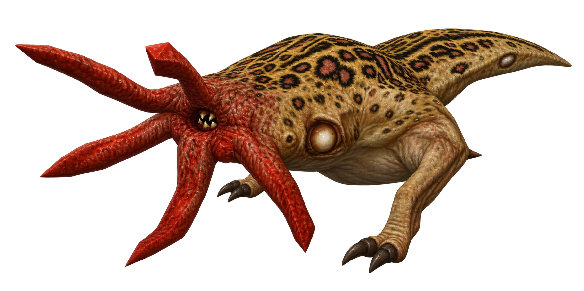

Reconstruction candidate fondée sur le modèle du jeu; pose isolée, proportions et vue à vérifier avant animation et intégration.

## Shock Trooper — `shock_trooper_op4_idle_h`

**1024 × 1536**, RGBA. Retenu pour revue.

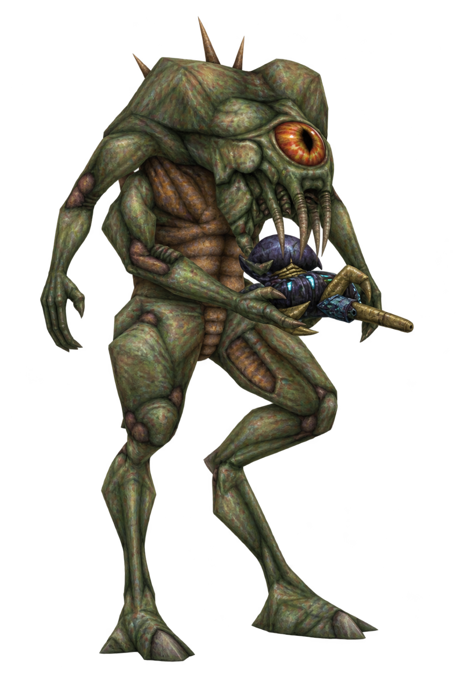

Reconstruction candidate fondée sur le modèle du jeu; pose isolée, proportions et vue à vérifier avant animation et intégration.

## Gonome — `gonome_op4_idle_h`

**1199 × 1312**, RGBA. Retenu pour revue.

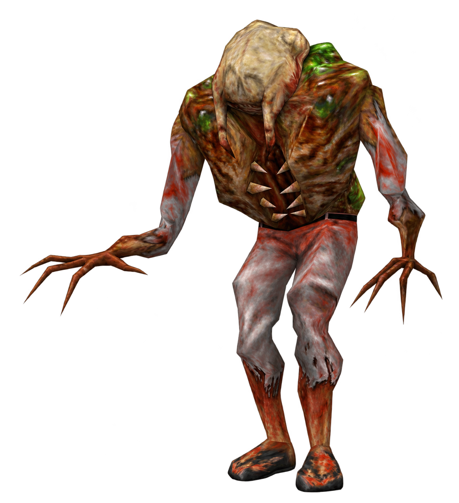

Reconstruction candidate fondée sur le modèle du jeu; pose isolée, proportions et vue à vérifier avant animation et intégration.

## Nihilanth — `nihilanth_hl1_idle_h`

**1114 × 1412**, RGBA. Retenu pour revue.

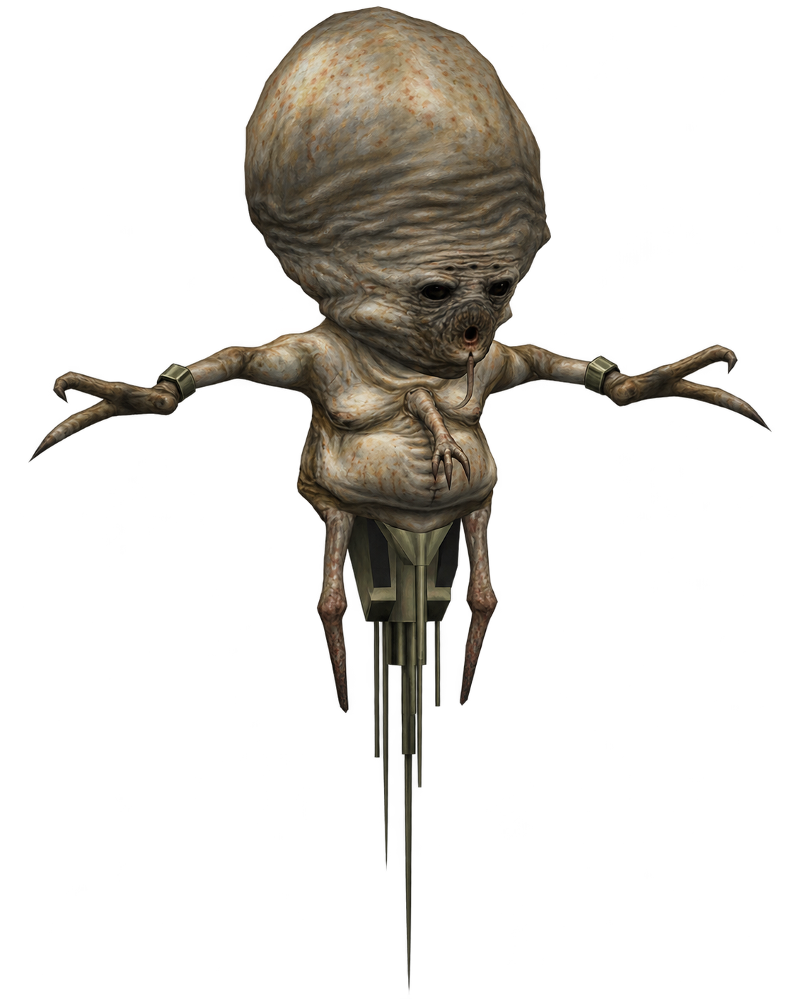

Proportions, grand crâne, troisième bras, bracelets et implant inférieur concordent avec le modèle HL1 consulté. Vue trois-quarts encore proche de face; profil de combat et phases à produire.

## Tentacules de Blast Pit — `tentacle_blastpit_hl1_idle_h`

**1031 × 1526**, RGBA. Retenu pour revue.

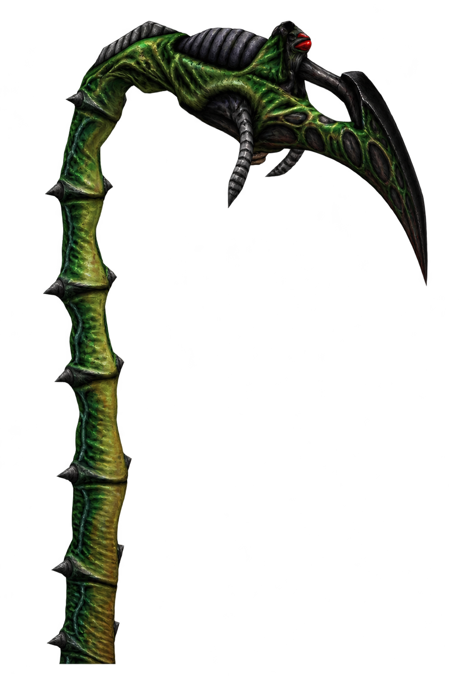

Appendice individuel fidèle aux marqueurs HL1 : bec noir, spot rouge, crête grise, deux préhenseurs, tige segmentée verte. Composition finale des trois tentacules et arène non produites par ce fichier.

## Gonarch — `gonarch_hl1_idle_h`

**1536 × 1024**, RGBA. Révision historique non retenue.

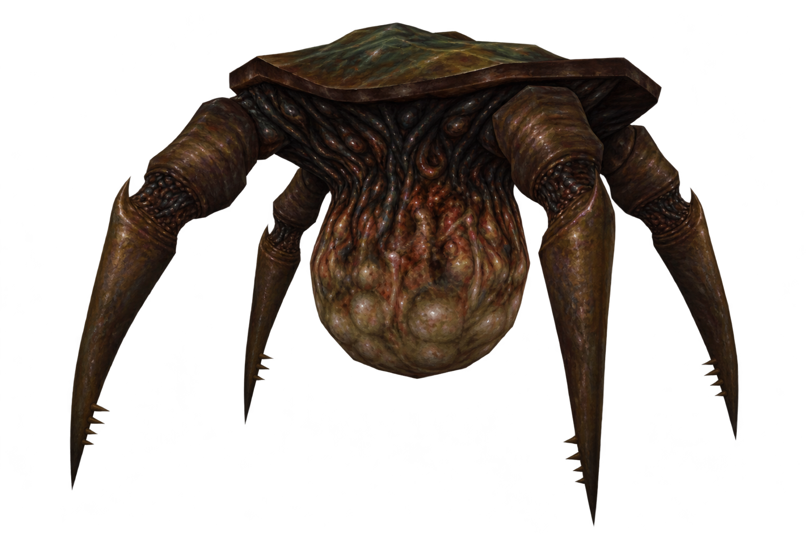

Première itération. Quatre pattes, carapace et sac conformes aux marqueurs du modèle; détouré propre sur composite réel. V2 préférée pour lisibilité. Vue frontale trois-quarts, profil combat à compléter.

## Gonarch — `gonarch_hl1_idle_h_v2`

**1536 × 1024**, RGBA. Retenu pour revue.

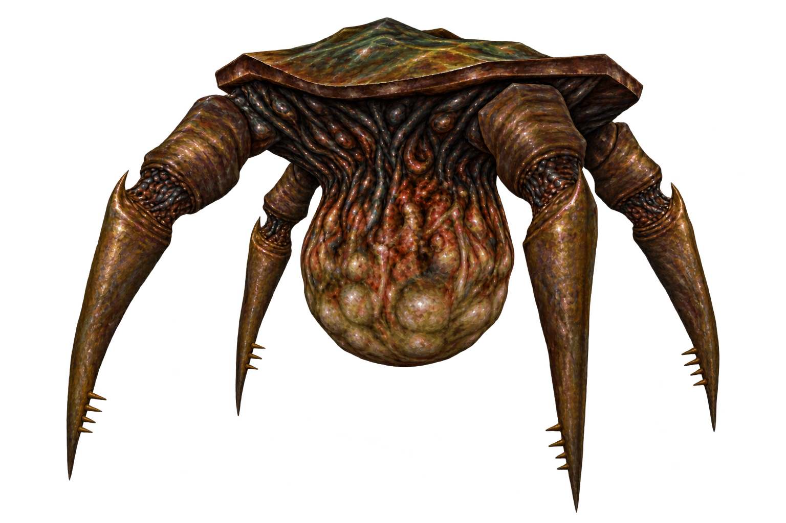

Retouche dédiée au détourage. Le halo RGB affiché en aperçu brut disparaît sur composition alpha correcte. Anatomie principale et quatre pattes maintenues; vue frontale trois-quarts à compléter par profil combat.

## Gordon Freeman — `gordon_hl2_idle_h`

**1148 × 1370**, RGBA. Retenu pour revue.

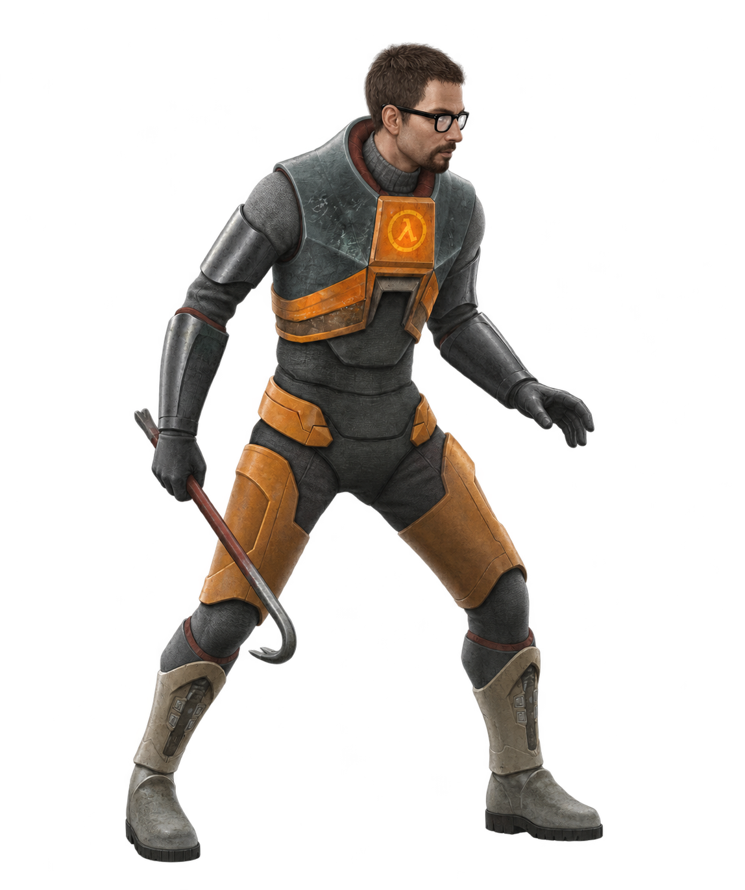

Lunettes, barbiche, pied-de-biche et découpe HEV Mark V repris de l’illustration officielle Lonely Road. Pose trois-quarts droite exploitable. La source est une illustration promotionnelle de Raising the Bar, pas une capture du modèle joueur retail; dimensions et faces non montrées ne sont pas certifiées.

## Alyx Vance — `alyx_hl2_idle_h`

**1024 × 1536**, RGBA. Retenu pour revue.

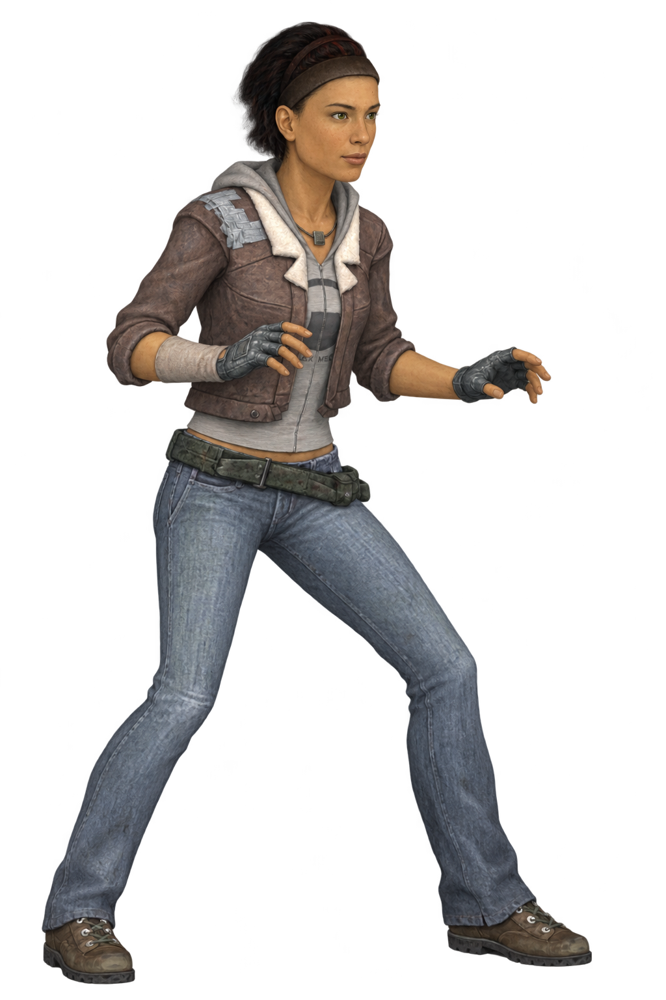

Visage, bandeau, veste, col clair, réparation d’épaule, bandage droit, gants, jean et chaussures concordent avec le modèle retail HL2. Pose sans arme; l’Alyx Gun et ses prises en main restent à produire séparément. Le halo visible dans l’affichage RGB sous alpha est absent des composites réels.

## Barney Calhoun — `barney_hl2_idle_h`

**1060 × 1484**, RGBA. Retenu pour revue.

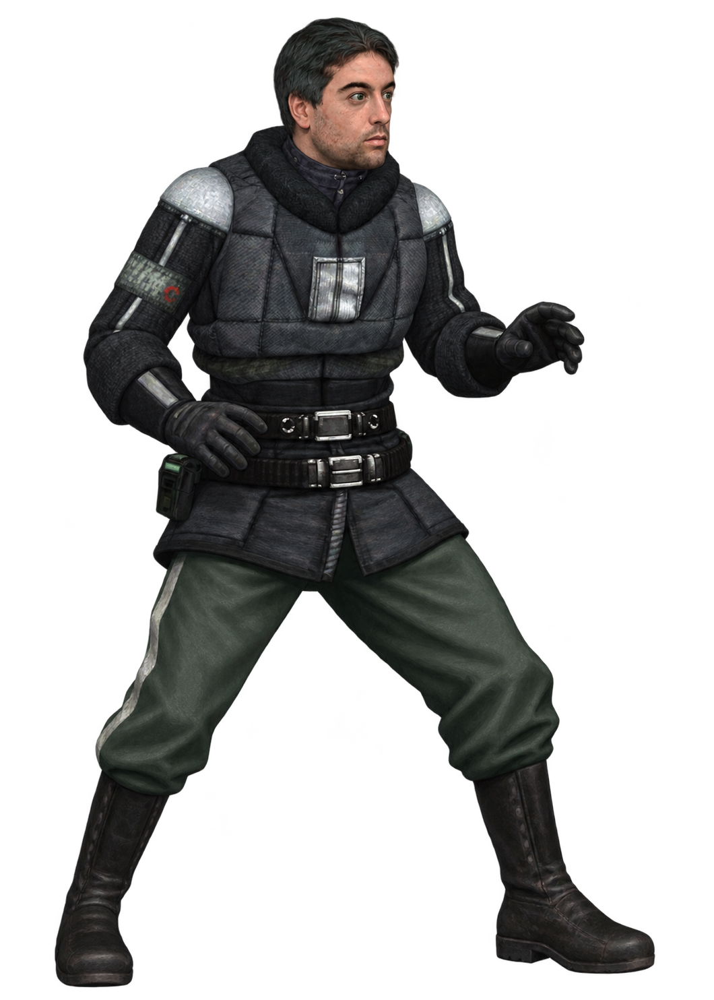

Visage découvert, armure Civil Protection, épaulettes claires, deux ceintures, pantalon vert et bottes conservés. Pose trois-quarts droite et alpha propre. Les petits marquages et surfaces latérales doivent encore être comparés à des vues supplémentaires du modèle.

## Adrian Shephard — `shephard_op4_idle_h`

**1199 × 1312**, RGBA. Retenu pour revue.

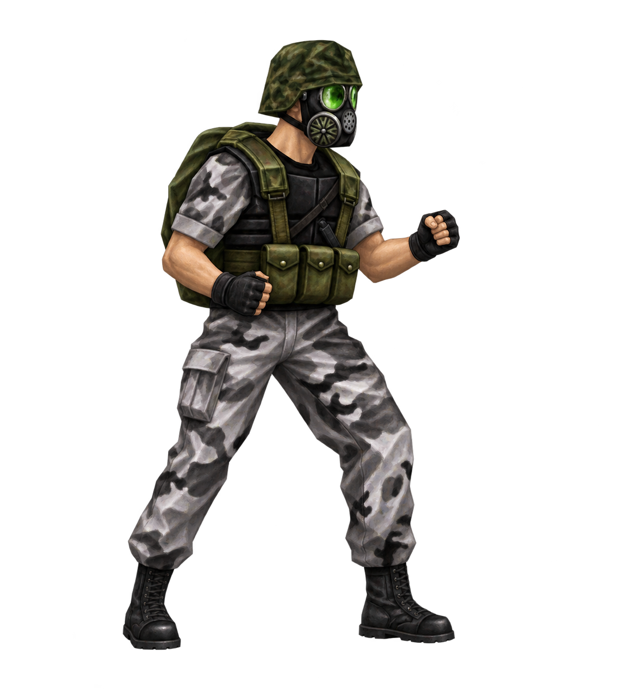

Masque à verres verts, casque et paquetage olive, manches courtes, camouflage urbain gris et bottes reprennent le modèle joueur OP4 original. Les proportions et plis sont adaptés au dessin; forme exacte des poches/attaches et texture doivent être vérifiées avant certification. Sans arme.

## Vortigaunt — `vortigaunt_hl2_idle_h`

**1234 × 1274**, RGBA. Retenu pour revue.

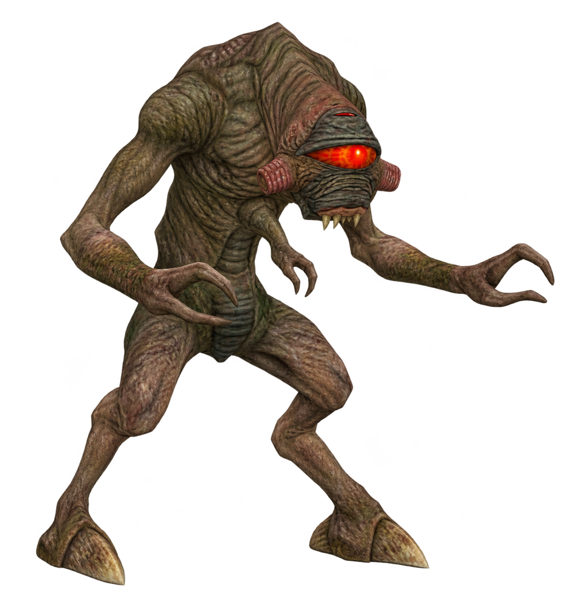

Silhouette du modèle HL2 retail, grand œil rouge-orange, troisième bras thoracique, longues mains à deux doigts et pieds pointus sont lisibles. Pas de collier d’esclavage. Peau enrichie en détails et plus chaude que le rendu de référence; contrôle des petits yeux et textures reste requis.

## Père Grigori — `grigori_hl2_idle_h`

**1154 × 1363**, RGBA. Retenu pour revue.

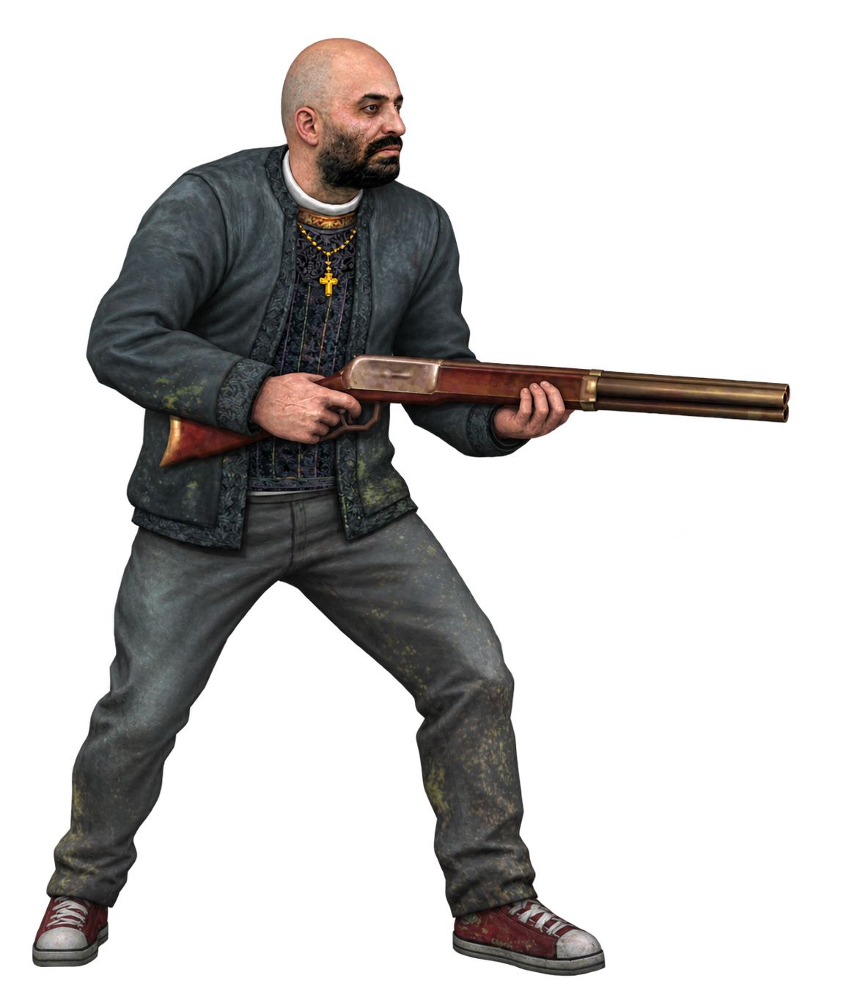

Tête chauve, barbe, vêtements gris-bleu, croix, taches et chaussures rouges correspondent au modèle retail. Annabelle est présente, mais la lecture des deux tubes à la bouche demande une capture rapprochée supplémentaire du modèle source. Ne pas certifier le canon/tube-magasin à partir de la seule vue actuelle; aucune substitution à un modèle réel n’a été faite.

## Wallace Breen — `breen_hl2_idle_h`

**784 × 2005**, RGBA. Retenu pour revue.

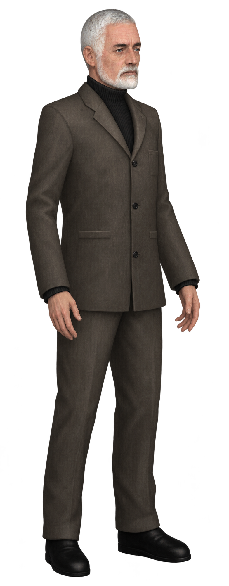

Silhouette et tenue concordent avec la source; pose statique et petites surfaces restent à certifier.

## Îlot frontière de Xen — `stage_xen_hl1_master_h`

**2172 × 724**, RGB. Retenu pour revue.

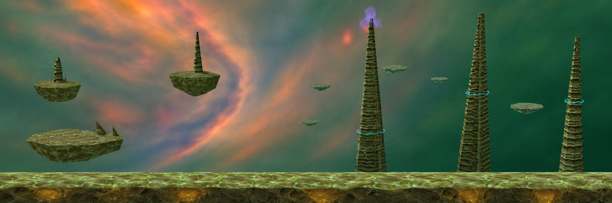

Ciel vert à volutes saumon, îles flottantes aplaties, aiguilles striées et anneaux cyan conservés. Aucun personnage ou boss visible. Le sol continu et la redistribution des îles adaptent la géométrie du niveau 3D pour une lecture latérale. Master aplati unique; aucune couche de parallaxe séparée, arène complète, animation, intégration runtime ou fidélité 1:1 certifiée.

## Anneau Lambda — `stage_lambda_hl1_master_h`

**2172 × 724**, RGB. Retenu pour revue.

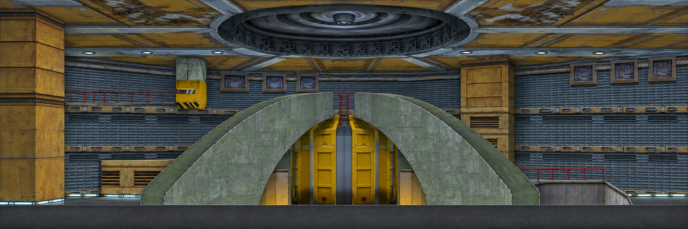

Noyau jaune, arches gris-vert, émetteur circulaire de plafond, panneaux bleus striés et garde-corps rouges conservés. Salle finale inactive, sans mélange avec le puits à téléporteurs. Sol continu frontal et composition centrée adaptés; bande de sol visible environ 10 %, inférieure au souhait initial 16 %. Hauteur de terrain à valider avant intégration. Master aplati unique; aucune couche de parallaxe séparée, arène complète, animation, intégration runtime ou fidélité 1:1 certifiée.

## Passerelle de Blast Pit — `stage_blastpit_hl1_master_h`

**2172 × 724**, RGB. Retenu pour revue.

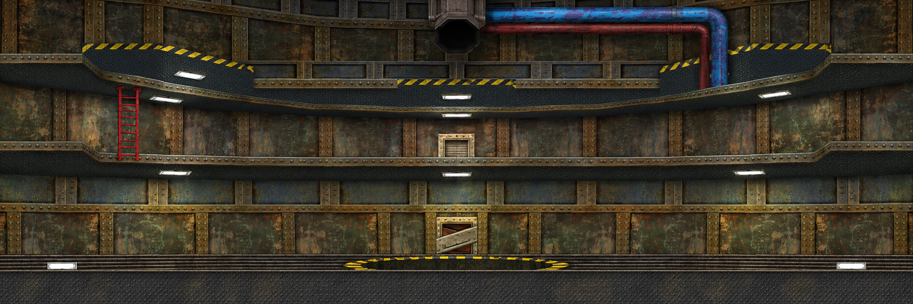

Tôle rouillée rivetée, coursives, rayures de danger, échelle rouge et conduites rouge/bleue reconnaissables. Tentacules absents; ouverture du puits derrière la plateforme. Niveaux des coursives et projection du cylindre recomposés de profil; bande de sol visible environ 10 %, à valider avant intégration. Master aplati unique; aucune couche de parallaxe séparée, arène complète, animation, intégration runtime ou fidélité 1:1 certifiée.

## Disposal — `stage_disposal_hl25_master_h`

**2172 × 724**, RGB. Retenu pour revue.

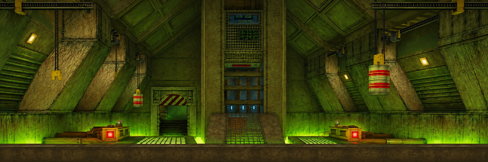

Capture Valve officielle reprise: contreforts obliques, chaînes et palans jaunes, tonneaux à bandes rouges, tour centrale, lampes rouges et éclairage toxique vert. Aucun joueur visible. La passerelle continue est une adaptation 2D et non une reproduction de la topologie jouable 3D. Bande de sol visible environ 11 %, à valider avant intégration. Master aplati unique; aucune couche de parallaxe séparée, arène complète, animation, intégration runtime ou fidélité 1:1 certifiée.

## Contamination — `stage_contamination_hl25_master_h`

**2172 × 724**, RGB. Retenu pour revue.

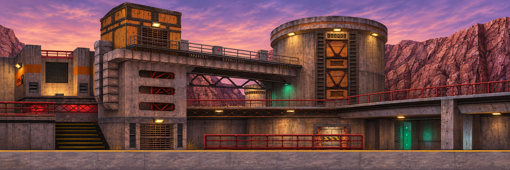

Béton et tours, passerelles à garde-corps rouges, ciel couchant et falaises préservés. Adaptation 2D candidate, géométrie recomposée. Aucun stage complet en six couches, certification 1:1 ou runtime déclaré.

## Pool Party — `stage_pool_party_hl25_master_h`

**2172 × 724**, RGB. Retenu pour revue.

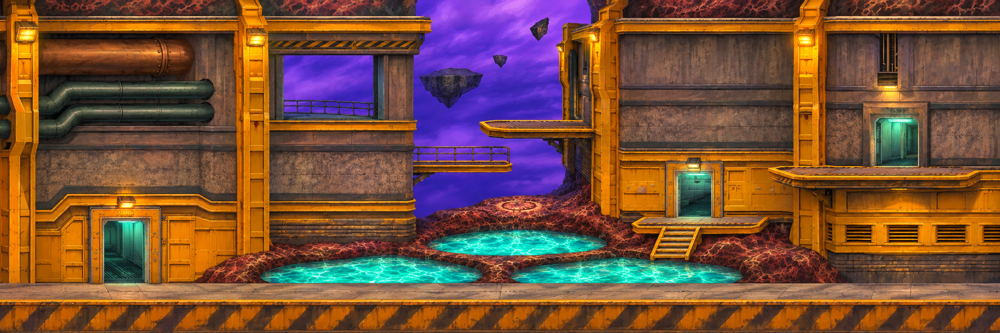

Avant-poste jaune, trois bassins turquoise, roche organique et vide violet conservés. Adaptation 2D candidate, géométrie recomposée. Aucun stage complet en six couches, certification 1:1 ou runtime déclaré.

## Rocket Frenzy — `stage_rocket_frenzy_hl25_master_h`

**2172 × 724**, RGB. Retenu pour revue.

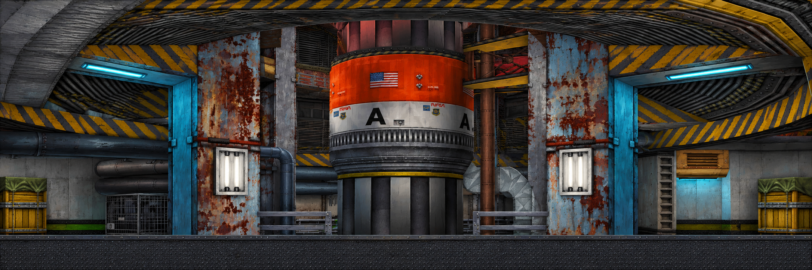

Fusée orange et blanche, piliers rouillés, éclairage cyan, rayures de danger et conduites conservés. Adaptation 2D candidate, géométrie recomposée. Aucun stage complet en six couches, certification 1:1 ou runtime déclaré.

## Orbe d’énergie secondaire AR2 — `proj_ar2_energy_ball_hl2_h`

**1536 × 1024**, RGBA. Retenu pour revue.

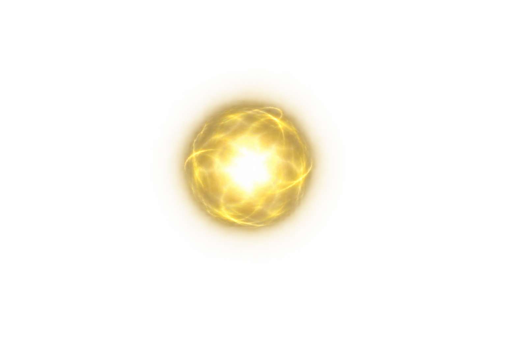

Silhouette orb lumineuse cohérente; la couronne et ses filaments restent à comparer avec capture du jeu. Pas de certification 1:1.

## Fléchette explosive Hunter — `proj_hunter_flechette_ep2_h`

**2172 × 724**, RGBA. Retenu pour revue.

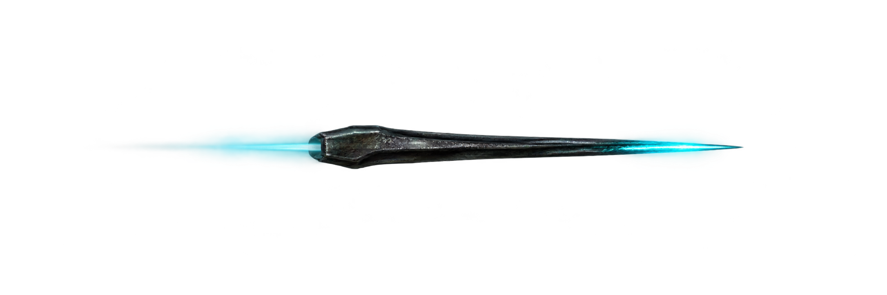

Candidat allongé cyan, détail mécanique surdimensionné possible. Revue sur modèle source nécessaire.

## Crachat du Bullsquid — `proj_bullsquid_spit_hl1_h`

**2172 × 724**, RGBA. Retenu pour revue.

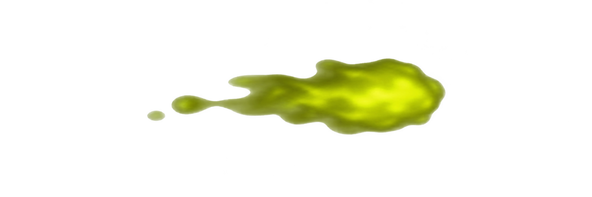

Globule jaune-vert; silhouette nettement plus allongée que le sprite source potentiel. À comparer sur capture exacte.

## Double anneau sonique Houndeye — `fx_houndeye_sonic_ring_hl1_h`

**2172 × 724**, RGBA. Retenu pour revue.

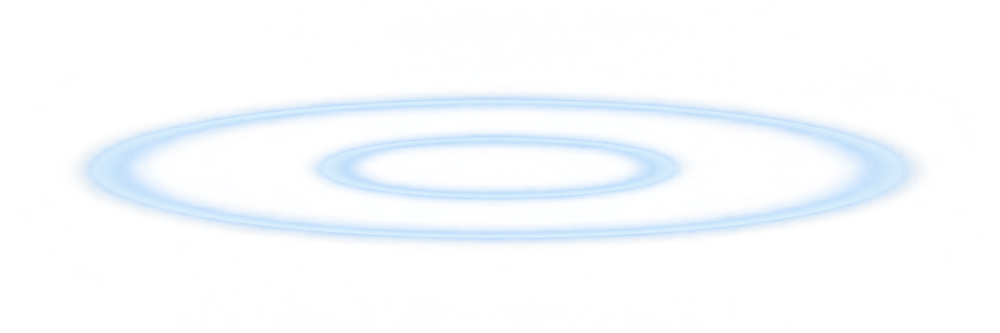

Deux anneaux concentriques présents, composite alpha sur gris clair et foncé vérifié sans nuage opaque interne. Épaisseur, cadence et taille source à valider.

## Boulette d’énergie haute puissance — `proj_energy_pellet_portal1_h`

**1536 × 1024**, RGBA. Retenu pour revue.

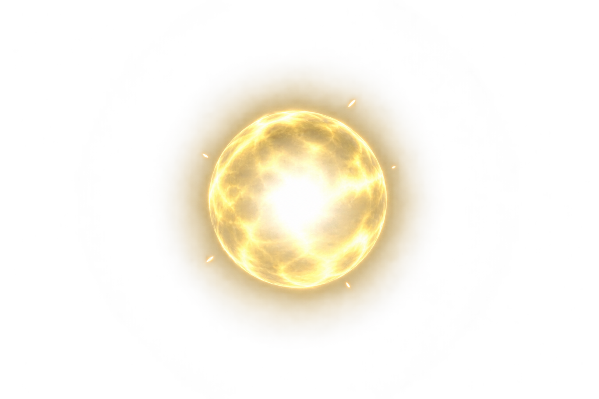

Pastille lumineuse blanche/dorée cohérente comme candidat; turbulence et dimensions à comparer au shader du jeu.

## Pont de lumière solide — `fx_hard_light_bridge_portal2_h`

**2172 × 724**, RGBA. Retenu pour revue.

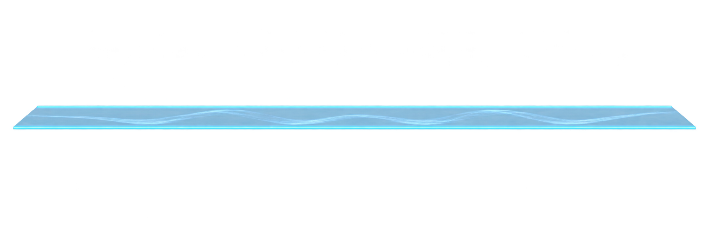

Bande bleue horizontale cohérente; profondeur/perspective et aspect des bandes de lumière à confronter à une capture.

## Goutte de gel répulsif — `proj_repulsion_gel_portal2_h`

**1536 × 1024**, RGBA. Retenu pour revue.

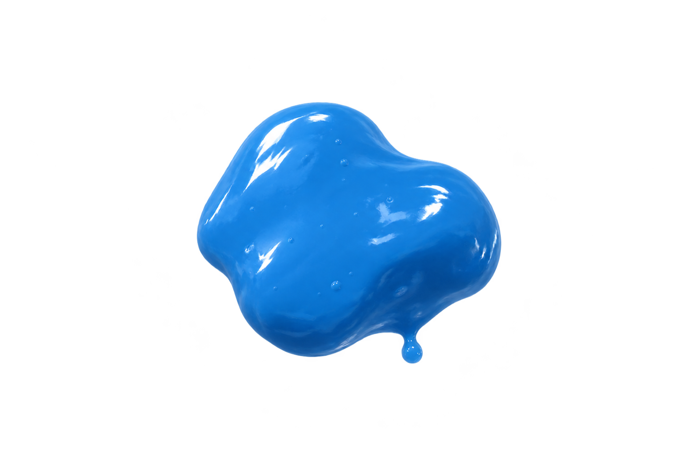

Goutte bleue humide lisible. Composite alpha sur gris clair et foncé vérifié : le halo apparent dans le rendu RGB ne se voit pas sur fond opaque. Aucun défaut de halo confirmé. Matière et profil restent candidats, pas certifiés 1:1.

## Frelon biologique Hivehand / Alien Grunt — `proj_hornet_hl1_h`

**1973 × 797**, RGBA. Retenu pour revue.

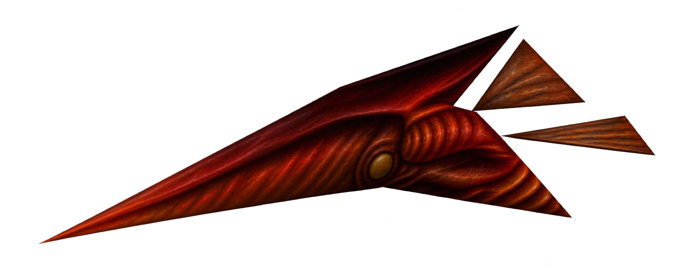

Silhouette et deux appendices triangulaires postérieurs proches de la référence inspectée. Retexturation haute résolution reste adaptation; taille et animation non validées.

## Goutte de gel propulsif — `proj_propulsion_gel_portal2_h`

**1536 × 1024**, RGBA. Retenu pour revue.

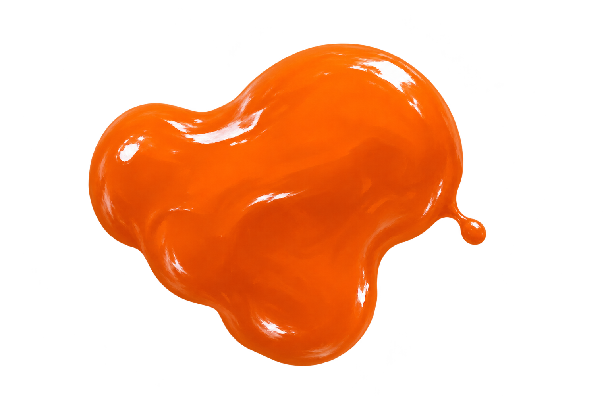

Première image candidate; couleur, contour et animation demandent comparaison avec une frame exacte du jeu.

## Goutte de gel de conversion — `proj_conversion_gel_portal2_h`

**1536 × 1024**, RGBA. Retenu pour revue.

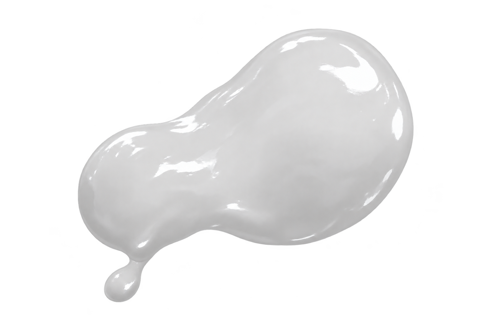

Première image candidate; couleur, contour et animation demandent comparaison avec une frame exacte du jeu.

## Faisceau de découragement thermique — `fx_thermal_beam_portal2_h`

**2172 × 724**, RGBA. Révision historique non retenue.

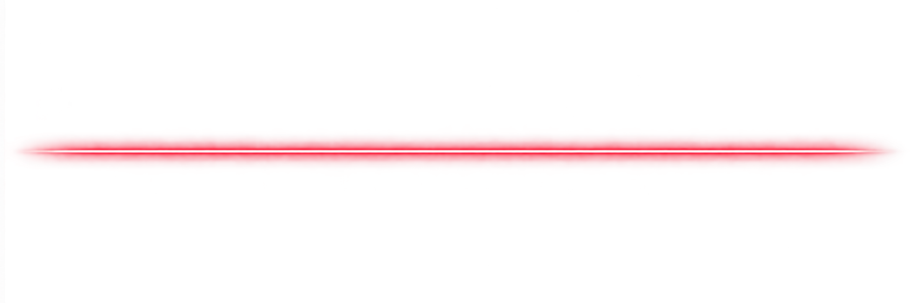

Bande blanche verticale parasite au bord gauche confirmée sur composite alpha; remplacé pour prochaine revue par v2, historique conservé.

## Portail bleu Portal 1 — `fx_portal_blue_portal1_h`

**1024 × 1536**, RGBA. Retenu pour revue.

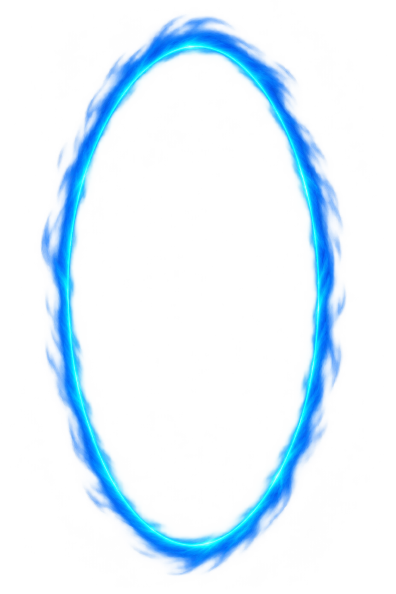

Première image candidate; couleur, contour et animation demandent comparaison avec une frame exacte du jeu.

## Orbes de l’Alien Controller — `proj_controller_orb_hl1_h`

**1536 × 1024**, RGBA. Retenu pour revue.

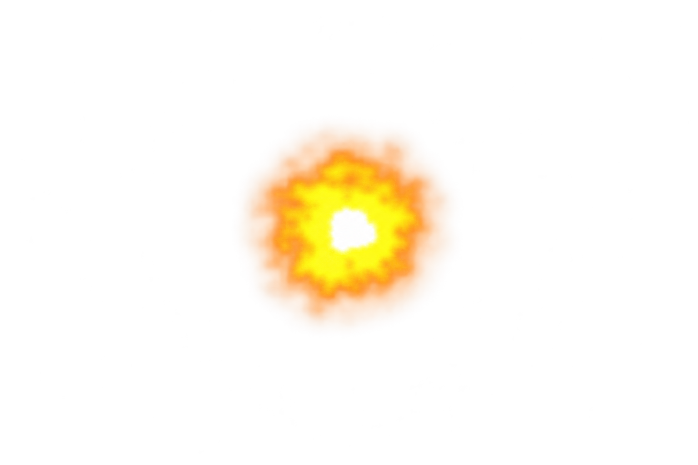

Couleur et type d'effet verrouillés aux références citées. Frame et cadence restent candidates; aucun clip complet.

## Mortier organique Gonarch — `proj_gonarch_mortar_hl1_h`

**1536 × 1024**, RGBA. Retenu pour revue.

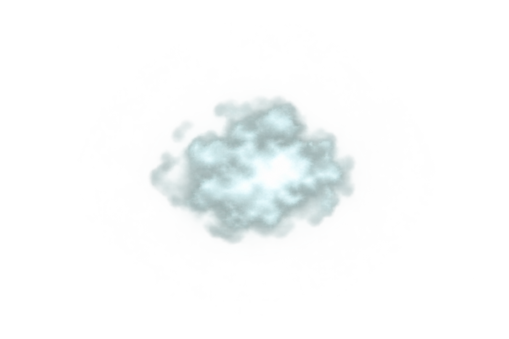

Couleur et type d'effet verrouillés aux références citées. Frame et cadence restent candidates; aucun clip complet.

## Décharge Vortigaunt HL1 — `fx_vortigaunt_zap_hl1_h`

**2172 × 724**, RGBA. Retenu pour revue.

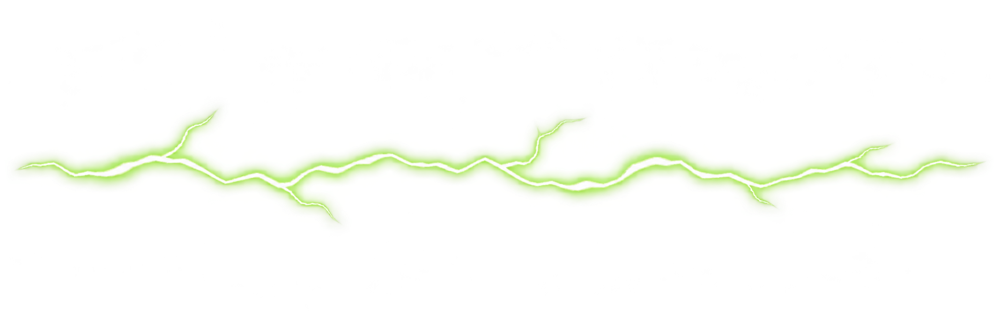

Couleur et type d'effet verrouillés aux références citées. Frame et cadence restent candidates; aucun clip complet.

## Faisceau de découragement thermique — `fx_thermal_beam_portal2_v2_h`

**2172 × 724**, RGBA. Retenu pour revue.

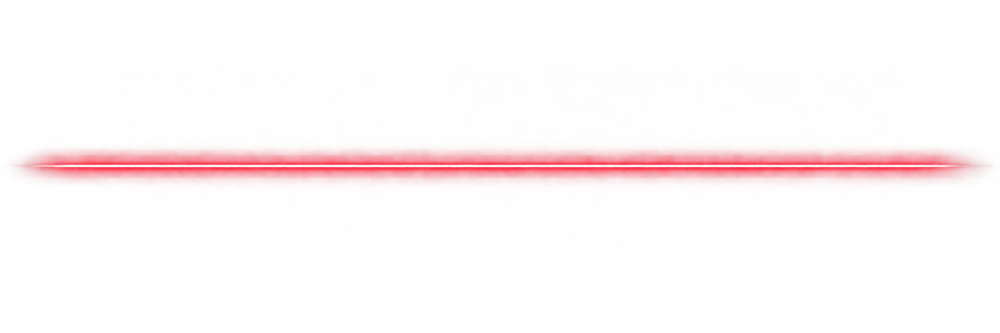

Révision conservée pour éliminer la bande blanche verticale; une révision ne couvre pas une cible supplémentaire.

## Roquette RPG — modèle HL1 — `proj_rpg_rocket_hl1_h`

**1905 × 826**, RGBA. Retenu pour revue.

Silhouette, orientation et matériaux comparés à la capture retail fournie en entrée. Alpha composite clair/sombre contrôlé. Les textures ont été interprétées par le générateur : pas de certification 1:1.

## Grenade à fragmentation HL2 — `proj_hand_grenade_hl2_h`

**1124 × 1399**, RGBA. Retenu pour revue.

Silhouette, orientation et matériaux comparés à la capture retail fournie en entrée. Alpha composite clair/sombre contrôlé. Les textures ont été interprétées par le générateur : pas de certification 1:1.

## Carreau incandescent HL2 — `proj_crossbow_bolt_hl2_h`

**2172 × 724**, RGBA. Retenu pour revue.

Silhouette, orientation et matériaux comparés à la capture retail fournie en entrée. Alpha composite clair/sombre contrôlé. Les textures ont été interprétées par le générateur : pas de certification 1:1.

## Bombe Hunter-Chopper — `proj_helicopter_bomb_hl2_h`

**1275 × 1233**, RGBA. Retenu pour revue.

Silhouette, orientation et matériaux comparés à la capture retail fournie en entrée. Alpha composite clair/sombre contrôlé. Les textures ont été interprétées par le générateur : pas de certification 1:1.

## Grenade à main HL1 — `proj_hand_grenade_hl1_h`

**1046 × 1504**, RGBA. Retenu pour revue.

Candidat; revue visuelle et animations restent à terminer.

## Carreau d’arbalète HL1 — `proj_crossbow_bolt_hl1_h`

**1944 × 809**, RGBA. Retenu pour revue.

Candidat; revue visuelle et animations restent à terminer.

## Snark lancé — `proj_snark_hl1_h`

**1312 × 1199**, RGBA. Retenu pour revue.

Candidat; revue visuelle et animations restent à terminer.
