# Lot I — galerie du 24 novembre 2026

14 PNG individuels. Chaque aperçu mène au fichier original. Les images sont des candidats de production ; les notes ci-dessous distinguent références inspectées, adaptations et limites.

## Rollermine HL2 — état déployé

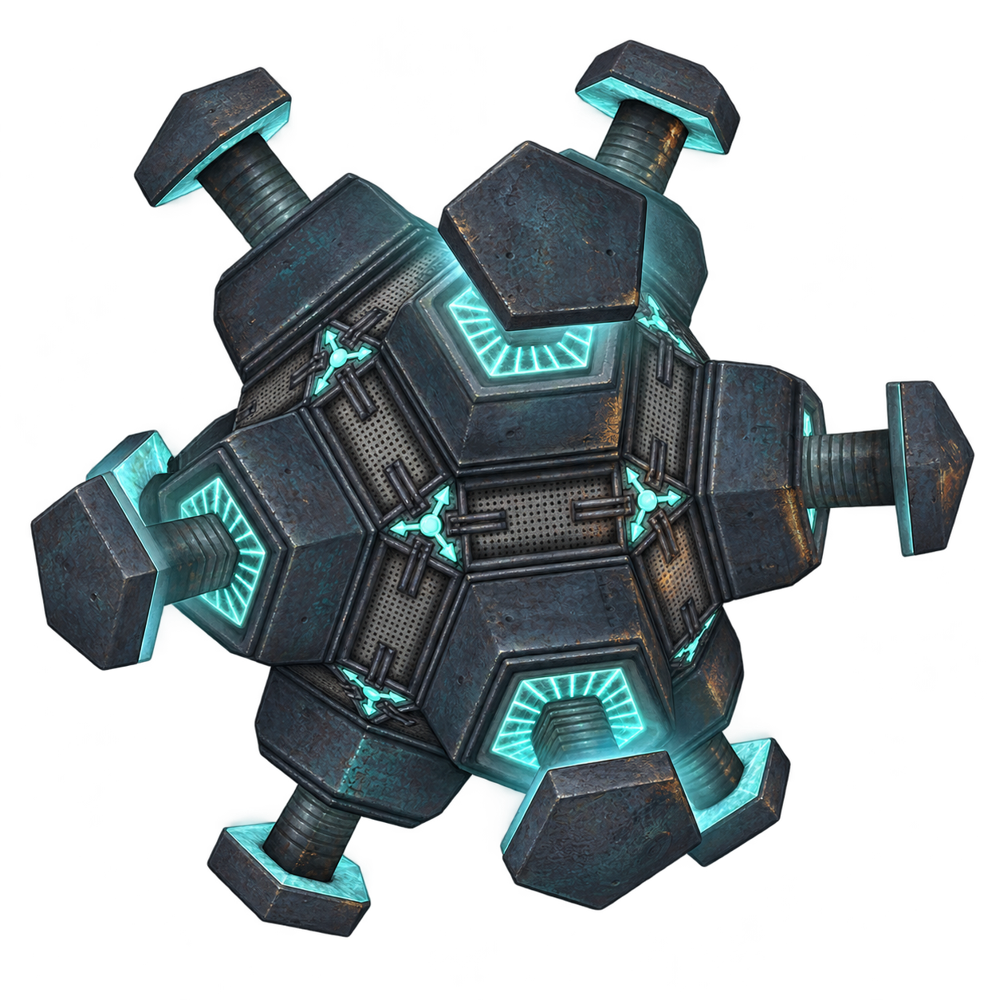

- Cible : `rollermine_hl2` ; état : `pose ou master de base`.
- Format : 1254 × 1254 px, RGBA.
- [PNG original](../../../../assets/resonance/candidates/continuation_20261124_i/machines/rollermine_hl2_active_i.png) ; SHA-256 : `bcd0ad5c9c7873dedb7a9d4b6962a8be587d5724277fd55f1a0e92870a0a3a56`.

## City Scanner HL2

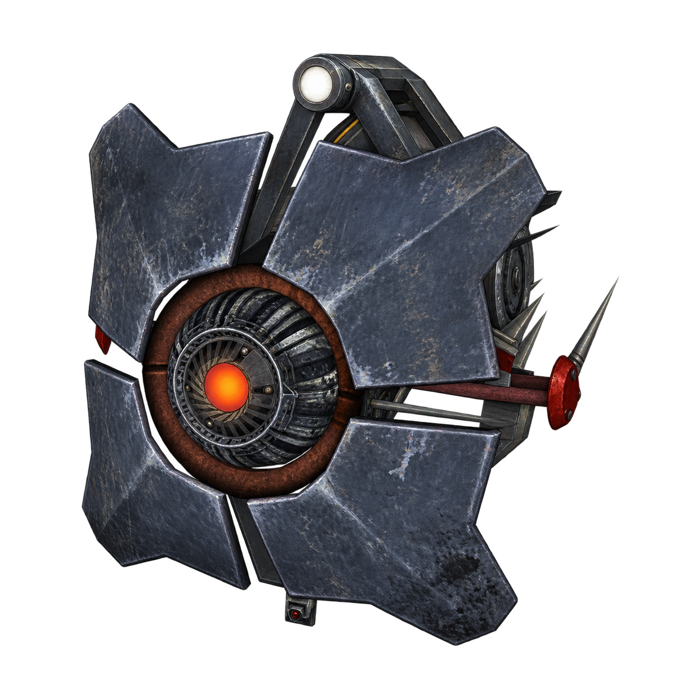

- Cible : `city_scanner_hl2` ; état : `pose ou master de base`.
- Format : 1254 × 1254 px, RGBA.
- [PNG original](../../../../assets/resonance/candidates/continuation_20261124_i/machines/city_scanner_hl2_idle_i.png) ; SHA-256 : `594856e236122e7de6f4a3308d0c2d5b40a23034e99dcfe712bfd9b3e9aede15`.

## Pit Worm — partie émergée

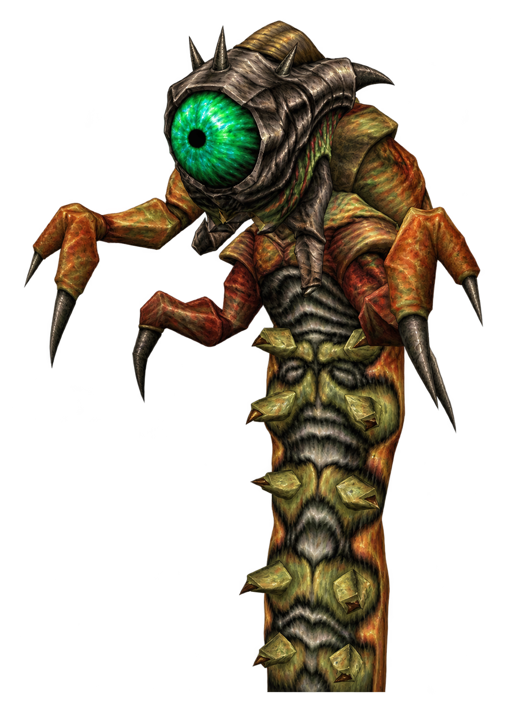

- Cible : `pit_worm_op4` ; état : `pose ou master de base`.
- Format : 1064 × 1478 px, RGBA.
- [PNG original](../../../../assets/resonance/candidates/continuation_20261124_i/bosses/pit_worm_op4_idle_i.png) ; SHA-256 : `7e7175af5c8d4759d05c7d9bd003dfe41c14e06ba9a8b4717a23df5c9a92e566`.

## Gene Worm — partie émergée

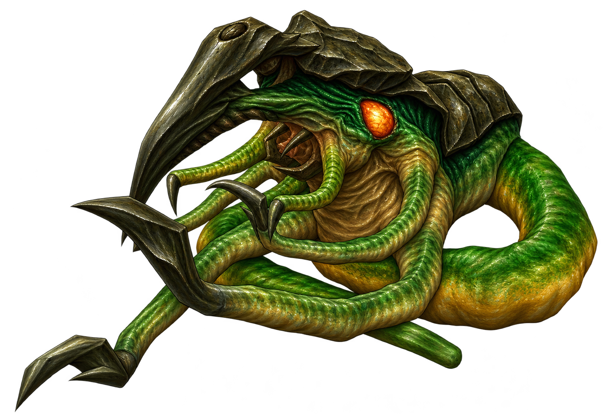

- Cible : `gene_worm_op4` ; état : `pose ou master de base`.
- Format : 1506 × 1045 px, RGBA.
- [PNG original](../../../../assets/resonance/candidates/continuation_20261124_i/bosses/gene_worm_op4_idle_i.png) ; SHA-256 : `b87efec804dbf66c2facd42c0344be723a6fd6130d2e5f2edfb67d7f1e9b5b0d`.

## G-Man — costume Half-Life original

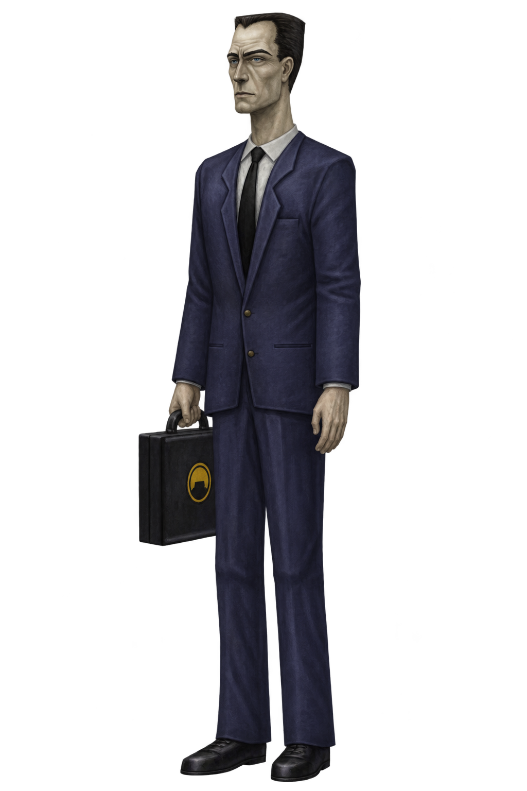

- Cible : `costume_gman_hl1` ; état : `pose ou master de base`.
- Format : 1024 × 1536 px, RGBA.
- [PNG original](../../../../assets/resonance/candidates/continuation_20261124_i/costumes/costume_gman_hl1_idle_i.png) ; SHA-256 : `1febc0a2328ec19f7f148e656618660d305d6009d6178e413d2e2f45a83fd72f`.

## Protection Civile — garde au bâton

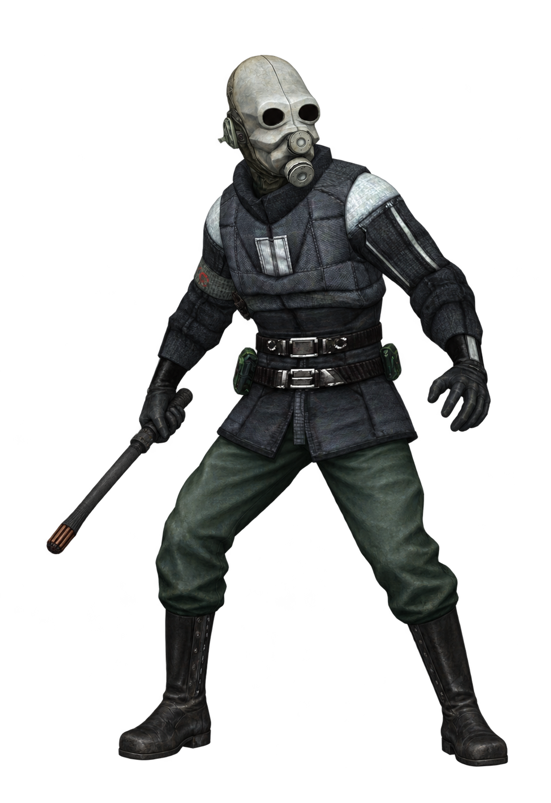

- Cible : `civil_protection_hl2` ; état : `pose ou master de base`.
- Format : 1039 × 1514 px, RGBA.
- [PNG original](../../../../assets/resonance/candidates/continuation_20261124_i/characters/civil_protection_hl2_guard_i.png) ; SHA-256 : `4f28415ecd6beecfc38fd307314b9cd636184d9bb12600d5d380edcda78543b4`.

## Combine Grunt — Alyx

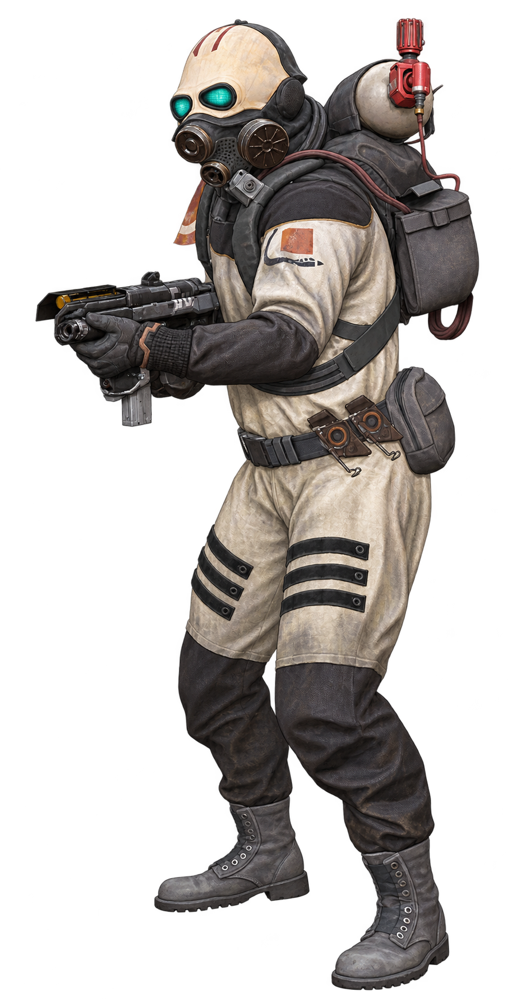

- Cible : `combine_grunt_hla` ; état : `pose ou master de base`.
- Format : 906 × 1736 px, RGBA.
- [PNG original](../../../../assets/resonance/candidates/continuation_20261124_i/supplement/combine_grunt_hla_idle_i.png) ; SHA-256 : `06a05b21f94bcaa20e0b668be8cf39d75a8028efc9c2a8cd526ce68f7bfa36ee`.

## Combine Charger — Alyx

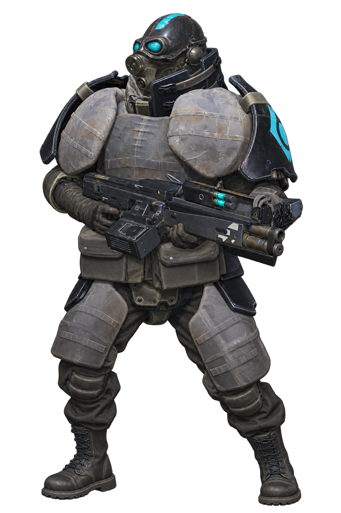

- Cible : `combine_charger_hla` ; état : `pose ou master de base`.
- Format : 1024 × 1536 px, RGBA.
- [PNG original](../../../../assets/resonance/candidates/continuation_20261124_i/supplement/combine_charger_hla_idle_i.png) ; SHA-256 : `801d80fa373c6875694d6f05e67fcbfc1e7be7ac7b9be6b70aecef7c7e4f71fb`.

## Combine Suppressor — Alyx

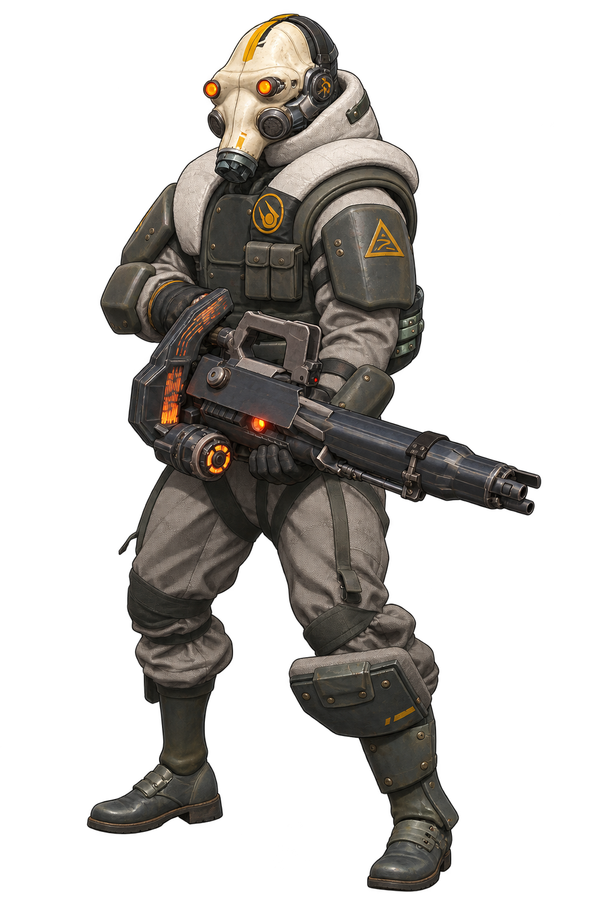

- Cible : `combine_suppressor_hla` ; état : `pose ou master de base`.
- Format : 1024 × 1536 px, RGBA.
- [PNG original](../../../../assets/resonance/candidates/continuation_20261124_i/supplement/combine_suppressor_hla_idle_i.png) ; SHA-256 : `28cc9f165aac79c850760f52d22ca342f589c55a78941aa47a5fd0e576fa383f`.

## Terminus du tram de Black Mesa

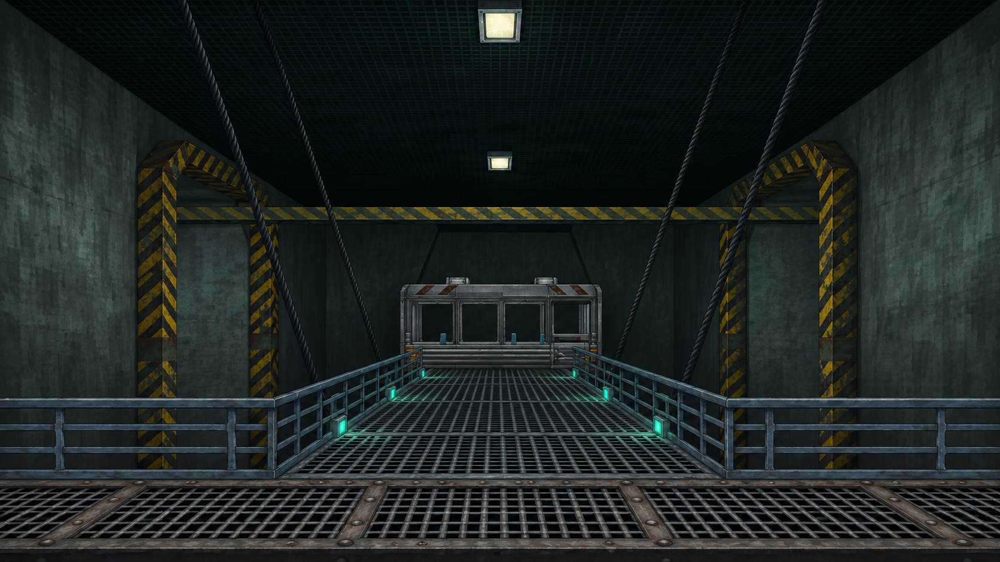

- Cible : `STG_01_HL1_TRAM` ; état : `pose ou master de base`.
- Format : 1672 × 941 px, RGB.
- [PNG original](../../../../assets/resonance/candidates/continuation_20261124_i/stages/stage_tram_hl1_master_i.png) ; SHA-256 : `8b72d5cd487eb66e3699adc451c171500f82c374f16df43b1587b3c907552ed7`.

## Cour de Black Mesa East

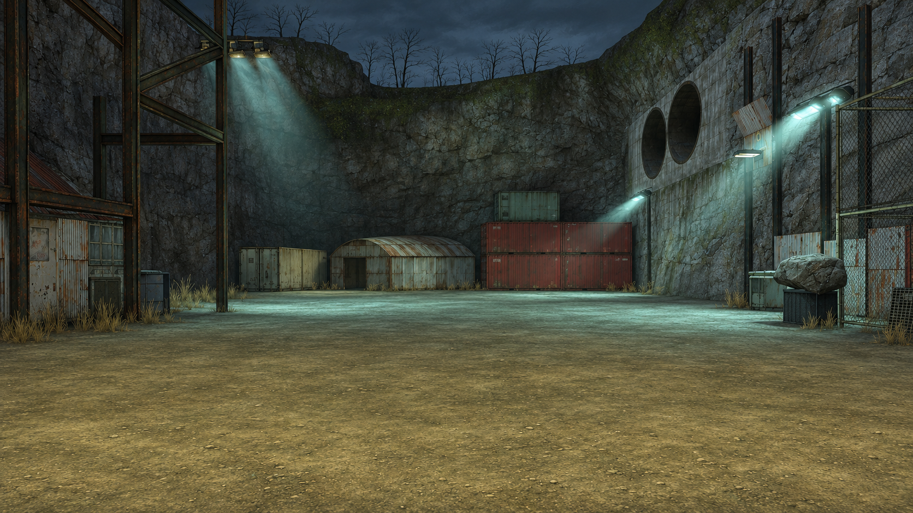

- Cible : `STG_13_HL2_BME` ; état : `pose ou master de base`.
- Format : 1672 × 941 px, RGB.
- [PNG original](../../../../assets/resonance/candidates/continuation_20261124_i/stages/stage_black_mesa_east_hl2_master_i.png) ; SHA-256 : `9755a4ecb4edf5cab917aae9863d0bc7d07bcaa8b6f6356fe95ba67c174f9117`.

## Relaxation Vault — Portal

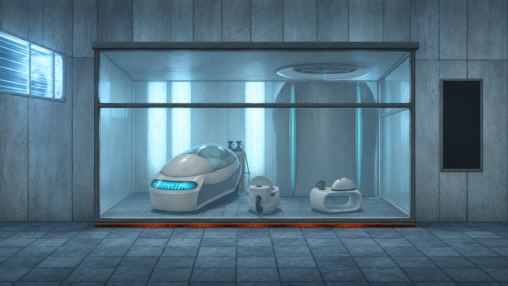

- Cible : `STG_EXT_PORTAL1_RELAXATION` ; état : `pose ou master de base`.
- Format : 1672 × 941 px, RGB.
- [PNG original](../../../../assets/resonance/candidates/continuation_20261124_i/stages/stage_relaxation_vault_portal1_master_i.png) ; SHA-256 : `1e81472e83aa40b29ca3501bac4d61e6d3ddaefe2b708f4a30d04ee4dd0a47f6`.

## Rayon primaire Tau/Gauss — Half-Life

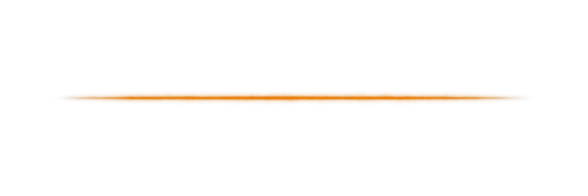

- Cible : `fx_gauss_beam_hl1` ; état : `primary`.
- Format : 2172 × 724 px, RGBA.
- [PNG original](../../../../assets/resonance/candidates/continuation_20261124_i/effects/fx_gauss_primary_hl1_i.png) ; SHA-256 : `7beed7e39242fd7079a3655dc32953fcb07861e70386026a62730f28b414cc77`.

## Portail orange actif — Portal

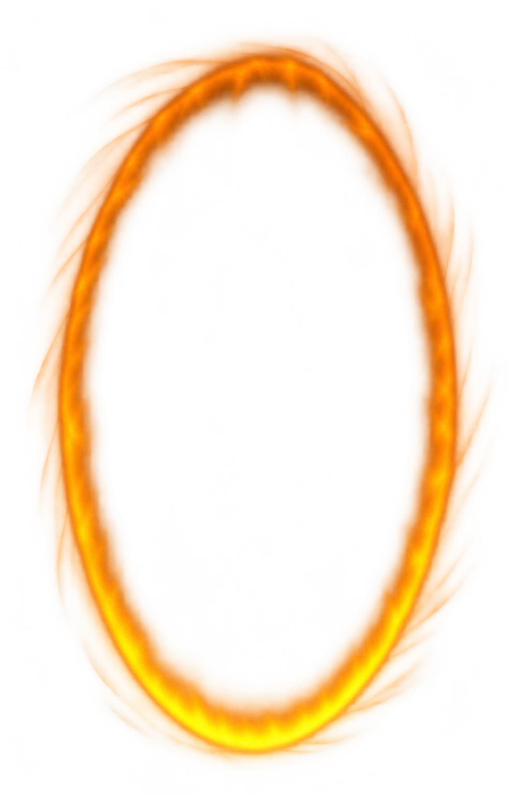

- Cible : `fx_portal_orange_portal1` ; état : `active_rim`.
- Format : 1024 × 1536 px, RGBA.
- [PNG original](../../../../assets/resonance/candidates/continuation_20261124_i/effects/fx_portal_orange_active_rim_portal1_i.png) ; SHA-256 : `eb8c9910a8e85fbd0b6e0404a7248b4d7b9a83125abf37b22bb02d5d61fe45a8`.
