# Galerie — lot J

**44 PNG conservés, 41 cibles.** Tous sont candidats non certifiés. Les révisions non sélectionnées restent visibles pour la traçabilité. Les sorties perdues sans fichier ne sont pas affichées.

[Rapport complet](README.md) · [Registre](generation_register.json)

## Personnages et costume

### Gordon Freeman Mark IV

**gordon_hl1_idle_j** — 1199 × 1312 — sélectionné pour revue.

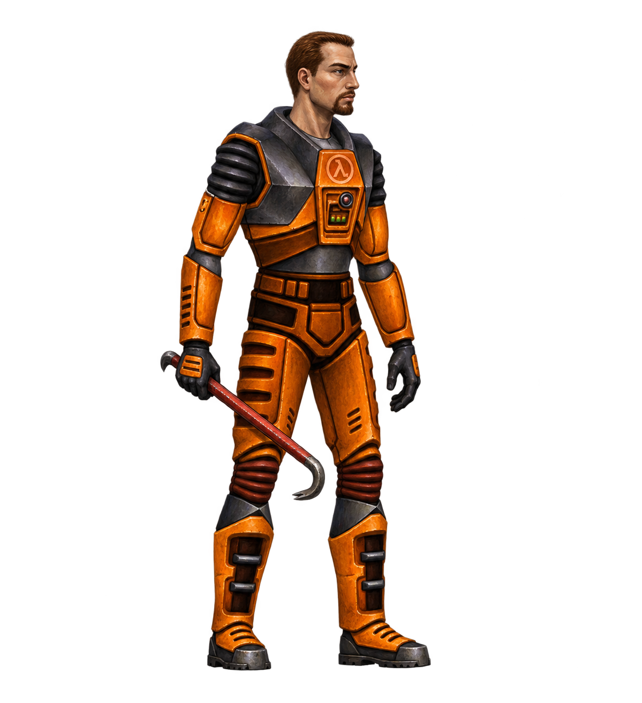

Choix explicite du modèle original player_hl01 sans lunettes, HEV Mark IV. Palette et console centrales préservées. Pose adaptée en trois quarts vers la droite, traits du visage et volumes d’armure encore à comparer; pas une certification 1:1.

### Soldat HECU

**hecu_hl1_idle_j** — 1199 × 1312 — sélectionné pour revue.

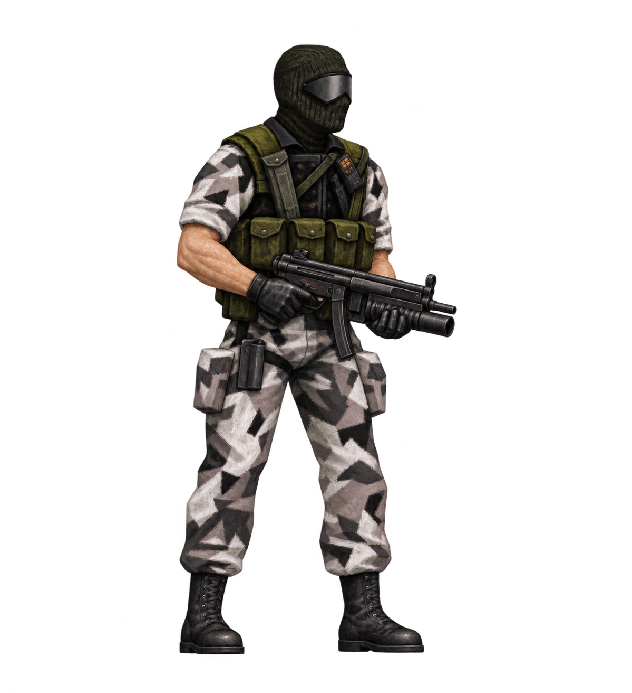

Variante Hgrunt_hl03 à cagoule explicitement retenue, distincte du béret et du masque à gaz déjà produits. Camouflage, gilet, lunettes et proportions lisibles. Arme MP5 adaptée à la pose, géométrie fine et couture des poches à vérifier; une seule pose statique.

### Assassin Black Ops

**black_ops_hl1_idle_j** — 1024 × 1536 — sélectionné pour revue.

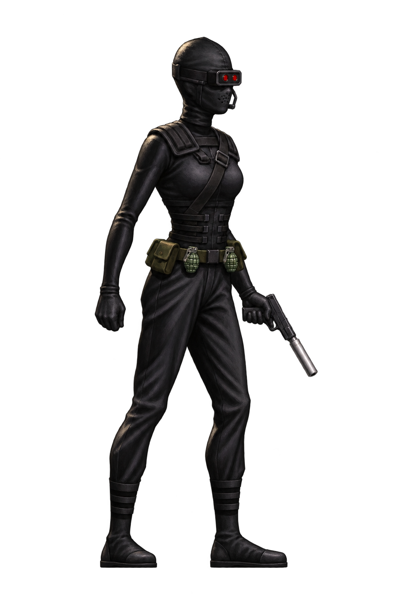

Modèle féminin Half-Life original retenu. Lunettes rouges, masque, tenue noire et silencieux argent conservés. Pose et volumes réinterprétés. Alpha contrôlé sur fonds blanc et noir: pas de halo large visible au compositing; candidat non certifié.

### Infirmier HECU

**hecu_medic_op4_idle_j** — 1024 × 1536 — sélectionné pour revue.

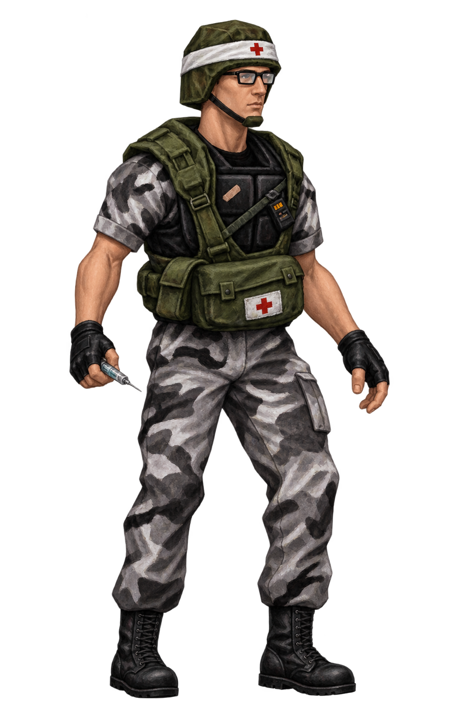

Variante originale du Medic à lunettes, casque marqué et sac médical conservée; seringue tenue vers le bas. Face, volumes du sac et plis sont réinterprétés. Alpha contrôlé sur fonds blanc et noir: pas de halo large visible au compositing.

### Ingénieur HECU

**hecu_engineer_op4_idle_j** — 887 × 1774 — sélectionné pour revue.

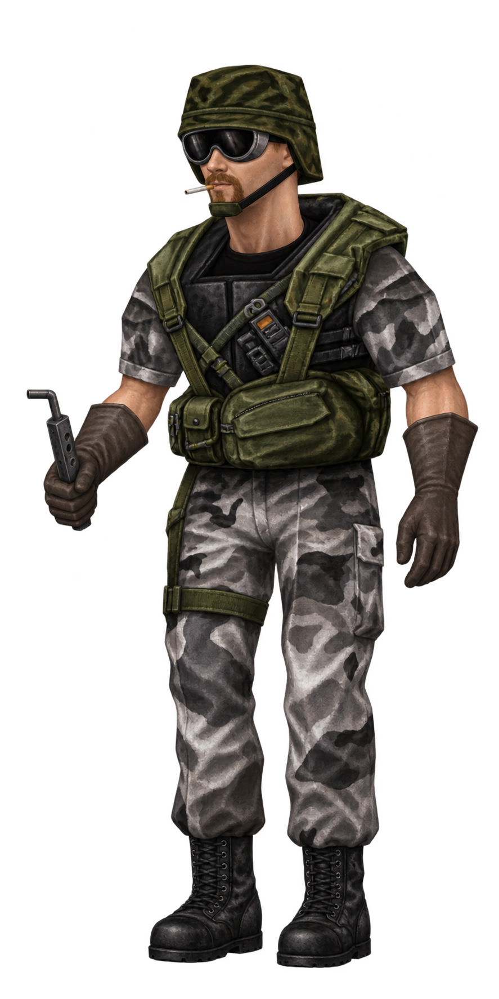

Casque, lunettes de soudure, moustache/barbiche, longs gants et chalumeau conservés. Le générateur a orienté le personnage vers la gauche malgré la consigne droite; orientation à traiter dans le moteur ou dans une future correction. Cigarette canonique visible. Aucun feu ajouté.

### Otis Laurey

**otis_op4_idle_j** — 1024 × 1536 — sélectionné pour revue.

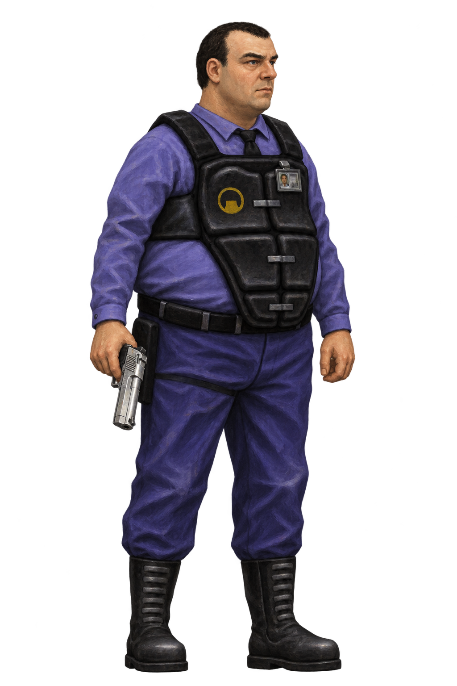

Otis original sans casque: silhouette forte, chemise bleu violacé, gilet segmenté et pistolet argent conservés. Visage, semelles et volumes du gilet adaptés; pas de halo large au compositing blanc/noir. Le nom Otis Laurey du catalogue est conservé; le visuel référence le garde Otis générique original.

### Barney Calhoun Blue Shift

**barney_blueshift_idle_j** — 1024 × 1536 — sélectionné pour revue.

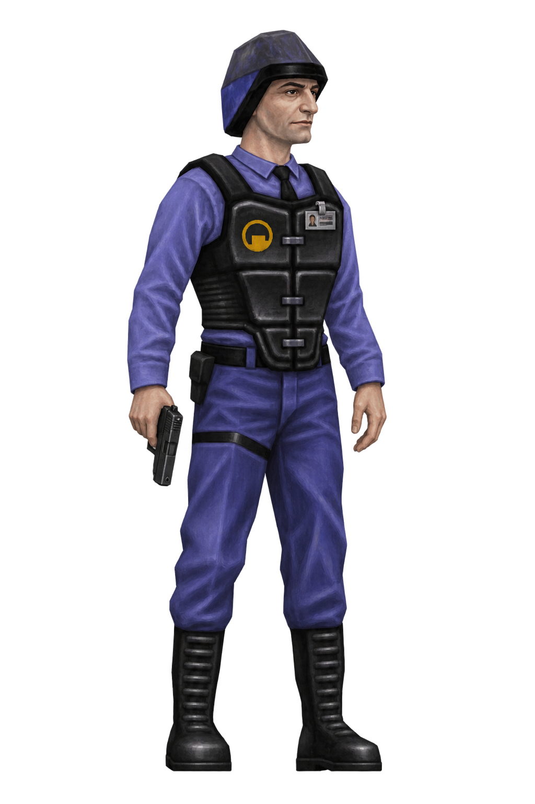

Choix standard original explicitement conservé, casque et gilet séparés du Barney HL2. Uniforme bleu violacé et badge lisibles. Traits du visage et arrondis du casque à valider, alpha propre au compositing blanc/noir.

### Rosenberg

**rosenberg_blueshift_idle_j** — 1024 × 1536 — sélectionné pour revue.

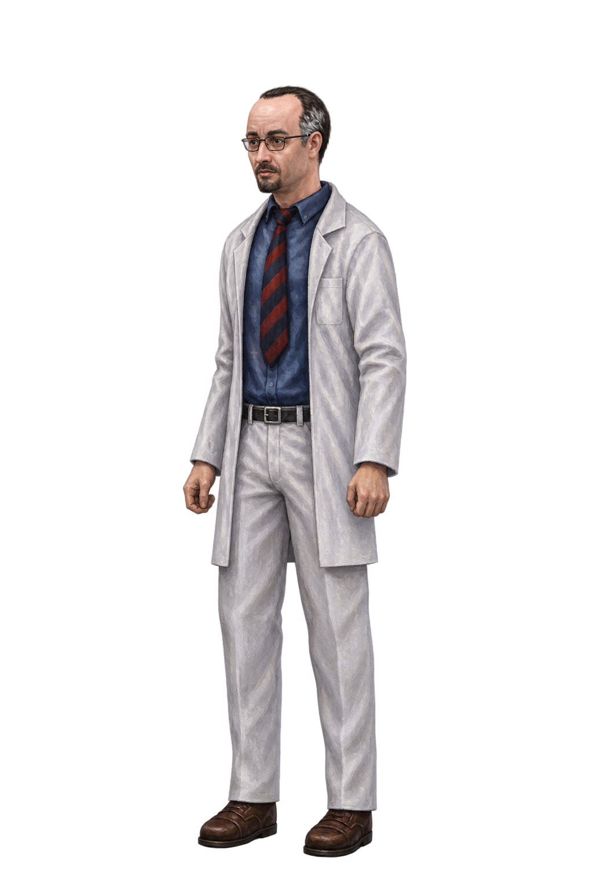

Modèle standard Blue Shift retenu: lunettes, calvitie, moustache/barbiche, chemise bleue, cravate rayée et pantalon blanc préservés. Le personnage regarde vers la gauche malgré la consigne droite. Visage et tissu redessinés, absence de certification 1:1.

### Uriah

**uriah_ep2_idle_j** — 925 × 1701 — révision conservée, non sélectionnée.

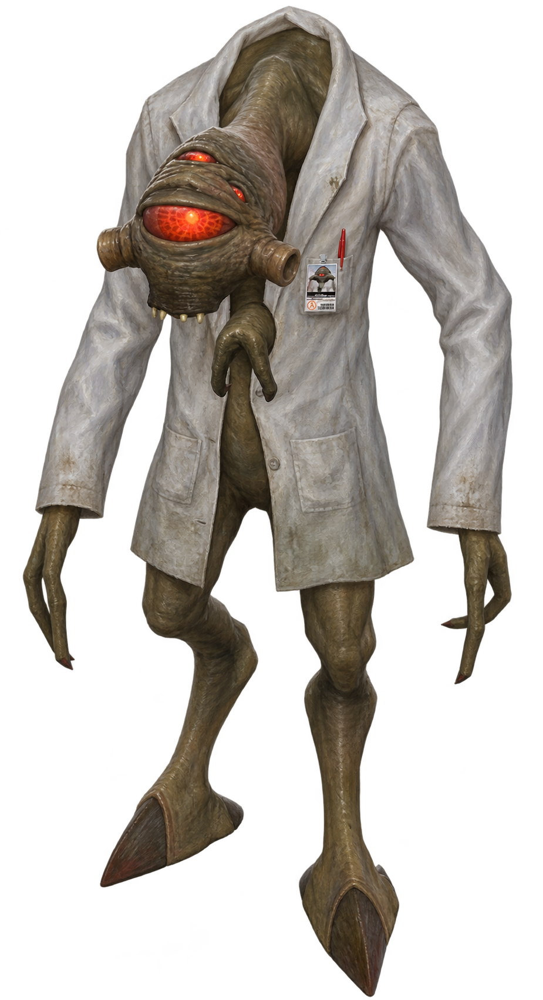

Uriah reconnaissable: trois bras visibles, blouse, badge, stylo et morphologie Vortigaunt préservés. Pose principalement frontale; les pieds ne partagent pas exactement la même ligne. Marge supérieure très serrée, corrigée dans la révision uriah_ep2_idle_framed_j. Aucun éclair ajouté.

### Griggs

**griggs_ep2_idle_j** — 1024 × 1536 — sélectionné pour revue.

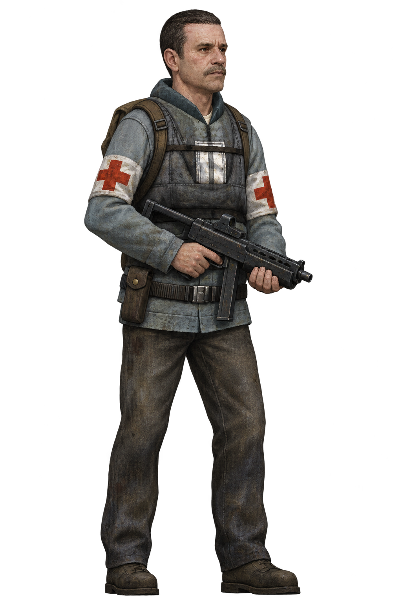

Deux références chargées: visage Griggs en jeu et modèle complet male_06 Medic. Moustache, chemise, brassards médicaux, gilet et pantalon conservés. Le SMG1 comporte des détails réinterprétés à reprendre; la pose reste un candidat statique sans animation.

### Sheckley

**sheckley_ep2_idle_j** — 1024 × 1536 — sélectionné pour revue.

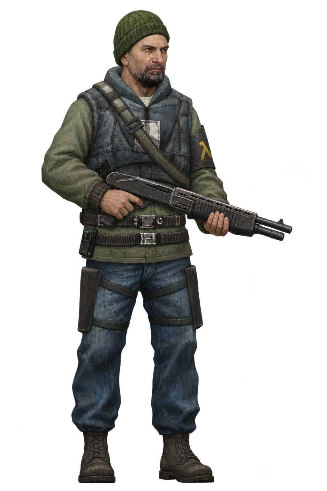

Deux références: portrait en jeu et modèle male_08 Rebel complet. Bonnet vert, barbe, veste, double ceinture et pantalon bleu conservés; brassard lambda et SPAS-12 lisibles. Visage et géométrie précise du fusil restent à comparer, sprite de base uniquement.

### Eli Vance — période Alyx

**costume_eli_hla_idle_j** — 1024 × 1536 — sélectionné pour revue.

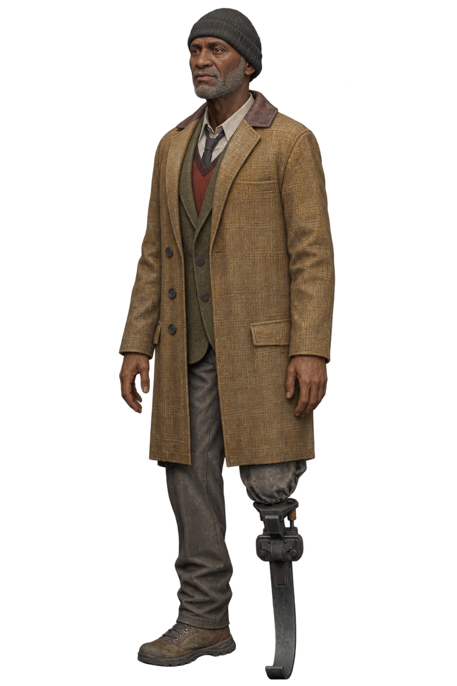

Tenue de la période principale Alyx, avec manteau, bonnet et prothèse gauche correcte, séparée de la tenue de fin et du modèle HL2. Direction rendue vers la gauche, silhouette et textures fidèles au guide mais visage et détails de prothèse à comparer. Pose statique.

### Uriah

**uriah_ep2_idle_framed_j** — 846 × 1858 — sélectionné pour revue.

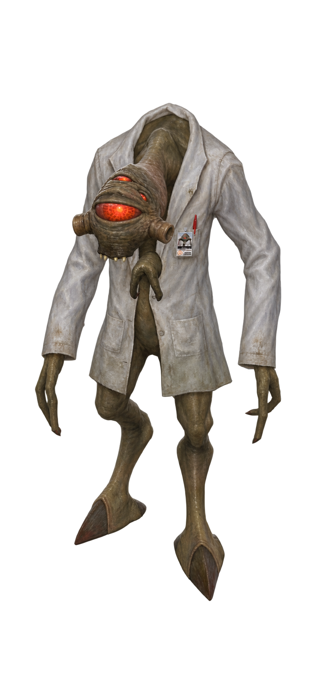

Correction ciblée de cadrage par imagegen: marge ajoutée autour de la silhouette, col entier visible. Les trois bras, blouse, badge et stylo sont préservés. Pose encore principalement frontale et appuis à harmoniser pour le moteur; aucune certification 1:1.

## Créatures et machines

### Baby Voltigore — Opposing Force

**baby_voltigore_op4_idle_j** — 1372 × 1147 — sélectionné pour revue.

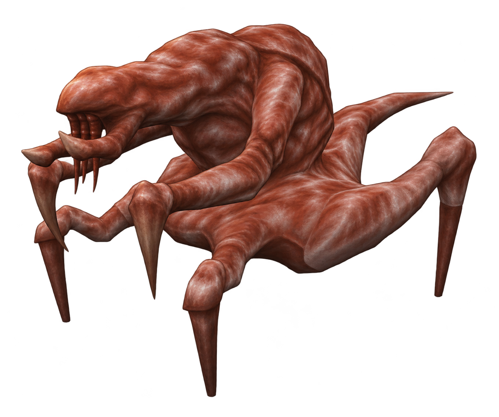

Pose individuelle candidate; détails, proportions et échelle à comparer au jeu source. Aucune animation, intégration moteur ou fidélité stricte 1:1 certifiée. PNG original conservé sans retouche. Orientation gauche conservée malgré la consigne droite; aucun miroir appliqué. Marges plus petites que 10 %. Articulations et nombre apparent des pattes restent à vérifier.

### Ichthyosaur — Half-Life original

**ichthyosaur_hl1_idle_j** — 1774 × 887 — sélectionné pour revue.

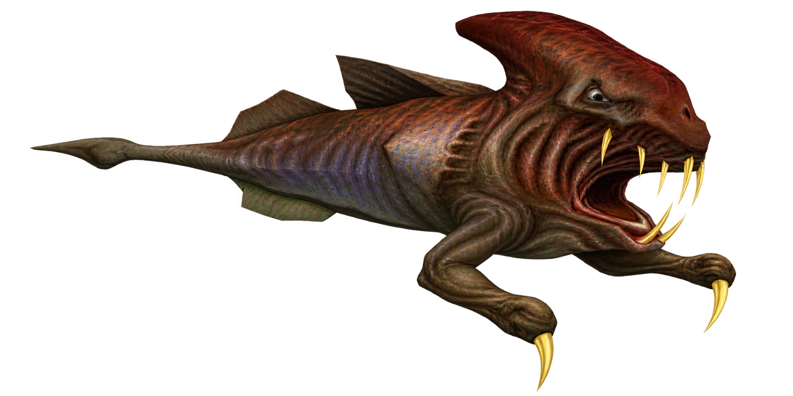

Pose individuelle candidate; détails, proportions et échelle à comparer au jeu source. Aucune animation, intégration moteur ou fidélité stricte 1:1 certifiée. PNG original conservé sans retouche. Pose de nage vers la droite; queue et appendices visibles. Extrémité inférieure proche du bord; marges de 10 % non respectées partout.

### Stalker — Half-Life 2

**stalker_hl2_idle_j** — 1024 × 1536 — sélectionné pour revue.

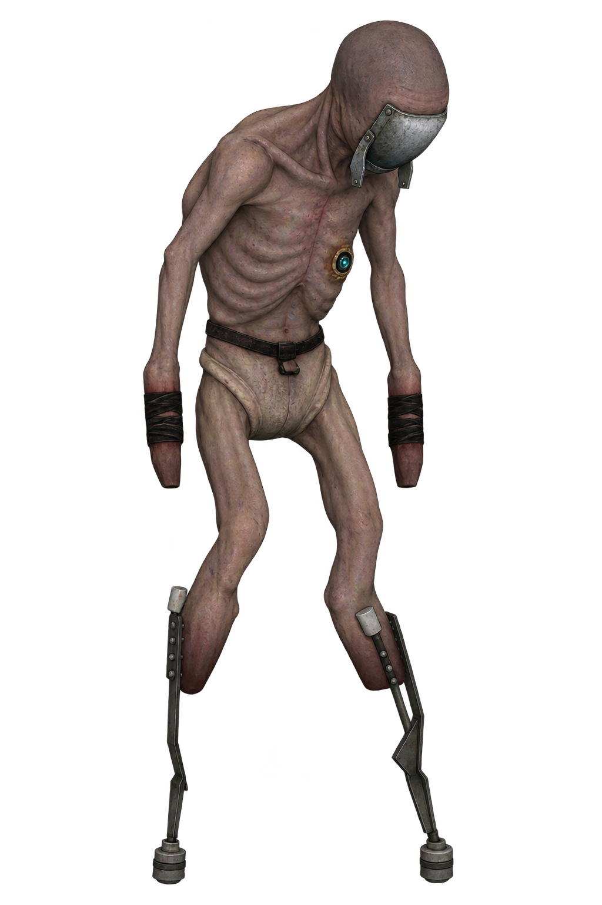

Pose individuelle candidate; détails, proportions et échelle à comparer au jeu source. Aucune animation, intégration moteur ou fidélité stricte 1:1 certifiée. PNG original conservé sans retouche. Vue presque frontale plutôt que latérale. Aperçus d’inspection composités sur fonds clair et sombre: aucun fond diffus massif visible; le halo apparent du retour brut ne se retrouve pas dans ces composites. Mécanismes des jambes et proportions à vérifier.

### Gardien des tunnels — Episode Two

**guardian_tunnels_ep2_idle_j** — 1312 × 1199 — sélectionné pour revue.

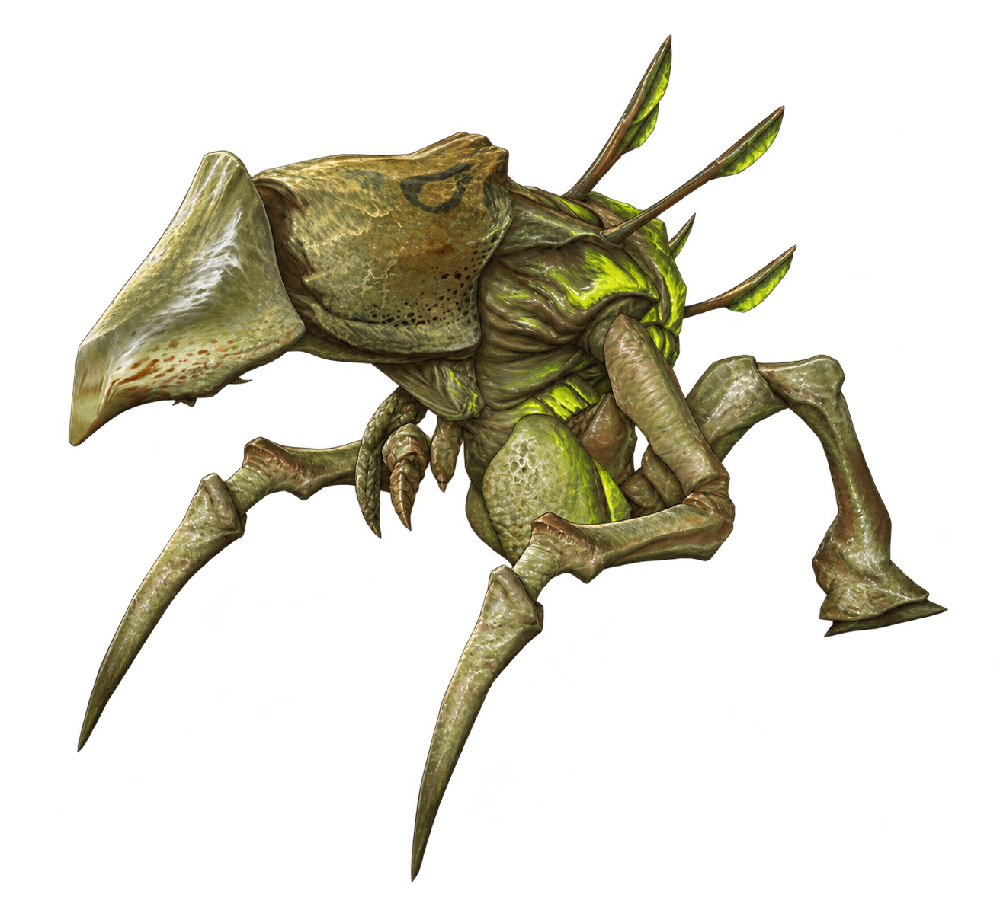

Pose individuelle candidate; détails, proportions et échelle à comparer au jeu source. Aucune animation, intégration moteur ou fidélité stricte 1:1 certifiée. PNG original conservé sans retouche. Silhouette et bioluminescence verte suivent la référence retail. Orientation gauche et vue trois quarts conservées malgré la consigne droite. Marges inférieures à 10 %; pointes de carapace et pattes fines à contrôler au pixel près.

### Jeff — Half-Life Alyx

**jeff_hla_idle_j** — 1254 × 1254 — sélectionné pour revue.

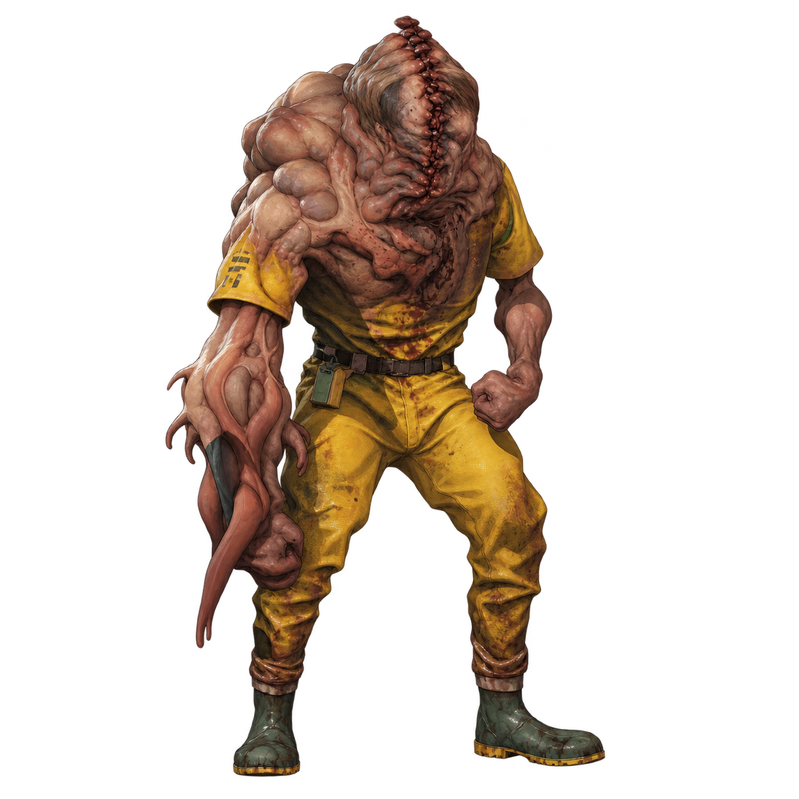

Pose individuelle candidate; détails, proportions et échelle à comparer au jeu source. Aucune animation, intégration moteur ou fidélité stricte 1:1 certifiée. PNG original conservé sans retouche. Silhouette et costume jaune issus de la capture retail; vue presque frontale. Les pieds ne partagent pas exactement une ligne de sol; marge supérieure proche de 2 %. Détails fongiques interprétés, fidélité fine non certifiée.

### Voltigore — Opposing Force

**voltigore_op4_idle_j** — 1448 × 1086 — sélectionné pour revue.

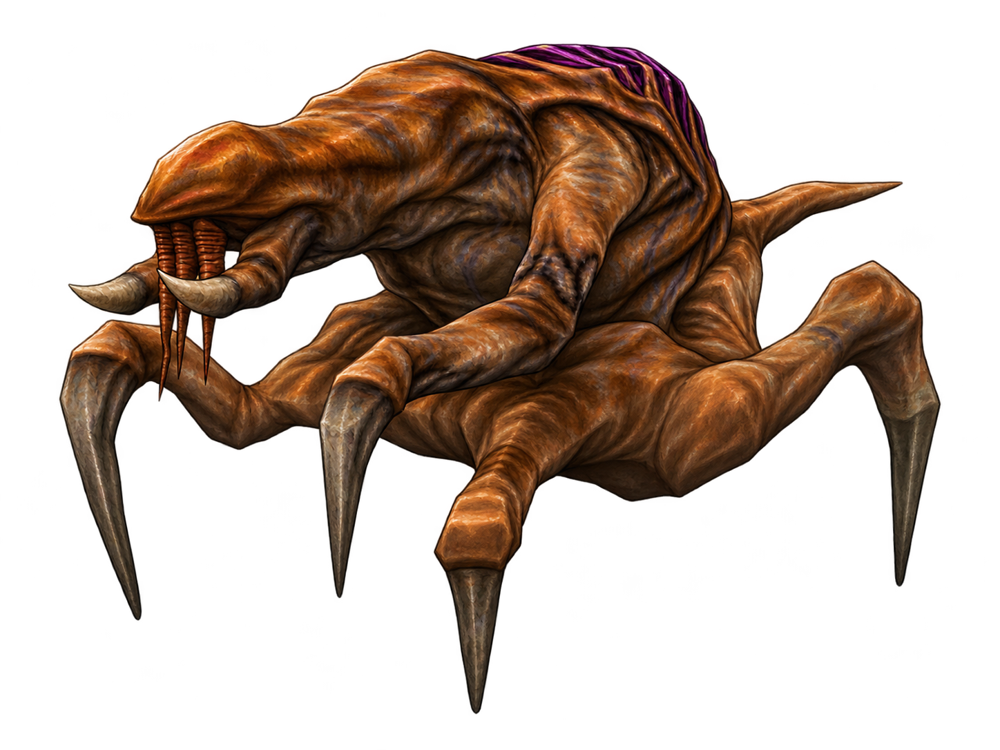

Pose individuelle candidate; détails, proportions et échelle à comparer au jeu source. Aucune animation, intégration moteur ou fidélité stricte 1:1 certifiée. PNG original conservé sans retouche. Carapace brune, stries violettes, longues griffes et pose proches de la référence GoldSrc. Orientation gauche conservée malgré la consigne droite; marge inférieure à 10 %. Nombre et articulations des membres à vérifier.

### Barnacle — Half-Life original

**barnacle_hl1_idle_j** — 1024 × 1536 — sélectionné pour revue.

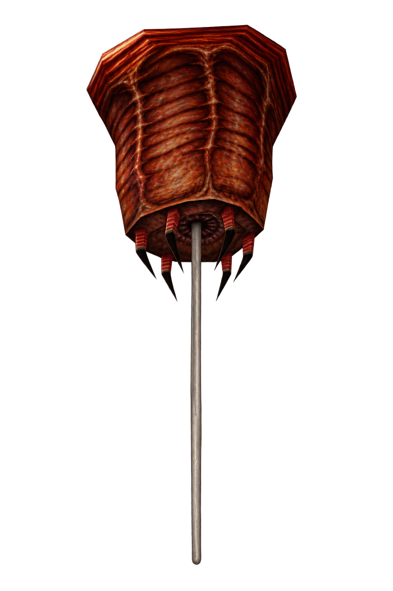

Pose individuelle candidate; détails, proportions et échelle à comparer au jeu source. Aucune animation, intégration moteur ou fidélité stricte 1:1 certifiée. PNG original conservé sans retouche. Silhouette GoldSrc verticale; langue complète raccourcie pour tenir dans le cadre, donc longueur non canonique fixe. Aperçus d’inspection composités sur fonds clair et sombre: aucun halo massif visible; aucun pixel du PNG original modifié. Forme des dents et petit relief de la langue à revoir.

### Shield Scanner — Half-Life 2

**shield_scanner_hl2_idle_j** — 1466 × 1073 — sélectionné pour revue.

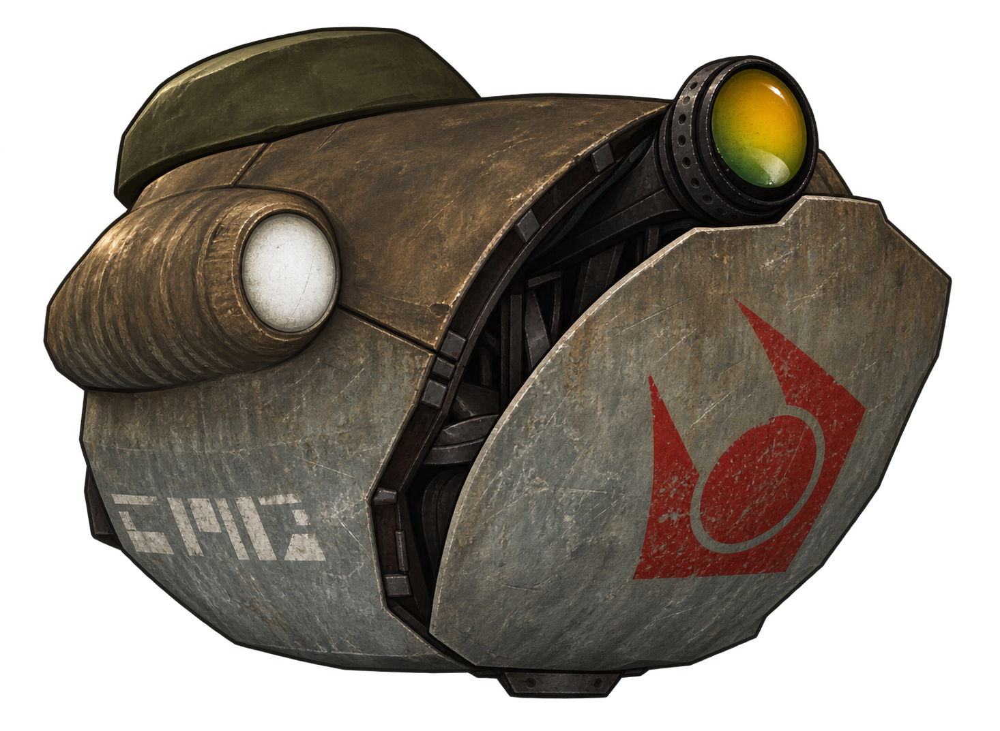

Pose individuelle candidate; détails, proportions et échelle à comparer au jeu source. Aucune animation, intégration moteur ou fidélité stricte 1:1 certifiée. PNG original conservé sans retouche. Scanner fermé individuel; optique jaune-verte, lampe claire et emblème rouge conservés. Orientation gauche, cadrage très serré, détails de surface et marquage interprétés; dessin du logo et stenciling à comparer au modèle.

### Frankenturret — Portal 2

**frankenturret_portal2_idle_j** — 1312 × 1199 — sélectionné pour revue.

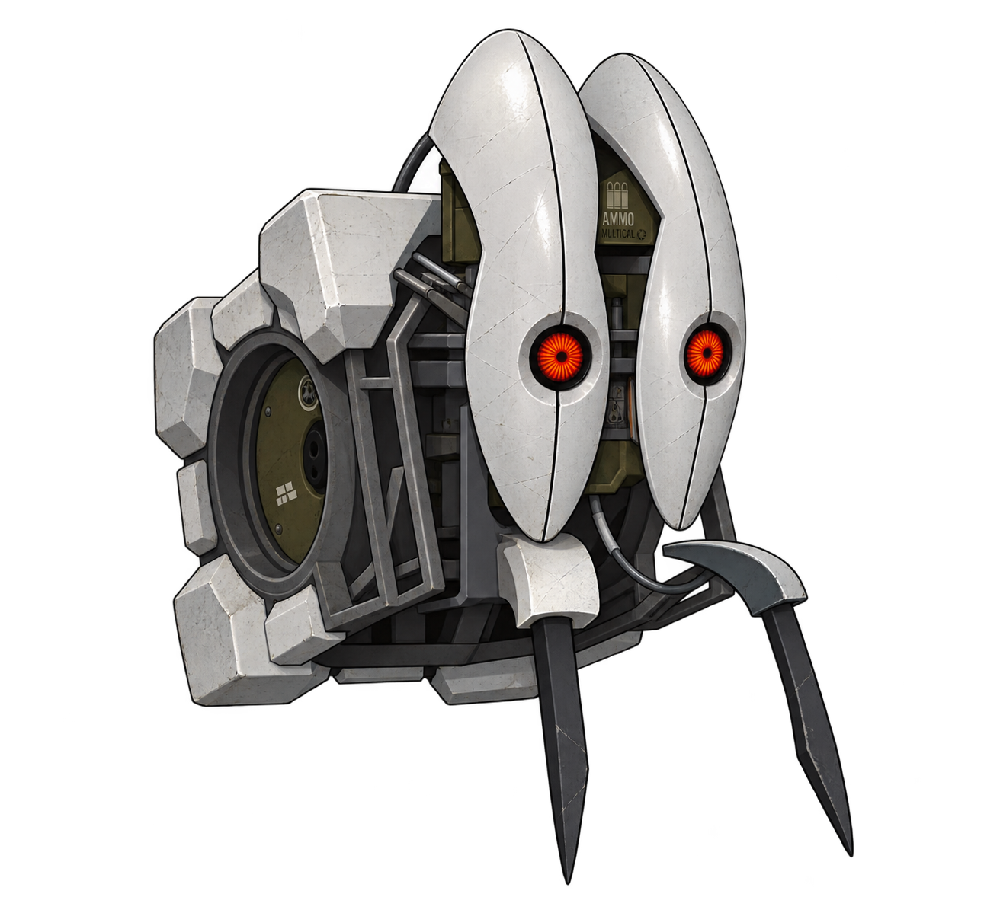

Pose individuelle candidate; détails, proportions et échelle à comparer au jeu source. Aucune animation, intégration moteur ou fidélité stricte 1:1 certifiée. PNG original conservé sans retouche. Un seul assemblage cube-tourelles avec deux yeux; orientation droite. Marges inférieures à 10 % et détails mécaniques fins à vérifier. Le texte interne AMMO est visible dans la référence et dans la sortie; son exactitude n’est pas certifiée.

## Décors

### Barrage de Surface Tension

**stage_surface_dam_hl1_master_j** — 1672 × 941 — révision conservée, non sélectionnée.

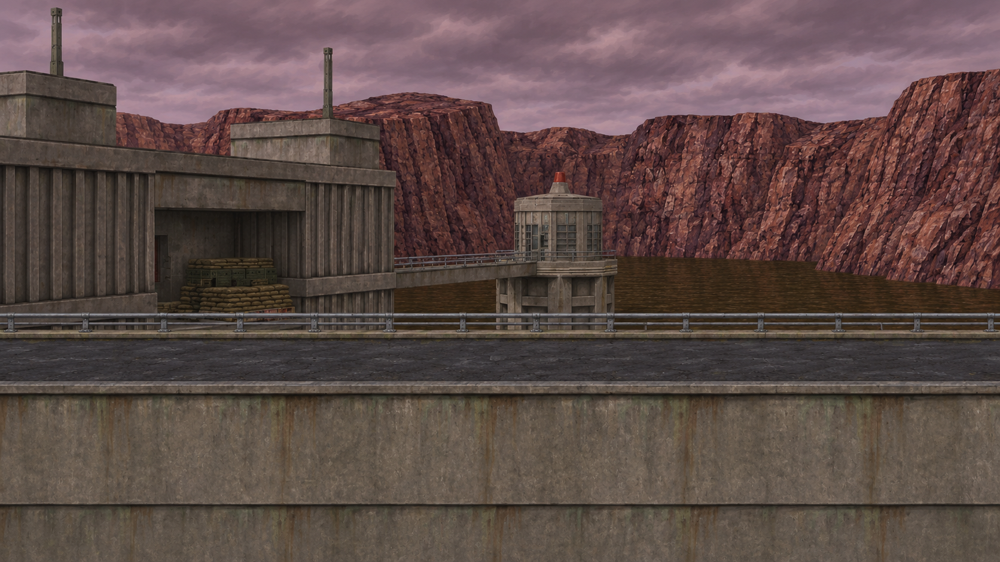

Barrage de béton, tour de prise d’eau cylindrique, usine basse, réservoir brun et falaises stratifiées reconnaissables. Route trop haute (~61 % de l’image) et grande paroi verticale de béton occupant le bas ; cadrage impropre au premier plan de combat attendu. Conservé pour traçabilité, remplacé pour revue par la variante v2. Master unique aplati ; pas de couches séparées, animation ou intégration runtime, aucune certification 1:1.

### Barrage de Surface Tension

**stage_surface_dam_hl1_master_j_v2** — 1672 × 941 — sélectionné pour revue.

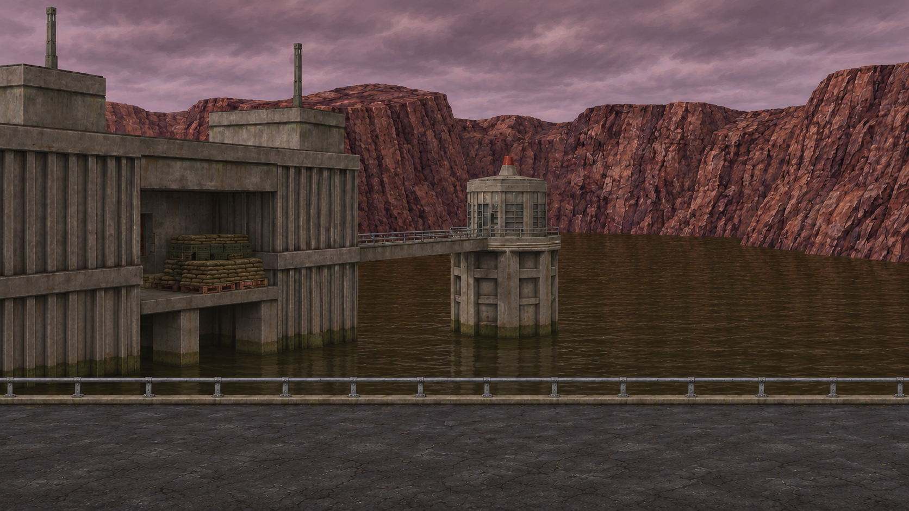

Même barrage, tour cylindrique, usine et réservoir ; route asphaltée abaissée et étendue jusqu’au bas sans paroi verticale au premier plan. Sol horizontal vers 79 % de la hauteur, proche des 78 % demandés. Vue latérale et largeur du tablier adaptées au combat ; les dimensions des bâtiments et de la tour restent à comparer à la capture retail. Master unique aplati ; pas de couches séparées, animation ou intégration runtime, aucune certification 1:1.

### Plateforme de la Citadelle

**stage_citadel_hl2_master_j** — 1672 × 941 — sélectionné pour revue.

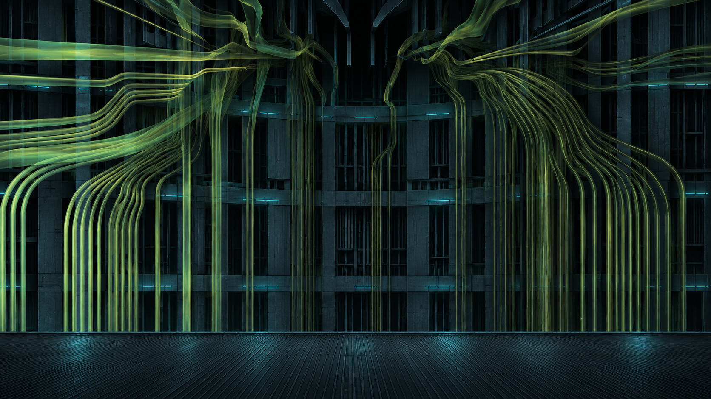

Puits Combine sombre, panneaux verticaux bleu-noir, struts rigides, accents cyan et conduits jaune-vert conservés. Plateforme frontale vers 83 % plutôt que 78 %. Perspective d’origine tournée vers le haut adaptée à une vue latérale ; conduits, proportions et raccords des panneaux à revoir en jeu. Master unique aplati ; pas de couches séparées, animation ou intégration runtime, aucune certification 1:1.

### Cour de fret de Calhoun

**stage_freight_blueshift_master_j** — 1672 × 941 — sélectionné pour revue.

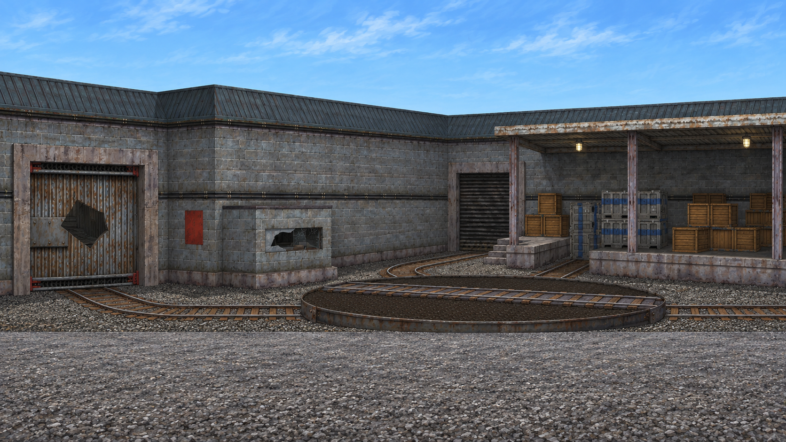

Hangar de béton, porte nervurée, petite cabine, plaque tournante ferroviaire, auvent et conteneurs bleutés conservés ; véhicules et soldats absents. Premier plan horizontal dégagé vers 75 %. Cour et plaque tournante réorganisées pour la vue latérale ; positions relatives des portes, consoles de voie et voies secondaires à vérifier. Master unique aplati ; pas de couches séparées, animation ou intégration runtime, aucune certification 1:1.

### Laboratoire de Rosenberg

**stage_rosenberg_blueshift_master_j** — 1672 × 941 — sélectionné pour revue.

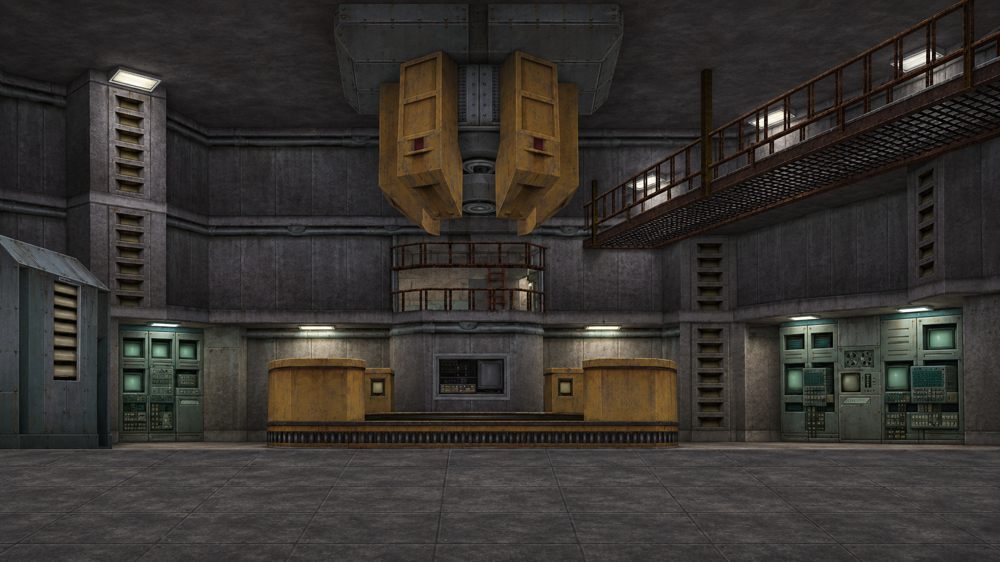

Téléporteur à mâchoires ocre, socle central, consoles CRT turquoise, parois grises et passerelle supérieure grillagée visibles sans personnages. Sol vers 80 %. Le téléporteur est inactif et la géométrie du laboratoire est adaptée à la vue de côté ; agencement des consoles et proportions de l’émetteur à comparer à ba_teleport1. Master unique aplati ; pas de couches séparées, animation ou intégration runtime, aucune certification 1:1.

### Accès au cœur instable

**stage_core_ep1_master_j** — 1672 × 941 — sélectionné pour revue.

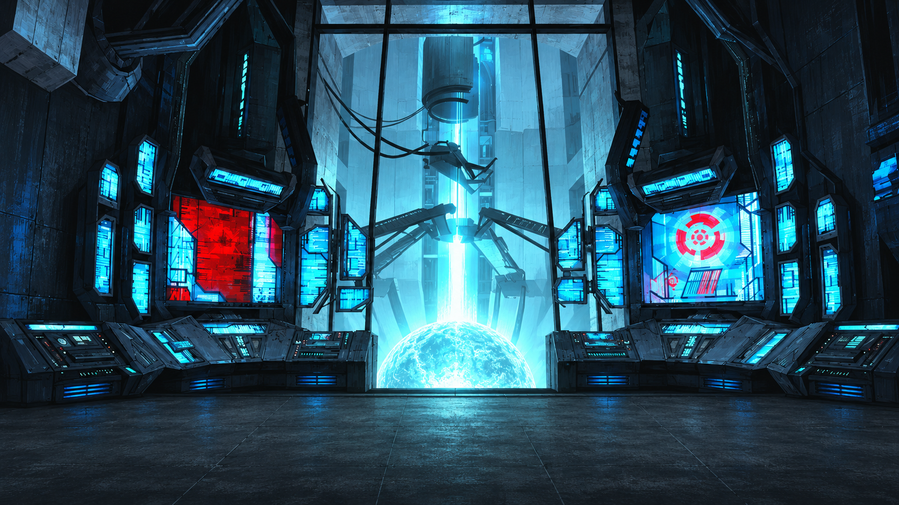

Baies de consoles Combine cyan et rouges, câbles, grande fenêtre sur puits du réacteur et lueur cyan-blanche conservés ; aucune Alyx. Sol dégagé vers 78 %. Lueur et mécanisme du cœur plus détaillés que les captures, ainsi que certains panneaux de consoles ; confirmer l’identité Episode One et les proportions de la machinerie. Master unique aplati ; pas de couches séparées, animation ou intégration runtime, aucune certification 1:1.

### Galerie des fourmis lions

**stage_antlion_gallery_ep2_master_j** — 1672 × 941 — sélectionné pour revue.

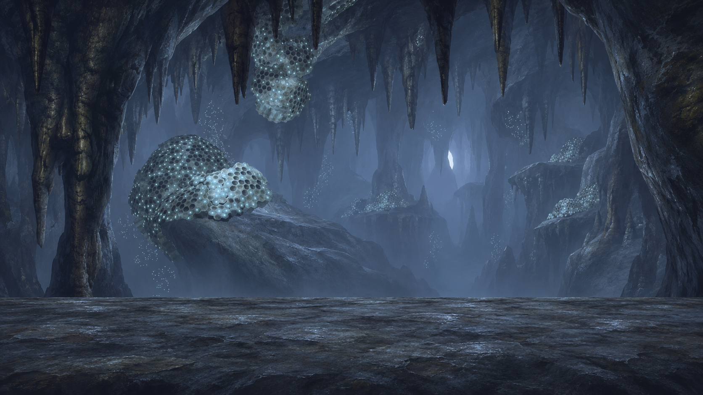

Caverne bleu-gris humide, longues stalactites et nids cireux alvéolaires avec petites lueurs bleues ; aucune créature. Ledge frontal continu vers 76 %. Distribution des nids et formations rocheuses extrapolée dans l’adaptation latérale ; vérifier l’échelle et les valeurs sombres avec les combattants. Master unique aplati ; pas de couches séparées, animation ou intégration runtime, aucune certification 1:1.

### Toits de Cité 17 — refuge d’Alyx

**stage_balcony_hla_master_j** — 1672 × 941 — sélectionné pour revue.

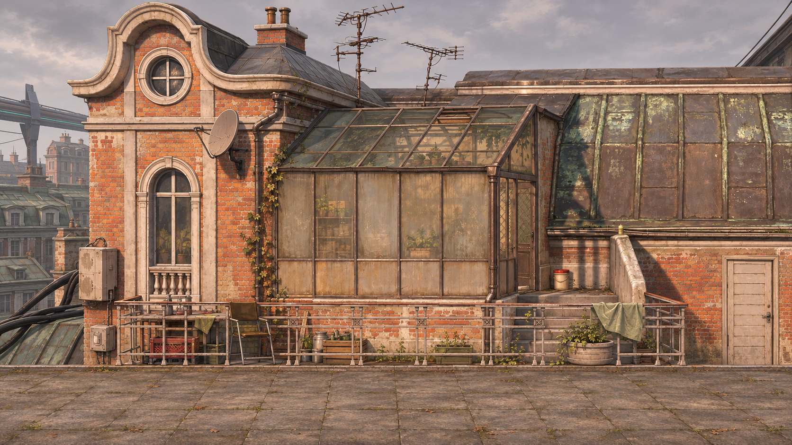

Façade de brique rouge et pierre claire du refuge, petite fenêtre ronde, serre vitrée, toitures métalliques ternies et antennes conservées. Sol vers 83 %. Balcon élargi, caméra abaissée et garde-corps déplacé derrière la ligne de combat ; cette géométrie est une adaptation, pas une reproduction 1:1 du niveau. Master unique aplati ; pas de couches séparées, animation ou intégration runtime, aucune certification 1:1.

### Hôtel Northern Star — hall principal

**stage_northern_star_hla_master_j** — 1672 × 941 — sélectionné pour revue.

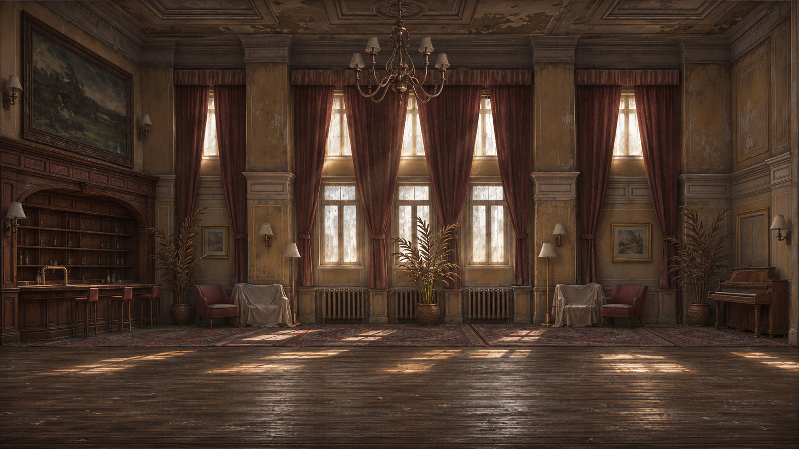

Hall Northern Star avec bar de bois sombre, hautes fenêtres, rideaux bordeaux, lustre, piano, tapis et mobilier de salon regroupé à l’arrière. Sol dégagé vers 78 %. Le salon a été élargi et les sièges repoussés derrière le plan de combat ; comparer le mobilier et les moulures. Pas de contamination Xen ajoutée. Master unique aplati ; pas de couches séparées, animation ou intégration runtime, aucune certification 1:1.

### Salle 17 — chambre des récepteurs

**stage_test17_portal1_master_j** — 1672 × 941 — sélectionné pour revue.

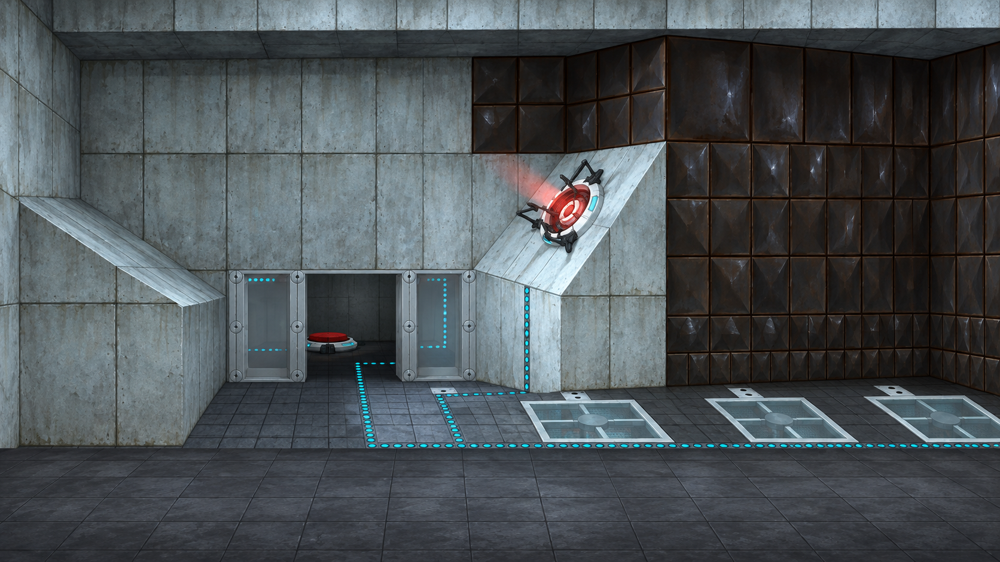

Chambre des récepteurs de la Salle 17 : panneau incliné, récepteur cyan/rouge, carrelage clair et brun, porte vers bouton rouge et trois panneaux vitrés. Sol vers 80 %. Cette image ne couvre que la chambre des récepteurs, sans incinérateur ; la variante incinérateur de la cible demeure manquante. Disposition latérale et raccords des conduits adaptés. Master unique aplati ; pas de couches séparées, animation ou intégration runtime, aucune certification 1:1.

### Chambre de relaxation délabrée

**stage_relaxation_portal2_master_j** — 1672 × 941 — sélectionné pour revue.

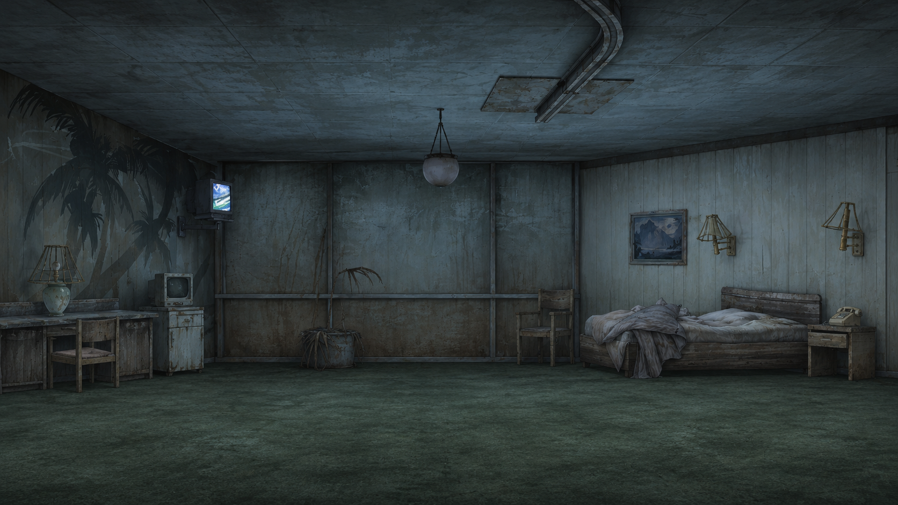

Chambre de relaxation délabrée de Portal 2 : fresque tropicale, lit vide, vieux téléviseur, tapis vert, panneaux usés et rail au plafond. Sol dégagé vers 78 %. Chambre volontairement élargie en vue latérale ; meubles regroupés au fond et proportions extrapolées. Comparer les petits accessoires et l’usure aux captures. Master unique aplati ; pas de couches séparées, animation ou intégration runtime, aucune certification 1:1.

## Décor historique récupéré

### Questionable Ethics — salle laser c2a4f

**stage_questionable_ethics_hl1_master_h_recovered** — 2172 × 724 — sélectionné pour revue.

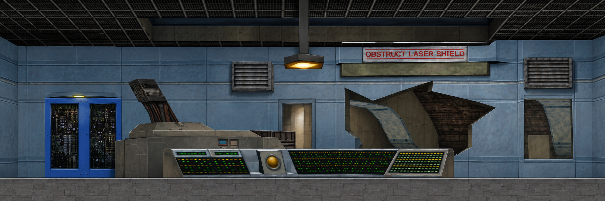

Unique sortie historique valide non enregistrée trouvée par audit; prompt inconnu laissé null. PNG récupéré sans nouvel appel, sans retouche, sans certification 1:1.

## Projectiles et effets

### Dispositif Magnusson — corps au repos

**proj_magnusson_device_ep2_held_resumed_j** — 1294 × 1216 — sélectionné pour revue.

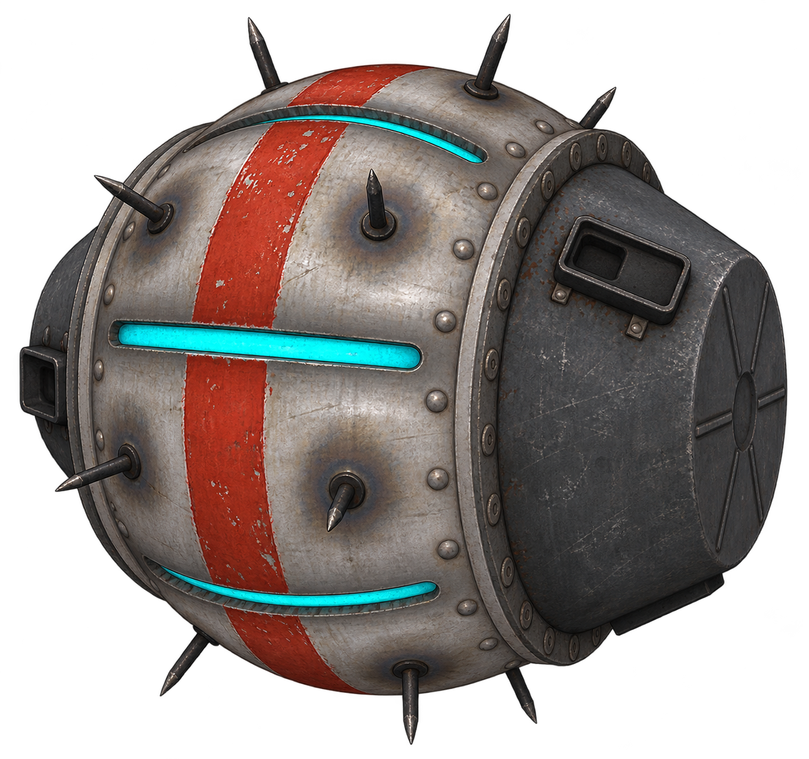

Forme, bande rouge, pointes et barrettes cyan de la référence conservées; détails et reliefs interprétés en haute résolution. Marges plus serrées que la consigne, objet complet. Pose isolée, pas de vol ou explosion.

### Phéropode HL2 — corps lancé

**proj_bugbait_hl2_body_resumed_j** — 1319 × 1192 — sélectionné pour revue.

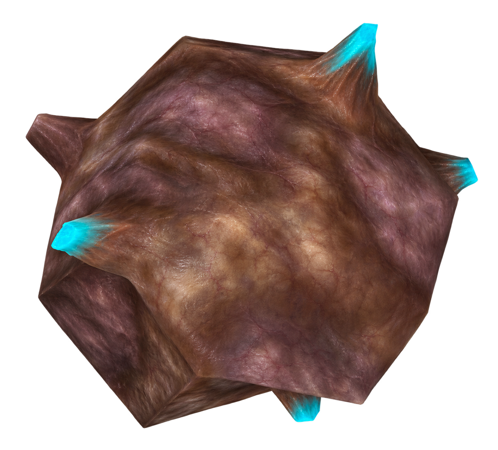

Référence du worldmodel brun/violet à pointes cyan, différente du modèle tenu orange. Surface plus détaillée, proportions et pointes à comparer finement; aucune animation ou dispersion.

### Bombe Aperture — corps Portal 2

**proj_aperture_bomb_portal2_body_resumed_j** — 1254 × 1254 — sélectionné pour revue.

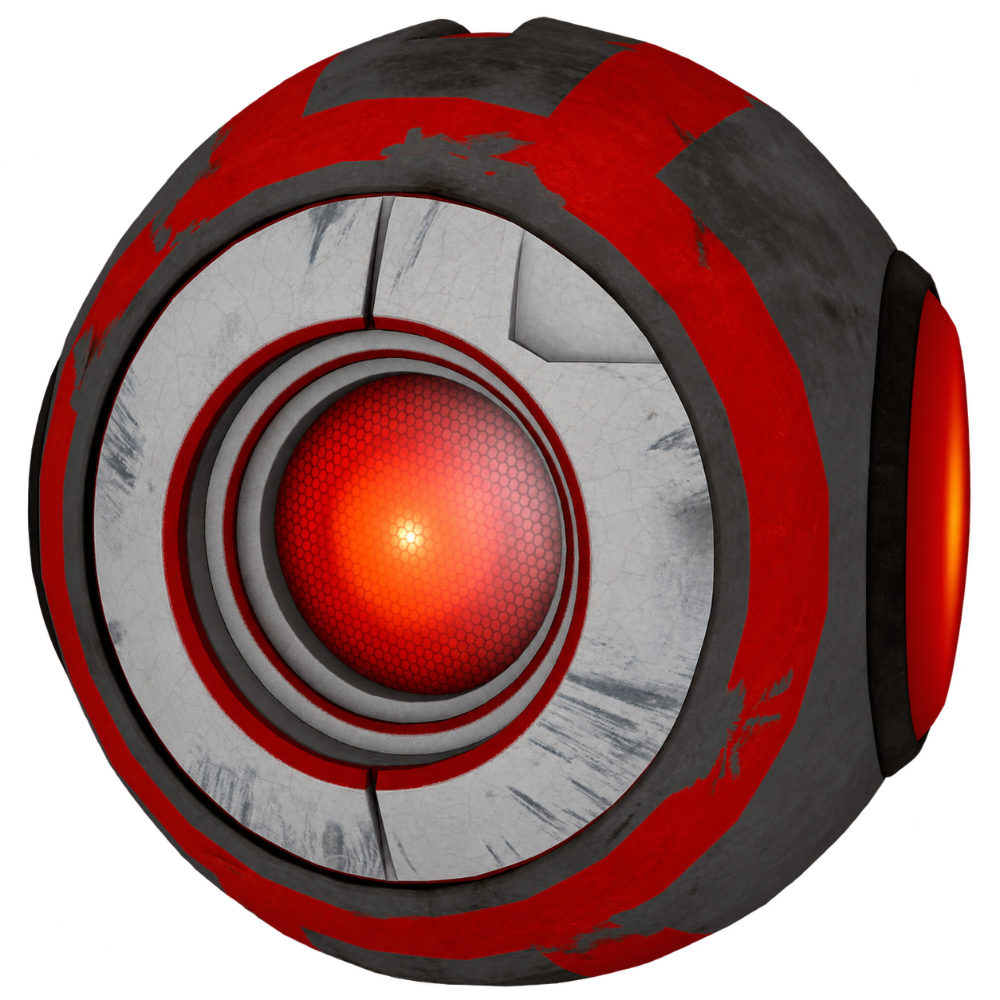

Bombe sombre à bandes rouges, couronne blanche segmentée et lentille orange/rouge. Silhouette complète mais marge inférieure étroite; usure et reflets interprétés. Aucune explosion.

### Capsule de headcrabs — coque ouverte

**proj_headcrab_canister_hl2_opening_resumed_j** — 1612 × 976 — sélectionné pour revue.

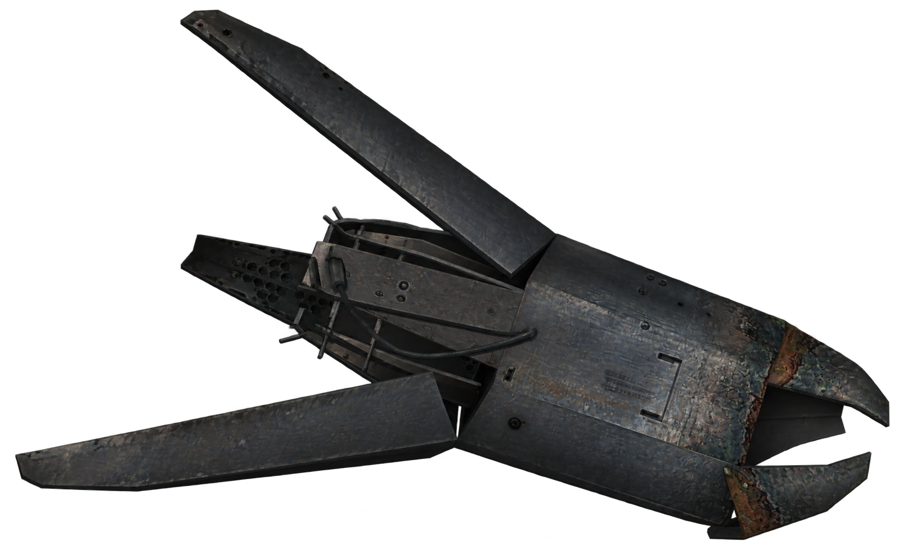

Coque ouverte guidée par le modèle retail, trois panneaux allongés et nez orienté à droite. Le cadrage est serré mais les pointes sont présentes; géométrie et textures à comparer. État opening seulement, aucun vol ni headcrab.

### Mine laser HL1 — boîtier

**device_tripmine_hl1_body_resumed_j** — 1697 × 927 — sélectionné pour revue.

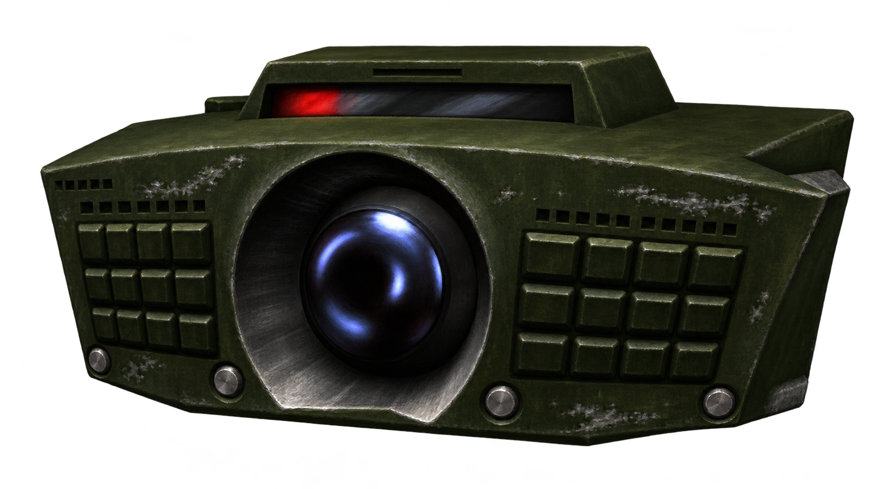

Boîtier olive original HL1, lentille centrale, cellules latérales et quatre boulons. Détails du dessus simplifiés et grille à comparer; aucune détection intégrée.

### Mine laser HL1 — rayon de détection

**fx_tripmine_laser_hl1_beam_resumed_j** — 2172 × 724 — sélectionné pour revue.

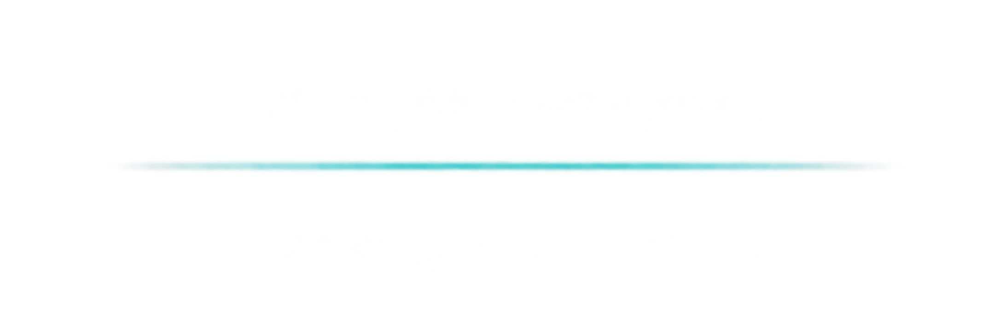

Rayon horizontal turquoise translucide de détection, distinct du boîtier. Le compositing révèle un trait fin et régulier; luminosité, largeur et durée restent à comparer dans le jeu. Image fixe, pas une simulation de rayon.

### Tunnel d’excursion — sens normal

**fx_excursion_funnel_portal2_normal_resumed_j** — 2172 × 724 — sélectionné pour revue.

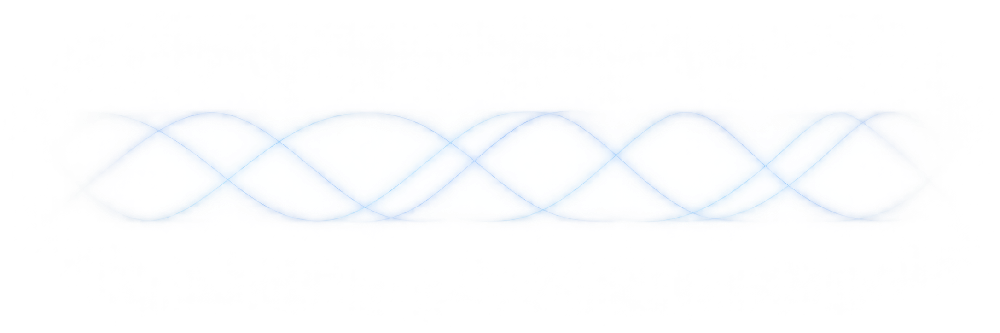

Nouvel appel après perte de l'environnement; le fichier perdu n'a pas été restauré. Capture retail source inspectée avant génération. PNG original conservé intact. Composition alpha sur noir et blanc inspectée: filaments bleus très fins, tube constant, wash quasi absent, aucun fond opaque; motes peu ou non visibles et luminosité assez faible à comparer en jeu. Lignes statiques: aucune animation ni fidélité 1:1 certifiée.

### Tunnel d’excursion — sens inversé

**fx_excursion_funnel_portal2_reverse_resumed_j** — 2172 × 724 — sélectionné pour revue.

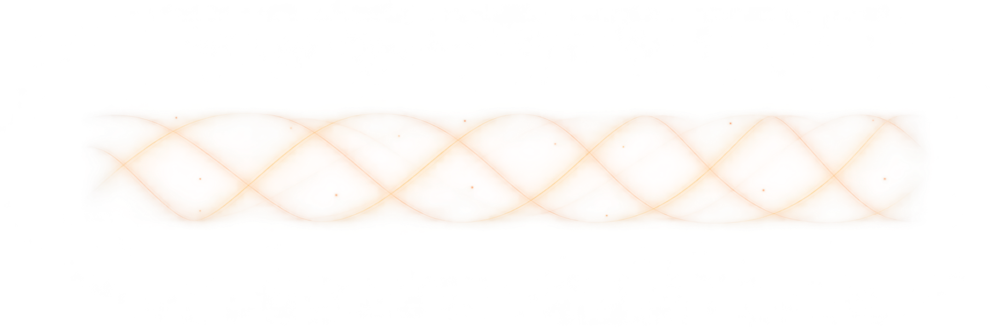

Nouvel appel après perte de l'environnement; le fichier perdu n'a pas été restauré. Capture retail source inspectée avant génération. PNG original conservé intact. Composition alpha sur noir et blanc inspectée: filaments orange/ambre fins, quelques motes, tube constant et wash très faible, aucun fond opaque. Une aura locale douce reste visible; saturation et luminosité plus faibles que la capture à comparer en jeu. Frame statique: sens de déplacement et animation non validés, fidélité 1:1 non certifiée.

### Faisceau Gluon — référence retail originale

**fx_gluon_beam_hl1_beam_resumed_j** — 2172 × 724 — sélectionné pour revue.

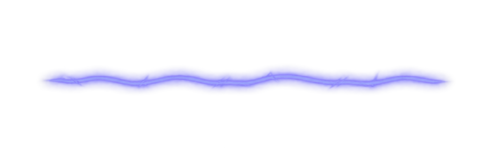

Nouvel appel après perte de l'environnement; le fichier perdu n'a pas été restauré. Capture Egon_color01 inspectée et code Valve egon.cpp (CreateEffect/UpdateEffect) consulté. PNG original intact. Alpha sur noir/blanc: ruban continu bleu-violet ondulé, faible aura et bruit anguleux local, aucun fond opaque. Transposition latérale depuis une capture en perspective: tracé, amplitude, largeur et dynamique ne sont pas certifiés 1:1. Pas de flare terminal ou contact dans cette frame beam; aucune animation intégrée.

### Décharge Shock Roach — première frame candidate

**proj_shock_bolt_opfor_body_resumed_j** — 1774 × 887 — sélectionné pour revue.

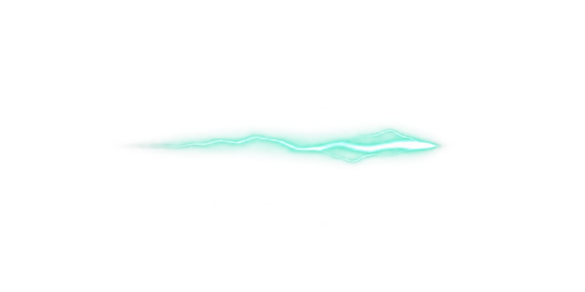

Nouvel appel après perte de l'environnement; le fichier perdu n'a pas été restauré. Capture Shock_Trooper_first inspectée; elle documente une décharge cyan au contact d'une cible et ne suffit pas à certifier le sprite de trajet isolé. PNG original intact. Alpha sur noir/blanc: court trait cyan/turquoise horizontal, cœur lumineux à droite, quelques fils locaux reliés, sans fond opaque. Pointe plus concentrée et forme isolée à vérifier contre une capture du projectile en vol; aucune fidélité 1:1, animation ou intégration runtime déclarée.
