# Galerie du lot K — 25 novembre 2026

**80 PNG originaux**, une pose, un état d’effet ou un panorama par fichier. Les métadonnées et les limites de chaque candidate sont conservées dans le registre. Aucun sprite n’est une animation complète; aucun panorama ne remplace ses six plans.

[Rapport du lot](README.md) · [Revue des 104 cibles](TARGET_REVIEW.md) · [Registre global](../../data/generated_art_register.json)

## Personnages, créatures et petites machines

### Adventure Core / Rick — Portal 2

`adventure_core_portal2_idle_k` · Portal 2 · 1312 × 1199 · RGBA

Candidat non certifié, non intégré par ce lot.

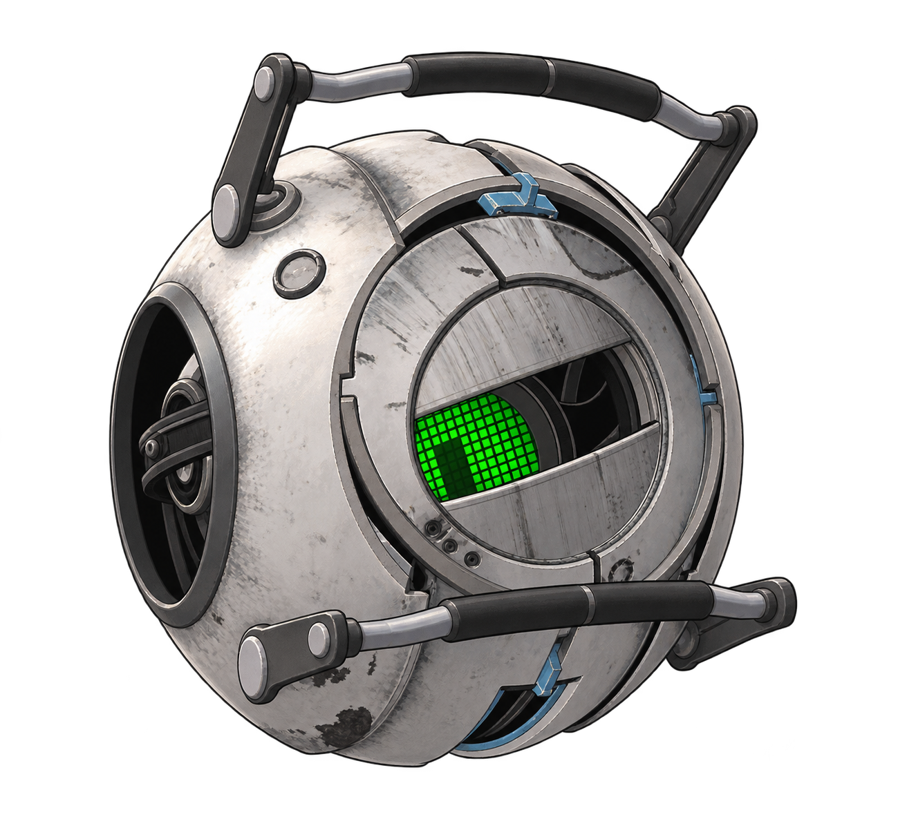

Pose statique candidate. Aucune certification de fidélité 1:1, animation terminée ou intégration runtime. Un noyau entier isolé; grille verte, volet incliné, deux poignées et coque conservés. Comparaison visuelle avec la référence effectuée; micro-détails et proportions restent candidats. Marges inférieures à 10 %. Aucun détourage ou miroir ajouté.

### Alyx Vance période Alyx

`alyx_hla_idle_k` · Half-Life Alyx · 1199 × 1312 · RGBA

Candidat non certifié, non intégré par ce lot.

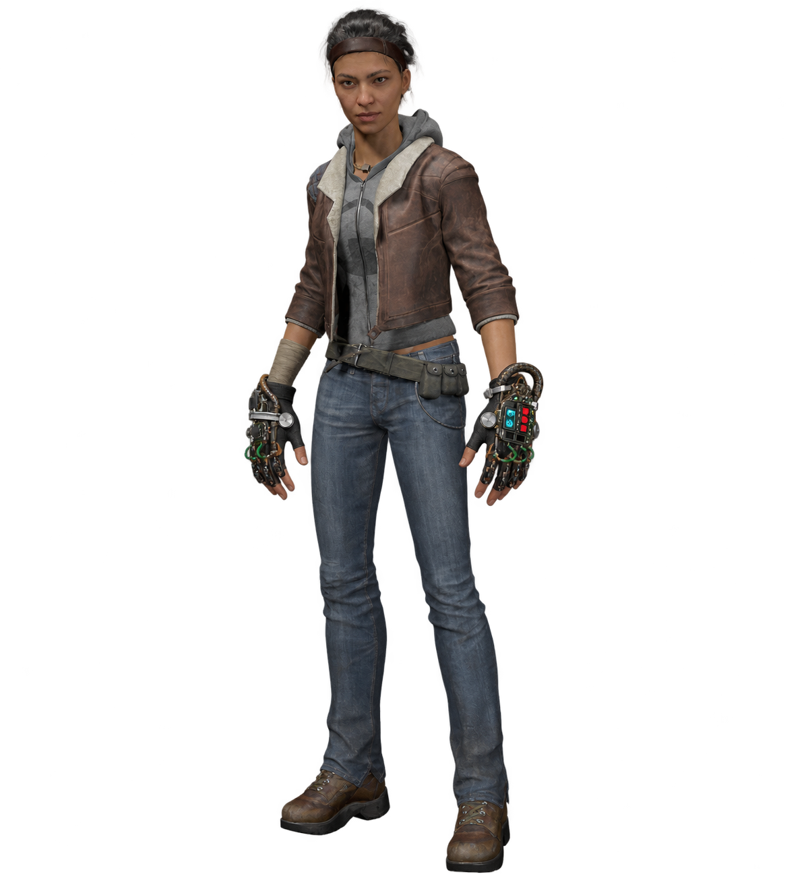

Recomposition explicite de sources HLA distinctes : corps cinématique et gants VR. Pose de base entière; modèle facial et vêtements cohérents, HUD sur le gant gauche anatomique. Articulations, câblages, volumes des Russells et raccords aux poignets partiellement reconstruits; les surfaces cachées restent à comparer. Aucune capture unique corps+gants ni certification 1:1. Composites blanc/noir inspectés, marge haute très faible.

### Bendy — sujet de tests PeTI

`bendy_peti_idle_k` · Portal 2: Perpetual Testing Initiative · 1001 × 1572 · RGBA

Candidat non certifié, non intégré par ce lot.

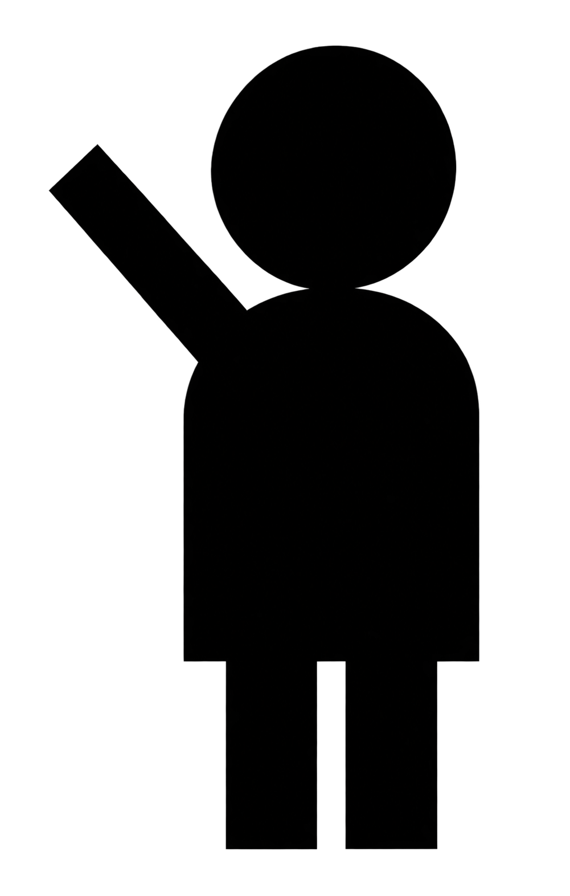

Silhouette noire schématique conforme à la vue modèle, sans visage ni corps réaliste. Compositing blanc valide la tête ronde, le bras levé et les jambes; disparition sur noir attendue pour un aplat noir. Pose du modèle retenue, absence de portal gun volontaire pour cette pose de base.

### Black Ops masculin

`black_ops_male_op4_idle_k` · Half-Life: Opposing Force · 887 × 1774 · RGBA

Candidat non certifié, non intégré par ce lot.

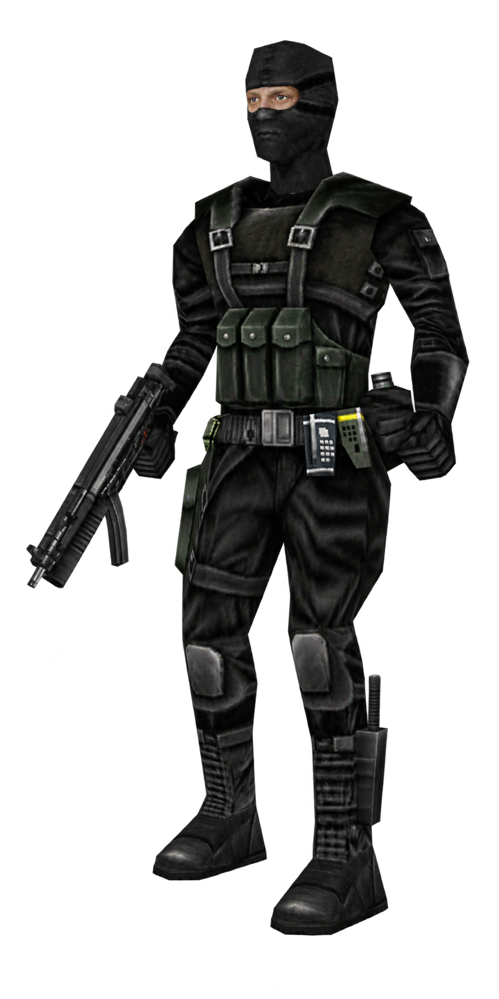

Uniforme, cagoule et arme abaissée correspondent au Black Ops masculin Opposing Force. Visage, boucles et textures sont plus détaillés que la source LD; proportions du chargeur et pièces de ceinture à vérifier. Composites blanc/noir inspectés.

### Combine Ordinal

`combine_ordinal_hla_idle_k` · Half-Life Alyx · 932 × 1688 · RGBA

Candidat non certifié, non intégré par ce lot.

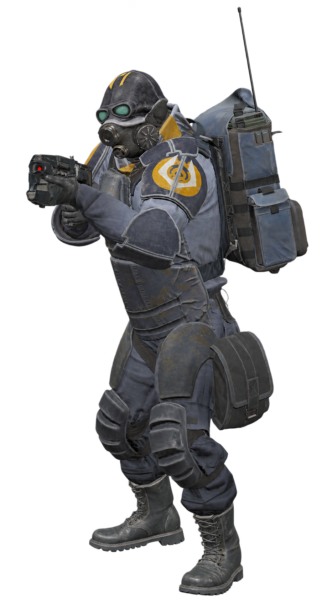

Modèle final Ordinal, masque noir, optiques vertes, insignes jaunes, sac et antenne conservés. Armement prêt sans tir; détails d’insigne, chargeur et sangles réinterprétés, antenne proche du bord haut. Composites blanc/noir lisibles. Un seul appel K; refus historique conservé ailleurs.

### Tourelle défectueuse — Portal 2

`defective_turret_portal2_idle_k` · Portal 2 · 1068 × 1473 · RGBA

Candidat non certifié, non intégré par ce lot.

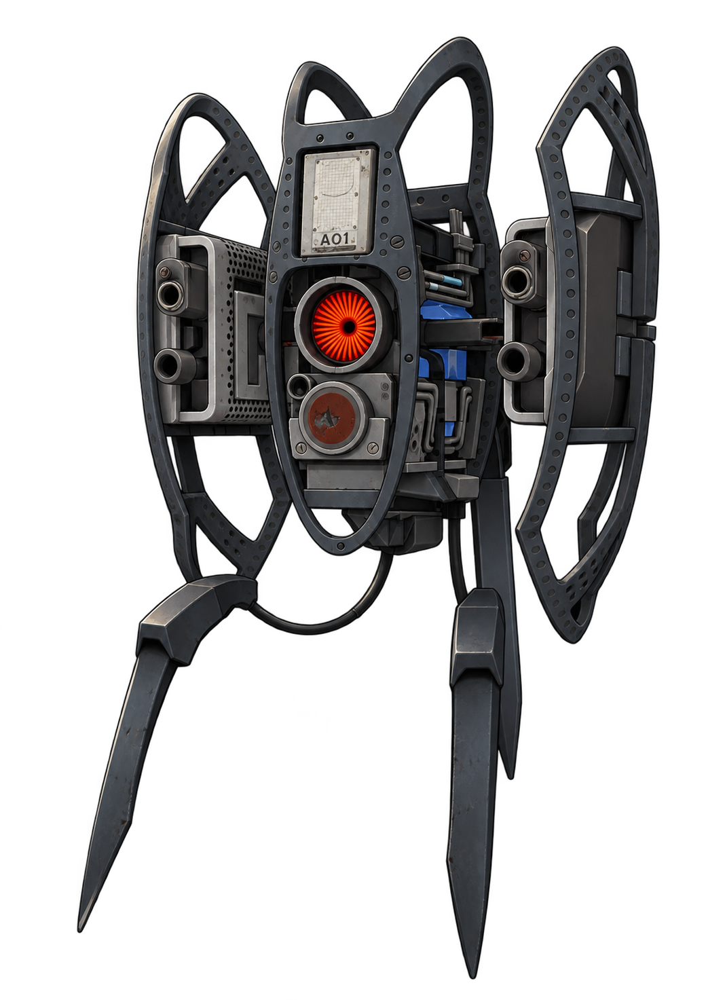

Pose statique candidate. Aucune certification de fidélité 1:1, animation terminée ou intégration runtime. Une tourelle défectueuse de la campagne Portal 2 sans coques, avec œil rouge radial, haut-parleur, composants bleus et structure tripode. Contours lisibles sur les deux fonds; fines franges possibles, lettrage et mécanique non certifiés.

### Doug Rattmann

`doug_rattmann_labrat_idle_k` · Portal 2: Lab Rat · 1024 × 1536 · RGBA

Candidat non certifié, non intégré par ce lot.

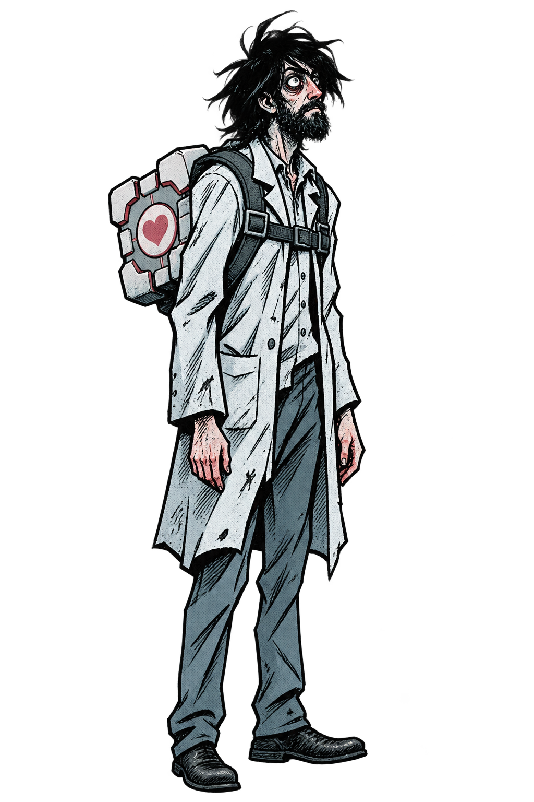

Adaptation de pose idle du Doug hirsute du comic officiel, distinct du flashback rasé. Le dessin conserve les hachures, la blouse et le Cube; harnais thoracique et boucles ajoutés/reconstruits par la génération au-delà des vues disponibles. Visage, sangles, échelle du Cube et pose à contrôler. Composites blanc/noir sans fond opaque; alpha max 254.

### Fast Zombie

`fast_zombie_hl2_idle_k` · Half-Life 2 · 980 × 1605 · RGBA

Candidat non certifié, non intégré par ce lot.

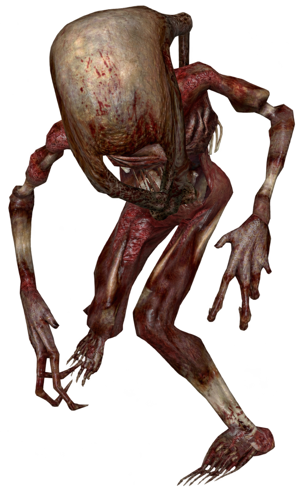

Proportions allongées, headcrab rapide et posture courbée conservés. Détails fins des doigts/orteils et des côtes réinterprétés, marges étroites. Aucun mélange visuel avec les deux autres zombies; candidat non certifié.

### Gary

`gary_hla_idle_k` · Half-Life: Alyx · 1199 × 1312 · RGBA

Candidat non certifié, non intégré par ce lot.

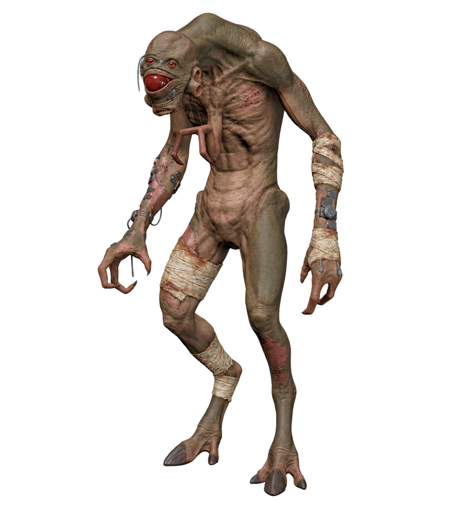

Gary HLA reconnaissable : bandages, fixations et trois bras conservés. Visage, grains de peau et épaisseur des doigts légèrement réinterprétés. Composite blanc/noir inspecté, silhouette complète, marge basse étroite. Candidat sans certification 1:1.

### Isaac Kleiner

`kleiner_hl2_idle_k` · Half-Life 2 · 807 × 1949 · RGBA

Candidat non certifié, non intégré par ce lot.

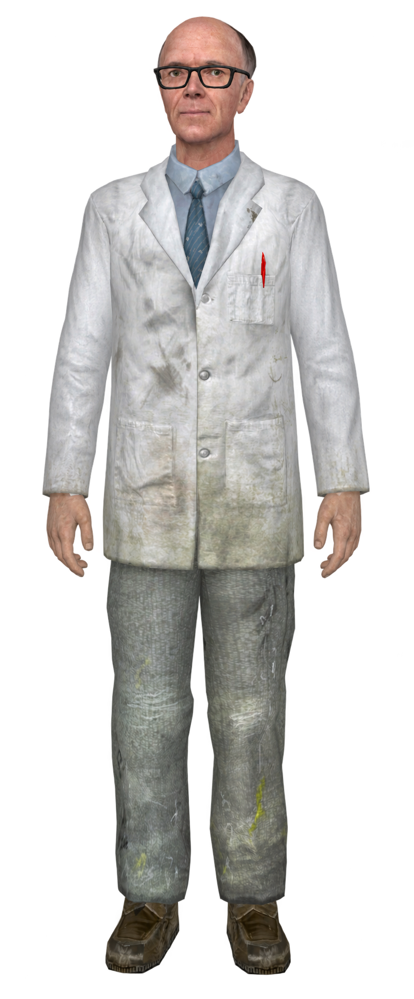

Kleiner retail HL2 et sa tenue conservés; geste transformé en pose neutre. Visage plus lisse, mains et plis nouvellement reconstruits; quelques franges claires de la blouse sur noir. Corps complet sans emprunt au modèle HLA abandonné. Un seul appel K; refus historiques conservés.

### Lamarr

`lamarr_hl2_idle_k` · Half-Life 2 · 1312 × 1199 · RGBA

Candidat non certifié, non intégré par ce lot.

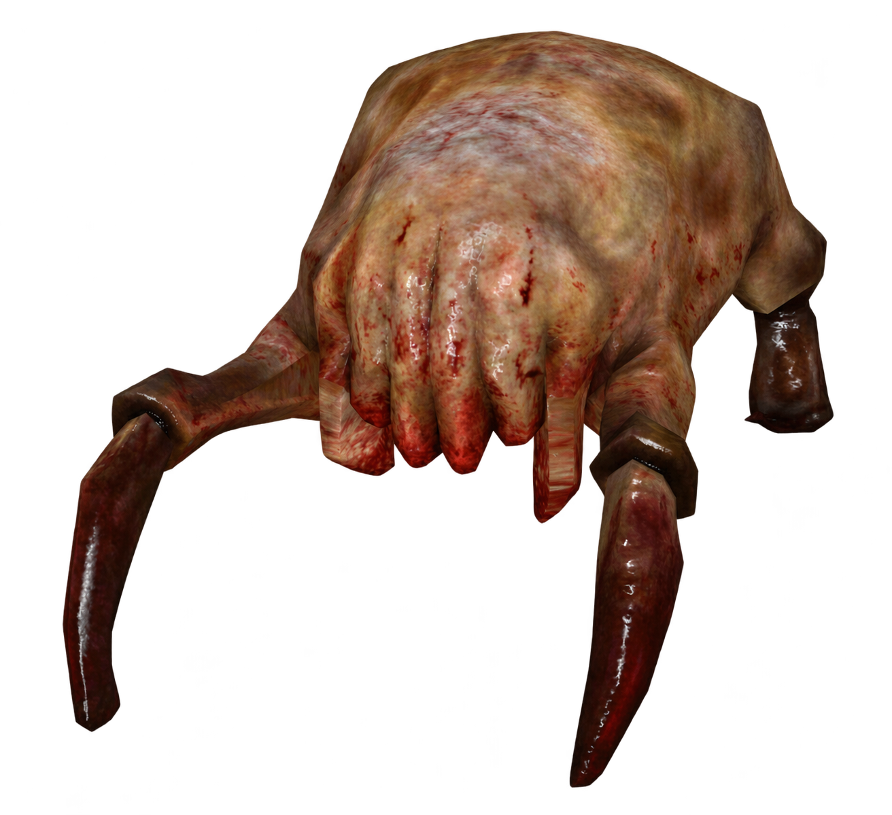

Lamarr identifiée par son modèle et les captures de Kleiner. Silhouette et teinte conservées; reflets de peau plus marqués que la source et emplacement exact des pattes à comparer. Aucun collier ni bec ajouté; composites blanc/noir inspectés.

### Larry

`larry_hla_idle_k` · Half-Life: Alyx · 1145 × 1374 · RGBA

Candidat non certifié, non intégré par ce lot.

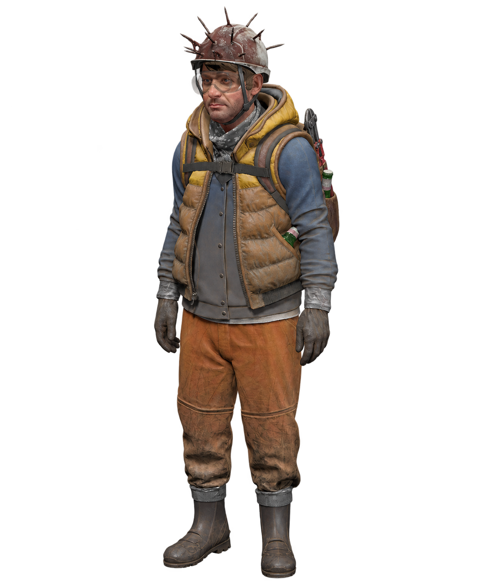

Casque à clous, lunettes, couleurs des vêtements et équipement de sac visibles. Le rendu montre deux bouteilles vertes (une latérale et une plus haute), à comparer aux vues sources; visage et disposition exacte des clous encore à vérifier. Marges verticales très étroites.

### Arne Magnusson

`magnusson_ep2_idle_k` · Half-Life 2: Episode Two · 778 × 2022 · RGBA

Candidat non certifié, non intégré par ce lot.

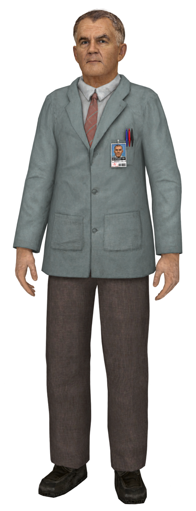

Silhouette Episode Two, blouse bleu-gris, cravate rose, stylos et badge conservés. Le visage, la photo du badge et les mains sont réinterprétés; les rayures fines de cravate sont atténuées. Comparer aussi la coupe de veste et les chaussures. Corps complet, marges inférieures aux 10 % demandés; composites blanc/noir lisibles. Aucun dispositif Magnusson ajouté. Un seul appel K; refus historique conservé.

### Judith Mossman

`mossman_hl2_idle_k` · Half-Life 2 · 725 × 2170 · RGBA

Candidat non certifié, non intégré par ce lot.

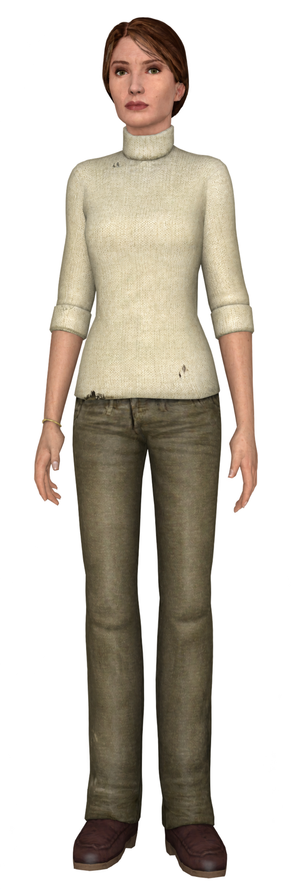

Modèle retail HL2 en col roulé, pantalon olive-brun et chaussures bordeaux conservé. Visage, mains et plis affinés/reconstruits; comparer les proportions du visage, le bracelet et l'usure du pull à la capture. Corps complet, marge basse et haute inférieure aux 10 % demandés. Aucun rectangle de fond visible sur composites blanc et noir. Un seul appel K; refus historiques conservés.

### Odessa Cubbage

`odessa_hl2_idle_k` · Half-Life 2 · 757 × 2078 · RGBA

Candidat non certifié, non intégré par ce lot.

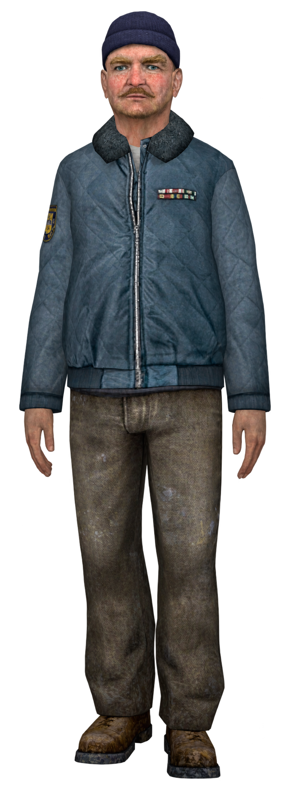

Bonnet, moustache, veste bleue, écusson de bras et barre de décorations du modèle retail conservés. Visage et texture de veste affinés; motifs des décorations et texte d'écusson non certifiés. Pose frontale détendue reconstituée, mains et chaussures à comparer. Corps complet avec marges plus faibles que demandé; composites blanc/noir sans fond opaque visible. Un seul appel K; refus historique conservé.

### Poison Zombie

`poison_zombie_hl2_idle_k` · Half-Life 2 · 1079 × 1457 · RGBA

Candidat non certifié, non intégré par ce lot.

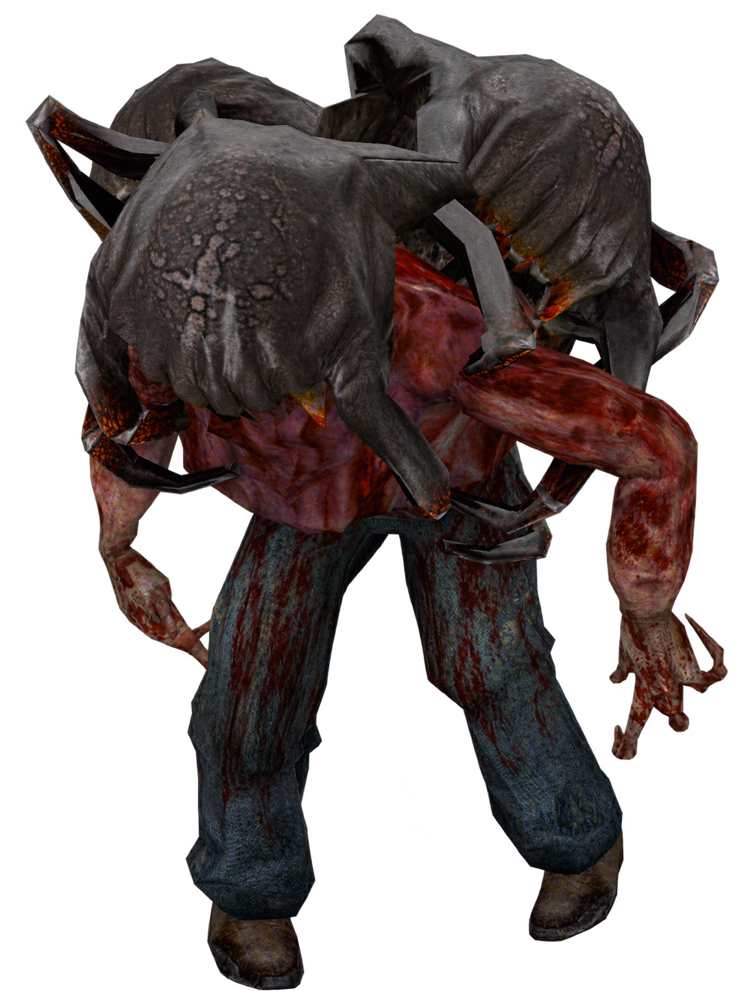

Hôte massif et headcrabs sombres sur tête/dos conformes à la silhouette source. Nombre et articulation exacts des pattes imbriquées et texture du torse doivent encore être comparés; marges étroites. Candidat non certifié.

### Reviver — Half-Life: Alyx

`reviver_hla_idle_k` · Half-Life: Alyx · 1254 × 1254 · RGBA

Candidat non certifié, non intégré par ce lot.

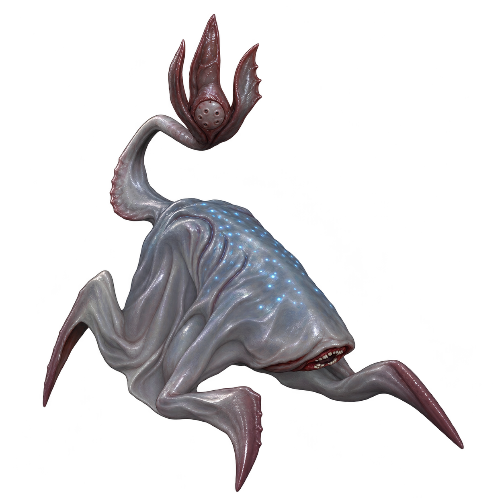

Pose statique candidate. Aucune certification de fidélité 1:1, animation terminée ou intégration runtime. Créature autonome entière orientée à droite, bouche basse, points bleus et appendice caudal à trois lobes présents. Aucun hôte ni effet électrique. Marges variables et nombre d'appendices partiellement occultés : comparer au modèle avant validation. Pixels originaux préservés.

### Richard Keller

`richard_keller_decay_idle_k` · Half-Life: Decay · 1254 × 1254 · RGBA

Candidat non certifié, non intégré par ce lot.

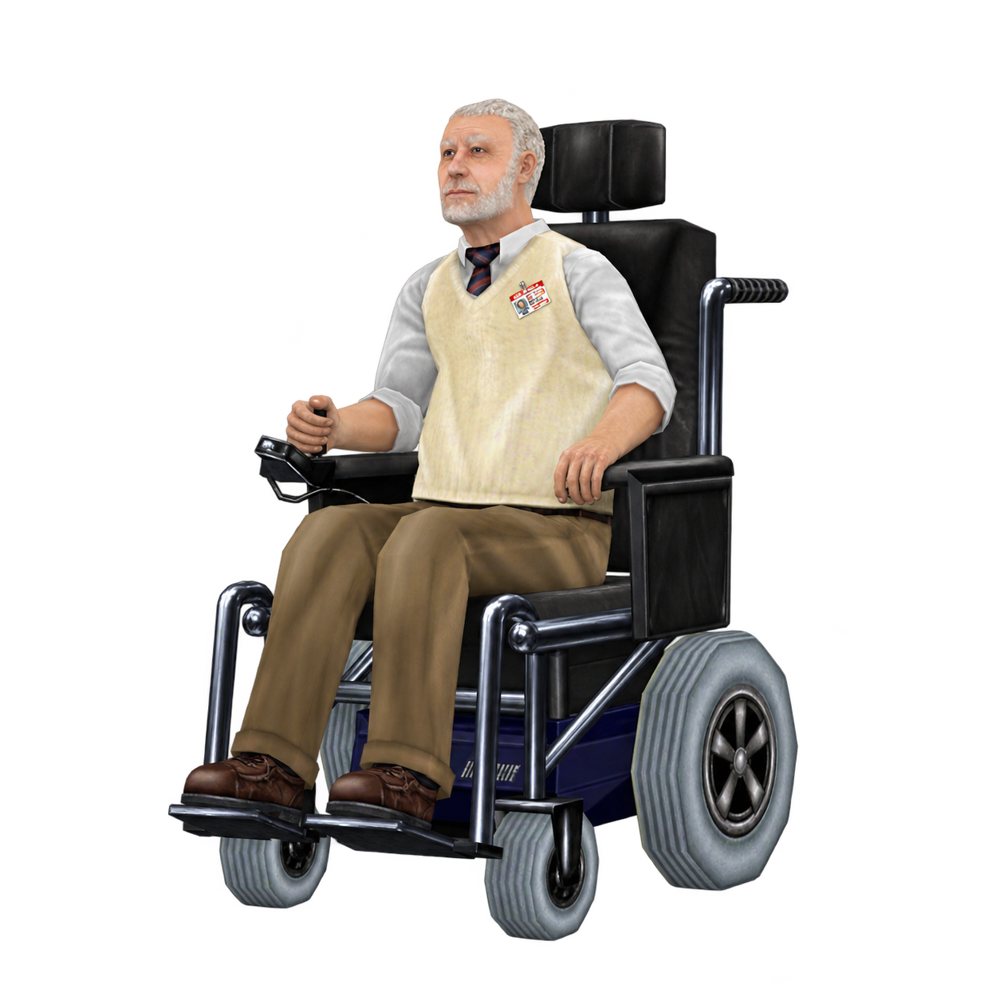

Fauteuil entier avec repose-pieds et roues conservé, Keller reste assis. Géométrie des roues et tête affinées par génération; petite frange claire ponctuelle sur l’épaule gauche visible sur noir. Taille relative du fauteuil à comparer au modèle PS2. Candidat non certifié.

### Russell

`russell_hla_idle_k` · Half-Life: Alyx · 1145 × 1374 · RGBA

Candidat non certifié, non intégré par ce lot.

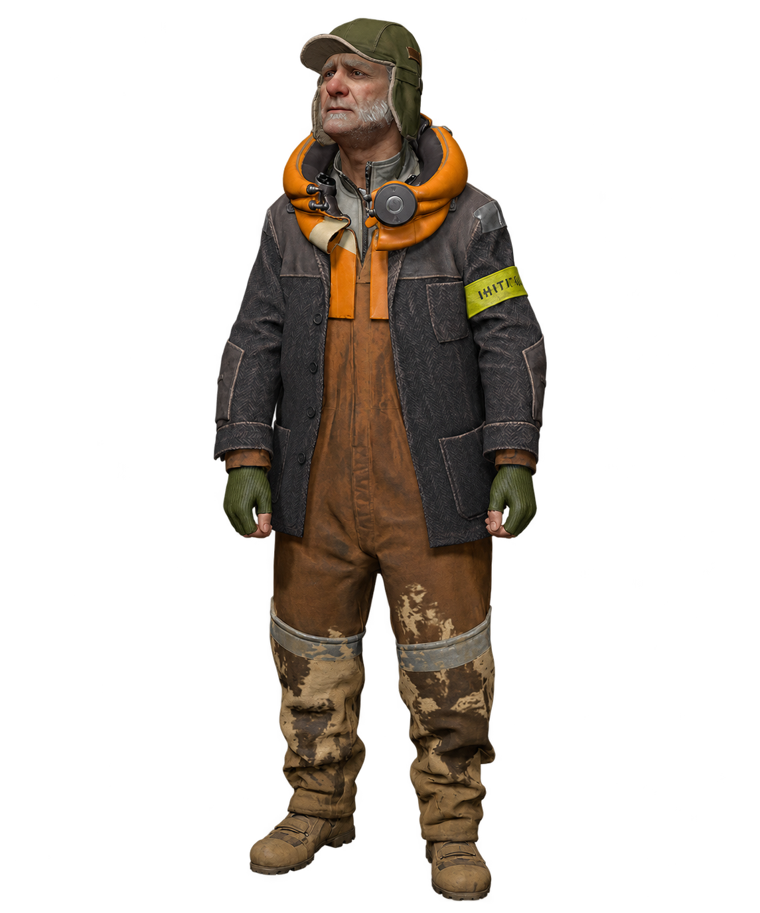

Tenue retail, casque audio, casquette et brassard identifiables. Visage légèrement réinterprété et marquage du brassard à comparer; détails d’usure affinés. Corps entier, marge verticale très mince; candidat non certifié.

### Tourelle sentinelle — Portal 2

`sentry_turret_portal2_idle_k` · Portal 2 · 1024 × 1536 · RGBA

Candidat non certifié, non intégré par ce lot.

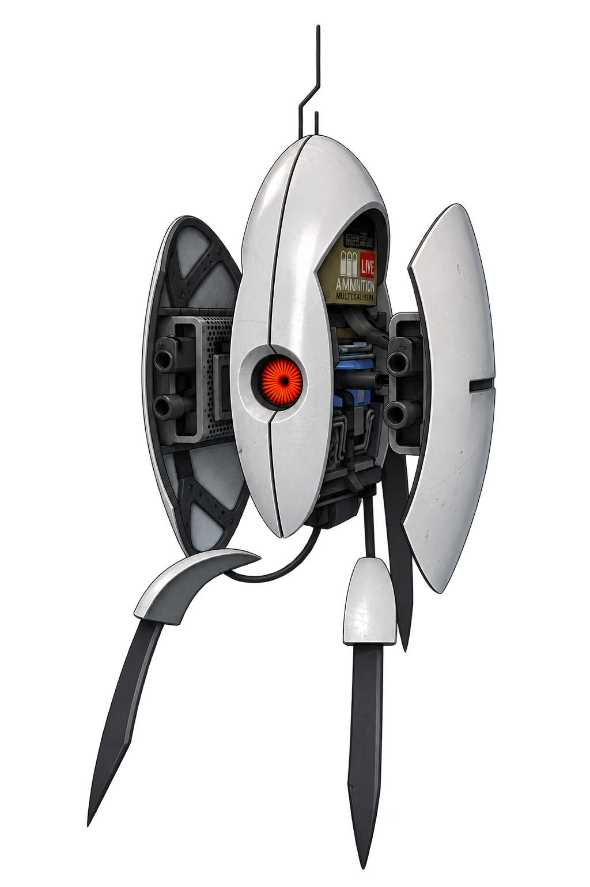

Pose statique candidate. Aucune certification de fidélité 1:1, animation terminée ou intégration runtime. Une tourelle standard Portal 2 dans l’état à coques ouvertes documenté par la référence. Le large halo gris suspecté dans l’aperçu brut est absent après composition réelle sur les deux fonds. Observation initiale corrigée. Lettrage approximatif et détails mécaniques à valider; aucune intégration.

### Shock Roach

`shock_roach_op4_idle_k` · Half-Life: Opposing Force · 1316 × 1195 · RGBA

Candidat non certifié, non intégré par ce lot.

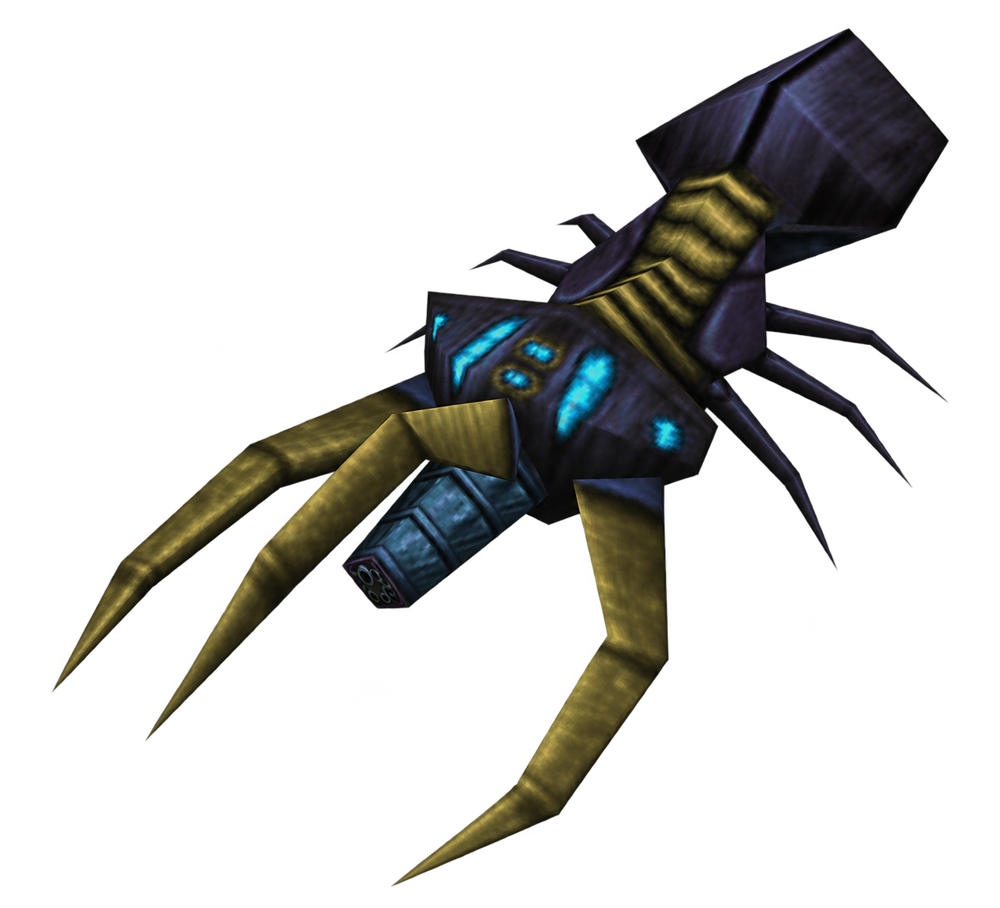

Silhouette angulaire GoldSrc et trois longues pointes antérieures conservées. Le détail interne de l’extrémité bleue est inventé/précisé au-delà de la petite source et doit être comparé. Composites blanc/noir lisibles; candidat non certifié.

### Simmons

`simmons_blueshift_idle_k` · Half-Life: Blue Shift · 1002 × 1570 · RGBA

Candidat non certifié, non intégré par ce lot.

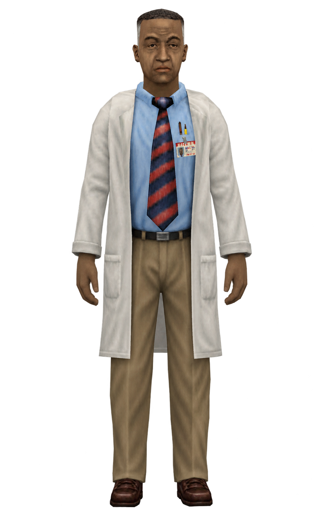

Visage nommé de Simmons, chemise bleue et cravate rayée conservés. Corps entier reconstruit à partir du portrait et de la vue arrière; bas de blouse frontal, mains et détails du pantalon à contrôler. Petite frange claire du vêtement visible sur noir. Source Blue Shift, pas scientifique générique.

### Snark

`snark_hl1_idle_k` · Half-Life · 1312 × 1199 · RGBA

Candidat non certifié, non intégré par ce lot.

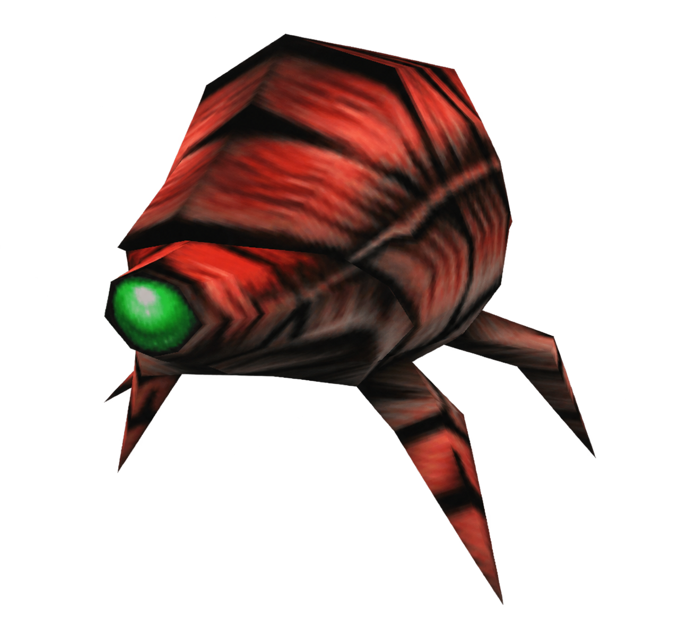

Modèle LD rouge/noir avec œil vert conservé, sans mélange HLA. Texture agrandie et lissée; contours et proportion exacte des appendices restent à comparer. Détourage lisible sur blanc/noir, candidat non certifié.

### Walter Bennet

`walter_bennet_blueshift_idle_k` · Half-Life: Blue Shift · 979 × 1606 · RGBA

Candidat non certifié, non intégré par ce lot.

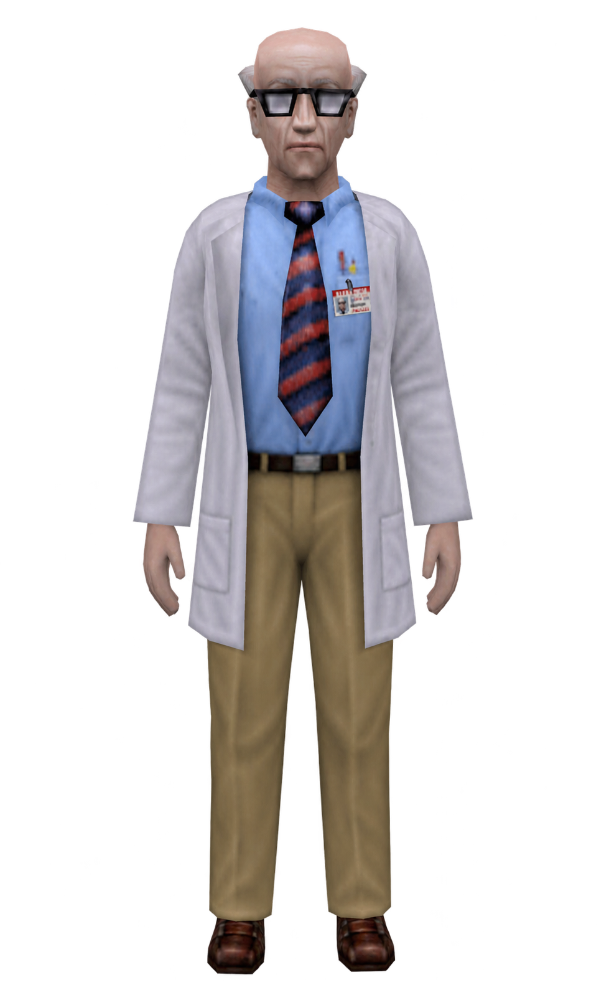

Visage étroit, calvitie et lunettes du Walter de Blue Shift conservés. Bas du corps reconstruit à partir de captures du même jeu, sans emprunt au Dr. Walter PS2; longueur de blouse, plis et mains à comparer. Composite noir révèle quelques franges claires fines, sans rectangle de fond.

### Zombie standard

`zombie_hl2_idle_k` · Half-Life 2 · 769 × 2045 · RGBA

Candidat non certifié, non intégré par ce lot.

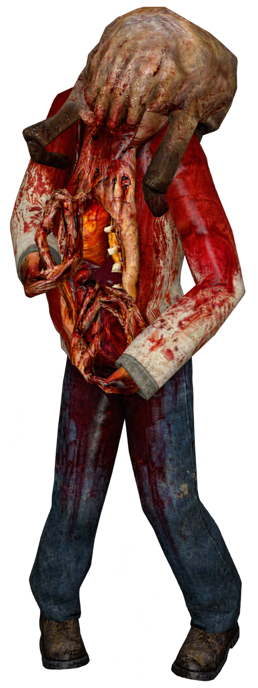

Silhouette, chemise, jean et headcrab classique cohérents avec le rendu source inspecté. La texture et les doigts sont réinterprétés; faible marge autour des chaussures et du sommet. Pose source conservée, pas encore une garde latérale de gameplay. Candidat, comparaison 1:1 toujours requise.

## Costumes

### Barney — déguisement avec casque

`costume_barney_cp_helmet_idle_k` · Half-Life 2 · 790 × 1989 · RGBA

Candidat non certifié, non intégré par ce lot.

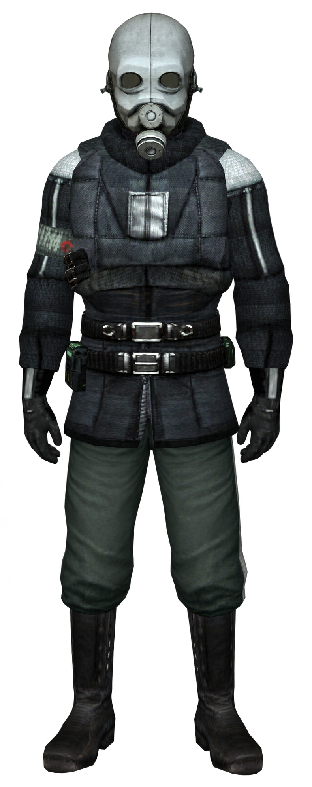

Recomposition explicite de la capture de Barney masqué à la gare et du modèle retail démasqué pour le corps. Aucun visage exposé; tenue sombre, épaules claires, brassard, deux ceintures, pantalon vert et bottes conservés. La calotte paraît plus arrondie; les lentilles, respirateurs et jonction casque/cou doivent être comparés de près à la capture, ainsi que les poches. Pose bras baissés reconstituée. Corps complet sans rectangle de fond sur composites blanc/noir; marges inférieures aux 10 % demandés. Un seul appel K; refus historique conservé.

### Colette — Head-to-Head PS2

`costume_colette_headtohead_ps2_idle_k` · Half-Life — PlayStation 2 · 1024 × 1536 · RGBA

Candidat non certifié, non intégré par ce lot.

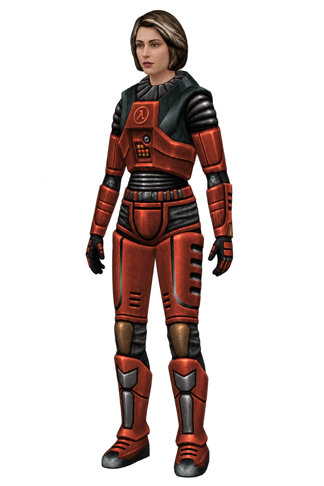

Palette rouge du modèle PS2 Head-to-Head et construction HEV cohérentes. Visage plus réaliste et proportions d’armure modifiées par rapport au modèle polygonal; comparaison exacte requise. Brume visible dans l’aperçu RGB située hors silhouette transparente; composites blanc/noir ne montrent pas de fond opaque. Alpha maximal 254, franges faibles consignées.

### G-Man — modèle Alyx

`costume_gman_hla_idle_k` · Half-Life: Alyx · 1199 × 1312 · RGBA

Candidat non certifié, non intégré par ce lot.

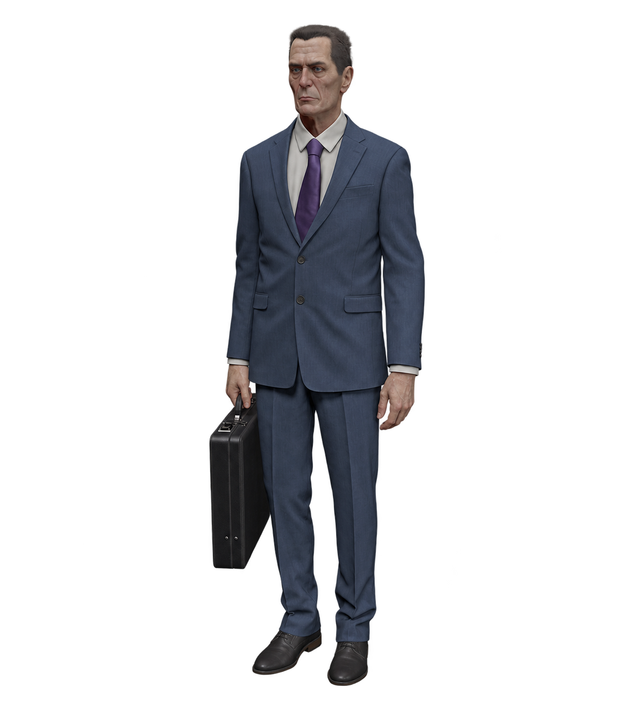

Version HLA : suit bleu-gris, cravate violette et mallette conservés. Visage et plis affinés par génération; forme exacte des poches et mallette à comparer. Détourage complet inspecté sur blanc/noir; candidat non certifié.

### Judith Mossman — transmission arctique

`costume_mossman_arctic_idle_k` · Half-Life 2: Episode One / Episode Two · 731 × 2152 · RGBA

Candidat non certifié, non intégré par ce lot.

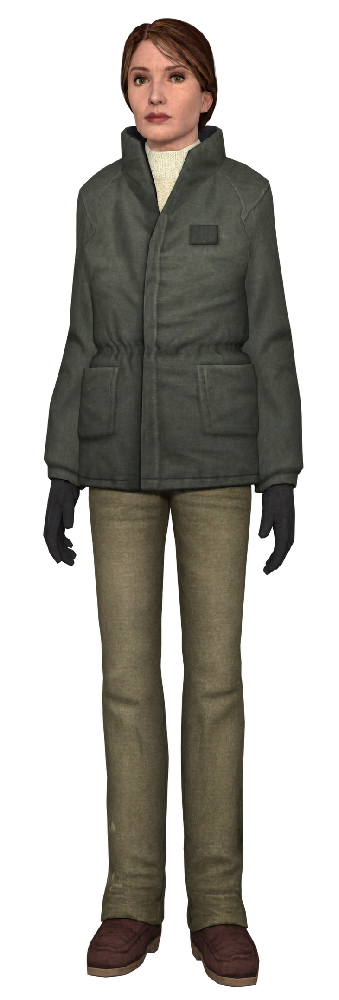

Tenue retail Episode One : manteau vert, col écru, gants noirs et pantalon kaki conservés. Visage et volumes réinterprétés, distinction explicite avec les concepts Episode Three. Pieds complets, marge basse étroite; composites blanc/noir inspectés.

### Skeleton — modèle multijoueur publié

`skeleton_hl25_multiplayer_idle_k` · Half-Life Deathmatch — 25th Anniversary / Further Data · 1199 × 1312 · RGBA

Candidat non certifié, non intégré par ce lot.

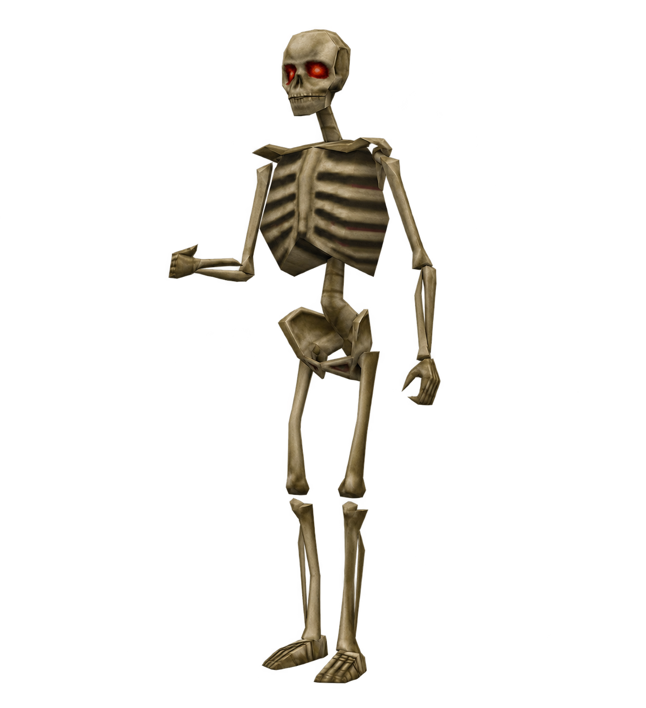

Structure polygonale et articulations caractéristiques conservées; rouge retenu comme teinte d’yeux réglable de cette candidate. Forme du bassin et nombre de côtes texturées doivent être comparés; aucun équipement inventé. Composites blanc/noir inspectés.

### Too Much Coffee Man — modèle multijoueur publié

`too_much_coffee_man_hl25_multiplayer_idle_k` · Half-Life Deathmatch — 25th Anniversary / Further Data · 1199 × 1312 · RGBA

Candidat non certifié, non intégré par ce lot.

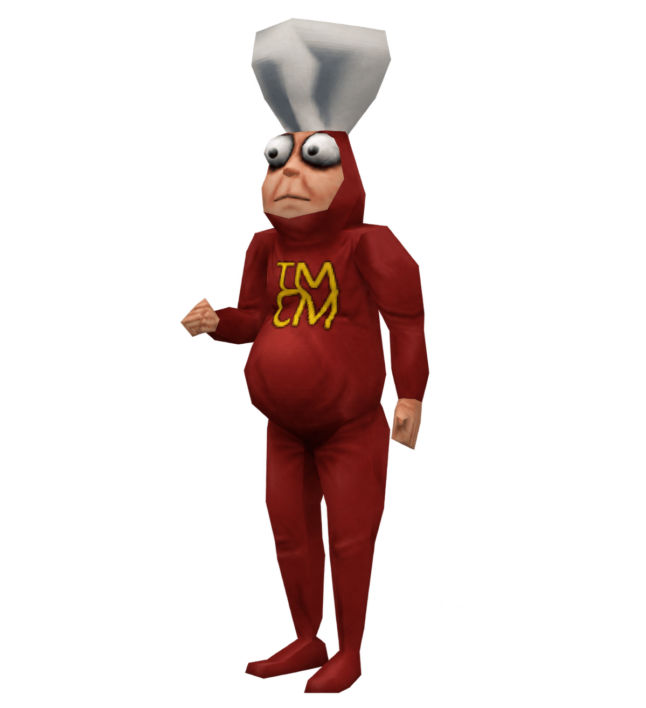

Modèle multijoueur GoldSrc, yeux saillants et grande tasse supérieure conservés. Motif jaune TM/CM partiellement déformé et volume de la tasse à revoir; fine frange claire au bord supérieur sur noir. Aucune confusion revendiquée avec une illustration originale du comic.

## Boss et grandes machines

### Appareil-tourelle fermé — Aperture Desk Job

`appliance_turret_deskjob_idle_k` · Aperture Desk Job · 1312 × 1199 · RGBA

Candidat non certifié, non intégré par ce lot.

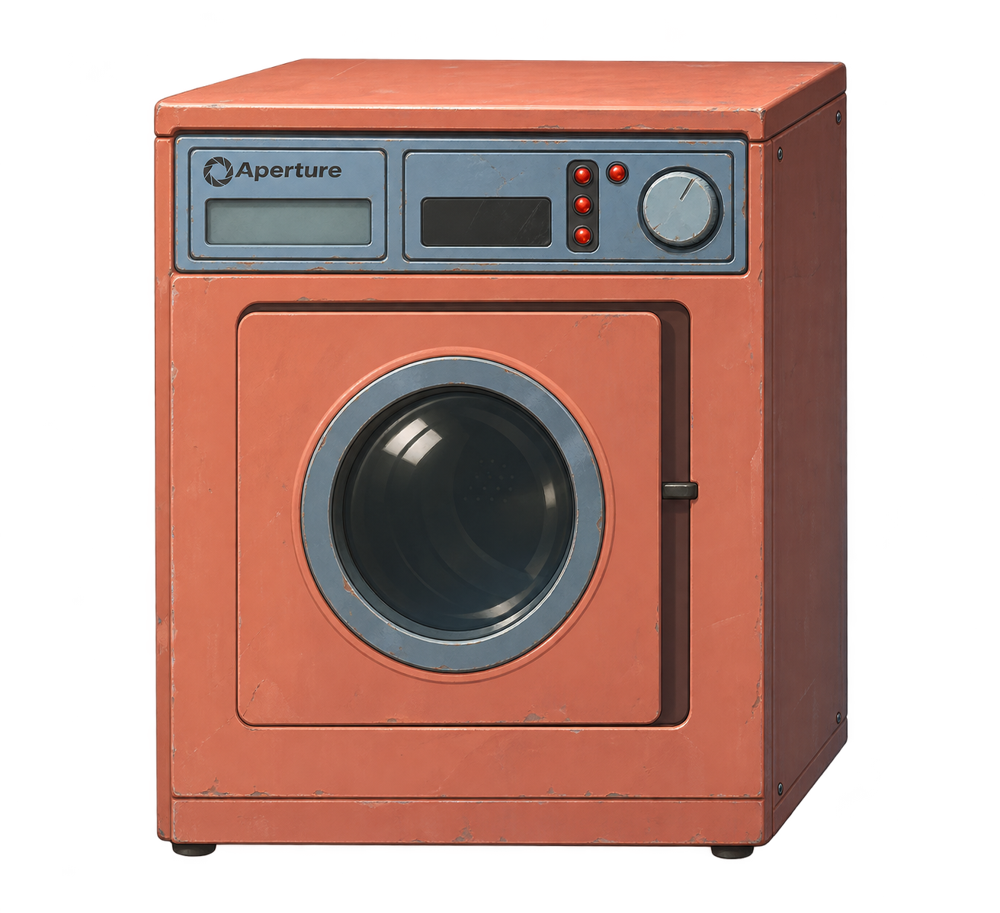

Pose statique candidate. Aucune certification de fidélité 1:1, animation terminée ou intégration runtime. Un sèche-linge fermé isolé, couleur saumon et panneau bleu-gris; aucun Grady ni arme ajoutée. Quatre voyants apparaissent malgré la consigne de trois et le marquage Aperture est reproduit approximativement. Pose d'appareil fermé uniquement : aucune animation de tourelle validée. Fines franges colorées : contrôle sur fonds clair et sombre réalisé, revue moteur encore nécessaire.

### GLaDOS — Portal, pose suspendue

`glados_portal1_idle_k` · Portal · 1124 × 1399 · RGBA

Candidat non certifié, non intégré par ce lot.

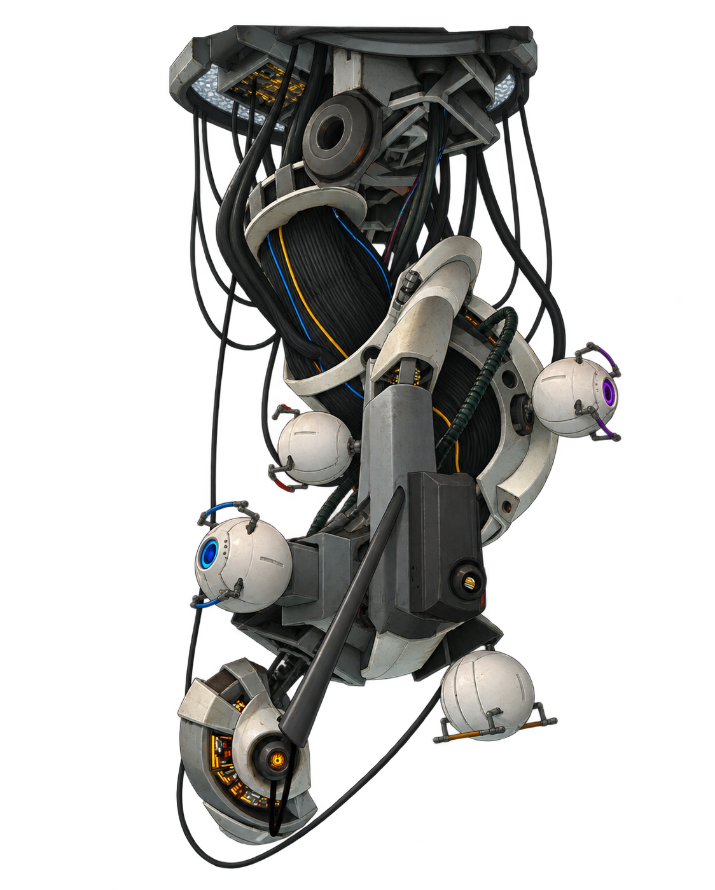

Pose statique candidate. Aucune certification de fidélité 1:1, animation terminée ou intégration runtime. Un ensemble GLaDOS Portal 1 suspendu avec quatre modules de personnalité attachés; tête basse et construction lisibles. Petites franges possibles sur les câbles et contours. Les surfaces masquées dans la capture n’ont pas de vue de contrôle indépendante. Aucune animation ni intégration.

### Antlion Guardian de surface — Episode Two

`guardian_surface_ep2_idle_k` · Half-Life 2 Episode Two · 1312 × 1199 · RGBA

Candidat non certifié, non intégré par ce lot.

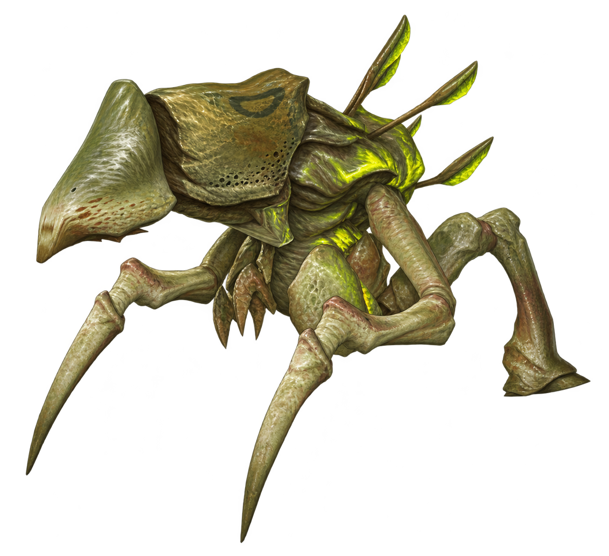

Pose statique candidate. Aucune certification de fidélité 1:1, animation terminée ou intégration runtime. Guardian entier isolé, modèle vert lumineux avec crête large et appendices dorsaux, orientation gauche conservée. Marges serrées et fines franges colorées. La sortie ne prouve pas une scène en surface et n'implique aucune nouvelle variante anatomique.

### Hunter-Chopper — Episode Two

`hunter_chopper_ep2_idle_k` · Half-Life 2 Episode Two · 1774 × 887 · RGBA

Candidat non certifié, non intégré par ce lot.

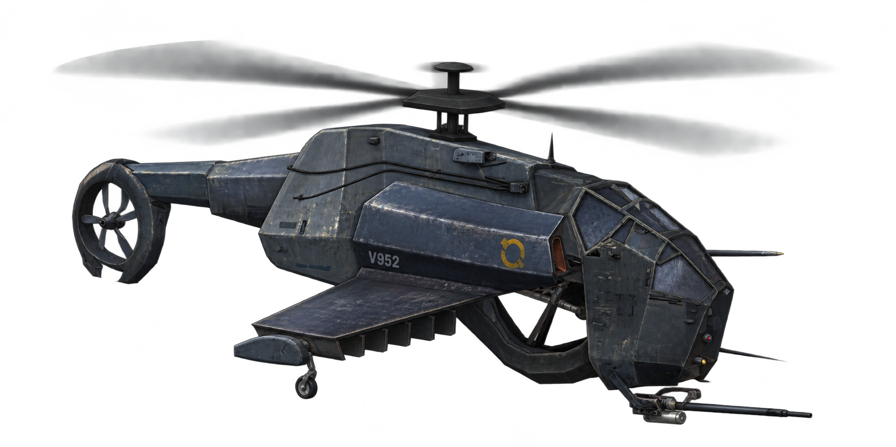

Pose statique candidate. Aucune certification de fidélité 1:1, animation terminée ou intégration runtime. Hélicoptère entier orienté à droite, rotor principal, rotor de queue annulaire, canon inférieur et roues présents. La pale/traînée de rotor demeure une interprétation statique; inscriptions et petits composants à comparer au modèle. Aucun projectile ou décor.

### Strider — Half-Life 2

`strider_hl2_idle_k` · Half-Life 2 · 1086 × 1448 · RGBA

Candidat non certifié, non intégré par ce lot.

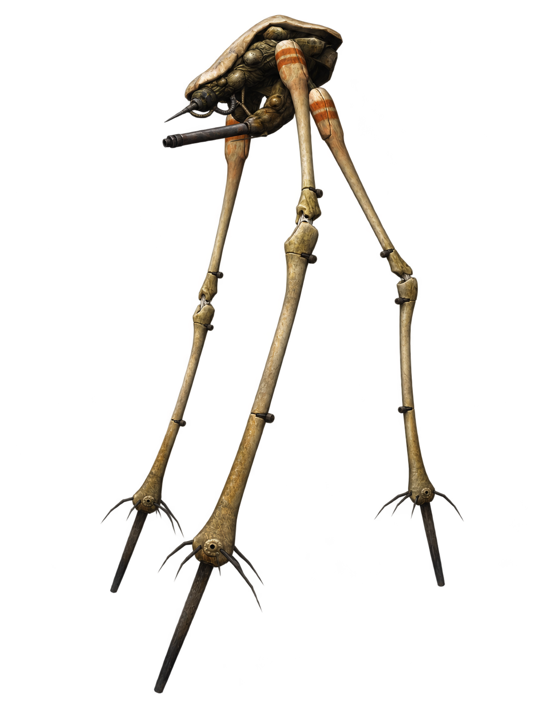

Pose statique candidate. Aucune certification de fidélité 1:1, animation terminée ou intégration runtime. Trois longues jambes et pieds complets, deux armes sous le corps; orientation gauche conservée sans miroir. Cadrage serré en haut et en bas. De fines franges colorées apparaissent sur certains contours; composition alpha contrôlée sur deux fonds; intégration sur fond de jeu encore à valider. Aucun tir.

### Strider combat — Half-Life: Alyx

`strider_hla_idle_k` · Half-Life Alyx · 1457 × 1080 · RGBA

Candidat non certifié, non intégré par ce lot.

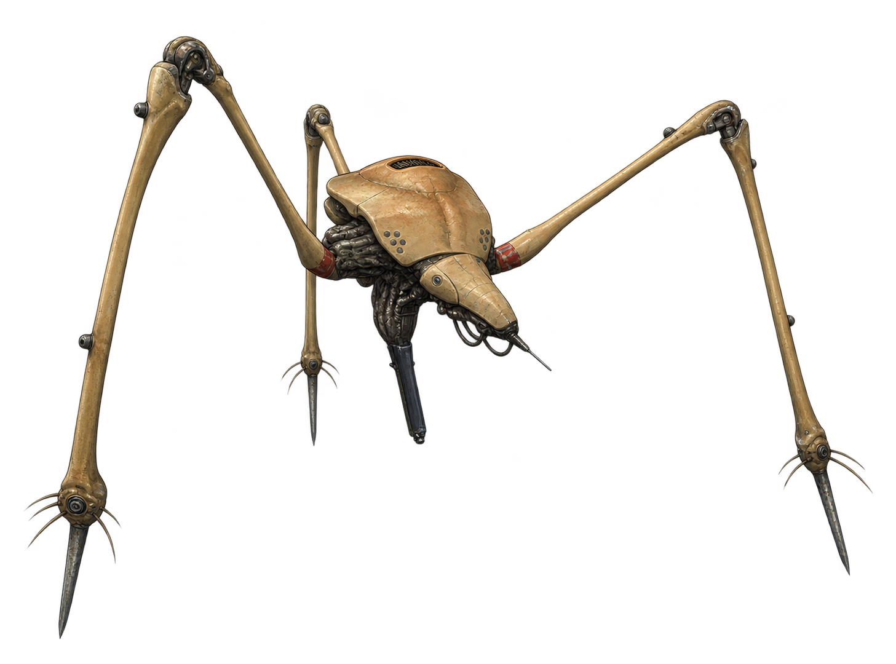

Pose statique candidate. Aucune certification de fidélité 1:1, animation terminée ou intégration runtime. Modèle de combat distinct du HL2, trois jambes, genoux relevés et carapace large. Sujet entier orienté à droite, marge droite faible. Fines franges colorées visibles à quelques contours; aucune retouche appliquée. Aucune pièce de construction.

## Stages

### Relais de Xen/Focal Point

`stage_bs_xen_focal_point_master_k` · Half-Life: Blue Shift · 1672 × 941 · RGB

Candidat non certifié, non intégré par ce lot.

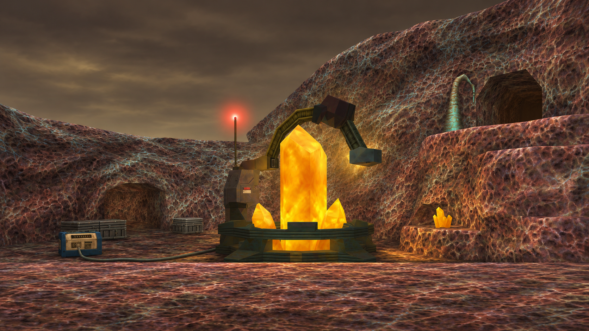

Cristal Xenium jaune dans son anneau, bras du Focuser, balise rouge, petit générateur et roches veinées du site ba_xen5. Disposition réinterprétée en élévation latérale ; détails du châssis/boîtiers non vérifiés à l’échelle. Aucun Xénophore vivant ; arche végétale source conservée comme élément décoratif. Master aplati, aucune couche ou animation complète, runtime désactivé.

### Dortoirs niveau 3/Domestic Violence

`stage_decay_dormitories_ps2_master_k` · Half-Life: Decay · 1672 × 941 · RGB

Candidat non certifié, non intégré par ce lot.

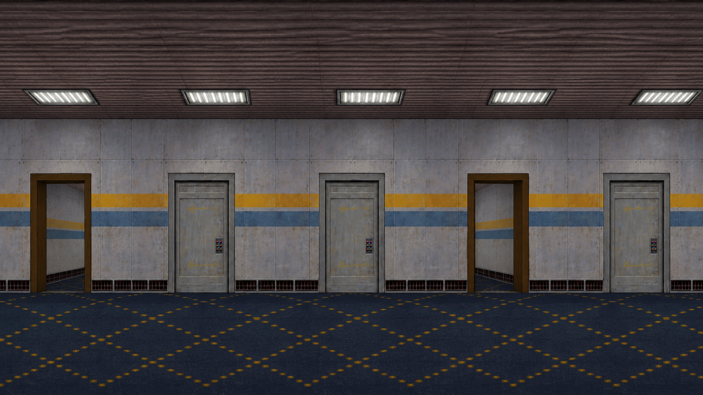

Mur gris à bandes jaune/bleu, portes à clavier, plinthes grillagées et moquette bleu nuit à losanges jaunes des dortoirs PS2. Capture de couloir étroit à faible définition ; passage à cinq travées frontales et ordre des portes réinterprétés. Les noms et numéros des chambres sont volontairement omis. Sol ~74 % ; topologie ht05dorms non certifiée. Master aplati, aucune couche ou animation complète, runtime désactivé.

### Installation de transfert Gamma

`stage_decay_gamma_ps2_master_k` · Half-Life: Decay · 1672 × 941 · RGB

Candidat non certifié, non intégré par ce lot.

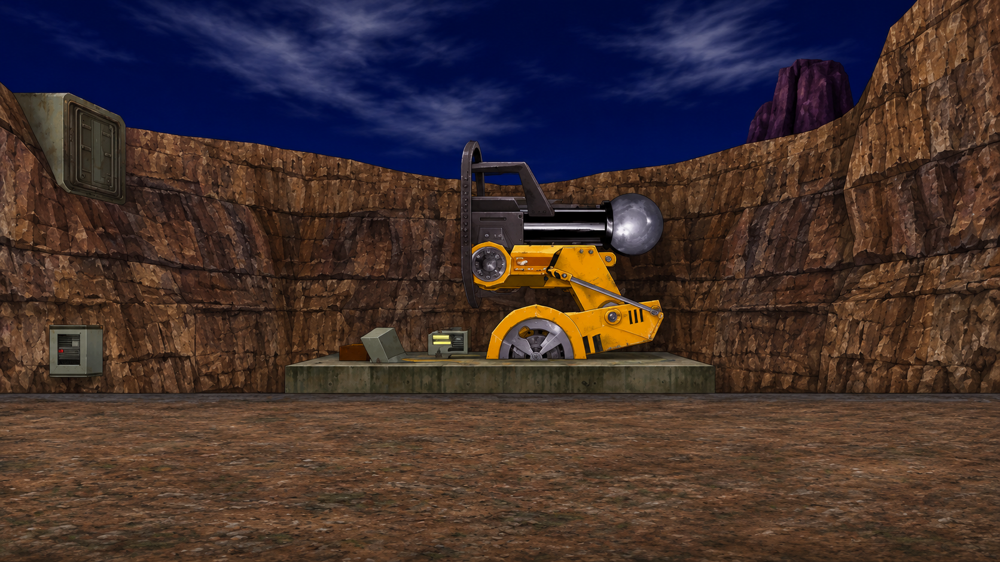

Balise jaune articulée repliée sur socle, sphère argentée, enceinte de roche et ciel cobalt de la capture PS2. Source PS2 attribuée par l’article et HUD inspecté, définition 640 px. La machine reproduit l’état visuel choisi mais ses petites pièces restent interpolées. Sol trop haut (~70 %) ; calibrage du master requis, aucun cycle d’activation. Master aplati, aucune couche ou animation complète, runtime désactivé.

### Bureau Cave Johnson final

`stage_deskjob_cave_office_master_k` · Aperture Desk Job · 1672 × 941 · RGB

Candidat non certifié, non intégré par ce lot.

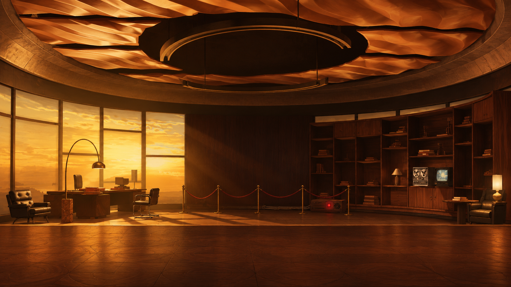

Fenêtres ambrées, bibliothèque courbe, bureau, lampe arquée, magnétophone et plafond circulaire du bureau final ; tête absente. Zone centrale autrefois masquée par la tête comblée par un mur sombre uni, explicitement non attesté. Mobilier repoussé derrière la voie. Le plafond et le parquet réinterprétés ne certifient pas la géométrie du jeu. Master aplati, aucune couche ou animation complète, runtime désactivé.

### Poste contrôle produits

`stage_deskjob_factory_master_k` · Aperture Desk Job · 1672 × 941 · RGB

Candidat non certifié, non intégré par ce lot.

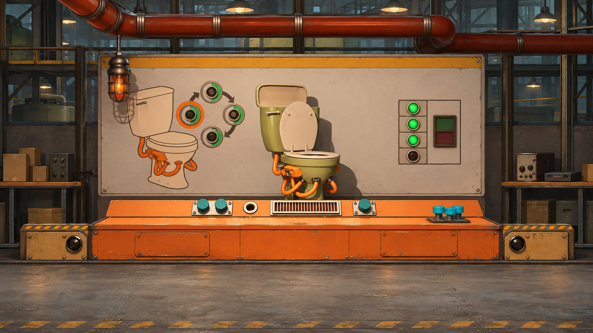

Établi orange à boutons turquoise, panneau crème, gros tuyau rouge, gyrophare grillagé et produit sanitaire à flexibles du poste Desk Job. Le schéma sanitaire reste peint sur le panneau malgré la consigne de l’omettre ; aucune lettre lisible. Extension latérale de l’atelier et sol industriel inférés pour cadrage. Produit inerte sans acteur ni tir. Master aplati, aucune couche ou animation complète, runtime désactivé.

### Quai d’évacuation

`stage_ep1_evac_platform_master_k` · Half-Life 2 Episode One · 1672 × 941 · RGB

Candidat non certifié, non intégré par ce lot.

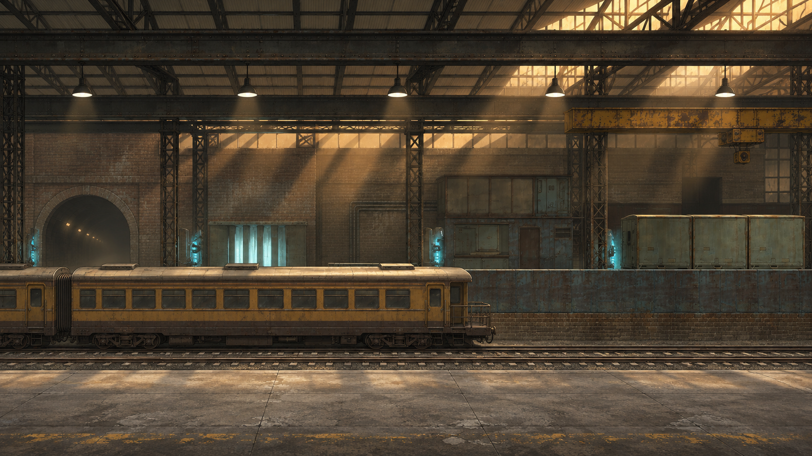

Wagon ocre, poutres et fermes métalliques, lampes industrielles, tunnel, conteneurs et touches cyan du dépôt d’Exit 17. Vue élevée source convertie en élévation latérale ; ordre et espacement des conteneurs et supports réinterprétés. Voie de combat à environ 82 % ; six plans et métrique du lieu à réaliser. Master aplati, aucune couche ou animation complète, runtime désactivé.

### Distillerie en quarantaine

`stage_hla_distillery_master_k` · Half-Life Alyx · 1672 × 941 · RGB

Candidat non certifié, non intégré par ce lot.

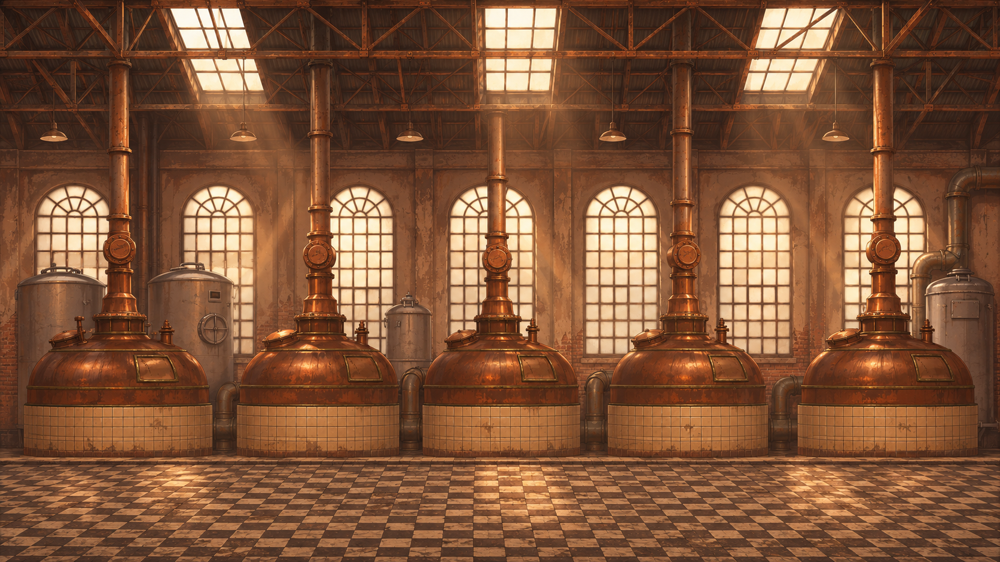

Alambics de cuivre à base carrelée, hautes fenêtres cintrées et verrières de la salle a3_distillery reconnaissables. Implantation originale des cuves ramenée à une rangée presque symétrique ; le sol (~81 %) reste continu mais la profondeur du lieu est simplifiée. Aucun Jeff, aucune bouteille ou obstacle dans la voie. Master aplati, aucune couche ou animation complète, runtime désactivé.

### Rue de la zone de quarantaine

`stage_hla_quarantine_street_master_k` · Half-Life Alyx · 1672 × 941 · RGB

Candidat non certifié, non intégré par ce lot.

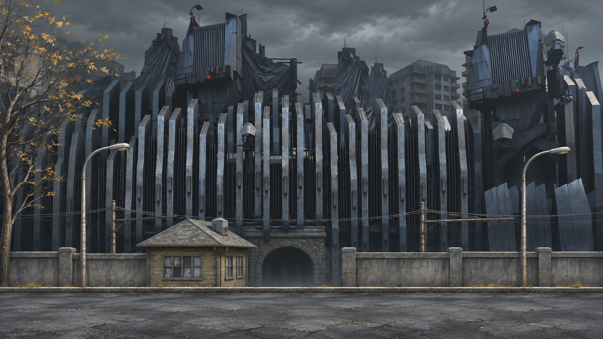

Mur mobile du Cartel à lames verticales, tours et bâches sombres, petit poste ocre et entrée maçonnée de a2_quarantine_entrance. Vue originale surélevée transformée en rue ; la chaussée libre commence vers 86 %, plus étroite que prévu. Dimensions et hauteur des ouvrages de pied de mur à revoir ; aucun parcours exact certifié. Master aplati, aucune couche ou animation complète, runtime désactivé.

### Intérieur du Vault — appartement contenu

`stage_hla_vault_apartment_master_k` · Half-Life: Alyx · 1672 × 941 · RGB

Candidat non certifié, non intégré par ce lot.

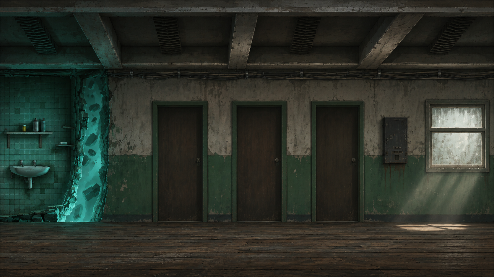

Appartement contenu du Vault : plâtre vert/gris, câbles, portes, lavabo carrelé et fracture turquoise suspendant des débris. Choix limité au couloir d’appartement a5_vault, pas à toute la cellule du Vault. Trois portes remises frontalement et bois de la voie consolidé ; effet de gravité statique, non animé. Master aplati, aucune couche ou animation complète, runtime désactivé.

### Zoo Cité 17/Captivity

`stage_hla_zoo_captivity_master_k` · Half-Life: Alyx · 1672 × 941 · RGB

Candidat non certifié, non intégré par ce lot.

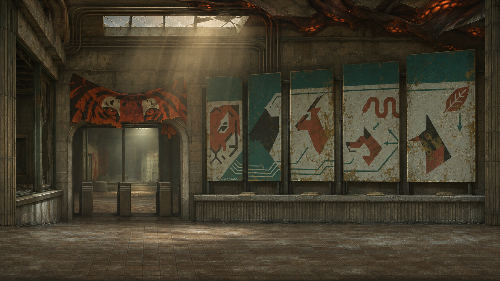

Entrée peinte en tête de tigre, panneaux zoologiques usés, tourniquets, verrière et croissance Xen du zoo Central. Panneaux adaptés et signes décoratifs non textuels conservés ; très petits tracés ressemblant à de faux caractères sur le bas d’un panneau. Aucun acteur vivant ou mort. Espacement du vestibule recomposé. Master aplati, aucune couche ou animation complète, runtime désactivé.

### Dépôt sous occupation

`stage_op4_cargo_master_k` · Half-Life Opposing Force · 1672 × 941 · RGB

Candidat non certifié, non intégré par ce lot.

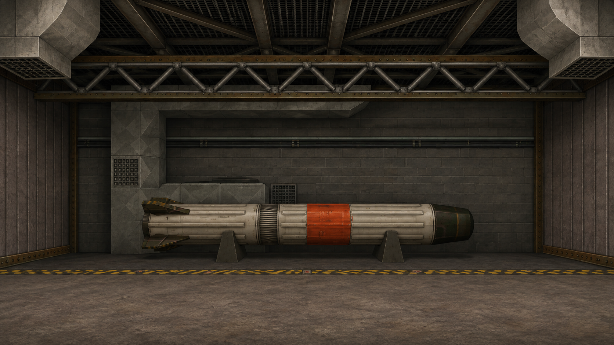

Supports béton segmentés, toiture métallique, conduits jumeaux et missile horizontal beige/orange du dépôt de Friendly Fire conservés. Cadrage frontal adapté ; missile, cradles et trame des murs simplifiés/recomposés. L’occupation militaire reste un contexte, aucun soldat n’est peint. Dimensions exactes du lieu et raccordement aux six couches non validés. Master aplati, aucune couche ou animation complète, runtime désactivé.

### Chambre du portail Race X

`stage_op4_gene_worm_chamber_master_k` · Half-Life Opposing Force · 1672 × 941 · RGB

Candidat non certifié, non intégré par ce lot.

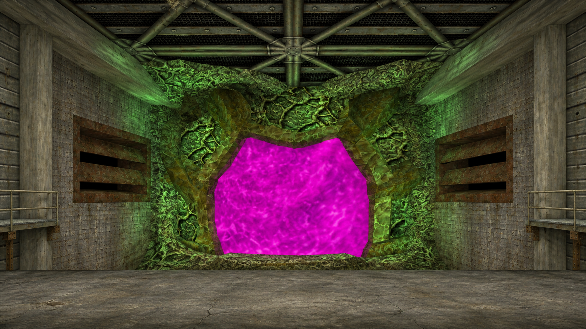

Portail magenta, croissance verte, murs maçonnés et fentes rouillées du portail Race X, sans Gene Worm. Portail et parois recomposés en symétrie ; sol à environ 82 % (au lieu des 78 % demandés). Surface libre continue mais hauteur de sol à recalibrer lors de l’intégration ; aucune certification géométrique. Master aplati, aucune couche ou animation complète, runtime désactivé.

### Maintenance/The Escape

`stage_portal1_maintenance_master_k` · Portal · 1672 × 941 · RGB

Candidat non certifié, non intégré par ce lot.

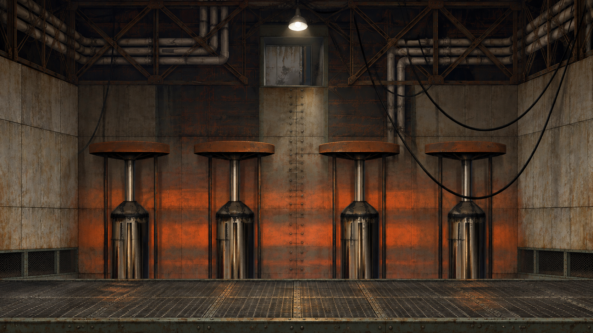

Pistons massifs à tête rouillée, béton carré, poutrelles, câbles et éclairage orange de la maintenance Portal1. Les quatre pistons ont été alignés pour la lecture latérale ; leur hauteur et phase sont fixes, sans animation. Grille de combat ajoutée à l’avant de la fosse comme adaptation ; sol vers 84 %, profondeur utile à vérifier. Master aplati, aucune couche ou animation complète, runtime désactivé.

### Hub coopération

`stage_portal2_coop_hub_master_k` · Portal 2 coop · 1672 × 941 · RGB

Candidat non certifié, non intégré par ce lot.

Hub mp_coop_lobby_3 : cadre jaune, grand écran mural, coursives à panneaux pliés, sorties rondes et circuit pointillé ambre. Scores et pictogrammes de l’écran retirés ; proportions de la plateforme et position des sorties simplifiées. Sol continu vers 84 %. Le décor ne représente pas la révision initiale mp_coop_lobby_2. Master aplati, aucune couche ou animation complète, runtime désactivé.

### Voûte sujets humains

`stage_portal2_human_vault_master_k` · Portal 2 coop · 1672 × 941 · RGB

Candidat non certifié, non intégré par ce lot.

Rangées de capsules en verre jaune-vert, rayonnages massifs, tuyaux et câbles suspendus du Human Vault. Occupants supprimés ; les sièges et harnais restent humanoïdes par leur fonction, surtout à petite échelle. Une revue agrandie des capsules lointaines reste nécessaire. Passerelle élargie et mise de profil, garde-corps derrière la voie, sol vers 83 %. Master aplati, aucune couche ou animation complète, runtime désactivé.

### Art Therapy/Peer Review — chambre 4

`stage_portal2_peer_review_chamber4_master_k` · Portal 2 coop · 1672 × 941 · RGB

Candidat non certifié, non intégré par ce lot.

Salle Bridge Gels : dispensateurs bleu/orange, mur noir, panneaux inclinés, verrière grillagée, pont lumineux vertical et bouton arrière. La disposition du puzzle est simplifiée pour une vue de combat ; le gel n’est pas simulé. La structure du pont lumineux reste visuellement schématique. Grille libre vers 83 %, aucune mécanique de test intégrée. Master aplati, aucune couche ou animation complète, runtime désactivé.

### Centre communications Uplink

`stage_uplink_communications_master_k` · Half-Life: Uplink · 1672 × 941 · RGB

Candidat non certifié, non intégré par ce lot.

Antenne intérieure courbe, support vert, conduit bleu/rouge, console à roue rouge et enceinte de briques jaune d’Uplink. L’architecture circulaire a été ouverte en vue latérale ; profondeur du puits peu visible. Sol continu vers 83 %, texture de plaques métalliques à la place de la grille fine du modèle source. Master aplati, aucune couche ou animation complète, runtime désactivé.

## Projectiles et effets

### Traceur primaire AR2 HL2

`fx_ar2_tracer_hl2_trace_k` · Half-Life 2 · 2172 × 724 · RGBA

État visuel : `trace`. Candidat non certifié, non intégré par ce lot.

Trait blanc-jaune fin et halo cyan; référence Gunship justifiée par le matériau effects/gunshiptracer partagé dans le SDK. FX_AR2Tracer varie sa largeur entre 0,5 et 1,5; le chemin joueur FX_PlayerAR2Tracer emploie 6 à 12. Ce candidat fin ne certifie pas le tir du joueur. Une capture directe du contexte AR2 retenu reste requise. PNG original conservé sans retouche; aucune certification 1:1.

### Tourelle électroménagère — flash de tir

`fx_deskjob_turret_tracer_muzzle_k` · Aperture Desk Job · 1536 × 1024 · RGBA

État visuel : `muzzle`. Candidat non certifié, non intégré par ce lot.

Un flash de bouche doré à cœur clair, vu sur blanc/noir. Le canal alpha est réel (minimum 0), sans rectangle noir opaque; de très faibles résidus alpha étendent la boîte non nulle. Ne représente pas le trajet du tir. PNG original conservé sans retouche; aucune certification 1:1.

### Gargantua — jet de flamme maintenu

`fx_gargantua_flame_hl1_flame_sustain_k` · Half-Life (1998) · 2172 × 724 · RGBA

État visuel : `flame_sustain`. Candidat non certifié, non intégré par ce lot.

Jet unique orange-saumon avec origine bleu-violet à droite. La capture et les couleurs du SDK sont cohérentes; le double faisceau et son évolution temporelle ne sont pas reproduits par cette image. PNG original conservé sans retouche; aucune certification 1:1.

### Gargantua — particule de l’onde au sol

`fx_gargantua_stomp_hl1_ground_wave_particle_k` · Half-Life (1998) · 1278 × 1230 · RGBA

État visuel : `ground_wave`. Candidat non certifié, non intégré par ce lot.

Petite particule rouge à contour diffus, référence gargeye1. C’est un composant de la vague au sol décrit par CStomp::Think, pas la vague entière, son déplacement ni sa collision. PNG original conservé sans retouche; aucune certification 1:1.

### Traceur du Gunship HL2

`fx_gunship_tracer_hl2_trace_k` · Half-Life 2 · 2172 × 724 · RGBA

État visuel : `trace`. Candidat non certifié, non intégré par ce lot.

Trait blanc-jaune très fin, halo cyan retenu sur compositions noir/blanc. Le RGB caché ne doit pas être lu comme un fond opaque. Longueur, largeur et vitesse devront être pilotées par le moteur. PNG original conservé sans retouche; aucune certification 1:1.

### Pit Worm — rayon continu

`fx_pit_worm_beam_opfor_beam_k` · Half-Life: Opposing Force · 2172 × 724 · RGBA

État visuel : `beam`. Candidat non certifié, non intégré par ce lot.

Segment continu vert sur fond transparent, sans corps ni œil du monstre. Épaisseur et profil lumineux adaptés au sprite 2D; extrémités, impact et durée restent à produire. PNG original conservé sans retouche; aucune certification 1:1.

### Portail coop — ATLAS primaire cyan

`fx_portals_coop_portal2_atlas_blue_k` · Portal 2 — coopération · 1066 × 1476 · RGBA

État visuel : `atlas_blue`. Candidat non certifié, non intégré par ce lot.

Anneau unique de la variante atlas_blue; centre transparent (alpha central 0, quelques valeurs 1 dans la zone intérieure mesurée). Palette vérifiée sur les portails appairés de Portal 2. Des résidus alpha très faibles et la texture du bord restent à nettoyer/contrôler avant intégration; aucun aperçu du monde de destination ni animation. PNG original conservé sans retouche; aucune certification 1:1.

### Portail coop — ATLAS secondaire indigo

`fx_portals_coop_portal2_atlas_purple_k` · Portal 2 — coopération · 1070 × 1470 · RGBA

État visuel : `atlas_purple`. Candidat non certifié, non intégré par ce lot.

Anneau unique de la variante atlas_purple; centre transparent (alpha central 0, quelques valeurs 1 dans la zone intérieure mesurée). Palette vérifiée sur les portails appairés de Portal 2. Des résidus alpha très faibles et la texture du bord restent à nettoyer/contrôler avant intégration; aucun aperçu du monde de destination ni animation. PNG original conservé sans retouche; aucune certification 1:1.

### Portail — P-body secondaire rouge

`fx_portals_coop_portal2_pbody_red_k` · Portal 2 — coopération · 1070 × 1470 · RGBA

État visuel : `pbody_red`. Candidat non certifié, non intégré par ce lot.

Anneau unique de la variante pbody_red; centre transparent (alpha central 0, quelques valeurs 1 dans la zone intérieure mesurée). Palette vérifiée sur les portails appairés de Portal 2. Des résidus alpha très faibles et la texture du bord restent à nettoyer/contrôler avant intégration; aucun aperçu du monde de destination ni animation. PNG original conservé sans retouche; aucune certification 1:1.

### Portail coop — P-body primaire jaune

`fx_portals_coop_portal2_pbody_yellow_k` · Portal 2 — coopération · 1070 × 1470 · RGBA

État visuel : `pbody_yellow`. Candidat non certifié, non intégré par ce lot.

Anneau unique de la variante pbody_yellow; centre transparent (alpha central 0, quelques valeurs 1 dans la zone intérieure mesurée). Palette vérifiée sur les portails appairés de Portal 2. Des résidus alpha très faibles et la texture du bord restent à nettoyer/contrôler avant intégration; aucun aperçu du monde de destination ni animation. PNG original conservé sans retouche; aucune certification 1:1.

### Portail — Chell primaire bleu

`fx_portals_solo_portal2_blue_k` · Portal 2 · 1086 × 1448 · RGBA

État visuel : `blue`. Candidat non certifié, non intégré par ce lot.

Anneau unique de la variante blue; centre transparent (alpha central 0, quelques valeurs 1 dans la zone intérieure mesurée). Palette vérifiée sur les portails appairés de Portal 2. Des résidus alpha très faibles et la texture du bord restent à nettoyer/contrôler avant intégration; aucun aperçu du monde de destination ni animation. PNG original conservé sans retouche; aucune certification 1:1.

### Portail — Chell secondaire orange

`fx_portals_solo_portal2_orange_k` · Portal 2 · 1072 × 1467 · RGBA

État visuel : `orange`. Candidat non certifié, non intégré par ce lot.

Anneau unique de la variante orange; centre transparent (alpha central 0, quelques valeurs 1 dans la zone intérieure mesurée). Palette vérifiée sur les portails appairés de Portal 2. Des résidus alpha très faibles et la texture du bord restent à nettoyer/contrôler avant intégration; aucun aperçu du monde de destination ni animation. PNG original conservé sans retouche; aucune certification 1:1.

### Traceur de mitrailleuse Strider HL2

`fx_strider_tracer_hl2_trace_k` · Half-Life 2 · 2172 × 724 · RGBA

État visuel : `trace`. Candidat non certifié, non intégré par ce lot.

Trait clair à halo cyan, distinct du canon à distorsion. Le SDK partage le matériau du Gunship avec une largeur différente; comparer la taille et la durée dans une séquence Strider retail. PNG original conservé sans retouche; aucune certification 1:1.

### Grenade du Cartel Alyx — corps désarmé

`proj_combine_grenade_hla_body_k` · Half-Life: Alyx · 1374 × 1145 · RGBA

État visuel : `body`. Candidat non certifié, non intégré par ce lot.

Corps jaune moutarde, disques noirs et centre orange lisibles sur noir/blanc; anse et profondeur réinterprétées. Un seul corps non armé, sans trajectoire ni explosion. PNG original conservé sans retouche; aucune certification 1:1.

### Nihilanth — énergie offensive

`proj_nihilanth_energy_hl1_body_k` · Half-Life (1998) · 1288 × 1221 · RGBA

État visuel : `body`. Candidat non certifié, non intégré par ce lot.

Centre blanc-cyan et rayons violets/rosés visibles sur blanc/noir, guidés par le preview nhth1. Les rayons ont été redessinés; ce n’est pas une extraction du sprite du jeu ni un orbe orange de recharge. PNG original conservé sans retouche; aucune certification 1:1.

### Nihilanth — projectile de téléportation

`proj_nihilanth_teleport_hl1_body_k` · Half-Life (1998) · 1271 × 1238 · RGBA

État visuel : `body`. Candidat non certifié, non intégré par ce lot.

Centre jaune pâle, couronne orange et halo vert granuleux, guidés par exit1. Texture redessinée; seule une frame candidate, sans séquence de téléportation complète. PNG original conservé sans retouche; aucune certification 1:1.

### Missile de la tourelle Portal — corps

`proj_rocket_turret_missile_portal1_body_k` · Portal · 2172 × 724 · RGBA

État visuel : `body`. Candidat non certifié, non intégré par ce lot.

Objet unique horizontal, nez rouge, corps bleu-vert sombre et anneaux gris; silhouette contenue. Détails de profil et proportions à comparer au modèle Portal original. PNG original conservé sans retouche; aucune certification 1:1.

### Voltigore Opposing Force — charge électrique

`proj_voltigore_orb_opfor_charge_k` · Half-Life: Opposing Force · 2172 × 724 · RGBA

État visuel : `charge`. Candidat non certifié, non intégré par ce lot.

Charge violette à centre clair et branches anguleuses fines. La capture documente une charge dans les mains du Voltigore; ce fichier ne prouve pas la forme de l’orbe en vol. PNG original conservé sans retouche; aucune certification 1:1.

### Grenade Xen Alyx — corps au repos

`proj_xen_grenade_hla_body_k` · Half-Life: Alyx · 1289 × 1221 · RGBA

État visuel : `body`. Candidat non certifié, non intégré par ce lot.

Chair ivoire plissée et cavités vertes conformes aux grandes masses de la référence HLA; reliefs et répartition des cavités reconstruits. Vérifier le modèle sous plusieurs angles. PNG original conservé sans retouche; aucune certification 1:1.

## Archives

### Archive Alien Assassin — build HL2 2002

`archive_alien_assassin_hl2_2002_idle_k` · Half-Life 2 — développement · 1312 × 1199 · RGBA

Candidat non certifié, non intégré par ce lot.

Pose statique candidate. Aucune certification de fidélité 1:1, animation terminée ou intégration runtime. Silhouette accroupie et deux lentilles vertes sur supports conservées, griffes, armor et asymétrie du poignet présentes. Cadrage supérieur très serré; fines franges colorées et détail des plaques interprété. Révision 2002 uniquement, sans animation.

### Borealis — archive HL2 E3 2002

`archive_borealis_hl2_e3_2002_master_k` · Half-Life 2 development · 1672 × 941 · RGB

Candidat non certifié, non intégré par ce lot.

Coque rouge, passerelle blanche à bande de fenêtres, mât à guérite, cheminée orange et projecteurs du Borealis promotionnel E3 2002. Pont de combat extrapolé depuis une capture extérieure ; l’image peut se lire comme le navire vu depuis un quai plutôt que comme son propre pont. Nombre et placement des hublots ainsi que structures latérales non validés. Archive de développement uniquement, aucune apparence Episode Three/HL3 revendiquée. Master aplati, aucune couche ou animation complète, runtime désactivé.

### Archive Cremator — build HL2 2002

`archive_cremator_hl2_2002_idle_k` · Half-Life 2 — développement · 1024 × 1536 · RGBA

Candidat non certifié, non intégré par ce lot.

Pose statique candidate. Aucune certification de fidélité 1:1, animation terminée ou intégration runtime. Silhouette 2002 entière, tête à trois ouvertures, manteau vert à haut col, ventre circulaire et bras longs présents. Le large halo gris suspecté dans l’aperçu brut est absent lorsque le canal alpha est réellement composé sur fonds clair et sombre. Observation initiale corrigée, sans modifier aucun pixel. Petites sangles de gants et détails de surface interprétés; la silhouette reste candidate.

### Archive Kingpin — modèle prépublication Half-Life

`archive_kingpin_hl1_idle_k` · Half-Life — développement · 1061 × 1483 · RGBA

Candidat non certifié, non intégré par ce lot.

Pose statique candidate. Aucune certification de fidélité 1:1, animation terminée ou intégration runtime. Silhouette d'archive entière avec grand crâne, deux stalks latéraux, bras en faux et queue repliée. Textures fortement détaillées par génération; aucun modèle inédit déclaré. Orientation et proportion de la queue restent à comparer à l'original. Quelques artefacts colorés isolés près du contour supérieur; fichier non retouché.

### Archive Mr. Friendly — modèle prépublication Half-Life

`archive_mr_friendly_hl1_idle_k` · Half-Life — développement · 1317 × 1194 · RGBA

Candidat non certifié, non intégré par ce lot.

Pose statique candidate. Aucune certification de fidélité 1:1, animation terminée ou intégration runtime. Silhouette historique accroupie, deux longs membres angulaires antérieurs et dos arqué. Pose proche de la capture; aucun autre personnage ou action. Détails de peau interprétés; extrémités et proportion du dos à valider. Artefacts colorés isolés près de certains contours conservés.

### Archive Odell — build HL2 2002

`archive_odell_hl2_idle_k` · Half-Life 2 — développement · 1024 × 1536 · RGBA

Candidat non certifié, non intégré par ce lot.

Pose statique candidate. Aucune certification de fidélité 1:1, animation terminée ou intégration runtime. Personnage entier avec tenue orange, bonnet, gants et bottes grises, sans moustache; visage interprété d’après la capture. Le large halo orange/gris suspecté dans l’aperçu brut est absent après composition réelle du canal alpha sur les deux fonds. Observation initiale corrigée; aucun pixel retouché.

### Archive Hydra — modèle E3 de la fuite HL2

`hydra_hl2_cut_idle_k` · Half-Life 2 contenu coupé · 1153 × 1364 · RGBA

Candidat non certifié, non intégré par ce lot.

Pose statique candidate. Aucune certification de fidélité 1:1, animation terminée ou intégration runtime. Une tige Hydra bleue/cyan, renflement jaune-vert et longue pointe barbelée conformes à la silhouette retenue. La terminaison inférieure est plane et reste une interprétation puisque la référence était tronquée. Quelques pixels périphériques bleus; translucidité interne examinée sur deux fonds, à valider ensuite dans le moteur. Aucun corps inventé.
