# Galerie du lot L — 25 novembre 2026

**15 PNG originaux**, un élément et un état statique par image. Les panoramas, études d’archives et plans de parallaxe sont des candidats; aucune animation n’est produite par ce lot.

[Rapport](README.md) · [Revue des 28 cibles](TARGET_REVIEW.md) · [Registre](../../data/generated_art_register.json)

## Effets GoldSrc / Opposing Force

### Impact du crachat Bullsquid

`fx_bullsquid_spit_impact_hl1_impact_decal_spit1_l` · Half-Life (1998) · 1536 × 1024 · RGBA

Candidat non certifié, non intégré par ce lot.

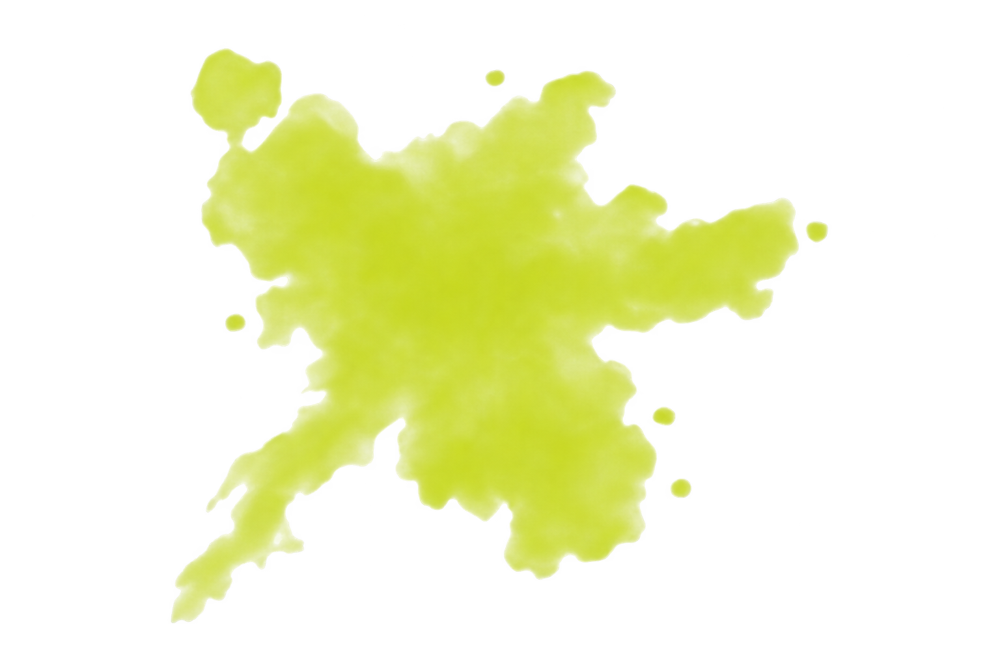

La silhouette asymétrique de {SPIT1 est reconnaissable : lobe supérieur gauche, branche droite et longue pointe inférieure gauche. Le générateur lisse et épaissit certaines zones, ajoute une texture nuageuse et un bord clair : ce n’est pas une reproduction pixel pour pixel. Les compositions blanc/noir montrent un decal détaché sans rectangle opaque; les très faibles pixels alpha autour de la forme ne doivent pas être confondus avec le RGB caché. Étude du dépôt persistant uniquement; spray de contact et chronologie exclus. Marque persistante de contact uniquement. Aucune chronologie inspectée ne permet de classer ce composant dans impact_start ou impact_end; le fichier compte pour la famille mais pour aucun état contractuel.

### Orbe Displacer

`proj_displacer_orb_opfor_body_resource_study_l` · Half-Life: Opposing Force · 1254 × 1254 · RGBA

État / plan : `body`. Candidat non certifié, non intégré par ce lot.

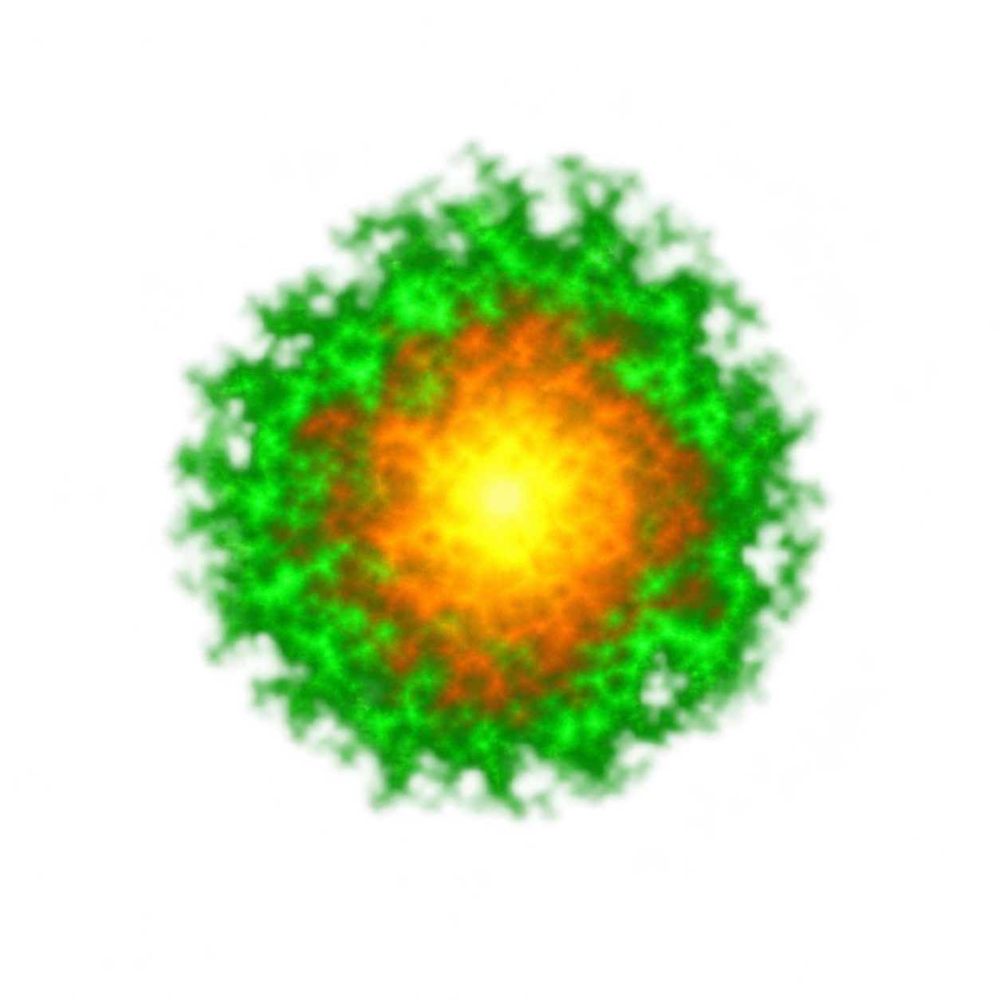

Centre jaune pâle, zone orange et couronne verte irrégulière retrouvés. La granulation et la forme des lobes sont réinterprétées; la couronne est plus texturée que la petite frame inspectée. Transparence réelle lisible sur blanc/noir, sans fond noir conservé. Quelques pixels alpha très faibles atteignent les bords du canvas, tandis que la silhouette utile garde des marges. Étude du seul composant exit1 provenant d’Uplink, associé au Displacer par une implémentation communautaire; aucun rayon lgtning, anneau disp_ring, rendu retail OP4 ou correspondance binaire certifiée. Étude du composant de corps exit1, associée à body; aucune complétion de l’état, displacement, rayon ou anneau de contact.

### Projection Gene Worm

`proj_gene_worm_spit_opfor_cloud_resource_study_l` · Half-Life: Opposing Force · 1254 × 1254 · RGBA

État / plan : `body`. Candidat non certifié, non intégré par ce lot.

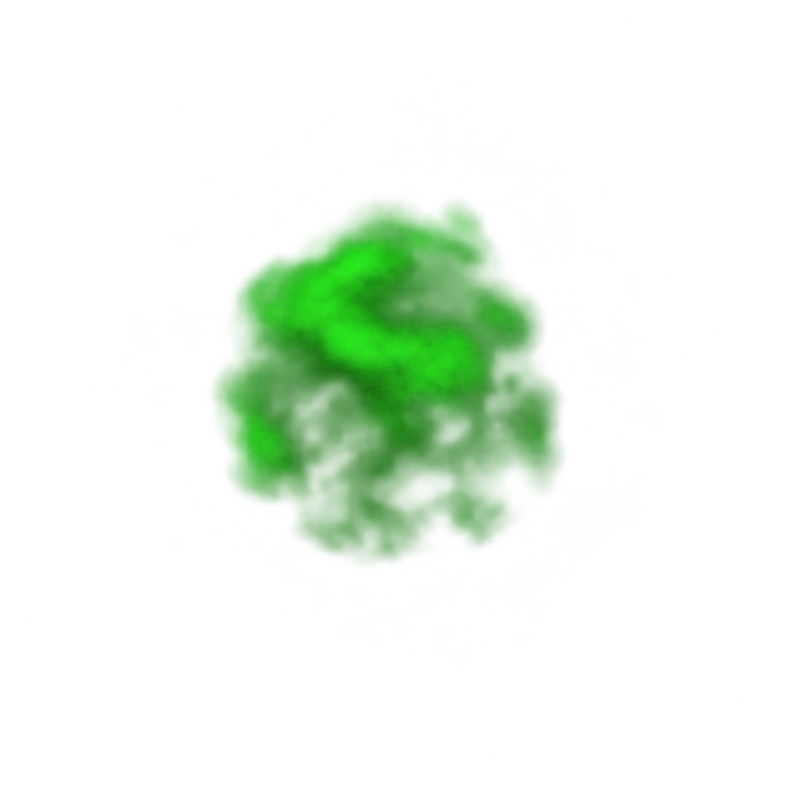

Petit nuage vert diffus, partie supérieure plus lumineuse et ouvertures dans la partie basse; la disposition générale suit la frame ballsmoke inspectée, avec des volumes et des détails réinterprétés. Sur blanc/noir, les lobes restent translucides et aucun rectangle noir n’est conservé. Très faibles résidus alpha hors de la silhouette utile. Étude d’un seul composant ballsmoke d’Uplink auquel la teinte verte de l’implémentation communautaire OP4 est appliquée; le trajet, l’échelle, la durée et le rendu retail exact restent à vérifier. Étude du composant de corps ballsmoke, associée à body; aucune complétion de l’état ni impact.

### Grenade secondaire MP5

`proj_mp5_grenade_hl1_body_l` · Half-Life (1998) · 1774 × 887 · RGBA

État / plan : `body`. Candidat non certifié, non intégré par ce lot.

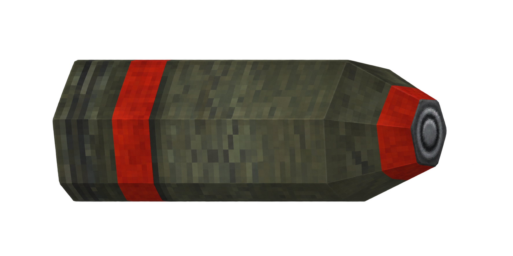

Géométrie facettée, bandes rouges, corps olive-gris et capuchon concentrique correspondent à la vue calculée du modèle Uplink. Le rendu agrandit/réinterprète la texture et le relief du capuchon; les proportions semblent légèrement allongées par la perspective. Détourage lisible sur blanc/noir, marges amples autour de la silhouette utile; très faibles résidus alpha hors silhouette. Candidate d’étude Uplink : aucune identité binaire retail ni fidélité 1:1 déclarée.

## Effets Source / Alyx

### Flash de bouche du pistolet HL2 — capture retail 2008

`fx_pistol_fire_hl2_muzzle_l` · Half-Life 2 · 1536 × 1024 · RGBA

État / plan : `muzzle`. Candidat non certifié, non intégré par ce lot.

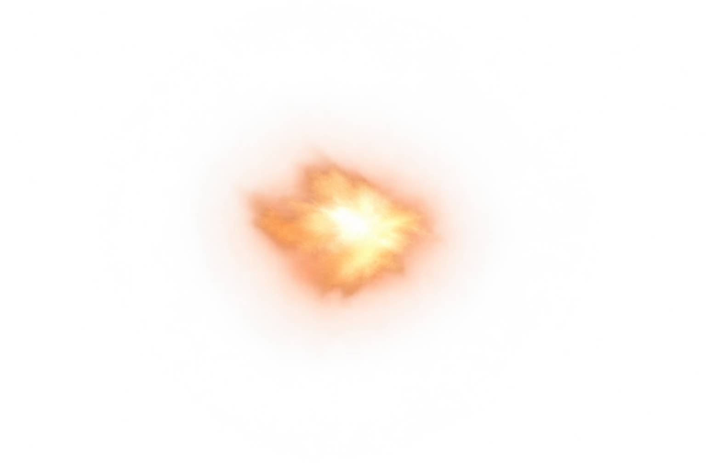

État muzzle uniquement; résolution de référence faible, reconstruction haute définition non certifiée.

### Arc environnemental du Reviver libre — cage d’ascenseur HLA

`fx_reviver_discharge_hla_discharge_l` · Half-Life: Alyx · 1199 × 1312 · RGBA

État / plan : `discharge`. Candidat non certifié, non intégré par ce lot.

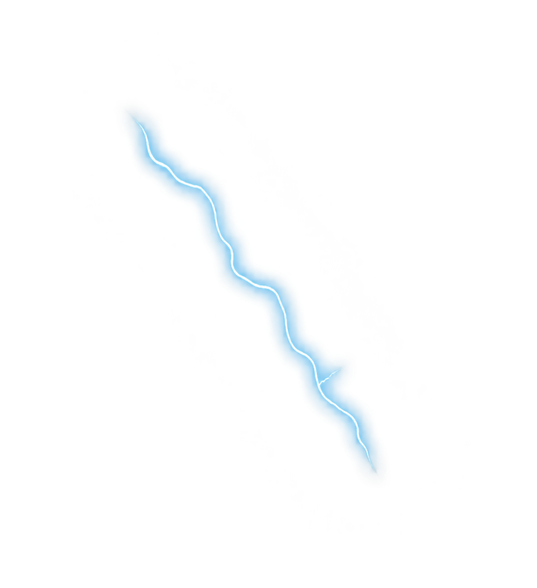

État discharge du contrat; portée strictement environnementale. Aucune autre étape n’est couverte.

## Archives documentées

### Air Exchange — concept du réacteur, publication Raising the Bar 2004

`archive_air_exchange_hl2_concept_rtb2004_master_l` · Half-Life 2 — développement · 1672 × 941 · RGB

Candidat non certifié, non intégré par ce lot.

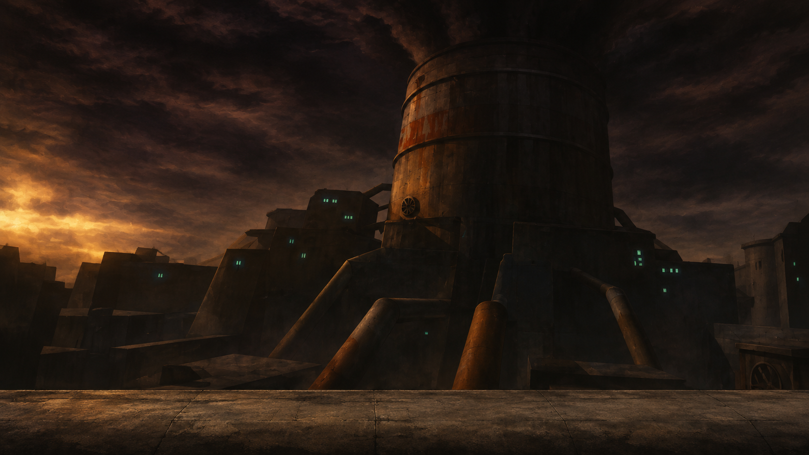

Un panorama opaque : réacteur cylindrique dominant, contreforts, bâtiments bas sombres, petites lumières cyan et ciel ocre à gauche. Aucun personnage, HUD ou texte. Sol continu, mais sa ligne supérieure se situe vers 85,7 % de la hauteur, plus bas que les 79 % demandés. Le rendu accentue la lumière orange, la netteté des plaques et certains volumes; le sol en dalles est une adaptation explicitement ajoutée. Silhouette globale lisible, pas de fidélité 1:1 ni de géométrie jouable validée.

### Arctique Episode Three — concept navire et glacier

`archive_arctic_ep3_concept05_master_l` · Half-Life 2: Episode Three — prototype · 1672 × 941 · RGB

Candidat non certifié, non intégré par ce lot.

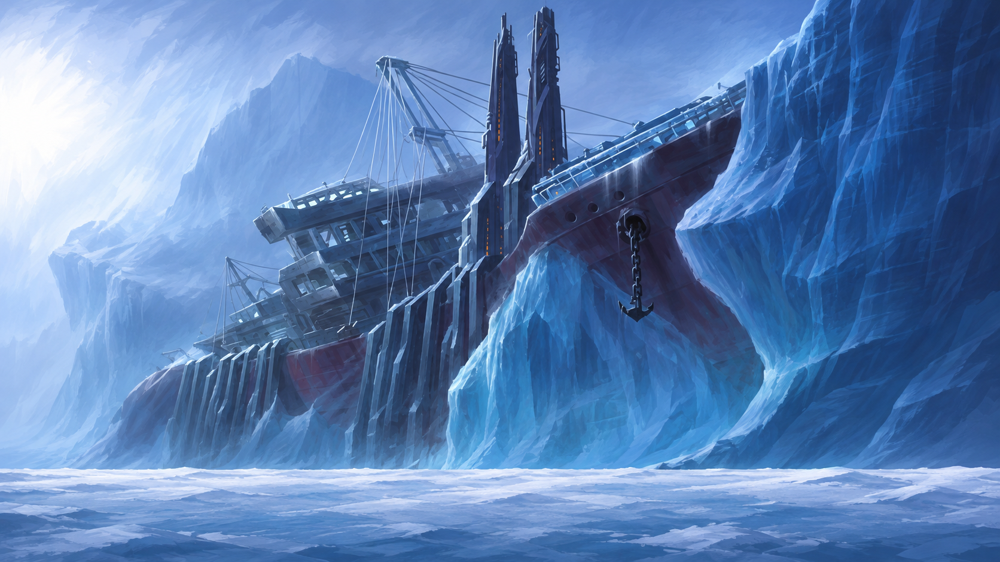

Navire sombre oblique, superstructure à gauche, parois de glace bleue à droite et montants verticaux conservés. Panorama opaque sans personnage, HUD ni signature. L’avant-plan est une bande de neige continue; sa ligne supérieure est vers 83,5 % de la hauteur, plus bas que les 79 % demandés. La perspective, les câbles, les détails de coque et la glace sont réinterprétés; le sol dégagé est une adaptation de composition.

### Blob Episode Three — étude de volume translucide

`archive_blob_ep3_envelope_pose_l` · Half-Life 2: Episode Three — prototype · 1448 × 1086 · RGBA

Candidat non certifié, non intégré par ce lot.

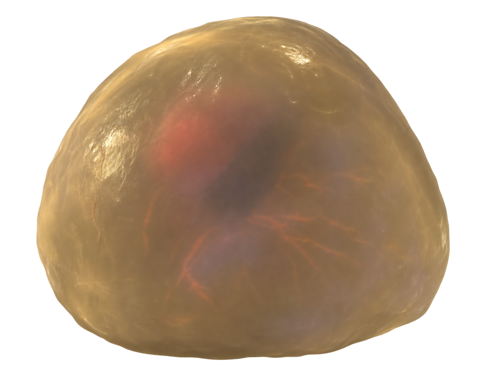

Une masse arrondie ambrée, sans yeux, visage, membre ou accessoire; structures rouges et sombres diffuses à l’intérieur. Fond transparent confirmé et deux compositions inspectées. Le volume reste pratiquement opaque : alpha médian du corps 253/255 et alpha central 253, contre la translucidité démontrée par les cadres source. L’aspect translucide peint ne constitue pas une reproduction de la réfraction ou de la transparence. La base et les courbes sont réinterprétées; petite marge inférieure.

### Ice Gun Episode Three — masse de glace observée

`archive_icegun_ep3_ice_mass_l` · Half-Life 2: Episode Three — prototype · 1774 × 887 · RGBA

État / plan : `ice_mass`. Candidat non certifié, non intégré par ce lot.

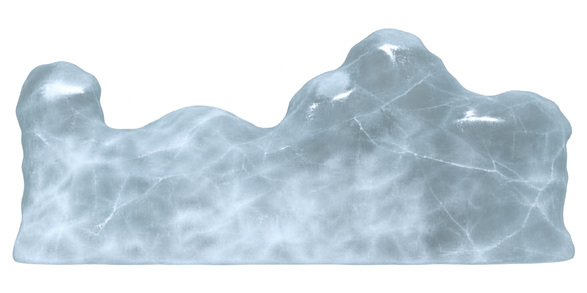

Une seule masse de glace bleu pâle avec sommets arrondis irréguliers, gel blanc, fissures et base plate. Pas de fusil inventé, rayon, soldat, décor ou HUD. Alpha extérieur réel confirmé sur noir/blanc, mais corps presque opaque : alpha médian 253/255 et central 252. Relief plus lisse et composition en obstacle frontal que les formations perspectives des captures; cette adaptation ne fixe pas collision ou création temporelle.

## Couches de l’usine Portal 2

### Portal 2 — usine à tourelles, Chaîne et bras en arrière-plan L4

`layer_portal2_turret_factory_assembly_line_l` · Portal 2 · 2172 × 724 · RGBA

État / plan : `L4`. Candidat non certifié, non intégré par ce lot.

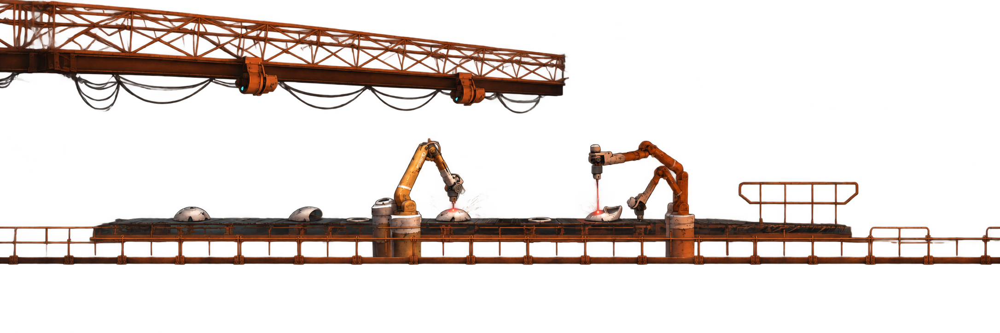

Portique, bras, chaîne, coques et garde-corps isolés sur alpha réel. Les grands motifs restent lisibles, mais géométrie, éclairage et étincelles diffèrent du maître. Le bord inférieur atteint y=577; raccord au sol non homologué. Le petit escalier et les détails du puits droit du maître sont absents. Les repères lumineux bleus/cyan à droite disparaissent également; le vide bleu plus grand change la lecture de profondeur.

### Portal 2 — usine à tourelles, Atmosphère du puits L1

`layer_portal2_turret_factory_atmosphere_l` · Portal 2 · 2172 × 724 · RGB

État / plan : `L1`. Candidat non certifié, non intégré par ce lot.

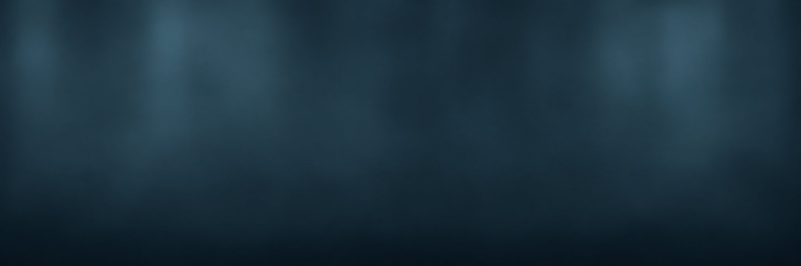

Champ atmosphérique opaque bleu gris au canevas 2172 × 724, sans structure visible. Les valeurs et volumes de brume sont recomposés, non extraits pixel par pixel du maître.

### Portal 2 — usine à tourelles, Charpentes et passerelles lointaines L2

`layer_portal2_turret_factory_distant_trusses_l` · Portal 2 · 2172 × 724 · RGBA

État / plan : `L2`. Candidat non certifié, non intégré par ce lot.

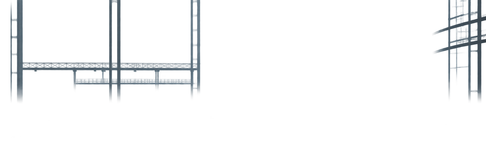

Treillis et passerelles isolés sur alpha réel. Extrémités basses adoucies; structure lointaine simplifiée et plus claire que dans le maître. Le puits mécanique, l’escalier et les détails lumineux à droite du maître ne sont pas reconstruits par ce plan. Les repères lumineux bleus/cyan à droite disparaissent également; le vide bleu plus grand change la lecture de profondeur.

### Portal 2 — usine à tourelles, Bordure de premier plan L6

`layer_portal2_turret_factory_foreground_edge_l` · Portal 2 · 2172 × 724 · RGBA

État / plan : `L6`. Candidat non certifié, non intégré par ce lot.

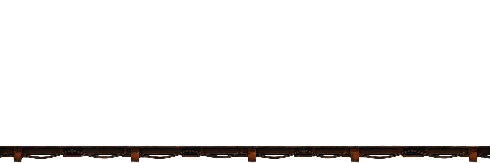

Bordure étroite, équerres et câbles au bas du canevas, haut transparent. L’alpha significatif commence à y=645. Le sol historique L5 contient déjà façade et câbles : superposition nominale possible, mais ces objets seraient dédoublés avec des facteurs de parallaxe différents. Séparation L5/L6 à corriger avant intégration.

### Portal 2 — usine à tourelles, Parois industrielles L3

`layer_portal2_turret_factory_industrial_walls_l` · Portal 2 · 2172 × 724 · RGBA

État / plan : `L3`. Candidat non certifié, non intégré par ce lot.

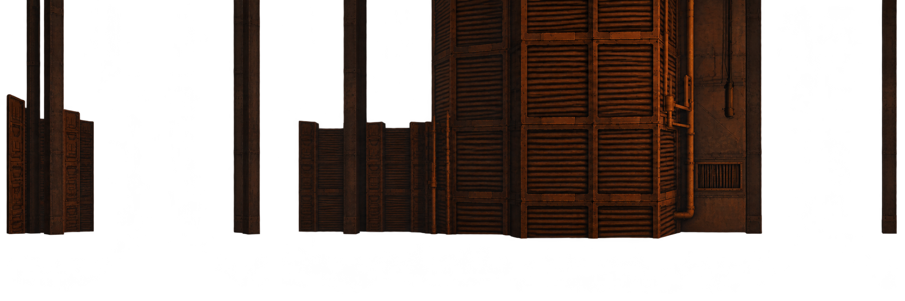

Panneaux nervurés et piliers isolés sur alpha réel; ouvertures conservées. Les occlusions des bras sont complétées générativement, avec segmentation et valeurs réinterprétées. Bord inférieur visible jusqu’à y=575, recouvert partiellement par le sol historique qui commence vers y=566.
