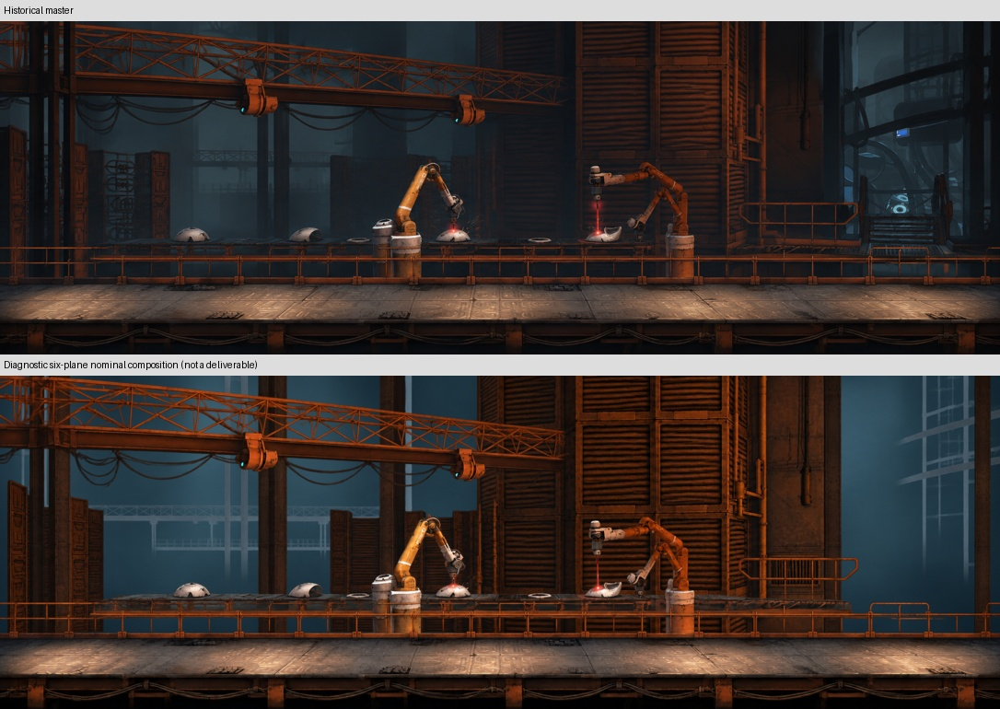
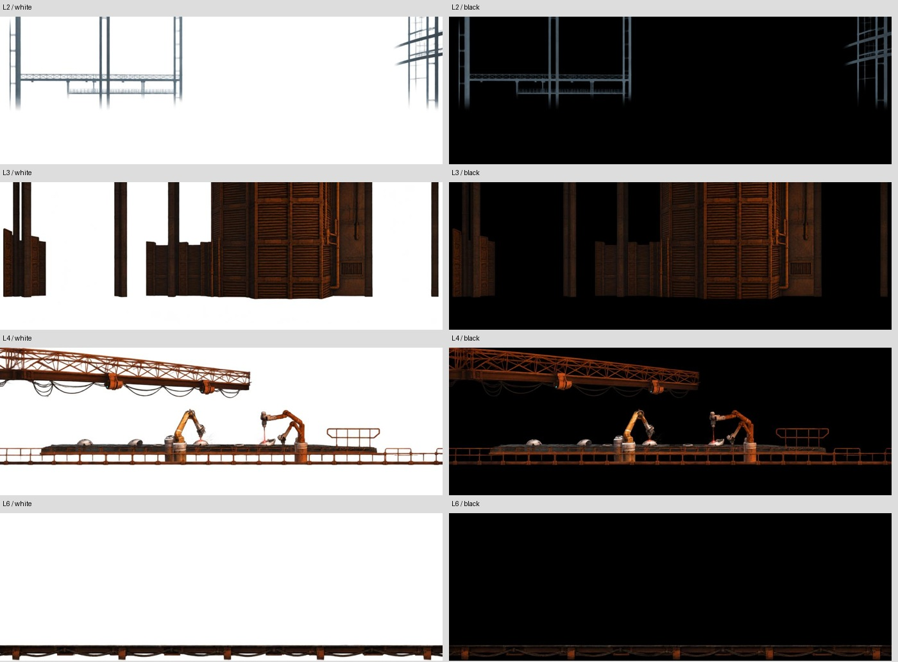

# Couches de l’usine à tourelles — revue du lot L

Cinq fichiers PNG originaux, un plan par image, tous au canevas **2172 × 724** du maître existant. Les deux JPG de ce dossier sont des diagnostics de composition, pas de nouveaux assets de production ni des sorties supplémentaires du générateur.

## Références inspectées

- Maître candidat du lot C : `stage_portal2_turret_factory_master_c`, SHA256 `002de2836d1c3ad7b0ce35f59a6bc4f9c1443504bb48098b48a6f5fcf3d6512d`. Cible d’édition pour la caméra et la composition.
- Sol historique L5 : `layer_portal2_turret_factory_floor_c`, SHA256 `4ac08390bd7ab534f32a561f8bf9ac92febe0e8fbb45c8c632cfb4fe56aad55a`. Conservé intact.
- [Capture officielle Valve / Steam de Portal 2](https://shared.akamai.steamstatic.com/store_item_assets/steam/apps/620/ss_0e16bceacb6616a5ca4bc4ba4d28c7a0d06b671c.1920x1080.jpg?t=1790187113), 1920 × 1080, SHA256 `557a184ce2292a2b3821c48ac0090d9e7573c16b229cca86dab8e99dfac16ba1`. Référence de matériaux et d’identité; sa perspective ne devient pas la caméra de l’arène.

Le maître était déjà une adaptation latérale de captures officielles. Une séparation générative de ce maître ne rend pas sa topologie canonique et ne garantit pas l’identité de ses pixels.

## Plans et constats

| Plan | Facteur documenté | Contrôle |
|---|---:|---|
| L1 — usine à tourelles, Atmosphère du puits L1 | 0 | Champ atmosphérique opaque bleu gris au canevas 2172 × 724, sans structure visible. Les valeurs et volumes de brume sont recomposés, non extraits pixel par pixel du maître. |
| L2 — usine à tourelles, Charpentes et passerelles lointaines L2 | 0.12 | Treillis et passerelles isolés sur alpha réel. Extrémités basses adoucies; structure lointaine simplifiée et plus claire que dans le maître. Le puits mécanique, l’escalier et les détails lumineux à droite du maître ne sont pas reconstruits par ce plan. |
| L3 — usine à tourelles, Parois industrielles L3 | 0.3 | Panneaux nervurés et piliers isolés sur alpha réel; ouvertures conservées. Les occlusions des bras sont complétées générativement, avec segmentation et valeurs réinterprétées. Bord inférieur visible jusqu’à y=575, recouvert partiellement par le sol historique qui commence vers y=566. |
| L4 — usine à tourelles, Chaîne et bras en arrière-plan L4 | 0.55 | Portique, bras, chaîne, coques et garde-corps isolés sur alpha réel. Les grands motifs restent lisibles, mais géométrie, éclairage et étincelles diffèrent du maître. Le bord inférieur atteint y=577; raccord au sol non homologué. Le petit escalier et les détails du puits droit du maître sont absents. |
| L6 — usine à tourelles, Bordure de premier plan L6 | 1.1 | Bordure étroite, équerres et câbles au bas du canevas, haut transparent. L’alpha significatif commence à y=645. Le sol historique L5 contient déjà façade et câbles : superposition nominale possible, mais ces objets seraient dédoublés avec des facteurs de parallaxe différents. Séparation L5/L6 à corriger avant intégration. |

## Composition nominale

La superposition à décalage nul conserve la voie de combat et les grands blocs de composition. Les treillis deviennent plus schématiques; les nuances et la division des panneaux diffèrent. Le puits droit et son escalier perdent des détails identifiants. Les équerres et câbles sont présents à la fois dans le L5 historique et le L6 : cet ensemble ne doit pas être activé en parallaxe avant correction.

## Transparence

L1 est opaque. L2, L3, L4 et L6 ont un canal alpha et des pixels réellement transparents. Les composites clairs/sombres sont propres à cette échelle et ne reproduisent pas le bruit rouge ou gris affiché par les pixels RGB quasi transparents. Les empreintes, dimensions, boîtes alpha et comptes de pixels figurent dans [le registre partiel](layer_generation.json). Les originaux n’ont subi aucune retouche ni réencodage.

**Les six identifiants L1–L6 disposent désormais d’un candidat, mais aucun stage à six couches n’est déclaré terminé.** Aucun test de mouvement de caméra, raccord de bord, collision ou intégration runtime n’est revendiqué. Le premier lot L conserve une dette explicite de séparation et d’harmonisation.

## Relecture indépendante

Une seconde inspection du maître, des plans et des diagnostics confirme les observations précédentes. La disparition de l’escalier et des petits repères lumineux bleus/cyan à droite laisse un grand vide bleu qui modifie la profondeur. Les largeurs des panneaux, les jonctions de piliers et le détail du portique sont également réinterprétés. La voie de combat reste lisible à décalage nul. Cette relecture ne certifie ni la fidélité des pixels ni le mouvement de caméra.
