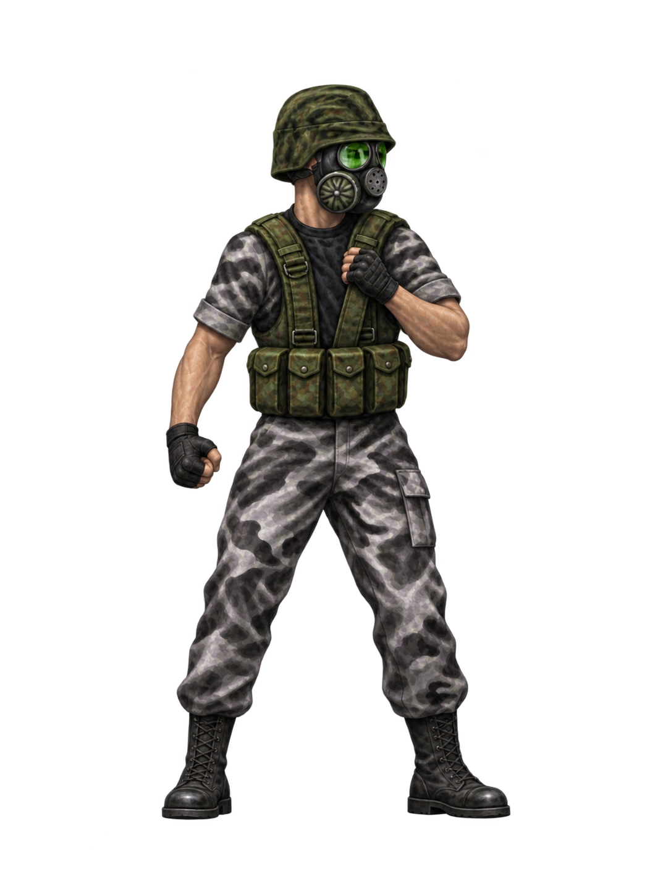
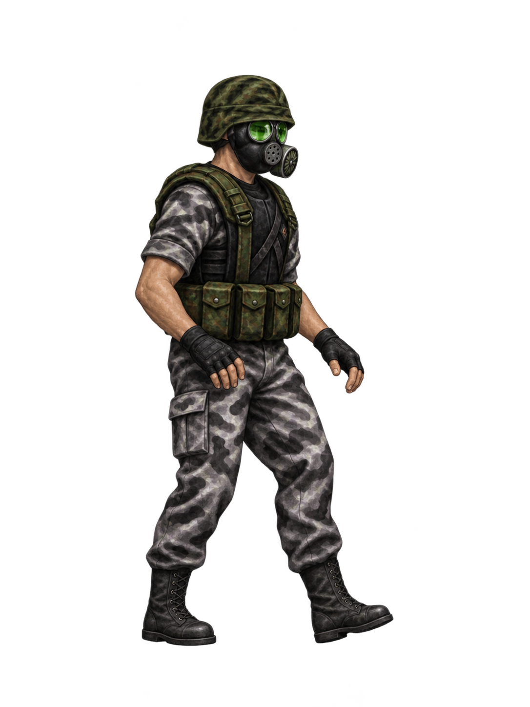
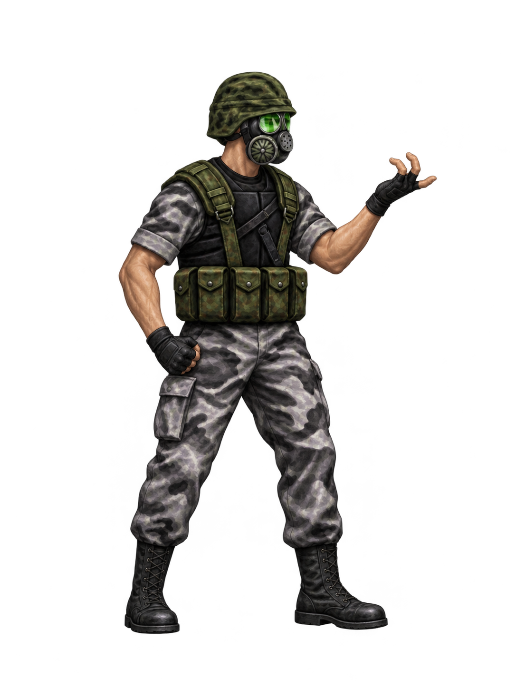
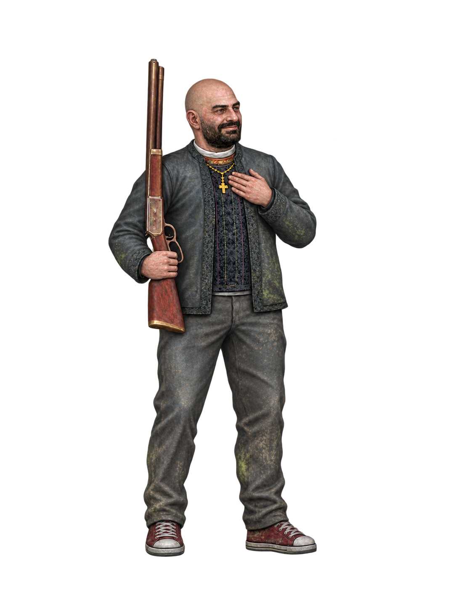
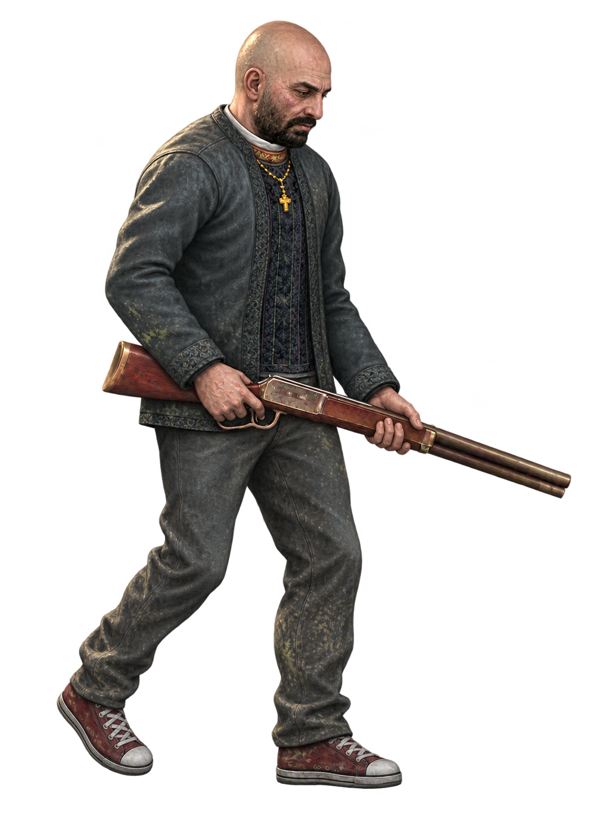
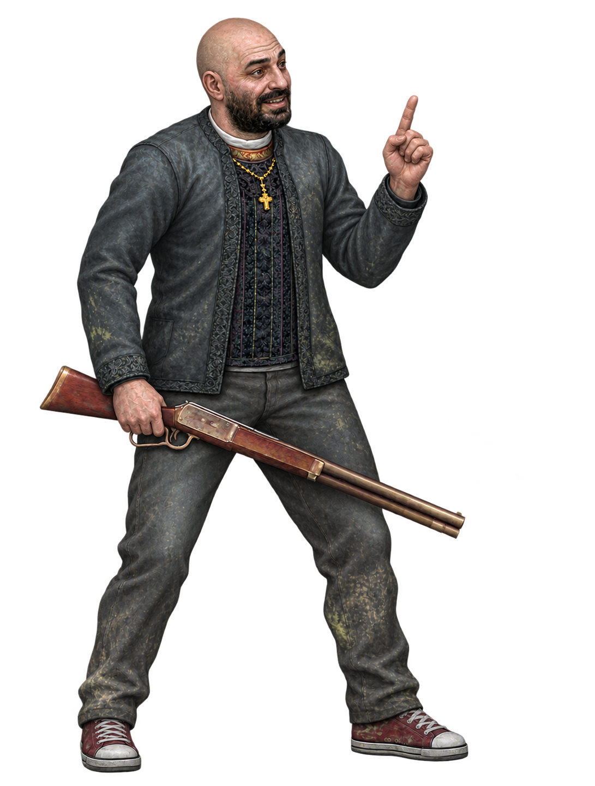
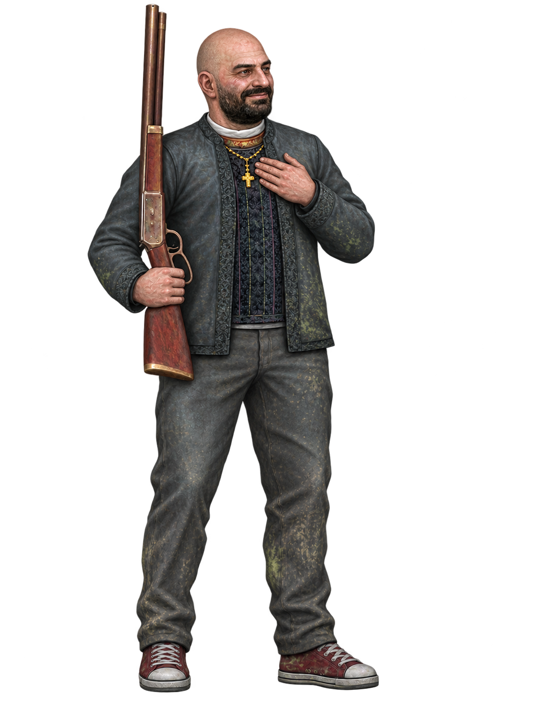

# Galerie du lot N — sept PNG individuels

Six poses candidates sont retenues pour la prochaine revue. Le premier cadrage de Grigori est conservé séparément. Ces images ne sont pas des animations complètes et n'ont pas de certification 1:1. Les références, consignes et empreintes figurent dans [le registre](generation_register.json).

## Shephard — confirmation de sélection

## Shephard — désélection

## Shephard — taunt silencieux

## Grigori — confirmation, cadrage v2 retenu

## Grigori — désélection

## Grigori — taunt d'admonestation

## Grigori — premier cadrage conservé, non retenu

La marge supérieure était trop faible. Le fichier original reste disponible pour tracer la correction, mais la prochaine revue utilise la v2 ci-dessus.

