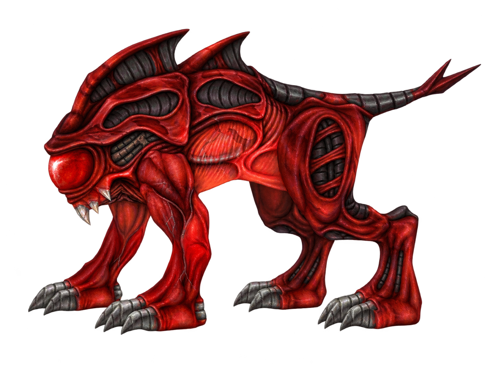
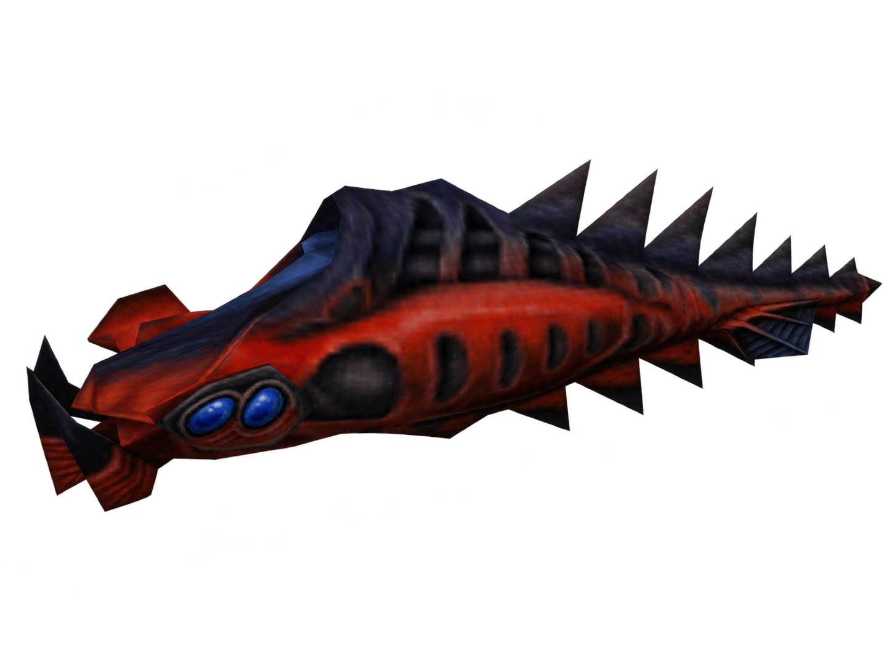
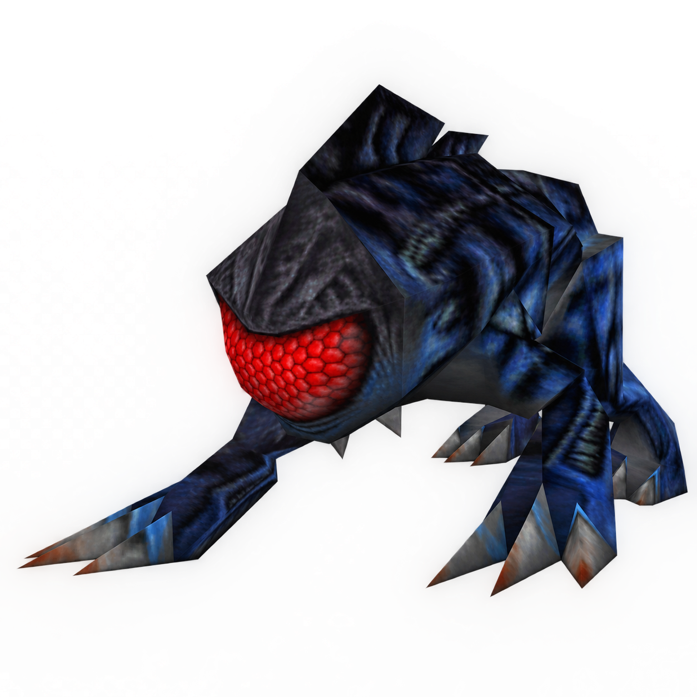
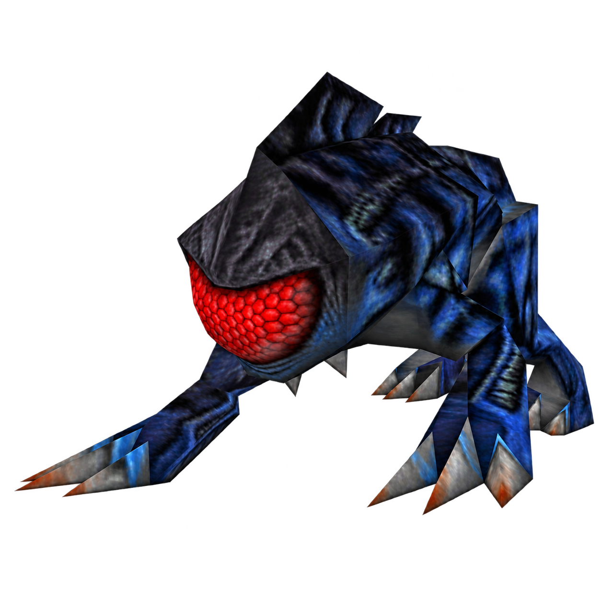
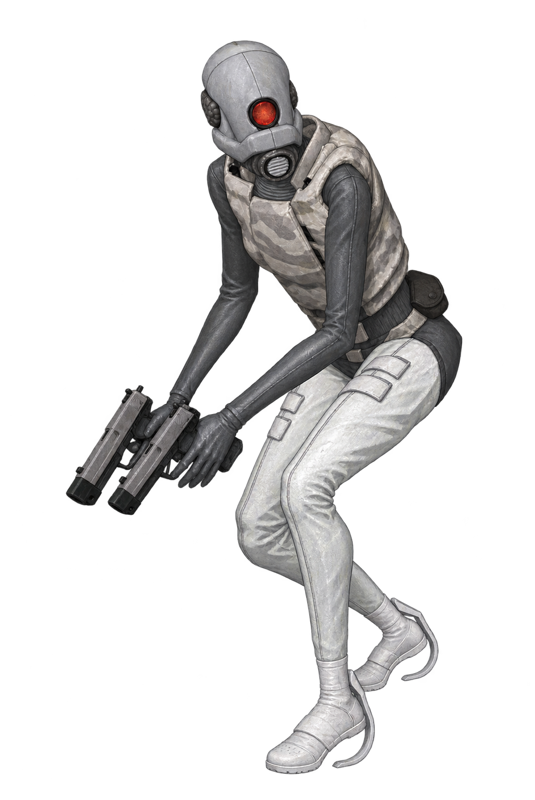
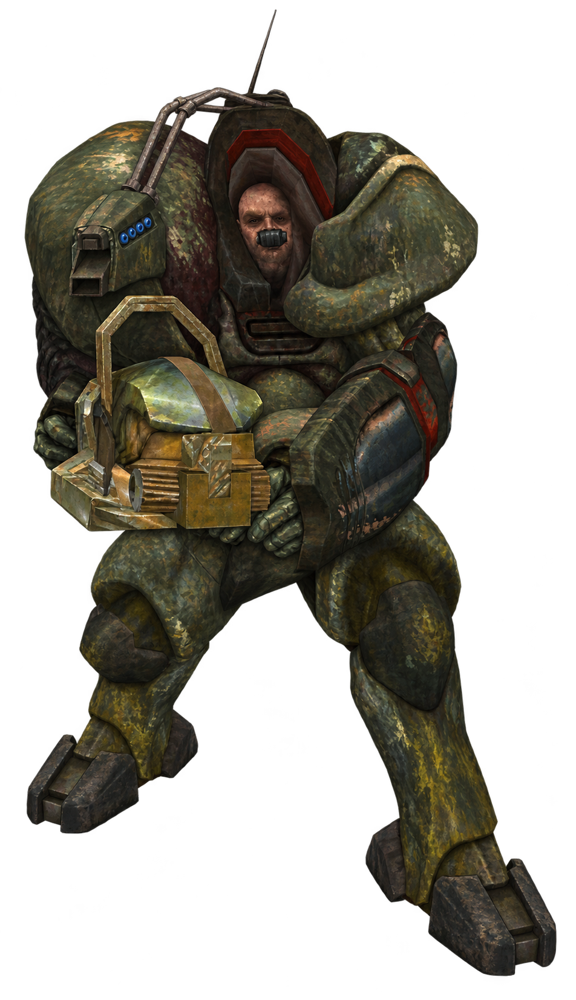
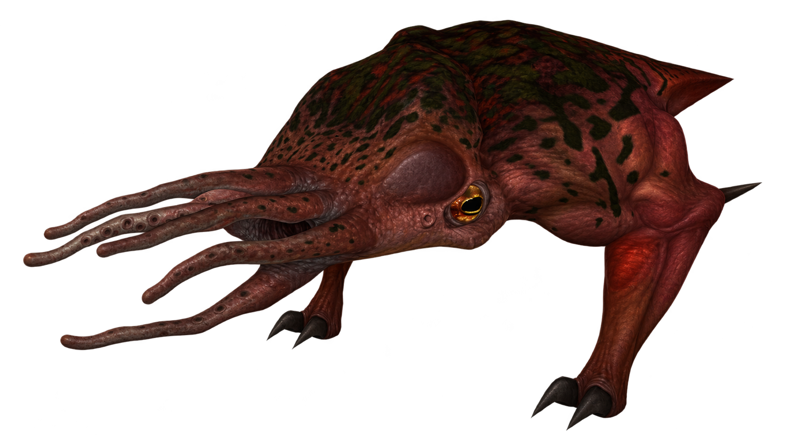
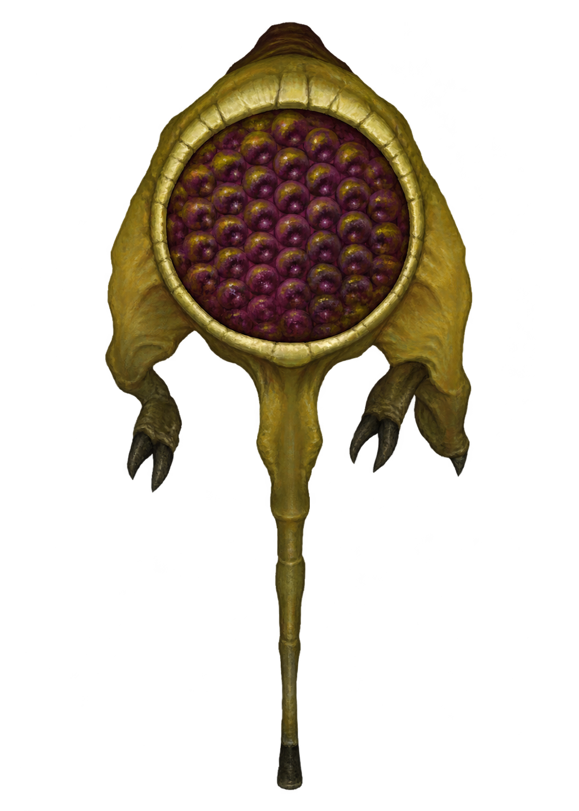
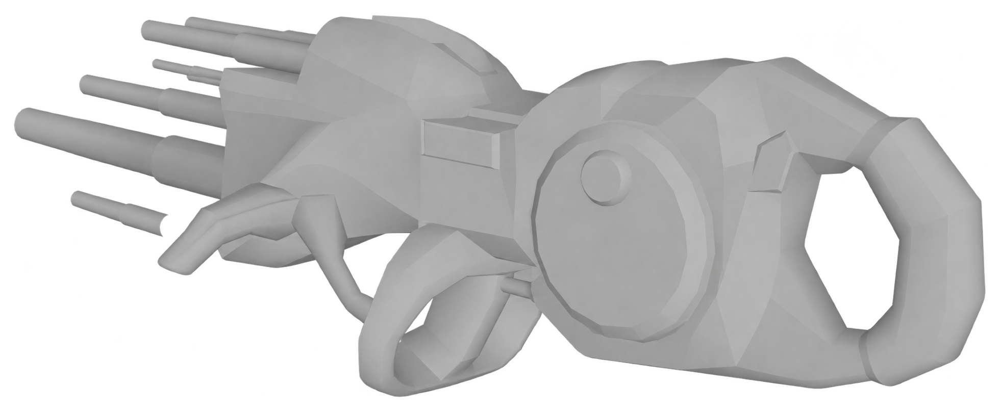

# Galerie — contenu coupé, lot P

9 PNG originaux conservés, huit candidats retenus pour revue. Un sujet par image. Les refus de Stukabat et du Sniper Rifle sont tracés sans fichier. Aucune image ne constitue un kit animé complet ni une certification 1:1.

[Rapport](README.md) · [Registre et prompts](generation_register.json) · [File dédiée](CUT_CONTENT_QUEUE.md)

| Cible | PNG | Décision |
| --- | --- | --- |
| Panther Eye — révision rouge de Chuck Jones | [archive_panther_eye_hl1_red_diablo_idle_p.png](../../../../assets/resonance/candidates/continuation_20261127_p/hl1/archive_panther_eye_hl1_red_diablo_idle_p.png) | Candidat retenu |
| Archer — créature aquatique | [archive_archer_hl1_legacy_swim_p.png](../../../../assets/resonance/candidates/continuation_20261127_p/hl1/archive_archer_hl1_legacy_swim_p.png) | Candidat retenu |
| Panther Eye — révision alpha bleue | [archive_panther_eye_hl1_alpha_blue_pose_p.png](../../../../assets/resonance/candidates/continuation_20261127_p/hl1/archive_panther_eye_hl1_alpha_blue_pose_p.png) | Première version conservée, non retenue |
| Panther Eye — révision alpha bleue | [archive_panther_eye_hl1_alpha_blue_pose_v2_p.png](../../../../assets/resonance/candidates/continuation_20261127_p/hl1/archive_panther_eye_hl1_alpha_blue_pose_v2_p.png) | Candidat retenu |
| Stukabat — créature volante | Aucun | Refus du générateur, sans sortie |
| Combine Assassin — modèle féminin | [archive_combine_assassin_hl2_guard_p.png](../../../../assets/resonance/candidates/continuation_20261127_p/hl2/archive_combine_assassin_hl2_guard_p.png) | Candidat retenu |
| Combine Guard — Synth | [archive_combine_guard_synth_hl2_guard_p.png](../../../../assets/resonance/candidates/continuation_20261127_p/hl2/archive_combine_guard_synth_hl2_guard_p.png) | Candidat retenu |
| Bullsquid — incarnation HL2 abandonnée | [archive_bullsquid_hl2_cut_idle_p.png](../../../../assets/resonance/candidates/continuation_20261127_p/hl2/archive_bullsquid_hl2_cut_idle_p.png) | Candidat retenu |
| Houndeye — incarnation HL2 abandonnée | [archive_houndeye_hl2_cut_front_p.png](../../../../assets/resonance/candidates/continuation_20261127_p/hl2/archive_houndeye_hl2_cut_front_p.png) | Candidat retenu |
| Fusil de précision jouable | Aucun | Refus du générateur, sans sortie |
| Combine Guard Gun | [archive_combine_guard_gun_hl2_untextured_p.png](../../../../assets/resonance/candidates/continuation_20261127_p/weapons/archive_combine_guard_gun_hl2_untextured_p.png) | Candidat retenu |

## Panther Eye — révision rouge de Chuck Jones — archive_panther_eye_hl1_red_diablo_idle_p

1448 × 1086 px · RGBA · retenu pour revue.

Référence et limites dans le registre.

## Archer — créature aquatique — archive_archer_hl1_legacy_swim_p

1448 × 1086 px · RGBA · retenu pour revue.

Référence et limites dans le registre.

## Panther Eye — révision alpha bleue — archive_panther_eye_hl1_alpha_blue_pose_p

1254 × 1254 px · RGBA · version écartée conservée.

Référence et limites dans le registre.

## Panther Eye — révision alpha bleue — archive_panther_eye_hl1_alpha_blue_pose_v2_p

1254 × 1254 px · RGBA · retenu pour revue.

Référence et limites dans le registre.

## Combine Assassin — modèle féminin — archive_combine_assassin_hl2_guard_p

1026 × 1532 px · RGBA · retenu pour revue.

Vue trois-quarts et garde de la référence; proportions fines, manches, mains, géométrie des pistolets et ressorts de talons à comparer. Aucune animation officielle déduite.

## Combine Guard — Synth — archive_combine_guard_synth_hl2_guard_p

952 × 1652 px · RGBA · retenu pour revue.

Silhouette et palette du modèle Synth conservées; interpolation des traits humains, des mains et de la texture. Vue de référence, pas profil latéral validé. Ne pas confondre le canon porté ici avec le modèle séparé non texturé.

## Bullsquid — incarnation HL2 abandonnée — archive_bullsquid_hl2_cut_idle_p

1668 × 943 px · RGBA · retenu pour revue.

Révision HL2 sombre rouille/noir, indépendante du Bullsquid HL1. Tentacules, griffes, yeux et surface réinterprétés en 2D à contrôler au modèle.

## Houndeye — incarnation HL2 abandonnée — archive_houndeye_hl2_cut_front_p

1060 × 1484 px · RGBA · retenu pour revue.

Étude frontale fondée sur un petit aperçu original. Détail des facettes interpolé; trois pattes conservées. Ne couvre pas profil combat, dos ou attaque sonique.

## Combine Guard Gun — archive_combine_guard_gun_hl2_untextured_p

1960 × 802 px · RGBA · retenu pour revue.

Étude du worldmodel non texturé, conservé gris; pas de texture ou couleur finale inventée. Modèle distinct du canon coloré porté dans la capture de Combine Guard Synth.
